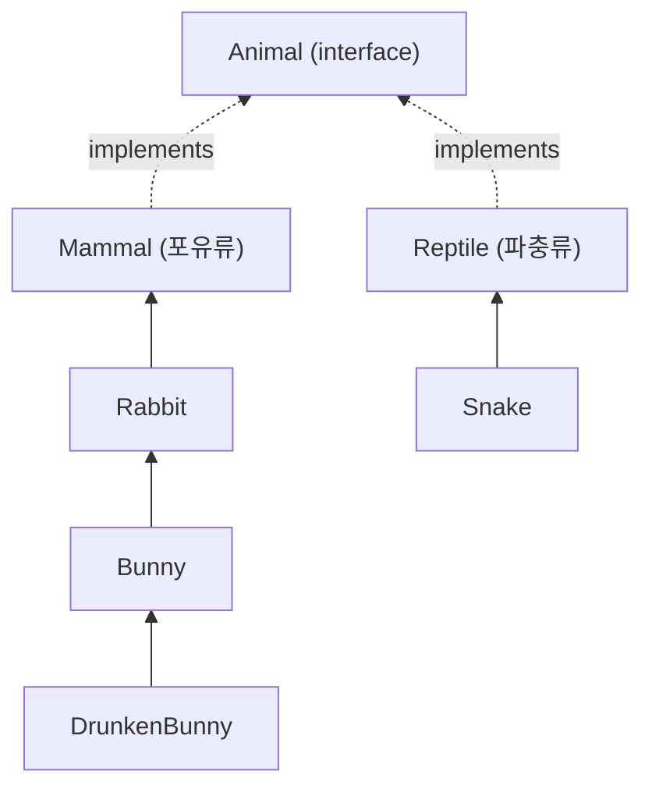
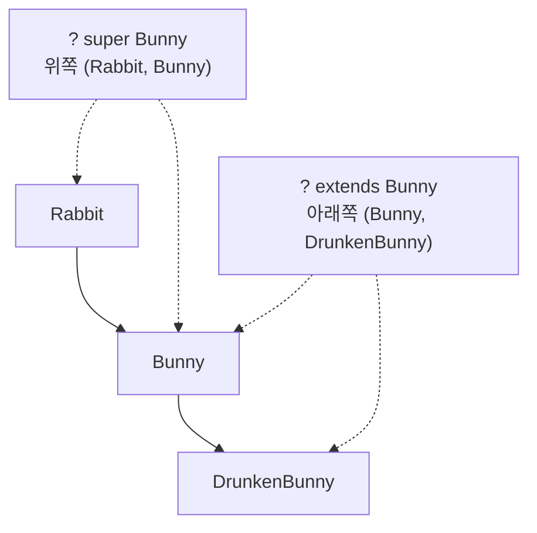
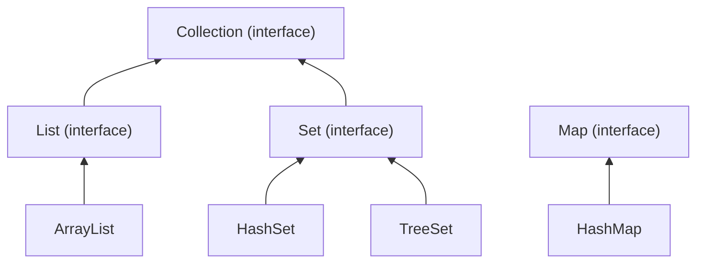
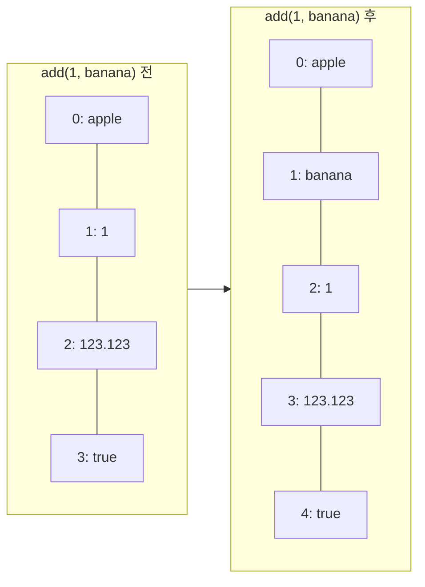
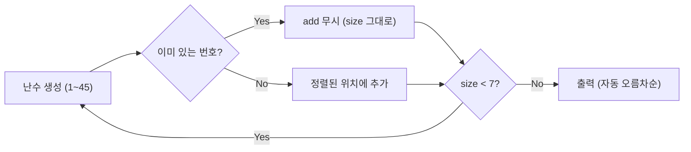
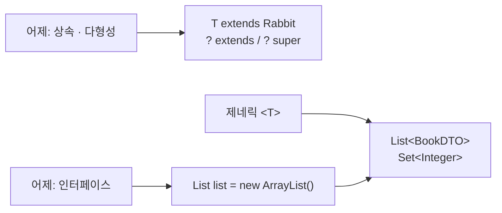

## 들어가며 (Situation)

[어제(10/6) 수업]({{ site.baseurl }})에서는 상속과 다형성을 배웠다. 오늘은 chap04로 넘어가 **제네릭(Generic)**과 **컬렉션(Collection)**을 배웠다. 상속 관계(`Rabbit` → `Bunny` → `DrunkenBunny`)가 제네릭의 타입 제한에 그대로 쓰여서, 어제 내용을 알아야 이해되는 수업이었다.

| 패키지 | 주제 |
|--------|------|
| `a_generic.a_basic` | 제네릭 클래스 선언, 타입 변수 `T`, Wrapper 클래스 |
| `a_generic.b_use` | 타입 제한(`T extends Rabbit`), 와일드카드(`?`, `extends`, `super`) |
| `b_collection.a_list` | `List` / `ArrayList`, DTO, `Collections.sort`, 향상된 for 문 |
| `b_collection.b_set` | `Set` / `HashSet`, `TreeSet`으로 만든 로또 추첨기 |

## 문제 상황 (Task)

지금까지 배운 방식으로 데이터를 담으면 두 가지 문제가 있다.

1. **타입을 확인할 수 없다.** 어떤 타입이든 담을 수 있는 클래스를 만들면, 문자열이 들어가야 할 곳에 숫자가 들어가도 컴파일러가 막아주지 않는다.
2. **배열은 크기가 고정이다.** 중간에 값을 끼워 넣거나 빼려면 직접 배열을 새로 만들고 값을 옮겨야 한다.

제네릭은 1번을, 컬렉션은 2번을 해결한다. 그리고 컬렉션은 제네릭과 함께 써야 제대로 쓸 수 있다.

## 해결 과정 (Action)

### 1. 제네릭 — 타입을 "나중에" 정한다

제네릭은 **클래스나 메소드에서 쓸 타입을 선언할 때가 아니라 사용할 때 정하는 방법**이다. 클래스 이름 뒤에 `<T>`를 붙이면 `T`가 타입 변수가 된다.

```java
public class GenericTest<T> {

    private T value;

    public T getValue() { return value; }

    public void setValue(T value) { this.value = value; }
}
```

`T`는 관례상 쓰는 이름이다. Oracle 튜토리얼에서는 보통 다음과 같이 쓴다고 정리한다.

| 이름 | 의미 |
|------|------|
| `T` | Type |
| `E` | Element (컬렉션에서 사용) |
| `K` / `V` | Key / Value (Map에서 사용) |
| `N` | Number |

사용하는 쪽에서 `<>` 안에 타입을 넣으면 `T`가 그 타입으로 정해진다.

```java
GenericTest<String> gt2 = new GenericTest<>();
gt2.setValue("문자열");
// gt2.setValue(1);   // 컴파일 에러 — String만 넣을 수 있다
```

오른쪽의 `new GenericTest<>()`처럼 타입을 비워 두는 `<>`를 **다이아몬드 연산자**라고 한다. 왼쪽에 이미 `<String>`이 있으니 컴파일러가 타입을 알아서 추론한다.

#### 타입을 안 정하면? — Raw Type

수업 첫 예제는 `<>` 없이 객체를 만들었다.

```java
GenericTest gt = new GenericTest();
gt.setValue(1);
gt.setValue("안녕하세요");   // 둘 다 들어간다
```

이렇게 타입 인자 없이 쓰는 것을 **Raw Type**이라고 한다. 이 경우 `T`는 사실상 `Object`처럼 동작해서 아무 값이나 들어간다. 컴파일은 되지만 경고(unchecked)가 뜨고, 제네릭을 쓰는 의미가 없어진다. Oracle 튜토리얼도 Raw Type은 쓰지 말라고 안내한다.

| 구분 | `GenericTest gt` (Raw Type) | `GenericTest<String> gt2` |
|------|----------------------------|---------------------------|
| 넣을 수 있는 값 | 아무거나 | `String`만 |
| 타입 검사 시점 | 없음 (실행 중 문제 발생 가능) | **컴파일 시점** |
| 꺼낼 때 | 형변환 필요 | 형변환 불필요 |

#### `<int>`는 안 된다 — Wrapper 클래스

```java
// GenericTest<int> gt3 = new GenericTest<int>();   // 컴파일 에러
GenericTest<Integer> gt3 = new GenericTest<>();
gt3.setValue(1);   // int 1이 Integer로 자동 변환된다
```

`<>` 안에는 **참조 자료형만** 들어갈 수 있다. 그래서 기본 자료형은 객체로 감싼 **Wrapper 클래스**를 쓴다. 수업 주석에는 일부만 있어서 8개를 모두 정리했다.

| 기본 자료형 | Wrapper 클래스 |
|------------|----------------|
| `byte` | `Byte` |
| `short` | `Short` |
| `int` | **`Integer`** |
| `long` | `Long` |
| `float` | `Float` |
| `double` | `Double` |
| `char` | **`Character`** |
| `boolean` | `Boolean` |

`int`와 `char`만 이름이 다르고 나머지는 첫 글자만 대문자다. `gt3.setValue(1)`처럼 `int`를 넣어도 되는 이유는 컴파일러가 `Integer`로 자동 변환해 주기 때문이다. 이것을 **오토박싱(Autoboxing)**이라고 한다. 반대로 `Integer`를 `int`로 바꾸는 것은 언박싱이다.

### 2. 타입 제한 — `T extends Rabbit`

`T`에 아무 타입이나 들어가면 곤란할 때가 있다. 수업에서는 토끼 농장 예제를 썼다. 먼저 클래스 관계는 다음과 같다.



토끼 농장에 뱀이 들어오면 안 된다. 그래서 `T`에 **상한**을 건다.

```java
public class RabbitFarm<T extends Rabbit> {

    private T animal;

    public RabbitFarm() {}
    public RabbitFarm(T animal) { this.animal = animal; }

    public T getAnimal() { return animal; }
    public void setAnimal(T animal) { this.animal = animal; }
}
```

`<T extends Rabbit>`은 **`Rabbit`이거나 `Rabbit`을 상속받은 클래스만** `T`가 될 수 있다는 뜻이다.

```java
// RabbitFarm<Mammal> farm1 = new RabbitFarm<>();   // 에러 — Mammal은 Rabbit의 부모
RabbitFarm<Rabbit> farm1 = new RabbitFarm<>();
RabbitFarm<Bunny> farm2 = new RabbitFarm<>();
RabbitFarm<DrunkenBunny> farm3 = new RabbitFarm<>();
```

`Bunny` 농장(`farm2`)에 무엇을 넣을 수 있는지도 확인했다.

```java
// farm2.setAnimal(new Rabbit());   // 에러 — Rabbit은 Bunny의 부모

DrunkenBunny drunkenBunny = new DrunkenBunny();
farm2.setAnimal(drunkenBunny);       // OK — DrunkenBunny는 Bunny의 자식
farm2.getAnimal().cry();             // "ㅂㅂ바니아니이 당근...근당근"
```

`farm2`의 타입은 `RabbitFarm<Bunny>`인데 `DrunkenBunny`의 `cry()`가 호출된다. 어제 배운 **다형성과 동적 바인딩**이 제네릭 안에서도 그대로 동작하는 것이다.

`T extends Rabbit`에는 장점이 하나 더 있다. 컴파일러가 `T`는 최소한 `Rabbit`이라는 것을 알기 때문에 `getAnimal().cry()`처럼 **`Rabbit`의 메소드를 바로 호출할 수 있다.** 제한이 없는 `<T>`였다면 `T`는 `Object`로만 취급되어 `cry()`를 호출할 수 없다.

### 3. 와일드카드 — 매개변수에서 받을 타입을 제한한다

타입 제한(`T extends`)은 **클래스를 선언할 때** 쓴다. 와일드카드 `?`는 이미 만들어진 제네릭 타입을 **메소드의 매개변수로 받을 때** 범위를 정한다.

```java
public class WildcardFarm {

    public void anyType(RabbitFarm<?> farm) {               // 제한 없음
        farm.getAnimal().cry();
    }
    public void extendsType(RabbitFarm<? extends Bunny> farm) {  // 상한 제한
        farm.getAnimal().cry();
    }
    public void superType(RabbitFarm<? super Bunny> farm) {      // 하한 제한
        farm.getAnimal().cry();
    }
}
```

| 와일드카드 | 의미 | `Rabbit` 농장 | `Bunny` 농장 | `DrunkenBunny` 농장 |
|-----------|------|:---:|:---:|:---:|
| `<?>` | 아무거나 | O | O | O |
| `<? extends Bunny>` | `Bunny`와 **그 자식** | X | O | O |
| `<? super Bunny>` | `Bunny`와 **그 부모** | O | O | X |

```java
wildcardFarm.extendsType(new RabbitFarm<Bunny>(new Bunny()));
wildcardFarm.extendsType(new RabbitFarm<DrunkenBunny>(new DrunkenBunny()));
// wildcardFarm.extendsType(new RabbitFarm<Rabbit>(new Rabbit()));          // 에러

wildcardFarm.superType(new RabbitFarm<Rabbit>(new Rabbit()));
wildcardFarm.superType(new RabbitFarm<Bunny>(new Bunny()));
// wildcardFarm.superType(new RabbitFarm<DrunkenBunny>(new DrunkenBunny())); // 에러
```



처음에는 `<? super Bunny>`의 `farm.getAnimal().cry()`가 왜 컴파일되는지 헷갈렸다. `? super Bunny`만 보면 `Object`가 들어올 수도 있을 것 같기 때문이다. 하지만 `RabbitFarm` 자체가 `<T extends Rabbit>`으로 선언되어 있어서, 어떤 와일드카드를 쓰든 꺼낸 값은 **최소한 `Rabbit`**이다. 그래서 `cry()`를 호출할 수 있다. 클래스의 타입 제한과 와일드카드 제한이 **함께** 적용된다.

### 4. 컬렉션 — 크기가 늘어나는 자료구조

컬렉션은 여러 데이터를 담는 자료구조를 **인터페이스와 구현 클래스로 표준화**한 것이다. 수업에서 정리한 세 가지는 다음과 같다.

| 인터페이스 | 순서 | 중복 | 대표 구현체 |
|-----------|:---:|:---:|-------------|
| `List` | 있음 | 허용 | `ArrayList`, `LinkedList` |
| `Set` | 없음 | 불허 | `HashSet`, `TreeSet` |
| `Map` | 없음 | key 불허, value 허용 | `HashMap`, `TreeMap` |



`Map`은 `Collection`을 상속하지 않는다. key와 value가 한 쌍이라 구조가 다르기 때문이다. 다만 Java Collections Framework에는 함께 포함된다. 오늘 수업에서는 `List`와 `Set`까지 실습했다.

### 5. List / ArrayList — 순서가 있고 중복을 허용한다

```java
List list = new ArrayList();
```

왼쪽이 `List`, 오른쪽이 `ArrayList`인 이유는 어제 배운 인터페이스 때문이다. `List`는 인터페이스라 `new`로 만들 수 없고, `List`를 구현한 `ArrayList`로 객체를 만든다. 변수 타입을 인터페이스로 두면 나중에 `LinkedList`로 바꿔도 다른 코드를 고칠 필요가 없다.

배열과 달리 중간에 값을 넣고 빼도 **나머지 요소가 알아서 자리를 옮긴다.**

```java
list.add("apple");
list.add(1);
list.add(123.123);
list.add(true);
// [apple, 1, 123.123, true]

list.add(1, "banana");   // 1번 위치에 끼워 넣기
// [apple, banana, 1, 123.123, true]

list.remove(2);          // 2번 위치 삭제
// [apple, banana, 123.123, true]
```



| 메소드 | 하는 일 |
|--------|---------|
| `add(값)` | 맨 뒤에 추가 |
| `add(인덱스, 값)` | 해당 위치에 끼워 넣고 뒤 요소를 한 칸씩 민다 |
| `get(인덱스)` | 해당 위치의 값 조회 |
| `remove(인덱스)` | 해당 위치의 값 삭제 후 뒤 요소를 당긴다 |
| `size()` | 요소 개수 (배열의 `length`에 해당) |

그런데 위 `list`는 문자열, 정수, 실수, boolean이 **한 리스트에 섞여 있다.** 1번에서 본 Raw Type 문제가 컬렉션에서도 그대로 생긴다. 그래서 컬렉션은 항상 제네릭과 함께 쓴다.

```java
List<String> strings = new ArrayList<>();
strings.add("a");
strings.add("c");
strings.add("b");
strings.add("d");

Collections.sort(strings);   // [a, b, c, d]
```

`Collections.sort()`는 `String`처럼 크기 비교 기준이 정해진 타입이면 바로 정렬해 준다.

### 6. DTO와 함께 쓰는 ArrayList

실습 과제는 "책 5권을 하나의 변수에 저장하고 가격 오름차순으로 정렬하기"였다. 책 한 권의 데이터를 담을 클래스로 **DTO(Data Transfer Object)**를 만들었다.

DTO는 기능보다 **데이터 운반**이 목적인 클래스다. 수업에서 정리한 DTO의 구성은 다음과 같다.

1. `private` 필드
2. 기본 생성자
3. 모든 필드를 초기화하는 생성자
4. getter
5. setter
6. `toString()`

```java
public class BookDTO {
    private int no;
    private String title;
    private String author;
    private int price;

    public BookDTO() {}
    public BookDTO(int no, String title, String author, int price) { /* ... */ }

    // getter / setter 생략

    @Override
    public String toString() {
        return "BookDTO{no=" + no + ", title='" + title + "', author='" + author + "', price=" + price + "}";
    }
}
```

`toString()`을 오버라이딩하지 않으면 객체를 출력할 때 `BookDTO@1b6d3586` 같은 값이 나온다. 오버라이딩해 두면 `System.out.println(bookList)`만으로 리스트 안의 책 정보가 모두 출력된다.

```java
List<BookDTO> bookList = new ArrayList<>();
bookList.add(new BookDTO(1, "홍길동", "허균", 50000));
bookList.add(new BookDTO(2, "목민심서", "정약용", 45000));
bookList.add(new BookDTO(3, "삼국지", "유비", 30000));
bookList.add(new BookDTO(4, "마법천자문", "손오공", 20000));
bookList.add(new BookDTO(5, "삼국유사", "일연", 58000));
```

#### 시행착오: 반복문이 한 번만 돈다

리스트를 하나씩 출력하려고 작성한 코드에서 **책이 1권만 출력되었다.**

```java
for (int i = 0; i < bookList.size(); i++);{   // ← 세미콜론!
    int i = 0;
    System.out.println((i + 1) + "번째 책 : " + bookList.get(i));
}
```

원인은 `for (...)` 뒤의 **세미콜론 `;`** 이다. Java는 `;`를 빈 문장으로 본다. 그래서 반복문은 아무 일도 하지 않고 5번 돈 뒤 끝나고, 그 아래 `{ }` 블록은 **반복문과 상관없는 일반 블록**으로 딱 한 번 실행된다.

더 헷갈리는 점은 블록 안의 `int i = 0;`이다. 반복문의 `i`는 세미콜론에서 이미 범위가 끝났기 때문에, 블록 안에서 `i`를 새로 선언해도 에러가 나지 않는다. 결과적으로 컴파일 에러 없이 `1번째 책`만 출력된다. 올바른 코드는 다음과 같다.

```java
for (int i = 0; i < bookList.size(); i++) {
    System.out.println((i + 1) + "번째 책 : " + bookList.get(i));
}
```

#### 향상된 for 문

인덱스가 필요 없다면 **향상된 for 문**이 더 간단하고, 위 같은 실수도 줄일 수 있다.

```java
// for (요소 하나를 담을 변수 : 컬렉션)
for (BookDTO book : bookList) {
    System.out.println(book.getNo() + "번째 책 : " + book);
}
```

| 구분 | 일반 for 문 | 향상된 for 문 |
|------|-------------|---------------|
| 인덱스 사용 | 가능 | 불가능 |
| 범위 실수 (`<=`, `size()`) | 생길 수 있음 | 없음 |
| 용도 | 위치가 필요할 때, 일부만 돌 때 | 처음부터 끝까지 다 볼 때 |

#### 남은 과제: 가격 오름차순 정렬

과제의 마지막 단계인 "가격 오름차순 정렬"은 수업 코드에서 아직 구현하지 않았다. `Collections.sort(strings)`처럼 바로 정렬할 수 없는 이유는 `BookDTO`에 **무엇을 기준으로 비교할지 정해져 있지 않기 때문**이다. 아래는 정렬 기준을 직접 넘기는 방식의 **예시 코드**다.

```java
// 예시 코드 — 수업에서 다루지 않은 내용
bookList.sort(Comparator.comparingInt(BookDTO::getPrice));
// 마법천자문(20000) → 삼국지(30000) → 목민심서(45000) → 홍길동(50000) → 삼국유사(58000)
```

비교 기준을 정하는 `Comparable`과 `Comparator`는 다음 공부거리로 남겨둔다.

### 7. Set / HashSet — 순서가 없고 중복을 허용하지 않는다

```java
Set<String> hset = new HashSet<>();
hset.add("java");
hset.add("db");
hset.add("servlet");
hset.add("spring");
hset.add("jpa");
hset.add("jpa");   // 중복 — 추가되지 않는다

System.out.println("hset = " + hset);   // 5개만 출력, 순서는 넣은 순서와 다를 수 있다
```

`Set`의 특징은 두 가지다.

1. **저장 순서를 유지하지 않는다.** 출력 순서는 내부 해시 값에 따라 정해진다. 공식 문서도 `HashSet`은 순서를 보장하지 않는다고 명시한다.
2. **중복을 허용하지 않는다.** 같은 값을 다시 `add()`하면 무시되고, `add()`는 `false`를 반환한다.

### 8. TreeSet — 중복 제거 + 자동 정렬 (로또 추첨기)

`TreeSet`도 `Set`이라 중복을 허용하지 않는다. `HashSet`과 다른 점은 **값을 정렬된 상태로 유지한다**는 것이다. 이 두 성질을 이용해 로또 추첨기를 만들었다.

```java
Set<Integer> lotto = new TreeSet<>();

while (lotto.size() < 7) {
    lotto.add((int) (Math.random() * 45) + 1);   // 1 ~ 45
}

System.out.println("lotto= " + lotto);   // 오름차순으로 7개 출력
```



`for`가 아니라 `while (lotto.size() < 7)`을 쓴 것이 핵심이다. 중복 번호가 나오면 `size()`가 늘지 않으므로, **중복 검사 코드를 따로 쓰지 않아도** 서로 다른 번호 7개가 모일 때까지 반복한다. 배열로 만들었다면 새 번호를 뽑을 때마다 기존 번호와 비교하는 이중 반복문과 정렬 코드가 필요했을 것이다.

난수 식도 정리했다.

| 식 | 범위 |
|----|------|
| `Math.random()` | 0.0 이상 1.0 미만 |
| `Math.random() * 45` | 0.0 이상 45.0 미만 |
| `(int)(Math.random() * 45)` | 0 ~ 44 |
| `(int)(Math.random() * 45) + 1` | **1 ~ 45** |

> 수업 주석에는 "TreeSet은 이진 검색 트리 구조라 조회가 매우 빠르다"고 되어 있다. 공식 문서 기준으로 `TreeSet`은 `TreeMap`(레드-블랙 트리) 기반이고, `add`·`remove`·`contains`가 **O(log n)**이다. 반면 `HashSet`은 같은 작업이 평균 **O(1)**이다. 그래서 단순 조회만 보면 `HashSet`이 더 빠르고, `TreeSet`의 강점은 **정렬된 순서를 유지한다는 점**이라고 이해하는 게 정확하다.

| 구분 | `HashSet` | `TreeSet` |
|------|-----------|-----------|
| 중복 | 불허 | 불허 |
| 순서 | 보장 안 함 | **오름차순 정렬** |
| 내부 구조 | 해시 테이블 | 레드-블랙 트리 |
| 추가·삭제·조회 | 평균 O(1) | O(log n) |
| 쓰면 좋은 경우 | 중복 제거만 필요할 때 | 정렬된 상태가 필요할 때 |

## 결과 (Result)

오늘 배운 내용으로 처음의 두 문제가 해결됐다.

| 문제 | Before | After |
|------|--------|-------|
| 타입 안정성 | Raw Type → 아무 값이나 들어감, 실행해 봐야 오류 발견 | `<String>`, `<T extends Rabbit>` → **컴파일 시점에 차단** |
| 크기 고정 | 배열 → 끼워 넣기·삭제를 직접 구현 | `ArrayList` → `add(인덱스, 값)`, `remove()` 한 줄 |
| 중복 제거 + 정렬 | 이중 반복문 + 정렬 코드 필요 | `TreeSet` + `while (size() < 7)` |



**배운 점**

- 제네릭의 타입 제한과 와일드카드는 결국 **상속 관계도의 어느 범위까지 허용하느냐**의 문제다. 클래스 관계도를 먼저 그려 보니 `extends`/`super`가 헷갈리지 않았다.
- `for (...);` 세미콜론 하나 때문에 **컴파일 에러 없이 결과만 틀리는** 버그가 생겼다. 에러가 안 난다고 맞는 코드는 아니다.
- 자료구조를 고를 때는 "무엇을 하고 싶은가"를 먼저 정해야 한다. 순서가 필요하면 `List`, 중복 제거면 `HashSet`, 중복 제거와 정렬이 모두 필요하면 `TreeSet`이다.

## 더 학습하면 좋은 개념

- **Comparable과 Comparator** — `BookDTO`를 가격순으로 정렬하지 못한 이유가 바로 이것이다. 객체의 정렬 기준을 정하는 두 가지 방법이고, `TreeSet`에 직접 만든 객체를 넣을 때도 필요하다.
- **Map과 HashMap** — 오늘 개념만 배운 세 번째 컬렉션이다. key로 value를 찾는 구조라 실무에서 `List`만큼 자주 쓴다.
- **equals()와 hashCode()** — `HashSet`이 "같은 값"을 판단하는 기준이다. 직접 만든 `BookDTO`를 `HashSet`에 넣으면 내용이 같아도 중복 제거가 안 되는데, 이 두 메소드를 오버라이딩해야 해결된다.
- **PECS (Producer Extends, Consumer Super)** — `? extends`와 `? super`를 언제 쓰는지 정리한 원칙이다. 값을 꺼내기만 하면 `extends`, 넣기만 하면 `super`를 쓴다.
- **타입 소거 (Type Erasure)** — 제네릭 타입 정보는 컴파일 후 사라진다. `new T()`를 할 수 없는 이유, `List<int>`가 안 되는 이유와 연결된다.

## 참고 자료

- [Oracle Java Tutorials - Generics](https://docs.oracle.com/javase/tutorial/java/generics/index.html)
- [Oracle Java Tutorials - Generic Types (타입 변수 명명 규칙)](https://docs.oracle.com/javase/tutorial/java/generics/types.html)
- [Oracle Java Tutorials - Raw Types](https://docs.oracle.com/javase/tutorial/java/generics/rawTypes.html)
- [Oracle Java Tutorials - Bounded Type Parameters](https://docs.oracle.com/javase/tutorial/java/generics/bounded.html)
- [Oracle Java Tutorials - Wildcards](https://docs.oracle.com/javase/tutorial/java/generics/wildcards.html)
- [Oracle Java Tutorials - Autoboxing and Unboxing](https://docs.oracle.com/javase/tutorial/java/data/autoboxing.html)
- [Oracle Java Tutorials - Collection Interfaces](https://docs.oracle.com/javase/tutorial/collections/interfaces/index.html)
- [Java SE 21 API - ArrayList](https://docs.oracle.com/en/java/javase/21/docs/api/java.base/java/util/ArrayList.html)
- [Java SE 21 API - HashSet](https://docs.oracle.com/en/java/javase/21/docs/api/java.base/java/util/HashSet.html)
- [Java SE 21 API - TreeSet](https://docs.oracle.com/en/java/javase/21/docs/api/java.base/java/util/TreeSet.html)
