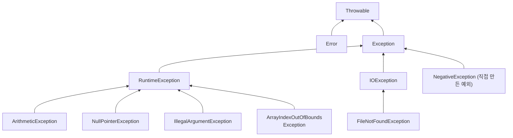
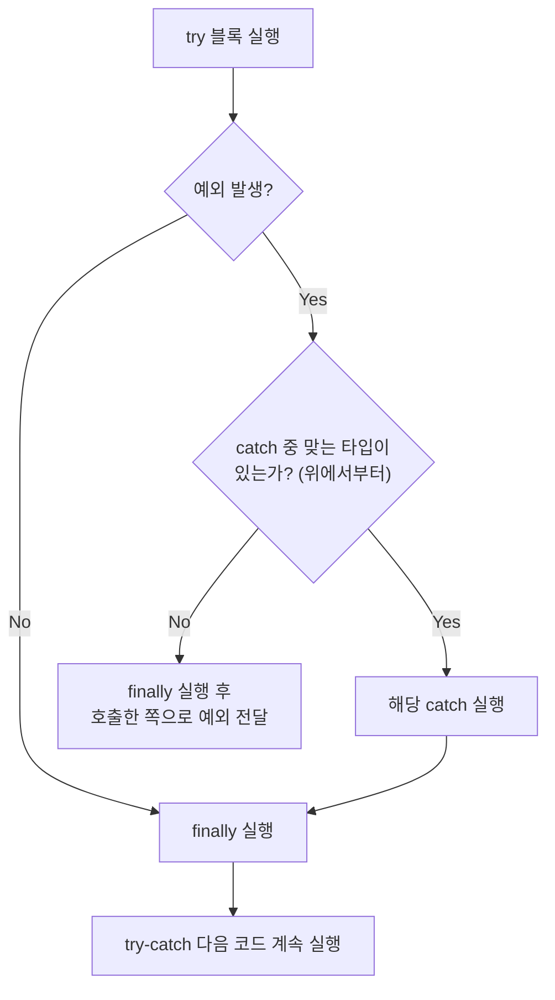
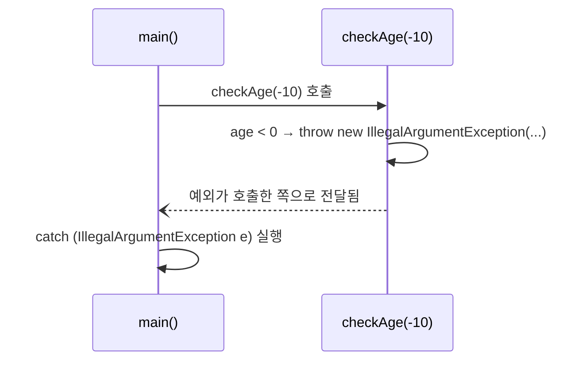
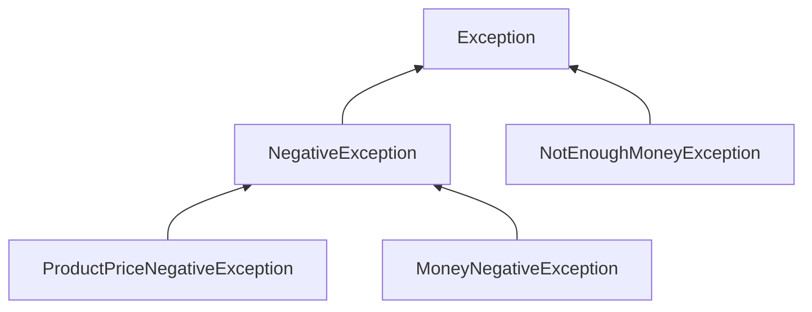
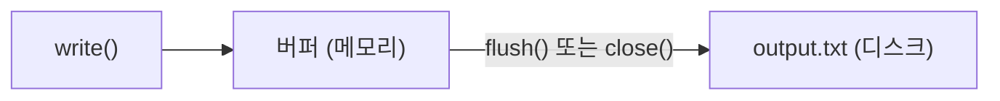
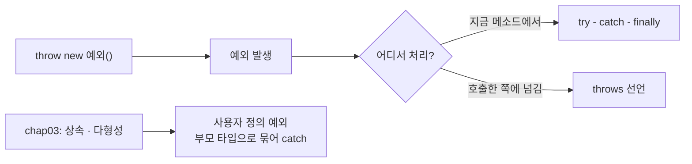

## 들어가며 (Situation)

[어제(10/7) 수업]({{ site.baseurl }})에서는 제네릭과 컬렉션을 배웠다. 오늘은 chap05로 넘어가 **예외 처리(Exception)**와 **파일 입출력(File I/O)**을 배웠다. 파일 입출력 코드는 예외 처리 없이는 컴파일조차 되지 않아서, 두 주제가 자연스럽게 이어지는 수업이었다.

| 패키지 | 주제 |
|--------|------|
| `a_exception.a_basic` | 컴파일 오류와 런타임 오류, 예외로 프로그램이 멈추는 상황 |
| `a_exception.b_sovled` | `try` - `catch` - `finally`, `throw` |
| `a_exception.c_userexception` | 사용자 정의 예외, `throws`로 예외 넘기기 |
| `b_fileio` | `FileWriter`로 쓰기, `FileReader`로 읽기 |

## 문제 상황 (Task)

지금까지 작성한 코드는 **모든 것이 잘 돌아간다는 가정** 위에 있었다. 하지만 실제 프로그램에서는 이런 일이 생긴다.

1. 배열 범위를 벗어난 인덱스에 접근하거나, `null`인 변수의 메소드를 호출한다.
2. 나이에 음수가 들어오거나, 가진 돈보다 비싼 물건을 사려고 한다.
3. 읽으려는 파일이 없거나, 디스크에 쓰다가 문제가 생긴다.

이런 상황을 처리하지 않으면 **프로그램이 그 자리에서 비정상 종료**된다. 오늘 수업의 목표는 문제가 생겨도 프로그램이 멈추지 않도록 처리하고, 우리 프로그램에만 있는 문제는 직접 예외로 만드는 것이었다.

## 해결 과정 (Action)

### 1. 오류의 종류 — 컴파일 오류와 런타임 오류

| 구분 | 발생 시점 | 예시 | 발견하는 쪽 |
|------|----------|------|------------|
| **컴파일 오류** | 코드를 작성·컴파일할 때 | 없는 변수 참조, 타입 불일치 | 컴파일러 (IDE에 빨간 줄) |
| **런타임 오류** | 프로그램을 실행하는 중 | `NullPointerException`, 배열 범위 초과 | 실행해 봐야 알 수 있음 |

컴파일 오류는 실행 전에 고칠 수 있다. 문제는 **문법은 맞지만 실행 중에 터지는** 런타임 오류다. 수업에서는 일부러 예외를 일으켜 봤다.

```java
System.out.println("프로그램 시작...");

int[] iarr = new int[5];                          // 0 ~ 4번 인덱스
System.out.println("6번째 인덱스 출력: " + iarr[6]); // 💥 ArrayIndexOutOfBoundsException

String str = null;
str.length();                                     // 💥 NullPointerException

System.out.println("프로그램 종료...");
```

실행하면 다음과 같이 출력된다.

```text
프로그램 시작...
Exception in thread "main" java.lang.ArrayIndexOutOfBoundsException: Index 6 out of bounds for length 5
```

`프로그램 종료...`는 출력되지 않는다. **첫 번째 예외에서 프로그램이 바로 멈췄기 때문**이다. 그래서 그 아래의 `str.length()`도 실행되지 않는다. 예외 두 개를 다 확인하려면 하나씩 주석 처리하며 실행해야 한다.

### 2. 예외 클래스의 계층 구조

Java에서 예외는 **클래스**다. 예외가 발생한다는 것은 `new ArithmeticException()`처럼 예외 객체가 만들어져 던져진다는 뜻이다. 모든 예외는 `Throwable`을 상속한다.



이 구조에서 가장 중요한 구분은 **`RuntimeException`을 상속하느냐**다.

| 구분 | Checked Exception | Unchecked Exception |
|------|-------------------|---------------------|
| 해당 클래스 | `Exception`의 자식 중 `RuntimeException`이 **아닌** 것 | `RuntimeException`과 그 자식 |
| 예시 | `IOException`, `FileNotFoundException`, 오늘 만든 `NegativeException` | `NullPointerException`, `ArithmeticException`, `IllegalArgumentException` |
| 처리 강제 | **컴파일러가 강제** (`try-catch` 또는 `throws` 없으면 컴파일 에러) | 강제하지 않음 |
| 주된 원인 | 프로그램 바깥 상황 (파일 없음, 네트워크) | 대부분 코드의 실수 (null 체크 누락, 0으로 나누기) |

`Error`는 메모리 부족(`OutOfMemoryError`)처럼 프로그램이 대응하기 어려운 심각한 문제라서 보통 직접 처리하지 않는다. 이 구분은 수업 주석에 직접 나오지는 않지만, 뒤에서 나오는 "왜 파일 입출력은 `try-catch`가 없으면 컴파일이 안 되는가"를 이해하는 데 꼭 필요하다.

### 3. try - catch - finally — 예외를 잡아서 처리하기

```java
try {
    // 예외가 발생할 수 있는 코드
    String str = null;
    str.length();
} catch (ArithmeticException e) {
    System.out.println("예외 메세지 = " + e.getMessage());
    System.out.println("!!!!예외 발생!!!!");
} catch (NullPointerException e) {
    System.out.println("예외 메세지 = " + e.getMessage());
    System.out.println("!!!!예외 발생!!!!");
} finally {
    System.out.println("예외발생 여부와 관계없이 실행됨...");
}
System.out.println("프로그램 종료됨...");
```

| 블록 | 역할 |
|------|------|
| `try` | 예외가 발생할 가능성이 있는 코드 |
| `catch (예외타입 e)` | 해당 타입의 예외가 발생했을 때 실행. 여러 개를 이어 쓸 수 있다 |
| `finally` | 예외 발생 여부와 **관계없이 항상** 실행 |



1번 예제와 달리 이번에는 `프로그램 종료됨...`까지 출력된다. 예외를 **잡았기 때문에** 프로그램이 멈추지 않고 다음 줄로 넘어간다.

`try` 안에서 예외가 발생하면 **그 아래 줄은 실행되지 않고** 바로 `catch`로 넘어간다. 그리고 `catch`는 위에서부터 차례로 타입을 비교해서 처음 맞는 하나만 실행된다. `10 / 0`의 주석을 풀면 `ArithmeticException` 쪽 `catch`가, `str.length()`가 실행되면 `NullPointerException` 쪽 `catch`가 실행된다.

`e.getMessage()`는 예외 객체에 담긴 설명 문자열을 돌려준다. `10 / 0`이라면 `/ by zero`가 출력된다.

#### catch 순서 주의 — 부모 타입을 먼저 쓰면 에러

`catch`는 **위에서부터** 비교한다. 그래서 부모 타입을 위에 두면 아래의 자식 타입 `catch`는 절대 실행될 수 없다. Java는 이를 컴파일 에러로 막는다. 아래는 **예시 코드**다.

```java
// 예시 코드
try {
    // ...
} catch (RuntimeException e) {          // 부모가 먼저 다 잡아버림
} catch (NullPointerException e) {      // 컴파일 에러 — 도달할 수 없는 catch
}
```

자식(구체적인 예외) → 부모(일반적인 예외) 순서로 써야 한다.

### 4. throw — 예외를 직접 발생시키기

예외는 Java가 일으키기만 하는 것이 아니다. 코드상으로는 문제가 없지만 **프로그램의 규칙에 맞지 않을 때** 직접 던질 수 있다. 나이가 음수인 경우가 그렇다.

```java
public static void checkAge(int age) {
    if (age < 0) {
        throw new IllegalArgumentException("나이는 음수일 수 없습니다.");
    }
    System.out.println("전달받은 " + age + "는 유효한 나이입니다");
}
```

```java
try {
    checkAge(-10);
} catch (IllegalArgumentException e) {
    System.out.println("e.getMessage() = " + e.getMessage());
}
// e.getMessage() = 나이는 음수일 수 없습니다.
```



`checkAge()` 안에는 `try-catch`가 없다. 그래서 던져진 예외는 **`checkAge()`를 호출한 `main()`으로 전달**되고, `main()`의 `catch`가 처리한다. 수업 주석의 "호출한 쪽에 예외 처리를 위임한다"는 말이 이 흐름이다.

`throw` 아래 줄(`System.out.println(...)`)은 실행되지 않는다. `return`처럼 메소드가 그 자리에서 끝난다.

> `IllegalArgumentException`은 Unchecked Exception이라 메소드 선언부에 아무것도 쓰지 않아도 된다. 반면 Checked Exception을 던질 때는 다음에 나오는 `throws`를 반드시 써야 한다.

### 5. 사용자 정의 예외 — 우리 프로그램만의 예외 만들기

Java가 제공하는 예외는 `NullPointerException`처럼 **일반적인 상황**만 표현한다. "상품 가격이 음수다", "가진 돈이 부족하다" 같은 우리 프로그램만의 상황은 표현할 수 없다. 그래서 예외 클래스를 직접 만들었다.

#### 만드는 방법: Exception을 상속한다

```java
public class NegativeException extends Exception {

    public NegativeException(String message) {
        super(message);   // 부모(Exception)의 생성자에 메시지 전달
    }
}
```

`super(message)`로 넘긴 메시지가 나중에 `e.getMessage()`로 꺼내진다. 같은 방식으로 예외 4개를 만들었는데, **예외끼리도 상속 관계**를 만들었다.



| 예외 클래스 | 부모 | 발생 상황 |
|------------|------|----------|
| `NegativeException` | `Exception` | 음수 관련 예외의 공통 부모 |
| `ProductPriceNegativeException` | `NegativeException` | 상품 가격이 음수 |
| `MoneyNegativeException` | `NegativeException` | 가진 돈이 음수 |
| `NotEnoughMoneyException` | `Exception` | 가진 돈 < 상품 가격 |

#### throws — 이 메소드는 이런 예외를 던질 수 있다

```java
public void checkMoney(int productPrice, int money)
        throws ProductPriceNegativeException, MoneyNegativeException, NotEnoughMoneyException {

    if (productPrice < 0) {
        throw new ProductPriceNegativeException("상품의 가격은 음수일 수 없습니다!!!");
    }
    if (money < 0) {
        throw new MoneyNegativeException("가진 돈이 음수일 수 없습니다!!");
    }
    if (money < productPrice) {
        throw new NotEnoughMoneyException("가진 돈 보다 상품의 가격이 더 비싸요..");
    }

    System.out.println("가진 돈이 충분합니다. 즐거운 쇼핑하세요 ");
}
```

직접 만든 예외는 `Exception`을 상속했으므로 **Checked Exception**이다. 그래서 메소드 선언부에 `throws`로 "이 메소드를 호출하면 이 예외들이 발생할 수 있다"고 반드시 밝혀야 한다. 빼면 컴파일 에러가 난다.

처음에는 `throw`와 `throws`가 헷갈렸다. 철자는 한 글자 차이지만 역할이 완전히 다르다.

| 구분 | `throw` | `throws` |
|------|---------|----------|
| 위치 | 메소드 **본문 안** | 메소드 **선언부** (매개변수 괄호 뒤) |
| 역할 | 예외를 **실제로 발생**시킨다 | 이 메소드가 던질 수 있는 예외를 **알린다** |
| 뒤에 오는 것 | 예외 **객체** 하나 (`new ...Exception()`) | 예외 **클래스 이름** 여러 개 (쉼표로 구분) |
| 비유 | 공을 던진다 | "이 사람은 공을 던질 수 있음" 안내판 |

#### 호출하는 쪽에서 처리하기

```java
ExceptionTest et = new ExceptionTest();

try {
    et.checkMoney(50000, 30000);
} catch (ProductPriceNegativeException e) {
    System.out.println(e.getMessage());
} catch (MoneyNegativeException e) {
    System.out.println(e.getMessage());
} catch (NotEnoughMoneyException e) {
    System.out.println(e.getMessage());
}
// 출력: 가진 돈 보다 상품의 가격이 더 비싸요..
```

상품 가격 50000원, 가진 돈 30000원이므로 세 번째 `if`에서 `NotEnoughMoneyException`이 발생한다.

| `checkMoney(상품가격, 가진돈)` | 발생하는 예외 | 출력 |
|-------------------------------|--------------|------|
| `(-5000, 30000)` | `ProductPriceNegativeException` | 상품의 가격은 음수일 수 없습니다!!! |
| `(5000, -100)` | `MoneyNegativeException` | 가진 돈이 음수일 수 없습니다!! |
| `(50000, 30000)` | `NotEnoughMoneyException` | 가진 돈 보다 상품의 가격이 더 비싸요.. |
| `(5000, 30000)` | 없음 | 가진 돈이 충분합니다. 즐거운 쇼핑하세요 |

#### 예외에 상속 관계를 만든 이유

`ProductPriceNegativeException`과 `MoneyNegativeException`은 둘 다 `NegativeException`의 자식이다. 그래서 "음수 문제는 한꺼번에 처리하고 싶다"면 부모 타입 하나로 잡을 수 있다. chap03에서 배운 **다형성**이 예외에도 그대로 적용되는 것이다. 아래는 **예시 코드**다.

```java
// 예시 코드 — 부모 타입으로 묶어서 처리
try {
    et.checkMoney(-5000, 30000);
} catch (NegativeException e) {          // 두 음수 예외를 모두 잡음
    System.out.println("음수 오류: " + e.getMessage());
} catch (NotEnoughMoneyException e) {
    System.out.println(e.getMessage());
}
```

### 6. 파일 입출력 — 예외 처리가 필수인 이유

프로그램의 변수는 프로그램이 끝나면 사라진다. 데이터를 남기려면 **파일**에 저장해야 한다.

#### 파일 쓰기 — FileWriter

```java
try {
    FileWriter writer = new FileWriter("output.txt");
    writer.write("hello, File IO!!");
    writer.write("File Test");

    writer.flush();   // 버퍼에 모인 데이터를 디스크로 밀어낸다
} catch (IOException e) {
    throw new RuntimeException(e);
}
```

`new FileWriter(...)`와 `write()`는 `IOException`을 던질 수 있다고 `throws`로 선언되어 있다. `IOException`은 **Checked Exception**이라서 `try-catch`로 감싸지 않으면 **컴파일 에러**가 난다. 수업 주석의 "File IO 관련 클래스들은 예외를 반드시 처리하게 설정되어 있다"는 말이 이것이다. 디스크가 가득 찼거나 쓰기 권한이 없는 것처럼, 코드를 아무리 잘 짜도 막을 수 없는 바깥 상황이 원인이기 때문이다.

실행 후 프로젝트 폴더에 생긴 `output.txt`의 내용은 다음과 같다.

```text
hello, File IO!!File Test
```

두 문장이 **한 줄로 붙어 있다.** `write()`는 넘긴 문자열을 그대로 쓸 뿐 줄바꿈을 넣어 주지 않는다. 줄을 나누려면 `"hello, File IO!!\n"`처럼 직접 `\n`을 넣어야 한다.

#### 버퍼와 flush()



`write()`를 호출할 때마다 디스크에 바로 쓰면 느리다. 그래서 데이터를 **버퍼**라는 메모리 공간에 모아 두었다가 한 번에 내보낸다. `flush()`는 버퍼에 남은 데이터를 강제로 디스크에 쓰는 메소드다. `flush()`를 빼면 데이터가 버퍼에만 머물다가 프로그램이 끝나 **파일이 비어 있을 수 있다.**

#### 파일 읽기 — FileReader

```java
try {
    FileReader reader = new FileReader("output.txt");

    int data;
    while ((data = reader.read()) != -1) {
        System.out.println((char) data);
    }
} catch (FileNotFoundException e) {
    throw new RuntimeException(e);
} catch (IOException e) {
    throw new RuntimeException(e);
}
```

`read()`는 파일에서 **한 문자씩** 읽어서 `int`로 돌려주고, 파일 끝에 도달하면 `-1`을 돌려준다.

| 코드 | 의미 |
|------|------|
| `data = reader.read()` | 한 문자를 읽어 `data`에 저장 |
| `(...) != -1` | 저장한 값이 `-1`(파일 끝)이 아니면 계속 반복 |
| `(char) data` | `int`로 받은 문자 코드를 다시 문자로 형변환 |

반환 타입이 `char`가 아니라 `int`인 이유는 **파일 끝을 나타낼 `-1`이 필요하기 때문**이다. `char`에는 음수를 담을 수 없다. 그래서 받은 값을 출력할 때는 chap01에서 배운 명시적 형변환 `(char)`을 쓴다.

또 `println`을 썼기 때문에 **한 글자마다 줄이 바뀌어** 세로로 출력된다. 한 줄로 보고 싶다면 `print`를 쓰면 된다.

`catch` 순서도 3번에서 본 규칙 그대로다. `FileNotFoundException`은 `IOException`의 자식이라서 **반드시 위에** 와야 한다. 순서를 바꾸면 컴파일 에러가 난다.

#### 시행착오: close()를 하지 않았다

수업 코드는 `writer`와 `reader`를 **닫지 않았다.** 파일은 운영체제의 자원이라서 다 쓰면 `close()`로 돌려줘야 한다. 닫지 않으면 다른 프로그램이 그 파일을 쓰지 못하거나, 열린 파일이 쌓여 자원이 부족해질 수 있다.

`close()`는 예외가 나도 실행되어야 하므로 `finally`에 넣는 게 맞다. 하지만 `close()` 자체도 `IOException`을 던지기 때문에 `finally` 안에 또 `try-catch`가 들어가 코드가 복잡해진다. 그래서 Java 7부터는 **try-with-resources** 문법을 쓴다. 아래는 수업 코드를 바꾼 **예시 코드**다.

```java
// 예시 코드 — try 괄호 안에서 만든 자원은 블록이 끝나면 자동으로 close()된다
try (FileWriter writer = new FileWriter("output.txt")) {
    writer.write("hello, File IO!!\n");
    writer.write("File Test");
} catch (IOException e) {
    throw new RuntimeException(e);
}

try (FileReader reader = new FileReader("output.txt")) {
    int data;
    while ((data = reader.read()) != -1) {
        System.out.print((char) data);
    }
} catch (IOException e) {
    throw new RuntimeException(e);
}
```

| 구분 | 수업 코드 | try-with-resources |
|------|----------|-------------------|
| `close()` | 호출 안 함 | 자동 호출 (예외가 나도) |
| `flush()` | 직접 호출 | `close()`할 때 자동으로 flush |
| 코드 길이 | 짧지만 자원이 새어 나감 | 짧고 안전 |

> `catch` 안의 `throw new RuntimeException(e)`는 IntelliJ가 자동으로 만들어 주는 코드다. Checked Exception을 Unchecked Exception으로 감싸서 다시 던지는 것이라, 실제로 예외가 나면 **프로그램은 결국 멈춘다.** 연습용으로는 괜찮지만, 실제로는 사용자에게 안내 메시지를 보여 주는 등 상황에 맞게 처리해야 한다.

## 결과 (Result)

오늘 배운 내용으로 처음의 세 가지 문제를 처리할 수 있게 됐다.

| 문제 | Before | After |
|------|--------|-------|
| 배열 범위 초과, null 참조 | 그 자리에서 비정상 종료, `프로그램 종료...` 출력 안 됨 | `try-catch`로 잡고 `프로그램 종료됨...`까지 실행 |
| 프로그램 규칙 위반 (음수 나이, 잔액 부족) | 표현할 방법 없음 | `throw` + 사용자 정의 예외 4개로 상황별 메시지 |
| 파일 입출력 | 예외 처리 없이는 컴파일 불가 | `try-catch`로 쓰기·읽기 성공, `output.txt` 생성 |



**배운 점**

- 예외 처리는 **오류를 없애는 것이 아니라 오류가 났을 때 어떻게 할지 정하는 것**이다. 1번 예제와 3번 예제의 차이는 `프로그램 종료` 한 줄이 출력되느냐였다.
- Checked와 Unchecked의 차이를 알고 나니 "왜 `IllegalArgumentException`은 `throws`가 필요 없고, 직접 만든 예외는 필요한가"가 설명됐다. 기준은 `RuntimeException`을 상속했는지다.
- 예외도 클래스라서 상속과 다형성이 그대로 적용된다. chap03에서 배운 개념이 계속 다시 쓰이고 있다.

## 더 학습하면 좋은 개념

- **try-with-resources와 AutoCloseable** — 수업 코드에서 빠진 `close()`를 자동으로 처리하는 문법이다. 파일뿐 아니라 DB 연결 같은 모든 자원을 다룰 때 표준처럼 쓰인다.
- **BufferedReader / BufferedWriter** — `FileReader`는 한 문자씩 읽어서 느리다. 버퍼를 둔 클래스를 쓰면 `readLine()`으로 한 줄씩 읽을 수 있다.
- **멀티 catch (`catch (A | B e)`)** — 수업의 `catch` 블록들은 처리 내용이 똑같았다. Java 7부터는 하나로 합칠 수 있다.
- **예외 체이닝과 스택 트레이스 (`e.printStackTrace()`, cause)** — `new RuntimeException(e)`처럼 원래 예외를 감싸면 원인을 추적할 수 있다. 디버깅할 때 예외 메시지보다 훨씬 많은 정보를 준다.
- **Checked vs Unchecked 설계 논쟁** — 사용자 정의 예외를 `Exception`과 `RuntimeException` 중 무엇으로 상속할지는 실무에서도 의견이 갈린다. Spring 같은 프레임워크가 왜 Unchecked를 주로 쓰는지 찾아보면 좋다.

## 참고 자료

- [Oracle Java Tutorials - Exceptions](https://docs.oracle.com/javase/tutorial/essential/exceptions/index.html)
- [Oracle Java Tutorials - The Catch or Specify Requirement (Checked / Unchecked)](https://docs.oracle.com/javase/tutorial/essential/exceptions/catchOrDeclare.html)
- [Oracle Java Tutorials - The try / catch / finally Blocks](https://docs.oracle.com/javase/tutorial/essential/exceptions/handling.html)
- [Oracle Java Tutorials - How to Throw Exceptions](https://docs.oracle.com/javase/tutorial/essential/exceptions/throwing.html)
- [Oracle Java Tutorials - Creating Exception Classes](https://docs.oracle.com/javase/tutorial/essential/exceptions/creating.html)
- [Oracle Java Tutorials - The try-with-resources Statement](https://docs.oracle.com/javase/tutorial/essential/exceptions/tryResourceClose.html)
- [Oracle Java Tutorials - Character Streams](https://docs.oracle.com/javase/tutorial/essential/io/charstreams.html)
- [Java SE 21 API - FileWriter](https://docs.oracle.com/en/java/javase/21/docs/api/java.base/java/io/FileWriter.html)
- [Java SE 21 API - FileReader](https://docs.oracle.com/en/java/javase/21/docs/api/java.base/java/io/FileReader.html)
