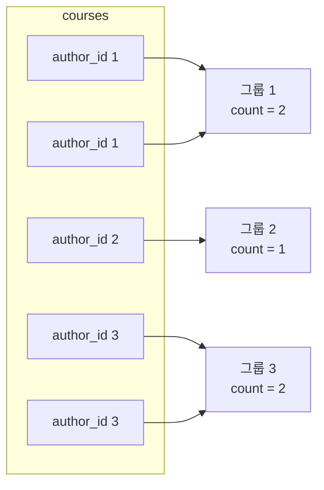
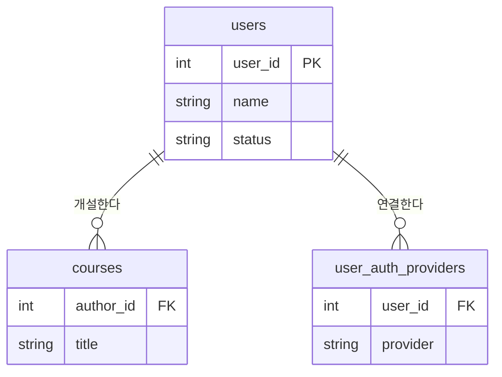
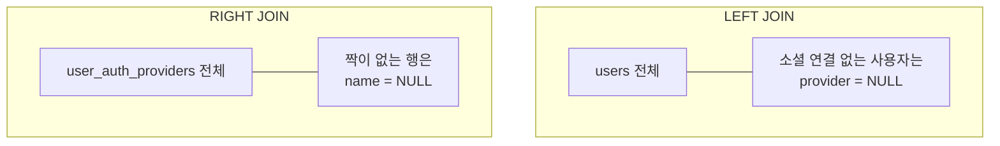

## 들어가며 (Situation)

지난주까지는 Java를 배웠고, 오늘부터 **RDBMS(관계형 데이터베이스)** 수업이 시작됐다. 실습은 MySQL로 했다. 오전에는 메뉴 테이블(`tbl_menu`, `tbl_category`)로 조회의 기본 문법을, 오후에는 LMS(학습 관리 시스템) 테이블(`users`, `courses`, `grades`, `enrollments`)로 집계와 JOIN을 실습했다.

| 파일 | 주제 |
|------|------|
| `01_select.sql` | SELECT, `*`, 별칭(AS), 기본 함수 |
| `02_orderby.sql` | ORDER BY, NULL 정렬 |
| `03_where.sql` | WHERE, 비교·논리 연산자, BETWEEN, LIKE, IN, IS NULL |
| `04_distinct.sql` | DISTINCT |
| `05_limit.sql` | LIMIT, 페이징 |
| `06_grouping.sql` | 집계 함수, GROUP BY, HAVING |
| `07_Join.sql` | JOIN, LEFT/RIGHT JOIN |

## 문제 상황 (Task)

수업에서 SELECT가 SQL의 90% 이상을 차지한다고 했다. 조회할 때 정해야 하는 건 결국 두 가지다.

1. **어떤 열(컬럼)** 을 가져올 것인가? → 정보의 **종류**
2. **어떤 행(row)** 을 가져올 것인가? → 정보의 **범위**

여기에 실무에서 자주 나오는 요구가 더해진다.

- 결과를 정렬하고, 중복을 빼고, 개수를 제한해야 한다. (ORDER BY, DISTINCT, LIMIT)
- "전체 사용자 수", "교육자별 강좌 수"처럼 **묶어서 계산**해야 한다. (GROUP BY)
- 실제 DB는 데이터가 **여러 테이블로 나뉘어** 있어서, 합쳐서 봐야 한다. (JOIN)

## 해결 과정 (Action)

### 1. SELECT — 무엇을, 어디에서

```sql
select          -- 조회해줘
    menu_name   -- 무엇을? (컬럼)
from            -- 어디에서?
    tbl_menu;   -- (테이블)
```

| 문법 | 의미 | 예 |
|------|------|-----|
| `select 컬럼1, 컬럼2` | 원하는 컬럼만 조회 | `select menu_code, menu_price` |
| `select *` | 모든 컬럼 조회 (`*` = 애스터리스크) | `select * from tbl_menu` |
| `컬럼 as '별칭'` | 결과에 표시될 이름 바꾸기 | `menu_name as '메뉴 이름'` |
| 함수 | MySQL 내장 함수 호출 | `select now();`, `select concat('조', '평훈');` |

`select now();`처럼 **FROM 없이도 SELECT를 쓸 수 있다.** 테이블을 조회하는 게 아니라 계산 결과를 한 행으로 돌려준다.

### 2. 실행 순서 — 문법을 이해하는 기준

오늘 배운 절들은 **작성 순서와 실행 순서가 다르다.** 이걸 알면 아래에서 나오는 "별칭을 어디서 쓸 수 있나", "WHERE와 HAVING은 왜 다른가"가 한 번에 정리된다. (실제 실행 계획은 옵티마이저가 정하지만, 논리적인 처리 순서는 아래와 같다.)


### 3. ORDER BY — 정렬

```sql
select
    menu_code,
    menu_price,
    menu_code * menu_price as `연산결과`
from
    tbl_menu
order by
    `연산결과` desc;
```

| 키워드 | 의미 |
|--------|------|
| `asc` | 오름차순 (기본값) |
| `desc` | 내림차순 |

ORDER BY는 SELECT보다 **나중에** 실행되기 때문에, SELECT에서 만든 별칭 `연산결과`로 정렬할 수 있다.

#### NULL은 어디로 정렬될까?

`tbl_category`의 `ref_category_code`(상위 카테고리)에는 NULL이 있다. MySQL은 NULL을 **가장 작은 값처럼** 취급해서, 오름차순이면 NULL이 맨 위로 온다.

수업에서는 NULL을 뒤로 보내려고 `is null`로 정렬했다.

```sql
order by
    ref_category_code is null asc;
```

`ref_category_code is null`은 NULL이면 `1`, 아니면 `0`이 된다. 오름차순이니 `0`(값 있음)이 먼저, `1`(NULL)이 뒤로 간다.

다만 이 식은 **"NULL인가 아닌가"로만 정렬**한다. NULL이 아닌 행들 사이의 순서는 보장되지 않는다. 값까지 오름차순으로 보고 싶다면 정렬 기준을 하나 더 적어야 한다. 아래는 **예시 코드**다.

```sql
-- 예시 코드: NULL은 뒤로, 나머지는 값 기준 오름차순
order by
    ref_category_code is null asc,
    ref_category_code asc;
```

### 4. WHERE — 어떤 행을 가져올까

```sql
select menu_name, menu_price, orderable_status
from tbl_menu
where orderable_status = 'Y';
```

| 연산자 | 의미 | 예 |
|--------|------|-----|
| `=` | 같다 | `orderable_status = 'Y'` |
| `!=`, `<>` | 같지 않다 | `category_code <> 10` |
| `>`, `<`, `>=`, `<=` | 크기 비교 | `menu_price <= 13000` |
| `and` | 조건을 **모두** 만족 | `menu_price >= 10000 and menu_price < 20000` |
| `or` | 조건 중 **하나라도** 만족 | `orderable_status = 'Y' or category_code = 10` |
| `between a and b` | a 이상 b 이하 (**양 끝 포함**) | `menu_price between 10000 and 20000` |
| `like` | 패턴 일치 | `menu_name like '%마늘%'` |
| `in (...)` | 목록 중 하나와 일치 | `category_code in (4, 5, 6)` |
| `not` | 부정 | `not between`, `not in` |
| `is null` / `is not null` | NULL 여부 | `ref_category_code is not null` |

#### BETWEEN은 양 끝을 포함한다

수업에서 "10000원 이상 20000원 **미만**"은 `>=`와 `<`를 `and`로 이었고, "10000원과 20000원 사이"는 `between`을 썼다. 두 쿼리는 결과가 다를 수 있다. `between 10000 and 20000`은 **20000원짜리 메뉴도 포함**하기 때문이다.

#### LIKE 패턴

| 패턴 | 의미 |
|------|------|
| `'단어%'` | 단어로 **시작** |
| `'%단어'` | 단어로 **끝남** |
| `'%단어%'` | 단어를 **포함** |

수업 문제는 "이름에 '마늘'을 **포함**하는 메뉴"였는데, 코드는 `like '생마늘%'`로 되어 있었다. 이러면 '생마늘'로 **시작하는** 메뉴만 나온다. 문제 의도대로라면 `like '%마늘%'`가 맞다.

#### NULL은 `=`로 비교할 수 없다

NULL은 "값이 없음"이라서 `= null`로 비교하면 결과가 참이 아니다. 그래서 `is null` / `is not null`을 쓴다.

```sql
select * from tbl_category
where ref_category_code is not null;
```

### 5. DISTINCT — 중복 제거

```sql
select
    distinct category_code   -- 중복이 있는 컬럼 앞에 붙인다
from
    tbl_menu
order by
    category_code;
```

메뉴는 여러 개지만 카테고리 코드는 겹친다. `distinct`를 붙이면 카테고리 코드가 한 번씩만 나온다. 컬럼을 여러 개 적으면 **컬럼 조합 전체**가 같을 때만 중복으로 본다.

### 6. LIMIT — 개수 제한과 페이징

수백만 건을 한 번에 조회하면 시스템에 큰 부하가 간다. LIMIT은 "상위 5개만", "1페이지에 10개만" 같은 **페이징**을 만들 때 꼭 필요하다.

```sql
select *
from tbl_menu
order by menu_price desc
limit 1, 5;
```

| 형식 | 의미 |
|------|------|
| `limit 5` | 처음부터 5개 |
| `limit offset, row_count` | `offset`개를 건너뛰고 `row_count`개 |
| `limit row_count offset offset` | 위와 같은 뜻의 다른 표기 |

`offset`은 **0부터 시작**한다. 그래서 `limit 1, 5`는 첫 번째 행(가장 비싼 메뉴)을 건너뛰고 **2~6번째** 행을 가져온다. 가장 비싼 메뉴부터 5개를 원하면 `limit 0, 5` 또는 `limit 5`를 써야 한다.

페이징 공식으로 정리하면 다음과 같다.

```sql
-- 예시 코드: 한 페이지에 10개씩, 3페이지
-- offset = (페이지 번호 - 1) * 페이지 크기 = (3 - 1) * 10 = 20
limit 20, 10;
```

#### 시행착오: 테이블 이름 오타

수업 파일의 LIMIT 예제는 `from tbl_menutbl_menu`로 테이블 이름이 두 번 붙어 있었다. 이 상태로 실행하면 `Table '...tbl_menutbl_menu' doesn't exist` 에러가 난다. 에러 메시지에 **존재하지 않는 테이블 이름**이 그대로 찍히니, 먼저 이름부터 확인하면 된다.

### 7. 집계 함수와 GROUP BY

"우리 서비스의 총 사용자 수는?"처럼 여러 행을 **하나의 값으로 계산**할 때 집계 함수를 쓴다.

| 함수 | 의미 | NULL 처리 |
|------|------|-----------|
| `count(컬럼)` | 데이터 개수 | NULL 제외 |
| `count(*)` | 행 개수 | NULL 포함 (행 자체를 셈) |
| `sum(컬럼)` | 합계 | NULL 무시 |
| `avg(컬럼)` | 평균 | NULL 무시 |
| `max(컬럼)` / `min(컬럼)` | 최댓값 / 최솟값 | NULL 무시 |

```sql
-- 전체 사용자 수
select count(*) as '총 사용자 수' from users;

-- 과정을 등록한 교육자 수 (중복 없이)
select count(distinct author_id) as '과정 등록 교육자 수' from courses;

-- 모든 제출물의 총점과 평균
select sum(score) as '총점', avg(score) as '평균' from grades;
```

`count(distinct author_id)`는 한 교육자가 강좌를 여러 개 열어도 **한 명으로** 센다.

#### 시행착오: 일반 컬럼과 집계 함수를 같이 쓰면 에러

```sql
select
    name,
    count(*) as '총 사용자 수'
from
    users;
```

`count(*)`는 결과가 한 행인데, `name`은 사용자 수만큼 있다. **어떤 `name`을 그 한 행에 붙여야 할지 정할 수 없어서** 에러가 난다.

이 에러는 MySQL의 `ONLY_FULL_GROUP_BY` SQL 모드 때문에 발생한다. MySQL 5.7.5부터 기본으로 켜져 있다. 이 모드를 끄면 에러 없이 실행되지만 `name`에는 **아무 행의 값이나** 들어가므로, 끄는 것보다 쿼리를 바로잡는 게 맞다.

#### GROUP BY — 묶어서 각각 계산

이 문제를 푸는 게 GROUP BY다. 특정 컬럼 기준으로 행을 묶고, **그룹마다** 집계 함수를 적용한다.

```sql
-- 상태(status)별 사용자 수
select
    status,
    count(*) as '사용자 수'
from users
group by status;

-- 교육자별 개설 강좌 수
select
    author_id as '교육자 번호',
    count(*) as '개설 강좌 수'
from courses
group by author_id;
```

`group by status`를 하면 `status`는 그룹마다 하나로 정해지므로 SELECT에 같이 써도 된다.



(위 그림의 데이터는 설명을 위한 예시다.)

#### HAVING — 그룹을 거르는 조건

```sql
-- 개설 강좌 수가 3개 이상인 교육자
select
    author_id as '교육자 번호',
    count(*) as '개설 강좌 수'
from courses
group by author_id
having count(*) >= 3;
```

| 구분 | WHERE | HAVING |
|------|-------|--------|
| 실행 시점 | 그룹화 **전** | 그룹화 **후** |
| 거르는 대상 | 개별 행 | 그룹 |
| 집계 함수 사용 | 불가 | 가능 |

`count(*) >= 3`은 그룹을 다 묶어야 알 수 있는 값이다. WHERE는 그룹화 전에 실행되니 여기서는 쓸 수 없고, HAVING에 써야 한다.

두 개를 같이 써야 하는 문제도 있었다.

```sql
-- 수강 상태가 'completed'인 등록 중, 학생이 2명 이상인 과정
select
    course_id,
    count(*) '학생 수'
from enrollments
where status = 'completed'   -- 1. 완료된 등록만 남기고
group by course_id           -- 2. 과정별로 묶은 뒤
having count(*) >= 2;        -- 3. 2명 이상인 그룹만
```

`status = 'completed'`는 행 하나하나의 조건이라 WHERE에, `count(*) >= 2`는 그룹의 조건이라 HAVING에 둔다.

### 8. JOIN — 나뉜 테이블 합치기

수업에서 "굉장히 중요"하다고 강조한 부분이다. 실제 DB는 비슷한 의미의 데이터를 **테이블별로 나눠** 저장한다. JOIN은 여러 테이블을 **공통 값을 기준으로** 합쳐 하나의 결과로 만든다.

`desc courses;`로 구조를 보면 `courses.author_id`는 `users.user_id` 값을 가져온 컬럼이다. 이렇게 다른 테이블의 키를 참조하는 컬럼을 **외래키(FK, Foreign Key)** 라고 한다.



(다이어그램에는 수업 쿼리에 나온 컬럼만 적었다.)

```sql
-- 과정 제목과 그 과정을 만든 교육자 이름
select
    c.title as '과정 제목',
    u.name  as '교육자 이름'
from courses as c
join users as u
on c.author_id = u.user_id;
```

- `courses as c`처럼 **테이블에도 별칭**을 줄 수 있다. 컬럼 앞에 `c.`, `u.`를 붙여 어느 테이블의 컬럼인지 구분한다.
- `on` 뒤에 **두 테이블을 잇는 조건**을 적는다.
- 그냥 `join`이라고 쓰면 `inner join`이다. 양쪽에 짝이 있는 행만 나온다.

#### LEFT JOIN과 RIGHT JOIN

사용자 중에는 소셜 로그인을 연결한 사람도 있고 아닌 사람도 있다. 모든 사용자를 보고 싶다면 LEFT JOIN을 쓴다.

```sql
select
    u.name as '사용자 이름',
    uap.provider as '소셜 로그인 제공자'
from users as u
left join user_auth_providers as uap
on u.user_id = uap.user_id;
```

| 종류 | 기준 | 짝이 없을 때 |
|------|------|-------------|
| `inner join` | 양쪽 모두 | 결과에서 빠짐 |
| `left join` | **왼쪽**(FROM 쪽) 테이블 | 오른쪽 컬럼이 NULL로 채워짐 |
| `right join` | **오른쪽**(JOIN 쪽) 테이블 | 왼쪽 컬럼이 NULL로 채워짐 |



수업에서 같은 쿼리를 `right join`으로 바꿔 실행했다. 이 경우 기준이 `user_auth_providers`가 되므로 **소셜 로그인을 연결한 사용자만** 나온다. 소셜 로그인 기록은 항상 어떤 사용자에 연결되어 있으니, 사실상 inner join과 같은 결과가 된다.

즉 LEFT와 RIGHT는 **어느 쪽 테이블을 빠짐없이 보여줄지**의 차이다. `A left join B`와 `B right join A`는 같은 결과를 낸다.

#### 참고: OUTER JOIN

수업에서 JOIN 종류로 inner, left, right, self, outer를 소개했다. LEFT/RIGHT JOIN의 정식 이름이 `LEFT OUTER JOIN`, `RIGHT OUTER JOIN`이다. 양쪽을 모두 살리는 **FULL OUTER JOIN은 MySQL이 지원하지 않는다.** 필요하면 LEFT JOIN과 RIGHT JOIN 결과를 `UNION`으로 합쳐야 한다.

```sql
-- 예시 코드: MySQL에서 FULL OUTER JOIN 흉내내기
select u.name, uap.provider
from users u left join user_auth_providers uap on u.user_id = uap.user_id
union
select u.name, uap.provider
from users u right join user_auth_providers uap on u.user_id = uap.user_id;
```

## 결과 (Result)

하루 동안 SQL 조회 문법 **7개 주제**를 배웠다. 처음에 세운 질문에 이렇게 답할 수 있게 됐다.

| 요구 | 쓰는 문법 |
|------|-----------|
| 어떤 컬럼을? | `select 컬럼`, `as 별칭` |
| 어떤 행을? | `where` + 비교/논리 연산자, `between`, `like`, `in`, `is null` |
| 정렬, 중복 제거, 개수 제한 | `order by`, `distinct`, `limit` |
| 묶어서 계산 | 집계 함수 + `group by`, 그룹 조건은 `having` |
| 나뉜 테이블 합치기 | `join ... on`, 기준 테이블은 `left` / `right` |

수업 코드를 다시 보면서 바로잡은 부분도 정리해 둔다.

| 위치 | 수업 코드 | 바로잡은 내용 |
|------|----------|--------------|
| NULL 정렬 | `order by ref_category_code is null asc` | NULL만 뒤로 갈 뿐, 값 정렬까지 하려면 `, ref_category_code asc` 추가 |
| LIKE | `like '생마늘%'` | '마늘' 포함이면 `'%마늘%'` |
| LIMIT | `from tbl_menutbl_menu`, `limit 1, 5` | 테이블명 오타. `limit 1, 5`는 2~6번째 행 |
| 집계 에러 | `select name, count(*)` | `ONLY_FULL_GROUP_BY` 때문에 에러. GROUP BY로 해결 |

**배운 점**

- SQL은 **쓰는 순서와 실행 순서가 다르다.** 실행 순서를 알면 "별칭을 ORDER BY에서는 쓸 수 있는데 WHERE에서는 왜 안 되지?", "집계 조건은 왜 HAVING에 쓰지?"가 자연스럽게 이해된다.
- NULL은 특별한 값이다. 비교(`is null`), 정렬(맨 위), 집계(`count(컬럼)`에서 제외), JOIN(짝이 없으면 NULL로 채움) 모두에서 따로 생각해야 한다.

## 더 학습하면 좋은 개념

- **정규화(Normalization)** — 데이터를 왜 여러 테이블로 나누는지에 대한 답이다. 정규화를 알면 JOIN이 왜 필요한지 설계 관점에서 이해할 수 있다.
- **PK, FK와 참조 무결성** — 오늘 `author_id`를 외래키라고 간단히만 봤다. 외래키 제약조건이 걸려 있으면 없는 사용자 번호로 강좌를 만들 수 없다. 이 동작을 알아야 데이터가 왜 일관되게 유지되는지 이해할 수 있다.
- **인덱스(Index)** — WHERE, JOIN, ORDER BY가 빨라지는 이유다. 데이터가 많아지면 같은 쿼리라도 인덱스 유무에 따라 속도가 크게 달라진다.
- **서브쿼리(Subquery)** — 쿼리 안에 쿼리를 넣는 방법이다. JOIN으로 풀 수 있는 문제를 다른 방식으로 풀 수 있어서, 둘을 비교해 보면 좋다.
- **OFFSET 페이징의 한계와 커서(Keyset) 페이징** — `limit 100000, 10`은 앞의 10만 개 행을 읽고 버린다. 데이터가 많을 때 페이징 성능을 어떻게 개선하는지 알아 두면 좋다.

## 참고 자료

- [MySQL 8.0 Reference Manual - SELECT Statement](https://dev.mysql.com/doc/refman/8.0/en/select.html)
- [MySQL 8.0 Reference Manual - Sorting Rows](https://dev.mysql.com/doc/refman/8.0/en/sorting-rows.html)
- [MySQL 8.0 Reference Manual - Working with NULL Values](https://dev.mysql.com/doc/refman/8.0/en/working-with-null.html)
- [MySQL 8.0 Reference Manual - Pattern Matching](https://dev.mysql.com/doc/refman/8.0/en/pattern-matching.html)
- [MySQL 8.0 Reference Manual - Aggregate Function Descriptions](https://dev.mysql.com/doc/refman/8.0/en/aggregate-functions.html)
- [MySQL 8.0 Reference Manual - MySQL Handling of GROUP BY](https://dev.mysql.com/doc/refman/8.0/en/group-by-handling.html)
- [MySQL 8.0 Reference Manual - JOIN Clause](https://dev.mysql.com/doc/refman/8.0/en/join.html)
