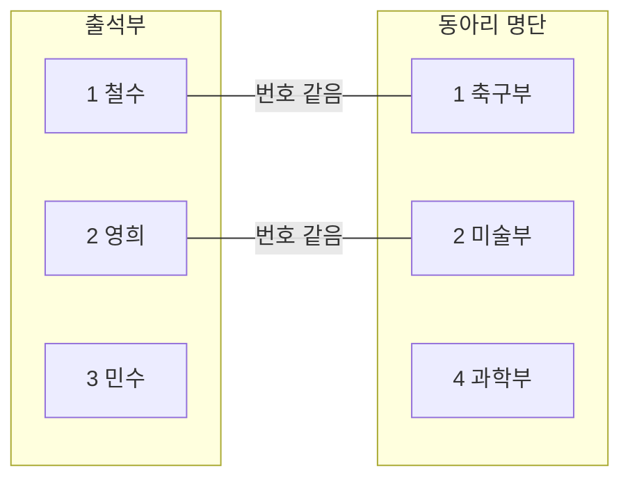
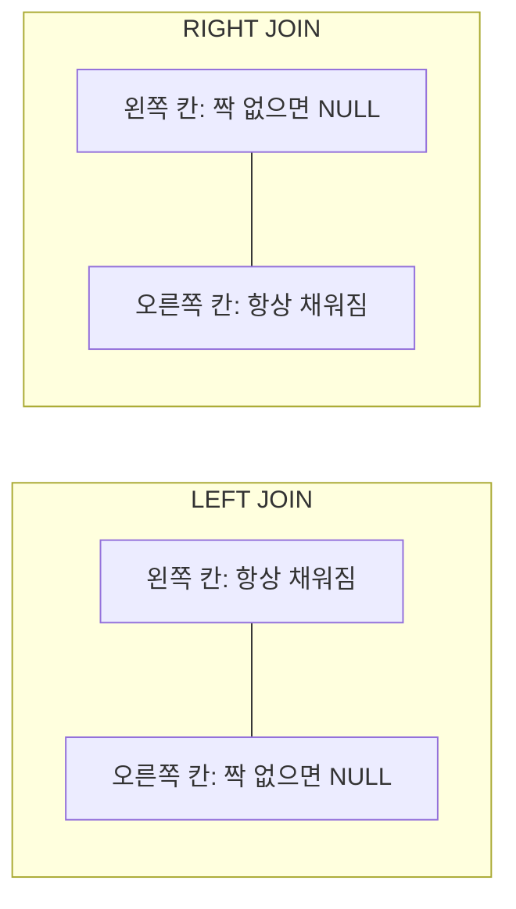

[10/12 MySQL 수업]({{ site.baseurl }})에서 JOIN을 배웠는데 계속 헷갈려서, 아주 쉽게 다시 정리했다.

## 정의

**JOIN은 두 개의 표를 같은 번호끼리 짝지어 하나의 표로 붙이는 것이다.**

## 설명

### 종이 두 장으로 생각하기

선생님에게 종이가 두 장 있다.

**📄 출석부 (왼쪽 종이)**

| 번호 | 이름 |
|------|------|
| 1 | 철수 |
| 2 | 영희 |
| 3 | 민수 |

**📄 동아리 명단 (오른쪽 종이)**

| 학생 번호 | 동아리 |
|-----------|--------|
| 1 | 축구부 |
| 2 | 미술부 |
| 4 | 과학부 |

(설명을 위해 만든 예시 데이터다. 4번은 전학 간 친구인데 동아리 명단에만 남아 있다.)

"철수는 무슨 동아리야?"를 알려면 두 종이를 나란히 놓고 **번호가 같은 줄끼리** 이어 보면 된다. 이게 JOIN이다.



민수(3번)는 동아리 명단에 짝이 없고, 과학부(4번)는 출석부에 짝이 없다. **짝이 없는 친구를 어떻게 할지**에 따라 JOIN의 종류가 나뉜다.

### JOIN 문장 읽는 법

```sql
select 출석부.이름, 동아리.동아리
from 출석부                                -- ① 왼쪽 종이
join 동아리                                -- ② 오른쪽 종이
on 출석부.번호 = 동아리.학생번호;           -- ③ 번호가 같은 것끼리 이어라
```

| 부분 | 쉬운 말 |
|------|---------|
| `from 표A` | 첫 번째 종이 (**왼쪽**) |
| `join 표B` | 두 번째 종이 (**오른쪽**) |
| `on A.번호 = B.번호` | 어떤 칸이 같으면 짝인지 |

**왼쪽, 오른쪽 구분법:** `from` 뒤에 먼저 쓴 표가 왼쪽, `join` 뒤에 쓴 표가 오른쪽이다.

### JOIN 세 가지

| JOIN | 누가 나올까? | 짝이 없으면? |
|------|-------------|-------------|
| `inner join` (그냥 `join`) | 짝이 있는 친구만 | 결과에서 빠진다 |
| `left join` | **왼쪽 종이**는 전부 | 오른쪽 칸이 비어 있다 (`NULL`) |
| `right join` | **오른쪽 종이**는 전부 | 왼쪽 칸이 비어 있다 (`NULL`) |

**어떤 걸 쓸지 고르는 질문 하나:** "짝이 없는 줄도 결과에 나와야 하나?"

- 아니다 → `inner join`
- 왼쪽 표는 하나도 빠지면 안 된다 → `left join`

### NULL은 어느 쪽에 올까?

규칙은 하나다. **"전부 살리는 쪽의 반대편 칸이 비어서 `NULL`이 된다."**

짝이 없는 친구도 결과에 넣으려면 옆 칸을 채울 게 없다. 그래서 그 빈칸에 `NULL`이 들어간다.

| JOIN | 전부 살리는 쪽 | `NULL`이 오는 쪽 | 언제 `NULL`이 생길까? |
|------|---------------|-----------------|----------------------|
| `inner join` | 없음 (짝 있는 것만) | **안 생김** | 짝 없는 줄은 아예 빠지니까 |
| `left join` | 왼쪽 (`from` 뒤 표) | **오른쪽** 표의 칸 | 왼쪽 줄에 오른쪽 짝이 없을 때 |
| `right join` | 오른쪽 (`join` 뒤 표) | **왼쪽** 표의 칸 | 오른쪽 줄에 왼쪽 짝이 없을 때 |



**외우는 법:** `left`는 왼쪽 편을 들어 준다. 그러면 손해 보는 **오른쪽**이 빈칸(`NULL`)을 받는다. `right`는 그 반대다.

출석부 예시로 보면 이렇다.

| JOIN | 짝 없는 줄 | 결과 | `NULL` 위치 |
|------|-----------|------|------------|
| `left join` | 민수 (출석부에만 있음) | `민수 / NULL` | 오른쪽 (동아리 칸) |
| `right join` | 과학부 4번 (동아리 명단에만 있음) | `NULL / 과학부` | 왼쪽 (이름 칸) |

**주의:** 결과에 `NULL`이 보인다고 모두 "짝이 없어서"는 아니다. 원래 표에 처음부터 `NULL`로 저장된 값일 수도 있다. 짝이 없어서 생긴 `NULL`인지 확인하려면, `on`에 쓴 **번호 칸**(예: `uap.user_id`)이 `NULL`인지 보면 된다. 짝이 있었다면 번호 칸은 절대 비어 있을 수 없기 때문이다. 그래서 아래 예시 3에서도 `where uap.user_id is null`로 번호 칸을 검사한다.

### 비슷해서 헷갈리는 것

| 구분 | JOIN | UNION |
|------|------|-------|
| 붙이는 방향 | **옆으로** (칸이 늘어남) | **아래로** (줄이 늘어남) |
| 기준 | 같은 번호끼리 짝짓기 | 칸 개수가 같은 결과 이어 붙이기 |
| 비유 | 출석부 옆에 동아리 명단 붙이기 | 1반 명단 아래에 2반 명단 붙이기 |

## 예시

### 예시 1. 종이 두 장으로 결과 비교

**① INNER JOIN — 짝 있는 친구만**

```sql
select 출석부.이름, 동아리.동아리
from 출석부
inner join 동아리 on 출석부.번호 = 동아리.학생번호;
```

| 이름 | 동아리 |
|------|--------|
| 철수 | 축구부 |
| 영희 | 미술부 |

민수와 과학부는 짝이 없어서 빠졌다.

**② LEFT JOIN — 출석부(왼쪽)는 전부**

```sql
select 출석부.이름, 동아리.동아리
from 출석부
left join 동아리 on 출석부.번호 = 동아리.학생번호;
```

| 이름 | 동아리 |
|------|--------|
| 철수 | 축구부 |
| 영희 | 미술부 |
| 민수 | `NULL` |

민수는 동아리가 없지만 **출석부에 있으니까** 나온다. 동아리 칸은 비어 있다.

**③ RIGHT JOIN — 동아리 명단(오른쪽)은 전부**

```sql
select 출석부.이름, 동아리.동아리
from 출석부
right join 동아리 on 출석부.번호 = 동아리.학생번호;
```

| 이름 | 동아리 |
|------|--------|
| 철수 | 축구부 |
| 영희 | 미술부 |
| `NULL` | 과학부 |

과학부는 출석부에 이름이 없지만 **동아리 명단에 있으니까** 나온다. 이름 칸은 비어 있다.

한 장으로 모으면 이렇다.

| 누구 | inner | left | right |
|------|:-----:|:----:|:-----:|
| 철수 - 축구부 (짝 있음) | ✅ | ✅ | ✅ |
| 영희 - 미술부 (짝 있음) | ✅ | ✅ | ✅ |
| 민수 (출석부에만 있음) | ❌ | ✅ | ❌ |
| 과학부 4번 (동아리 명단에만 있음) | ❌ | ❌ | ✅ |

### 예시 2. 수업 테이블로 다시 보기

수업의 LMS 데이터베이스로 바꾸면 이렇다.

| 비유 | 수업 테이블 |
|------|-------------|
| 출석부 | `users` (`user_id`, `name`) |
| 동아리 명단 | `user_auth_providers` (`user_id`, `provider`) — 소셜 로그인 연결 정보 |
| 번호 | `user_id` |

**"모든 사용자와, 연결한 소셜 로그인을 보여 줘"**

소셜 로그인을 안 한 사용자도 **빠지면 안 되니까** `left join`이다.

```sql
select
    u.name as '사용자 이름',
    uap.provider as '소셜 로그인 제공자'
from users as u
left join user_auth_providers as uap
on u.user_id = uap.user_id;
```

- `users as u`는 표에 **짧은 별명**을 붙인 것이다. `u.name`은 "u 표의 name 칸"이라는 뜻이다.
- 소셜 로그인을 안 한 사용자는 `provider` 칸이 `NULL`로 나온다.

**"과정 제목과 만든 교육자 이름을 보여 줘"**

과정은 반드시 만든 사람이 있으니 짝이 없는 경우가 없다. 그냥 `join`(= `inner join`)이면 된다.

```sql
select
    c.title as '과정 제목',
    u.name as '교육자 이름'
from courses as c
join users as u
on c.author_id = u.user_id;
```

여기서는 번호 칸의 이름이 서로 다르다(`author_id`와 `user_id`). 이름이 달라도 **같은 사람을 가리키는 번호**면 `on`으로 이을 수 있다.

### 예시 3. 짝 없는 사람만 찾기 (한 걸음 더)

LEFT JOIN 결과에서 오른쪽 칸이 `NULL`인 줄만 남기면 **"짝이 없는 사람"** 만 찾을 수 있다.

```sql
-- 소셜 로그인을 한 번도 연결하지 않은 사용자
select u.name
from users as u
left join user_auth_providers as uap
on u.user_id = uap.user_id
where uap.user_id is null;
```

비유로 말하면 "출석부에서 동아리가 없는 친구 찾기"다. `NULL`은 `= null`이 아니라 **`is null`** 로 비교해야 한다.

## 한 줄 정리

> JOIN은 **같은 번호끼리 두 표를 옆으로 붙이는 것**이다. 짝 없는 줄을 버리면 `inner`, 왼쪽을 다 살리면 `left`, 오른쪽을 다 살리면 `right`.

## 참고 자료

- [MySQL 8.0 Reference Manual - JOIN Clause](https://dev.mysql.com/doc/refman/8.0/en/join.html)
- [MySQL 8.0 Reference Manual - Working with NULL Values](https://dev.mysql.com/doc/refman/8.0/en/working-with-null.html)
