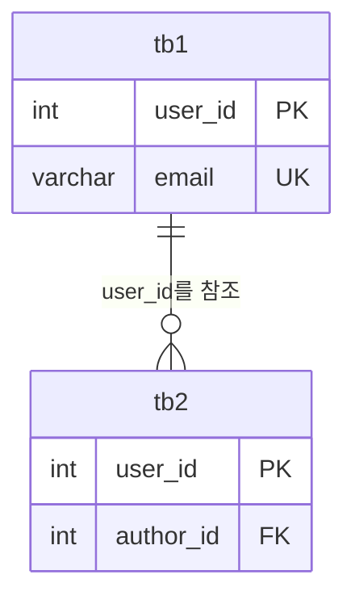
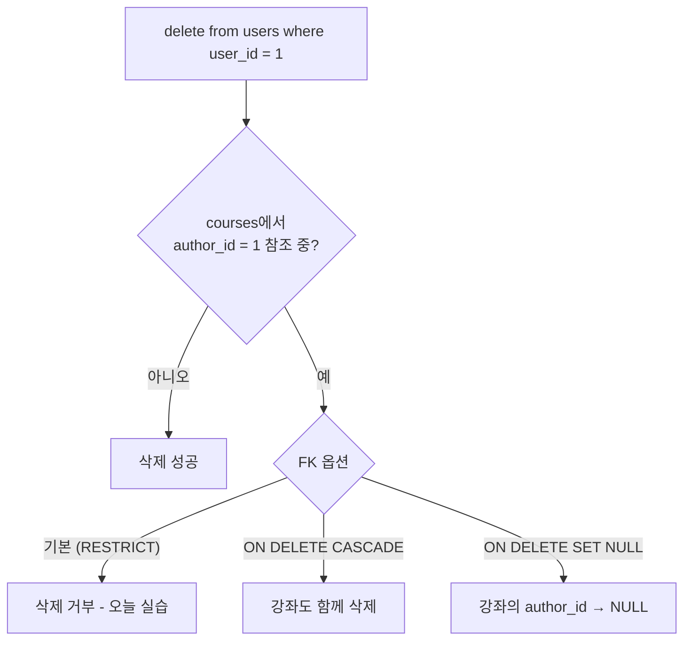
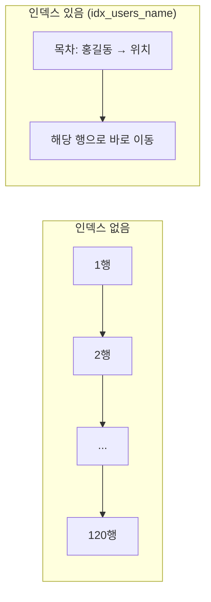
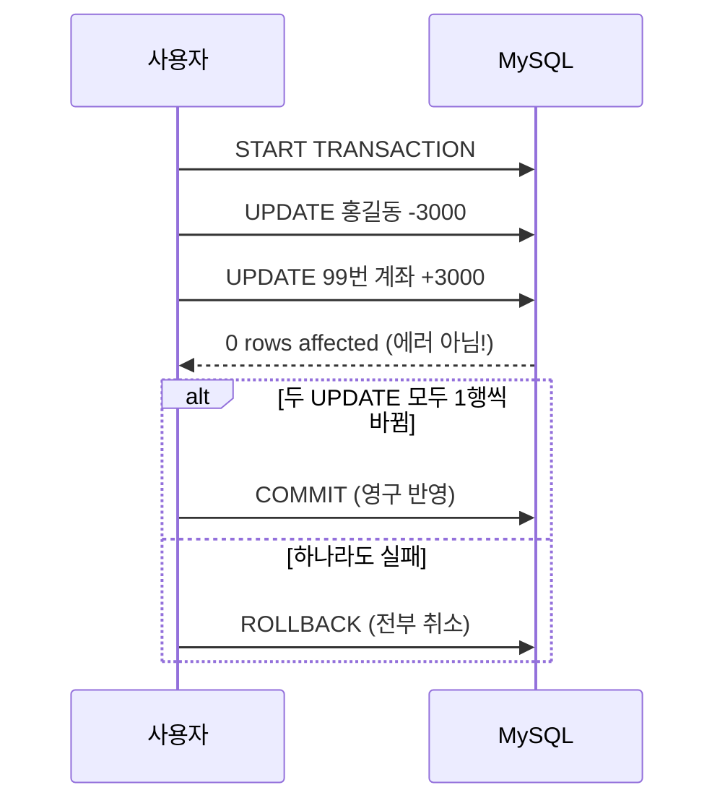

## 들어가며 (Situation)

[10/12 수업] 에서는 SELECT로 데이터를 **조회**하는 법(WHERE, GROUP BY, JOIN)을 배웠다. 오늘(10/13)은 조회를 넘어서 테이블을 **만들고**, 데이터를 **넣고 바꾸고 지우고**, 그 작업을 **안전하게 묶는** 법까지 배웠다. 실습은 LMS 데이터베이스(`wanted_lms`)의 `users`, `courses`, `enrollments` 테이블로 했다.

| 파일 | 주제 |
|------|------|
| `07_Join.sql` (추가) | NULL 비교 |
| `08_subqueries.sql` | 서브쿼리 (WHERE, FROM) |
| `09_ddl.sql` | DDL: 데이터 타입, 제약 조건, CREATE / ALTER / DROP / TRUNCATE |
| `10_dml.sql` | DML: INSERT / UPDATE / DELETE, 제약 조건 위반 에러 |
| `11_union.sql` | UNION |
| `12_view.sql` | VIEW |
| `13_index.sql` | INDEX, EXPLAIN |
| `14_transctional.sql` | 트랜잭션: START TRANSACTION / COMMIT / ROLLBACK |

SQL 명령어는 하는 일에 따라 이렇게 나뉜다. 오늘은 DQL에 이어 DDL, DML, TCL을 배웠다.

| 분류 | 이름 | 하는 일 | 명령어 |
|------|------|---------|--------|
| DQL | Data Query Language | 데이터 조회 | `SELECT` |
| DDL | Data Definition Language | 테이블 **구조** 정의 | `CREATE`, `ALTER`, `DROP`, `TRUNCATE` |
| DML | Data Manipulation Language | 테이블 **데이터** 조작 | `INSERT`, `UPDATE`, `DELETE` |
| TCL | Transaction Control Language | 작업 단위 확정·취소 | `START TRANSACTION`, `COMMIT`, `ROLLBACK` |

## 문제 상황 (Task)

어제 배운 SELECT만으로는 풀 수 없는 문제들이 있었다.

1. **조건을 미리 알 수 없을 때**: "홍길동과 **같은 해**에 가입한 사용자"를 찾으려면, 홍길동의 가입 연도부터 알아야 한다.
2. **테이블을 직접 만들고 바꿔야 할 때**: 잘못된 데이터가 들어오지 못하게 규칙까지 정해야 한다.
3. **데이터를 넣고, 고치고, 지워야 할 때**: 실수 한 번에 데이터 전체가 바뀔 수 있다.
4. **조회가 느려질 때**: 사용자가 100만 명이면 이름 하나 찾는 데도 시간이 걸린다.
5. **여러 작업이 함께 성공해야 할 때**: 계좌이체는 "출금"과 "입금" 둘 다 성공해야 한다. 중간에 멈추면 돈이 사라진다.

## 해결 과정 (Action)

### 0. 먼저 짚고 가기: NULL은 `=`로 비교할 수 없다

어제 JOIN 파일 끝에 추가한 내용이다. NULL은 "값이 0"이나 "빈 문자열"이 아니라 **값이 비어 있는 상태**다. 그래서 `=`로 비교할 수 없다.

```sql
-- 결과가 나오지 않는다
select * from users where name = null;

-- 이렇게 비교해야 한다
select * from users where name is null;
```

`name = null`은 참도 거짓도 아닌 **UNKNOWN**이 된다. WHERE는 참인 행만 남기므로 아무것도 나오지 않는다. 에러가 나지 않아서 실수를 알아채기 어렵다.

### 1. 서브쿼리 — 쿼리 안의 쿼리

**서브쿼리**는 쿼리 안에 넣은 또 다른 쿼리다. 문제의 조건이 바로 주어지지 않을 때, 두 쿼리를 하나로 합친다.

> 문제: '홍길동'과 같은 연도에 가입한 모든 사용자의 이름과 가입일

이 문제는 두 단계로 나뉜다.

```sql
-- 1단계: 홍길동의 가입 연도
select year(created_at) from users where name = '홍길동';

-- 2단계: 그 연도에 가입한 사용자 (연도를 모르니 아직 조건을 못 쓴다)
select name, created_at from users;
```

1단계 결과를 2단계 조건 자리에 **그대로 넣으면** 된다.

```sql
select
    name,
    created_at
from
    users
where
    year(created_at) = (
        select year(created_at)
        from users
        where name = '홍길동'
    );
```


#### FROM 절 서브쿼리 — 결과를 테이블처럼 쓰기

서브쿼리는 FROM 절에도 쓸 수 있다. SELECT 결과를 **가상 테이블**처럼 다른 테이블과 JOIN한다.

```sql
select
    u.name as '교육자 이름',
    aut.course_count as '교육자 개설 과정 수'
from
    users u
    join
    (
        select author_id, count(*) as course_count
        from courses
        group by author_id
    ) as aut on u.user_id = aut.author_id
order by
    `교육자 개설 과정 수` desc;
```

안쪽 쿼리가 "교육자별 강좌 수" 표(`aut`)를 만들고, 바깥 쿼리가 그 표를 `users`와 JOIN해서 번호 대신 **이름**을 붙인다. FROM 절 서브쿼리에는 반드시 **별칭**(`as aut`)을 붙여야 한다.

| 위치 | 결과 형태 | 쓰임 |
|------|-----------|------|
| WHERE 절 | 값 1개 (또는 여러 개) | 조건 값을 계산해서 비교 |
| FROM 절 | 표 (가상 테이블) | 집계 결과를 다른 테이블과 JOIN |

#### 시행착오: 홍길동이 두 명이면?

`=` 오른쪽 서브쿼리는 **값이 하나**여야 한다. `users`에 '홍길동'이 두 명이라 연도가 두 개 나오면 `Subquery returns more than 1 row` 에러가 난다. 결과가 여러 개일 수 있다면 `=` 대신 `in`을 쓴다. 아래는 **예시 코드**다.

```sql
-- 예시 코드: 서브쿼리 결과가 여러 개여도 동작
where year(created_at) in (
    select year(created_at) from users where name = '홍길동'
);
```

### 2. DDL — 테이블 구조 정의하기

수업에서 강조한 문장이 있다.

> 테이블을 만드는 것은 단순히 칸을 나누는 작업이 아니다. 데이터가 지켜야 할 규칙을 정의하고, 데이터베이스가 스스로 데이터의 품질을 유지하도록 만드는 과정이다.

그 규칙의 두 축이 **데이터 타입**과 **제약 조건**이다.

| 데이터 타입 | 저장하는 값 | 예 |
|-------------|-------------|-----|
| `INT` / `BIGINT` | 정수 | `user_id`, `author_id` |
| `VARCHAR(n)` | 최대 n글자의 가변 길이 문자열 | `email`, `name` |
| `TEXT` | 아주 긴 문자열 | `description` |
| `DATE` | 날짜 (`YYYY-MM-DD`) | 생일 |
| `DATETIME` / `TIMESTAMP` | 날짜 + 시간 | `created_at` |
| `DECIMAL(p, s)` | 정확한 소수 (전체 p자리, 소수 s자리) | 잔액 `balance decimal(10,2)` |

| 제약 조건 | 의미 |
|-----------|------|
| `NOT NULL` | 비워 둘 수 없음 (필수 입력) |
| `UNIQUE` | 중복 불가 |
| `PRIMARY KEY` | `NOT NULL` + `UNIQUE`, 테이블의 대표 식별자 |
| `FOREIGN KEY` | 다른 테이블의 키를 참조, 테이블 사이 관계를 보장 |
| `DEFAULT` | 값을 안 넣었을 때 쓸 기본값 |

데이터 타입은 "나이 칸에 '스무살'"이 들어오는 것을 막고, 제약 조건은 "이메일 중복", "없는 사용자를 참조" 같은 **논리적 오류**를 막는다. 수업에서는 제약 조건을 데이터를 지키는 **'자동 경찰'** 이라고 표현했다.

#### CREATE TABLE

```sql
create table tb1(
    user_id int primary key,
    user_pwd varchar(12) not null comment '사용자 비밀번호',
    email varchar(30) not null unique comment '이메일',
    user_status varchar(10) default 'active' comment '계정 활성 상태',
    created_at timestamp not null default current_timestamp comment '가입 일시'
) comment '서비스 유저 정보 테이블';

create table tb2(
    user_id int primary key,
    author_id int not null comment 'tb1 에서 전달 받는 외래키',
    -- ... (tb1과 같은 컬럼 생략)
    foreign key(`author_id`) references `tb1`(`user_id`)
) comment '서비스 유저 정보 테이블2';
```

한 줄은 **`컬럼명 데이터타입 제약조건`** 순서다. `comment`로 컬럼과 테이블에 설명을 달 수 있고, `describe tb1;`(= `desc`)로 만든 구조를 확인한다.

`foreign key(author_id) references tb1(user_id)`는 "`tb2.author_id`에는 `tb1.user_id`에 **실제로 있는 값만** 들어올 수 있다"는 뜻이다. 이것을 **참조 무결성**이라고 한다.



| 용어 | 오늘 예 | 설명 |
|------|---------|------|
| 부모 테이블 | `tb1`, `users` | 외래키로 **참조되는** 쪽 (키를 주는 쪽) |
| 자식 테이블 | `tb2`, `courses` | 외래키를 **가진** 쪽 (키를 받는 쪽) |

#### 시행착오: 부모 테이블을 먼저 지우면 에러

수업 코드는 `drop table tb1;`을 먼저, `drop table tb2;`를 나중에 실행했다. `tb2`가 아직 `tb1`을 참조하고 있으므로 `tb1` 삭제는 **거부된다.** 부모를 지우면 자식의 `author_id`가 가리킬 곳이 사라지기 때문이다. 삭제는 **자식 → 부모** 순서로 해야 한다.

```sql
drop table tb2;   -- 자식 먼저
drop table tb1;   -- 부모 나중
```

만들 때는 반대로 **부모 → 자식** 순서다. `tb2`를 만들 때 참조할 `tb1`이 이미 있어야 한다.

#### ALTER TABLE — 만든 테이블 고치기

`courses`를 복사한 임시 테이블로 실습했다.

```sql
create table courses_temp as select * from courses;

-- 컬럼 추가
alter table courses_temp add column price int not null default 0;

-- 컬럼 수정 (타입, 기본값 변경)
alter table courses_temp modify column price varchar(200) not null default '0원';

-- 컬럼 삭제
alter table courses_temp drop column price;
```

`create table ... as select`는 **컬럼과 데이터만** 복사한다. 원본의 PRIMARY KEY, FOREIGN KEY, 인덱스 같은 제약 조건은 복사되지 않는다. 연습용 임시 테이블로는 괜찮지만, 원본과 똑같은 구조가 필요하면 `create table 새테이블 like 원본;`을 쓴다.

#### DELETE vs TRUNCATE vs DROP

| 명령 | 분류 | 지우는 것 | 테이블 구조 | 롤백 | WHERE |
|------|------|-----------|-------------|------|-------|
| `delete from t` | DML | 데이터 (행 단위) | 남음 | 트랜잭션 안이면 가능 | 가능 |
| `truncate table t` | DDL | 데이터 전부 | 남음 | **불가** | 불가 |
| `drop table t` | DDL | 데이터 + 구조 | **사라짐** | **불가** | 불가 |

수업에서는 DROP을 "매우 빠르지만 롤백 불가"라고 설명했다. TRUNCATE도 DDL이라 마찬가지로 **롤백할 수 없다.** MySQL에서 DDL 문은 실행 전후로 **자동 커밋(implicit commit)** 되기 때문이다. 그래서 둘 다 실행 전에 한 번 더 확인해야 한다.

### 3. DML — 데이터 넣고, 고치고, 지우기

#### INSERT

```sql
-- insert into 테이블명 (컬럼명...) values (값...)
insert into users (`email`, `name`)
values ('email@gmail.com', '조평훈');
```

적지 않은 컬럼은 `DEFAULT` 값이나 `AUTO_INCREMENT`로 채워진다.

수업에서 INSERT 에러를 일부러 내 봤다. 핵심 메시지는 하나였다.

> ⭐ INSERT에서 에러가 나면 **테이블의 제약 조건과 데이터 타입**부터 확인한다. ⭐

| 실습 | 결과 | 이유 |
|------|------|------|
| 같은 이메일로 한 번 더 INSERT | 에러 | `email`이 `UNIQUE` |
| `name` 없이 INSERT | 에러 | `name`이 `NOT NULL` |
| `name`에 숫자 `123` INSERT | **성공** | 숫자를 문자열 `'123'`으로 자동 형변환 |
| `courses`에 `author_id = 999` INSERT | 에러 | `users`에 999번 사용자가 없음 (FK 위반) |

FK 위반 에러는 **고아 데이터**(부모가 없는 자식 데이터)를 막아 준다. 존재하지 않는 교육자의 강좌가 생기지 않는다.

`name`에 `123`이 들어간 경우는 DB가 막아 주지 않는다. 숫자를 문자로 바꾸는 건 손실이 없기 때문이다. 반대로 `INT` 컬럼에 `'abc'`를 넣으면 MySQL 기본 설정(Strict SQL 모드)에서는 에러가 난다. 수업의 결론처럼 **"이름에 숫자만 넣으면 안 된다" 같은 규칙은 프론트엔드와 백엔드에서 검사**해야 한다.

#### UPDATE — WHERE를 빠뜨리지 말 것

```sql
-- update 테이블명 set 컬럼명 = 값 where 조건
update users set `name` = '조평순' where `user_id` = 1;
```

수업 코드에는 WHERE 없는 UPDATE도 있었다.

```sql
update users set `name` = '조평훈';
```

이 쿼리는 **모든 사용자의 이름을 '조평훈'으로 바꾼다.** 수정·삭제에서 가장 중요한 건 WHERE 조건이다. 그리고 조건에는 **한 행을 정확히 가리키는 값(PK, UNIQUE)** 을 쓰는 것이 권장된다. `name`처럼 겹칠 수 있는 컬럼으로 조건을 걸면 다른 사람까지 바뀔 수 있다.

MySQL Workbench는 기본으로 **Safe Updates** 옵션이 켜져 있다. 그래서 키 컬럼 조건이 없는 UPDATE/DELETE는 `Error Code: 1175`로 막힌다. 이 에러가 나면 옵션을 끄기 전에 **WHERE가 맞는지 먼저 확인**하는 게 순서다.

#### DELETE — 부모 데이터는 함부로 못 지운다

```sql
delete from users where email = 'email@gmail.com';   -- 성공

delete from users where user_id = 1;                 -- 에러
```

1번 사용자는 `courses.author_id`로 참조되고 있다. 부모 행을 지우면 그 강좌들이 고아 데이터가 되므로 DB가 삭제를 **거부한다.** 이것이 외래키의 기본 동작(`RESTRICT`)이다. 외래키를 만들 때 `on delete cascade`(자식도 같이 삭제)나 `on delete set null`(자식의 FK를 NULL로)을 지정하면 동작을 바꿀 수 있다.



### 4. UNION — 두 조회 결과를 위아래로 합치기

> 문제: `active`와 `suspended` 사용자 모두에게 이메일을 보낸다. 탈퇴(`deleted`) 사용자는 뺀다.

```sql
select `email`, `status` from users where status = 'active'
union
select `name`, `email`, `status` from users where status = 'suspended';
```

**UNION**은 두 SELECT 결과를 **세로로** 이어 붙인다(합집합). JOIN이 테이블을 **가로로** 붙이는 것과 반대다. 규칙은 두 가지다.

1. 두 SELECT의 **컬럼 개수가 같아야** 한다.
2. 같은 위치의 컬럼끼리 **순서와 데이터 타입이 맞아야** 한다.

#### 시행착오: 컬럼 개수가 다르다

위 수업 코드는 첫 번째 SELECT가 2개(`email`, `status`), 두 번째가 3개(`name`, `email`, `status`)라서 `The used SELECT statements have a different number of columns` 에러가 난다. 규칙 1번을 어긴 것이다. 문제에서 "이름, 이메일, 상태"를 원했으니 양쪽을 맞춘다.

```sql
select `name`, `email`, `status` from users where status = 'active'
union
select `name`, `email`, `status` from users where status = 'suspended';
```

| 연산 | 중복 행 | 속도 |
|------|---------|------|
| `union` | 제거 | 중복 검사 때문에 상대적으로 느림 |
| `union all` | 유지 | 빠름 |

참고로 이 문제는 같은 테이블에서 조건만 다르기 때문에 `where status in ('active', 'suspended')` 한 줄로도 풀린다. UNION은 **서로 다른 테이블**의 결과를 합칠 때 진가가 드러난다.

### 5. VIEW — 자주 쓰는 쿼리에 이름 붙이기

**뷰(VIEW)** 는 SELECT 쿼리에 이름을 붙여 저장한 **가상 테이블**이다.

```sql
-- create view 뷰이름 as 쿼리문
create view v_coureses_stats as
select
    c.course_id,
    c.title,
    count(e.enrollment_id) as '등록 학생 수'
from courses as c
left join enrollments as e on c.course_id = e.course_id
group by c.course_id, c.title;

-- 이후로는 테이블처럼 쓴다
select * from v_coureses_stats where `등록 학생 수` >= 3;
```

`left join`을 쓴 이유는 **수강생이 0명인 과정도** 통계에 나오게 하기 위해서다. `count(*)`가 아니라 `count(e.enrollment_id)`를 쓴 것도 같은 이유다. 짝이 없는 과정은 `enrollment_id`가 NULL이라 0으로 세어진다. (`count(*)`였다면 1로 세어진다.)

| 명령 | 문법 |
|------|------|
| 생성 | `create view 뷰이름 as select ...` |
| 수정 | `create or replace view 뷰이름 as select ...` |
| 삭제 | `drop view 뷰이름` |

수업에서 말한 뷰를 쓰는 이유는 이렇다.

| 이유 | 설명 |
|------|------|
| 편의성 | 복잡한 JOIN, GROUP BY를 한 번만 작성하고, 이후에는 `select * from 뷰`로 끝 |
| 보안성 | 마케팅팀에는 이름·이메일만 있는 뷰를 주고, 원본 테이블의 민감한 정보는 숨김 |
| 가독성 | 자주 쓰는 컬럼만 모아 두어 쿼리가 읽기 쉬움 |

수업 주석에는 "조회 속도가 빨라진다"는 설명도 있었다. MySQL의 뷰는 **결과를 저장하지 않는다.** 조회할 때마다 안쪽 쿼리를 다시 실행하므로, 원래 쿼리보다 빨라지지는 않는다. 속도를 높이고 싶다면 아래의 인덱스가 답이다.

### 6. INDEX — 책의 목차처럼 빠르게 찾기

100만 명이 있는 `users`에서 '홍길동'을 찾는다고 하자. 인덱스가 없으면 DB는 **첫 행부터 마지막 행까지** 하나씩 비교한다. 이것을 **풀 테이블 스캔(full table scan)** 이라고 한다.

**인덱스**는 책의 **목차**다. 특정 컬럼 값과 그 데이터가 있는 위치를 정렬해서 미리 저장해 둔다. 그러면 처음부터 다 읽지 않고 목차에서 위치를 찾아 바로 이동한다.



```sql
-- 실행 계획 확인
explain select * from users where name = '홍길동';

-- create index 인덱스이름 on 테이블명(컬럼명)
create index idx_users_name on users(name);

-- 다시 실행 계획 확인
explain select * from users where name = '홍길동';
```

`EXPLAIN`은 쿼리를 실제로 실행하지 않고 **어떻게 실행할지(실행 계획)** 를 보여 준다. 결과의 `rows` 칸이 DB가 **읽을 것으로 예상하는 행 수**다.

| | 인덱스 적용 전 | 인덱스 적용 후 |
|---|---|---|
| 스캔한 행 수 (`rows`) | **120** (전체) | **1** |
| 방식 | 풀 테이블 스캔 | 인덱스로 바로 찾기 |

PRIMARY KEY와 UNIQUE 컬럼은 테이블을 만들 때 **자동으로 인덱스가 생긴다.** 값이 유일한지 매번 검사하려면 빠르게 찾을 수 있어야 하기 때문이다. (InnoDB는 FOREIGN KEY 컬럼에도 인덱스가 없으면 자동으로 만든다.)

#### 인덱스는 양날의 검

| 장점 | 단점 |
|------|------|
| SELECT가 빨라짐 | 테이블과 **별도의 저장 공간**을 차지 |
| WHERE, JOIN, ORDER BY에 효과 | **INSERT / UPDATE / DELETE가 느려짐** |

데이터가 바뀌면 목차도 같이 고쳐야 하기 때문이다.

| DML | 인덱스에서 추가로 하는 일 |
|-----|--------------------------|
| INSERT | 정렬된 위치를 찾아 목차에 새 항목 추가 |
| DELETE | 목차에서도 해당 항목을 찾아 삭제 |
| UPDATE (인덱스 컬럼) | **삭제 + 삽입**이 함께 일어남 (가장 비쌈) |

그래서 인덱스는 이런 곳에 건다.

1. **조회 비율이 압도적으로 높은** 테이블 (DML이 조금 느려지는 것은 감수)
2. 값이 **자주 바뀌지 않는** 컬럼

### 7. 트랜잭션 — 전부 성공 아니면 전부 취소

계좌이체는 한 가지 일처럼 보이지만, 실제로는 UPDATE가 **두 번** 일어난다.

```sql
create table accouts(
    id int primary key,
    owner varchar(50),
    balance decimal(10,2)
);

insert into accouts(id, owner, balance)
values (1, '홍길동', 10000.00), (2, '김짱구', 5000.00);
```

1. 홍길동 계좌 −3000
2. (여기서 은행 정전!)
3. 김짱구 계좌 +3000

1번만 실행되고 멈추면 **3000원이 증발한다.** **트랜잭션**은 여러 작업을 **하나의 논리적 작업 단위**로 묶어서, 하나라도 잘못되면 전부 되돌린다.

| 명령 | 의미 |
|------|------|
| `start transaction` | 지금부터 하나의 작업 단위 시작 |
| `commit` | 모든 작업을 **영구 반영** |
| `rollback` | 시작 지점으로 **전부 되돌림** |

#### 정상 흐름: COMMIT

```sql
start transaction;

update accouts set balance = balance - 3000 where id = 1;   -- 홍길동 -3000
update accouts set balance = balance + 3000 where id = 2;   -- 김짱구 +3000

select * from accouts;   -- 바뀐 값이 보이지만, 아직 영구 반영은 아니다

commit;                  -- 이제 확정
```

#### 비정상 흐름: ROLLBACK

```sql
start transaction;

update accouts set balance = balance - 3000 where id = 1;    -- 홍길동 -3000
update accouts set balance = balance + 3000 where id = 99;   -- 없는 계좌!

rollback;   -- 홍길동의 -3000까지 전부 취소

select * from accouts;   -- 이체 전 상태로 돌아와 있다
```



#### 시행착오: 없는 계좌에 UPDATE해도 에러가 나지 않는다

여기서 중요한 사실이 있다. `where id = 99`인 UPDATE는 **에러가 아니다.** 조건에 맞는 행이 없어서 `0 rows affected`가 나올 뿐이다. MySQL이 알아서 롤백해 주지 않는다. 수업에서도 결과를 보고 **사람이 직접 `rollback`을 실행**했다.

그래서 실제 프로그램에서는 **"영향받은 행 수가 기대와 다른지"를 코드가 확인하고, 직접 rollback을 호출**해야 한다. 이것이 [10/19 JDBC 수업]({{ site.baseurl }})에서 `executeUpdate()`의 반환값으로 `result > 0`을 검사한 이유이고, Service 계층이 트랜잭션을 책임지는 이유다.

또 하나, MySQL은 기본이 **자동 커밋(autocommit)** 이다. `start transaction` 없이 UPDATE를 실행하면 그 즉시 확정되어 ROLLBACK으로 되돌릴 수 없다. 그리고 앞에서 본 것처럼 DDL(`create`, `drop`, `truncate`)은 트랜잭션 중이어도 자동으로 커밋된다.

## 결과 (Result)

처음의 다섯 가지 문제를 이렇게 해결했다.

| 문제 | 해결 |
|------|------|
| 조건을 미리 알 수 없음 | **서브쿼리**로 조건 값을 먼저 계산 (WHERE / FROM) |
| 테이블 만들기와 규칙 정하기 | **DDL** + 데이터 타입 + 제약 조건 (PK, FK, UNIQUE, NOT NULL, DEFAULT) |
| 데이터 넣기, 고치기, 지우기 | **DML** + WHERE에 PK 조건, 에러가 나면 제약 조건과 타입 확인 |
| 조회가 느림 | **인덱스**: `EXPLAIN` 기준 스캔 행 수 **120 → 1** |
| 여러 작업을 함께 성공시켜야 함 | **트랜잭션**: `start transaction` → `commit` / `rollback` |

수업 코드를 다시 보며 정리한 부분도 남겨 둔다.

| 파일 | 수업 코드 | 정리한 내용 |
|------|----------|-------------|
| `08_subqueries` | `year(created_at) = (서브쿼리)` | 홍길동이 여러 명이면 에러, `in` 사용 |
| `09_ddl` | `drop table tb1;` → `drop table tb2;` | 자식(`tb2`)부터 지워야 함 |
| `09_ddl` | `create table ... as select` | 제약 조건과 인덱스는 복사되지 않음 |
| `10_dml` | `update users set name = '조평훈';` | WHERE가 없어 **전체 행** 변경 |
| `11_union` | 2컬럼 `union` 3컬럼 | 컬럼 개수가 달라 에러 |
| `12_view` | "뷰로 조회 속도가 빨라진다" | MySQL 뷰는 결과를 저장하지 않음 |
| `14_transctional` | 없는 계좌 UPDATE 후 `rollback` | 0행 UPDATE는 에러가 아님, 직접 확인 필요 |

**배운 점**

- **제약 조건은 DB가 스스로 지키는 규칙**이다. INSERT 에러는 귀찮은 게 아니라 잘못된 데이터를 막아 준 것이다. 에러가 나면 제약 조건과 타입부터 본다.
- **수정·삭제에서 가장 무서운 건 WHERE가 없는 것**이다. 실행 전에 같은 WHERE로 SELECT를 먼저 돌려서 몇 행이 대상인지 확인하는 습관을 들이자.
- **인덱스는 공짜가 아니다.** 읽기는 빨라지고 쓰기는 느려진다. 어디에 걸지 고르는 것이 설계다.
- **트랜잭션의 rollback은 자동이 아니다.** "실패"를 판단하는 건 결국 프로그램의 몫이다.

## 더 학습하면 좋은 개념

- **ACID** — 트랜잭션이 보장해야 하는 네 가지 성질(원자성, 일관성, 고립성, 지속성)이다. 오늘 본 "전부 아니면 전부"는 그중 원자성(Atomicity)이다. 나머지를 알아야 트랜잭션을 제대로 이해할 수 있다.
- **트랜잭션 격리 수준(Isolation Level)** — 두 사람이 동시에 같은 계좌를 수정하면 어떻게 될까? MySQL InnoDB의 기본 격리 수준(REPEATABLE READ)과 그 의미를 알면 동시성 문제를 이해할 수 있다.
- **B-Tree 인덱스와 복합 인덱스** — 인덱스가 실제로 어떤 구조로 저장되는지 알면, 왜 `like '%홍'`에는 인덱스가 잘 안 먹히는지, 컬럼 여러 개로 만든 인덱스는 순서가 왜 중요한지 이해할 수 있다.
- **상관 서브쿼리와 EXISTS** — 오늘 배운 서브쿼리는 안쪽이 한 번만 실행됐다. 바깥 쿼리의 행마다 안쪽이 실행되는 상관 서브쿼리와, JOIN으로 바꿔 쓰는 방법을 비교해 보면 좋다.
- **정규화(Normalization)** — 왜 `users`와 `courses`를 나누고 FK로 연결하는지에 대한 설계 원리다. 오늘 배운 FK와 참조 무결성이 정규화의 결과물이다.

## 참고 자료

- [MySQL 8.0 Reference Manual - Subqueries](https://dev.mysql.com/doc/refman/8.0/en/subqueries.html)
- [MySQL 8.0 Reference Manual - Data Types](https://dev.mysql.com/doc/refman/8.0/en/data-types.html)
- [MySQL 8.0 Reference Manual - CREATE TABLE Statement](https://dev.mysql.com/doc/refman/8.0/en/create-table.html)
- [MySQL 8.0 Reference Manual - FOREIGN KEY Constraints](https://dev.mysql.com/doc/refman/8.0/en/create-table-foreign-keys.html)
- [MySQL 8.0 Reference Manual - ALTER TABLE Statement](https://dev.mysql.com/doc/refman/8.0/en/alter-table.html)
- [MySQL 8.0 Reference Manual - TRUNCATE TABLE Statement](https://dev.mysql.com/doc/refman/8.0/en/truncate-table.html)
- [MySQL 8.0 Reference Manual - UNION Clause](https://dev.mysql.com/doc/refman/8.0/en/union.html)
- [MySQL 8.0 Reference Manual - CREATE VIEW Statement](https://dev.mysql.com/doc/refman/8.0/en/create-view.html)
- [MySQL 8.0 Reference Manual - How MySQL Uses Indexes](https://dev.mysql.com/doc/refman/8.0/en/mysql-indexes.html)
- [MySQL 8.0 Reference Manual - EXPLAIN Output Format](https://dev.mysql.com/doc/refman/8.0/en/explain-output.html)
- [MySQL 8.0 Reference Manual - START TRANSACTION, COMMIT, and ROLLBACK](https://dev.mysql.com/doc/refman/8.0/en/commit.html)
- [MySQL 8.0 Reference Manual - Statements That Cause an Implicit Commit](https://dev.mysql.com/doc/refman/8.0/en/implicit-commit.html)
