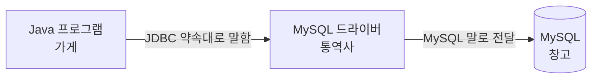
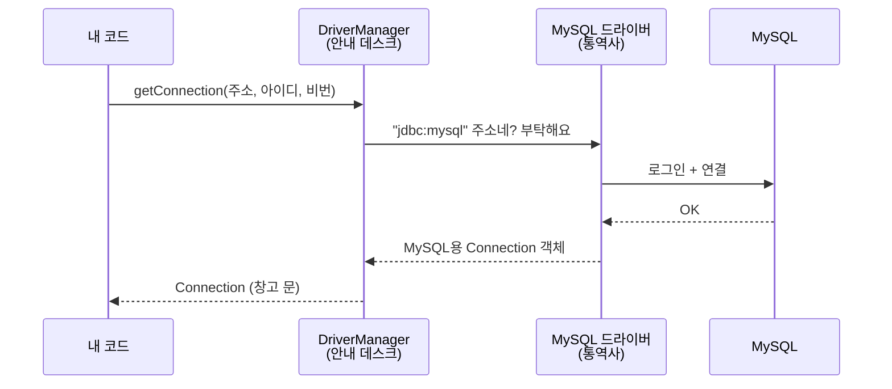
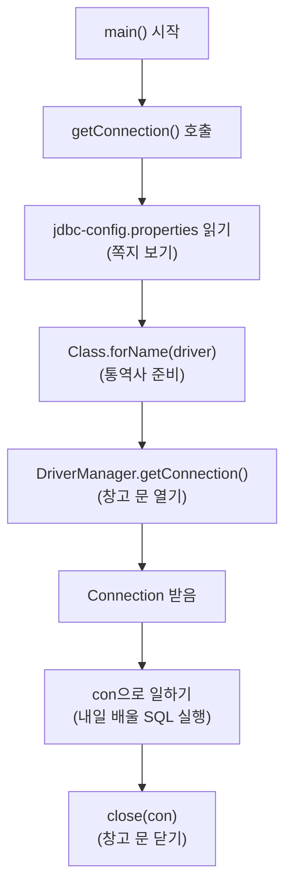

## 들어가며 (Situation)

[10/12]({{ site.baseurl }}), [10/13]({{ site.baseurl }})에는 MySQL Workbench에서 SQL을 직접 실행했다. 그런데 실제 프로그램(쇼핑몰, 학습 사이트)은 사람이 Workbench를 켜서 SQL을 치지 않는다. **Java 프로그램이 대신 DB에 접속해서 SQL을 보낸다.**

오늘(10/14)은 그 첫 단계로, **Java와 MySQL을 연결하는 법**을 배웠다. (`chap01-jdbc-connection`)

| 파일 | 하는 일 |
|------|---------|
| `a_connection/Application01` | DB 접속 정보를 코드에 직접 써서 연결 |
| `a_connection/Application02` | 접속 정보를 `jdbc-config.properties` 파일로 분리 |
| `b_template/JDBCTemplate` | 연결 만들기, 연결 끊기를 메서드로 묶음 |
| `b_template/Application` | `JDBCTemplate`을 불러서 한 줄로 연결 |

## 문제 상황 (Task)

### 쉽게 비유하면

- **MySQL**은 멀리 있는 **창고**다. 메뉴 정보가 잔뜩 들어 있다.
- **Java 프로그램**은 그 창고에서 물건을 꺼내 오고 싶은 **가게**다.
- 그런데 가게와 창고는 **말이 다르다.** 가게는 Java 말을 하고, 창고는 MySQL 말을 한다.

그래서 오늘 풀어야 할 문제는 세 가지였다.

1. 가게와 창고를 **어떻게 연결할까?** (말이 다른데)
2. 창고 주소와 **비밀번호를 코드에 그대로 적어도 될까?**
3. 기능이 늘어날 때마다 연결 코드를 **매번 다시 써야 할까?**

## 해결 과정 (Action)

### 1. JDBC — 가게와 창고 사이의 약속

**JDBC(Java Database Connectivity)** 는 "Java가 DB와 이야기할 때는 이 방법으로 하자"라는 **약속(규칙 모음)** 이다. Java가 기본으로 제공하는 `java.sql` 패키지에 들어 있다.

그런데 약속만 있으면 안 된다. MySQL 말로 실제 통역해 줄 **통역사**가 필요하다. 그게 **JDBC 드라이버**다. 드라이버는 MySQL을 만든 쪽에서 제공하고, `build.gradle`에 추가해서 받는다.

```groovy
dependencies {
    // mysql 연동을 위한 외부 api 의존성
    implementation 'com.mysql:mysql-connector-j:8.4.0'
}
```

| 비유 | 실제 | 누가 만들었나 |
|------|------|--------------|
| 가게 | 내 Java 프로그램 | 나 |
| 대화 약속 | JDBC (`java.sql`의 `Connection`, `Statement` 등) | Java |
| 통역사 | MySQL JDBC 드라이버 (`mysql-connector-j`) | MySQL |
| 창고 | MySQL DB (`menudb`) | MySQL |



이렇게 나눠 둔 덕분에, 나중에 창고를 MySQL에서 Oracle로 바꿔도 **통역사(드라이버)만 바꾸면** 내 코드는 거의 그대로 쓸 수 있다.

### 2. 첫 연결 — 창고 문 열기 (`Application01`)

```java
Connection con = null;

try {
    // ① 통역사(드라이버) 불러오기
    Class.forName("com.mysql.cj.jdbc.Driver");

    // ② 창고 문 열기: 주소, 아이디, 비밀번호
    con = DriverManager.getConnection(
            "jdbc:mysql://localhost/menudb",
            "wanted",
            "wanted"
    );

    // ③ 값이 찍히면 연결 성공!
    System.out.println("con = " + con);

} catch (ClassNotFoundException e) {
    throw new RuntimeException(e);
} catch (SQLException e) {
    throw new RuntimeException(e);
} finally {
    con = null;
}
```

한 줄씩 쉽게 풀면 이렇다.

| 코드 | 쉬운 말 |
|------|---------|
| `Class.forName("com.mysql.cj.jdbc.Driver")` | "MySQL 통역사님, 준비해 주세요" |
| `DriverManager` | 통역사들을 관리하는 **안내 데스크** |
| `DriverManager.getConnection(주소, 아이디, 비번)` | 안내 데스크에 "이 창고 문 열어 주세요" 부탁 |
| `Connection con` | 열린 **창고 문** (연결 통로) |
| `"jdbc:mysql://localhost/menudb"` | 창고 주소: MySQL, 내 컴퓨터(`localhost`), `menudb` 창고 |

`con`을 출력했을 때 `null`이 아니라 객체 정보가 찍히면 창고 문이 열린 것이다.

#### 왜 `new Connection()`이 아닐까?

`Connection`은 **인터페이스**(약속만 적힌 설계도)라서 `new`로 직접 만들 수 없다. 수업 주석에는 "`DriverManager`가 `Connection`을 구현한다"고 적혀 있었는데, 정확히는 조금 다르다.

- `DriverManager`는 **안내 데스크**일 뿐, `Connection`을 구현하지 않는다.
- 안내 데스크가 주소(`jdbc:mysql://...`)를 보고 **MySQL 드라이버에게 연결을 부탁**한다.
- 실제 `Connection` 객체는 **MySQL 드라이버가 만든 클래스**의 객체다.



나는 `Connection`이라는 **약속(인터페이스)** 만 보고 코드를 쓴다. 안에 어떤 회사의 객체가 들어 있는지는 몰라도 된다. 이것이 [10/6에 배운 다형성]({{ site.baseurl }})이다.

### 3. 비밀번호를 쪽지로 옮기기 (`Application02`)

`Application01`에는 문제가 있었다. **창고 주소와 비밀번호가 코드에 그대로 적혀 있다.** 코드를 친구에게 보여 주면 비밀번호도 같이 보인다. 비밀번호가 바뀌면 코드를 고쳐서 다시 빌드해야 한다.

그래서 접속 정보를 **따로 쪽지(파일)** 에 적었다. (`jdbc-config.properties`)

```properties
driver=...
url=...
user=...
password=...
```

`.properties` 파일은 `키=값` 형태로 한 줄씩 적는 설정 파일이다. Java의 `Properties` 객체가 이 파일을 읽는다.

```java
// 1. 쪽지를 읽을 Properties 객체 만들기
Properties prop = new Properties();

// 2. 쪽지 파일 읽기 (10/8에 배운 파일 입출력)
prop.load(new FileReader("src/main/java/com/wanted/a_connection/jdbc-config.properties"));

// 3. 키로 값 꺼내기
String driver = prop.getProperty("driver");
String url = prop.getProperty("url");
String user = prop.getProperty("user");
String password = prop.getProperty("password");

// 4. 꺼낸 값으로 연결
Class.forName(driver);
con = DriverManager.getConnection(url, user, password);
```

| 구분 | Application01 | Application02 |
|------|---------------|---------------|
| 접속 정보 위치 | Java 코드 안 | `.properties` 파일 |
| 비밀번호 바뀌면 | 코드 수정 + 다시 빌드 | **파일만 수정** |
| 코드에 비밀번호 노출 | 있음 | 없음 |

파일을 읽다 보니 `FileNotFoundException`, `IOException`까지 처리할 예외가 4개로 늘었다. [10/8에 배운 예외 처리]({{ site.baseurl }})가 여기서 바로 쓰였다.

> 코드에서 비밀번호를 뺀 건 좋은 출발이다. 그래도 이 `.properties` 파일을 Git에 올리면 결국 비밀번호가 공개된다. 실제 프로젝트에서는 이 파일을 `.gitignore`에 넣는다.

### 4. 반복되는 코드를 도우미에게 맡기기 (`JDBCTemplate`)

수업에서 이런 질문이 나왔다.

> 회원가입, 로그인, 회원정보 수정, 회원 삭제를 하려면 DB에 **4번** 접속해야 한다. 그때마다 `Application02`의 코드를 다 복사해야 할까?

복사하면 4곳이 똑같아지고, 쪽지 경로가 바뀌면 4곳을 다 고쳐야 한다. 그래서 반복되는 일을 **도우미 클래스** `JDBCTemplate`에 맡겼다.

```java
public class JDBCTemplate {

    // 창고 문 열어 주기
    public static Connection getConnection() {
        Connection con = null;
        Properties prop = new Properties();
        try {
            prop.load(new FileReader("src/main/java/com/wanted/a_connection/jdbc-config.properties"));

            String driver = prop.getProperty("driver");
            String url = prop.getProperty("url");
            String user = prop.getProperty("user");
            String password = prop.getProperty("password");

            Class.forName(driver);
            con = DriverManager.getConnection(url, user, password);

        } catch (FileNotFoundException e) {
            throw new RuntimeException(e);
        } catch (IOException e) {
            throw new RuntimeException(e);
        } catch (ClassNotFoundException e) {
            throw new RuntimeException(e);
        } catch (SQLException e) {
            throw new RuntimeException(e);
        }
        return con;
    }

    // 창고 문 닫아 주기
    public static void close(Connection con) {
        try {
            // 문이 있고, 아직 열려 있을 때만 닫는다
            if (con != null && !con.isClosed()) {
                con.close();
            }
        } catch (SQLException e) {
            throw new RuntimeException(e);
        }
    }
}
```

이제 쓰는 쪽은 아주 짧아진다.

```java
import static com.wanted.b_template.JDBCTemplate.close;
import static com.wanted.b_template.JDBCTemplate.getConnection;

public class Application {
    public static void main(String[] args) {
        Connection con = getConnection();   // 문 열기
        System.out.println("con = " + con);
        // con 을 활용해서 회원가입 진행!
        close(con);                         // 문 닫기
    }
}
```

| 코드 | 쉬운 말 |
|------|---------|
| `public static` 메서드 | 객체를 만들지 않고 `JDBCTemplate.getConnection()`으로 바로 부를 수 있다 |
| `import static ...getConnection` | 클래스 이름까지 생략하고 `getConnection()`만 써도 된다 |
| `con != null && !con.isClosed()` | "문이 있고, 아직 안 닫혔으면" — 이미 닫힌 문을 또 닫지 않게 확인 |

### 전체 흐름 한눈에 보기



### 시행착오: `con = null`은 문을 닫지 않는다

`Application01`과 `Application02`의 `finally`에는 `con = null;`이 있었다. 문을 닫는 것처럼 보이지만 **아니다.**

| 코드 | 실제로 일어나는 일 | 비유 |
|------|-------------------|------|
| `con = null` | 변수가 연결을 **가리키지 않게** 될 뿐, 연결은 그대로 | 창고 문을 열어 둔 채 **열쇠만 버림** |
| `con.close()` | DB와의 연결을 **실제로 끊음** | 창고 문을 **잠그고 나옴** |

DB가 동시에 받을 수 있는 연결 수에는 한계가 있다. 문을 열어 놓고 안 닫으면, 계속 쌓이다가 나중에는 새 연결을 못 받을 수 있다. 그래서 `JDBCTemplate`에서는 `close(con)`으로 **진짜로 닫는** 메서드를 만들었다.

### 참고: `Class.forName()`은 이제 생략해도 된다

JDBC 4.0부터는 드라이버 jar가 프로젝트에 있으면 `DriverManager`가 **알아서 통역사를 찾는다.** 그래서 `Class.forName()` 줄이 없어도 연결된다. 수업에서는 원리를 보여 주려고 직접 썼고, [10/19 수업]({{ site.baseurl }})의 `JDBCTemplate`에서는 이 줄이 빠졌다.

## 결과 (Result)

| 문제 | 해결 |
|------|------|
| Java와 MySQL은 말이 다르다 | JDBC(약속) + MySQL 드라이버(통역사) |
| 비밀번호가 코드에 노출된다 | `.properties` 파일로 분리하고 `Properties`로 읽기 |
| 연결 코드가 매번 반복된다 | `JDBCTemplate.getConnection()` / `close()` 두 메서드로 묶기 |

`Application02`에서 연결 한 번에 약 30줄이던 코드가, `JDBCTemplate`을 쓰니 **`getConnection()`과 `close(con)` 두 줄**이 됐다.

**배운 점**

- Java는 DB와 직접 말하지 않는다. **JDBC라는 약속**과 **드라이버라는 통역사**를 거친다.
- `Connection`은 인터페이스다. 실제 객체는 드라이버가 만들고, 나는 약속(인터페이스)만 보고 코드를 쓴다.
- 연 문은 **반드시 `close()`로 닫는다.** `null`을 넣는 것은 닫는 게 아니다.

## 더 학습하면 좋은 개념

- **try-with-resources** — `close()`를 직접 부르지 않아도 자동으로 닫아 주는 문법이다. 10/19 수업에서 실제로 썼다.
- **커넥션 풀(Connection Pool)** — 매번 창고 문을 새로 여는 대신 미리 몇 개 열어 두고 돌려 쓰는 방법이다. 실제 서버는 거의 이 방식을 쓴다.
- **클래스패스와 `getResourceAsStream()`** — 지금은 `src/main/java/...` 경로로 파일을 읽어서, 실행 위치가 바뀌면 파일을 못 찾는다. 10/19에 `resources` 폴더로 옮긴 이유다.
- **ServiceLoader** — JDBC 4.0부터 `Class.forName()` 없이 드라이버를 자동으로 찾는 원리다.

## 참고 자료

- [Oracle Java Tutorials - Establishing a Connection](https://docs.oracle.com/javase/tutorial/jdbc/basics/connecting.html)
- [Java SE 17 API - DriverManager](https://docs.oracle.com/en/java/javase/17/docs/api/java.sql/java/sql/DriverManager.html)
- [Java SE 17 API - Connection](https://docs.oracle.com/en/java/javase/17/docs/api/java.sql/java/sql/Connection.html)
- [Java SE 17 API - Properties](https://docs.oracle.com/en/java/javase/17/docs/api/java.base/java/util/Properties.html)
- [MySQL Connector/J Developer Guide - Connecting Using DriverManager](https://dev.mysql.com/doc/connector-j/en/connector-j-usagenotes-connect-drivermanager.html)
