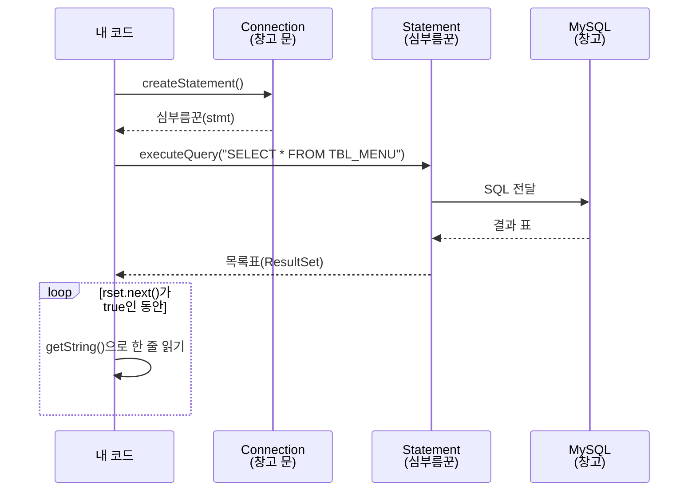
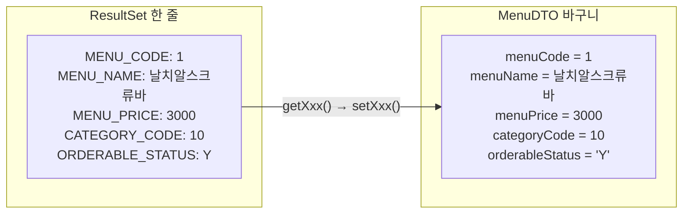
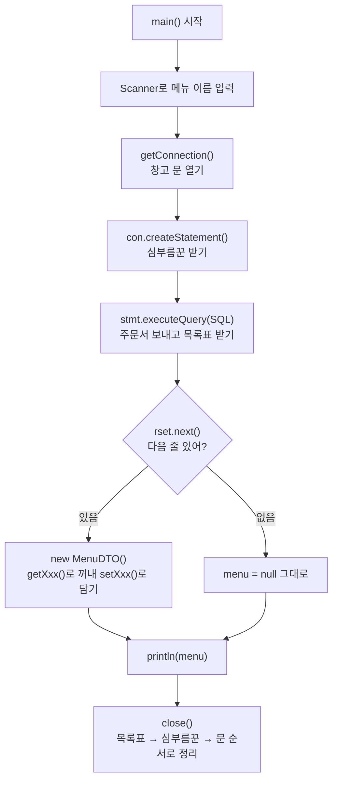

## 들어가며 (Situation)

[어제(10/14)]({{ site.baseurl }})는 Java 프로그램과 MySQL 창고 사이에 **문(Connection)을 여는 법**까지 배웠다. 문은 열었지만 아직 창고에서 아무것도 꺼내 오지 않았다.

오늘(10/15)은 열린 문으로 **SQL을 보내고, 결과를 받아서, Java 객체에 담는 법**을 배웠다. (`chap02-statement/a_statements`)

| 파일 | 하는 일 |
|------|---------|
| `common/JDBCTemplate` | 어제 만든 도우미 + `Statement`, `ResultSet` 닫기 추가 |
| `a_statements/Application01` | 메뉴 **전체** 조회해서 출력 |
| `a_statements/Application02` | 메뉴 이름을 입력받아 **하나** 조회 |
| `a_statements/Application03` | 조회 결과를 `MenuDTO` **객체에 담기** |
| `common/MenuDTO` | 메뉴 한 개를 담는 바구니 클래스 |
| `a_statements/Application04` | 하브루타 과제 |

## 문제 상황 (Task)

어제 비유를 이어 가면 이렇다.

- **창고 문(Connection)** 은 열렸다.
- 이제 창고에 **"이거 가져와 주세요"라고 적은 주문서(SQL)** 를 보내야 한다.
- 창고가 돌려준 **물건 목록(결과)** 을 한 줄씩 읽어야 한다.
- 읽은 물건을 화면에 찍고 끝내지 말고, **바구니(객체)에 담아** 다음 일에 쓸 수 있어야 한다.

## 해결 과정 (Action)

### 1. 등장인물 소개

수업에서 "JDBC의 핵심 인터페이스 2가지"로 `Statement`와 `ResultSet`을 소개했다.

| 이름 | 비유 | 하는 일 |
|------|------|---------|
| `Connection` | 창고 문 | DB와 연결된 통로 (어제 배움) |
| `Statement` | **심부름꾼** | SQL 주문서를 들고 창고에 가서 실행 |
| `ResultSet` | **물건 목록표** | 창고가 돌려준 결과 표 |
| `MenuDTO` | **바구니** | 메뉴 한 개의 정보를 담는 Java 객체 |

### 2. 메뉴 전체 조회 (`Application01`)

```java
Connection con = getConnection();   // ① 창고 문 열기
Statement stmt = null;
ResultSet rset = null;

try {
    // ② 문(con)에게 심부름꾼 한 명 보내 달라고 하기
    stmt = con.createStatement();

    // ③ 심부름꾼에게 주문서(SQL)를 주고 다녀오게 하기
    rset = stmt.executeQuery("SELECT * FROM TBL_MENU");

    // ④ 받은 목록표를 한 줄씩 읽기
    while (rset.next()) {
        System.out.println(
                rset.getString("MENU_NAME") + " 은/는 "
                + rset.getString("MENU_PRICE") + "원 입니다. "
        );
    }

} catch (SQLException e) {
    throw new RuntimeException(e);
} finally {
    close(con);    // ⑤ 다 썼으면 정리
    close(rset);
    close(stmt);
}
```

| 코드 | 쉬운 말 |
|------|---------|
| `con.createStatement()` | 창고 문에게 "심부름꾼 한 명 주세요". `Statement`도 인터페이스라 `new`로 못 만들고, 문(`con`)이 만들어 준다 |
| `stmt.executeQuery(sql)` | 심부름꾼이 SQL을 실행하고 **목록표(`ResultSet`)** 를 가져온다 |
| `rset.next()` | 손가락을 **다음 줄로 옮긴다.** 줄이 있으면 `true`, 끝이면 `false` |
| `rset.getString("MENU_NAME")` | 지금 손가락이 있는 줄에서 `MENU_NAME` 칸 값을 읽는다 |



#### `rset.next()`는 손가락이다

`ResultSet`을 처음 받으면 손가락(**커서**)은 **첫 줄보다 위**에 있다. 그래서 바로 `getString()`을 하면 안 되고, 먼저 `next()`로 첫 줄에 손가락을 올려야 한다.

| 순서 | 손가락 위치 | `next()` 결과 |
|------|------------|---------------|
| 처음 | 첫 줄 **위** (아무 줄도 아님) | — |
| `next()` 1번 | 1번째 줄 | `true` → 읽기 |
| `next()` 2번 | 2번째 줄 | `true` → 읽기 |
| … | … | … |
| 마지막 다음 | 줄 없음 | `false` → `while` 끝 |

그래서 **여러 줄**을 읽을 때는 `while (rset.next())`, **한 줄**만 기대할 때는 `if (rset.next())`를 쓴다.

### 3. 이름으로 메뉴 하나 찾기 (`Application02`)

실습 요구사항은 이랬다.

> Scanner로 메뉴 이름을 입력받아, 그 메뉴의 번호, 가격, 판매상태를 출력하라.
> 출력 예시: `날치알스크류바 의 정보 : 1 , 3000 원 , Y`

```java
Scanner sc = new Scanner(System.in);
System.out.print("메뉴 이름 입력 : ");
String menuName = sc.nextLine();

stmt = con.createStatement();
rset = stmt.executeQuery(
        "SELECT MENU_CODE, MENU_PRICE , ORDERABLE_STATUS FROM TBL_MENU WHERE MENU_NAME = '"
        + menuName + "'"
);

if (rset.next()) {
    System.out.println(
            menuName + " 의 정보 : " +
                    rset.getString("MENU_CODE") + " , " +
                    rset.getString("MENU_PRICE") + " 원 , " +
                    rset.getString("ORDERABLE_STATUS")
    );
}
```

입력받은 이름을 SQL 문자열 사이에 **이어 붙였다.** MySQL에서 문자열은 `'`로 감싸야 하니, `'` + 이름 + `'`를 직접 붙여야 한다. 따옴표를 하나만 빠뜨려도 SQL 문법 에러가 난다.

| 입력 | 만들어진 SQL |
|------|-------------|
| `날치알스크류바` | `... WHERE MENU_NAME = '날치알스크류바'` |

#### 시행착오: 이어 붙이기는 위험하다

이어 붙이기는 불편할 뿐 아니라 **위험하다.** 누군가 이름 칸에 `' OR '1'='1`을 입력하면 SQL이 이렇게 바뀐다.

```sql
SELECT ... FROM TBL_MENU WHERE MENU_NAME = '' OR '1'='1'
```

`'1'='1'`은 항상 참이라 **모든 메뉴가 조회된다.** 손님이 주문서에 몰래 글자를 끼워 넣어서 **주문서 내용 자체를 바꿔 버린 것**이다. 이걸 **SQL 인젝션**이라고 한다. 이 문제는 [10/19에 배운 `PreparedStatement`]({{ site.baseurl }})로 해결한다.

### 4. 바구니(DTO)에 담기 (`Application03`)

지금까지는 읽은 값을 `println`으로 **찍고 끝**이었다. 그런데 실제 프로그램은 조회한 메뉴로 다른 일을 해야 한다. 가격을 계산하거나, 화면에 보내거나, 다른 메서드에 넘긴다. 그러려면 값을 **하나의 객체에 담아** 들고 다닐 수 있어야 한다.

그 바구니가 **DTO(Data Transfer Object, 데이터를 나르는 객체)** 다.

```java
public class MenuDTO {

    /* DTO 기본 구성 요소
     * 1. 필드
     * 2. 기본 생성자
     * 3. 모든 필드를 초기화하는 생성자
     * 4. Getter , Setter
     * 5. toString
     */
    private int menuCode;
    private String menuName;
    private int menuPrice;
    private int categoryCode;
    private char orderableStatus;

    public MenuDTO() {}

    // ... 모든 필드 생성자, getter/setter, toString
}
```

| 구성 요소 | 왜 필요할까? |
|-----------|-------------|
| `private` 필드 | DB 표의 칸(컬럼) 하나 = 필드 하나 |
| 기본 생성자 | 빈 바구니를 먼저 만들고 나중에 채울 때 |
| 모든 필드 생성자 | 한 번에 꽉 채운 바구니를 만들 때 |
| getter / setter | `private` 필드를 꺼내고 넣는 통로 ([10/2 캡슐화]({{ site.baseurl }})) |
| `toString()` | `println(menu)` 했을 때 내용이 보기 좋게 찍히도록 |

DB의 한 줄이 바구니 하나가 된다.

| DB 컬럼 (`TBL_MENU`) | DB 타입 | DTO 필드 | Java 타입 | 꺼내는 메서드 |
|----------------------|---------|----------|-----------|--------------|
| `MENU_CODE` | 정수 | `menuCode` | `int` | `getInt()` |
| `MENU_NAME` | 문자열 | `menuName` | `String` | `getString()` |
| `MENU_PRICE` | 정수 | `menuPrice` | `int` | `getInt()` |
| `CATEGORY_CODE` | 정수 | `categoryCode` | `int` | `getInt()` |
| `ORDERABLE_STATUS` | 문자 1개 (`Y`/`N`) | `orderableStatus` | `char` | `getString().charAt(0)` |

```java
MenuDTO menu = null;   // 아직 바구니 없음

stmt = con.createStatement();
rset = stmt.executeQuery("SELECT * FROM TBL_MENU WHERE MENU_NAME = '" + menuName + "'");

if (rset.next()) {
    menu = new MenuDTO();                                     // 빈 바구니 만들기
    menu.setMenuCode(rset.getInt("MENU_CODE"));               // 칸마다 하나씩 담기
    menu.setMenuName(rset.getString("MENU_NAME"));
    menu.setMenuPrice(rset.getInt("MENU_PRICE"));
    menu.setCategoryCode(rset.getInt("CATEGORY_CODE"));
    menu.setOrderableStatus(rset.getString("ORDERABLE_STATUS").charAt(0));
}

System.out.println("menu = " + menu);
```

- `getInt()`로 꺼내면 처음부터 숫자라서, 바구니의 `int` 칸에 바로 들어간다.
- `ResultSet`에는 `getChar()`가 없다. 그래서 `getString()`으로 `"Y"`를 꺼낸 뒤 `.charAt(0)`으로 첫 글자 `'Y'`만 뗐다.
- 없는 메뉴 이름을 넣으면 `next()`가 `false`라서 `menu`는 `null` 그대로다. 그래서 `menu = null`이 출력된다.



(그림의 `CATEGORY_CODE` 값은 설명을 위한 예시다.)

### 5. 정리 도우미도 늘었다 (`JDBCTemplate`)

어제는 `close(Connection)`만 있었다. 오늘은 `Statement`와 `ResultSet`도 닫아야 해서, **이름은 같고 매개변수만 다른** `close()`를 두 개 더 만들었다.

```java
public static void close(Connection con) { ... }
public static void close(Statement stmt) { ... }
public static void close(ResultSet rset) { ... }
```

`close(con)`, `close(stmt)`, `close(rset)` 중 어떤 걸 부를지는 **넣는 값의 타입**을 보고 Java가 알아서 고른다. 이것이 [10/6에 배운 오버로딩]({{ site.baseurl }})이다.

#### 시행착오: 닫는 순서

수업 코드는 `close(con)` → `close(rset)` → `close(stmt)` 순서로 닫았다. 열린 순서는 **문(con) → 심부름꾼(stmt) → 목록표(rset)** 였으니, 닫을 때는 **거꾸로 목록표 → 심부름꾼 → 문** 이 자연스럽다.

| 순서 | 열 때 | 닫을 때 |
|------|-------|---------|
| 1 | `Connection` (문) | `ResultSet` (목록표) |
| 2 | `Statement` (심부름꾼) | `Statement` (심부름꾼) |
| 3 | `ResultSet` (목록표) | `Connection` (문) |

방에 들어갈 때 **현관 → 방문** 순서로 열었으면, 나올 때는 **방문 → 현관** 순서로 닫는 것과 같다. 문(`Connection`)을 먼저 닫아도 그 안의 것들이 같이 정리되긴 하지만, "나중에 연 것을 먼저 닫는다"는 습관을 들이는 게 좋다.

### 오늘의 Java 흐름 한눈에 보기



### 6. 하브루타 과제 (`Application04`)

수업 마지막에 짝과 함께 풀 과제가 나왔다.

1. 메뉴 **전체** 조회 결과를 Java 객체로 옮겨 담기
2. `EmployeeDB`로 각자 1개 이상 DB 접속, 조회 결과를 객체로 옮겨 담기

1번은 `Application01`(전체 조회)과 `Application03`(DTO에 담기)을 합치면 된다. 바구니가 여러 개 나오니, [10/7에 배운 컬렉션]({{ site.baseurl }}) `List`에 담는다. 아래는 **예시 코드**다.

```java
// 예시 코드: 전체 메뉴를 바구니 여러 개에 담아 List로 모으기
List<MenuDTO> menuList = new ArrayList<>();

while (rset.next()) {
    MenuDTO menu = new MenuDTO(
            rset.getInt("MENU_CODE"),
            rset.getString("MENU_NAME"),
            rset.getInt("MENU_PRICE"),
            rset.getInt("CATEGORY_CODE"),
            rset.getString("ORDERABLE_STATUS").charAt(0)
    );
    menuList.add(menu);
}

for (MenuDTO menu : menuList) {
    System.out.println(menu);
}
```

이 모양은 10/19에 만든 `MenuDAO.findAll()`과 거의 같다.

## 결과 (Result)

| 하고 싶었던 것 | 쓴 것 |
|----------------|-------|
| SQL 보내기 | `con.createStatement()` → `stmt.executeQuery(sql)` |
| 결과 읽기 | `ResultSet` + `next()` + `getString()` / `getInt()` |
| 결과를 객체에 담기 | `MenuDTO` + setter |
| 다 쓴 자원 정리 | `JDBCTemplate.close()` 3종 (오버로딩) |

**배운 점**

- JDBC로 조회하는 흐름은 **문 열기 → 심부름꾼 → 주문서 실행 → 목록표 한 줄씩 읽기 → 정리하기** 다섯 단계다.
- `ResultSet`의 손가락은 첫 줄 **위**에서 시작한다. 그래서 항상 `next()`부터 부른다.
- 조회 결과는 찍고 끝내지 말고 **DTO에 담는다.** 그래야 다른 메서드로 넘길 수 있다.
- SQL에 입력값을 이어 붙이는 `Statement`는 불편하고 위험하다. 그래서 다음 수업에서 `PreparedStatement`를 배운다.

## 더 학습하면 좋은 개념

- **PreparedStatement** — `?` 자리에 값을 끼워 넣어 SQL 인젝션을 막는 방법이다. 10/19 수업 내용이다.
- **SQL 인젝션** — 오늘 본 `' OR '1'='1` 공격이 실제로 어떤 피해(로그인 우회, 데이터 유출)로 이어지는지 알면 PreparedStatement가 왜 필수인지 이해된다.
- **DTO와 VO, Entity의 차이** — 데이터를 담는 객체도 쓰임에 따라 이름과 규칙이 다르다. 계층 구조를 배울 때 헷갈리지 않으려면 미리 알아 두면 좋다.
- **try-with-resources** — `finally`에서 `close()`를 세 번 부르지 않아도, 열린 반대 순서로 자동으로 닫아 준다.

## 참고 자료

- [Oracle Java Tutorials - Processing SQL Statements with JDBC](https://docs.oracle.com/javase/tutorial/jdbc/basics/processingsqlstatements.html)
- [Oracle Java Tutorials - Retrieving and Modifying Values from Result Sets](https://docs.oracle.com/javase/tutorial/jdbc/basics/retrieving.html)
- [Java SE 17 API - Statement](https://docs.oracle.com/en/java/javase/17/docs/api/java.sql/java/sql/Statement.html)
- [Java SE 17 API - ResultSet](https://docs.oracle.com/en/java/javase/17/docs/api/java.sql/java/sql/ResultSet.html)
- [OWASP - SQL Injection](https://owasp.org/www-community/attacks/SQL_Injection)
