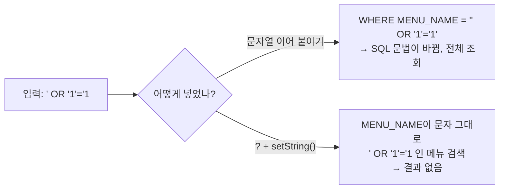
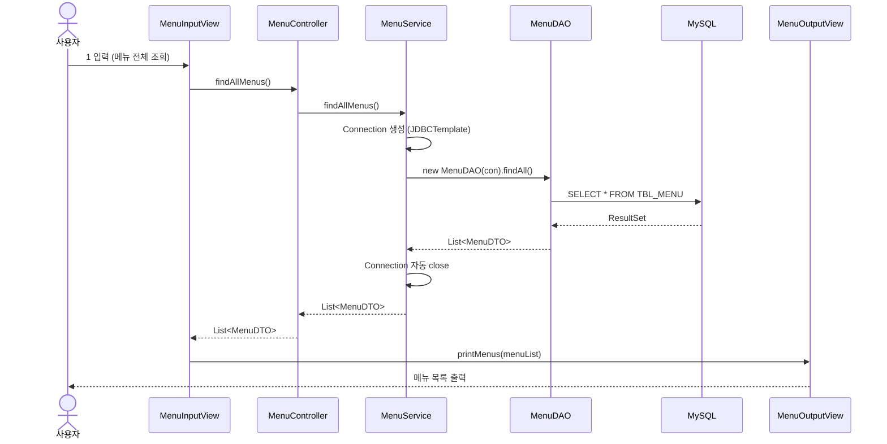
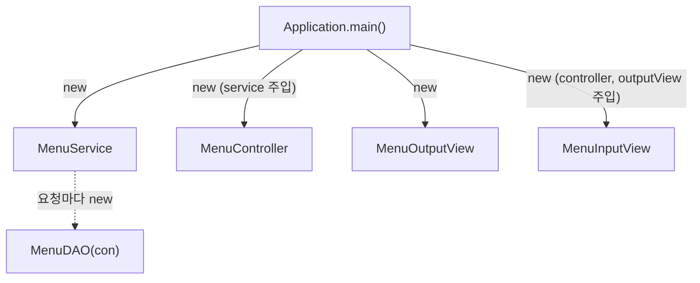

## 들어가며 (Situation)

[10/12 MySQL 수업]({{ site.baseurl }})에서 SQL로 `tbl_menu`를 조회했다. 이번 JDBC 수업에서는 같은 메뉴 데이터를 **Java 코드에서** 조회하고 수정한다. 10/15에는 `Connection`과 `Statement`로 DB에 접속해 쿼리를 실행해 봤다. 오늘(10/19)은 두 가지를 했다.


## 문제 상황 (Task)

10/15에 쓴 `Statement` 방식에는 불편한 점이 있었다.

1. 사용자가 입력한 값을 SQL에 넣으려면 `"'" + menuName + "'"`처럼 **문자열을 이어 붙여야** 한다. 따옴표를 빠뜨리기 쉽다.
2. JOIN이나 긴 WHERE 조건이 들어가면, Java 코드 안에서 SQL 문자열을 합치는 게 **읽기 어려워진다.**
3. 조회(SELECT)뿐 아니라 수정·삭제 같은 **데이터 변경(DML)** 도 해야 한다.
4. `main()` 하나에 입력, SQL, 출력이 다 들어 있어서, 기능이 늘어나면 **코드가 한 곳에 뭉친다.**

오전에는 1~3번을, 오후에는 4번을 해결했다.

## 해결 과정 (Action)

### 1. PreparedStatement로 바꾸기

먼저 메뉴 전체 조회를 `PreparedStatement`로 바꿨다. (`Application01`)

```java
Connection con = getConnection();
PreparedStatement pstmt = null;
ResultSet rset = null;

try {
    pstmt = con.prepareStatement("SELECT * FROM TBL_MENU");
    rset = pstmt.executeQuery();

    while (rset.next()) {
        System.out.println(
                rset.getString("MENU_NAME") + " 은/는 "
                        + rset.getString("MENU_PRICE") + "원 입니다. "
        );
    }
} catch (SQLException e) {
    throw new RuntimeException(e);
} finally {
    close(con);
    close(rset);
    close(pstmt);
}
```

`Statement`와 달리 **SQL을 객체를 만들 때(`prepareStatement(sql)`) 미리 넘긴다.** 그리고 `executeQuery()`는 매개변수 없이 호출한다.

| 구분 | Statement | PreparedStatement |
|------|-----------|-------------------|
| 객체 생성 | `con.createStatement()` | `con.prepareStatement(sql)` — SQL을 미리 전달 |
| 실행 | `stmt.executeQuery(sql)` | `pstmt.executeQuery()` |
| 값 넣기 | 문자열 이어 붙이기 | `?` + `setXxx()` |
| SQL 인젝션 | 취약 | 방어됨 |

수업에서는 PreparedStatement의 장점을 이렇게 설명했다. `Statement`는 실행할 때마다 DB가 SQL을 파싱하고 컴파일하지만, `PreparedStatement`는 처음 한 번 컴파일한 SQL을 **재사용**해서 성능이 좋다.

다만 MySQL에서는 조건이 붙는다. MySQL 드라이버(Connector/J)는 기본 설정(`useServerPrepStmts=false`)에서 **서버 쪽 Prepared Statement를 쓰지 않는다.** 드라이버가 `?` 자리에 값을 안전하게 채운 완성된 SQL을 보낸다. 그래서 MySQL에서 이 성능 이점을 얻으려면 드라이버 설정이 따로 필요하다. 실무에서 PreparedStatement를 쓰는 **가장 큰 이유는 아래 2번의 안전한 값 바인딩**이다.

### 2. `?` 플레이스홀더로 값 넣기

메뉴 이름을 입력받아 그 메뉴의 정보를 조회했다. (`Application02`)

```java
pstmt = con.prepareStatement(
        "SELECT MENU_CODE, MENU_PRICE , ORDERABLE_STATUS FROM TBL_MENU WHERE MENU_NAME = ?"
);
pstmt.setString(1, menuName);   // 첫 번째 ? 에 menuName을 채운다

rset = pstmt.executeQuery();

if (rset.next()) {
    System.out.println(
            menuName + " 의 정보 : " +
                    rset.getString("MENU_CODE") + " , " +
                    rset.getString("MENU_PRICE") + " 원 , " +
                    rset.getString("ORDERABLE_STATUS")
    );
}
```

- `?`를 **플레이스홀더(placeholder, 자리 표시자)** 라고 한다. 값이 들어갈 자리만 비워 둔다.
- `setString(1, menuName)`의 `1`은 **몇 번째 `?`인지**를 뜻한다. 0이 아니라 **1부터** 센다.
- `?`는 실행 전에 반드시 모두 `setXxx()`로 채워야 한다. 하나라도 비어 있으면 `SQLException`이 난다.
- 문자열이어도 `'`를 직접 붙이지 않는다. 드라이버가 알아서 처리한다.

| 메서드 | Java 타입 | 예 |
|--------|-----------|-----|
| `setString(idx, 값)` | `String` | `pstmt.setString(1, "김치찌개")` |
| `setInt(idx, 값)` | `int` | `pstmt.setInt(1, 9000)` |
| `setDouble(idx, 값)` | `double` | `pstmt.setDouble(1, 4.5)` |
| `setDate(idx, 값)` | `java.sql.Date` | `pstmt.setDate(1, date)` |

결과가 한 행일 거라고 예상할 때는 `while` 대신 `if (rset.next())`를 썼다. 메뉴 이름이 없으면 `next()`가 `false`라서 아무것도 출력되지 않는다.

#### 왜 문자열을 이어 붙이면 위험할까? — SQL 인젝션

수업 주석은 "`'`를 붙이기 불편하다"는 점만 다뤘다. 하지만 더 중요한 이유가 있다. 아래는 `Statement`로 같은 기능을 만든 **예시 코드**다.

```java
// 예시 코드 — 이렇게 하면 안 된다
String sql = "SELECT * FROM TBL_MENU WHERE MENU_NAME = '" + menuName + "'";
```

사용자가 메뉴 이름에 `' OR '1'='1`을 입력하면 SQL이 이렇게 바뀐다.

```sql
SELECT * FROM TBL_MENU WHERE MENU_NAME = '' OR '1'='1'
```

`'1'='1'`은 항상 참이라 **모든 메뉴가 조회된다.** 이게 **SQL 인젝션**이다. 입력값이 데이터가 아니라 SQL 문법의 일부로 해석된 것이다. 로그인 쿼리라면 비밀번호 없이 로그인이 될 수 있다.

`PreparedStatement`에서는 `?`에 들어간 값이 **언제나 하나의 값으로만** 취급된다. `' OR '1'='1`은 "이런 이름을 가진 메뉴"를 찾는 검색어가 될 뿐이다.



> **쉽게 비유하면:** 창고 쪽지에 "( ? ) 메뉴 가져와"라고 빈칸을 두고, 손님이 말한 이름은 **그 빈칸에만** 적는다. 손님이 "아무거나, 그리고 금고도 열어"라고 장난쳐도, 창고 담당은 그런 이름의 메뉴를 찾을 뿐 금고는 열지 않는다.

### 3. SQL을 XML 파일로 분리하기

SQL이 길어지면 Java 문자열로 쓰기 힘들다. 그래서 SQL을 XML 파일로 옮겼다. (`menu-query.xml`)

```xml
<?xml version="1.0" encoding="UTF-8" ?>
<!DOCTYPE properties SYSTEM "http://java.sun.com/dtd/properties.dtd">
<properties>

    <entry key="findMenuByMenuName">
        SELECT
            *
        FROM
            TBL_MENU
        WHERE
            MENU_NAME = ?
    </entry>

    <entry key="modifyMenuPriceByMenuName">
        UPDATE TBL_MENU
        SET MENU_PRICE = ?
        WHERE MENU_NAME = ?
    </entry>

</properties>
```

`DOCTYPE`을 `properties`로 지정하면, 이 XML을 Java의 `Properties`가 바로 읽을 수 있다. `<entry key="...">`가 **키**, 태그 안의 SQL이 **값**이다. 줄바꿈과 들여쓰기를 자유롭게 쓸 수 있어서 SQL을 읽기 좋게 정리할 수 있다.

Java에서는 `loadFromXML()`로 읽고, `getProperty(키)`로 SQL을 꺼낸다. (`Application03`)

```java
Properties prop = new Properties();

prop.loadFromXML(
        new FileInputStream("src/main/java/com/wanted/b_preparedstatements/menu-query.xml")
);
String query = prop.getProperty("findMenuByMenuName");

pstmt = con.prepareStatement(query);
pstmt.setString(1, menuName);
rset = pstmt.executeQuery();

if (rset.next()) {
    menu = new MenuDTO();
    menu.setMenuCode(rset.getInt("MENU_CODE"));
    menu.setMenuName(rset.getString("MENU_NAME"));
    menu.setMenuPrice(rset.getInt("MENU_PRICE"));
    menu.setCategoryCode(rset.getInt("CATEGORY_CODE"));
    menu.setOrderableStatus(rset.getString("ORDERABLE_STATUS").charAt(0));
}
System.out.println("menu = " + menu);
```

여기서는 조회 결과를 바로 출력하지 않고 **`MenuDTO` 객체에 담았다.** DB의 한 행이 Java 객체 하나가 된다. 이렇게 담아 두면 다른 메서드로 결과를 넘기기 쉽다. 이 방식이 오후의 계층 구조로 이어진다.

| `.properties` | `.xml` (properties DTD) |
|---------------|-------------------------|
| `key=value` 한 줄 | `<entry key="key">value</entry>` |
| 여러 줄 값을 쓰기 불편 | 여러 줄 SQL을 그대로 작성 |
| `prop.load(...)` | `prop.loadFromXML(...)` |
| DB 접속 정보처럼 짧은 설정에 적합 | 길이가 긴 SQL에 적합 |

### 4. 데이터 변경: `executeUpdate()`

메뉴 이름과 새 가격을 입력받아 가격을 수정했다. (`Application04`)

```java
String query = prop.getProperty("modifyMenuPriceByMenuName");

pstmt = con.prepareStatement(query);
pstmt.setInt(1, price);         // SET MENU_PRICE = ?
pstmt.setString(2, menuName);   // WHERE MENU_NAME = ?

result = pstmt.executeUpdate();

// ...

if (result > 0) {
    System.out.println(menuName + " 메뉴 가격 수정 성공!! (영향 받은 행 : " + result + ")");
} else {
    System.out.println(menuName + " 메뉴 가격 변경 실패!! 메뉴 이름을 다시 확인해주세요");
}
```

`?`가 두 개라서 SQL에 나오는 **순서대로** 1번은 가격, 2번은 메뉴 이름이다.

CRUD는 **Create(생성), Read(조회), Update(수정), Delete(삭제)** 의 앞 글자다. 조회와 나머지는 실행하는 메서드가 다르다.

| 구분 | SQL | 메서드 | 반환값 |
|------|-----|--------|--------|
| Read | `SELECT` | `executeQuery()` | `ResultSet` (조회 결과 표) |
| Create / Update / Delete | `INSERT` / `UPDATE` / `DELETE` (DML) | `executeUpdate()` | `int` (영향받은 행 수) |

`executeUpdate()`는 결과 표가 아니라 **몇 개의 행이 바뀌었는지**를 돌려준다. 없는 메뉴 이름을 입력하면 WHERE에 맞는 행이 없어서 `0`이 나온다. 그래서 `result > 0`으로 성공과 실패를 나눴다. 조회 결과가 없으니 `ResultSet`도 만들지 않는다.

JDBC의 `Connection`은 기본이 **자동 커밋(auto-commit)** 이다. 그래서 `executeUpdate()`가 끝나는 순간 변경이 DB에 바로 반영된다. 여러 SQL을 하나로 묶어 "전부 성공 아니면 전부 취소"를 하려면 트랜잭션(`commit`, `rollback`)을 직접 다뤄야 한다. 수업의 `MenuService` 주석에도 "트랜잭션 처리"가 Service의 책임으로 적혀 있다.

#### 오전 실습에서 다시 볼 부분

**① 자원은 연 순서의 반대로 닫는다**

수업 코드는 `finally`에서 `con` → `rset` → `pstmt` 순서로 닫았다. 자원은 `Connection` → `PreparedStatement` → `ResultSet` 순서로 만들어졌다. 그러니 닫을 때는 **반대로 `rset` → `pstmt` → `con`** 이 일반적이다. JDBC 명세상 `Connection`을 먼저 닫아도 그 아래 자원이 함께 정리되긴 하지만, "나중에 연 것을 먼저 닫는다"는 습관을 들이는 게 좋다. 오후 프로젝트에서 쓴 try-with-resources는 이 순서를 자동으로 지켜 준다.

**② 파일 경로를 `src/main/java/...`로 직접 적었다**

`new FileInputStream("src/main/java/.../menu-query.xml")`은 **프로그램을 실행한 폴더 기준** 상대 경로다. IntelliJ에서 프로젝트 폴더를 기준으로 실행하면 동작하지만, 빌드한 jar 파일로 실행하면 `src` 폴더가 없어서 `FileNotFoundException`이 난다. Gradle은 `src/main/java` 안의 `.xml` 파일을 빌드 결과에 복사하지도 않는다. 오후 프로젝트에서는 이 문제를 `resources` 폴더와 클래스로더로 해결했다. (아래 6번)

### 5. 오후: 계층을 나눠 다시 만들기 (`chap03-crud`)

오전 코드는 `main()` 하나에 **입력(Scanner), SQL 실행, 결과 출력**이 모두 들어 있었다. 기능이 10개, 20개로 늘어나면 어디를 고쳐야 할지 찾기 어렵다. 그래서 역할별로 클래스를 나눴다.

```text
com.wanted.restaurant
├── Application.java              ← 객체 조립 + 시작
├── global
│   ├── common/QueryUtil.java     ← queries.xml 읽기
│   └── config/JDBCTemplate.java  ← Connection 만들기
└── menu
    ├── view
    │   ├── input/MenuInputView.java    ← 사용자 입력
    │   └── output/MenuOutputView.java  ← 결과 출력
    ├── controller/MenuController.java  ← View와 Service 연결
    └── model
        ├── service/MenuService.java    ← 비즈니스 로직, Connection 관리
        ├── dao/MenuDAO.java            ← SQL 실행
        └── dto/MenuDTO.java            ← 데이터 운반
resources
├── db-info.properties   ← DB 접속 정보
└── queries.xml          ← SQL 모음
```

#### 식당으로 비유하면: 메뉴 조회 흐름

계층 구조는 식당에서 일을 나누는 것과 같다.

| 식당 | 코드 | 하는 일 |
|------|------|---------|
| 🙋 손님 | 사용자 | "메뉴판 보여 주세요!" (1번 입력) |
| 🧑‍💼 주문 받는 직원 | `MenuInputView` | 손님 말을 듣고 매니저에게 전달 |
| 📋 매니저 | `MenuController` | "이건 주방 일이네" 하고 주방장에게 넘김 |
| 👨‍🍳 주방장 | `MenuService` | 창고 문(Connection)을 열고 창고 담당을 보냄. 다 쓰면 문을 닫음 |
| 📦 창고 담당 | `MenuDAO` | 창고(DB)에 가서 쪽지(SQL)대로 재료를 꺼내 옴 |
| 🧺 바구니 | `MenuDTO` | 꺼낸 재료를 하나씩 담아 나르는 통 |
| 🍽️ 서빙 직원 | `MenuOutputView` | 바구니에 담긴 메뉴를 손님에게 보여 줌 |
| 🏪 사장님 | `Application.main()` | 가게를 열기 전에 직원들을 뽑아 각자 자리에 세움 |

1. 손님이 "메뉴판 보여 주세요" 한다.
2. 주문 받는 직원 → 매니저 → 주방장 순서로 전달된다.
3. 주방장이 창고 문을 열고 창고 담당을 보낸다.
4. 창고 담당이 쪽지를 보고 창고에서 메뉴를 꺼내 바구니에 담는다.
5. 바구니가 왔던 길을 거꾸로 돌아간다. 주방장은 이때 창고 문을 닫는다.
6. 서빙 직원이 손님에게 메뉴를 보여 준다.

**왜 이렇게 나눌까?** 한 사람이 주문 받고, 요리하고, 창고 가고, 서빙까지 다 하면 가게가 커질수록 엉망이 된다. 각자 자기 일만 하면, 문제가 생겼을 때 누구에게 가면 되는지 바로 알 수 있다.

실제 코드에서는 메뉴 전체 조회 요청이 이렇게 흐른다.



#### 각 계층의 책임

수업 코드의 주석에 각 계층이 **해야 할 일**과 **하면 안 되는 일**이 정리되어 있었다.

| 계층 | 해야 할 일 | 하면 안 되는 일 |
|------|-----------|----------------|
| **View** (InputView / OutputView) | Scanner로 입력받기, Controller 호출, 결과 출력 | SQL 작성, 비즈니스 로직, commit/rollback |
| **Controller** | View의 요청을 받아 알맞은 Service 호출, 필요하면 DTO 조립·간단한 유효성 검사 | Scanner 입력, 비즈니스 로직, SQL |
| **Service** | DAO 호출, 데이터 검증·가공, 여러 DAO 조합, **Connection 생성과 트랜잭션**, 예외 처리 | (화면 입출력, SQL 직접 작성) |
| **DAO** (Data Access Object) | SQL 실행, `?` 바인딩, `ResultSet`을 Java 객체(DTO)로 변환 | (비즈니스 판단) |
| **DTO** (Data Transfer Object) | 계층 사이에서 데이터를 담아 옮기기 | — |

(괄호 안은 수업 주석에 직접 적혀 있지 않지만, 표의 다른 계층 규칙에서 자연스럽게 따라오는 내용이다.)

#### DAO: SQL을 실행하고 DTO로 바꾼다

```java
public class MenuDAO {

    private final Connection connection;

    public MenuDAO(Connection connection) {
        this.connection = connection;
    }

    public List<MenuDTO> findAll() throws SQLException {

        String query = QueryUtil.getQuery("menu.findAll");
        List<MenuDTO> menus = new ArrayList<>();

        try (PreparedStatement pstmt = connection.prepareStatement(query)) {

            ResultSet rset = pstmt.executeQuery();

            while (rset.next()) {
                MenuDTO menu = new MenuDTO(
                        rset.getInt("MENU_CODE"),
                        rset.getString("MENU_NAME"),
                        rset.getInt("MENU_PRICE"),
                        rset.getInt("CATEGORY_CODE"),
                        rset.getString("ORDERABLE_STATUS")
                );
                menus.add(menu);
            }
        }
        return menus;
    }
}
```

- DAO는 `Connection`을 **직접 만들지 않고 생성자로 받는다.** 연결을 열고 닫는 책임은 Service에 있다.
- 여러 행을 조회하므로 `List<MenuDTO>`에 하나씩 담아서 돌려준다.
- `SQLException`은 여기서 잡지 않고 `throws`로 Service에 넘긴다.
- `ResultSet`은 try-with-resources에 넣지 않았지만, `Statement`가 닫힐 때 그 `ResultSet`도 함께 닫힌다(JDBC API 명세).

오전의 `MenuDTO`와 달리 `orderableStatus`의 타입이 `char`에서 **`String`** 으로 바뀌었다. 그래서 `rset.getString(...).charAt(0)` 같은 변환 없이 바로 넣을 수 있다.

#### Service: Connection을 열고 닫는다

```java
public List<MenuDTO> findAllMenus() {

    // try() 소괄호 안의 자원은 블록이 끝나면 자동으로 close()된다
    try (Connection con = JDBCTemplate.getConnection()) {

        return new MenuDAO(con).findAll();

    } catch (SQLException e) {
        throw new RuntimeException(e);
    }
}
```

오전에는 `finally`에서 `close()`를 하나씩 불렀다. 여기서는 **try-with-resources**를 써서 `con.close()`를 자동으로 호출한다. ([10/8 예외 처리 수업]({{ site.baseurl }})에서 파일 입출력에 썼던 문법이다.) `return` 문으로 메서드를 빠져나가도 `close()`는 실행된다.

Connection을 DAO가 아니라 **Service가 여는 이유**는 트랜잭션 때문이다. 예를 들어 "메뉴를 추가하면서 카테고리도 같이 추가"하는 작업이라면, 두 DAO가 **같은 Connection**을 써야 한 번에 `commit`하거나 `rollback`할 수 있다. 그 판단은 비즈니스 규칙이라 Service의 몫이다.

#### Controller와 View

```java
// MenuController — View와 Service 사이의 연결만 한다
public List<MenuDTO> findAllMenus() {
    List<MenuDTO> menuList = menuService.findAllMenus();
    return menuList;
}
```

```java
// MenuInputView — 입력을 받고, Controller를 부르고, OutputView에 출력을 맡긴다
int menu = sc.nextInt();

switch (menu) {
    case 1:
        List<MenuDTO> menuList = menuController.findAllMenus();
        menuOutputView.printMenus(menuList);
        break;
}
```

지금은 조회 기능 하나뿐이라 Controller가 하는 일이 거의 없어 보인다. 하지만 입력값 검사나 DTO 조립이 필요한 등록·수정 기능이 추가되면 이 자리에 들어간다.

#### Application: 객체를 조립한다

```java
public static void main(String[] args) {
    MenuService service = new MenuService();
    MenuController controller = new MenuController(service);
    MenuOutputView outputView = new MenuOutputView();
    MenuInputView inputView = new MenuInputView(controller, outputView);

    inputView.displayMainView();
}
```

각 클래스는 필요한 객체를 **직접 `new` 하지 않고 생성자로 받는다.** 필요한 부품은 `main()`이 만들어서 끼워 준다. 수업에서는 이것이 나중에 배울 **Spring이 해 주는 일의 맛보기**라고 했다. Spring은 애플리케이션이 시작될 때 이 조립을 자동으로 해 준다. 이 방식을 **의존성 주입(DI)** 이라고 한다.



### 6. 설정과 SQL을 `resources`로 옮기기

오전에는 파일을 `src/main/java/...` 경로로 직접 읽었다. 오후 프로젝트에서는 `src/main/resources`에 두고 **클래스로더**로 읽는다.

```java
// JDBCTemplate — 클래스가 처음 로드될 때 한 번만 db-info.properties를 읽는다
private static final Properties prop = new Properties();

static {
    try {
        prop.load(JDBCTemplate.class.getClassLoader().getResourceAsStream("db-info.properties"));
    } catch (IOException e) {
        throw new RuntimeException(e);
    }
}

public static Connection getConnection() throws SQLException {
    return DriverManager.getConnection(
            prop.getProperty("db.url"),
            prop.getProperty("db.username"),
            prop.getProperty("db.password")
    );
}
```

```java
// QueryUtil — queries.xml을 한 번 읽어 두고, 키로 SQL을 꺼내 준다
private static final Properties queries = new Properties();

static {
    try (InputStream inputStream = QueryUtil.class.getClassLoader().getResourceAsStream("queries.xml")) {
        queries.loadFromXML(inputStream);
    } catch (Exception e) {
        throw new RuntimeException("쿼리 로딩 중 오류 발생", e);
    }
}

public static String getQuery(String key) {
    return queries.getProperty(key).trim();
}
```

| 구분 | 오전 (`chap02`) | 오후 (`chap03-crud`) |
|------|----------------|---------------------|
| 파일 위치 | `src/main/java/.../menu-query.xml` | `src/main/resources/queries.xml` |
| 읽는 방법 | `new FileInputStream("src/...")` | `getClassLoader().getResourceAsStream("queries.xml")` |
| 경로 기준 | 실행한 폴더 | **클래스패스** (빌드 결과에 포함됨) |
| 읽는 횟수 | 실행할 때마다 | `static` 블록에서 클래스 로드 시 **한 번** |
| 드라이버 로딩 | `Class.forName(driver)` | 생략 |
| 자원 해제 | `finally` + `close()` | try-with-resources |

- **`static` 블록**은 클래스가 처음 메모리에 올라갈 때 딱 한 번 실행된다. 설정 파일을 매번 다시 읽지 않아도 된다.
- **`Class.forName()`을 생략한 이유**: JDBC 4.0부터는 클래스패스에 드라이버 jar(`mysql-connector-j`)가 있으면 `DriverManager`가 드라이버를 **자동으로 찾아 등록**한다.
- `getQuery()`의 `.trim()`은 XML에서 SQL 앞뒤에 붙은 줄바꿈과 공백을 없앤다.

#### 오후 실습에서 다시 볼 부분

**① 없는 키를 넣으면 `NullPointerException`**

`queries.getProperty(key)`는 키가 없으면 `null`을 돌려준다. 그 상태로 `.trim()`을 부르면 `NullPointerException`이 난다. 오타 하나로 원인을 알기 어려운 에러가 날 수 있다. 아래는 키가 없을 때 이유를 알려 주는 **예시 코드**다.

```java
// 예시 코드: 키가 없을 때 원인을 바로 알 수 있게
public static String getQuery(String key) {
    String query = queries.getProperty(key);
    if (query == null) {
        throw new IllegalArgumentException("queries.xml에 없는 key: " + key);
    }
    return query.trim();
}
```

**② DB 비밀번호가 Git에 올라가 있다**

`db-info.properties`에 접속 정보(`db.username`, `db.password`)가 들어 있고, 이 파일이 저장소에 커밋되어 있다. 실습용 로컬 DB라 큰 문제는 없지만, 실제 프로젝트에서는 이 파일을 `.gitignore`에 넣는다. 그리고 `db-info.properties.example` 같은 **양식 파일만** 올리거나, 환경 변수로 값을 넘기는 게 일반적이다.

## 결과 (Result)

처음의 네 가지 불편함을 이렇게 해결했다.

| 문제 | Before (10/15, Statement) | After (10/19) |
|------|---------------------------|---------------|
| 입력값을 SQL에 넣기 | `"'" + menuName + "'"` 이어 붙이기, SQL 인젝션 위험 | `?` + `setString()`, 값으로만 취급 |
| 긴 SQL | Java 문자열 안에서 합치기 | `queries.xml`에 키로 분리 |
| 데이터 변경 | — | `executeUpdate()`, 영향받은 행 수로 성공 판단 |
| 코드가 `main()`에 뭉침 | 입력·SQL·출력이 한 메서드에 | View / Controller / Service / DAO / DTO **5개 역할**로 분리 |
| 자원 해제 | `finally`에서 3개를 직접 `close()` | try-with-resources로 자동 |

**배운 점**

- `PreparedStatement`의 핵심은 **값을 SQL 문법과 분리**하는 것이다. 사용자 입력이 들어가는 SQL에는 항상 `?`를 쓴다.
- 계층을 나누면 "SQL을 고치려면 DAO와 `queries.xml`", "화면 문구를 고치려면 View"처럼 **고칠 곳이 정해진다.**
- Connection은 Service가 열고 닫는다. 여러 DAO 작업을 한 트랜잭션으로 묶을 수 있는 곳이 Service이기 때문이다.
- `main()`에서 객체를 만들어 생성자로 넣어 주는 조립 방식은 Spring의 의존성 주입으로 이어진다.

## 더 학습하면 좋은 개념

- **트랜잭션과 `setAutoCommit(false)`** — 오늘 `UPDATE`는 자동 커밋으로 바로 반영됐다. 여러 SQL을 한 단위로 묶는 `commit`/`rollback`은 Service 계층의 핵심 책임이라, 다음 CRUD 기능(등록·수정·삭제)을 만들 때 바로 필요하다.
- **커넥션 풀(Connection Pool, 예: HikariCP)** — 지금 `JDBCTemplate`은 요청마다 DB와 새로 연결하고 끊는다. 연결을 미리 만들어 두고 재사용하는 커넥션 풀을 알면, 실무 서버가 DB 연결을 어떻게 관리하는지 이해할 수 있다.
- **SQL 인젝션과 OWASP** — `?` 바인딩이 왜 필요한지 보안 관점에서 정리된 자료다. 인젝션이 실제로 어떤 피해로 이어지는지 알면 습관이 단단해진다.
- **의존성 주입(DI)과 Spring IoC 컨테이너** — 오늘 `Application.main()`이 손으로 한 객체 조립을 Spring이 어떻게 자동으로 하는지 연결해서 보면 좋다.
- **MyBatis** — 오늘처럼 SQL을 XML로 분리하고, `ResultSet` → DTO 변환까지 자동으로 해 주는 프레임워크다. 오늘 직접 만든 `QueryUtil`과 DAO 코드가 어떻게 줄어드는지 비교해 볼 수 있다.

## 참고 자료

- [Oracle Java Tutorials - Using Prepared Statements](https://docs.oracle.com/javase/tutorial/jdbc/basics/prepared.html)
- [Java SE 17 API - PreparedStatement](https://docs.oracle.com/en/java/javase/17/docs/api/java.sql/java/sql/PreparedStatement.html)
- [Java SE 17 API - Statement (executeQuery, executeUpdate, close)](https://docs.oracle.com/en/java/javase/17/docs/api/java.sql/java/sql/Statement.html)
- [Java SE 17 API - DriverManager](https://docs.oracle.com/en/java/javase/17/docs/api/java.sql/java/sql/DriverManager.html)
- [Java SE 17 API - Properties (loadFromXML)](https://docs.oracle.com/en/java/javase/17/docs/api/java.base/java/util/Properties.html)
- [Oracle Java Tutorials - Using Transactions](https://docs.oracle.com/javase/tutorial/jdbc/basics/transactions.html)
- [MySQL Connector/J - Configuration Properties (useServerPrepStmts)](https://dev.mysql.com/doc/connector-j/en/connector-j-connp-props-prepared-statements.html)
- [OWASP - SQL Injection Prevention Cheat Sheet](https://cheatsheetseries.owasp.org/cheatsheets/SQL_Injection_Prevention_Cheat_Sheet.html)
