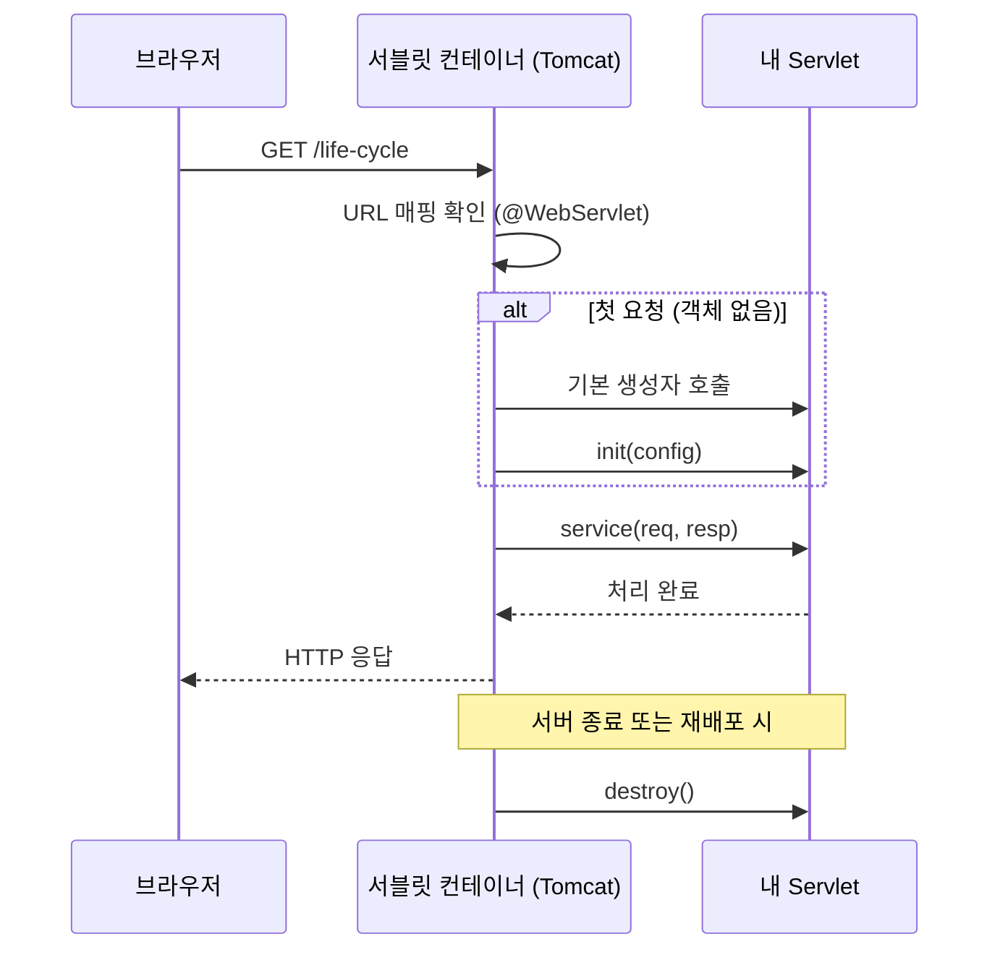
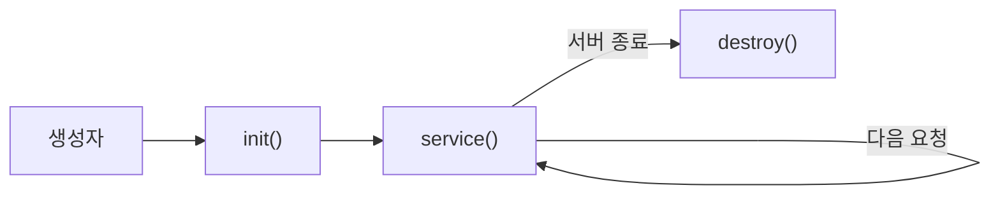
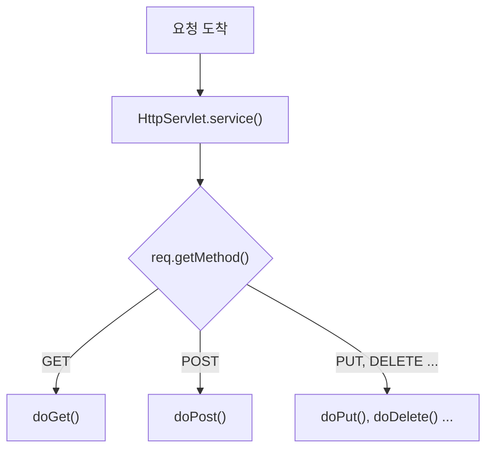
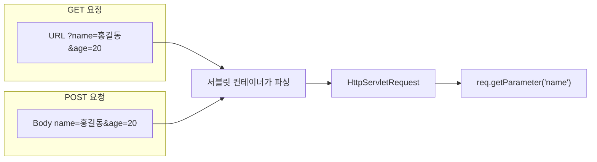

## 들어가며 (Situation)

지금까지 Java는 `main()` 메서드에서 시작해서 위에서 아래로 실행되는 프로그램만 만들었다. 오늘 배운 **Servlet**에는 `main()`이 없다. 그런데도 브라우저에서 주소를 입력하면 내가 만든 클래스의 메서드가 실행된다.

오늘 수업(`chap01-servlet`)의 구성은 다음과 같다.

| 패키지 | 클래스 | URL | 주제 |
|--------|--------|-----|------|
| `a_lifecycle` | `LifeCycleServlet` | `/life-cycle` | 서블릿 생명주기 |
| `b_service` | `ServiceMethodServlet` | `/request-service` | `service()`, `doGet()`, `doPost()` |
| `c_parameter` | `QueryStringServlet` | `/querystring` | GET 파라미터 |
| `c_parameter` | `FormDataServlet` | `/formdata` | POST 파라미터 |

프로젝트는 Gradle `war` 플러그인을 쓰고, 의존성은 `jakarta.servlet-api` 6.1.0을 `compileOnly`로 추가했다. `compileOnly`인 이유는 서블릿 API를 실행 시점에 **서버(Tomcat 같은 WAS)가 제공**하기 때문이다. 내 war 파일 안에 넣을 필요가 없다.

## 문제 상황 (Task)

이 글에서 답하려는 질문은 하나다.

> `main()`도 없고 `new`도 하지 않았는데, **누가 내 서블릿 객체를 만들고 메서드를 호출하는가?**

이 질문은 세 가지로 나뉜다.

1. 서블릿 객체는 **언제 만들어지고 언제 사라지는가?** (생명주기)
2. 요청이 오면 **어떤 메서드가** 실행되는가? (`service()` → `doGet()` / `doPost()`)
3. 사용자가 보낸 값은 **어떻게 꺼내는가?** (`getParameter()`)

## 해결 과정 (Action)

### 1. 전체 흐름 먼저 보기

답부터 말하면 객체를 만들고 메서드를 호출하는 쪽은 **서블릿 컨테이너(WAS)** 다. 나는 "이 URL로 요청이 오면 이 클래스를 써라"라고 알려 주고, 정해진 메서드를 **오버라이딩**만 한다. 프로그램 흐름의 주도권이 내 코드가 아니라 컨테이너에 있다. 이걸 **제어의 역전(IoC)** 이라고 부른다.

#### 식당으로 비유하면: 왜 `main()`이 없어도 될까?

- **일반 Java 프로그램**은 혼자 하는 **포장마차**다. 문을 열고 장사를 시작하는 것까지 내가 직접 해야 한다. 그 "가게 문 열기"가 `main()`이다.
- **서블릿**은 큰 식당에 고용된 **요리사**다. 식당 문을 열고 손님을 받는 일은 **식당 주인(Tomcat)** 이 한다.
- 요리사는 "짜장면 주문이 들어오면 내가 만들게요"라고 정해 두기만 하면 된다. 이게 `@WebServlet("/짜장면")`과 `doGet()`이다.
- 손님이 오면 주인이 요리사를 부른다. 그래서 요리사는 가게 문을 열 필요가 없다.

| 식당 | 서블릿 |
|------|--------|
| 식당 주인 | 서블릿 컨테이너 (Tomcat) |
| 가게 문 열기 | `main()` — Tomcat 안에 이미 있음 |
| 요리사 | 내가 만든 서블릿 클래스 |
| "짜장면은 내가 만들게요" | `@WebServlet("/짜장면")` |
| 손님의 주문 | 브라우저의 HTTP 요청 |
| 요리하기 | `doGet()` / `doPost()` |

**한 줄 정리:** `main()`은 Tomcat 안에 이미 있다. Tomcat이 먼저 실행된 다음, 요청이 올 때마다 내 서블릿을 불러 준다. 그래서 내가 `main()`을 쓸 필요가 없다.



#### 오버라이딩(Overriding)이란?

**오버라이딩**은 자식 클래스가 부모 클래스에게 물려받은 메서드를 **같은 이름, 같은 매개변수**로 다시 정의하는 것이다. 이렇게 하면 부모의 동작 대신 자식이 정의한 동작이 실행된다.

서블릿에서는 `HttpServlet`이 부모 클래스다. `doGet()`, `doPost()`, `init()`, `destroy()` 같은 메서드가 이미 만들어져 있고, 내 서블릿은 필요한 메서드만 골라서 다시 정의한다.

```java
public class ServiceMethodServlet extends HttpServlet {   // HttpServlet을 상속

    @Override   // 부모의 doGet()을 다시 정의한다고 컴파일러에게 알림
    protected void doGet(HttpServletRequest req, HttpServletResponse resp) throws ServletException, IOException {
        System.out.println("GET 요청을 처리할 메소드 호출됨...");
    }
}
```

오버라이딩을 하려면 Java 언어 명세가 정한 규칙을 지켜야 한다.

| 규칙 | 내용 | 서블릿 예 |
|------|------|-----------|
| 메서드 시그니처 | 이름과 매개변수의 타입·개수·순서가 부모와 같아야 한다 | `doGet(HttpServletRequest, HttpServletResponse)` |
| 반환 타입 | 부모와 같거나, 부모 반환 타입의 하위 타입이어야 한다 | `void` 그대로 |
| 접근 제어자 | 부모보다 **좁힐 수 없다** (넓히는 건 가능) | 부모가 `protected`이니 `protected` 또는 `public`만 가능 |
| 예외 | 부모가 선언한 것보다 **넓은 checked 예외**를 던질 수 없다 | `ServletException`, `IOException`까지만 |
| 대상 | `private`, `final`, `static` 메서드는 오버라이딩할 수 없다 | — |

`@Override` 어노테이션은 없어도 오버라이딩은 된다. 하지만 붙여 두면 **컴파일러가 진짜 오버라이딩인지 검사**해 준다. 예를 들어 `doGet`을 `doget`으로 잘못 쓰면, `@Override`가 없을 때는 새 메서드가 하나 생길 뿐이다. 그러면 GET 요청이 와도 내 코드가 실행되지 않는데, 에러가 나지 않아서 원인을 찾기 어렵다. `@Override`가 있으면 그 자리에서 컴파일 에러가 난다.

오버라이딩이 서블릿에서 중요한 이유는 **컨테이너는 부모 타입(`HttpServlet`)의 메서드를 호출하는데, 실제로는 내가 다시 정의한 메서드가 실행**되기 때문이다. 컨테이너는 내 클래스 이름을 몰라도 된다. 정해진 메서드(`service()`, `init()` 등)만 부르면, Java가 실행 시점에 실제 객체의 메서드를 찾아 실행해 준다. 이것이 10/6에 배운 **다형성**이다.

| 구분 | 오버로딩 (Overloading) | 오버라이딩 (Overriding) |
|------|------------------------|-------------------------|
| 뜻 | 같은 이름, **다른 매개변수**로 메서드를 여러 개 만듦 | 부모 메서드를 **같은 시그니처**로 다시 정의 |
| 위치 | 같은 클래스 안 (상속 관계에서도 가능) | 부모-자식 클래스 사이 |
| 결정 시점 | 컴파일 시점 | 실행 시점 |
| 서블릿 예 | `init()`과 `init(ServletConfig)`는 서로 오버로딩 관계 | `doGet()`, `doPost()`를 다시 정의 |

### 2. URL과 클래스 연결하기: `@WebServlet`

```java
@WebServlet(value = "/life-cycle")
public class LifeCycleServlet extends HttpServlet {
```

| 부분 | 의미 |
|------|------|
| `@WebServlet` | 이 클래스가 서블릿이라고 컨테이너에 알려 주는 어노테이션 |
| `value = "/life-cycle"` | 이 서블릿이 처리할 URL 패턴 |
| `extends HttpServlet` | HTTP 요청을 처리하는 기본 기능을 상속받음 |

예전에는 `web.xml`에 `<servlet>`과 `<servlet-mapping>`을 직접 적어서 연결했다. 오늘 프로젝트의 `web.xml`은 비어 있고, 어노테이션만으로 매핑했다.

### 3. 생명주기: 생성자 → init → service → destroy

`LifeCycleServlet`은 각 단계에서 로그를 찍고, 몇 번째 호출인지 세도록 만들었다.

```java
@WebServlet(value = "/life-cycle")
public class LifeCycleServlet extends HttpServlet {

    private int initCount = 1;
    private int serviceCount = 1;
    private int destroyCount = 1;

    public LifeCycleServlet() {
        System.out.println("기본생성자 호출됨...");
    }

    @Override
    public void init(ServletConfig config) throws ServletException {
        System.out.println("init() 호출됨... : " + initCount++);
    }

    @Override
    protected void service(HttpServletRequest req, HttpServletResponse resp) throws ServletException, IOException {
        System.out.println("service() 호출됨... : " + serviceCount++);
    }

    @Override
    public void destroy() {
        System.out.println("destory() 호출됨... : " + destroyCount++);
    }
}
```

`/life-cycle`에 여러 번 접속하면 콘솔에 이렇게 찍힌다. (출력 순서를 보여 주기 위한 예시다.)

```text
기본생성자 호출됨...
init() 호출됨... : 1
service() 호출됨... : 1
service() 호출됨... : 2
service() 호출됨... : 3
destory() 호출됨... : 1      ← 서버를 종료할 때
```

| 단계 | 호출 시점 | 호출 횟수 |
|------|----------|-----------|
| 생성자 | 처음 요청이 들어왔을 때 (기본 설정) | 1번 |
| `init()` | 생성 직후, 초기화 | 1번 |
| `service()` | **요청이 올 때마다** | 요청 수만큼 |
| `destroy()` | 서버 종료, 재배포 등으로 서블릿을 내릴 때 | 1번 |

여기서 알 수 있는 중요한 사실은 **서블릿 객체가 하나만 만들어진다**는 점이다. 요청이 100번 와도 생성자와 `init()`은 한 번만 실행되고, 같은 객체의 `service()`가 100번 호출된다. 그래서 `serviceCount`가 1, 2, 3으로 계속 올라간다. 요청마다 새 객체가 만들어졌다면 매번 1이 찍혔을 것이다.



#### 시행착오: `init(ServletConfig)`를 오버라이딩할 때 주의할 점

수업 코드는 `init(ServletConfig config)`를 오버라이딩하면서 `super.init(config)`를 호출하지 않았다. 로그를 찍는 데는 문제가 없다. 하지만 부모 클래스 `GenericServlet`의 `init(ServletConfig)`는 **전달받은 config를 저장하는 일**을 한다. 이 호출을 빼면 나중에 `getServletConfig()`가 `null`을 돌려준다.

공식 문서도 같은 내용을 안내한다. 초기화 코드를 넣을 때는 매개변수가 없는 `init()`을 오버라이딩하면 된다. 아래는 **예시 코드**다.

```java
// 예시 코드: config 저장은 부모에게 맡기고, 내 초기화 코드만 작성
@Override
public void init() throws ServletException {
    System.out.println("init() 호출됨...");
}
```

### 4. 요청 처리: `service()`가 `doGet()` / `doPost()`로 나눠 준다

`service.html`에서 같은 URL(`/request-service`)로 세 가지 요청을 보낸다.

| HTML | HTTP 메서드 |
|------|-------------|
| `<a href="/request-service">` | GET (링크 클릭 = URL 이동) |
| `<form action="/request-service" method="get">` | GET |
| `<form action="/request-service" method="post">` | POST |

처음에는 `service()`를 직접 오버라이딩해서 `req.getMethod()`로 어떤 방식의 요청인지 출력해 봤다. 그다음 `service()`를 주석 처리하고 `doGet()`과 `doPost()`만 남겼다.

```java
@WebServlet(value = "/request-service")
public class ServiceMethodServlet extends HttpServlet {

    @Override
    protected void doGet(HttpServletRequest req, HttpServletResponse resp) throws ServletException, IOException {
        System.out.println("GET 요청을 처리할 메소드 호출됨...");
    }

    @Override
    protected void doPost(HttpServletRequest req, HttpServletResponse resp) throws ServletException, IOException {
        System.out.println("POST 요청을 처리할 메소드 호출됨...");
    }
}
```

`service()`를 오버라이딩하지 않았는데도 GET 요청이면 `doGet()`이, POST 요청이면 `doPost()`가 실행된다. **부모 `HttpServlet`의 `service()`가 HTTP 메서드를 확인하고 알맞은 `doXxx()`를 대신 호출**해 주기 때문이다.



그래서 두 방식의 차이가 생긴다.

| 방식 | 결과 |
|------|------|
| `service()`를 직접 오버라이딩 | 모든 요청이 내 `service()`로 들어온다. 부모의 분기 로직이 실행되지 않아서 `doGet()`/`doPost()`가 **호출되지 않는다.** |
| `doGet()`/`doPost()`만 오버라이딩 | 부모의 `service()`가 메서드별로 나눠 준다. **일반적으로 쓰는 방식** |

`LifeCycleServlet`에서 `service()`를 직접 오버라이딩한 건 생명주기를 보기 위해서였다. 실제 요청 처리 코드는 `doGet()`과 `doPost()`에 쓴다.

참고로 `doPost()`만 만들고 GET으로 요청하면, 부모의 기본 `doGet()`이 실행되어 **405 Method Not Allowed** 응답이 간다.

### 5. 사용자가 보낸 값 꺼내기: Request Parameter

`parameter.html`은 이름, 나이, 생일, 성별, 국적, 취미를 입력받는 폼이다. 같은 폼을 GET(`/querystring`)과 POST(`/formdata`)로 각각 보낸다.

폼의 각 입력 요소는 `name` 속성을 **키**로, 입력값을 **값**으로 해서 서버에 전달된다.

| 입력 요소 | `name` | 전달되는 값 |
|-----------|--------|-------------|
| `<input type="text">` | `name` | 입력한 글자 |
| `<input type="number">` | `age` | 입력한 숫자 (문자열로) |
| `<input type="date">` | `birthday` | `2021-01-08` 형식 |
| `<input type="radio">` | `gender` | 선택한 것의 `value` 1개 (`M` / `F`) |
| `<select>` | `national` | 선택한 `option`의 `value` |
| `<input type="checkbox">` | `hobbies` | 체크한 것 **여러 개** |

#### GET: 쿼리스트링으로 전달

GET 폼을 제출하면 값이 URL 뒤에 붙는다.

```text
/querystring?name=홍길동&age=20&birthday=2021-01-08&gender=M&national=ko&hobbies=movie&hobbies=music&hobbies=sleep
```

`?` 뒤가 **쿼리스트링**이다. `키=값`이 `&`로 이어져 있다. 그래서 폼이 아니어도 `<a href>`에 직접 쿼리스트링을 써서 같은 요청을 보낼 수 있다. 수업에서도 그렇게 해 봤다.

```java
@WebServlet(value = "/querystring")
public class QueryStringServlet extends HttpServlet {

    @Override
    protected void doGet(HttpServletRequest req, HttpServletResponse resp) throws ServletException, IOException {
        System.out.println("doGet() 호출됨...");

        String name = req.getParameter("name");
        System.out.println("name = " + name);

        int age = Integer.parseInt(req.getParameter("age"));
        System.out.println("age = " + age);
    }
}
```

`getParameter()`는 항상 `String`을 돌려준다. HTTP로 오가는 값은 모두 문자열이기 때문이다. 숫자로 쓰려면 `Integer.parseInt()`처럼 **직접 변환(파싱)** 해야 한다.

#### POST: 요청 본문(Body)으로 전달

POST 폼을 제출하면 URL은 `/formdata` 그대로이고, 값은 **요청 본문(Body, Payload)** 에 담겨 간다. 그런데 서버에서 값을 꺼내는 코드는 GET과 똑같다.

```java
@WebServlet(value = "/formdata")
public class FormDataServlet extends HttpServlet {

    @Override
    protected void doPost(HttpServletRequest req, HttpServletResponse resp) throws ServletException, IOException {
        System.out.println("doPost() 호출됨...");
        String name = req.getParameter("name");
        System.out.println("name = " + name);
    }
}
```

값이 URL에 있든 본문에 있든, 컨테이너가 파싱해서 `HttpServletRequest`에 넣어 준다. 나는 `getParameter("키")`만 부르면 된다.



#### GET과 POST 비교

| 항목 | GET | POST |
|------|-----|------|
| 데이터 위치 | URL (쿼리스트링) | 요청 본문 (Body) |
| 주소창 노출 | 보임 | 보이지 않음 |
| 길이 제한 | 브라우저·서버가 정한 URL 길이 제한이 있음 | 상대적으로 큰 데이터도 가능 |
| 북마크·새로고침 | 같은 URL로 다시 요청 가능 | 새로고침 시 재전송 경고 |
| 주 용도 | **조회** | **등록·수정** (게시글 작성, 회원가입) |
| 서블릿 메서드 | `doGet()` | `doPost()` |

수업 주석에는 "GET은 200자 내외만 전달 가능", "POST는 느리다"라는 설명이 있었다. 공식 HTTP 명세(RFC 9110)를 찾아보니 조금 다르게 이해해야 한다.

- **길이:** HTTP 명세 자체에는 URL 길이 제한이 없다. 다만 브라우저와 서버가 각자 제한을 두고, 명세는 최소 8000자 정도는 지원하라고 권장한다. 그래서 "정해진 200자"라기보다 **"긴 데이터를 보내기에는 부적합하다"** 로 이해하는 게 정확하다.
- **보안:** POST도 본문이 암호화되는 건 아니다. 주소창과 브라우저 기록에 남지 않을 뿐이다. 실제로 데이터를 보호하는 건 **HTTPS**다.
- **조회에 GET을 쓰는 진짜 이유:** 명세에서 GET은 **안전한(safe) 메서드**, 즉 서버 상태를 바꾸지 않는 요청으로 정의되어 있다. 그래서 캐싱, 북마크, 재요청이 자유롭다. 속도 차이보다 이 **의미의 차이**가 더 중요하다.

#### 시행착오: 파라미터를 꺼낼 때 조심할 점

수업 코드를 보면서 실행해 보면 바로 만날 수 있는 문제들을 정리했다.

**① 나이를 비우고 제출하면 에러가 난다**

나이 칸을 비우면 `getParameter("age")`는 빈 문자열 `""`을 돌려준다. `Integer.parseInt("")`는 `NumberFormatException`을 던진다. 파라미터가 아예 없으면 `null`이 오고, 이때도 같은 예외가 난다. 아래는 **예시 코드**다.

```java
// 예시 코드: 값이 없을 때를 먼저 확인
String ageParam = req.getParameter("age");
int age = 0;
if (ageParam != null && !ageParam.isEmpty()) {
    age = Integer.parseInt(ageParam);
}
```

**② 취미(체크박스)는 `getParameter()`로 하나만 나온다**

`hobbies=movie&hobbies=music&hobbies=sleep`처럼 같은 키가 여러 번 오면 `getParameter("hobbies")`는 **첫 번째 값(`movie`)만** 돌려준다. 여러 값을 모두 받으려면 `getParameterValues()`를 써야 한다. 아래는 **예시 코드**다.

```java
// 예시 코드: 같은 키로 온 값을 배열로 모두 받기
String[] hobbies = req.getParameterValues("hobbies");
if (hobbies != null) {   // 하나도 체크하지 않으면 null
    for (String hobby : hobbies) {
        System.out.println("hobby = " + hobby);
    }
}
```

| 메서드 | 반환 | 값이 없을 때 |
|--------|------|-------------|
| `getParameter("키")` | `String` (첫 번째 값) | `null` |
| `getParameterValues("키")` | `String[]` (모든 값) | `null` |
| `getParameterMap()` | `Map<String, String[]>` (전체) | 빈 Map |

**③ POST로 보낸 한글이 깨진다면**

POST 본문은 요청에 인코딩 정보가 없으면 서버 설정에 따라 다른 문자셋으로 해석될 수 있다. 한글 이름이 깨져서 출력된다면, 값을 꺼내기 **전에** 인코딩을 지정한다. 아래는 **예시 코드**다.

```java
// 예시 코드: getParameter()보다 먼저 호출해야 적용된다
req.setCharacterEncoding("UTF-8");
String name = req.getParameter("name");
```

`web.xml`에 `<request-character-encoding>UTF-8</request-character-encoding>`을 적어서 앱 전체에 한 번에 적용할 수도 있다.

## 결과 (Result)

처음 질문 "`main()`도 `new`도 없는데 누가 내 코드를 실행하는가?"의 답은 **서블릿 컨테이너**였다. 오늘 배운 흐름을 한 장으로 정리하면 다음과 같다.

| 순서 | 누가 | 무엇을 | 관련 코드 |
|------|------|--------|-----------|
| 1 | 브라우저 | URL로 GET/POST 요청 | `<a href>`, `<form method>` |
| 2 | 컨테이너 | URL에 맞는 서블릿 찾기 | `@WebServlet("/...")` |
| 3 | 컨테이너 | 첫 요청이면 객체 생성 + 초기화 | 생성자, `init()` |
| 4 | 컨테이너 | `service()` 호출 | `HttpServlet.service()` |
| 5 | `HttpServlet` | HTTP 메서드에 따라 분기 | `doGet()` / `doPost()` |
| 6 | 내 코드 | 파라미터 꺼내서 처리 | `req.getParameter()` |
| 7 | 컨테이너 | 서버 종료 시 정리 | `destroy()` |

수업 코드를 다시 보며 정리한 내용도 남겨 둔다.

| 위치 | 수업 코드 | 정리한 내용 |
|------|----------|-------------|
| `LifeCycleServlet` | `init(ServletConfig)`에서 `super.init(config)` 없음 | `getServletConfig()`가 `null`이 된다. 초기화는 `init()` 오버라이딩 권장 |
| `ServiceMethodServlet` | `service()` 주석 처리 후 `doGet()`/`doPost()` | 부모 `service()`가 분기해 준다. `service()`를 직접 오버라이딩하면 `doXxx()`는 호출되지 않음 |
| `QueryStringServlet` | `Integer.parseInt(req.getParameter("age"))` | 값이 비면 `NumberFormatException` |
| 체크박스 `hobbies` | `getParameter()`로는 첫 값만 | 여러 값은 `getParameterValues()` |
| GET/POST 주석 | "GET 200자", "POST 느림" | 명세상 고정 제한은 없음. 핵심 차이는 데이터 위치와 의미(조회 vs 변경) |

**배운 점**

- 서블릿은 내가 실행하는 코드가 아니라 **컨테이너가 정해진 시점에 불러 주는 코드**다. 그래서 어떤 메서드를 오버라이딩하느냐가 곧 "언제 실행될지"를 정한다.
- 서블릿 객체는 **하나**이고, 요청마다 `service()`만 다시 호출된다. 생명주기 예제의 카운트가 1, 2, 3으로 올라가는 것으로 확인했다.
- GET과 POST는 서버 쪽 코드(`getParameter()`)는 같고, **데이터가 실려 가는 위치와 용도**가 다르다.

## 더 학습하면 좋은 개념

- **서블릿과 멀티스레드(Thread Safety)** — 서블릿 객체는 하나인데 요청은 동시에 여러 개 들어온다. 컨테이너는 요청마다 스레드를 만들어 같은 객체의 `service()`를 동시에 호출한다. 그래서 `serviceCount` 같은 인스턴스 필드에 요청 데이터를 저장하면 위험하다.
- **`loadOnStartup`** — 기본적으로 서블릿은 첫 요청 때 만들어진다. `@WebServlet(loadOnStartup = 1)`을 주면 서버가 시작할 때 미리 만들어서 첫 요청이 느려지지 않는다.
- **응답 보내기 (`HttpServletResponse`)** — 오늘은 콘솔에만 출력했다. `resp.setContentType()`과 `resp.getWriter()`로 브라우저에 HTML을 보내는 것이 다음 단계다.
- **forward와 redirect** — 서블릿이 요청을 다른 서블릿이나 JSP로 넘기는 두 가지 방법이다. 둘은 URL 변경 여부와 요청 객체 공유 여부가 다르다.
- **Spring MVC의 DispatcherServlet** — Spring도 내부적으로는 서블릿 하나(`DispatcherServlet`)가 모든 요청을 받아 컨트롤러로 나눠 준다. 오늘 배운 `service()` 분기 구조를 알면 Spring의 동작이 이해된다.

## 참고 자료

- [Jakarta Servlet 6.1 Specification](https://jakarta.ee/specifications/servlet/6.1/jakarta-servlet-spec-6.1)
- [Jakarta Servlet 6.1 API - HttpServlet](https://jakarta.ee/specifications/servlet/6.1/apidocs/jakarta.servlet/jakarta/servlet/http/httpservlet)
- [Jakarta Servlet 6.1 API - GenericServlet](https://jakarta.ee/specifications/servlet/6.1/apidocs/jakarta.servlet/jakarta/servlet/genericservlet)
- [Jakarta Servlet 6.1 API - ServletRequest](https://jakarta.ee/specifications/servlet/6.1/apidocs/jakarta.servlet/jakarta/servlet/servletrequest)
- [Java Language Specification (SE 17) - 8.4.8 Inheritance, Overriding, and Hiding](https://docs.oracle.com/javase/specs/jls/se17/html/jls-8.html#jls-8.4.8)
- [Java SE 17 API - @Override](https://docs.oracle.com/en/java/javase/17/docs/api/java.base/java/lang/Override.html)
- [RFC 9110 - HTTP Semantics (Methods)](https://www.rfc-editor.org/rfc/rfc9110#name-methods)
- [MDN - HTTP 요청 메서드](https://developer.mozilla.org/ko/docs/Web/HTTP/Methods)
