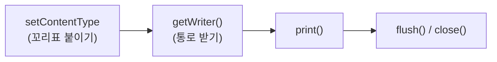
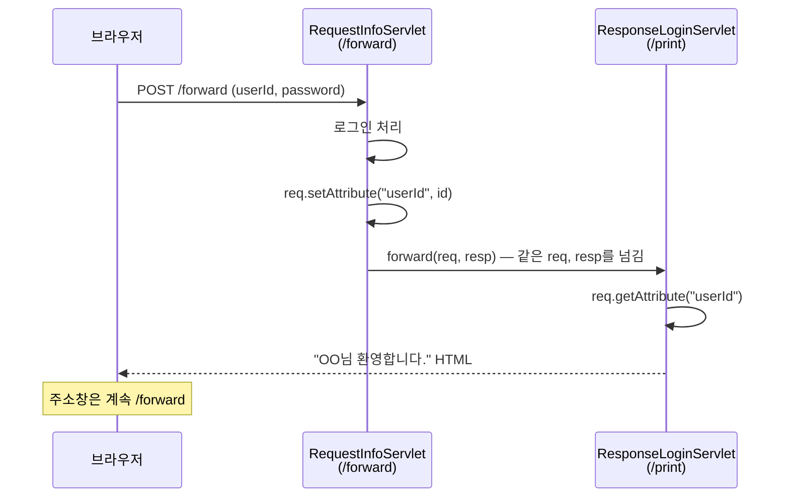
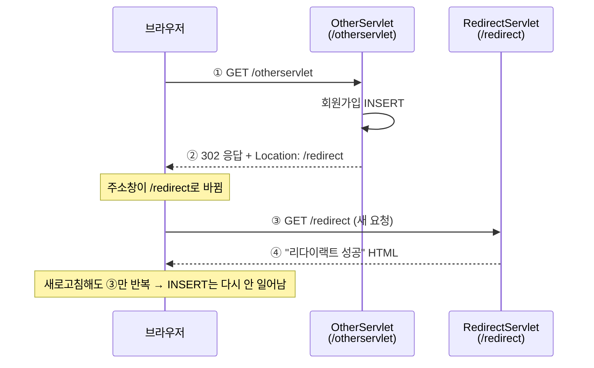
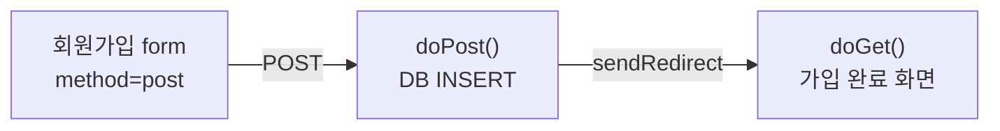
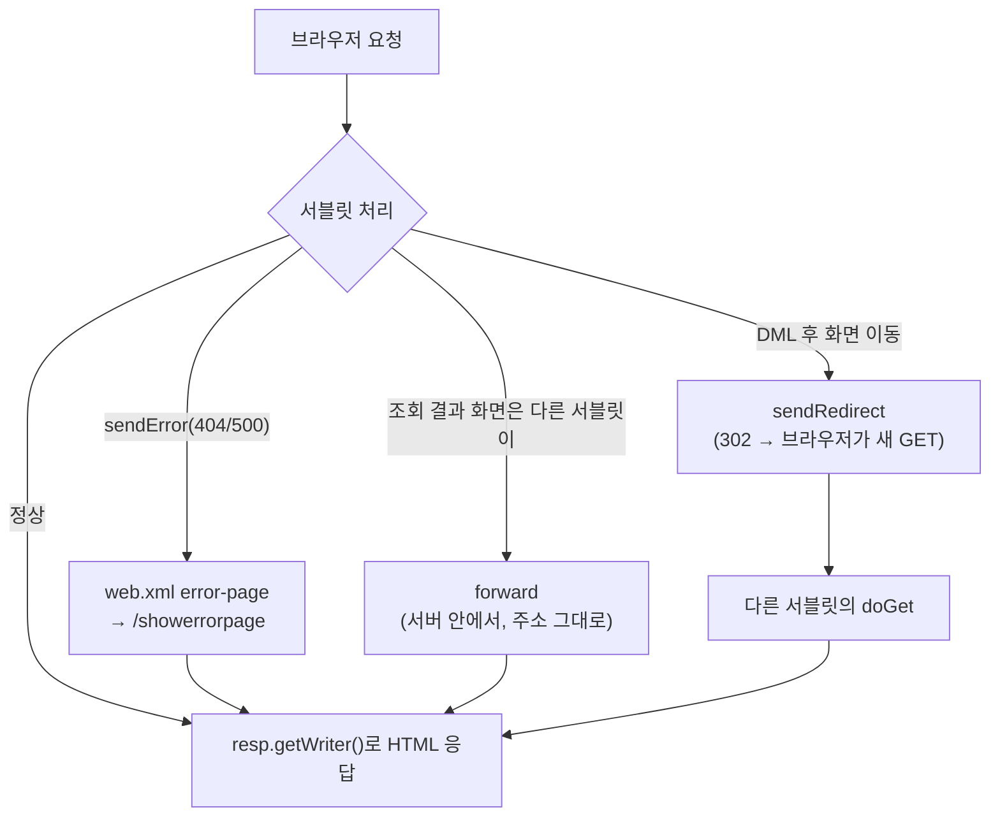

## 들어가며 (Situation)

[어제(10/21)]({{ site.baseurl }})는 서블릿이 **요청을 받는 법**을 배웠다. 생명주기, `doGet()`/`doPost()`, `getParameter()`로 값 꺼내기까지 했다. 그런데 결과는 전부 **콘솔에만** 찍혔다. 브라우저 화면에는 아무것도 나오지 않았다.

오늘(10/22)은 그다음 단계다.

| 패키지 | 클래스 | URL | 주제 |
|--------|--------|-----|------|
| `d_response` | `ResponseServlet` | `/response` | 브라우저에 HTML 응답 보내기 |
| `e_exception` | `Show404Servlet`, `Show500Servlet` | `/show404`, `/show500` | 일부러 에러 내기 |
| `e_exception` | `ExceptionServlet` + `web.xml` | `/showerrorpage` | 에러가 나면 보여 줄 페이지 |
| `f_forward` | `RequestInfoServlet` → `ResponseLoginServlet` | `/forward` → `/print` | **forward**: 다른 서블릿에게 일 넘기기 |
| `g_redirect` | `OtherServlet` → `RedirectServlet` | `/otherservlet` → `/redirect` | **redirect**: 브라우저에게 다시 요청하라고 하기 |

## 문제 상황 (Task)

어제 쓴 식당 비유를 이어 가면 이렇다. 손님은 **브라우저**, 식당 주인은 **Tomcat**, 요리사는 **서블릿**이다.

1. 요리사가 요리를 했는데 **손님 식탁에 내놓는 법**을 모른다. (응답)
2. 없는 메뉴를 시키거나 주방에 불이 나면 손님에게 **뭐라고 안내할지** 정해야 한다. (에러 페이지)
3. 요리사 한 명이 주문 받기, 요리, 서빙을 다 하면 너무 바쁘다. **일을 나눠야** 한다. (forward)
4. 주문을 처리한 뒤 손님이 **새로고침**하면 같은 주문이 또 들어간다. 이걸 막아야 한다. (redirect)

## 해결 과정 (Action)

### 1. 응답 보내기 — 손님 식탁에 내놓기 (`ResponseServlet`)

수업에서 서블릿의 역할을 세 가지로 정리했다.

| 역할 | 하는 일 | 배운 날 |
|------|---------|---------|
| 요청 받기 | GET/POST에 따라 파라미터 꺼내기 | 10/21 |
| Controller 역할 | 받은 데이터를 Service 계층에 넘기기 | (10/19 계층 구조와 연결) |
| **응답 보내기** | `HttpServletResponse`로 사용자에게 결과 보내기 | **오늘** |

```java
@WebServlet("/response")
public class ResponseServlet extends HttpServlet {

    @Override
    protected void doGet(HttpServletRequest req, HttpServletResponse resp) throws ServletException, IOException {

        // ① 보낼 HTML 만들기
        StringBuilder response = new StringBuilder();
        response.append("<!doctype html>\n")
                .append("<html>\n")
                .append("<body>\n")
                .append("<h1>Servlet 의 응답 결과!</h1>")
                .append("</body>\n")
                .append("</html>\n");

        System.out.println("response type : " + resp.getContentType());   // null

        // ② "이건 HTML이고, UTF-8 글자예요" 라고 알려 주기
        resp.setContentType("text/html; charset=UTF-8");

        // ③ 브라우저로 내보내는 통로 받기
        PrintWriter out = resp.getWriter();
        out.print(response);
        out.flush();   // 남은 내용 바로 보내기
        out.close();   // 통로 닫기
    }
}
```

| 코드 | 쉬운 말 |
|------|---------|
| `StringBuilder` | HTML 글자를 조각조각 이어 붙이는 도구. `+`로 문자열을 계속 붙이는 것보다 효율적이다 |
| `resp.setContentType("text/html; charset=UTF-8")` | "이 접시는 **HTML 요리**이고, 글자는 **UTF-8**로 썼어요" 라는 꼬리표 |
| `resp.getWriter()` | 손님 식탁으로 이어진 **배달 통로**(`PrintWriter`) |
| `out.print(...)` | 통로에 요리 올리기 |
| `out.flush()` / `out.close()` | 남은 걸 다 보내고 통로 닫기 |

`setContentType()`을 하기 전에 `getContentType()`을 찍으면 `null`이 나온다. 아직 꼬리표를 안 붙였기 때문이다.

#### 순서가 중요하다: 꼬리표 먼저, 통로는 나중에

`setContentType()`은 **`getWriter()`보다 먼저** 불러야 한다. `getWriter()`를 부르는 순간 글자 인코딩이 정해져 버린다. 그 뒤에 `charset=UTF-8`을 붙여도 적용되지 않아서 **한글이 깨진다.** 수업 코드는 순서가 올바르다.



### 2. 에러 페이지 — 문제가 생겼을 때 안내하기

#### 일부러 에러 내기 (`Show404Servlet`, `Show500Servlet`)

```java
@WebServlet("/show404")
public class Show404Servlet extends HttpServlet {
    @Override
    protected void doGet(HttpServletRequest req, HttpServletResponse resp) throws ServletException, IOException {
        resp.sendError(404, "페이지가 없습니다!");
    }
}

@WebServlet("/show500")
public class Show500Servlet extends HttpServlet {
    @Override
    protected void doGet(HttpServletRequest req, HttpServletResponse resp) throws ServletException, IOException {
        resp.sendError(500, "500번대 Error 는 순전히 개발자의 잘못.");
    }
}
```

`resp.sendError(상태코드, 메시지)`는 "정상 응답 대신 **에러 응답**을 보내라"는 뜻이다.

| 상태 코드 | 뜻 | 누구 잘못? | 식당 비유 |
|-----------|----|-----------|-----------|
| 2xx (200) | 성공 | — | 주문한 요리가 나옴 |
| 3xx (302) | 다른 곳으로 가세요 | — | "저쪽 창구로 가세요" (아래 redirect) |
| 4xx (404) | 요청한 것이 없음 | 주로 **클라이언트** (주소 오타 등) | 메뉴판에 없는 요리를 시킴 |
| 5xx (500) | 서버 내부 오류 | **서버(개발자)** | 주방에 불이 남 |

#### 에러가 나면 어디로 보낼지 정하기 (`web.xml`)

```xml
<web-app ...>
    <error-page>
        <error-code>404</error-code>
        <location>/showerrorpage</location>
    </error-page>
    <error-page>
        <error-code>500</error-code>
        <location>/showerrorpage</location>
    </error-page>
</web-app>
```

"404나 500 에러가 나면 **`/showerrorpage` 서블릿**이 대신 응답해라"라는 설정이다. 이게 없으면 Tomcat이 기본으로 만든 투박한 에러 화면이 나온다.

#### 에러 안내 서블릿 (`ExceptionServlet`)

```java
@WebServlet("/showerrorpage")
public class ExceptionServlet extends HttpServlet {

    @Override
    protected void doGet(HttpServletRequest req, HttpServletResponse resp) throws ServletException, IOException {

        String forwardUrl = req.getAttribute("jakarta.servlet.forward.request_uri").toString();

        // 컨테이너가 넣어 준 에러 정보 꺼내기
        int statusCode = (int) req.getAttribute("jakarta.servlet.error.status_code");
        String msg = req.getAttribute("jakarta.servlet.error.message").toString();

        StringBuilder responseBuilder = new StringBuilder();
        responseBuilder.append("<!doctype html>\n")
                // ... (생략)
                .append("<h1>").append(statusCode).append(" - ").append(msg).append("</h1>")
                // ... (생략)
                ;

        resp.setContentType("text/html; charset=UTF-8");
        PrintWriter out = resp.getWriter();
        out.print(responseBuilder);
        out.flush();
        out.close();
    }
}
```

에러가 나면 컨테이너(Tomcat)가 **요청 객체에 에러 정보를 넣어서** 이 서블릿을 불러 준다. `req.getAttribute("이름")`으로 꺼낸다.

| 속성 이름 | 들어 있는 값 | 예 |
|-----------|-------------|-----|
| `jakarta.servlet.error.status_code` | 상태 코드 (`Integer`) | `404` |
| `jakarta.servlet.error.message` | `sendError()`에 넣은 메시지 | `페이지가 없습니다!` |
| `jakarta.servlet.error.request_uri` | 에러가 난 원래 요청 주소 | `/show404` |
| `jakarta.servlet.error.exception` | 예외가 원인이면 그 예외 객체 | — |

`/show404`를 누르면 화면에 `404 - 페이지가 없습니다!`가 나온다. 주소창은 `/show404` 그대로다. 손님은 에러 안내 서블릿이 따로 있다는 걸 모른다. 수업에서는 이것을 **forward와 같은 개념**이라고 설명했다. 바로 다음에 배우는 내용이다.

#### 시행착오: 원래 주소는 `error.request_uri`로 꺼내자

수업 코드는 원래 주소를 `jakarta.servlet.forward.request_uri`로 꺼냈다. 그런데 서블릿 명세에서 **에러 페이지용으로 정해 둔 속성은 `jakarta.servlet.error.request_uri`** 이다. `forward.*` 속성이 에러 상황에도 채워지는지는 서버 구현에 따라 다를 수 있다. 값이 없으면 `getAttribute()`는 `null`을 돌려주고, 거기에 `.toString()`을 부르면 **에러 페이지에서 또 에러(NullPointerException)** 가 난다. 아래는 **예시 코드**다.

```java
// 예시 코드: 에러 페이지용 속성으로 꺼내고, null이어도 안전하게
Object uri = req.getAttribute("jakarta.servlet.error.request_uri");
String requestUri = String.valueOf(uri);   // null이면 "null" 문자열
```

### 3. forward — 주방 안에서 다른 요리사에게 넘기기

로그인을 예로 들었다. 하나의 서블릿이 **로그인 처리**와 **환영 화면 만들기**를 다 하면 책임이 너무 많다. 그래서 둘로 나눴다.

| 서블릿 | URL | 책임 |
|--------|-----|------|
| `RequestInfoServlet` | `/forward` | 아이디·비밀번호 받아서 **로그인 처리** |
| `ResponseLoginServlet` | `/print` | "OO님 환영합니다" **화면 만들기** |

```java
// RequestInfoServlet — 로그인 처리만 하고 응답은 넘긴다
@Override
protected void doPost(HttpServletRequest req, HttpServletResponse resp) throws ServletException, IOException {

    String id = req.getParameter("userId");
    String pwd = req.getParameter("password");

    // memberService.login(id, pwd);   ← 실제로는 Service → DAO → MySQL
    System.out.println("로그인 성공!!!");

    // ① 다음 서블릿에게 줄 쪽지 붙이기
    req.setAttribute("userId", id);

    // ② /print 서블릿에게 요청과 응답을 통째로 넘기기
    RequestDispatcher rd = req.getRequestDispatcher("/print");
    rd.forward(req, resp);
}
```

```java
// ResponseLoginServlet — 넘겨받아서 화면만 만든다
@WebServlet("/print")
public class ResponseLoginServlet extends HttpServlet {

    @Override
    protected void doPost(HttpServletRequest req, HttpServletResponse resp) throws ServletException, IOException {

        // 앞 서블릿이 붙여 준 쪽지 꺼내기
        String id = req.getAttribute("userId").toString();

        StringBuilder responseText = new StringBuilder();
        responseText.append("<!doctype html>\n")
                // ... (생략)
                .append("<h3 align=\"center\">").append(id).append("님 환영합니다.</h3>")
                // ... (생략)
                ;

        resp.setContentType("text/html; charset=UTF-8");
        PrintWriter out = resp.getWriter();
        out.print(responseText.toString());
        out.flush();
        out.close();
    }
}
```

**식당 비유:** 손님이 계산대 직원에게 주문하면, 직원은 주문서를 **주방 안에서** 요리사에게 건넨다. 손님은 계산대 앞에 그대로 서 있고, 누가 요리했는지 모른다.



#### forward의 특징

| 특징 | 설명 |
|------|------|
| `req`, `resp`를 **공유** | 같은 요청 객체를 넘기므로 `setAttribute()`로 붙인 값을 다음 서블릿이 `getAttribute()`로 꺼낼 수 있다 |
| **주소가 안 바뀜** | 브라우저는 `/forward`만 알고 `/print`의 존재를 모른다 |
| **HTTP 메서드 유지** | POST로 들어온 요청을 forward하면 받는 쪽도 `doPost()`가 호출된다. 그래서 `ResponseLoginServlet`도 `doPost()`를 오버라이딩했다 |
| 서버 **안에서** 처리 | 브라우저와 다시 통신하지 않는다. 요청은 1번 |

#### `getParameter()` vs `getAttribute()`

어제 배운 `getParameter()`와 오늘 쓴 `getAttribute()`는 이름이 비슷해서 헷갈린다.

| 구분 | `getParameter("키")` | `getAttribute("키")` |
|------|---------------------|---------------------|
| 누가 넣었나 | **브라우저** (폼, 쿼리스트링) | **서버 코드** (`setAttribute()`) 또는 컨테이너 |
| 반환 타입 | `String` | `Object` (꺼낼 때 형변환 필요) |
| 값을 바꿀 수 있나 | 없음 (읽기 전용) | `setAttribute()`로 넣고 바꿀 수 있음 |
| 오늘 예 | `req.getParameter("userId")` | `req.getAttribute("userId")`, `req.getAttribute("jakarta.servlet.error.status_code")` |

#### forward의 위험: 새로고침하면 같은 요청이 또 간다

forward 후에도 주소창은 `/forward`이고, 마지막 요청은 **POST /forward**다. 이 상태에서 손님이 **새로고침(F5)** 하면 브라우저는 "양식을 다시 제출할까요?"라고 묻고, 확인하면 **같은 POST 요청을 한 번 더** 보낸다.

로그인이라면 다시 로그인될 뿐이다. 하지만 이게 **회원가입(INSERT)이나 결제**였다면 새로고침할 때마다 회원이 또 추가되고 결제가 또 된다. 수업에서 강조한 결론은 이랬다.

> **조회(SELECT)는 forward로 해도 되지만, DML(INSERT/UPDATE/DELETE)을 forward로 처리하면 큰일 난다.**

이 문제를 푸는 방법이 redirect다.

### 4. redirect — 손님에게 다른 창구로 가라고 하기

```java
// OtherServlet — 회원가입을 처리한 뒤 다른 주소로 보낸다
@WebServlet("/otherservlet")
public class OtherServlet extends HttpServlet {

    @Override
    protected void doGet(HttpServletRequest req, HttpServletResponse resp) throws ServletException, IOException {

        // memberService.signUp();
        System.out.println("회원정보 DB 에 Insert 완료!");

        resp.sendRedirect("/redirect");   // "/redirect로 다시 요청하세요"
    }
}
```

```java
// RedirectServlet — 다시 들어온 요청에 응답한다
@WebServlet("/redirect")
public class RedirectServlet extends HttpServlet {

    @Override
    protected void doGet(HttpServletRequest req, HttpServletResponse resp) throws ServletException, IOException {
        // ... "리다이랙트 성공!!!" HTML 응답 (생략)
    }
}
```

**식당 비유:** 손님이 1번 창구에서 접수를 마치면, 직원이 **"이제 2번 창구로 가세요"라고 쪽지를 준다.** 손님이 **직접** 2번 창구로 가서 다시 줄을 선다. 2번 창구 직원은 1번 창구에서 무슨 얘기를 했는지 모른다.



`sendRedirect()`는 실제로 **상태 코드 302**와 **`Location: /redirect`** 헤더를 담은 응답을 보낸다. 브라우저는 이 응답을 받으면 자동으로 그 주소에 **GET 요청을 새로** 보낸다. 주소창이 바뀌는 건 a 태그를 누른 것과 같아서 항상 **GET**이다. 그래서 `RedirectServlet`은 `doGet()`을 오버라이딩했다.

#### redirect의 특징

| 특징 | 설명 |
|------|------|
| 요청이 **2번** | 처음 요청 + 브라우저가 다시 보내는 요청 |
| **주소가 바뀜** | 주소창이 `/redirect`로 바뀐다 |
| `req`, `resp` **공유 안 됨** | 두 번째 요청은 완전히 새 요청이라 `setAttribute()`로 넣은 값이 사라진다 |
| 새로고침이 **안전** | 새로고침하면 마지막 요청인 `GET /redirect`만 반복된다. INSERT는 다시 안 일어난다 |

이렇게 **POST로 데이터를 바꾸고 → redirect → GET으로 결과 화면**을 보여 주는 흐름을 **PRG 패턴(Post/Redirect/Get)** 이라고 부른다.

#### redirect의 단점과 그다음 이야기

redirect는 "이전 요청을 아예 모른다"는 점이 장점이자 단점이다. 두 번째 서블릿에게 "방금 가입한 사람 이름"을 전해 줄 방법이 없다. 수업에서는 이 단점을 해결하는 게 **쿠키(Cookie)와 세션(Session)** 이라고 예고했다.

### 5. forward vs redirect 한눈에 비교

| 구분 | forward | redirect |
|------|---------|----------|
| 코드 | `req.getRequestDispatcher("/print").forward(req, resp)` | `resp.sendRedirect("/redirect")` |
| 누가 이동시키나 | **서버**가 안에서 넘김 | **브라우저**가 다시 요청 |
| 요청 횟수 | 1번 | 2번 |
| 주소창 | 안 바뀜 (`/forward`) | 바뀜 (`/redirect`) |
| `req`, `resp` | 공유 (`setAttribute` 값 전달 가능) | 새로 만들어짐 (값 사라짐) |
| HTTP 메서드 | 원래 메서드 유지 (POST → POST) | 항상 GET |
| 새로고침하면 | 원래 요청 반복 (**DML 위험**) | 마지막 GET만 반복 (안전) |
| 어울리는 곳 | **조회** 결과 보여 주기 | **등록·수정·삭제** 후 화면 이동 |
| 식당 비유 | 직원이 주방 안에서 요리사에게 넘김 | 손님에게 "2번 창구로 가세요" |

### 6. doGet과 doPost는 언제 쓸까?

#### `<a>` 태그면 왜 `doGet()`일까?

**`<a>` 링크를 누르면 브라우저는 항상 GET 방식으로 요청을 보낸다.** 그래서 그 요청을 받는 서블릿은 `doGet()`을 만들어 둬야 한다.

**1단계: 요청에는 항상 "방식"이 붙는다**

택배를 보낼 때 "일반 택배"인지 "등기"인지 적는 것처럼, 브라우저도 요청에 **GET**인지 **POST**인지 적어서 보낸다.

**2단계: `<a>` 태그는 방식을 고를 수 없다. 무조건 GET이다**

| HTML | 보내는 방식 |
|------|------------|
| `<a href="/show404">` 클릭 | **GET** (고를 수 없음) |
| 주소창에 직접 입력 | **GET** |
| `<form method="get">` 제출 | GET |
| `<form method="post">` 제출 | **POST** (form만 POST를 고를 수 있음) |

링크를 누르는 건 "이 주소의 페이지를 **보여 주세요**"라는 뜻이다. 그래서 브라우저는 '가져오기(GET)' 방식만 쓴다.

**3단계: 서버에서는 부모 `HttpServlet`이 방식을 보고 나눠 준다**

[어제 배운 내용]({{ site.baseurl }})이다. 요청이 오면 `service()`가 방식을 확인한다.

```text
GET 요청이 왔네?  → doGet() 호출
POST 요청이 왔네? → doPost() 호출
```

**4단계: 그래서 짝을 맞춰야 한다**

`<a>`가 보내는 건 GET이니까, 받는 서블릿에 `doGet()`이 있어야 내 코드가 실행된다. `doPost()`만 만들어 두면 GET 요청이 왔을 때 내 코드는 실행되지 않는다. 그 대신 부모의 기본 `doGet()`이 **405 에러**(Method Not Allowed, 이 방식은 허용 안 됨)를 보낸다.

> **기억법:** 누르면 GET, form에 `post`라고 적었을 때만 POST.

#### 그럼 `doPost()`는 언제 쓸까?

**`<form method="post">`로 보낸 요청을 받을 때 쓴다.** 주로 **서버에 무언가를 저장하거나 바꾸는 요청**이다.

```html
<form action="/forward" method="post">
    <input type="text" name="userId">
    <input type="password" name="password">
    <button type="submit">로그인</button>
</form>
```

브라우저 화면에서 POST를 보내는 방법은 사실상 `method="post"`로 적은 form을 제출하는 것뿐이다. (자바스크립트로도 보낼 수 있는데, 그건 나중에 배운다.)

| 이런 일을 할 때 | 방식 | 이유 |
|----------------|------|------|
| 메뉴 목록 보기, 검색하기 | **GET** → `doGet()` | 서버의 데이터를 **보기만** 함 |
| 로그인 | **POST** → `doPost()` | 비밀번호가 **주소창에 보이면 안 됨** |
| 회원가입, 글쓰기 | **POST** → `doPost()` | DB에 **INSERT** |
| 정보 수정, 삭제 | **POST** → `doPost()` | DB를 **UPDATE / DELETE** |
| 긴 글, 파일 올리기 | **POST** → `doPost()` | 주소에 다 담기엔 **너무 김** |

> **기억법:** 보기만 하면 GET, 바꾸면 POST.

#### 왜 로그인은 꼭 POST일까?

GET으로 로그인 form을 보내면 값이 주소에 붙는다.

```text
/forward?userId=hong&password=1234
```

비밀번호가 주소창, 브라우저 방문 기록, 서버 기록에 그대로 남는다. POST는 값을 주소가 아니라 **요청 본문(Body)** 에 담아서 이런 데 남지 않는다. 다만 POST도 암호화되는 건 아니다. 진짜로 지켜 주는 건 **HTTPS**다.

#### 오늘 수업 코드로 확인

| 화면에서 누른 것 | 보내는 방식 | 받는 서블릿 | 오버라이딩한 메서드 |
|------------------|------------|------------|-------------------|
| `<a href="/response">` | GET | `ResponseServlet` | `doGet()` |
| `<a href="/show404">` | GET | `Show404Servlet` | `doGet()` |
| `<a href="/otherservlet">` | GET | `OtherServlet` | `doGet()` |
| `<form action="/forward" method="post">` | **POST** | `RequestInfoServlet` | `doPost()` |
| forward로 넘겨받음 (`/print`) | **POST** (방식을 그대로 이어받음) | `ResponseLoginServlet` | `doPost()` |
| redirect로 주소가 바뀜 (`/redirect`) | GET (주소 이동 = 링크 클릭과 같음) | `RedirectServlet` | `doGet()` |

#### 짚고 갈 점: `OtherServlet`은 원래 POST가 어울린다

`OtherServlet`은 "회원정보 DB에 Insert 완료!"를 출력한다. DB를 **바꾸는** 일인데 `<a>` 링크(GET)로 들어온다. 수업에서는 redirect 동작을 보여 주려고 간단히 링크로 만든 것이다. 실제 회원가입이라면 form을 `method="post"`로 만들고 `doPost()`에서 처리한 뒤, `sendRedirect()`로 GET 화면에 보낸다. 앞에서 정리한 **PRG 패턴**이다.



### 시행착오: 화면 만드는 코드가 계속 반복된다

오늘 만든 서블릿 4개(`ResponseServlet`, `ExceptionServlet`, `ResponseLoginServlet`, `RedirectServlet`)에 거의 같은 코드가 들어 있다.

```java
StringBuilder sb = new StringBuilder();
sb.append("<!doctype html>\n").append("<html>\n") /* ... */ ;
resp.setContentType("text/html; charset=UTF-8");
PrintWriter out = resp.getWriter();
out.print(sb);
out.flush();
out.close();
```

수업 주석에도 "`setContentType`은 응답할 때마다 해 줘야 한다, 계속 반복되는 코드"라고 적혀 있었다. Java 코드 안에 HTML을 한 줄씩 `append`하는 것도 읽기 어렵다. 이 불편함을 줄이는 것이 다음에 배울 **필터(Filter)** 와 **JSP** 다. 필터는 인코딩 설정 같은 공통 작업을 한곳에서 처리하고, JSP는 HTML 안에 Java 값을 끼워 넣는다.

## 결과 (Result)

처음의 네 가지 문제를 이렇게 해결했다.

| 문제 | 해결 |
|------|------|
| 브라우저에 결과를 보여 줄 수 없음 | `setContentType()` → `getWriter()` → `print()` |
| 에러가 나면 투박한 화면 | `sendError()` + `web.xml`의 `<error-page>` + 에러 안내 서블릿 |
| 한 서블릿의 책임이 너무 많음 | **forward**로 처리 서블릿과 응답 서블릿 나누기 |
| 새로고침하면 DML이 반복됨 | **redirect**로 주소를 바꿔 GET 요청만 반복되게 하기 |

오늘 배운 요청의 여행 경로를 모으면 이렇다.



**배운 점**

- 응답은 **꼬리표(`setContentType`) → 통로(`getWriter`) → 내보내기(`print`)** 순서다. 꼬리표를 늦게 붙이면 한글이 깨진다.
- forward는 **서버 안에서** 넘기고, redirect는 **브라우저에게 다시 오라고** 한다. 주소창이 바뀌는지 보면 구분할 수 있다.
- 데이터를 **바꾸는** 요청 뒤에는 redirect를 쓴다. 그래야 새로고침해도 같은 INSERT가 반복되지 않는다.

## 더 학습하면 좋은 개념

- **PRG 패턴(Post/Redirect/Get)** — 오늘 redirect를 쓴 이유를 정식으로 부르는 이름이다. 게시판 글쓰기, 회원가입처럼 실무에서 매일 쓰는 흐름이다.
- **쿠키(Cookie)와 세션(Session)** — redirect 하면 사라지는 정보를 유지하는 방법이다. 로그인 상태를 유지하는 원리이기도 하다.
- **HTTP 상태 코드 (2xx, 3xx, 4xx, 5xx)** — 302 외에도 301(영구 이동), 303(See Other), 400, 401, 403 등이 있다. 상태 코드를 알면 브라우저 개발자 도구에서 문제를 빨리 찾을 수 있다.
- **필터(Filter)** — 모든 서블릿에서 반복되는 `setContentType`, 인코딩 설정, 로그인 확인을 한곳에서 처리한다.
- **JSP와 MVC 패턴** — 서블릿은 처리(Controller), JSP는 화면(View)을 맡는 구조다. 오늘 forward로 "처리 서블릿 → 응답 서블릿"을 나눈 것이 바로 이 구조의 시작이다.

## 참고 자료

- [Jakarta Servlet 6.1 Specification](https://jakarta.ee/specifications/servlet/6.1/jakarta-servlet-spec-6.1)
- [Jakarta Servlet 6.1 API - HttpServletResponse](https://jakarta.ee/specifications/servlet/6.1/apidocs/jakarta.servlet/jakarta/servlet/http/httpservletresponse)
- [Jakarta Servlet 6.1 API - ServletResponse (setContentType, getWriter)](https://jakarta.ee/specifications/servlet/6.1/apidocs/jakarta.servlet/jakarta/servlet/servletresponse)
- [Jakarta Servlet 6.1 API - RequestDispatcher](https://jakarta.ee/specifications/servlet/6.1/apidocs/jakarta.servlet/jakarta/servlet/requestdispatcher)
- [RFC 9110 - HTTP Semantics: Status Codes](https://www.rfc-editor.org/rfc/rfc9110#name-status-codes)
- [MDN - HTTP 리다이렉션](https://developer.mozilla.org/ko/docs/Web/HTTP/Redirections)
