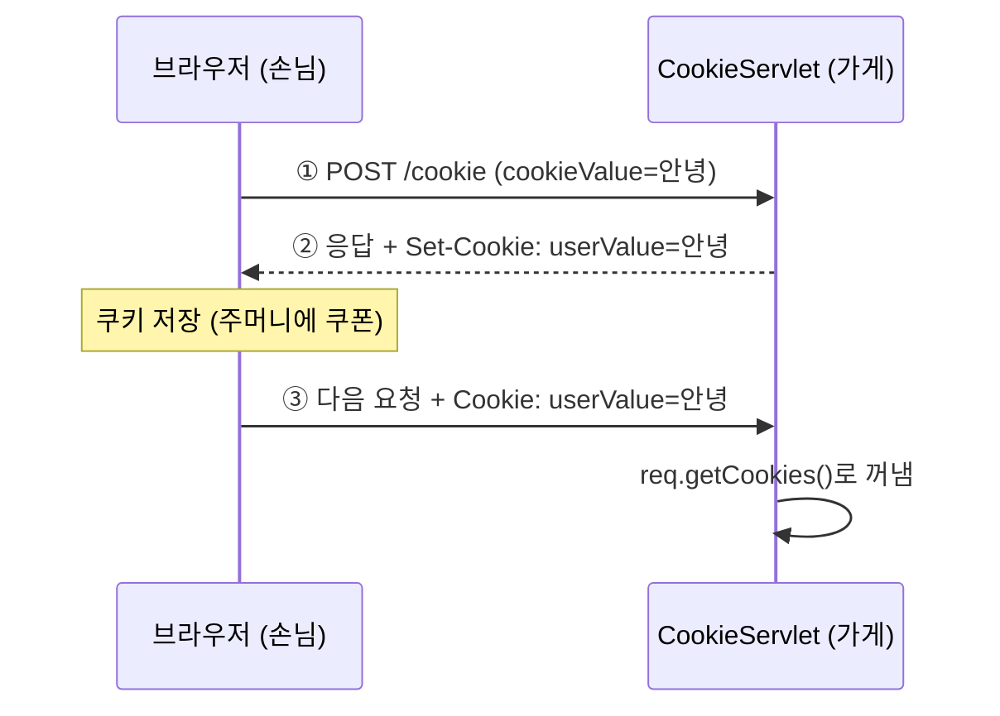
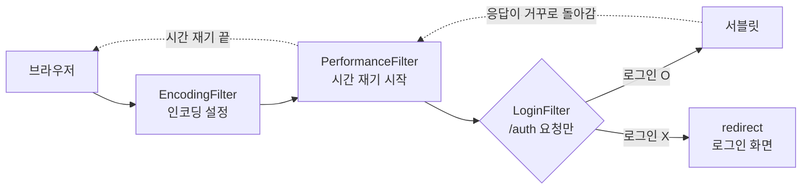
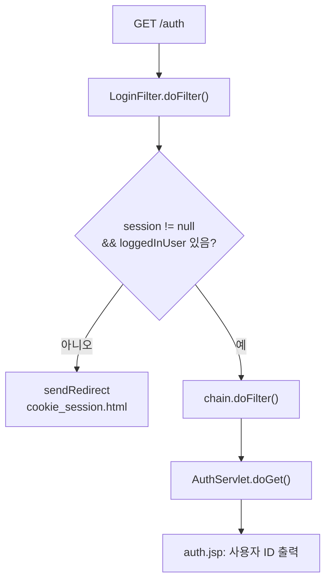
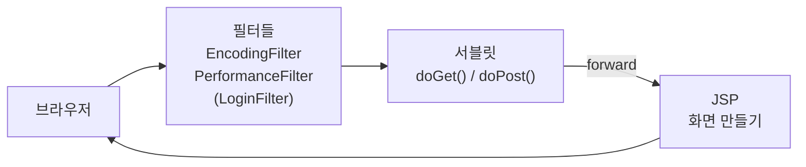

## 들어가며 (Situation)

[어제(10/22)]({{ site.baseurl }})는 응답 보내기, 에러 페이지, forward와 redirect를 배웠다. redirect의 단점은 **"이전 요청을 아예 모른다"** 는 것이었다. 그래서 수업 끝에 **쿠키와 세션**으로 이 단점을 해결한다고 예고했다.

오늘(10/23)은 그 쿠키와 세션, 그리고 모든 요청이 서블릿에 닿기 전에 먼저 거치는 **필터**를 배웠다. 응답 화면은 처음으로 **JSP**로 만들었다.

| 패키지 | 파일 | 역할 |
|--------|------|------|
| `h_cookie_session` | `cookie_session.html` | 쿠키, 세션 테스트 화면 |
| `h_cookie_session` | `CookieServlet` | 쿠키 저장하고 꺼내기 |
| `h_cookie_session` | `SessionServlet` | 세션에 로그인 정보 저장하고 꺼내기 |
| `h_cookie_session` | `ExpireServlet` | 세션 없애기 (로그아웃) |
| `h_cookie_session` | `cookie-result.jsp`, `session-result.jsp` | 결과 보여 주는 화면 |
| `i_filter` | `EncodingFilter` + `web.xml` | 모든 응답에 한글 인코딩 설정 |
| `i_filter` | `PerformanceFilter` | 모든 요청의 처리 시간 재기 |
| `i_filter` | `LoginFilter` | 로그인 안 한 사람 막기 |
| `i_filter` | `AuthServlet`, `auth.jsp` | 로그인한 사람만 보는 페이지 |

## 문제 상황 (Task)

계속 써 온 식당 비유로 보면 이렇다.

1. **식당은 손님을 기억하지 못한다.** HTTP는 요청이 끝나면 손님을 잊어버린다. 방금 로그인한 손님이 다음 페이지로 가면 "누구세요?"가 된다. 이걸 **무상태(Stateless)** 라고 한다.
2. **모든 서블릿에 똑같은 코드가 반복된다.** 어제 만든 서블릿마다 `resp.setContentType("text/html; charset=UTF-8")`가 들어 있었다.
3. **로그인한 사람만 들어가야 하는 페이지**가 있다. 서블릿마다 "로그인했나?" 검사를 넣으면 또 반복된다.

## 해결 과정 (Action)

### 한눈에 보는 오늘의 등장인물

| 개념 | 식당 비유 | 어디에 저장? |
|------|-----------|-------------|
| **쿠키** | 손님 **주머니 속 쿠폰** | 브라우저 (손님 쪽) |
| **세션** | 가게 **보관함** + 손님이 받은 **번호표** | 서버 (가게 쪽) |
| **필터** | 식당 **입구 직원** — 들어오는 모든 손님을 먼저 맞음 | — |
| **JSP** | **메뉴판 틀** — 빈칸에 값만 끼워 넣는 화면 | — |

---

### 1. 쿠키 — 손님 주머니에 쿠폰 넣어 주기

**쿠키**는 서버가 브라우저에게 **"이거 들고 있다가 다음에 올 때 보여 줘"** 하고 건네는 작은 쪽지다. 브라우저는 쿠키를 저장해 두었다가, 같은 사이트에 요청할 때마다 **자동으로** 함께 보낸다.



#### 🧾 테스트 화면 — `cookie_session.html`

**역할:** 쿠키에 넣을 값과, 세션 로그인에 쓸 아이디·비밀번호를 입력하는 화면이다. 두 form 모두 `method="post"`라서 받는 서블릿은 `doPost()`가 실행된다.

```html
<h1>쿠키와 세션 테스트!!</h1>
<hr>
<h2>쿠키 테스트</h2>
<form action="/cookie" method="post">
    <label>쿠키 값 : <input type="text" name="cookieValue" placeholder="값 입력해주세요.."></label>
    <br>
    <button type="submit">쿠키에 값 넣기</button>
</form>
<hr>
<h2>세션 테스트</h2>
<form action="/session" method="post">
    <label>사용자 id : <input type="text" name="userId" placeholder="값 입력해주세요.."></label>
    <br>
    <label>비밀번호 : <input type="password" name="userPwd"></label>
    <button type="submit">로그인</button>
</form>
<p><a href="/session">세션 확인</a></p>
```

#### 🍪 쿠키 굽고 꺼내기 — `CookieServlet`

**역할:**
- `doPost()` — 입력값으로 **쿠키를 만들어** 응답에 실어 보낸다.
- `doGet()` — 브라우저가 보낸 쿠키 중에서 `userValue`를 **찾아 꺼내고**, JSP로 forward해서 보여 준다.

```java
@WebServlet("/cookie")
public class CookieServlet extends HttpServlet {

    @Override
    protected void doPost(HttpServletRequest req, HttpServletResponse resp) throws ServletException, IOException {

        // 쿠키에 담을 사용자의 입력값 추출
        String cookieValue = req.getParameter("cookieValue");

        // 쿠키 객체 생성! (이름, 값)
        Cookie cookie = new Cookie("userValue", cookieValue);
        cookie.setMaxAge(60 * 60); // 만료 1 시간 설정

        // 브라우저에게 보내줄 쿠키 add
        resp.addCookie(cookie);

        doGet(req, resp);
    }

    @Override
    protected void doGet(HttpServletRequest req, HttpServletResponse resp) throws ServletException, IOException {

        String savedValue = "없음!";

        // 브라우저가 보낸 쿠키 전부 받기 (없으면 null)
        Cookie[] cookies = req.getCookies();
        if (cookies != null) {
            for (Cookie cookie : cookies) {
                if ("userValue".equals(cookie.getName())) {
                    savedValue = cookie.getValue();
                    break;
                }
            }
        }

        // 쿠키에 있는 값을 화면에 보여주기 위해 넣어주기
        req.setAttribute("savedValue", savedValue);

        RequestDispatcher rd = req.getRequestDispatcher("/h_cookie_session/cookie-result.jsp");
        rd.forward(req, resp);
    }
}
```

| 코드 | 쉬운 말 |
|------|---------|
| `new Cookie("userValue", 값)` | 쿠폰에 **이름**과 **내용** 적기 |
| `cookie.setMaxAge(60 * 60)` | 쿠폰 **유효기간 1시간**(초 단위). 0이면 바로 삭제, 안 정하면 브라우저를 끌 때 사라짐 |
| `resp.addCookie(cookie)` | 응답에 쿠폰 넣어서 손님에게 건네기 |
| `req.getCookies()` | 손님이 들고 온 쿠폰 **전부** 받기. 하나도 없으면 `null` |
| `"userValue".equals(cookie.getName())` | 그중 이름이 `userValue`인 쿠폰 찾기. 상수를 앞에 두면 `getName()`이 `null`이어도 에러가 안 난다 |

`req.getCookies()`는 이름으로 하나만 꺼내는 메서드가 없다. 그래서 **배열을 돌면서 이름을 비교**해야 한다.

#### 📄 쿠키 결과 화면 — `cookie-result.jsp`

**역할:** 서블릿이 `req.setAttribute("savedValue", ...)`로 넣어 준 값을 `${savedValue}` 자리에 끼워서 보여 준다.

```jsp
<%@ page contentType="text/html;charset=UTF-8" language="java" %>
<html>
  <head>
    <title>Title</title>
  </head>
  <body>
        <h1> 쿠키에 저장 된 값 꺼내기! </h1>
        <h3> 쿠키에 저장 된 값 : ${savedValue} </h3>
  </body>
</html>
```

`${savedValue}`는 **EL(Expression Language, 표현 언어)** 이다. "`savedValue`라는 이름으로 저장된 값을 여기에 넣어 줘"라는 뜻이다. 어제처럼 `StringBuilder`로 HTML을 한 줄씩 `append`할 필요가 없어졌다.

#### 시행착오: 처음 쿠키를 넣으면 "없음!"이 나온다

`doPost()`에서 쿠키를 넣고 바로 `doGet()`을 부르면, **처음 한 번은 `없음!`이 나온다.** 한 번 더 넣어야 그제야 **이전 값**이 보인다.

이유는 쿠키가 **손님 주머니**에 있기 때문이다.

| 순서 | 일어나는 일 |
|------|------------|
| ① | 브라우저가 `POST /cookie` 요청. 이때 주머니에는 아직 쿠키가 **없다** |
| ② | `resp.addCookie()` — 쿠키는 **응답**에 실린다. 아직 브라우저에 도착하지 않았다 |
| ③ | 같은 요청 안에서 `doGet()` → `req.getCookies()` — ①번 **요청에 실려 온** 쿠키를 읽는다. 그래서 없다 |
| ④ | 응답이 브라우저에 도착해서 그제야 쿠키가 저장된다 |

즉 `addCookie()`는 "**다음부터** 들고 와"라는 뜻이고, `getCookies()`는 "**이번에** 들고 온 것"을 보는 것이다. 같은 요청 안에서는 방금 넣은 쿠키를 읽을 수 없다.

#### 더 쉽게: 스티커 이야기

| 등장인물 | 실제 |
|----------|------|
| 🧒 나 | 브라우저 |
| 👩‍🏫 선생님 | 서버 (`CookieServlet`) |
| ⭐ 스티커 | 쿠키 |
| 들어갈 때 가져온 주머니 | 요청 (`req`) |
| 집에 갈 때 들고 나가는 가방 | 응답 (`resp`) |

**① 교실에 들어간다.** 주머니는 **텅 비어** 있다.

**② 선생님이 스티커를 준다.** "잘했어! 이 스티커 줄게" 하면서 스티커를 **내 가방 위에 올려놓는다.** 아직 주머니에 넣은 건 아니다. 가방은 **집에 갈 때** 들고 나간다.

> `resp.addCookie(cookie)` — 스티커를 **돌려보낼 가방(응답)** 에 넣은 것이다.

**③ 선생님이 바로 물어본다.** "너 주머니에 스티커 있니? 보여 줘!" 주머니를 뒤져 보지만 **없다.** 스티커는 아직 가방 위에 있으니까.

> `doGet()`의 `req.getCookies()` — **들어올 때 가져온 주머니(요청)** 만 본다. 그래서 **"없음!"** 이다.

**④ 집에 간다.** 가방을 들고 나와서 이제야 스티커를 **주머니에 넣는다.**

> 응답이 브라우저에 도착해서 쿠키가 **저장**된다.

**⑤ 다음 날 다시 교실에 간다.** 이번엔 주머니에 스티커가 **있다!** "스티커 있니?" 하면 꺼내서 보여 줄 수 있다.

> 두 번째 요청에서는 `getCookies()`에 쿠키가 **보인다.**

```text
1번째 방문                         2번째 방문
─────────────────────────         ─────────────────────────
들어갈 때 주머니: (비어 있음)         들어갈 때 주머니: ⭐
선생님: 가방에 ⭐ 넣음                선생님: "주머니 보여 줘"
선생님: "주머니 보여 줘"              나: ⭐ 있어요!
나: 없어요… → "없음!"
나갈 때: ⭐를 주머니에 넣음
```

**그럼 세션은 왜 바로 보일까?** 세션은 스티커를 나한테 주지 않고 선생님 **책상 서랍**에 넣어 둔다. 선생님이 자기 서랍을 여는 건 언제든 할 수 있으니, **같은 방문에서도 바로** 보인다.

| | 어디에 넣나 | 같은 방문에서 보이나 |
|---|---|---|
| 쿠키 ⭐ | **내 주머니** (나갈 때 받음) | ❌ 다음 방문부터 |
| 세션 🗄️ | **선생님 서랍** (서버) | ✅ 바로 |

> **한 줄 정리:** `addCookie()`는 "**나갈 때** 가져가", `getCookies()`는 "**들어올 때** 가져온 거 보여 줘". 그래서 스티커를 받은 **바로 그 방문**에는 아직 주머니에 없다.

해결 방법은 [어제 배운 redirect]({{ site.baseurl }})다. 쿠키를 넣고 redirect하면, 브라우저가 쿠키를 저장한 뒤 **새 요청에 실어서** 다시 온다. 새로고침해도 POST가 반복되지 않는 PRG 패턴도 함께 지켜진다. 아래는 **예시 코드**다.

```java
// 예시 코드: 쿠키를 넣은 뒤 redirect → 브라우저가 쿠키를 들고 GET /cookie로 다시 온다
resp.addCookie(cookie);
resp.sendRedirect("/cookie");
```

> 쿠키 값에 한글이나 공백을 넣으면 서버(Tomcat)가 허용하지 않아 에러가 날 수 있다. 그럴 때는 `URLEncoder.encode(값, "UTF-8")`로 바꿔서 넣고, 꺼낼 때 `URLDecoder.decode()`로 되돌린다.

---

### 2. 세션 — 가게 보관함에 맡기기

쿠키는 손님이 들고 다니니 **손님이 내용을 보고 고칠 수 있다.** 로그인 정보처럼 중요한 건 손님에게 맡기면 안 된다.

**세션**은 정보를 **서버(가게)의 보관함**에 넣어 둔다. 손님에게는 보관함 **번호표**만 준다. 이 번호표가 `JSESSIONID`라는 이름의 **쿠키**다. 손님이 번호표를 내밀면 가게는 그 번호의 보관함을 열어 본다.

```mermaid
sequenceDiagram
    participant B as 브라우저 (손님)
    participant S as SessionServlet
    participant Box as 세션 보관함 (서버)
    B->>S: ① POST /session (userId, userPwd)
    S->>Box: 보관함 새로 만들고 loggedInUser 저장
    S-->>B: ② 응답 + Set-Cookie: JSESSIONID=ABC123 (번호표)
    B->>S: ③ GET /session + Cookie: JSESSIONID=ABC123
    S->>Box: ABC123번 보관함 열기
    Box-->>S: loggedInUser = hong
```

| 구분 | 쿠키 | 세션 |
|------|------|------|
| 저장 위치 | **브라우저** (손님 주머니) | **서버** (가게 보관함) |
| 손님에게 주는 것 | 값 자체 | 번호표(`JSESSIONID`)만 |
| 손님이 내용을 볼 수 있나 | 있다 (개발자 도구에서 보이고 고칠 수 있음) | 없다 |
| 담을 수 있는 것 | 문자열만, 크기 작음 | 자바 객체 무엇이든 |
| 서버 부담 | 없음 | 손님 수만큼 메모리 사용 |
| 어울리는 곳 | 아이디 저장, 팝업 "오늘 하루 안 보기" | **로그인 상태**, 장바구니 |

#### 🗄️ 세션에 넣고 꺼내기 — `SessionServlet`

**역할:**
- `doPost()` — 로그인 버튼을 누르면 아이디·비밀번호를 **세션 보관함에 저장**하고, 유효시간을 30초로 정한다.
- `doGet()` — 세션 보관함에서 값을 **꺼내** JSP로 forward한다. 세션이 없으면 "로그인 안됨!!"을 보여 준다.

```java
@WebServlet("/session")
public class SessionServlet extends HttpServlet {

    @Override
    protected void doGet(HttpServletRequest req, HttpServletResponse resp) throws ServletException, IOException {

        // true : 세션 만든다.
        // false : 기존의 세션을 활용하며, 없다면 null 반환
        HttpSession session = req.getSession(false);

        String loggedInUser = null;
        String pwd = null;

        if (session != null) {
            loggedInUser = session.getAttribute("loggedInUser").toString();
            pwd = session.getAttribute("userPwd").toString();
        }

        req.setAttribute("loggedInUser", loggedInUser != null ? loggedInUser : "로그인 안됨!!");
        req.setAttribute("pwd", pwd != null ? pwd : "비밀번호 없음..");

        RequestDispatcher rd = req.getRequestDispatcher("/h_cookie_session/session-result.jsp");
        rd.forward(req, resp);
    }

    @Override
    protected void doPost(HttpServletRequest req, HttpServletResponse resp) throws ServletException, IOException {

        // ID , PWD 를 req 에서 꺼내서 변수에 담기
        String userId = req.getParameter("userId");
        String userPwd = req.getParameter("userPwd");

        if (userId != null && !userPwd.isEmpty()) {
            // 사용자의 아이디와 비밀번호를 저장하기 위한 Session 객체 생성
            HttpSession session = req.getSession(true);

            // null 발생 여부가 존재하는 변수를 형변환 시 메서드로 형변환 하는 것 보다
            // () : 캐스트 연산자 == 형변환 연산자를 사용하는 것이 안정적이다.
            String existUser = (String) session.getAttribute("loggedInUser");

            if (existUser == null || existUser.equals(userId)) {
                session.setAttribute("loggedInUser", userId);
                if (userPwd != null && !userPwd.isEmpty()) {
                    session.setAttribute("userPwd", userPwd);
                }
                session.setMaxInactiveInterval(30); // session 의 유효 기간 설정 30초!
            } else {
                session.setAttribute("loggedInUser", userId);
                if (userPwd != null && !userPwd.isEmpty()) {
                    session.setAttribute("userPwd", userPwd);
                }
                session.setMaxInactiveInterval(30);
            }

            doGet(req, resp);
        }
    }
}
```

| 코드 | 쉬운 말 |
|------|---------|
| `req.getSession(true)` (= `getSession()`) | 손님 보관함 **주세요.** 없으면 **새로 만들어** 준다 |
| `req.getSession(false)` | 손님 보관함 **있으면** 주세요. 없으면 `null` (새로 안 만듦) |
| `session.setAttribute("키", 값)` | 보관함에 물건 넣기 |
| `session.getAttribute("키")` | 보관함에서 물건 꺼내기 (`Object`라서 형변환 필요) |
| `session.setMaxInactiveInterval(30)` | **30초 동안 아무 요청이 없으면** 보관함 비우기 (초 단위) |

#### `getSession(true)`와 `getSession(false)`의 `true`/`false`는 무슨 뜻일까?

지금까지 본 `true`/`false`는 대부분 **결과**였다.

| 코드 | `true`/`false`의 의미 |
|------|----------------------|
| `rset.next()` | 다음 줄이 **있어?** → 있으면 `true` (메서드가 **돌려주는** 답) |
| `if (session != null)` | 세션이 **있어?** → 조건의 답 |

그런데 `getSession(true)`의 `true`는 내가 메서드에게 **넘겨주는 옵션**이다. 뜻은 하나다.

> **"보관함이 없으면 새로 만들어 줄까요?"**

| 코드 | 쉬운 말 | 보관함이 **있을 때** | 보관함이 **없을 때** |
|------|---------|-------------------|-------------------|
| `getSession(true)` | 없으면 **만들어 주세요** | 있던 보관함을 줌 | **새로 만들어서** 줌 |
| `getSession(false)` | 없으면 **만들지 마세요** | 있던 보관함을 줌 | **`null`** 을 줌 |
| `getSession()` | `true`와 같음 | 있던 보관함을 줌 | 새로 만들어서 줌 |

**보관함이 이미 있으면 `true`든 `false`든 결과가 똑같다.** 차이는 **없을 때만** 생긴다.

오늘 코드에서 다르게 쓴 이유는 이렇다.

| 위치 | 쓴 것 | 이유 |
|------|-------|------|
| `SessionServlet.doPost()` (로그인) | `getSession(true)` | 로그인하면 보관함이 **필요하니까** 없으면 만들어야 한다 |
| `SessionServlet.doGet()` (확인) | `getSession(false)` | **보기만** 할 거라서 괜히 빈 보관함을 만들면 안 된다 |
| `ExpireServlet` (로그아웃) | `getSession(false)` | 없애려는데 새로 만들면 이상하다 |
| `LoginFilter` (로그인 검사) | `getSession(false)` | 로그인 안 한 사람에게 보관함을 만들어 주면 **로그인한 것처럼 보일 수 있다** |

`LoginFilter`에서 `true`를 쓰면 진짜 문제가 된다. 로그인 안 한 손님에게도 빈 보관함이 생겨서 `session == null` 검사가 항상 통과해 버린다. 그래서 `LoginFilter`는 `false`를 쓰고, `session.getAttribute("loggedInUser") == null` 검사까지 함께 한다.

> **기억법:** `getSession(true)` = "없으면 만들어", `getSession(false)` = "없으면 그냥 `null` 줘".

쿠키와 달리, 세션은 `doPost()`에서 넣고 같은 요청의 `doGet()`에서 **바로 꺼낼 수 있다.** 보관함이 **서버**에 있어서 손님을 거칠 필요가 없기 때문이다.

#### 🚪 세션 없애기 — `ExpireServlet`

**역할:** 세션 보관함을 **통째로 비운다**(로그아웃). 그다음 `/session`으로 redirect해서 "로그인 안됨!!" 화면을 보여 준다.

```java
@WebServlet("/expire")
public class ExpireServlet extends HttpServlet {

    @Override
    protected void doGet(HttpServletRequest req, HttpServletResponse resp) throws ServletException, IOException {

        HttpSession session = req.getSession(false);

        // 세션이 존재한다면
        if (session != null) {
            // 세션 무효화 메서드
            session.invalidate();
        }

        // 세션 무효화 후 /session 으로 리다이랙트
        resp.sendRedirect("/session");
    }
}
```

| 세션이 사라지는 경우 | 코드 / 상황 |
|---------------------|------------|
| 직접 없애기 (로그아웃) | `session.invalidate()` |
| 시간이 지나서 | `setMaxInactiveInterval(초)`만큼 요청이 없을 때 |
| 번호표를 잃어버림 | 브라우저를 완전히 닫음 (`JSESSIONID` 쿠키는 기본적으로 브라우저 종료 시 삭제) |

#### 📄 세션 결과 화면 — `session-result.jsp`

**역할:** 서블릿이 넣어 준 `loggedInUser`, `pwd`를 보여 주고, 세션 만료 링크를 제공한다.

```jsp
<%@ page contentType="text/html;charset=UTF-8" language="java" %>
<html>
  <head>
    <title>Title</title>
  </head>
  <body>
        <h1>세션 확인!</h1>
        <p>로그인 된 사용자 ID : ${loggedInUser}</p>
        <p>PWD : ${pwd}</p>
        <a href="/expire"> 세션 만료 시키기 </a>
  </body>
</html>
```

#### 시행착오: 세션은 있는데 값이 없으면 500 에러

`SessionServlet.doGet()`은 세션이 **있으면** 값이 들어 있다고 가정하고 `.toString()`을 부른다.

```java
if (session != null) {
    loggedInUser = session.getAttribute("loggedInUser").toString();   // 값이 없으면 NPE!
}
```

그런데 **세션은 있지만 `loggedInUser`가 없는 경우**가 생긴다. JSP는 기본 설정에서 **열리기만 해도 세션을 만든다.** 그래서 쿠키 테스트로 `cookie-result.jsp`를 먼저 본 다음 "세션 확인"을 누르면, 빈 세션이 이미 있어서 `getAttribute()`가 `null`을 돌려준다. 거기에 `.toString()`을 부르면 `NullPointerException`이 나서 500 에러 페이지가 뜬다.

수업 코드의 `doPost()` 주석에 답이 이미 있다. **`null`일 수 있는 값은 `.toString()` 대신 `(String)` 형변환**을 쓴다. 캐스트는 `null`을 그대로 `null`로 바꿔 주기 때문이다. 아래는 **예시 코드**다.

```java
// 예시 코드: null이어도 에러 없이 null이 담긴다
if (session != null) {
    loggedInUser = (String) session.getAttribute("loggedInUser");
    pwd = (String) session.getAttribute("userPwd");
}
```

| 방법 | 값이 `"hong"`일 때 | 값이 `null`일 때 |
|------|-------------------|-----------------|
| `obj.toString()` | `"hong"` | **NullPointerException** |
| `(String) obj` | `"hong"` | `null` (에러 없음) |
| `String.valueOf(obj)` | `"hong"` | 문자열 `"null"` |

#### 짚고 갈 점

- **조건문 검사 대상:** `if (userId != null && !userPwd.isEmpty())`는 아이디는 `null`인지, 비밀번호는 비었는지를 검사한다. **아이디가 빈 문자열**이면 그대로 통과한다. 조건이 거짓이면 아무 응답도 하지 않아서 **빈 화면**이 나온다.
- **if와 else가 같은 일을 한다:** `existUser`가 같든 다르든 똑같이 저장한다. "다른 사람이 이미 로그인한 상태"를 처리하려던 자리로 보인다.
- **비밀번호를 세션에 넣지 않는다:** 수업에서는 동작 확인용으로 넣었다. 실제로는 비밀번호는 로그인 확인에만 쓰고, 세션에는 **아이디나 회원 번호**만 넣는다.

#### 쿠키·세션 서블릿에서 `doPost()`와 `doGet()`이 하는 역할

`doGet()`과 `doPost()`는 **요청이 왔을 때 실제로 일을 하는 메서드**다. 같은 주소로 요청이 와도, **GET으로 왔으면 `doGet()`**, **POST로 왔으면 `doPost()`** 가 실행된다.

한 서블릿(`/session`)을 **창구가 두 개인 가게**라고 생각하면 쉽다.

| 창구 | 메서드 | 하는 일 | 비유 |
|------|--------|---------|------|
| 🔍 조회 창구 | `doGet()` | 정보를 **꺼내서 보여 주기** | "내 보관함에 뭐 있어요?" |
| ✍️ 접수 창구 | `doPost()` | 정보를 **받아서 저장하거나 바꾸기** | "이거 보관함에 넣어 주세요" |

링크를 누르거나 주소를 치면 조회 창구(GET)로, `method="post"` form을 제출하면 접수 창구(POST)로 온다. 어느 창구로 보낼지는 부모 `HttpServlet`의 `service()`가 정한다.

오늘 서블릿들이 맡은 일을 모으면 이렇다.

| 서블릿 | `doPost()` — 저장 | `doGet()` — 보여 주기 |
|--------|-------------------|----------------------|
| `CookieServlet` | 입력값으로 **쿠키 만들어** 응답에 넣기 | 브라우저가 보낸 쿠키 **꺼내서** JSP로 보여 주기 |
| `SessionServlet` | 아이디·비밀번호를 **세션에 저장** | 세션에서 **꺼내서** JSP로 보여 주기 |
| `ExpireServlet` | (없음) | 세션 **없애고** redirect |
| `AuthServlet` | (없음) | 로그인 사용자 **보여 주기** |

`CookieServlet`과 `SessionServlet`은 **`doPost()`가 끝나면 `doGet()`을 부른다.**

```java
@Override
protected void doPost(HttpServletRequest req, HttpServletResponse resp) ... {
    // ① 저장하는 일
    session.setAttribute("loggedInUser", userId);

    // ② 보여 주는 일은 doGet()에게 맡김
    doGet(req, resp);
}
```

"보여 주기" 코드를 `doPost()`에 또 쓰지 않으려고, 이미 보여 주기를 맡고 있는 `doGet()`을 **그냥 메서드처럼 불러서** 재사용한 것이다.

```text
로그인 버튼 클릭 (POST)
  → doPost(): 세션에 저장
  → doGet():  세션에서 꺼내서 화면 보여 주기
```

`doGet()`을 직접 부르는 건 **같은 요청 안에서** 메서드를 하나 더 호출하는 것뿐이다. 브라우저가 새로 GET 요청을 보내는 게 아니다. 그래서 주소창은 그대로이고, 새로고침하면 **POST가 다시** 간다. [어제 배운 forward의 위험]({{ site.baseurl }})과 같다. 저장 후 새로고침해도 안전하게 하려면, `doGet()`을 직접 부르는 대신 `resp.sendRedirect("/session")`으로 브라우저가 **새 GET 요청**을 보내게 하면 된다. (쿠키 시행착오에서 본 해결 방법과 같다.)

| 방법 | 요청 횟수 | 주소창 | 새로고침하면 |
|------|----------|--------|-------------|
| `doPost()` 안에서 `doGet(req, resp)` 호출 | 1번 | 그대로 | POST 다시 전송 (저장 반복) |
| `doPost()` 끝에 `resp.sendRedirect("/session")` | 2번 | `/session` (GET) | GET만 반복 (안전) |

> **기억법:** `doPost()`는 **받아서 저장**, `doGet()`은 **꺼내서 보여 주기**.

---

### 3. 필터 — 식당 입구 직원

**필터**는 요청이 **서블릿에 도착하기 전에** 먼저 거치는 관문이다. 응답이 나갈 때도 다시 거쳐 간다. 식당 입구 직원처럼 모든 손님을 먼저 맞아서 "옷 맡기세요", "예약 확인할게요"를 한 다음 안으로 들여보낸다.



(그림의 필터 순서는 이해를 돕기 위한 예시다. 아래 표처럼 어노테이션으로 등록한 필터끼리의 순서는 정해져 있지 않다.)

필터 클래스는 `Filter` 인터페이스를 구현하고, 서블릿처럼 생명주기 메서드 3개를 가진다.

| 메서드 | 언제 호출? | 서블릿과 비교 |
|--------|-----------|--------------|
| `init(FilterConfig)` | 서버가 시작할 때 1번 | `init()` |
| `doFilter(req, resp, chain)` | **요청이 올 때마다** | `service()` |
| `destroy()` | 서버가 종료할 때 1번 | `destroy()` |

`doFilter()` 안의 **`chain.doFilter(req, resp)`** 가 핵심이다. "다음 필터로, 다음 필터가 없으면 서블릿으로 보내라"는 뜻이다. 이 줄을 부르지 않으면 요청은 **거기서 멈춘다.**

필터를 등록하는 방법은 두 가지다.

| 방법 | 오늘 쓴 곳 | 특징 |
|------|-----------|------|
| `web.xml`의 `<filter>`, `<filter-mapping>` | `EncodingFilter` | 설정값(`init-param`) 전달 가능, **여러 필터의 순서**를 정할 수 있다 |
| `@WebFilter("경로")` 어노테이션 | `PerformanceFilter`, `LoginFilter` | 간단하다. 어노테이션끼리의 실행 순서는 명세에서 정해 주지 않는다 |

#### 🔤 한글 인코딩 담당 — `EncodingFilter` + `web.xml`

**역할:** **모든 요청**(`/*`)에 대해 응답 타입을 `text/html; charset=UTF-8`로 설정한다. 어제 서블릿마다 반복하던 `setContentType()`을 여기 한곳에서 처리한다.

```java
public class EncodingFilter implements Filter {

    private String encodingType;

    @Override
    public void init(FilterConfig filterConfig) throws ServletException {
        System.out.println("인코딩 필터의 init() 호출됨..");
        // web.xml의 init-param 값 읽기
        encodingType = filterConfig.getInitParameter("encoding-type");
    }

    @Override
    public void doFilter(ServletRequest request, ServletResponse response, FilterChain chain) throws IOException, ServletException {

        response.setContentType(encodingType);

        chain.doFilter(request, response);
    }

    @Override
    public void destroy() {
        Filter.super.destroy();
    }
}
```

```xml
<filter>
    <filter-name>encoding</filter-name>
    <filter-class>com.wanted.servlet.i_filter.EncodingFilter</filter-class>
    <init-param>
        <param-name>encoding-type</param-name>
        <param-value>text/html; charset=UTF-8</param-value>
    </init-param>
</filter>
<filter-mapping>
    <filter-name>encoding</filter-name>
    <url-pattern>/*</url-pattern>
</filter-mapping>
```

| `web.xml` 태그 | 쉬운 말 |
|----------------|---------|
| `<filter-name>` | 필터 별명 (`encoding`) |
| `<filter-class>` | 실제 클래스 (패키지까지 전부) |
| `<init-param>` | 필터에게 줄 설정값. `init()`에서 `getInitParameter()`로 읽는다 |
| `<url-pattern>/*</url-pattern>` | **모든 주소**에 이 필터를 적용 |

설정값을 코드가 아니라 `web.xml`에 둔 덕분에, 인코딩을 바꾸고 싶으면 **Java 코드를 고치지 않고** `web.xml`만 고치면 된다.

그래서 오늘 어제 만든 서블릿 4개(`ResponseServlet`, `ExceptionServlet`, `ResponseLoginServlet`, `RedirectServlet`)의 `resp.setContentType(...)` 줄을 **주석 처리**했다. 필터가 대신 해 주기 때문이다.

```java
// 서블릿마다 있던 코드 → 필터가 대신 처리
//        resp.setContentType("text/html; charset=UTF-8");
```

#### ⏱️ 시간 재기 담당 — `PerformanceFilter`

**역할:** **모든 요청**(`/*`)에 대해 요청 주소를 출력하고, 서블릿이 처리를 끝낼 때까지 **걸린 시간(ms)** 을 잰다.

```java
@WebFilter("/*")
public class PerformanceFilter implements Filter {

    @Override
    public void init(FilterConfig filterConfig) throws ServletException {
        System.out.println("Performance 필터 생성됨...");
    }

    @Override
    public void doFilter(ServletRequest request, ServletResponse response, FilterChain chain) throws IOException, ServletException {

        long startTime = System.currentTimeMillis();

        HttpServletRequest req = (HttpServletRequest) request;
        System.out.println("[요청 된 URL] : " + req.getRequestURI());

        // 다음 서블릿 OR 필터 호출
        chain.doFilter(request, response);

        long endTime = System.currentTimeMillis();

        System.out.println("[" + req.getRequestURI() + " 의 최종 수행 시간] : " + (endTime - startTime) + "(ms)");
    }

    @Override
    public void destroy() {
        System.out.println("Performance 필터 파괴됨...");
    }
}
```

이 필터를 보면 `chain.doFilter()`의 의미가 잘 보인다.

| 위치 | 언제 실행? |
|------|-----------|
| `chain.doFilter()` **앞** | 서블릿에 **가기 전** (요청 단계) |
| `chain.doFilter()` | 다음 필터 → 서블릿이 **일을 다 끝낼 때까지** 여기서 기다림 |
| `chain.doFilter()` **뒤** | 서블릿이 끝나고 **돌아온 후** (응답 단계) |

그래서 앞에서 시작 시간, 뒤에서 끝 시간을 찍으면 **서블릿 처리 시간**이 나온다. 콘솔에는 이런 식으로 찍힌다. (출력 형태를 보여 주기 위한 예시다.)

```text
[요청 된 URL] : /session
[/session 의 최종 수행 시간] : 12(ms)
```

`ServletRequest`를 `HttpServletRequest`로 형변환한 이유는 `getRequestURI()`가 **HTTP 전용** 메서드라서 자식 타입에만 있기 때문이다.

#### 🔒 로그인 검사 담당 — `LoginFilter`

**역할:** **`/auth`로 시작하는 요청**에만 동작한다. 세션에 `loggedInUser`가 없으면 서블릿으로 보내지 않고 **로그인 화면으로 redirect**한다. 로그인했으면 `chain.doFilter()`로 통과시킨다.

```java
/* Filter 는 Http 요청이 Servlet 에 도달하기 전에 동작하는 생명주기를 갖는다.
 * @WebFilter("필터가 동작하는 경로") */
@WebFilter("/auth/*")
public class LoginFilter implements Filter {

    @Override
    public void init(FilterConfig filterConfig) throws ServletException {
        System.out.println("로그인 관련 필터 초기화됨...");
    }

    @Override
    public void doFilter(ServletRequest request, ServletResponse response, FilterChain chain) throws IOException, ServletException {

        System.out.println("Login 필터 호출됨...");

        // 자식이 가지고 있는 getSession() 메서드를 사용하기 위해 클래스 형변환
        HttpServletRequest req = (HttpServletRequest) request;
        HttpServletResponse resp = (HttpServletResponse) response;

        // 기존 세션 유무 확인!
        HttpSession session = req.getSession(false);

        if (session == null || session.getAttribute("loggedInUser") == null) {
            // 로그인 안 함 → 서블릿으로 보내지 않고 로그인 화면으로
            resp.sendRedirect("/h_cookie_session/cookie_session.html");
        } else {
            // 세션 존재하고, loggedInUser 에 값이 있는 상태 → 통과!
            chain.doFilter(req, resp);
        }
    }

    @Override
    public void destroy() {
        System.out.println("로그인 관련 필터 파괴됨...");
    }
}
```



필터가 없었다면 "로그인했나?" 검사를 `/auth`, `/mypage`, `/order` 같은 **서블릿마다** 넣어야 한다. 필터를 쓰면 **한곳**에서 검사하고, 서블릿은 "여기까지 왔으면 로그인한 사람"이라고 믿고 자기 일만 하면 된다.

#### 🙋 로그인한 사람 전용 페이지 — `AuthServlet`

**역할:** `LoginFilter`를 통과한 요청만 들어온다. 세션의 사용자 정보를 가지고 `auth.jsp`로 forward한다.

```java
@WebServlet("/auth")
public class AuthServlet extends HttpServlet {

    @Override
    protected void doGet(HttpServletRequest req, HttpServletResponse resp) throws ServletException, IOException {

        HttpSession session = req.getSession(false);
        // 로그인 유저 정보 세션에서 꺼내오기
        String existUser = (String) session.getAttribute("loggedInUser");

        session.setAttribute("loggedInUser", existUser);

        RequestDispatcher rd = req.getRequestDispatcher("/i_filter/auth.jsp");
        rd.forward(req, resp);
    }
}
```

`req.getSession(false)`가 `null`인지 검사하지 않았는데도 괜찮은 건 `LoginFilter`가 앞에서 이미 걸러 주기 때문이다. 다만 세션에서 꺼낸 값을 같은 이름으로 **다시 세션에 넣는** `setAttribute()` 줄은 아무 변화가 없다. 지워도 결과가 같다.

#### 📄 로그인 사용자 화면 — `auth.jsp`

**역할:** JSP 안에 **Java 코드를 직접** 써서 세션의 사용자 아이디를 출력한다.

```jsp
<%@ page contentType="text/html;charset=UTF-8" language="java" %>
<html>
  <head>
    <title>Title</title>
  </head>
  <body>
    <h3>
     <%
         // JSP 파일은 HTML 처럼 보이지만
         // 실제로는 Java 로 이루어진 Servlet 이다.
         String user = (String) session.getAttribute("loggedInUser");
     %>
     <%= user %>
    </h3>
  </body>
</html>
```

수업 주석처럼 **JSP는 HTML처럼 생겼지만 실제로는 서블릿**이다. 서버가 처음 실행할 때 JSP를 Java 서블릿 코드로 바꾸고 컴파일한다. 그래서 JSP 안에서는 `session` 같은 객체를 따로 만들지 않고 바로 쓸 수 있다.

| JSP 문법 | 이름 | 쉬운 말 | 오늘 예 |
|----------|------|---------|---------|
| `<%@ ... %>` | 지시자 | 이 페이지 **설정** | `contentType="text/html;charset=UTF-8"` |
| `<% ... %>` | 스크립틀릿 | 안에 **Java 코드** 실행 | `String user = ...;` |
| `<%= ... %>` | 표현식 | 값을 화면에 **출력** | `<%= user %>` |
| `<%! ... %>` | 선언부 | 필드나 메서드 **선언** | (오늘 안 씀) |
| `${ ... }` | EL | 저장된 값을 이름으로 **꺼내 출력** | `${savedValue}`, `${loggedInUser}` |

수업 주석에는 "`!` 태그는 내부에서 Java 코드를 입력할 수 있다"라고 적혀 있었는데, 오늘 쓴 건 `!`가 없는 **`<% %>` 스크립틀릿**이다. `<%! %>`는 필드나 메서드를 **선언**할 때 쓰는 다른 태그다.

`${...}`(EL)과 `<%= %>`는 둘 다 값을 출력한다. EL은 Java 코드 없이 이름만으로 꺼내고, 값이 `null`이면 빈칸으로 보여 준다. 그래서 화면에는 Java 코드를 섞지 않고 **EL을 쓰는 게 권장**된다.

---

### 4. 오늘의 Java 흐름 한눈에 보기

오늘 코드는 **브라우저 → 필터 → 서블릿 → JSP** 순서로 흘러간다. 모든 요청은 서블릿에 가기 전에 **입구 직원(필터)** 을 먼저 지나간다.



| 순서 | 누가 | 하는 일 | 식당 비유 |
|------|------|---------|-----------|
| 1 | 브라우저 | 요청 보내기 | 손님이 들어옴 |
| 2 | 필터 | 인코딩 설정, 시간 재기, 로그인 검사 | 입구 직원 |
| 3 | 서블릿 | 쿠키·세션에 저장하거나 꺼내기 | 창구 직원 |
| 4 | JSP | 받은 값을 끼워서 화면 만들기 | 메뉴판 틀에 글씨 채우기 |

#### 시나리오 ① 쿠키에 값 넣기

```text
[브라우저] "쿠키에 값 넣기" 버튼 클릭 → POST /cookie
   │
   ▼
[EncodingFilter.doFilter()]    응답을 UTF-8로 설정 → chain.doFilter()
[PerformanceFilter.doFilter()] 시작 시간 기록      → chain.doFilter()
   │
   ▼
[CookieServlet.doPost()]
   ├ req.getParameter("cookieValue")    입력값 꺼내기
   ├ new Cookie("userValue", 값)        쿠폰 만들기
   ├ cookie.setMaxAge(60 * 60)          유효기간 1시간
   ├ resp.addCookie(cookie)             응답에 쿠폰 넣기 (아직 손님에게 안 감!)
   └ doGet(req, resp) 호출
         │
         ▼
[CookieServlet.doGet()]
   ├ req.getCookies()                   이번 요청에 들고 온 쿠폰 확인 → 처음엔 없음
   ├ req.setAttribute("savedValue", …)  화면에 보낼 값 붙이기
   └ forward → cookie-result.jsp
         │
         ▼
[cookie-result.jsp]  ${savedValue} 자리에 값 넣어서 HTML 완성
   │
   ▼
[PerformanceFilter]  끝 시간 기록, 걸린 시간 출력
   │
   ▼
[브라우저] 화면 표시 + 이제야 쿠키 저장
```

**포인트:** 쿠키는 응답이 브라우저에 도착해야 저장된다. 그래서 **다음 요청부터** `getCookies()`에 보인다.

#### 시나리오 ② 세션으로 로그인하고 확인하기

```text
[브라우저] "로그인" 버튼 클릭 → POST /session
   │
   ▼
[필터들] 인코딩, 시간 재기 → chain.doFilter()
   │
   ▼
[SessionServlet.doPost()]
   ├ req.getParameter("userId"), ("userPwd")
   ├ req.getSession(true)                보관함 없으면 새로 만들기
   ├ session.setAttribute("loggedInUser", userId)   보관함에 넣기
   ├ session.setMaxInactiveInterval(30)  30초 동안 요청 없으면 비우기
   └ doGet(req, resp) 호출
         │
         ▼
[SessionServlet.doGet()]
   ├ req.getSession(false)               있는 보관함만 가져오기
   ├ session.getAttribute("loggedInUser")   바로 꺼내짐 (서버에 있으니까!)
   ├ req.setAttribute("loggedInUser", …)
   └ forward → session-result.jsp
         │
         ▼
[session-result.jsp]  "로그인 된 사용자 ID : hong"
   │
   ▼
[브라우저] 화면 표시 + 번호표(JSESSIONID 쿠키) 저장
```

로그아웃할 때는 이렇게 흐른다.

```text
"세션 만료 시키기" 링크 → GET /expire
  → [ExpireServlet.doGet()]
       ├ req.getSession(false)
       ├ session.invalidate()          보관함 비우기
       └ resp.sendRedirect("/session") "/session으로 다시 오세요"
  → [브라우저] 새 요청 GET /session
  → [SessionServlet.doGet()] 세션 없음 → "로그인 안됨!!"
```

#### 시나리오 ③ 로그인한 사람만 들어가는 `/auth`

```text
[브라우저] GET /auth
   │
   ▼
[EncodingFilter] [PerformanceFilter] → chain.doFilter()
   │
   ▼
[LoginFilter.doFilter()]   /auth 요청이라 이 필터도 동작
   ├ req.getSession(false)
   └ 세션이 없거나 loggedInUser가 없어?
        │
        ├ 예  → resp.sendRedirect("/h_cookie_session/cookie_session.html")
        │       ⛔ 서블릿까지 못 감. 로그인 화면으로
        │
        └ 아니오 → chain.doFilter()  ✅ 통과
                    │
                    ▼
              [AuthServlet.doGet()]
                ├ session.getAttribute("loggedInUser")
                └ forward → auth.jsp
                    │
                    ▼
              [auth.jsp]  <% %>로 꺼내서 <%= user %> 출력
```

**포인트:** `AuthServlet`에는 "로그인했나?" 검사가 없다. `LoginFilter`가 문 앞에서 이미 걸러 주기 때문이다.

> **한 줄 정리:** 요청은 **필터(입구 직원)** 를 지나 **서블릿(창구)** 에서 쿠키·세션을 다루고, **JSP(메뉴판 틀)** 로 화면을 만들어 돌아간다. 쿠키는 **손님 주머니**라서 다음 요청부터 보이고, 세션은 **가게 보관함**이라서 바로 꺼낼 수 있다.

## 결과 (Result)

처음의 세 가지 문제를 이렇게 해결했다.

| 문제 | 해결 |
|------|------|
| HTTP는 손님을 기억하지 못한다 | **쿠키**(브라우저에 저장), **세션**(서버에 저장 + `JSESSIONID` 번호표) |
| 서블릿마다 `setContentType()` 반복 | **`EncodingFilter`** 한 곳에서 처리 → 서블릿 **4개**에서 해당 줄 제거 |
| 로그인 검사를 서블릿마다 해야 한다 | **`LoginFilter`** 가 `/auth` 요청을 먼저 검사, 안 했으면 redirect |
| `StringBuilder`로 HTML을 한 줄씩 만들었다 | **JSP** + `${}` (EL)로 화면 분리 |

역할별로 다시 모으면 이렇다.

| 역할 | 담당 | 핵심 코드 |
|------|------|-----------|
| 쿠키 만들기 | `CookieServlet.doPost()` | `new Cookie()`, `setMaxAge()`, `resp.addCookie()` |
| 쿠키 꺼내기 | `CookieServlet.doGet()` | `req.getCookies()` + 이름 비교 |
| 세션 저장 | `SessionServlet.doPost()` | `getSession(true)`, `setAttribute()`, `setMaxInactiveInterval()` |
| 세션 꺼내기 | `SessionServlet.doGet()` | `getSession(false)`, `getAttribute()` |
| 세션 없애기 | `ExpireServlet` | `invalidate()` + `sendRedirect()` |
| 공통 인코딩 | `EncodingFilter` | `setContentType()` + `chain.doFilter()` |
| 처리 시간 측정 | `PerformanceFilter` | `chain.doFilter()` 앞뒤로 시간 측정 |
| 로그인 검사 | `LoginFilter` | 세션 확인 → `sendRedirect()` 또는 `chain.doFilter()` |
| 화면 | JSP 3개 | `${}`, `<% %>`, `<%= %>` |

**배운 점**

- **쿠키는 손님 주머니, 세션은 가게 보관함.** 중요한 정보는 손님이 볼 수 없는 세션에 넣는다. 세션도 사실은 `JSESSIONID`라는 쿠키 번호표로 손님을 알아본다.
- `addCookie()`는 **다음 요청부터** 쿠키가 온다. 세션은 서버에 있어서 **바로** 꺼낼 수 있다.
- 필터의 `chain.doFilter()`는 "통과"다. 앞은 요청 단계, 뒤는 응답 단계다. 부르지 않으면 요청이 멈춘다.
- `null`일 수 있는 `getAttribute()` 결과에는 `.toString()` 대신 `(String)` 형변환을 쓴다.

## 더 학습하면 좋은 개념

- **쿠키 보안 옵션 (`HttpOnly`, `Secure`, `SameSite`)** — 세션 번호표(`JSESSIONID`)를 도둑맞으면 로그인이 털린다. 자바스크립트가 쿠키를 못 읽게 하는 `HttpOnly` 같은 옵션을 알아야 안전한 로그인을 만들 수 있다.
- **요청 인코딩 `request.setCharacterEncoding("UTF-8")`** — 오늘 `EncodingFilter`는 **응답** 인코딩만 설정했다. POST로 보낸 한글이 깨지지 않게 하려면 필터에서 **요청** 인코딩도 함께 설정하는 경우가 많다.
- **JWT와 토큰 기반 인증** — 세션은 서버가 보관함을 들고 있어야 한다. 서버가 여러 대일 때 보관함을 어떻게 공유할지, 아니면 토큰으로 대신할지 비교해 보면 좋다.
- **JSTL과 EL** — JSP에서 `<% %>` 없이 반복문, 조건문을 쓰는 태그 라이브러리다. 화면에서 Java 코드를 빼는 다음 단계다.
- **Spring Security와 인터셉터** — 오늘 만든 `LoginFilter`가 하는 일을 Spring에서는 Spring Security(필터 기반)나 HandlerInterceptor가 맡는다.

## 참고 자료

- [Jakarta Servlet 6.1 Specification](https://jakarta.ee/specifications/servlet/6.1/jakarta-servlet-spec-6.1)
- [Jakarta Servlet 6.1 API - Cookie](https://jakarta.ee/specifications/servlet/6.1/apidocs/jakarta.servlet/jakarta/servlet/http/cookie)
- [Jakarta Servlet 6.1 API - HttpSession](https://jakarta.ee/specifications/servlet/6.1/apidocs/jakarta.servlet/jakarta/servlet/http/httpsession)
- [Jakarta Servlet 6.1 API - HttpServletRequest (getSession)](https://jakarta.ee/specifications/servlet/6.1/apidocs/jakarta.servlet/jakarta/servlet/http/httpservletrequest)
- [Jakarta Servlet 6.1 API - Filter](https://jakarta.ee/specifications/servlet/6.1/apidocs/jakarta.servlet/jakarta/servlet/filter)
- [Jakarta Servlet 6.1 API - FilterChain](https://jakarta.ee/specifications/servlet/6.1/apidocs/jakarta.servlet/jakarta/servlet/filterchain)
- [Jakarta Server Pages 4.0 Specification](https://jakarta.ee/specifications/pages/4.0/)
- [MDN - HTTP 쿠키](https://developer.mozilla.org/ko/docs/Web/HTTP/Cookies)
