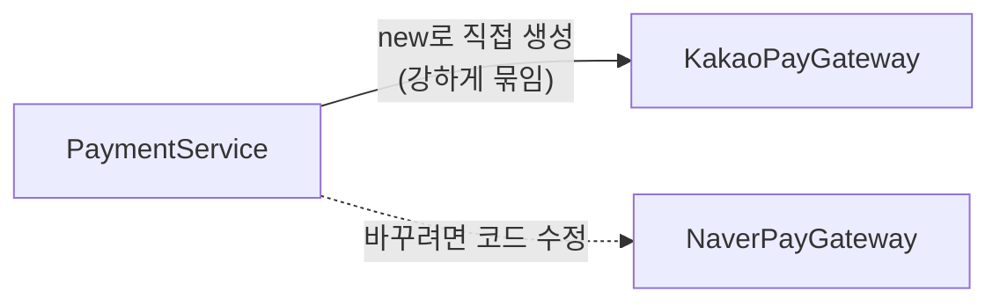
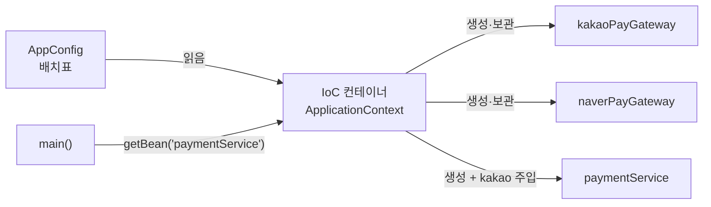
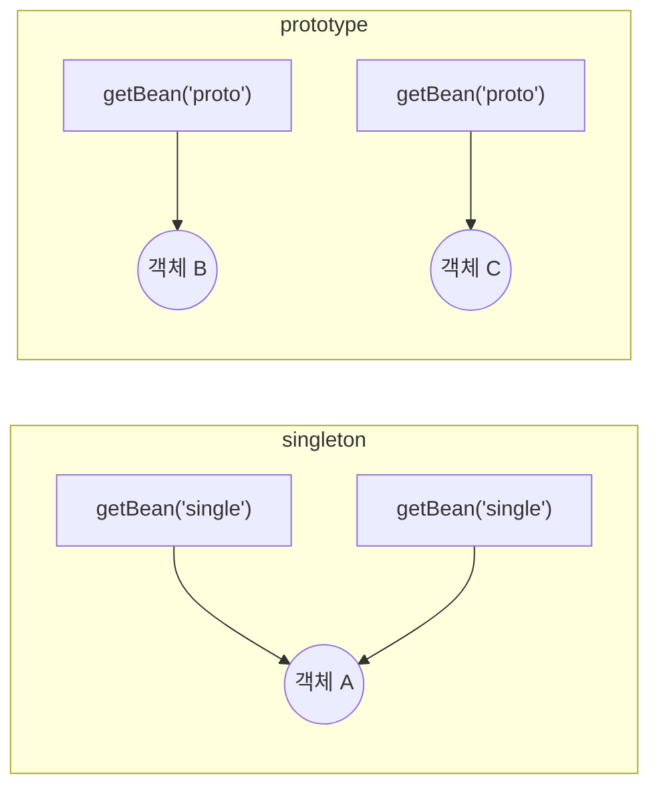
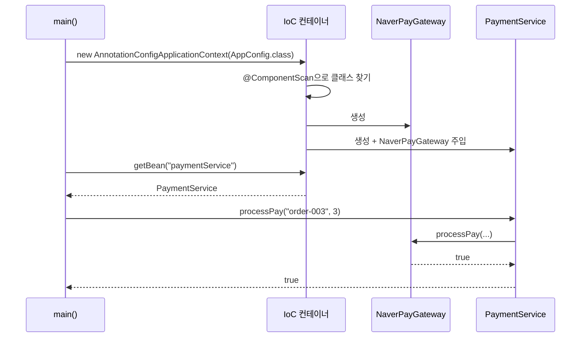

## 들어가며 (Situation)

오늘(10/26)부터 **Spring** 수업이 시작됐다. 첫 주제는 Spring의 심장인 **IoC 컨테이너**와 **DI(의존성 주입)** 다.

사실 비슷한 걸 이미 해 본 적이 있다. [10/19 JDBC 계층 구조 수업]({{ site.baseurl }})에서 `Application.main()`이 `MenuService`, `MenuController`, `MenuInputView`를 **직접 `new` 해서 생성자로 끼워 줬다.** 그때 강사님이 "나중에 Spring이 이 조립을 자동으로 해 준다"고 했는데, 오늘 그걸 배웠다.

예제는 **결제 시스템**이다. `PaymentService`가 카카오페이나 네이버페이로 결제를 한다.

| 프로젝트 | 섹션 | 주제 |
|----------|------|------|
| `chap01-IoC-container` | `section01` | Spring 없이 `new`로 직접 만들 때의 문제 |
| `chap01-IoC-container` | `section02` | 인터페이스 + `@Configuration` / `@Bean`으로 컨테이너에 등록 |
| `chap01-IoC-container` | `section03` | Bean 스코프: singleton vs prototype |
| `chap02-dependency-injection` | `section01` | `@ComponentScan`으로 Bean 자동 등록 |
| `chap02-dependency-injection` | `section02` | 의존성 주입 3가지: 필드, setter, 생성자 |

의존성은 `build.gradle`에 하나만 추가했다.

```groovy
dependencies {
    /* spring-context : Spring 프레임 워크의 핵심 의존성. IoC Container 생성 */
    implementation 'org.springframework:spring-context:7.0.8'
}
```

## 문제 상황 (Task)

### 쉽게 비유하면

- `PaymentService`는 **계산대 직원**이다.
- `KakaoPayGateway`, `NaverPayGateway`는 직원이 쓰는 **카드 단말기**다.
- 지금까지는 직원이 출근할 때 **자기가 직접 단말기를 사 와서** 썼다. (`new KakaoPayGateway()`)

이러면 문제가 생긴다.

1. 사장님이 "이제 네이버페이 단말기 쓰자"고 하면, **직원 코드를 열어서** 단말기를 바꿔야 한다.
2. 회사마다 단말기 **버튼 이름과 쓰는 법이 다르면**, 직원 코드를 전부 고쳐야 한다.
3. 직원이 100명이면? 객체 100개를 누가, 어떤 순서로 만들고 연결할지 **사람이 다 관리**해야 한다.

## 해결 과정 (Action)

### 한눈에 보는 오늘의 등장인물

| 용어 | 쉬운 말 | 식당 비유 |
|------|---------|-----------|
| **Bean** | Spring이 관리하는 **객체** | 가게에 등록된 직원과 도구 |
| **IoC 컨테이너** (`ApplicationContext`) | Bean을 만들고 보관하고 연결해 주는 **관리자** | **매니저**: 직원을 뽑고 도구를 쥐여 줌 |
| **IoC** (제어의 역전) | 객체를 만드는 주도권이 **내 코드 → 컨테이너**로 넘어감 | 직원이 단말기를 사 오는 게 아니라 매니저가 줌 |
| **DI** (의존성 주입) | 필요한 객체를 **밖에서 넣어 줌** | 매니저가 직원 손에 단말기를 쥐여 줌 |
| **인터페이스** (`PaymentInterface`) | 구현체들이 지켜야 할 **공통 규격** | "모든 단말기는 `결제` 버튼이 있어야 함" |

---

### 1. Spring 없이 직접 만들 때 (`chap01` / `section01`)

#### 💳 카드 단말기 두 개 — `KakaoPayGateway`, `NaverPayGateway`

**역할:** 실제 결제를 하는 클래스다. 그런데 **두 클래스의 메서드 모양이 다르다.** 카카오는 `int`, 네이버는 `double`로 수량을 받는다.

```java
public class KakaoPayGateway {

    // 카카오페이 결제를 담당하는 메서드
    public boolean pay(String orderId, int amount) {
        System.out.println("카카오페이로 결제 시작! : 주문 ID = " + orderId + ", 수량 = " + amount);
        return true;
    }
}
```

```java
public class NaverPayGateway {

    // 네이버페이 결제를 담당하는 메서드
    public boolean pay(String orderId, double amount) {
        System.out.println("네이버페이로 결제 시작! : 주문 ID = " + orderId + ", 수량 = " + amount);
        return true;
    }
}
```

#### 🧑‍💼 계산대 직원 — `PaymentService`

**역할:** 결제 비즈니스 로직을 담당한다. 그런데 **생성자 안에서 단말기를 직접 `new`** 한다. 네이버에서 카카오로 바꾸려고 주석을 오가며 코드를 고친 흔적이 그대로 남아 있다.

```java
public class PaymentService {

//    private NaverPayGateway naverPayGateway;
    private KakaoPayGateway kakaoPayGateway;

    public PaymentService() {
//        this.naverPayGateway = new NaverPayGateway();
        this.kakaoPayGateway = new KakaoPayGateway();   // 직접 생성!
    }

    public boolean processPay(String orderId, int amount) {

        System.out.println("결제 비즈니스 로직 시작! 주문 ID = " + orderId + ", 수량 = " + amount);

//        boolean result = naverPayGateway.pay(orderId, amount);
        boolean result = kakaoPayGateway.pay(orderId, amount);

        if (result) {
            System.out.println("결제 성공!");
        } else {
            System.out.println("결제 실패..");
        }
        return result;
    }
}
```

#### ▶️ 실행 — `Application`

**역할:** `PaymentService`를 `new`로 만들고 결제를 실행한다.

```java
public class Application {
    public static void main(String[] args) {
        PaymentService paymentService = new PaymentService();
        boolean result = paymentService.processPay("order-001", 3);
        System.out.println("결제 결과 : " + result);
    }
}
```

#### 무엇이 문제일까? — 개방-폐쇄 원칙(OCP) 위반

수업 주석에 문제가 정리되어 있었다.

1. 결제 수단을 바꾸려면 `PaymentService` **안의 코드를 직접 고쳐야** 한다. (필드 타입, 생성자, 메서드 호출 3곳)
2. 회사마다 **메서드 이름이나 매개변수가 다르면** 그것도 전부 고쳐야 한다.

이것을 SOLID 원칙 중 **개방-폐쇄 원칙(OCP, Open-Closed Principle)** 위반이라고 한다.

> 소프트웨어는 **확장에는 열려** 있어야 하고, **변경에는 닫혀** 있어야 한다.

쉽게 말하면 "새 결제 수단을 **추가**하는 건 쉬워야 하고, 추가할 때 **기존 코드를 고칠 필요는 없어야** 한다"는 뜻이다.



---

### 2. 인터페이스 + IoC 컨테이너 (`chap01` / `section02`)

#### 📐 공통 규격 — `PaymentInterface`

**역할:** 모든 결제 단말기가 **같은 이름, 같은 매개변수**의 메서드를 갖게 강제한다. section01의 "회사마다 메서드 모양이 다른" 문제를 해결한다.

```java
/* section01 에서 발생한 각 구현체 별로
 * 메서드 이름, 매개변수 타입 / 순서 문제를
 * interface 의 특징을 활용해서 해결 */
public interface PaymentInterface {

    boolean processPay(String orderId, int amount);

}
```

```java
public class KakaoPayGateway implements PaymentInterface {
    @Override
    public boolean processPay(String orderId, int amount) {
        System.out.println("카카오페이로 결제 시작! : 주문 ID = " + orderId + ", 수량 = " + amount);
        return true;
    }
}

public class NaverPayGateway implements PaymentInterface {
    @Override
    public boolean processPay(String orderId, int amount) {
        System.out.println("네이버페이로 결제 시작! : 주문 ID = " + orderId + ", 수량 = " + amount);
        return true;
    }
}
```

#### 🧑‍💼 계산대 직원 (개선) — `PaymentService`

**역할:** 이제 **구체적인 회사 이름을 모른다.** `PaymentInterface`라는 규격만 알고, 실제 단말기는 **생성자로 받는다.** 스스로 `new` 하지 않는다.

```java
public class PaymentService {

    private final PaymentInterface paymentInterface;   // 규격(인터페이스)만 안다

    public PaymentService(PaymentInterface paymentInterface) {   // 밖에서 받는다
        this.paymentInterface = paymentInterface;
    }

    public boolean processPay(String orderId, int amount) {

        System.out.println("결제 비즈니스 로직 시작! 주문 ID = " + orderId + ", 수량 = " + amount);

        boolean result = paymentInterface.processPay(orderId, amount);

        if (result) {
            System.out.println("결제 성공!");
        } else {
            System.out.println("결제 실패..");
        }
        return result;
    }
}
```

`paymentInterface.processPay()`를 부르면 실제로 들어 있는 객체(카카오 또는 네이버)의 메서드가 실행된다. [10/6에 배운 다형성]({{ site.baseurl }})이다.

#### 📋 매니저의 배치표 — `AppConfig`

**역할:** "어떤 객체를 만들어서 컨테이너에 등록할지"를 적어 둔 **설정 클래스**다. 여기서 직원에게 **어느 단말기를 줄지** 정한다.

```java
/* IoC 컨테이너에게 등록할 객체를 모아둔 설정 클래스
 * Bean : Bean 은 Spring 에서 객체를 의미하는 단어. */
@Configuration
public class AppConfig {

    /* @Bean 어노테이션을 사용하면 컨테이너 내부에서
     * 그 객체의 이름은 메서드명이 기본값이 된다. */

    @Bean
    public KakaoPayGateway kakaoPayGateway() {
        return new KakaoPayGateway();
    }

    @Bean
    public NaverPayGateway naverPayGateway() {
        return new NaverPayGateway();
    }

    @Bean
    public PaymentService paymentService() {
        return new PaymentService(kakaoPayGateway());   // ← 여기만 바꾸면 결제 수단 교체
    }
}
```

| 코드 | 쉬운 말 |
|------|---------|
| `@Configuration` | "이 클래스는 **배치표(설정)** 예요" |
| `@Bean` | "이 메서드가 돌려주는 객체를 **Bean으로 등록**해 주세요" |
| Bean 이름 | 기본값은 **메서드 이름** (`kakaoPayGateway`, `paymentService`) |
| `new PaymentService(kakaoPayGateway())` | 직원에게 카카오 단말기를 쥐여 주기 |

이제 네이버페이로 바꾸려면 `PaymentService`는 **건드리지 않고** `AppConfig`의 한 줄만 바꾸면 된다.

```java
return new PaymentService(naverPayGateway());
```

> `@Configuration` 클래스 안에서 `kakaoPayGateway()`를 직접 호출해도 매번 새 객체가 만들어지지 않는다. Spring이 이 클래스를 감싸서, 이미 컨테이너에 있는 Bean을 돌려주도록 처리한다.

#### 왜 괄호 안만 바꾸면 결제 수단이 바뀔까?

`PaymentService`가 **"어떤 회사 단말기든 꽂을 수 있는 자리"** 를 갖고 있기 때문이다. 한 단계씩 따라가 보자.

**① `PaymentService`에는 "단말기 꽂는 자리"가 있다**

```java
public class PaymentService {

    private final PaymentInterface paymentInterface;   // ← 꽂는 자리

    public PaymentService(PaymentInterface paymentInterface) {   // ← 여기로 받아서
        this.paymentInterface = paymentInterface;                // ← 자리에 꽂음
    }
}
```

자리의 모양(타입)이 `KakaoPayGateway`가 아니라 **`PaymentInterface`** 다. 그래서 이 규격을 지킨 단말기라면 **아무거나** 꽂을 수 있다.

> 🎮 **게임기 카트리지 슬롯과 같다.** 슬롯 모양만 맞으면 마리오 카트리지든 포켓몬 카트리지든 꽂을 수 있다. 게임기를 뜯어서 고칠 필요 없이 **꽂는 카트리지만 바꾸면** 다른 게임이 나온다.

**② 카카오와 네이버는 둘 다 그 자리에 맞는다**

```java
public class KakaoPayGateway implements PaymentInterface { ... }   // ✅ 규격 지킴
public class NaverPayGateway implements PaymentInterface { ... }   // ✅ 규격 지킴
```

`implements PaymentInterface`는 "나는 `PaymentInterface` 규격을 지키는 단말기예요"라는 약속이다. 그래서 둘 다 `PaymentInterface` 자리에 **들어갈 수 있다.**

**③ 괄호 안에 넣은 게 그대로 자리에 꽂힌다**

```java
new PaymentService(kakaoPayGateway());   // 카카오 카트리지를 꽂음
new PaymentService(naverPayGateway());   // 네이버 카트리지를 꽂음
```

괄호 안의 값이 **생성자 매개변수**로 들어가고, 생성자가 그걸 `this.paymentInterface`에 저장한다. 즉 **괄호 안에 무엇을 넣느냐 = 자리에 무엇이 꽂히느냐**다.

**④ 결제할 때는 "꽂혀 있는 것"의 메서드가 실행된다**

```java
public boolean processPay(String orderId, int amount) {
    boolean result = paymentInterface.processPay(orderId, amount);   // ← 꽂힌 단말기의 버튼 누르기
    ...
}
```

`PaymentService`는 그냥 "자리에 꽂힌 단말기의 `processPay` 버튼"을 누른다. **안에 누가 꽂혀 있는지는 신경 쓰지 않는다.** Java가 실행할 때 실제로 꽂힌 객체를 보고 그 객체의 메서드를 실행해 준다. 이게 다형성이다.

```text
[AppConfig]   new PaymentService( naverPayGateway() )
                                   │
                                   ▼
[생성자]      this.paymentInterface = (네이버 단말기)
                                   │
                    ... 나중에 결제 요청 ...
                                   │
                                   ▼
[processPay]  paymentInterface.processPay(...)
                                   │  "꽂힌 게 누구지?" → 네이버!
                                   ▼
[NaverPayGateway.processPay()]  "네이버페이로 결제 시작!"
```

괄호 안을 `kakaoPayGateway()`로 바꾸면 위 흐름에서 **"네이버"만 "카카오"로** 바뀌고, 나머지는 전부 그대로다.

| | section01 (직접 `new`) | section02 (밖에서 받기) |
|---|---|---|
| 자리 모양 | `KakaoPayGateway` **전용** | `PaymentInterface` **아무거나** |
| 단말기는 누가 정해? | `PaymentService` **스스로** (생성자 안에서 `new`) | **밖에서** 괄호로 넣어 줌 |
| 네이버로 바꾸려면 | `PaymentService` 안의 필드 타입, 생성자, 메서드 호출 **3곳** 수정 | `AppConfig`의 괄호 안 **1곳** 수정 |
| 비유 | 카트리지가 **납땜**된 게임기 | 카트리지 **슬롯**이 있는 게임기 |

> **한 줄 정리:** `PaymentService`는 **"`PaymentInterface` 모양의 빈 자리"** 만 갖고 있고, **괄호 안에 넣은 단말기가 그 자리에 꽂힌다.** 결제할 때는 꽂힌 단말기의 메서드가 실행되니까, 괄호 안만 바꾸면 결제 수단이 바뀐다.

#### ▶️ 실행 — `Application`

**역할:** **IoC 컨테이너를 만들고**, 컨테이너에서 `PaymentService`를 **꺼내서** 쓴다. 더 이상 `new PaymentService()`를 하지 않는다.

```java
public class Application {

    public static void main(String[] args) {

        // IoC Container 생성
        // IoC Container == Application Context == Bean Factory
        ApplicationContext context =
                new AnnotationConfigApplicationContext(AppConfig.class);

        // getBean() : 컨테이너 내부에 있는 객체를 꺼내오는 메서드
        PaymentService paymentService = context.getBean("paymentService", PaymentService.class);

        boolean result = paymentService.processPay("order-001", 3);
        System.out.println("결제 결과 : " + result);
    }
}
```

| 코드 | 쉬운 말 |
|------|---------|
| `new AnnotationConfigApplicationContext(AppConfig.class)` | 매니저를 고용하면서 **배치표를 건네줌**. 매니저가 배치표대로 Bean을 전부 만든다 |
| `ApplicationContext` | 그 매니저(**IoC 컨테이너**) |
| `context.getBean("이름", 타입.class)` | 매니저에게 "`paymentService` 직원 불러 주세요" |



수업 주석에서 `IoC Container == Application Context == Bean Factory`라고 정리했다. 엄밀히는 `BeanFactory`가 Bean을 만들고 꺼내는 **기본 기능**이고, `ApplicationContext`는 그 기능에 여러 부가 기능을 더한 **확장판**이다. 실무에서는 거의 항상 `ApplicationContext`를 쓴다.

---

### 3. Bean 스코프: singleton vs prototype (`chap01` / `section03`)

#### 📋 배치표 — `AppConfig`

**역할:** 같은 `PaymentService`를 **두 가지 방식**으로 등록한다. `single`은 하나만 만들어 계속 같은 것을 주고, `proto`는 달라고 할 때마다 새로 만든다.

```java
@Configuration
public class AppConfig {

    /* @Bean 의 Scope 확인하기!
     * 1. Bean 은 기본적으로 싱글톤 스코프를 갖는다.
     * - 객체는 기본적으로 컨테이너 내부에서 단일 인스턴스이다.
     * - 모든 요청에 동일한 객체를 반환한다.
     * - 1-1) 메모리 효율적이다.
     * - 1-2) 같은 인스턴스이기 때문에 동일한 동작을 예상할 수 있다. */

    @Bean
    public KakaoPayGateway kakaoPayGateway() {
        return new KakaoPayGateway();
    }

    @Bean
    public NaverPayGateway naverPayGateway() {
        return new NaverPayGateway();
    }

    @Bean("single")         // default 메서드명이지만, 직접 이름 지정 가능
    @Scope("singleton")     // default 설정은 싱글톤이다.
    public PaymentService paymentService() {
        return new PaymentService(kakaoPayGateway());
    }

    @Bean("proto")
    @Scope("prototype")     // 요청 시마다 매번 새로운 인스턴스를 반환
    public PaymentService paymentService2() {
        return new PaymentService(kakaoPayGateway());
    }
}
```

#### 🧑‍💼 상태를 가진 직원 — `PaymentService`

**역할:** 스코프 차이를 눈으로 보려고 **`orderId` 필드**를 하나 추가했다. 결제할 때 주문 번호를 필드에 저장한다.

```java
public class PaymentService {

    private final PaymentInterface paymentInterface;

    /* Bean 은 기본적으로 Singleton 이다.
     * 가장 주의!!!!
     * - Bean 이 상태(필드) 값을 가지게 되면 모든 요청이 해당 필드 값을 공유하게 된다.
     * - 따라서 필드에는 행위 위주의 클래스(ex) service, dao) 만 작성하고
     * - 데이터 저장이 필요한 경우에는 각 요청별로 DTO 를 통해서 데이터를 저장한다. */
    private String orderId;

    public PaymentService(PaymentInterface paymentInterface) {
        this.paymentInterface = paymentInterface;
    }

    public boolean processPay(String orderId, int amount) {
        System.out.println("결제 비즈니스 로직 시작! 주문 ID = " + orderId + ", 수량 = " + amount);

        this.orderId = orderId;   // 필드에 저장

        boolean result = paymentInterface.processPay(orderId, amount);
        // ... (결과 출력 생략)
        return result;
    }

    public String getOrderId() {
        return this.orderId;
    }
}
```

#### ▶️ 실행 — `Application`

**역할:** `getBean()`을 **두 번씩** 호출해서, 두 번 꺼낸 객체가 같은 객체인지 확인한다.

```java
ApplicationContext context = new AnnotationConfigApplicationContext(AppConfig.class);

System.out.println("==============singleton 확인!!================");
PaymentService single = context.getBean("single", PaymentService.class);
single.processPay("order-001", 3);
System.out.println("single 의 주문 ID = " + single.getOrderId());

PaymentService single2 = context.getBean("single", PaymentService.class);
System.out.println("single2 의 주문 ID = " + single2.getOrderId());

System.out.println("==============prototype 확인!!================");
PaymentService proto = context.getBean("proto", PaymentService.class);
proto.processPay("order-002", 3);
System.out.println("proto 의 주문 ID = " + proto.getOrderId());

PaymentService proto2 = context.getBean("proto", PaymentService.class);
System.out.println("proto2 의 주문 ID = " + proto2.getOrderId());
```

`single2`와 `proto2`는 `processPay()`를 **부르지 않았다.** 그런데 결과가 다르다.

| 변수 | `processPay()` 호출 | `getOrderId()` 결과 | 이유 |
|------|--------------------|--------------------|------|
| `single` | `order-001`로 호출 | `order-001` | 방금 저장했으니까 |
| `single2` | 호출 안 함 | **`order-001`** | `single`과 **같은 객체**라서 값이 남아 있음 |
| `proto` | `order-002`로 호출 | `order-002` | 방금 저장했으니까 |
| `proto2` | 호출 안 함 | **`null`** | `proto`와 **다른 새 객체**라서 아무것도 저장 안 됨 |

| 스코프 | `getBean()` 할 때마다 | 비유 | 기본값 |
|--------|---------------------|------|--------|
| `singleton` | **같은 객체** 하나를 계속 줌 | 가게에 하나뿐인 계산대 | ✅ |
| `prototype` | **새 객체**를 매번 만들어 줌 | 손님마다 새로 주는 일회용 컵 | |



#### 시행착오: 싱글톤 Bean에 상태를 저장하면 위험하다

`single2`에 `order-001`이 남아 있는 걸 보면 위험이 보인다. 실제 서버에서는 여러 손님의 요청이 **동시에 같은 싱글톤 객체**를 쓴다. ([10/21 Servlet]({{ site.baseurl }})에서 서블릿 객체도 하나라 `serviceCount`가 계속 올라갔던 것과 같은 구조다.)

| 시간 | 손님 A | 손님 B | `orderId` 필드 |
|------|--------|--------|---------------|
| 1 | `processPay("A-주문")` | | `A-주문` |
| 2 | | `processPay("B-주문")` | `B-주문` (덮어씀!) |
| 3 | `getOrderId()` | | **`B-주문`** ← 남의 주문 번호 |

그래서 수업 주석의 결론처럼, 싱글톤 Bean의 필드에는 **다른 Bean처럼 바뀌지 않는 것**(`paymentInterface`)만 두고, **요청마다 달라지는 데이터**(`orderId`)는 메서드 매개변수나 지역 변수, DTO로 주고받는다.

#### 더 알아보기: 싱글톤이란?

**싱글톤(Singleton)은 객체를 딱 하나만 만들어서, 필요한 모든 곳이 그 하나를 같이 쓰는 방식이다.** "single"(하나)에서 온 이름이다.

**비유: 학교 정수기 🚰** — 학교에 정수기가 **한 대** 있다. 1반 학생도, 2반 학생도, 선생님도 **모두 같은 정수기**에서 물을 마신다. 학생이 올 때마다 정수기를 새로 사 오지 않는다.

| | 싱글톤 | 싱글톤이 아니면 (prototype) |
|---|---|---|
| 정수기 | 학교에 **1대**, 다 같이 씀 | 학생이 올 때마다 **새로 1대씩** 삼 |
| 장점 | 돈(메모리) 절약, 어디서 써도 같은 정수기 | 각자 자기 것이라 안 섞임 |
| 단점 | 누가 컵을 놓고 가면 **다음 사람이 봄** | 정수기가 엄청 많아짐 |

`==`로 비교하면 차이가 바로 보인다. `==`는 **두 변수가 같은 객체를 가리키는지** 비교한다. 아래는 수업 코드에 확인용 줄을 더한 **예시 코드**다.

```java
// 예시 코드: 같은 객체인지 확인
PaymentService single  = context.getBean("single", PaymentService.class);
PaymentService single2 = context.getBean("single", PaymentService.class);
System.out.println(single == single2);   // true  ← 같은 객체!

PaymentService proto  = context.getBean("proto", PaymentService.class);
PaymentService proto2 = context.getBean("proto", PaymentService.class);
System.out.println(proto == proto2);     // false ← 다른 객체!
```

위에서 `single2.getOrderId()`가 `order-001`로 나온 것도 같은 이유다. `single`이 쓰고 간 값이 **같은 객체**에 그대로 남아 있었던 것이다.

**왜 Spring은 기본이 싱글톤일까?** `PaymentService`는 **"결제하는 방법"** 만 알면 된다. 손님 A를 결제하든 손님 B를 결제하든 하는 일이 똑같다. 그러니 **하나만 있으면 충분**하다.

| 싱글톤이 어울리는 것 | 이유 |
|----------------------|------|
| Service, DAO, Controller | **일하는 방법**만 갖고 있고, 손님마다 다른 게 없음 |
| 설정 정보, 커넥션 관리자 | 하나로 모든 곳이 같은 값을 봐야 함 |

**싱글톤의 함정: 정수기 위에 놓고 간 컵 ⚠️** — 필드(`orderId`)는 정수기 위에 놓는 컵이다. 손님 A가 컵을 올려놓고 잠깐 한눈판 사이에 손님 B가 자기 컵으로 **바꿔치기**한다. A가 돌아와서 집어 든 건 **B의 컵**이다. 그래서 싱글톤 필드에는 **모두가 같이 써도 되는 것**만 둔다.

```java
@Service
public class PaymentService {
    private final PaymentInterface paymentInterface;   // ✅ 모두 같은 단말기 → OK
    // private String orderId;                        // ❌ 손님마다 다른 값 → 섞임

    public boolean processPay(String orderId, int amount) {   // ✅ 주문 번호는 매개변수로
        // orderId는 이 메서드 안에서만 쓰고 끝
    }
}
```

매개변수와 지역 변수는 **메서드를 부를 때마다 따로** 생겨서 손님끼리 섞이지 않는다.

**짚고 갈 점: Spring 싱글톤은 "클래스당 1개"가 아니다.** 위 `AppConfig`는 같은 `PaymentService` 클래스를 `single`과 `proto`로 **두 번** 등록했다. Spring의 싱글톤은 **"Bean 이름(정의) 하나당 객체 1개"** 다. 만약 `@Bean("single2")`라는 싱글톤을 하나 더 등록하면, `single`과 `single2`는 **서로 다른** `PaymentService` 객체가 된다.

| 구분 | 순수 Java 싱글톤 패턴 | Spring 싱글톤 스코프 |
|------|----------------------|---------------------|
| 누가 "하나만" 보장? | **클래스 스스로** (`private` 생성자 + `static` 변수) | **IoC 컨테이너**가 관리 |
| 하나의 기준 | 프로그램 전체에서 **클래스당 1개** | **Bean 이름(정의)당 1개** |
| 클래스 코드 | 싱글톤용으로 특별하게 작성 | 평범한 클래스 그대로 |

순수 Java로 싱글톤을 만들려면 이런 특별한 코드가 필요하다. 아래는 **예시 코드**다.

```java
// 예시 코드: 순수 Java 싱글톤 패턴
public class WaterPurifier {
    private static final WaterPurifier INSTANCE = new WaterPurifier();   // 딱 하나 미리 만들어 둠

    private WaterPurifier() {}   // 밖에서 new 못 하게 막음

    public static WaterPurifier getInstance() {   // 이 메서드로만 꺼냄
        return INSTANCE;
    }
}
```

Spring을 쓰면 이런 코드를 **쓸 필요가 없다.** 평범한 클래스에 `@Service`만 붙여도 컨테이너가 알아서 하나만 만들어서 나눠 준다.

> **한 줄 정리:** 싱글톤은 **"학교 정수기처럼 하나를 모두가 같이 쓰는 것"** 이다. 메모리를 아끼고 어디서든 같은 객체를 쓰지만, **사람마다 다른 값을 필드에 두면 섞인다.**

---

### 4. `@ComponentScan`으로 자동 등록 (`chap02` / `section01`)

수업에서 이런 질문이 나왔다.

> `AppConfig`에 `@Bean` 메서드를 하나씩 적어서 등록했는데, **Bean이 100개라면?**

100개를 다 적는 대신, 클래스에 **표시(어노테이션)** 만 해 두고 Spring이 **찾아서** 등록하게 한다.

#### 🔍 찾아서 등록하는 배치표 — `AppConfig`

**역할:** `@Bean` 메서드가 **하나도 없다.** 대신 `@ComponentScan`으로 지정한 패키지를 뒤져서 `@Component`가 붙은 클래스를 전부 Bean으로 등록한다.

```java
@Configuration
/* @ComponentScan 은 지정된 패키지에서
 * @Component 관련 어노테이션이 붙은 클래스를 스캔하여 Bean 으로 등록해준다.
 * 만약 scan 범위에서 제외하고자 하면 excludeFilter 를 활용할 수 있다. */
@ComponentScan(basePackages = "com.wanted.di.section01",
    excludeFilters = @ComponentScan.Filter(
            // 1. 클래스명 제외
//            type = FilterType.ASSIGNABLE_TYPE, classes = {PaymentService.class}
            // 2. 어노테이션 제외
//            type = FilterType.ANNOTATION, classes = {org.springframework.stereotype.Service.class}
            // 3. 정규표현식 제외
//            type = FilterType.REGEX, pattern = {"com.wanted.di.section01.service.*"}
    )
)
public class AppConfig {

}
```

| 설정 | 쉬운 말 |
|------|---------|
| `basePackages = "com.wanted.di.section01"` | 이 패키지와 **그 아래 패키지 전부**를 뒤져라 |
| `excludeFilters` | 뒤지되 **이건 빼라** |
| `FilterType.ASSIGNABLE_TYPE` | 특정 **클래스**를 빼기 |
| `FilterType.ANNOTATION` | 특정 **어노테이션**이 붙은 것 빼기 (예: `@Service` 전부) |
| `FilterType.REGEX` | 클래스 이름이 **정규표현식**에 맞는 것 빼기 |

수업에서는 세 가지 제외 방법을 하나씩 주석을 풀어 가며 확인했다. 지금은 셋 다 주석이라 **아무것도 제외하지 않는다.**

#### 🏷️ "저 Bean이에요" 표시 — `@Component`, `@Service`

**역할:** 스캔할 때 Spring이 알아볼 수 있게 클래스에 **이름표**를 붙인다.

```java
@Component
public class NaverPayGateway implements PaymentInterface {
    @Override
    public boolean processPay(String orderId, int amount) {
        System.out.println("네이버페이로 결제 시작! : 주문 ID = " + orderId + ", 수량 = " + amount);
        return true;
    }
}
```

```java
/* @Service 어노테이션은 @Component 의 특수한 형태이다.
 * MVC 패턴 중 Service 계층에 해당하는 Bean에 붙이게 된다. */
@Service
public class PaymentService {

    private final PaymentInterface paymentInterface;

    public PaymentService(PaymentInterface paymentInterface) {
        this.paymentInterface = paymentInterface;
    }
    // ... processPay() 등은 section03과 같음
}
```

```java
// 스캔이 잘 되는지 확인하려고 만든 빈 클래스
@Component
public class Test {
}
```

| 어노테이션 | 붙이는 곳 | 하는 일 |
|------------|----------|---------|
| `@Component` | 일반 Bean | 기본 이름표 |
| `@Service` | Service 계층 | `@Component` + "비즈니스 로직 담당"이라는 의미 |
| `@Repository` | DAO 계층 | `@Component` + DB 예외 변환 기능 |
| `@Controller` | Controller 계층 | `@Component` + 웹 요청 처리 (Spring MVC) |

`@Service`, `@Repository`, `@Controller`는 모두 안에 `@Component`를 품고 있어서 **스캔 대상이 된다.** [10/19에 나눈 계층]({{ site.baseurl }})마다 알맞은 이름표를 붙이면 된다.

이름을 따로 안 주면 Bean 이름은 **클래스 이름의 첫 글자를 소문자로** 바꾼 것이 된다. 그래서 `PaymentService`는 `"paymentService"`로 꺼낸다.

#### ▶️ 실행 — `Application`

```java
ApplicationContext context = new AnnotationConfigApplicationContext(AppConfig.class);

PaymentService pay = context.getBean("paymentService", PaymentService.class);
pay.processPay("order-003", 3);
```

`AppConfig`에 `new PaymentService(...)`도, `new NaverPayGateway()`도 없는데 결제가 된다. Spring이 스캔으로 두 클래스를 찾고, `PaymentService` 생성자가 `PaymentInterface`를 원하니 **알맞은 Bean(`NaverPayGateway`)을 찾아서 넣어 준다.** 이게 다음에 배운 의존성 주입이다.

#### 짚고 갈 점: `basePackages`를 안 쓰면 어디까지 찾을까?

수업 주석에는 "`basePackages`를 지정하지 않으면 `@ComponentScan`이 달린 클래스와 같은 레벨(같은 패키지)까지만 스캔한다"고 적혀 있었다. 정확히는 **그 클래스가 있는 패키지와 그 하위 패키지 전부**를 스캔한다.

`AppConfig`는 `com.wanted.di.section01.config` 패키지에 있다. 그래서 `basePackages` 없이 `@ComponentScan`만 쓰면 `config` 아래만 찾는다. 옆 패키지인 `service`, `gateway`는 **못 찾는다.** 그래서 `basePackages`로 한 단계 위인 `section01`을 지정한 것이다.

```text
com.wanted.di.section01          ← basePackages로 지정 (여기부터 전부)
├── config
│   ├── AppConfig                ← @ComponentScan만 쓰면 여기부터만
│   └── Test (@Component)
├── gateway
│   └── NaverPayGateway (@Component)
└── service
    └── PaymentService (@Service)
```

---

### 5. 의존성 주입 3가지 (`chap02` / `section02`)

**DI(의존성 주입)** 는 수업 주석의 표현대로, 개발자가 직접 `new`로 객체를 연결하는 게 아니라 **IoC 컨테이너가 자동으로 필요한 객체를 넣어 주는 것**이다. 넣어 주는 **위치**에 따라 세 가지가 있다.

| 방식 | `@Autowired` 위치 | 비유 |
|------|-------------------|------|
| 필드 주입 | 필드 위 | 매니저가 직원 **주머니에 몰래** 단말기를 넣어 둠 |
| setter 주입 | setter 메서드 위 | 출근 후 매니저가 **"이거 써"** 하고 건넴 |
| 생성자 주입 | 생성자 위 (생략 가능) | **입사할 때** 단말기를 받아야만 입사 가능 |

#### ① 필드 주입 — `PaymentServiceField`

**역할:** 필드에 `@Autowired`를 붙여서, 컨테이너가 **필드에 바로** 객체를 넣게 한다.

```java
@Service("field")
public class PaymentServiceField {

    /* @Autowired 어노테이션은 IoC 컨테이너에 있는 Bean 을
     * 찾아서 사용하는 위치에 객체를 주입하겠다는 의미이다.
     * ---
     * 필드 주입의 단점
     * - final 키워드를 사용할 수 없다.
     * - 필드에 직접 객체를 생성해서 대입해도 컴파일 에러가 발생하지 않는다. */
    @Autowired
    private PaymentInterface paymentInterface;

    public boolean processPay(String orderId, int amount) {

//        paymentInterface = new NaverPayGateway();   ← 이렇게 바꿔치기해도 에러가 안 난다

        System.out.println("결제 비즈니스 로직 시작! 주문 ID = " + orderId + ", 수량 = " + amount);
        boolean result = paymentInterface.processPay(orderId, amount);
        // ... (결과 출력 생략)
        return result;
    }
}
```

코드가 가장 짧지만, 주석 처리된 줄처럼 **누군가 중간에 `new`로 바꿔치기해도** 컴파일러가 막지 못한다. 또 Spring 없이 테스트하려고 `new PaymentServiceField()`를 하면 필드에 넣을 방법이 없어서 `null`인 채로 남는다.

#### ② setter 주입 — `PaymentServiceSetter`

**역할:** setter 메서드에 `@Autowired`를 붙여서, 객체를 만든 **다음에** 컨테이너가 setter를 호출해 넣게 한다.

```java
@Service("setter")
public class PaymentServiceSetter {

    private PaymentInterface paymentInterface;

    /* @Autowired 를 setter 메서드에 작성해서 의존성 주입
     * ---
     * 단점
     * 1. final 키워드를 사용할 수 없다.
     * 2. setter 메서드가 호출되지 않으면 null 인 상태이다.
     * 장점
     * 1. 선택적 의존관계를 가질 수 있다. */
    @Autowired
    public void setPaymentInterface(PaymentInterface paymentInterface) {
        this.paymentInterface = paymentInterface;
    }

    public boolean processPay(String orderId, int amount) {
        System.out.println("결제 비즈니스 로직 시작! 주문 ID = " + orderId + ", 수량 = " + amount);
        boolean result = paymentInterface.processPay(orderId, amount);
        // ... (결과 출력 생략)
        return result;
    }
}
```

"없어도 동작은 하는" **선택적인 의존성**(예: 있으면 알림 보내기, 없으면 생략)에 어울린다. 반대로 꼭 필요한 의존성이라면 setter가 안 불린 상태로 `processPay()`를 부를 때 `NullPointerException`이 난다.

#### ③ 생성자 주입 — `PaymentServiceConstructor` ⭐ 권장

**역할:** 생성자 매개변수로 의존성을 받는다. 객체가 **만들어지는 순간** 의존성이 반드시 채워진다.

```java
@Service("constructor")
public class PaymentServiceConstructor {

    /* 생성자 주입 방식은 생성자가 1개 뿐이라면 자동으로
     * @Autowired 를 작성하지 않더라도 의존성이 주입 된다.
     * ---
     * 장점
     * 1. final 키워드를 통해 의존성이 변경되는 것을 방지(불변성 보장)
     * 2. 필수 의존성 강제화
     * - final 키워드를 작성하면 초기화를 반드시 해주어야 하는데
     * - 생성자로 주입하게 되면 객체의 생성 시점에 의존 관계를 바로 정의할 수 있다.
     * ---
     * 위 특징들로 인해서 생성자를 통한 의존성 주입 방식이 Spring 공식 권장 방식이다. */
    private final PaymentInterface paymentInterface;

    @Autowired
    public PaymentServiceConstructor(PaymentInterface paymentInterface) {
        this.paymentInterface = paymentInterface;
    }

    public boolean processPay(String orderId, int amount) {

//        paymentInterface = new NaverPayGateway();   ← final이라 컴파일 에러! 바꿔치기 불가

        System.out.println("결제 비즈니스 로직 시작! 주문 ID = " + orderId + ", 수량 = " + amount);
        boolean result = paymentInterface.processPay(orderId, amount);
        // ... (결과 출력 생략)
        return result;
    }
}
```

필드 주입과 **같은 주석 줄**이 있지만 결과가 다르다. 여기서는 `final`이라 그 줄의 주석을 풀면 **컴파일 에러**가 난다. 실수로 바꿔치기하는 걸 컴파일러가 막아 준다.

#### 세 가지 비교

| 항목 | 필드 주입 | setter 주입 | 생성자 주입 |
|------|----------|------------|------------|
| `final` 사용 | ❌ | ❌ | ✅ |
| 주입 시점 | 객체 생성 후 | 객체 생성 후 | **객체 생성과 동시에** |
| 의존성 누락 시 | `null`로 남음 | `null`로 남음 | **객체 생성 자체가 실패** (바로 알 수 있음) |
| 바꿔치기 방지 | ❌ | ❌ | ✅ |
| Spring 없이 테스트 | 어려움 | setter로 넣으면 됨 | `new`로 넣으면 됨 |
| `@Autowired` 생략 | ❌ | ❌ | 생성자가 **1개면 생략 가능** |
| 어울리는 곳 | (권장 안 함) | **선택적** 의존성 | **필수** 의존성 (기본) |

#### ▶️ 실행 — `Application`

```java
/* DI : 의존성 주입
 * IoC 컨테이너가 자동으로 객체 간의 의존성을 주입하는 것을 의미한다. == (new X)
 * 1. field 주입  2. setter 주입  3. constructor 주입 */
ApplicationContext context = new AnnotationConfigApplicationContext(AppConfig.class);

PaymentServiceField pay = context.getBean("field", PaymentServiceField.class);
pay.processPay("order-003", 3);

System.out.println("=========================================================");

PaymentServiceSetter pay2 = context.getBean("setter", PaymentServiceSetter.class);
pay2.processPay("order-003", 3);
```

수업의 `main()`은 필드와 setter 방식만 꺼내 실행했다. 생성자 방식(`"constructor"`)도 스캔되어 Bean으로 등록되어 있으니, 아래처럼 꺼내면 같은 결과를 볼 수 있다. 아래는 **예시 코드**다.

```java
// 예시 코드: 생성자 주입 Bean 꺼내서 실행
PaymentServiceConstructor pay3 = context.getBean("constructor", PaymentServiceConstructor.class);
pay3.processPay("order-003", 3);
```

---

### 6. 오늘의 Java 흐름 한눈에 보기

`new AnnotationConfigApplicationContext(AppConfig.class)` 한 줄이 실행될 때 Spring 안에서 일어나는 일이다.

```text
[main()] new AnnotationConfigApplicationContext(AppConfig.class)
   │
   ▼
[① 배치표 읽기] AppConfig 확인
   ├ @Bean 메서드가 있으면 → 그 메서드들을 등록 목록에 추가   (chap01)
   └ @ComponentScan이 있으면 → basePackages 아래를 뒤짐        (chap02)
         └ @Component / @Service 붙은 클래스 발견 → 등록 목록에 추가
   │
   ▼
[② Bean 만들기] 등록 목록의 객체를 생성 (싱글톤은 이때 미리 1개씩)
   │
   ▼
[③ 의존성 주입] "PaymentInterface 필요해요" → 컨테이너에서 맞는 Bean 찾아서 넣기
   ├ 생성자 주입 : 생성할 때 생성자 매개변수로
   ├ 필드 주입   : 생성 후 @Autowired 필드에
   └ setter 주입 : 생성 후 @Autowired setter 호출
   │
   ▼
[main()] context.getBean("이름", 타입.class)
   ├ singleton → 만들어 둔 그 객체를 줌
   └ prototype → 이때 새로 만들어서 줌
   │
   ▼
[main()] paymentService.processPay("order-001", 3)
   └ paymentInterface.processPay(...) → 실제 들어 있는 Kakao/Naver 메서드 실행
```



| 단계 | section01 (Spring 없음) | 오늘 배운 Spring 방식 |
|------|------------------------|---------------------|
| 객체 만들기 | 내가 `new` | **컨테이너**가 생성 |
| 의존성 연결 | `PaymentService` 생성자 안에서 직접 `new` | 컨테이너가 **주입** |
| 결제 수단 바꾸기 | `PaymentService` 코드 3곳 수정 | `AppConfig` 1줄 (또는 `@Component` 위치만) |
| 객체 꺼내기 | 변수에 바로 | `context.getBean()` |

---

### 7. 이 용어들을 굳이 써야 하는 이유

결론부터 말하면 **작은 프로그램에서는 굳이 안 써도 된다.** 이 도구들은 **프로그램이 커지고, 자주 바뀌고, 여러 사람이 함께 만들 때** 진가를 발휘한다. 하나씩 "없으면 뭐가 불편한지"로 정리했다.

#### ① 인터페이스 (`PaymentInterface`) — 갈아 끼우려고

**없으면:** 카카오는 `pay(String, int)`, 네이버는 `pay(String, double)`처럼 회사마다 버튼 모양이 다르다. 결제 수단을 바꿀 때마다 직원(`PaymentService`) 코드를 고쳐야 한다.

**있으면:** 모든 단말기가 `processPay()`라는 **같은 버튼**을 가진다. 직원은 어느 회사 단말기인지 몰라도 버튼만 누르면 된다.

> 🔌 **콘센트와 같다.** 콘센트 모양이 정해져 있으니 드라이기든 충전기든 그냥 꽂으면 된다. 회사마다 콘센트 모양이 달랐다면 가전제품을 바꿀 때마다 벽을 뜯어야 했을 것이다.

#### ② IoC 컨테이너 / Bean — 조립을 맡기려고

**없으면:** 10/19 수업처럼 `main()`에서 직접 `new`로 조립해야 한다. 객체가 4개일 땐 괜찮지만, 실제 서비스는 수백 개다.

```java
// 예시 코드: 객체가 늘어날수록 이게 끝없이 길어진다
MenuDAO dao = new MenuDAO(con);
MenuService service = new MenuService(dao, categoryDAO, ...);
MenuController controller = new MenuController(service, ...);
// ... 수백 줄
```

누가 누구를 필요로 하는지, **어떤 순서로** 만들어야 하는지 사람이 다 기억해야 한다. 하나라도 순서가 틀리면 `null` 에러가 난다.

**있으면:** "이런 객체들이 있어요"라고만 알려 주면, 컨테이너가 **순서를 알아서 정해서** 만들고 연결해 준다.

> 🧩 **레고 설명서 vs 자동 조립 기계.** 블록 10개면 손으로 끼우면 되지만, 블록 1,000개면 기계에 맡기는 게 낫다.

#### ③ DI (의존성 주입) — 밖에서 넣어 주려고

**없으면:** 직원이 단말기를 **스스로 사 온다**(`new KakaoPayGateway()`). 단말기를 바꾸려면 직원을 붙잡고 코드를 고쳐야 한다.

**있으면:** 직원은 "단말기 주세요"라고 **받기만** 한다. 무엇을 줄지는 매니저가 정한다.

특히 좋은 순간은 **테스트할 때**다. 진짜 카카오페이로 테스트하면 **진짜 돈이 나간다.** DI를 쓰면 가짜 단말기를 넣어서 테스트할 수 있다.

```java
// 예시 코드: 테스트용 가짜 단말기
PaymentService service = new PaymentService(new FakePayGateway());
service.processPay("test-001", 3);   // 돈 안 나감!
```

직원이 단말기를 스스로 `new`했다면 이렇게 바꿔 끼울 방법이 없다.

#### ④ `@ComponentScan` — 등록을 빼먹지 않으려고

**없으면:** `AppConfig`에 `@Bean` 메서드를 100개 적어야 한다. 새 클래스를 만들고 **등록을 깜빡하면** 실행할 때 "그런 Bean 없어요" 에러가 난다.

**있으면:** 클래스에 `@Service` 이름표만 붙이면 된다. 클래스와 이름표가 **같은 파일에** 있으니 잊어버릴 일이 줄어든다.

> 🏷️ **출석부에 이름 하나하나 적기 vs 이름표 단 학생 자동 출석.**

#### ⑤ 싱글톤 스코프 — 아끼려고

**없으면:** 손님이 올 때마다 `PaymentService`를 새로 만든다. 손님 1만 명이면 똑같은 직원을 1만 명 뽑는 셈이다. 메모리가 낭비되고 만드는 시간도 걸린다.

**있으면:** 직원 **한 명이 모든 손님**을 받는다. `PaymentService`는 "결제하는 방법"만 알면 되고 손님마다 다를 게 없기 때문이다.

> ⚠️ 그래서 3번에서 본 주의점이 따라온다. 한 명이 모든 손님을 받으니 **손님 정보를 주머니(필드)에 넣어 두면 섞인다.**

#### ⑥ 생성자 주입 — 실수를 빨리 잡으려고

**필드 주입이나 setter 주입이면:** 단말기를 안 받았는데도 직원이 출근한다. 그러다 **손님 앞에서** 결제 버튼을 누르는 순간 `NullPointerException`이 터진다.

**생성자 주입이면:** 단말기를 안 주면 **입사 자체가 안 된다.** 프로그램을 **켜는 순간** 에러가 나서 바로 알 수 있다. `final`이라 중간에 바꿔치기도 못 한다.

> 🚗 **시동 걸 때 경고등 vs 고속도로에서 고장.** 문제는 일찍 알수록 좋다.

#### 한눈에 정리

| 용어 | 안 쓰면 생기는 불편 | 쓰면 좋은 점 |
|------|-------------------|-------------|
| 인터페이스 | 구현체마다 호출 코드를 다 고쳐야 함 | **갈아 끼우기** 쉬움 |
| IoC 컨테이너 / Bean | 수백 개 객체를 손으로 조립, 순서도 직접 관리 | **조립 자동화** |
| DI | 클래스가 스스로 `new` → 바꾸기·테스트 어려움 | 바꿔 끼우기, **가짜로 테스트** |
| `@ComponentScan` | `@Bean` 수백 개, 등록 누락 | **이름표만** 붙이면 등록 |
| 싱글톤 | 요청마다 객체 생성 → 메모리 낭비 | **하나로 공유** |
| 생성자 주입 | 실행 중에 `null` 에러 | **켜자마자** 문제 발견 |

> **한 줄 정리:** 이 도구들은 모두 **"나중에 바꿀 때 덜 고치고, 실수를 일찍 잡기 위해"** 있다. 코드가 작을 땐 번거로워 보이지만, 커질수록 이 도구가 없으면 감당이 안 된다.

## 결과 (Result)

| 문제 | 해결 |
|------|------|
| 결제 수단마다 메서드 모양이 다름 | **`PaymentInterface`** 로 규격 통일 |
| `PaymentService`가 단말기를 직접 `new` (OCP 위반) | 생성자로 **받기만** 하고, 생성·연결은 **IoC 컨테이너**가 담당 |
| 결제 수단을 바꾸려면 서비스 코드 수정 | `AppConfig` **한 줄**만 수정 |
| Bean이 100개면 `@Bean`도 100개 | **`@ComponentScan`** + `@Component`/`@Service`로 자동 등록 |
| 같은 객체를 매번 만들 필요가 있나? | 기본 **singleton**, 필요하면 **prototype** |
| 의존성을 어디에 넣을까? | **생성자 주입**(공식 권장), 선택적이면 setter |

**배운 점**

- **IoC**는 "객체를 만들고 연결하는 주도권을 컨테이너에게 넘기는 것", **DI**는 "그 컨테이너가 필요한 객체를 넣어 주는 방법"이다. 10/19에 `main()`에서 손으로 하던 조립을 Spring이 대신한다.
- 클래스는 **구현체가 아니라 인터페이스**에 기대야 갈아 끼우기 쉽다. 그래서 `PaymentService`는 카카오인지 네이버인지 몰라도 된다.
- Bean은 기본이 **싱글톤**이다. 그래서 필드에 요청마다 달라지는 값을 저장하면 다른 요청과 섞인다.
- 필수 의존성은 **생성자 + `final`** 로 받는다. 빠뜨리면 실행 시작부터 실패해서, 나중에 `NullPointerException`으로 터지는 것보다 훨씬 빨리 문제를 알 수 있다.

## 더 학습하면 좋은 개념

- **같은 타입 Bean이 여러 개일 때 (`@Primary`, `@Qualifier`)** — 오늘 `chap02`에는 `NaverPayGateway`만 `@Component`였다. `KakaoPayGateway`에도 `@Component`를 붙이면 `PaymentInterface` 후보가 둘이 되어 Spring이 무엇을 넣을지 몰라 에러를 낸다. 이걸 해결하는 방법이다.
- **SOLID 원칙** — 오늘 본 개방-폐쇄 원칙(OCP) 외에, "구체 클래스가 아니라 인터페이스에 의존하라"는 **의존 역전 원칙(DIP)** 이 바로 `PaymentInterface`를 쓴 이유다.
- **Bean 생명주기 콜백 (`@PostConstruct`, `@PreDestroy`)** — [서블릿의 `init()`/`destroy()`]({{ site.baseurl }})처럼, Bean도 만들어진 직후와 없어지기 직전에 실행할 코드를 정할 수 있다.
- **웹 스코프 (`request`, `session`)** — singleton, prototype 외에 HTTP 요청 하나, 세션 하나마다 Bean을 만드는 스코프가 있다. 10/23에 배운 세션과 연결된다.
- **Spring Boot의 자동 설정** — 오늘은 `AppConfig`와 `AnnotationConfigApplicationContext`를 직접 만들었다. Spring Boot는 `@SpringBootApplication` 하나로 컴포넌트 스캔과 컨테이너 생성을 해 준다.

## 참고 자료

- [Spring Framework Reference - The IoC Container](https://docs.spring.io/spring-framework/reference/core/beans.html)
- [Spring Framework Reference - Dependency Injection](https://docs.spring.io/spring-framework/reference/core/beans/dependencies/factory-collaborators.html)
- [Spring Framework Reference - Bean Scopes](https://docs.spring.io/spring-framework/reference/core/beans/factory-scopes.html)
- [Spring Framework Reference - Classpath Scanning and Managed Components](https://docs.spring.io/spring-framework/reference/core/beans/classpath-scanning.html)
- [Spring Framework Reference - Using the @Bean Annotation](https://docs.spring.io/spring-framework/reference/core/beans/java/bean-annotation.html)
- [Spring Framework Reference - Using the @Configuration annotation](https://docs.spring.io/spring-framework/reference/core/beans/java/configuration-annotation.html)
