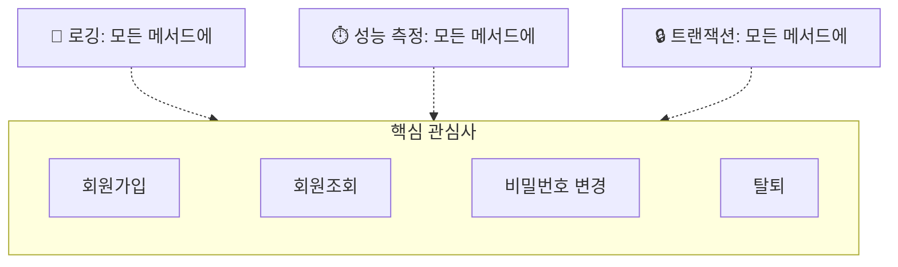
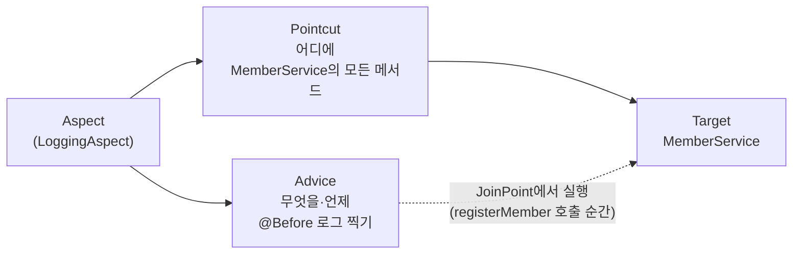
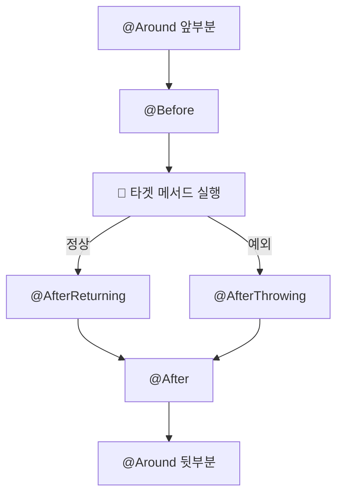
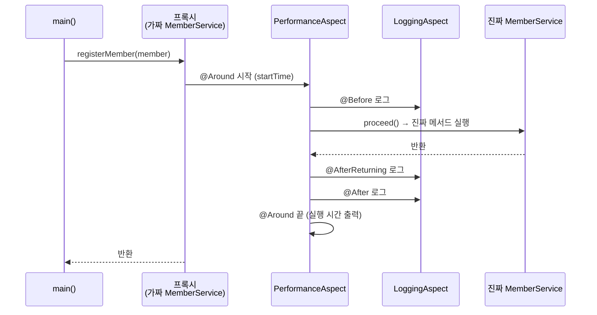

## 들어가며 (Situation)

객체를 **만들고 연결하는 일**을 Spring에게 맡겼다.

오늘(10/27)은 Spring의 또 다른 핵심 기능인 **AOP(Aspect Oriented Programming, 관점 지향 프로그래밍)** 를 배웠다. 이번에는 메서드마다 **반복되는 부가 코드**를 Spring에게 맡긴다.

예제는 **회원 관리 프로그램**이다.

| 구분 | 내용 |
|------|------|
| 기능 (핵심) | 회원가입, 회원조회, 비밀번호 수정, 탈퇴 |
| 비기능 (부가) | 로깅, 성능 측정 (+ 트랜잭션) |

| 섹션 | 파일 | 주제 |
|------|------|------|
| `section01` | `MemberService`, `Application` | AOP **적용 전**: 부가 코드가 모든 메서드에 섞여 있음 |
| `section02` | `LoggingAspect`, `PerformanceAspect`, `AppConfig` | AOP **적용 후**: 부가 코드를 Aspect로 분리 |
| 공통 | `MemberDTO` | Lombok으로 만든 회원 정보 DTO |

`build.gradle`에는 Lombok과 AOP 관련 의존성이 추가됐다.

```groovy
dependencies {
    implementation 'org.springframework:spring-context:7.0.8'
    compileOnly 'org.projectlombok:lombok:1.18.46'
    annotationProcessor('org.projectlombok:lombok:1.18.46')
    implementation 'org.springframework:spring-aop:7.0.8'
    implementation 'org.aspectj:aspectjrt:1.9.25.1'
    implementation 'org.aspectj:aspectjweaver:1.9.25.1'
}
```


## 문제 상황 (Task)

### 쉽게 비유하면

식당 직원(메서드)이 **요리**(핵심 일)를 할 때마다 이런 일도 같이 한다.

- 📝 "몇 시에 요리 시작했음" **기록 쓰기** (로깅)
- ⏱️ 타이머 켜고 끄기 (성능 측정)
- 🔒 실수하면 되돌리기 (트랜잭션)

요리사가 4명이면 4명 **모두가** 똑같이 기록을 쓰고 타이머를 켠다. 기록 양식이 바뀌면 4명을 **전부** 다시 가르쳐야 한다.

이 "모든 메서드에 똑같이 끼어드는 부가 일"을 **횡단 관심사(Cross-cutting Concern)** 라고 한다. 여러 메서드를 **가로로 가로지르며** 걸쳐 있다는 뜻이다.



## 해결 과정 (Action)

### 1. AOP 적용 전 (`section01`)

#### 📦 회원 정보 — `MemberDTO`

**역할:** 회원 한 명의 정보를 담는 바구니다. getter, setter, 생성자, `toString()`을 **Lombok** 어노테이션으로 자동 생성한다.

```java
// DTO 는 행위 위주의 객체가 아닌 데이터 위주의 객체이다.
@NoArgsConstructor
@AllArgsConstructor
@Getter
@Setter
@ToString
public class MemberDTO {

    private String email;
    private String password;
    private String name;
    private String phone;
    private String role;

}
```

| Lombok 어노테이션 | 대신 만들어 주는 코드 |
|-------------------|---------------------|
| `@NoArgsConstructor` | 기본 생성자 `MemberDTO()` |
| `@AllArgsConstructor` | 모든 필드를 받는 생성자 |
| `@Getter` / `@Setter` | 모든 필드의 getter / setter |
| `@ToString` | 모든 필드를 출력하는 `toString()` |

[10/15에 직접 만든 `MenuDTO`]({{ site.baseurl }})는 getter, setter, `toString()`만 수십 줄이었다. Lombok을 쓰면 **필드만 적으면** 된다.

#### 🧑‍💼 부가 코드가 섞인 서비스 — `MemberService`

**역할:** 회원가입, 조회, 비밀번호 변경, 탈퇴를 처리한다. 진짜 DB 대신 `HashMap`에 저장한다. 문제는 **4개 메서드 모두에** 성능 측정, 로깅, 트랜잭션 코드가 섞여 있다는 것이다.

회원가입 메서드를 보면 이렇다. 나머지 3개 메서드도 **같은 모양**이다.

```java
public class MemberService {

    // DB 역할을 대신하는 인메모리 데이터베이스
    private Map<String, MemberDTO> memberRepository = new HashMap<>();

    public void registerMember(MemberDTO member) {
        // 성능 측정 시작 - 횡단 관심사 #1
        long startTime = System.currentTimeMillis();

        try {
            // 로깅 - 횡단 관심사 #2
            System.out.println("[로그] 회원 가입 시작: " + member.getEmail());

            // 트랜잭션 시작 (의사코드) - 횡단 관심사 #3
            // beginTransaction();

            // ----- 핵심 비즈니스 로직 시작 -----
            if (member.getEmail() == null || member.getEmail().isEmpty()) {
                throw new IllegalArgumentException("이메일은 필수입니다.");
            }
            if (member.getPassword() == null || member.getPassword().length() < 8) {
                throw new IllegalArgumentException("비밀번호는 8자 이상이어야 합니다.");
            }
            if (memberRepository.containsKey(member.getEmail())) {
                throw new IllegalArgumentException("이미 등록된 이메일입니다: " + member.getEmail());
            }
            memberRepository.put(member.getEmail(), member);
            System.out.println("회원 정보 저장 완료: " + member.getEmail());
            // ----- 핵심 비즈니스 로직 종료 -----

            // 트랜잭션 커밋 (의사코드) - 횡단 관심사 #3
            // commitTransaction();

            // 로깅 - 횡단 관심사 #2
            System.out.println("[로그] 회원 가입 성공: " + member.getEmail());
        } catch (Exception e) {
            // 트랜잭션 롤백 (의사코드) - 횡단 관심사 #3
            // rollbackTransaction();

            // 로깅 - 횡단 관심사 #2
            System.out.println("[로그] 회원 가입 실패: " + e.getMessage());
            throw e;
        } finally {
            // 성능 측정 종료 - 횡단 관심사 #1
            long endTime = System.currentTimeMillis();
            System.out.println("[성능] 회원 가입 처리 시간: " + (endTime - startTime) + "ms");
        }
    }

    // getMember(), updatePassword(), deleteMember() 도 같은 구조 (생략)
}
```

메서드 하나가 약 45줄인데, **핵심 로직은 그중 10줄 남짓**이다. 나머지는 전부 부가 코드다.

| 메서드 | 성능 측정 | 로깅 | 트랜잭션 |
|--------|:--------:|:----:|:-------:|
| `registerMember()` | ✅ | ✅ | ✅ |
| `getMember()` | ✅ | ✅ | (조회라 없음) |
| `updatePassword()` | ✅ | ✅ | ✅ |
| `deleteMember()` | ✅ | ✅ | ✅ |

#### ▶️ 실행 — `Application`

**역할:** `new`로 `MemberService`를 만들고, 테스트 5개를 차례로 실행한다. 5번은 **이미 탈퇴한 회원을 조회**해서 일부러 예외를 낸다.

```java
MemberService service = new MemberService();

try {
    System.out.println("[테스트 1] 회원 가입");
    MemberDTO member = new MemberDTO("user@example.com", "pass0123", "홍길동", "010-1111-1111", "USER");
    service.registerMember(member);

    System.out.println("[테스트 2] 회원 조회");
    MemberDTO foundMember = service.getMember("user@example.com");

    System.out.println("[테스트 3] 비밀번호 변경");
    service.updatePassword("user@example.com", "pass0123", "pass0234");

    System.out.println("[테스트 4] 회원 탈퇴");
    service.deleteMember("user@example.com");

    // 일부러 예외를 발생
    System.out.println("[테스트 5] 존재하지 않는 회원 조회");
    service.getMember("user@example.com");

} catch (Exception e) {
    System.out.println("예외 발생!! : " + e.getMessage());
}
```

#### 무엇이 문제일까?

수업 주석에 정리된 section01의 문제점이다.

| 문제 | 설명 | 비유 |
|------|------|------|
| **코드 중복** | 모든 메서드마다 로깅, 성능 측정, 트랜잭션 코드가 반복된다 | 요리사 4명이 똑같은 기록지를 각자 씀 |
| **낮은 응집도** | 메서드가 핵심 로직 말고 다른 일도 한다 | 요리사가 요리 말고 경비 일까지 함 |
| **유지보수 어려움** | 로그 양식이나 측정 기준이 바뀌면 모든 메서드를 고쳐야 한다 | 기록지 양식이 바뀌면 4명을 다 다시 교육 |

> [10/23 Servlet 수업]({{ site.baseurl }})에서 서블릿마다 반복되던 `setContentType()`을 **필터**로 뺐던 것과 같은 문제다. 그때는 "서블릿 앞에서" 공통 일을 했다면, AOP는 **"메서드 앞뒤에서"** 공통 일을 한다.

---

### 2. AOP 용어 정리

AOP를 쓰기 전에 용어부터 정리했다. 식당에 **CCTV 업체**를 불렀다고 생각하면 쉽다.

| 용어 | 뜻 | 식당 비유 | 오늘 코드 |
|------|-----|-----------|-----------|
| **Aspect** (관점) | 횡단 관심사를 모아 둔 **클래스** | CCTV 업체 | `LoggingAspect`, `PerformanceAspect` |
| **Advice** (조언) | **무엇을, 언제** 할지 | "요리 **시작 전에** 녹화 시작" | `@Before`, `@After`, `@Around` 메서드 |
| **Pointcut** (지점 선택) | **어디에** 적용할지 고르는 규칙 | "**주방의 모든 요리사**에게" | `execution(* ...MemberService.*(..))` |
| **JoinPoint** (결합 지점) | Advice가 실제로 끼어드는 **그 순간**의 정보 | "지금 **김 요리사가 짜장면** 만드는 중" | 메서드 이름, 매개변수 |
| **Target** (대상) | Advice가 적용되는 **원래 객체** | 요리사 | `MemberService` |



---

### 3. AOP 적용 후 (`section02`)

#### ⚙️ AOP 켜기 — `AppConfig`

**역할:** `section02` 패키지를 스캔해서 Bean을 등록하고, `@EnableAspectJAutoProxy`로 **AOP 기능을 켠다.**

```java
@Configuration
@ComponentScan("com.wanted.aop.section02")
@EnableAspectJAutoProxy
public class AppConfig {
}
```

| 어노테이션 | 쉬운 말 |
|------------|---------|
| `@ComponentScan("...section02")` | 이 패키지 아래 `@Component`, `@Service`를 찾아 Bean으로 등록 ([어제 배움]({{ site.baseurl }})) |
| `@EnableAspectJAutoProxy` | `@Aspect` 클래스를 찾아서, 대상 Bean에 **자동으로 끼워 넣기** 시작 |

`@EnableAspectJAutoProxy`가 없으면 `@Aspect` 클래스가 Bean으로 등록돼도 **아무 일도 일어나지 않는다.** CCTV 업체와 계약은 했는데 전원을 안 켠 상태다.

#### 🧑‍💼 서비스 — `MemberService` (정리 중)

**역할:** `@Service`를 붙여서 Bean으로 등록했다. 로깅 코드를 주석 처리하거나 지우고 Aspect로 옮기는 중이다.

```java
@Service
public class MemberService {

    private Map<String, MemberDTO> memberRepository = new HashMap<>();

    public MemberDTO getMember(String email) {
        // 성능 측정 시작 - 횡단 관심사 #1
        long startTime = System.currentTimeMillis();

        try {
            if (email == null || email.isEmpty()) {
                throw new IllegalArgumentException("이메일은 필수입니다.");
            }
            MemberDTO member = memberRepository.get(email);
            if (member == null) {
                throw new IllegalArgumentException("존재하지 않는 회원입니다: " + email);
            }
            return member;
        } catch (Exception e) {
            throw e;
        } finally {
            // 성능 측정 종료 - 횡단 관심사 #1
            long endTime = System.currentTimeMillis();
            System.out.println("[성능] 회원 조회 처리 시간: " + (endTime - startTime) + "ms");
        }
    }

    // registerMember(), deleteMember()는 로그 줄을 주석 처리한 상태
    // updatePassword()는 getMember()처럼 로그 줄을 지운 상태
}
```

오전까지는 `getMember()`와 `updatePassword()`에서 로깅 코드를 지웠고, `registerMember()`와 `deleteMember()`는 시작·성공 로그만 주석 처리했다. **성능 측정 코드는 아직 남아 있다.** 그래서 지금 실행하면 성능 측정이 서비스 안에서 한 번, `PerformanceAspect`에서 한 번, **두 번** 찍힌다. 다 옮기고 나면 핵심 로직만 남는다. 아래는 정리가 끝났을 때 모습의 **예시 코드**다.

```java
// 예시 코드: 부가 코드를 모두 Aspect로 옮긴 뒤의 getMember()
public MemberDTO getMember(String email) {
    if (email == null || email.isEmpty()) {
        throw new IllegalArgumentException("이메일은 필수입니다.");
    }
    MemberDTO member = memberRepository.get(email);
    if (member == null) {
        throw new IllegalArgumentException("존재하지 않는 회원입니다: " + email);
    }
    return member;
}
```

약 30줄이던 메서드가 **핵심 로직 9줄**로 줄어든다.

#### 📝 로그 담당 — `LoggingAspect`

**역할:** 4개 메서드마다 반복되던 로그 코드를 **한곳**에 모았다. 메서드가 **시작할 때, 끝났을 때, 정상 반환했을 때, 예외가 났을 때** 각각 로그를 찍는다.

```java
@Component
@Aspect
public class LoggingAspect {

    // 타겟 메서드 동작 전 실행 될 Log 메서드
    @Before("execution(* com.wanted.aop.section02.MemberService.*(..))")
    public void logBefore(JoinPoint joinPoint) {
        // JoinPoint : Advice 메서드가 적용되는 지점에 대한 정보를 제공하는 객체
        String methodName = joinPoint.getSignature().getName();
        Object[] args = joinPoint.getArgs();

        StringBuilder argStr = new StringBuilder();
        for (Object arg : args) {
            argStr.append(arg).append(" , ");
        }

        System.out.println("[Before 로그] " + methodName + " 메서드 실행 시작 됨, 매개변수 : " + argStr);
    }

    // @After : 타겟 메서드가 실행 완료 된 후 (성공이든 실패든)
    @After("execution(* com.wanted.aop.section02.MemberService.*(..))")
    public void logAfter(JoinPoint joinPoint) {
        String methodName = joinPoint.getSignature().getName();
        System.out.println("[After 로그] " + methodName + " 메서드 실행 완료!");
    }

    // @AfterReturning : 정상적으로 값을 반환한 후. returning = 반환값을 받을 매개변수 이름
    @AfterReturning(
            pointcut = "execution(* com.wanted.aop.section02.MemberService.*(..))",
            returning = "result"
    )
    public void logAfterReturning(JoinPoint joinPoint, Object result) {
        String methodName = joinPoint.getSignature().getName();
        System.out.println("[AfterReturn 로그] " + methodName + " 메소드 정상 종료, 종료 시 반환값 : " + result);
    }

    // @AfterThrowing : 실행 중 예외가 발생했을 때. throwing = 예외를 받을 매개변수 이름
    @AfterThrowing(
            pointcut = "execution(* com.wanted.aop.section02.MemberService.*(..))",
            throwing = "exception"
    )
    public void logAfterThrowing(JoinPoint joinPoint, Exception exception) {
        String methodName = joinPoint.getSignature().getName();
        System.out.println("[AfterThrowing 로그] " + methodName + " 메소드 실행 중 예외 발생 : " + exception.getMessage());
    }
}
```

| 코드 | 쉬운 말 |
|------|---------|
| `@Component` | Bean으로 등록 (스캔 대상) |
| `@Aspect` | "이 클래스는 **CCTV 업체(Aspect)** 예요" |
| `joinPoint.getSignature().getName()` | 지금 실행 중인 **메서드 이름** (`registerMember` 등) |
| `joinPoint.getArgs()` | 그 메서드에 들어온 **매개변수들** |
| `returning = "result"` | 반환값을 **`result` 매개변수**로 받겠다. 이름이 메서드 매개변수와 같아야 한다 |
| `throwing = "exception"` | 던져진 예외를 **`exception` 매개변수**로 받겠다 |

#### Advice 5종류 — "언제" 실행할까?

| Advice | 실행 시점 | 비유 | 쓰임 |
|--------|----------|------|------|
| `@Before` | 메서드 **실행 전** | 요리 시작 전 녹화 시작 | 시작 로그, 권한 확인 |
| `@AfterReturning` | **정상 종료** 후 | 요리 성공 기록 | 반환값 확인 |
| `@AfterThrowing` | **예외 발생** 시 | 사고 기록 | 예외 로그 |
| `@After` | 성공이든 실패든 **끝난 후** | 영업 종료 후 정리 | 종료 로그, 자원 정리 |
| `@Around` | 실행 **전과 후 모두** | 처음부터 끝까지 옆에서 지켜봄 | 성능 측정, 트랜잭션 |



`@After`는 Java의 `finally`와 같다. 성공해도, 예외가 나도 **항상** 실행된다. `@AfterReturning`과 `@AfterThrowing`은 그중 **한쪽만** 실행된다.

#### 🎯 어디에 적용할까? — Pointcut 표현식

```text
execution(  *     com.wanted.aop.section02.MemberService  .  *   (..)  )
            ───   ──────────────────────────────────────     ─   ────
          반환타입            패키지.클래스                메서드  매개변수
         (아무거나)                                      (전부) (0개 이상)
```

수업 주석에 정리된 표현식 규칙이다.

| 표현 | 뜻 |
|------|-----|
| `*` (반환 타입 자리) | 반환 타입 상관없음 |
| `클래스.*` | 클래스 안의 **모든 메서드** |
| `(..)` | 매개변수 **0개 이상** (아무거나) |
| `()` | 매개변수 **없는** 메서드 |
| `(String)` | 매개변수가 `String` **1개**인 메서드 |
| `(String, ..)` | 첫 번째는 `String`, 나머지는 상관없음 |

오늘 쓴 `execution(* com.wanted.aop.section02.MemberService.*(..))`는 "**`MemberService`의 모든 메서드**"라는 뜻이다. 그래서 4개 메서드 모두에 로그가 찍힌다.

#### ⏱️ 성능 측정 담당 — `PerformanceAspect`

**역할:** `@Around`로 메서드 **앞뒤를 감싸서** 실행 시간을 잰다. 4개 메서드마다 있던 `startTime`, `endTime` 코드를 여기 한곳으로 모은다.

```java
@Component
@Aspect
@Order(1)
public class PerformanceAspect {

    /* @Around : Advice 중 가장 강력한 어노테이션이다.
     * Pointcut 으로 지정한 메서드의 앞/뒤에 모두 동작한다. */
    @Around("execution(* com.wanted.aop.section02.MemberService.*(..))")
    public Object performance(ProceedingJoinPoint joinPoint) {

        // 시작 시간 측정
        long startTime = System.currentTimeMillis();

        // ProceedingJoinPoint : 타겟 메서드의 실행을 직접 제어할 수 있다.
        try {
            Object result = joinPoint.proceed();   // ← 여기서 진짜 메서드 실행
            return result;
        } catch (Throwable e) {
            throw new RuntimeException(e);
        } finally {
            // 종료 시간 측정
            long endTime = System.currentTimeMillis();
            String methodName = joinPoint.getSignature().getName();
            System.out.println("[Around 성능 측정] " + methodName + " 메서드 실행 시간 : " + (endTime - startTime) + "(ms)");
        }
    }
}
```

| 코드 | 쉬운 말 |
|------|---------|
| `ProceedingJoinPoint` | 일반 `JoinPoint` + **"이제 진짜 메서드 실행해"** 버튼(`proceed()`)이 있는 것 |
| `joinPoint.proceed()` | **타겟 메서드를 실행**하고 그 반환값을 받는다 |
| `return result` | 받은 반환값을 **그대로 돌려줘야** 호출한 쪽이 결과를 받는다 |
| `@Order(1)` | 여러 Aspect가 겹칠 때 **실행 우선순위**. 숫자가 작을수록 **바깥쪽**(먼저 시작, 나중에 끝) |

`@Around`가 "가장 강력한" 이유는 `proceed()`를 **내가 직접 부르기** 때문이다. 부르기 전과 후에 코드를 넣을 수 있고, 아예 **안 부르면 메서드가 실행되지 않는다.** 반환값을 바꿔서 돌려줄 수도 있다. 그만큼 `proceed()`를 빠뜨리거나 `return`을 안 하면 원래 메서드가 동작하지 않으니 조심해야 한다.

[10/23의 `PerformanceFilter`]({{ site.baseurl }})와 구조가 거의 같다.

| | `PerformanceFilter` (10/23) | `PerformanceAspect` (오늘) |
|---|---|---|
| 감싸는 대상 | **HTTP 요청** 하나 | **메서드 호출** 하나 |
| 다음으로 넘기기 | `chain.doFilter(req, resp)` | `joinPoint.proceed()` |
| 앞 = 시작 시간, 뒤 = 끝 시간 | ✅ | ✅ |
| 적용 범위 지정 | `@WebFilter("/*")` | Pointcut `execution(...)` |

#### ▶️ 실행 — `Application`

**역할:** section01과 **똑같은 테스트 5개**를 실행한다. 다른 점은 `new MemberService()` 대신 **컨테이너에서 꺼낸다**는 것 하나다.

```java
// IoC 컨테이너 생성
ApplicationContext context = new AnnotationConfigApplicationContext(AppConfig.class);

MemberService service = context.getBean(MemberService.class);

// ... 테스트 1~5는 section01과 동일
```

`MemberService` 코드에는 `LoggingAspect`를 부르는 줄이 **한 줄도 없다.** 그런데도 로그가 찍힌다. 왜일까?

#### 비밀은 프록시(대리인)

`@EnableAspectJAutoProxy`가 켜져 있으면, `getBean(MemberService.class)`가 돌려주는 건 **진짜 `MemberService`가 아니다.** Spring이 만든 **대리인(프록시, Proxy)** 이다.

> 🎭 **비유:** 손님이 요리사에게 주문하면, 사실은 **요리사 옷을 입은 매니저**가 받는다. 매니저가 CCTV를 켜고(`@Before`), 진짜 요리사에게 주문을 넘기고(`proceed()`), 요리가 나오면 기록하고(`@AfterReturning`) 손님에게 준다. 손님은 매니저인 줄 모른다.



`main()`은 평소처럼 `service.registerMember()`를 불렀을 뿐이다. 그 사이에 끼어드는 일은 **프록시가** 한다. 그래서 `MemberService`는 Aspect의 존재를 몰라도 된다.

#### 더 알아보기: 프록시란?

**프록시(Proxy)는 진짜 객체 대신 앞에 서서 요청을 먼저 받는 "대리인" 객체다.** 영어 proxy가 "대리인"이라는 뜻이다.

**비유: 연예인과 매니저 🎤** — 🌟 **연예인**(진짜 `MemberService`)은 노래(핵심 일)만 한다. 🕴️ **매니저**(프록시)는 연예인 **앞에서** 모든 요청을 먼저 받는다. 방송국이 "노래 불러 주세요"라고 하면 이렇게 된다.

| 순서 | 매니저(프록시)가 하는 일 | 코드 |
|------|------------------------|------|
| 1 | 요청을 먼저 받고 **타이머**를 켠다 | `@Around` 시작 |
| 2 | "몇 시에 요청 왔는지" **기록**한다 | `@Before` |
| 3 | 연예인에게 "노래해" 하고 넘긴다 | `proceed()` |
| 4 | (연예인은 **노래만** 부른다) | 핵심 로직 |
| 5 | "잘 끝났음"이라고 기록한다 | `@AfterReturning` / `@After` |
| 6 | 타이머를 끄고 결과를 방송국에 전달한다 | `@Around` 끝 |

방송국(`main()`)은 **매니저랑 얘기한 줄 모른다.** 연예인(`MemberService`)도 기록이나 타이머에 대해 **전혀 모른다.** 둘 다 평소처럼 하는데, 그 사이에서 매니저가 부가 일을 다 처리한다.

**프록시를 손으로 만들어 보면** — Spring이 몰래 하는 일을 직접 코드로 쓰면 이런 모양이다. 아래는 이해를 돕기 위한 **예시 코드**다.

```java
// 예시 코드: Spring이 자동으로 만들어 주는 프록시를 손으로 흉내 낸 것
public class MemberServiceProxy extends MemberService {   // 진짜를 상속해서 "같은 척"

    private final MemberService target;   // 진짜 연예인

    public MemberServiceProxy(MemberService target) {
        this.target = target;
    }

    @Override
    public MemberDTO getMember(String email) {
        long start = System.currentTimeMillis();                 // ⏱️ @Around 시작
        System.out.println("[Before 로그] getMember 시작");     // 📝 @Before
        try {
            MemberDTO result = target.getMember(email);          // 🎯 진짜에게 넘김 = proceed()
            System.out.println("[AfterReturn 로그] 정상 종료");  // 📝 @AfterReturning
            return result;
        } finally {
            System.out.println("[After 로그] 실행 완료");        // 📝 @After
            System.out.println("[성능] " + (System.currentTimeMillis() - start) + "ms");   // ⏱️ @Around 끝
        }
    }
    // registerMember(), updatePassword(), deleteMember()도 똑같이...
}
```

이렇게 손으로 만들면 **메서드 4개마다 이걸 또 써야 한다.** 서비스가 10개면 프록시도 10개다. 결국 section01의 중복 문제가 프록시로 옮겨 갈 뿐이다. **Spring AOP는 이 프록시 클래스를 실행할 때 자동으로 만들어 준다.** 개발자는 Aspect에 "언제(Advice), 어디에(Pointcut)"만 적으면 된다.

**실제로 프록시인지 확인하는 법** — 컨테이너에서 꺼낸 객체의 클래스 이름을 찍어 보면 된다.

```java
MemberService service = context.getBean(MemberService.class);
System.out.println(service.getClass().getName());
```

`MemberService`가 아니라 대략 이런 이름이 나온다. (정확한 이름은 Spring 버전마다 조금 다르다.)

```text
com.wanted.aop.section02.MemberService$$SpringCGLIB$$0
```

뒤에 붙은 `$$SpringCGLIB$$`가 **"Spring이 만든 대리인"이라는 표시**다. `MemberService`를 상속해서 만들었기 때문에 `MemberService` 타입 변수에 그대로 담기고, 그래서 `main()`은 눈치채지 못한다.

```text
AOP 없을 때:
  main() ──────────────────────────────▶ 진짜 MemberService

AOP 있을 때:
  main() ──▶ 🕴️ 프록시 ──▶ (Aspect들) ──▶ 🌟 진짜 MemberService
              │                              │
              └──── 앞뒤로 로그·타이머 ────────┘
```

**언제 프록시가 생길까?**

| 조건 | 결과 |
|------|------|
| `@EnableAspectJAutoProxy` 켜짐 + Pointcut에 걸리는 Bean | 컨테이너가 **프록시로 감싸서** 등록 |
| Pointcut에 안 걸리는 Bean | 그냥 **진짜 객체** 그대로 |
| `new MemberService()`로 직접 만든 객체 | 컨테이너를 안 거쳤으니 **프록시 없음** → AOP 적용 안 됨 |

그래서 section02에서 `new` 대신 **`context.getBean()`으로 꺼낸 것**이 중요하다. 직접 `new` 하면 매니저 없이 연예인을 만나는 거라서 로그가 하나도 안 찍힌다.

**⚠️ 주의: 자기 자신을 부르면 매니저를 안 거친다**

```java
@Service
public class MemberService {
    public void updatePassword(...) {
        MemberDTO m = this.getMember(email);   // ← 자기 메서드 직접 호출
    }
}
```

연예인이 **혼잣말**로 "나 노래할게" 하면 매니저가 끼어들 틈이 없다. `this.getMember()`는 프록시가 아니라 **진짜 객체 안에서** 바로 부르는 거라서, `getMember()`에 걸린 AOP는 **실행되지 않는다.** 나중에 `@Transactional`을 쓸 때 자주 만나는 함정이다.

> **한 줄 정리:** 프록시는 **진짜 객체 앞에 선 대리인(매니저)** 이다. 요청을 먼저 받아서 앞뒤로 부가 일(로그, 시간 측정)을 하고, 핵심 일은 진짜 객체에게 넘긴다. Spring이 이 대리인을 **자동으로 만들어 주는 것**이 AOP의 원리다.

#### 예상 출력 순서

회원가입(테스트 1) 한 번에 콘솔에는 이런 순서로 찍힌다. (`PerformanceAspect`가 `@Order(1)`이라 가장 바깥에 있다. 아래는 코드 흐름으로 예상한 **예시 출력**이다.)

```text
[테스트 1] 회원 가입
[Before 로그] registerMember 메서드 실행 시작 됨, 매개변수 : MemberDTO(email=user@example.com, password=pass0123, ...) ,
회원 정보 저장 완료: user@example.com
[성능] 회원 가입 처리 시간: 0ms                       ← 서비스 안에 남은 코드
[AfterReturn 로그] registerMember 메소드 정상 종료, 종료 시 반환값 : null
[After 로그] registerMember 메서드 실행 완료!
[Around 성능 측정] registerMember 메서드 실행 시간 : 1(ms)   ← PerformanceAspect
```

- `registerMember()`는 `void`라서 반환값이 `null`로 찍힌다.
- 같은 Aspect 안에서는 `@AfterReturning`이 `@After`보다 **먼저** 찍힌다. `@After`는 `finally`처럼 가장 마지막에 실행되기 때문이다.

---

### 시행착오: 다시 볼 부분

#### ① `@Around`에서 예외를 감싸 버리면 메시지가 바뀐다

`PerformanceAspect`는 `catch (Throwable e)`에서 예외를 `new RuntimeException(e)`로 **감싸서** 다시 던진다. 그러면 테스트 5의 예외가 `main()`에 도착했을 때 모양이 바뀐다.

| | AOP 적용 전 (`section01`) | AOP 적용 후 (`section02`) |
|---|---|---|
| `main()`이 받는 예외 | `IllegalArgumentException` | **`RuntimeException`** (안에 원래 예외가 들어 있음) |
| `e.getMessage()` | `존재하지 않는 회원입니다: user@example.com` | `java.lang.IllegalArgumentException: 존재하지 않는 회원입니다: ...` |

AOP는 원래 코드의 동작을 **바꾸지 않는 것**이 원칙이다. 예외도 받은 그대로 던지는 게 좋다. `proceed()`는 `Throwable`을 던지도록 선언되어 있으니, Advice 메서드도 `throws Throwable`로 선언하고 `catch` 없이 그대로 내보내면 된다. 아래는 **예시 코드**다.

```java
// 예시 코드: 예외를 감싸지 않고 그대로 내보내기
@Around("execution(* com.wanted.aop.section02.MemberService.*(..))")
public Object performance(ProceedingJoinPoint joinPoint) throws Throwable {
    long startTime = System.currentTimeMillis();
    try {
        return joinPoint.proceed();
    } finally {
        long endTime = System.currentTimeMillis();
        System.out.println("[Around 성능 측정] " + joinPoint.getSignature().getName()
                + " 메서드 실행 시간 : " + (endTime - startTime) + "(ms)");
    }
}
```

#### ② 로그에 비밀번호가 찍힌다

`logBefore()`는 매개변수를 전부 출력한다. `MemberDTO`는 `@ToString`이라 **모든 필드**를 출력한다. 그래서 회원가입 로그에 `password=pass0123`이, 비밀번호 변경 로그에는 현재·새 비밀번호가 **그대로** 찍힌다.

실제 서비스에서 로그는 파일이나 로그 시스템에 오래 남는다. 비밀번호 같은 민감 정보는 로그에 남기면 안 된다. Lombok에서는 `@ToString.Exclude`로 특정 필드를 `toString()`에서 뺄 수 있다. 아래는 **예시 코드**다.

```java
// 예시 코드: toString()에서 비밀번호 제외
@ToString
public class MemberDTO {
    private String email;
    @ToString.Exclude
    private String password;
    // ...
}
```

---

### 오늘의 Java 흐름 한눈에 보기

```text
[main()] new AnnotationConfigApplicationContext(AppConfig.class)
   │
   ▼
[① 스캔] @ComponentScan("...section02")
   ├ MemberService     (@Service)   → Bean 등록
   ├ LoggingAspect     (@Component + @Aspect) → Bean 등록 + "나 Aspect야"
   └ PerformanceAspect (@Component + @Aspect) → Bean 등록 + "나 Aspect야"
   │
   ▼
[② @EnableAspectJAutoProxy] Pointcut 확인
   └ "MemberService의 모든 메서드"에 걸리네? → MemberService를 감싼 **프록시** 생성
   │
   ▼
[main()] context.getBean(MemberService.class)  → 프록시를 받음
   │
   ▼
[main()] service.registerMember(member)
   │
   ▼
[프록시] PerformanceAspect.@Around 시작 (startTime)        ← @Order(1), 가장 바깥
   │  LoggingAspect.@Before  → "[Before 로그] registerMember ..."
   │     │
   │     ▼  joinPoint.proceed()
   │  [진짜 MemberService.registerMember()]  핵심 로직 실행
   │     │
   │     ├ 정상 → LoggingAspect.@AfterReturning
   │     └ 예외 → LoggingAspect.@AfterThrowing
   │  LoggingAspect.@After   → "[After 로그] ..."
   ▼
[프록시] PerformanceAspect.@Around 끝 → "[Around 성능 측정] ..."
   │
   ▼
[main()] 결과 받음 (프록시였는지 모름)
```

| 단계 | section01 | section02 |
|------|-----------|-----------|
| `MemberService` 만들기 | `new MemberService()` | 컨테이너가 생성 + **프록시**로 감쌈 |
| 로그 코드 위치 | 4개 메서드 **안에 각각** | `LoggingAspect` **한곳** |
| 성능 측정 코드 위치 | 4개 메서드 **안에 각각** | `PerformanceAspect` **한곳** (서비스 쪽은 정리 중) |
| 로그 양식 바꾸려면 | 4곳 수정 | **1곳** 수정 |
| 새 메서드 추가하면 | 부가 코드도 다시 작성 | Pointcut에 걸리면 **자동 적용** |

## 결과 (Result)

| 문제 | 해결 |
|------|------|
| 코드 중복 (4개 메서드에 같은 부가 코드) | 부가 코드를 **Aspect 2개**로 모음 |
| 낮은 응집도 (핵심 로직이 부가 코드에 묻힘) | `MemberService`에는 **핵심 로직만** 남기는 중 (예: `getMember()` 약 30줄 → 9줄) |
| 유지보수 어려움 | 로그 양식, 측정 방식은 **Aspect 1곳**만 수정 |
| 어디에 적용할지 | **Pointcut** 표현식 한 줄로 지정 |
| 언제 실행할지 | **Advice** 5종류(`@Before`, `@After`, `@AfterReturning`, `@AfterThrowing`, `@Around`) |

**배운 점**

- **핵심 관심사**(회원가입, 조회)와 **횡단 관심사**(로깅, 성능, 트랜잭션)를 나누면, 서비스 코드가 "무슨 일을 하는지"만 보여 준다.
- AOP의 비밀은 **프록시**다. 컨테이너에서 꺼낸 객체가 사실은 대리인이라서, 원래 코드를 고치지 않고도 앞뒤에 일을 끼워 넣을 수 있다.
- `@Around`는 강력한 만큼 조심해야 한다. `proceed()`를 꼭 부르고, 반환값을 돌려주고, 예외는 그대로 내보낸다.
- 이 구조는 10/23의 **필터**와 닮았다. 필터는 HTTP 요청 앞뒤, AOP는 메서드 호출 앞뒤를 감싼다.

## 더 학습하면 좋은 개념

- **`@Transactional`** — 오늘 의사코드(`beginTransaction()`, `commitTransaction()`)로만 남겨 둔 트랜잭션을, Spring은 AOP로 처리한다. 메서드에 `@Transactional` 하나만 붙이면 [10/13에 배운 COMMIT/ROLLBACK]({{ site.baseurl }})이 자동으로 된다.
- **프록시의 한계: 자기 자신 호출(self-invocation)** — `MemberService` 안에서 `this.getMember()`처럼 자기 메서드를 부르면 프록시를 거치지 않아서 AOP가 적용되지 않는다. `@Transactional`을 쓸 때 자주 만나는 함정이다.
- **JDK 동적 프록시 vs CGLIB** — 오늘 `MemberService`는 인터페이스가 없는 클래스라 Spring이 **클래스를 상속한** 프록시를 만든다. 프록시를 만드는 두 방식의 차이를 알면 `final` 클래스·메서드에 AOP가 안 되는 이유도 이해된다.
- **`@Pointcut`으로 표현식 재사용** — 오늘은 같은 `execution(...)` 문자열을 Advice마다 5번 반복했다. `@Pointcut` 메서드로 한 번 정의하고 이름으로 불러 쓰는 방법이 있다.
- **로깅 프레임워크 (SLF4J, Logback)** — `System.out.println` 대신 로그 레벨(INFO, ERROR)과 출력 위치를 설정할 수 있는 도구다. 실무 로깅 Aspect는 보통 이걸 쓴다.

## 참고 자료

- [Spring Framework Reference - Aspect Oriented Programming with Spring](https://docs.spring.io/spring-framework/reference/core/aop.html)
- [Spring Framework Reference - AOP Concepts](https://docs.spring.io/spring-framework/reference/core/aop/introduction-defn.html)
- [Spring Framework Reference - Declaring a Pointcut](https://docs.spring.io/spring-framework/reference/core/aop/ataspectj/pointcuts.html)
- [Spring Framework Reference - Declaring Advice (Advice Ordering)](https://docs.spring.io/spring-framework/reference/core/aop/ataspectj/advice.html)
- [Spring Framework Reference - Proxying Mechanisms](https://docs.spring.io/spring-framework/reference/core/aop/proxying.html)
- [Project Lombok - Features](https://projectlombok.org/features/)
