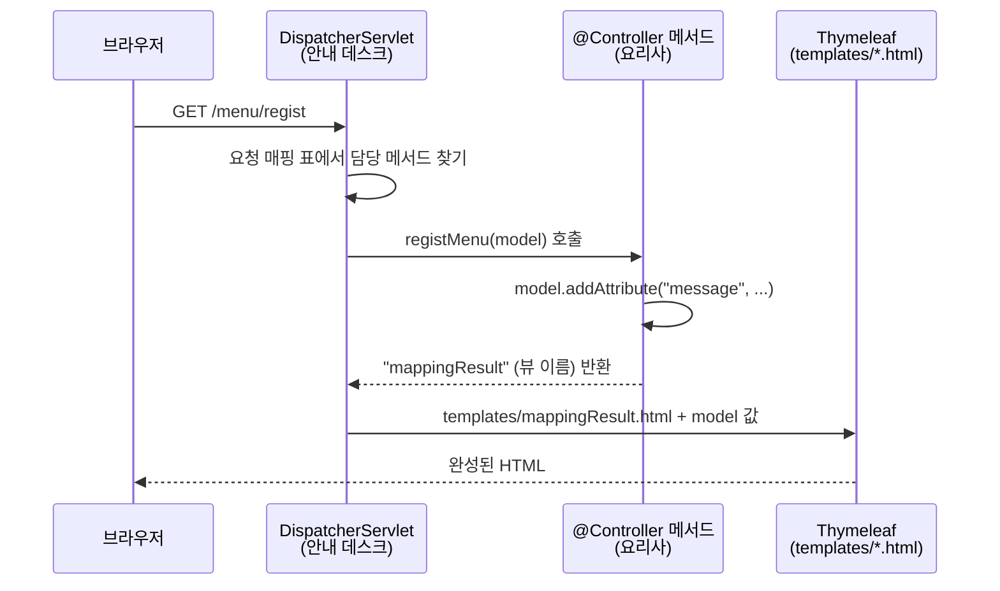
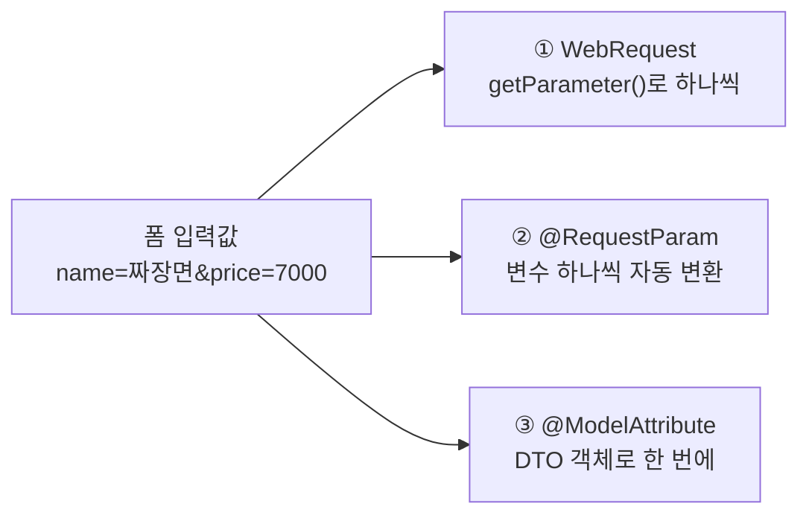
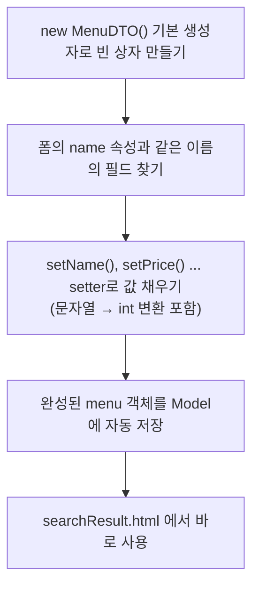
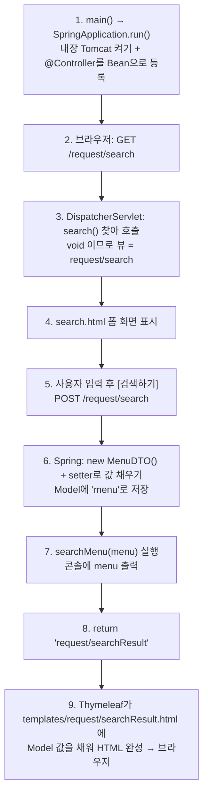

## 들어가며 (Situation)

10/21~10/23에는 **Servlet**으로 웹 요청을 직접 받았다. 10/26~10/27에는 **Spring Core**(IoC, DI, AOP)로 객체 관리를 Spring에 맡겼다.

오늘(10/28)은 이 둘을 합친 **Spring Web MVC**를 배웠다. 핵심은 하나다.

> Servlet 클래스를 직접 만들지 않아도, **`@Controller` 클래스의 메서드 하나하나가 요청을 받는다.**

| 챕터 | 프로젝트 | 주제 |
|------|----------|------|
| `chap01` | `chap01-request-mapping` | 어떤 주소·방식의 요청을 **어떤 메서드**가 받을지 연결하기 (요청 매핑) |
| `chap02` | `chap02-handler-method` | 메서드가 사용자가 보낸 **값(파라미터)** 을 꺼내는 3가지 방법 |

두 프로젝트 모두 **Spring Boot 4.1.2 + Java 21**로 만들었다. 화면은 **Thymeleaf** 템플릿을 쓴다.

```groovy
dependencies {
    implementation 'org.springframework.boot:spring-boot-starter-thymeleaf'
    implementation 'org.springframework.boot:spring-boot-starter-webmvc'
    compileOnly 'org.projectlombok:lombok'          // chap02에서 추가
    annotationProcessor 'org.projectlombok:lombok'  // chap02에서 추가
}
```

## 문제 상황 (Task)

Servlet으로 만들 때 불편했던 점을 다시 떠올려 보자.

| 불편한 점 | Servlet 방식 |
|-----------|--------------|
| 주소마다 클래스 1개 | `/menu/regist`, `/menu/modify`마다 `HttpServlet`을 상속한 클래스를 만들어야 함 |
| GET/POST 나누기 | `doGet()`, `doPost()`를 오버라이딩해서 나눔 |
| 값 꺼내기 | `req.getParameter("price")`로 꺼낸 뒤 `Integer.parseInt()`로 직접 변환 |
| 화면 보내기 | `req.getRequestDispatcher("/WEB-INF/...").forward(req, resp)`를 매번 작성 |
| 서버 실행 | Tomcat을 따로 설치하고 설정 |

오늘의 과제는 이 반복 작업을 **어노테이션 몇 개로 줄이는 방법**을 익히는 것이다.

### 쉽게 비유하면

식당으로 생각해 보자.

- **Servlet 방식**은 손님이 올 때마다 메뉴별로 **전담 직원을 한 명씩 새로 뽑는** 식당이다. 짜장면 담당, 짬뽕 담당이 따로 있다.
- **Spring MVC 방식**은 입구에 **안내 데스크 직원 한 명**(`DispatcherServlet`)이 있는 식당이다. 손님이 "짜장면 주세요(GET /menu/regist)"라고 하면, 안내 직원이 메뉴판(**요청 매핑**)을 보고 알맞은 요리사(**핸들러 메서드**)에게 주문을 넘긴다.
- 요리사는 음식(데이터)을 쟁반(**`Model`**)에 담고, "3번 접시에 담아 주세요(**뷰 이름** `"mappingResult"`)"라고만 말하면 된다. 접시에 담아 손님에게 가져가는 일은 안내 데스크가 한다.

## 해결 과정 (Action)

### 0. 큰 그림: 요청 하나가 처리되는 흐름



Spring Boot 앱에는 **Tomcat이 내장**되어 있다. Servlet도 사라진 게 아니다. Spring이 만든 Servlet 하나(`DispatcherServlet`)가 모든 요청을 먼저 받고, `@Controller` 클래스에 일을 **위임**한다. 수업 코드 주석에도 이 내용이 적혀 있다.

> Servlet 은 Http 요청을 받는 즉시 @Controller 어노테이션이 달린 클래스에 요청을 위임한다.

`chap01`의 `application.yaml`에서는 포트를 `7777`로 바꿨다. 그래서 `http://localhost:7777`로 접속한다.

```yaml
spring:
  application:
    name: chap01-request-mapping

server:
  port: 7777
```

### 1. 요청 매핑: 어떤 요청을 어떤 메서드가 받을까? (`chap01`)

#### ▶️ 시작점 — `Chap01RequestMappingApplication`

**역할:** Spring Boot 앱을 켜는 `main` 메서드. 내장 Tomcat을 실행하고, 같은 패키지 아래의 `@Controller`·`@Component`를 자동으로 찾아 Bean으로 등록한다.

```java
@SpringBootApplication
public class Chap01RequestMappingApplication {

    public static void main(String[] args) {
        SpringApplication.run(Chap01RequestMappingApplication.class, args);
    }
}
```

`@SpringBootApplication` 안에는 10/26에 배운 **`@ComponentScan`** 이 들어 있다. 그래서 같은 패키지에 있는 빈 클래스 `Test`(`@Component`)도 Bean으로 등록된다. 이 클래스는 컴포넌트 스캔 확인용으로 보인다.

```java
@Component
public class Test {
}
```

#### 🍽️ 메서드에 매핑하기 — `MethodController`

**역할:** `/menu/regist`, `/menu/modify` 요청을 받는다. **GET과 POST를 메서드 단위로** 나눠 받는다.

```java
@Controller
public class MethodController {

    @RequestMapping("/menu/regist")
    public String registMenu(Model model) {
        System.out.println("동작하니?");

        model.addAttribute("message", "GET 방식의 메뉴 등록 핸들러 메서드 동작함..");

        return "mappingResult";
    }

    // @RequestMapping : Servlet -> sevice() : get/post/delete
    @RequestMapping(value = "/menu/regist", method = RequestMethod.POST)
    public String postRegistMenu(Model model) {
        model.addAttribute("message", "POST 방식의 메뉴 등록 핸들러 메서드 동작함..");
        return "mappingResult";
    }

    @GetMapping("/menu/modify")
    public String getModifyMenu(Model model) {
        model.addAttribute("message", "GET 방식의 메뉴 수정 핸들러 메서드 동작함..");
        return "mappingResult";
    }

    @PostMapping("/menu/modify")
    public String postModifyMenu(Model model) {
        model.addAttribute("message", "POST 방식의 메뉴 수정 핸들러 메서드 동작함..");
        return "mappingResult";
    }
}
```

오늘 나온 매핑 어노테이션을 정리하면 다음과 같다.

| 어노테이션 | 의미 | Servlet으로 치면 |
|------------|------|------------------|
| `@RequestMapping("/menu/regist")` | 이 주소로 오는 요청을 **방식 상관없이** 받음 | `service()` |
| `@RequestMapping(value=..., method=RequestMethod.POST)` | 이 주소의 **POST** 요청만 받음 | `doPost()` |
| `@GetMapping("/menu/modify")` | GET만 받음 (위의 줄임 표현) | `doGet()` |
| `@PostMapping("/menu/modify")` | POST만 받음 (위의 줄임 표현) | `doPost()` |

**🤔 `/menu/regist`를 받는 메서드가 2개인데 안 헷갈릴까?**

첫 번째 `registMenu()`는 방식을 정하지 않았으니 GET, POST 둘 다 받을 수 있다. 하지만 POST 요청이 오면 Spring은 **조건이 더 구체적인** `postRegistMenu()`(POST라고 콕 집은 메서드)를 고른다. 그래서 결과적으로 GET → `registMenu()`, POST → `postRegistMenu()`가 실행된다.

> 예시: "아무 손님이나 받아요" 직원과 "예약 손님만 받아요" 직원이 있으면, 예약 손님은 예약 전담 직원에게 간다.

헷갈림을 줄이려면 처음부터 `@GetMapping`, `@PostMapping`처럼 **방식을 분명히 적는 편**이 안전하다.

#### 📦 `Model`과 `return "뷰 이름"`

**`Model`** 은 컨트롤러가 화면에 넘길 값을 담는 **쟁반**이다. `key-value` 형태로 담는다.

```java
model.addAttribute("message", "GET 방식의 메뉴 등록 핸들러 메서드 동작함..");
```

메서드가 `String`을 반환하면 그 문자열은 **뷰 이름**이 된다. Spring Boot + Thymeleaf 기본 설정에서는 앞에 `classpath:/templates/`, 뒤에 `.html`이 자동으로 붙는다.

```text
return "mappingResult";
        ↓
src/main/resources/templates/mappingResult.html
```

Servlet에서 매번 쓰던 `forward(req, resp)`를 Spring이 대신해 주는 셈이다.

| 비교 | Servlet (10/22) | Spring MVC (오늘) |
|------|-----------------|-------------------|
| 값 담기 | `req.setAttribute("message", ...)` | `model.addAttribute("message", ...)` |
| 화면 이동 | `req.getRequestDispatcher("/WEB-INF/views/result.jsp").forward(req, resp)` | `return "mappingResult";` |
| 화면 기술 | JSP + EL `${message}` | Thymeleaf `th:text="${message}"` |

#### 🖼️ 결과 화면 — `mappingResult.html`

**역할:** `Model`에 담긴 `message`를 꺼내서 보여 주는 Thymeleaf 템플릿. `th:`로 시작하는 문법은 chap06에서 자세히 배운다고 한다.

```html
<body>
    <h3 th:text="${message}"></h3>
</body>
```

#### 🏠 시작 페이지 — `static/index.html`

**역할:** 테스트용 버튼 모음. `static/` 폴더의 `index.html`은 `http://localhost:7777/`로 접속하면 바로 보인다(웰컴 페이지).

```html
<h3>GET 방식의 요청 : /menu/regist</h3>
<button onclick="location.href='/menu/regist'">GET 메뉴 등록 요청함!!</button>

<h3>POST 방식의 요청 : /menu/regist</h3>
<form action="/menu/regist" method="post">
    <button type="submit">POST 메뉴 등록 요청함!!</button>
</form>
```

| 폴더 | 들어가는 파일 | 접근 방법 |
|------|---------------|-----------|
| `resources/static/` | 그대로 보여 줄 정적 파일 (`index.html`, 이미지, CSS) | 주소로 바로 접근 |
| `resources/templates/` | 값을 채워서 만들 화면 (Thymeleaf) | 컨트롤러가 뷰 이름을 반환해야만 보임 |

#### 🧾 클래스에 매핑하기 — `ClassController`

**역할:** `/order/...`로 시작하는 주문 요청을 모아서 받는다. **클래스 위의 `@RequestMapping`** 이 공통 주소(접두사) 역할을 한다.

```java
@Controller
@RequestMapping("/order/*")
public class ClassController {

    @GetMapping("/regist")
    public String registOrder(Model model) {
        model.addAttribute("message", "GET 방식의 주문 등록 핸들러 메서드 동작.");
        return "mappingResult";
    }

    /* 요청 경로 : /order/detail/3
     * 3 : pathVariable 이라고 불리우며
     * 요청 url 을 타고 서버로 넘어오는 값을 의미한다. */
    @GetMapping("/detail/{orderNo}")
    public String pathVariable(Model model, @PathVariable("orderNo") int no) {
        model.addAttribute("message", no + "번 주문 상세조회!!");
        return "mappingResult";
    }
}
```

클래스 주소와 메서드 주소가 합쳐져서 최종 주소가 된다.

| 클래스 | 메서드 | 최종 주소 |
|--------|--------|-----------|
| `/order/*` | `@GetMapping("/regist")` | `GET /order/regist` |
| `/order/*` | `@GetMapping("/detail/{orderNo}")` | `GET /order/detail/3` |

`/order/*`처럼 끝이 `/*`이면 Spring은 그 `*` 자리를 메서드 주소로 바꿔 끼운다. 그래서 `/order/regist`가 된다. 단순히 `@RequestMapping("/order")`라고 써도 결과는 같다.

**`@PathVariable`: 주소 안에 들어 있는 값 꺼내기**

```text
/order/detail/3
              └─ {orderNo} 자리 → @PathVariable("orderNo") int no → no = 3
```

| 값을 보내는 위치 | 예시 주소 | 꺼내는 방법 |
|------------------|-----------|-------------|
| 주소 경로 안 | `/order/detail/3` | `@PathVariable` |
| 쿼리스트링 / 폼 | `/order/detail?orderNo=3` | `@RequestParam` (chap02) |

> 비유: 사물함 번호가 주소 자체에 적혀 있는 것(`/locker/3`)과, 쪽지에 "3번이요"라고 따로 적어 내는 것(`?no=3`)의 차이다.

### 2. 핸들러 메서드로 값 받기 (`chap02`)

`chap02`는 사용자가 폼에 입력한 값을 **컨트롤러가 꺼내는 3가지 방법**을 다룬다.



#### 🍜 메뉴 정보 — `MenuDTO`

**역할:** 메뉴 하나의 정보를 담는 상자. 10/27처럼 **Lombok**으로 생성자, getter/setter, `toString()`을 자동으로 만든다.

```java
@NoArgsConstructor
@AllArgsConstructor
@Getter
@Setter
@ToString
public class MenuDTO {

    private String name;
    private int price;
    private int categoryCode;
    private String orderableStatus;
}
```

#### 🎮 요청 처리 — `RequestController`

클래스 전체 코드의 뼈대는 다음과 같다. 아래에서 메서드별로 나눠 본다.

```java
@Controller
@RequestMapping("/request/*")
public class RequestController {
    // regist, modify, search 를 GET(폼 보여주기) / POST(값 처리) 쌍으로 가진다
}
```

##### (1) `void` 반환: 폼 화면 보여 주기

**역할:** 입력 폼 화면을 띄운다. 반환할 게 없어 보이지만 화면은 잘 나온다.

```java
@GetMapping("regist")
public void regist() {}

@GetMapping("modify")
public void modify() {}

@GetMapping("search")
public void search() {}
```

뷰를 정하는 방법은 2가지다.

| 반환 타입 | 뷰 이름 결정 방법 | 예시 |
|-----------|-------------------|------|
| `String` | 반환한 문자열 | `return "request/printResult";` → `templates/request/printResult.html` |
| `void` | **요청 주소**가 그대로 뷰 이름 | `GET /request/regist` → `templates/request/regist.html` |

`void`는 "주소랑 같은 이름의 화면을 보여 주세요"라는 뜻이다. 주소와 템플릿 폴더 구조를 맞춰 두면 코드가 짧아진다.

**🤔 `void`인데 화면은 어떻게 정해질까?**

`String`을 반환할 때는 화면 이름을 **직접 말한다**(`return "request/printResult";`). `void`는 아무 이름도 말하지 않는다. 그러면 Spring이 **요청 주소를 화면 이름으로** 쓴다.

```text
요청 주소:      GET /request/regist
                     ↓  맨 앞 "/" 를 떼면
화면 이름:      request/regist
                     ↓  String 때와 똑같이 접두사·접미사 붙이기
실제 파일:      templates/request/regist.html
```

이 주소→이름 변환은 Spring 안의 `RequestToViewNameTranslator`라는 부품이 맡는다.

| 항목 | `String` 반환 | `void` 반환 |
|------|---------------|-------------|
| 화면 이름은 누가 정해? | **내가** `return "..."`으로 | **Spring이** 요청 주소로 |
| 접두사 `templates/` + 접미사 `.html` | 붙음 | 똑같이 붙음 |
| 이동 방식 | forward | forward (똑같음) |
| `Model`에 담은 값 사용 | 가능 | 가능 |
| 주소와 다른 화면으로 보내기 | 가능 | **불가능** (항상 주소 이름 화면) |
| `redirect:` 쓰기 | 가능 | 불가능 |

즉 `void`는 **`return "request/regist";`를 생략한 버전**이다. 아래 두 코드는 같은 화면을 보여 준다.

```java
// 예시 코드: 둘 다 templates/request/regist.html
@GetMapping("regist")
public String regist() { return "request/regist"; }

@GetMapping("regist")
public void regist() {}
```

> 비유: 손님이 "**regist 세트** 주세요"라고 주문했다. `String` 요리사는 "**printResult 접시**에 담아 주세요"라고 직접 말한다. 주문 이름과 접시 이름이 달라도 된다. `void` 요리사는 아무 말도 안 한다. 그러면 안내 데스크가 "주문이 regist 세트니까 **regist 접시**겠지"라고 정한다.

그래서 오늘 코드도 이렇게 짝을 이룬다.

| 메서드 | 반환 | 이유 |
|--------|------|------|
| `GET /request/regist` → `regist()` | `void` | 할 일 없음. 주소 이름 그대로 `regist.html` 폼만 띄우면 됨 |
| `POST /request/regist` → `registMenu()` | `String` | 처리 후 **다른 화면**(`printResult.html`)으로 보내야 함 |

⚠️ 주의할 점

1. **주소와 템플릿 폴더 구조가 똑같아야** 한다. `templates/request/regist.html`이 없으면 템플릿을 찾지 못해 에러(500)가 난다.
2. **`void`는 "화면 없음"이라는 뜻이 아니다.** Java 문법으로는 돌려주는 게 없지만, Spring MVC에서는 "주소 이름 화면으로 가 주세요"라는 뜻이다. 단, 메서드가 `HttpServletResponse`로 응답을 직접 쓰거나 `@ResponseBody`가 붙어 있으면, Spring은 응답이 이미 끝났다고 보고 화면을 찾지 않는다.

> **한 줄 정리:** `void` = "화면 이름은 주소 보고 알아서 정해 주세요."
> 주소 `/request/regist` → 화면 `templates/request/regist.html` (forward)

**🔍 더 쉽게: `String`과 `void`의 차이는 딱 하나다**

> **보여 줄 화면 이름을 "누가" 정하느냐**
>
> - `String`이면 **내가** 정한다.
> - `void`이면 **주소**가 정한다.

나머지(`templates/` + `.html` 붙이기, forward, `Model` 사용)는 **완전히 똑같다.**

**실험: 같은 주소, 반환만 바꿔 보기**

오늘 코드의 등록 POST 메서드로 실험해 보자. 사용자가 폼에 메뉴를 입력하고 [등록]을 누르면 요청은 이렇게 온다.

```text
POST /request/regist
```

**경우 A — `String`으로 반환 (수업 코드 그대로)**

```java
@PostMapping("regist")
public String registMenu(Model model, WebRequest request) {
    ...
    model.addAttribute("message", "짜장면 을(를) ... 등록 했습니다!");
    return "request/printResult";        // ← 내가 화면 이름을 정함
}
```

Spring이 생각하는 순서는 다음과 같다.

1. "메서드가 `"request/printResult"`라고 말했네."
2. "앞뒤를 붙이자." → `templates/request/printResult.html`
3. **"메뉴 등록 성공!🍿🍿 짜장면 을(를) ... 등록 했습니다!"** 화면이 나온다. ✅

**경우 B — 같은 메서드를 `void`로 바꾸면? (예시 코드)**

```java
@PostMapping("regist")
public void registMenu(Model model, WebRequest request) {
    ...
    model.addAttribute("message", "짜장면 을(를) ... 등록 했습니다!");
    // return 없음
}
```

Spring이 생각하는 순서는 다음과 같다.

1. "메서드가 아무 말도 안 했네. 그럼 **주소**를 보자."
2. 요청 주소가 `/request/regist`이니까 화면 이름은 `request/regist`다.
3. "앞뒤를 붙이자." → `templates/request/regist.html`
4. **등록 폼 화면이 다시 나온다.** 결과 화면이 아니다. ❌

방금 입력한 그 폼이 다시 뜨는 것이다. `message`를 담았지만 `regist.html`에는 `${message}`를 보여 주는 곳이 없어서 아무것도 안 보인다.

```text
              요청 주소                    보여지는 화면
경우 A  POST /request/regist  ──String──▶  printResult.html  (결과 화면 ✅)
경우 B  POST /request/regist  ──void────▶  regist.html       (폼이 또 나옴 ❌)
```

**이게 차이다.** `void`는 **주소와 다른 화면으로 갈 방법이 없다.**

**그럼 GET에서는 왜 `void`로 충분했을까?**

```java
@GetMapping("regist")
public void regist() {}
```

```text
GET /request/regist  ──void──▶  regist.html  (폼 화면 ✅ 원하던 것!)
```

여기서는 **원하는 화면 이름과 주소가 우연히 같다.** 폼을 보여 주고 싶었는데, 주소도 `regist`, 화면 파일도 `regist.html`이다. 그래서 굳이 `return "request/regist";`라고 말할 필요가 없었던 것이다.

**초등학생 버전 비유: 택시**

택시를 탔다고 생각해 보자.

- **`String`** = 기사님께 **"○○ 학교로 가 주세요"라고 목적지를 말하는 것.** 어디든 원하는 곳에 갈 수 있다.
- **`void`** = 아무 말도 안 하는 것. 그러면 기사님이 "**지금 서 있는 이 동네 이름**이 목적지겠구나"라고 생각한다.

그래서

> **💡 꼭 기억하기**
>
> - 지금 있는 곳(주소)이 내가 가고 싶은 곳(화면)이면 → 말 안 해도 돼요. (`void` OK)
> - 다른 곳에 가고 싶으면 → **꼭 말해야 해요.** (`String` 필요)

**정리**

| 질문 | 답 |
|------|----|
| 차이가 뭐야? | 화면 이름을 **내가 정하면 `String`**, **주소가 정하면 `void`** |
| `void`를 쓰면 되는 때 | 보여 줄 화면 이름이 **주소와 똑같을 때** (오늘의 GET 폼 화면들) |
| `String`을 써야 하는 때 | 주소와 **다른 화면**을 보여 줘야 할 때 (오늘의 POST 결과 화면들) |
| 헷갈리면? | 그냥 항상 `String`으로 써도 된다. `void`는 **줄여 쓰는 방법**일 뿐이다. |

**👀 오늘의 GET 폼 화면 / POST 결과 화면 한눈에 보기**

```text
GET  /request/regist  ─void──▶  regist.html      (등록 폼)
POST /request/regist  ─String─▶ printResult.html (등록 결과)

GET  /request/modify  ─void──▶  modify.html      (수정 폼)
POST /request/modify  ─String─▶ printResult.html (수정 결과, 메시지 빈칸)

GET  /request/search  ─void──▶  search.html      (검색 폼)
POST /request/search  ─String─▶ searchResult.html(검색 결과)
```

##### (2) `WebRequest`: 하나씩 직접 꺼내기

**역할:** 신규 메뉴 등록. `WebRequest`에서 값을 하나씩 꺼낸다. Servlet의 `HttpServletRequest`와 거의 같은 방식이다.

```java
@PostMapping("regist")
public String registMenu(Model model, WebRequest request) {
    // WebRequest 는 Servlet 환경의 HttpServletRequest 의 역할을 한다.
    String menuName = request.getParameter("name");
    int menuPrice = Integer.parseInt(request.getParameter("price"));
    int categoryCode = Integer.parseInt(request.getParameter("categoryCode"));

    String message = menuName + " 을(를) 신규 메뉴 목록 " +
            categoryCode + "번 카테고리에 " + menuPrice +
            " 원으로 등록 했습니다!";

    model.addAttribute("message", message);

    return "request/printResult";
}
```

이 메서드와 짝을 이루는 폼(`templates/request/regist.html`)의 `name` 속성이 꺼낼 때 쓰는 이름이 된다.

```html
<form action="/request/regist" method="post">
    <input type="text" name="name"><br>
    <input type="number" name="price" step="1000" min="0"><br>
    <select name="categoryCode">
        <option value="1">식사</option>
        <option value="2">음료</option>
        <option value="3">디저트</option>
    </select><br>
    <button type="submit">등록</button>
</form>
```

결과 화면 `printResult.html`은 `message`를 보여 준다.

```html
<h1>메뉴 등록 성공!🍿🍿</h1>
<h3 th:text="${message}"></h3>
```

메서드 파라미터에 `Model`, `WebRequest`만 적어 두면 Spring이 알아서 넣어 준다. 10/26에 배운 **"필요한 건 Spring이 넣어 준다(DI)"** 와 같은 느낌이다. 다만 `String → int` 변환(`Integer.parseInt`)은 여전히 직접 해야 한다.

##### (3) `@RequestParam`: 이름표로 바로 받기

**역할:** 메뉴 수정. 원하는 값을 **변수로 바로** 받고, **타입 변환도 Spring이** 해 준다.

```java
@PostMapping("modify")
public String modifyMenu(Model model,
                         @RequestParam("modifyName") String name,
                         @RequestParam int modifyPrice) {
    System.out.println("name = " + name);
    System.out.println("modifyPrice = " + modifyPrice);

    return "request/printResult";
}
```

```html
<form action="modify" method="post">
    수정할 메뉴의 이름 : <input type="text" name="modifyName"><br>
    수정할 메뉴의 가격 : <input type="number" name="modifyPrice"><br>
    <button type="submit">수정</button>
</form>
```

| 쓰는 법 | 의미 |
|---------|------|
| `@RequestParam("modifyName") String name` | 폼의 `modifyName` 값을 `name` 변수에 담기 (이름이 달라도 됨) |
| `@RequestParam int modifyPrice` | 괄호를 생략하면 **변수 이름**과 같은 `name`을 찾음 + `int`로 자동 변환 |

수업에서 가장 강조한 주의점이다.

> View 쪽 input 의 **name 속성 값**과 `@RequestParam`의 이름이 다르면 **400 Bad Request**가 발생한다.

`@RequestParam`은 기본값이 `required = true`, 즉 "꼭 있어야 하는 값"이다. 이름이 틀리면 Spring은 그 값을 못 찾고, 요청이 잘못됐다며 400을 돌려준다. 값이 없어도 되게 하려면 `required = false`나 `defaultValue`를 쓴다.

```java
// 예시 코드: 값이 없으면 기본값 0 사용
@RequestParam(defaultValue = "0") int modifyPrice
```

##### (4) `@ModelAttribute`: DTO 한 상자로 받기

**역할:** 메뉴 검색. 입력값 4개를 `MenuDTO` 객체 **하나로 묶어서** 받는다.

```java
@PostMapping("search")
public String searchMenu(@ModelAttribute("menu") MenuDTO menu) {
    /* ModelAttribute
     * - 클래스자료형을 활용해서 사용자의 입력 값들을
     *   하나의 객체로 묶을 수 있다.
     * - Model 객체를 활용하지 않아도 forward 되는 페이지에서
     *   값들을 활용할 수 있다. */
    System.out.println("menu = " + menu);
    return "request/searchResult";
}
```

```html
<form action="search" method="post">
    검색할 메뉴 이름 : <input type="text" name="name"><br>
    검색할 메뉴 가격 : <input type="number" name="price"><br>
    검색할 메뉴 카테고리 : <select name="categoryCode">...</select><br>
    검색할 판매 상태 : <input type="text" name="orderableStatus"><br>
    <input type="submit" value="검색하기">
</form>
```

Spring이 하는 일을 순서대로 보면 다음과 같다.



그래서 **폼의 `name` 속성 = DTO 필드 이름**이 맞아야 한다. 그리고 Lombok의 `@NoArgsConstructor`, `@Setter`가 여기서 쓰인다.

> 비유: `WebRequest`는 택배 상자를 열어 물건을 하나씩 꺼내는 것, `@RequestParam`은 "연필이랑 지우개만 주세요"라고 골라 받는 것, `@ModelAttribute`는 **필통째로** 받는 것이다.

**Model에 저장되는 이름**

`@ModelAttribute`로 받은 객체는 `Model`에도 자동으로 담긴다. 이때 이름이 정해지는 규칙이 있다.

| 쓰는 법 | Model에 저장되는 이름 |
|---------|-----------------------|
| `@ModelAttribute("menu") MenuDTO menu` | `menu` |
| `@ModelAttribute MenuDTO menu` (이름 생략) | 클래스 이름의 첫 글자를 소문자로 바꾼 `menuDTO` |

결과 화면 `searchResult.html`은 다음과 같다.

```html
<h1>메뉴 검색 결과!!</h1>
<h3 th:text="${menuDTO.getName()}"></h3>
<h3 th:text="${menuDTO.getPrice()}"></h3>
<h3 th:text="${menuDTO.getCategoryCode()}"></h3>
<h3 th:text="${menuDTO.getOrderableStatus()}"></h3>
```

이름이 맞지 않는 부분이 있는데, 아래 시행착오에서 다룬다.

#### 세 가지 방법 비교

| 방법 | 장점 | 단점 | 이럴 때 |
|------|------|------|---------|
| `WebRequest` | Servlet과 비슷해서 익숙함 | 하나씩 꺼내고 형변환도 직접 | 값이 1~2개이고 특별한 처리가 필요할 때 |
| `@RequestParam` | 변수로 바로 받음, 자동 형변환 | 값이 많으면 파라미터가 길어짐 | 값이 몇 개 안 될 때 |
| `@ModelAttribute` | 여러 값을 객체 하나로, Model 자동 저장 | DTO 클래스가 필요, 필드 이름을 맞춰야 함 | 값이 많고 하나로 묶이는 데이터일 때 |

`index.html`에는 4번 **`@RequestBody`** 버튼도 있지만, 오전 수업 코드에는 아직 `/request/body` 메서드가 없다. 다음 시간에 이어서 배울 것으로 보인다.

### 시행착오: 다시 볼 부분

수업 코드를 실행 흐름대로 따라가 보면 확인해 볼 곳이 몇 군데 있다. 실제로 실행해 보지는 않았으니, 직접 돌려 보며 확인하면 좋다.

#### ① 검색 결과에서 `menuDTO`를 못 찾을 수 있다

컨트롤러는 `@ModelAttribute("menu")`로 **`menu`라는 이름**으로 저장한다. 그런데 `searchResult.html`은 **`menuDTO`** 를 찾는다.

| 위치 | 사용한 이름 |
|------|-------------|
| `RequestController.searchMenu()` | `menu` |
| `searchResult.html` | `menuDTO` |

이 상태면 `${menuDTO}`는 `null`이다. 그래서 `null.getName()`을 부르다가 화면 렌더링 중 에러가 날 가능성이 높다. 둘 중 하나로 맞추면 된다.

```java
// 방법 1 (예시 코드): 이름을 생략해서 기본 이름 menuDTO 사용
public String searchMenu(@ModelAttribute MenuDTO menu) { ... }
```

```html
<!-- 방법 2 (예시 코드): 템플릿에서 menu 이름으로 꺼내기 -->
<h3 th:text="${menu.name}"></h3>
```

Thymeleaf에서는 `${menu.getName()}` 대신 `${menu.name}`처럼 써도 getter가 호출된다.

#### ② 수정 결과 화면에 메시지가 비어 있다

`modifyMenu()`는 값을 콘솔에만 출력하고 `model.addAttribute("message", ...)`를 하지 않는다. 그래서 `printResult.html`에는 제목 "메뉴 등록 성공!🍿🍿"만 보이고 `message` 자리는 빈칸이다. 등록과 수정이 같은 결과 화면을 쓰는 것도 헷갈리는 부분이다.

```java
// 예시 코드
model.addAttribute("message", name + " 메뉴를 " + modifyPrice + "원으로 수정했습니다!");
```

#### ③ 아직 짝이 없는 버튼들

| 버튼 / 폼 | 요청 | 현재 상태 |
|-----------|------|-----------|
| chap01 POST 주문 등록 | `POST /order/regist` | GET 메서드만 있음 → **405 Method Not Allowed** 예상 |
| chap01 주문 수정·삭제 | `/order/modify`, `/order/delete` | 메서드 없음 → **404** 예상 |
| chap01 "3번 주문 상세" | `/order/detail/2` | 버튼 글자는 3번인데 실제로는 **2번** 조회 |
| chap02 메뉴 수정 폼2 | `POST /request/modifyAll` | 메서드 없음 → 404 예상 |
| chap02 `@RequestBody` | `/request/body` | 메서드 없음 → 404 예상 |

405와 404의 차이도 알아 두자. **404**는 "그런 주소 없어요", **405**는 "주소는 있는데 그 방식(GET/POST)은 안 받아요"라는 뜻이다.

#### ④ 빈 값을 보내면?

`registMenu()`에서 가격을 비워 두고 등록하면 `Integer.parseInt("")`가 `NumberFormatException`을 던져서 **500 에러**가 날 수 있다. `@RequestParam int`나 `@ModelAttribute`의 `int` 필드는 Spring이 변환을 맡는데, 변환에 실패하면 보통 **400** 계열 에러가 된다. 입력값 검증(Validation)이 필요한 이유다.

### 오늘의 Java 흐름 한눈에 보기

`chap02`의 메뉴 검색을 예로, 버튼 클릭부터 화면까지 따라가 보자.



초등학생에게 설명하듯 정리하면 이렇다.

1. **가게 문 열기**: `main()`이 식당(Tomcat)을 열고, 요리사(`@Controller`)들을 출근시킨다.
2. **손님 입장**: 손님이 "검색 메뉴판 주세요"(`GET /request/search`)라고 말한다.
3. **안내 데스크**: `DispatcherServlet`이 메뉴판(요청 매핑)을 보고 `search()` 요리사를 부른다. 요리사는 할 말이 없다(`void`). 그래서 주문 이름과 같은 접시(`request/search.html`)가 나간다.
4. **주문서 작성**: 손님이 빈칸을 채우고 [검색하기]를 누른다(`POST`).
5. **필통에 담기**: Spring이 빈 필통(`new MenuDTO()`)을 꺼내 칸마다 값을 넣는다.
6. **요리**: `searchMenu()` 요리사가 필통을 받아 확인한다.
7. **접시 이름 말하기**: 요리사가 "searchResult 접시에 담아 주세요"라고 말한다.
8. **서빙**: Thymeleaf가 접시(HTML)에 값을 담아 손님에게 내놓는다.

Servlet 때와 비교하면, **우리가 직접 쓰는 코드는 3번과 6번(메서드 안)뿐**이다. 나머지는 Spring이 해 준다.

## 결과 (Result)

같은 기능을 Servlet과 Spring MVC로 만들 때 필요한 코드를 비교해 보면 다음과 같다.

| 항목 | Servlet (10/21~23) | Spring MVC (오늘) |
|------|--------------------|-------------------|
| 메뉴 등록·수정 GET/POST 4개 처리 | Servlet 클래스 2개 + `doGet`/`doPost` 4개 | 컨트롤러 1개 + 메서드 4개 |
| 요청 주소 등록 | `@WebServlet("/menu/regist")` 클래스마다 | `@GetMapping` / `@PostMapping` 메서드마다 |
| 값 4개 꺼내기 | `getParameter()` 4줄 + `parseInt()` 2줄 | `@ModelAttribute MenuDTO menu` 한 줄 |
| 화면 이동 | `getRequestDispatcher(...).forward(req, resp)` | `return "뷰이름";` 또는 `void` |
| 서버 | 외부 Tomcat 설정 | 내장 Tomcat, `main()` 실행 |

**배운 점**

- Spring MVC에서도 Servlet은 사라지지 않았다. `DispatcherServlet` 하나가 앞에서 받아서 **나눠 주는 구조**로 바뀌었을 뿐이다. 그래서 Servlet을 먼저 배운 게 이해에 도움이 됐다.
- 편해진 만큼 **이름 맞추기**가 중요해졌다. 폼 `name` ↔ `@RequestParam` 이름 ↔ DTO 필드 이름 ↔ Model 이름 ↔ 템플릿 변수 이름이 한 줄로 이어져야 한다. 하나라도 어긋나면 400 에러가 나거나 화면이 비어 나온다.
- 같은 주소에 여러 메서드가 매핑되면 Spring은 **더 구체적인 쪽**을 고른다. 그래도 `@GetMapping`/`@PostMapping`으로 방식을 분명히 쓰는 게 읽기 쉽다.

## 더 학습하면 좋은 개념

- **DispatcherServlet과 HandlerMapping / HandlerAdapter / ViewResolver** — 오늘 "안내 데스크"라고 부른 부분의 실제 구성이다. 요청이 어떤 순서로 처리되는지 알면 404·405·400 에러의 원인을 빨리 찾을 수 있다.
- **`@RequestBody`와 `@ResponseBody` (HttpMessageConverter)** — 폼 대신 JSON으로 값을 주고받는 방법이다. 오늘 `index.html`의 4번 버튼이 바로 이 내용이고, REST API를 만들 때 핵심이 된다.
- **`@RestController`** — 화면(HTML) 대신 데이터(JSON)를 돌려주는 컨트롤러다. `@Controller`와의 차이를 알아야 프론트엔드와 분리된 백엔드를 만들 수 있다.
- **Bean Validation (`@Valid`, `@NotBlank`, `@Min`)** — 빈 값이나 잘못된 값이 들어올 때 400/500 에러 대신 친절한 메시지를 보여 주는 방법이다.
- **Thymeleaf 기본 문법 (`th:text`, `th:each`, `th:if`)** — 오늘 `th:text`만 맛봤다. 목록 출력, 조건 출력을 하려면 필요하고, 수업 chap06에서 이어진다.

## 참고 자료

- [Spring Framework 공식 문서 - DispatcherServlet](https://docs.spring.io/spring-framework/reference/web/webmvc/mvc-servlet.html)
- [Spring Framework 공식 문서 - Mapping Requests (@RequestMapping)](https://docs.spring.io/spring-framework/reference/web/webmvc/mvc-controller/ann-requestmapping.html)
- [Spring Framework 공식 문서 - Handler Methods: Method Arguments](https://docs.spring.io/spring-framework/reference/web/webmvc/mvc-controller/ann-methods/arguments.html)
- [Spring Framework 공식 문서 - @RequestParam](https://docs.spring.io/spring-framework/reference/web/webmvc/mvc-controller/ann-methods/requestparam.html)
- [Spring Framework 공식 문서 - @ModelAttribute](https://docs.spring.io/spring-framework/reference/web/webmvc/mvc-controller/ann-methods/modelattrib-method-args.html)
- [Spring Boot 공식 문서 - Servlet Web Applications (Static Content, Welcome Page, Template Engines)](https://docs.spring.io/spring-boot/reference/web/servlet.html)
- [Thymeleaf 공식 문서 - Using Thymeleaf](https://www.thymeleaf.org/doc/tutorials/3.1/usingthymeleaf.html)
