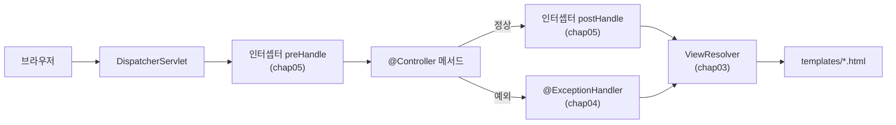
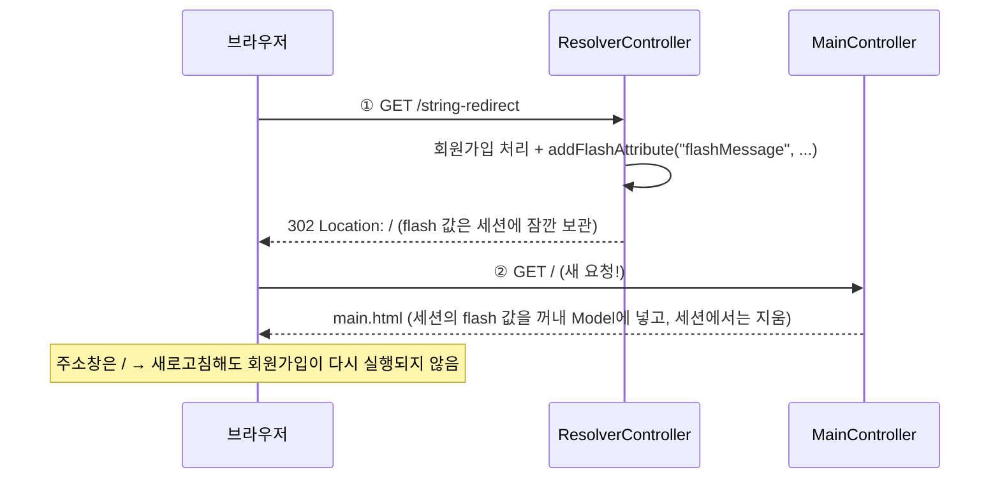
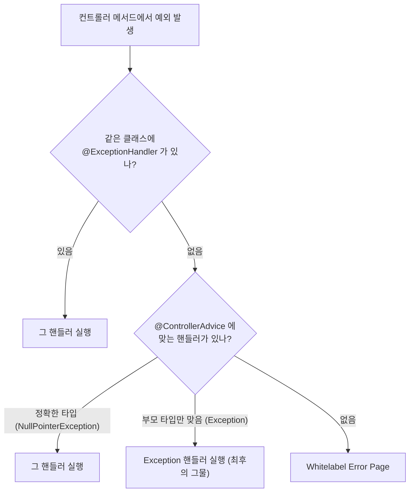
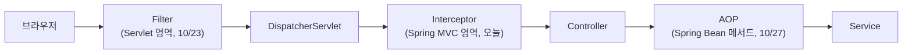
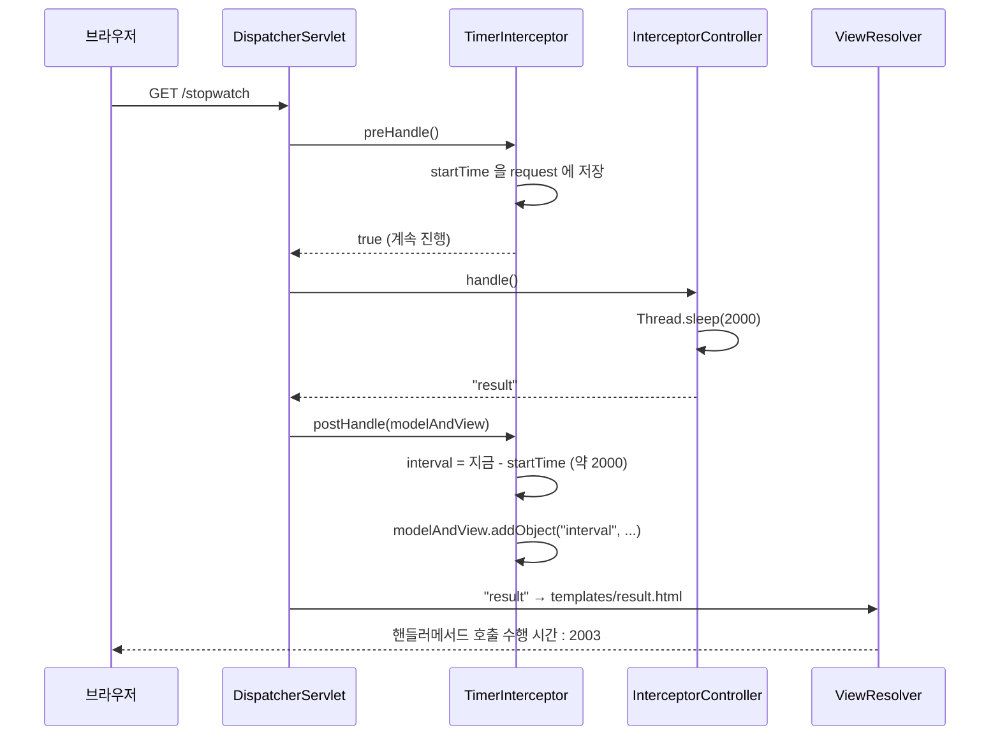

## 들어가며 (Situation)

[10/28]({{ site.baseurl }})에는 `@Controller` 메서드가 요청을 받고(요청 매핑), 사용자가 보낸 값을 꺼내는 방법(`WebRequest`, `@RequestParam`, `@ModelAttribute`)을 배웠다.

오늘(10/29)은 그 메서드의 **앞과 뒤**를 다뤘다. 레포 `08_Spring-Web-MVC`의 챕터 세 개다.

| 챕터 | 주제 | 한 줄 요약 |
|------|------|------------|
| `chap03-view-resolver` | 화면 고르기 | `String` · `ModelAndView` 반환, `redirect:`, `RedirectAttributes` |
| `chap04-exception-handler` | 예외 처리 | `@ExceptionHandler`, `@ControllerAdvice`, 처리 우선순위 |
| `chap05-interceptor` | 요청 가로채기 | `HandlerInterceptor`로 컨트롤러 앞뒤에서 수행 시간 재기 |



## 문제 상황 (Task)

10/28까지의 컨트롤러로는 다음 상황을 깔끔하게 처리하기 어렵다.

| 상황 | 문제 |
|------|------|
| 회원가입 처리 후 결과 화면을 보여 줌 | 사용자가 **새로고침**하면 회원가입이 **또** 실행됨 |
| redirect로 바꿨더니 | "가입 완료" 메시지가 **사라짐** |
| 메서드 안에서 `NullPointerException` 발생 | 사용자에게 **하얀 에러 페이지**(Whitelabel Error Page)가 그대로 보임 |
| 모든 컨트롤러에 같은 예외 처리를 넣고 싶음 | 메서드마다 `try-catch` 반복 |
| 모든 요청의 처리 시간을 재고 싶음 | 메서드마다 시간 재는 코드 반복 |

오늘의 과제는 이 문제들을 **컨트롤러 메서드는 건드리지 않고** 해결하는 방법을 익히는 것이다.

### 쉽게 비유하면

식당으로 생각해 보자. 컨트롤러 메서드는 **요리사**다.

- **ViewResolver**는 요리사가 "3번 접시"라고만 말하면 **진짜 접시를 꺼내 오는 직원**이다. `redirect:`는 "손님, **다른 창구로** 다시 가세요"라고 안내하는 것이다.
- **`@ExceptionHandler`** 는 주방에서 사고가 났을 때 손님에게 "많이 놀라셨죠? 죄송합니다"라고 말하는 **사과 담당**이다. `@ControllerAdvice`는 **식당 전체 공용** 사과 담당이다.
- **인터셉터**는 주문이 주방에 들어가기 **전**에 시계를 보고, 요리가 나온 **후**에 다시 시계를 보는 **매니저**다.

## 해결 과정 (Action)

### 1. ViewResolver — 화면 고르기와 redirect (`chap03`)

#### 🏠 메인 화면 — `MainController`

**역할:** `/`와 `/main` 두 주소를 한 메서드에 연결해 메인 화면을 보여 준다.

```java
@Controller
public class MainController {

    // {} 내부에는 여러 경로를 , 기준으로 작성할 수 있다.
    @RequestMapping(value = {"/" , "/main"})
    public String mainPage() {
        System.out.println("main 페이지 핸들러메서드 동작함...");
        return "main";
    }
}
```

#### 🎮 화면 고르기 — `ResolverController`

**역할:** 컨트롤러가 화면을 돌려주는 방법 세 가지와 `redirect`를 비교한다.

```java
/* Spring 에서 @Controller 는 View 를 반환해야 하는 책임을 가지고 있다.
 * View 를 반환하는 방법은 3가지가 있다.
 * 1. 반환타입 void : 요청한 url 곧 view 의 경로가 된다.
 * 2. 반환타입 String : 문자열 리턴값이 곧 view 의 경로가 된다.
 * 3. 반환타입 ModelAndView : setViewName("문자열"); 문자열이 곧 view 경로 */
```

| 반환 타입 | 화면 이름을 정하는 곳 | 값 담기 | 처음 본 날 |
|-----------|----------------------|---------|------------|
| `void` | 요청 주소 | `Model` | 10/28 |
| `String` | `return "result";` | `Model` | 10/28 |
| `ModelAndView` | `mv.setViewName("result");` | `mv.addObject(...)` | **오늘** |

**① `String` 반환 — forward**

```java
@GetMapping("/string")
public String stringView(Model model) {

    model.addAttribute("forwardMessage", "문자열로 View 반환");

    /* 가정 1. 해당 메서드 내부에서 회원가입이 로직 수행 */
    // service.registMember(); insert
    System.out.println("회원가입 완료!!!!");

    // ViewResolver 객체는 리턴되는 문자열에
    // 접두사로 resources/templates
    // 접미사로 .html 을 붙여주게 된다.
    // resources/templates/result.html
    return "result";
}
```

**ViewResolver**가 하는 일이 바로 10/28에 배운 "접두사 + 이름 + 접미사"다.

```text
return "result"
        ↓  ViewResolver
classpath:/templates/  +  result  +  .html
        ↓
templates/result.html 에 Model 값을 채워서 응답 (forward)
```

이 메서드에는 숨은 문제가 있다. **forward**는 주소창이 `/string`으로 남는다. 사용자가 결과 화면에서 **새로고침(F5)** 을 누르면 브라우저는 `/string`을 **다시 요청**하고, "회원가입 완료!!!!"가 **또** 실행된다. 10/22 Servlet에서 배운 **PRG 패턴**이 필요한 이유다.

**② `redirect:` — 다시 요청하게 하기**

```java
@GetMapping("/string-redirect")
public String redirect(RedirectAttributes rttr) {
    /* Spring 에서 view 리턴 시 기본 방식은 forward 방식이다.
     * 만약 redirect 가 필요하다면
     * 문자열에 접두사로 redirect:{보낼 URL} 을 붙여주어야 한다. */
    System.out.println("회원가입 완료!!!!");

    /* redirect 시에는 2번의 요청이 발생한다.
     * 그렇기 때문에 최초에 model 에 담아둔 값은
     * 재요청 시 소멸이 되며 / 요청에서는 사용할 수 없게 된다.
     * 따라서 redirect 시 전달해 줄 값이 있다면
     * Servlet 개념인 session 과 cookie 를 사용해야 한다.
     * Spring 에서는 RedirectAttributes 라는 객체를 통해서
     * redirect 시 값을 저장할 수 있는 방법을 제공해준다. */
//  model.addAttribute("forwardMessage", "문자열로 View 반환");
    rttr.addFlashAttribute("flashMessage", "리다이랙트 된 페이지에서도 유지되는 값!");

    return "redirect:/";
}
```

```html
<!-- main.html -->
<h3 th:text="${flashMessage}"></h3>
```



| 방식 | 요청 횟수 | 주소창 | `Model` 값 | 새로고침하면 |
|------|-----------|--------|------------|--------------|
| forward (`return "result"`) | 1번 | `/string` 그대로 | 유지 | 처리 로직이 **또** 실행됨 ⚠️ |
| redirect (`return "redirect:/"`) | **2번** | `/`로 바뀜 | **사라짐** | `/`만 다시 보여 줌 ✅ |
| redirect + `addFlashAttribute` | 2번 | `/`로 바뀜 | flash 값은 **한 번** 유지 | flash 값은 사라짐 (한 번만 쓰고 지워지니까) |

**🤔 `addFlashAttribute`는 어떻게 값을 넘길까?**

redirect는 **완전히 새 요청**이라 `Model`(요청 단위)은 사라진다. `addFlashAttribute`는 값을 **세션에 잠깐** 넣어 두었다가, redirect된 다음 요청에서 **꺼내 쓰고 바로 지운다.** 10/23에 배운 세션을 Spring이 "한 번만 쓰는 쪽지" 모양으로 감싸 준 것이다.

> 비유: 은행 창구에서 "저쪽 창구로 가세요"(redirect)라고 할 때, 그냥 보내면 손님이 무슨 일로 왔는지 다음 창구가 모른다. **포스트잇**(flash attribute)을 손님 손에 붙여 보내면, 다음 창구가 읽고 **떼어서 버린다.**

| 메서드 | 값이 가는 곳 | 주소창 |
|--------|--------------|--------|
| `addFlashAttribute("k", v)` | 세션에 잠깐 → 다음 요청의 `Model` | `/` (깨끗함) |
| `addAttribute("k", v)` | **쿼리스트링** | `/?k=v` (주소에 보임) |

**③ `ModelAndView` 반환**

```java
@GetMapping("modelAndView")
public ModelAndView modelAndView(ModelAndView mv) {
    mv.addObject("forwardMessage", "MV 활용 뷰와 데이터!");
    mv.setViewName("result");

    return mv;
}
```

`Model`(값)과 `View`(화면 이름)를 **한 객체**에 담는다. 11/04 JPA 미니 프로젝트의 `MenuController`가 이 방식을 썼다. redirect도 `mv.setViewName("redirect:/")`로 할 수 있다.

### 2. 예외 처리 — `@ExceptionHandler`와 `@ControllerAdvice` (`chap04`)

#### 🚨 컨트롤러 안의 예외 처리 — `ExceptionTestController`

**역할:** 일부러 예외를 일으키고, **같은 클래스 안**의 `@ExceptionHandler`가 가로채서 친절한 화면을 보여 준다.

```java
@Controller
public class ExceptionTestController {

    @GetMapping("nullpointer")
    public String nullPointer() {
        // 고의적으로 Error 발생
        String str = null;
        System.out.println(str.toLowerCase(Locale.ROOT));
        // 위 줄이 실행되면 NullPointerException 객체가 발생한다.
        return "/";
    }

    /* @ExceptionHandler(처리하고자 하는 예외 클래스)
     * 이렇게 정의해두면, 정의 된 예외 발생 시
     * 예외핸들러가 Controller 의 흐름을 가로채서 동작을 하게 된다. */
    @ExceptionHandler(NullPointerException.class)
    public String nullHandler(Model model, NullPointerException e) {
        model.addAttribute("key", e.getMessage());
        return "error/nullPointer";
    }

    @GetMapping("userexception")
    public String userException() throws MemberNotFoundException {
        boolean check = true;
        if (check) {
            throw new MemberNotFoundException("아프지 말자 우리");
        }
        return "/";
    }

    @ExceptionHandler(MemberNotFoundException.class)
    public String userException(Model model, MemberNotFoundException e) {
        model.addAttribute("key", e.getMessage());
        return "error/nullPointer";
    }
}
```

```html
<!-- templates/error/nullPointer.html -->
<h3>많이 놀라셨죠?</h3>
<h4>죄송합니다.</h4>
<h4 th:text="${key}"></h4>
```

`@ExceptionHandler` 메서드는 **일반 핸들러 메서드처럼** `Model`을 받고, 화면 이름을 돌려준다. 매개변수로 **발생한 예외 객체**(`e`)도 받을 수 있어서 `e.getMessage()`로 원인을 화면에 보여 준다.

**사용자 정의 예외 — `MemberNotFoundException`**

```java
public class MemberNotFoundException extends Throwable {

    public MemberNotFoundException(String 아프지_말자_우리) {
        super(아프지_말자_우리);
    }
}
```

"회원이 없다"처럼 **우리 서비스만의 상황**에 이름을 붙인 예외다. 11/04 미니 프로젝트의 `BusinessException(ErrorCode.MENU_NOT_FOUND)`로 이어지는 개념이다.

#### 🌐 전역 예외 처리 — `GlobalExceptionHandler`

**역할:** 여러 컨트롤러에서 공통으로 생길 수 있는 예외를 **한 클래스에 모아** 처리한다.

```java
/* Advice 는 AOP 챕터에서
 * 반복적으로 동작해야 하는 코드를 뭉쳐둔 메서드를 지칭하는 단어였다.
 * @ControllerAdvice 공통으로 발생할 수 있는 예외처리 핸들러를 묶어둔 클래스를 지칭한다. */
@ControllerAdvice
public class GlobalExceptionHandler {

    /* 예외처리 핸들러는 우선순위가 존재한다.
     * 같은 클래스 내부에 있는 핸들러 > 전역 핸들러 */
    @ExceptionHandler(NullPointerException.class)
    public String nullHandler(Model model, NullPointerException e) {
        System.out.println("전역 예외처리 핸들러 동작!!!");
        model.addAttribute("key", e.getMessage());
        return "error/nullPointer";
    }

    @ExceptionHandler(Exception.class)
    public String defaultException(Model model, Exception e) {
        model.addAttribute("class" , e.getClass());
        model.addAttribute("message" , e.getMessage());
        return "error/default";
    }
}
```

```java
@Controller
public class GlobalTestController {

    /* ExceptionTestController 에서 작성해둔 null-pointer 예외처리 핸들러가 동작하지 않는다.
     * 이유는 다른 클래스 내부에 있는 메서드는 알 수 없다. */
    @GetMapping("global-nullpointer")
    public String globalNull() {
        String str = null;
        System.out.println(str.toLowerCase(Locale.ROOT));
        return "/";
    }

    @GetMapping("global-default")
    public String anyException() {
        int[] iarr = new int[0];
        System.out.println(iarr[1]);   // ArrayIndexOutOfBoundsException
        return "/";
    }
}
```

10/27 AOP의 **Advice**("여러 곳에 반복되는 코드를 뭉쳐 둔 것")라는 이름이 여기서 다시 나온다. `@ControllerAdvice`는 "모든 컨트롤러에 공통으로 붙는 예외 처리"다.

**어떤 핸들러가 동작할까?**

| 요청 | 발생 예외 | 같은 클래스 핸들러 | 전역 핸들러 | 결과 |
|------|-----------|--------------------|-------------|------|
| `/nullpointer` | `NullPointerException` | ✅ 있음 | ✅ 있음 | **같은 클래스** 핸들러 (우선) |
| `/userexception` | `MemberNotFoundException` | ✅ 있음 | - | 같은 클래스 핸들러 |
| `/global-nullpointer` | `NullPointerException` | ❌ 없음 | ✅ 있음 | 전역 `nullHandler` |
| `/global-default` | `ArrayIndexOutOfBoundsException` | ❌ 없음 | `Exception`만 맞음 | 전역 `defaultException` |



전역 핸들러 안에서도 **더 구체적인 예외 타입**이 먼저 선택된다. `NullPointerException`은 `Exception`의 자식이지만, `nullHandler`가 있으니 `defaultException`이 아니라 `nullHandler`로 간다. `Exception.class` 핸들러는 **맞는 게 하나도 없을 때 잡는 마지막 그물**이다.

> 비유: 학교에서 아이가 다치면 먼저 **담임 선생님**(같은 클래스 핸들러)이 본다. 담임이 없으면 **보건실**(`@ControllerAdvice`)로 간다. 보건실에서도 "넘어져서 무릎 까짐"처럼 딱 맞는 처치법(`NullPointerException`)이 있으면 그걸 쓰고, 없으면 **기본 응급 처치**(`Exception`)를 한다.

| 비교 | `try-catch` | `@ExceptionHandler` / `@ControllerAdvice` |
|------|-------------|--------------------------------------------|
| 위치 | 메서드마다 | 클래스 하나 / 전역 클래스 하나 |
| 컨트롤러 코드 | 정상 흐름 + 예외 흐름이 섞임 | **정상 흐름만** |
| 에러 화면 바꾸기 | 모든 catch 수정 | 핸들러 한 곳 수정 |

11/04 JPA 미니 프로젝트의 `GlobalExceptionHandler`가 바로 이 구조를 확장한 것이다.

### 3. 인터셉터 — 컨트롤러 앞뒤 가로채기 (`chap05`)

#### ⏱️ 시간 재는 인터셉터 — `TimerInterceptor`

**역할:** 컨트롤러 메서드가 실행되기 **전**에 시작 시간을 적고, 실행된 **후**에 걸린 시간을 계산해 화면에 넘긴다.

```java
@Component
public class TimerInterceptor implements HandlerInterceptor {
    // Interceptor 는 Controller 의 핸들러 메서드 전과 후에 동작한다.

    // 컨트롤러 도달 전
    @Override
    public boolean preHandle(HttpServletRequest request, HttpServletResponse response,
                             Object handler) throws Exception {

        System.out.println("preHandle() 동작함..");
        long startTime = System.currentTimeMillis();
        request.setAttribute("startTime", startTime);

        // true : 다음 인터셉터가 있다면 호출 / 없다면 컨트롤러의 핸들러 메서드 호출
        return true;
    }

    // 컨트롤러 핸들러메서드 실행 후
    @Override
    public void postHandle(HttpServletRequest request, HttpServletResponse response,
                           Object handler, @Nullable ModelAndView modelAndView) throws Exception {

        System.out.println("postHandler() 호출됨..");
        long endTime = System.currentTimeMillis();
        long startTime = (long) request.getAttribute("startTime");

        modelAndView.addObject("interval", endTime - startTime);
    }
}
```

```java
@Controller
public class InterceptorController {

    @GetMapping("stopwatch")
    public String handle() throws InterruptedException {
        System.out.println("stopwatch 요청을 처리하는 핸들러 메서드 동작..");
        // 2초간 정지
        Thread.sleep(2000);
        return "result";
    }
}
```

```html
<!-- result.html -->
<h3 th:text="| 핸들러메서드 호출 수행 시간 : ${interval} |"></h3>
```

| 메서드 | 언제 | 반환값 / 특징 |
|--------|------|---------------|
| `preHandle` | 컨트롤러 메서드 **전** | `true` → 계속 진행 / `false` → **여기서 멈춤** (컨트롤러 실행 안 됨) |
| `postHandle` | 컨트롤러 메서드 **후**, 화면 그리기 **전** | `ModelAndView`에 값을 더 넣을 수 있음 |
| `afterCompletion` | 화면까지 다 그린 **후** (예외가 나도 호출) | 오늘 코드에는 없음. 자원 정리·로그에 사용 |

`preHandle`에서 적은 시작 시간을 `postHandle`이 어떻게 알까? 둘은 다른 메서드라 지역 변수를 공유할 수 없다. 그래서 **`request.setAttribute()`** 에 잠깐 넣어 둔다. 같은 요청 안에서는 `request`가 계속 따라다니기 때문이다(10/22 forward에서 값을 넘기던 그 `request`다).

`preHandle`이 `false`를 돌려주면 컨트롤러까지 가지 않는다. 그래서 인터셉터로 "로그인 안 했으면 막기" 같은 **문지기** 역할도 할 수 있다.

#### ⚙️ 인터셉터 등록 — `WebConfig`

**역할:** 만든 인터셉터를 Spring MVC에 등록하고, **어떤 주소에** 동작할지 정한다.

```java
/* WebMvcConfigurer
 * Spring MVC 패턴의 기본설정은 유지하며
 * 추가적인 커스터마이징이 필요할 때 구현하는 인터페이스
 * ex) 인터셉터 추가, CORS 설정 , 정적 리소스 핸들링 등등 */
@Configuration
public class WebConfig implements WebMvcConfigurer {

    // 등록할 인터셉터 객체
    private final TimerInterceptor timerInterceptor;

    // 생성자를 통한 Bean 간의 의존성 주입
    @Autowired
    public WebConfig(TimerInterceptor timerInterceptor) {
        this.timerInterceptor = timerInterceptor;
    }

    @Override
    public void addInterceptors(InterceptorRegistry registry) {
        // 만들어둔 인터셉터 등록
        registry.addInterceptor(timerInterceptor)
                // 인터셉터가 동작하게 만들 URL 경로 추가
                .addPathPatterns("/*")
                // 인터셉터 동작 시 정적인 요소 제외
                // /** : 모든 하위 경로까지 포함하는 패턴
                .excludePathPatterns("/css/**")
                .excludePathPatterns("/images/**")
                .excludePathPatterns("/js/**")
                .excludePathPatterns("/video/**");
    }
}
```

| 패턴 | 맞는 주소 | 안 맞는 주소 |
|------|-----------|--------------|
| `/*` | `/stopwatch`, `/main` (**한 단계**만) | `/css/style.css`, `/admin/logs` |
| `/**` | `/stopwatch`, `/css/style.css`, `/a/b/c` (**모든 하위**) | - |

`WebMvcConfigurer`는 Spring MVC의 기본 설정은 그대로 두고 **필요한 부분만 덧붙이는** 창구다. 인터셉터 말고도 CORS 설정, 정적 리소스 경로 추가 같은 일을 여기서 한다.

#### Filter vs Interceptor vs AOP

10/23 Servlet **Filter**, 10/27 **AOP**, 오늘 **Interceptor** 모두 "앞뒤에 끼어든다"는 점이 같다. 어디에 끼어드느냐가 다르다.



| 구분 | Filter (10/23) | Interceptor (오늘) | AOP (10/27) |
|------|----------------|--------------------|-------------|
| 관리 주체 | Servlet 컨테이너 (Tomcat) | Spring MVC | Spring (프록시) |
| 끼어드는 위치 | `DispatcherServlet` **앞** | 컨트롤러 **앞뒤** | **아무 Bean 메서드** 앞뒤 |
| 아는 정보 | `request`, `response` | + **어떤 핸들러인지**, `ModelAndView` | 메서드 이름, 매개변수, 반환값 |
| 주로 쓰는 곳 | 인코딩, 보안(Spring Security도 필터) | 로그인 확인, 요청 시간 측정, 공통 Model 값 | 로깅, 성능 측정, 트랜잭션 |
| 오늘 같은 일 | 시간 측정 가능, 하지만 화면에 값 넣기 어려움 | `ModelAndView`에 `interval` 추가 ✅ | 시간 측정 가능, 하지만 화면 몰라 |

> 비유: 공연장에 비유하면 **Filter**는 건물 **정문 경비**(누가 들어오는지만 앎), **Interceptor**는 **공연장 입구 안내원**(어느 공연 표인지 앎), **AOP**는 **무대 뒤 스태프**(배우 한 명 한 명의 등장·퇴장을 챙김)다.

### 시행착오: 다시 볼 부분

실행해 보지는 않았다. 코드를 따라가며 확인할 곳을 정리했다.

#### ① 짝이 없는 버튼

| 화면 | 버튼 | 주소 | 상태 |
|------|------|------|------|
| `chap03` `main.html` | 문자열로 redirect 하면서 값을 유지하기 | `/string-redirect-attr` | 메서드 없음 → 404 예상 (flash는 `/string-redirect`에서 이미 시연) |
| `chap04` `index.html` | 전역 - 사용자 정의의 예외 | `/global-userexception` | 메서드 없음 → 404 예상 |

`/global-userexception`은 재미있는 경우다. 없는 주소라 Spring이 "리소스 없음" 예외를 던지는데, 전역 `@ExceptionHandler(Exception.class)`가 그 예외까지 잡아서 404 대신 **Default 예외 페이지**가 보일 수도 있다. 최후의 그물이 너무 넓으면 이런 일이 생긴다.

#### ② `MemberNotFoundException extends Throwable`

보통 사용자 정의 예외는 **`Exception`**(Checked) 또는 **`RuntimeException`**(Unchecked)을 상속한다. `Throwable`은 `Exception`과 `Error`의 **부모**라서, 직접 상속하면 "예외도 아니고 에러도 아닌" 애매한 것이 된다. Spring의 예외 처리 흐름은 `Exception` 계열을 기준으로 설계되어 있으니 `Exception`이나 `RuntimeException`을 상속하는 편이 안전하다.

```text
Throwable
├── Error              ← JVM 수준 문제 (OutOfMemoryError …). 잡지 않는 것
└── Exception          ← Checked: 반드시 throws/catch
    └── RuntimeException ← Unchecked: throws 생략 가능 (NullPointerException …)
```

```java
// 예시 코드
public class MemberNotFoundException extends RuntimeException {
    public MemberNotFoundException(String message) {
        super(message);
    }
}
```

`RuntimeException`으로 바꾸면 컨트롤러 메서드의 `throws MemberNotFoundException`도 지울 수 있다. 11/04 미니 프로젝트의 `BusinessException`도 `RuntimeException`을 상속했다.

#### ③ `postHandle`의 `modelAndView`는 `null`일 수 있다

매개변수에 **`@Nullable`** 이 붙어 있다. `@ResponseBody`로 데이터만 돌려주는 메서드나, 정적 리소스 요청에서는 `modelAndView`가 `null`이다. 지금 코드는 바로 `modelAndView.addObject(...)`를 불러서, 그런 요청이 `/*`에 걸리면 `NullPointerException`이 날 수 있다.

```java
// 예시 코드
if (modelAndView != null) {
    modelAndView.addObject("interval", endTime - startTime);
}
```

또 `postHandle`은 컨트롤러에서 **예외가 나면 호출되지 않는다.** 예외가 나도 꼭 해야 하는 일(로그, 정리)은 `afterCompletion`에 둔다.

#### ④ `return "/";`는 실행되지 않는다

`nullPointer()`, `globalNull()` 등은 예외가 먼저 나서 `return "/";`까지 가지 않는다. 컴파일을 통과시키려고 둔 줄이다. 만약 실행된다면 `"/"`는 화면 이름이 되어 `templates//.html`을 찾게 되니, 메인으로 보내려면 `"redirect:/"`라고 써야 한다.

### 오늘의 Java 흐름 한눈에 보기

`/stopwatch` 버튼을 눌렀을 때를 따라가 보자.



초등학생에게 설명하듯 정리하면 이렇다.

1. **주문**: 손님이 "스톱워치 주세요"(`/stopwatch`)라고 한다.
2. **매니저가 시계 보기**: 주방에 들어가기 **전**, 매니저(`preHandle`)가 시계를 보고 시작 시간을 **주문서**(`request`)에 적는다. "통과!"(`true`)
3. **요리**: 요리사(`handle()`)가 2초 동안 요리한다(`sleep(2000)`). "result 접시에 담아 주세요"라고 말한다.
4. **매니저가 다시 시계 보기**: 요리가 나온 **후**, 매니저(`postHandle`)가 주문서에 적힌 시작 시간을 보고 "2초 걸렸네"를 계산해서 **쟁반**(`ModelAndView`)에 쪽지로 올린다.
5. **접시 꺼내기**: 직원(`ViewResolver`)이 `result` 접시(`templates/result.html`)를 꺼내 쪽지 내용을 적는다.
6. **서빙**: 손님 화면에 "수행 시간 : 2003"이 보인다. 요리사는 시계를 한 번도 보지 않았다.

만약 요리 중에 사고(예외)가 났다면, 4번 매니저 대신 **사과 담당**(`@ExceptionHandler`)이 나와서 "많이 놀라셨죠? 죄송합니다" 접시를 내보낸다.

## 결과 (Result)

오늘 배운 것을 "컨트롤러 메서드를 얼마나 덜 건드리게 됐나"로 정리하면 다음과 같다.

| 하고 싶은 일 | 오늘 전 | 오늘 후 | 컨트롤러 메서드 수정 |
|--------------|---------|---------|----------------------|
| 새로고침 중복 실행 막기 | (10/22 Servlet) `sendRedirect` + 세션 직접 | `return "redirect:/"` + `addFlashAttribute` | 1~2줄 |
| 예외 시 친절한 화면 | 메서드마다 `try-catch` | `@ExceptionHandler` / `@ControllerAdvice` | **0줄** |
| 모든 요청 처리 시간 측정 | 메서드마다 시간 재는 코드 | 인터셉터 1개 + 등록 | **0줄** |

**배운 점**

- Spring의 기본 화면 이동은 **forward**다. 처리(등록·수정·삭제) 후에는 **`redirect:`** 로 보내서 새로고침 중복 실행을 막는다(PRG 패턴).
- redirect는 **새 요청**이라 `Model`이 사라진다. 한 번만 넘길 값은 **`addFlashAttribute`** 로 세션에 잠깐 맡긴다.
- 예외 처리는 **같은 클래스 핸들러 → 전역 핸들러(구체 타입) → 전역 핸들러(`Exception`)** 순서로 찾는다.
- 인터셉터는 컨트롤러 **앞(`preHandle`)과 뒤(`postHandle`)** 에 끼어든다. Filter보다 안쪽이라 **어떤 핸들러인지, 어떤 Model인지** 안다.
- Filter · Interceptor · AOP는 모두 "공통 기능을 분리"하는 도구이고, **끼어드는 위치**로 골라 쓴다.

## 더 학습하면 좋은 개념

- **PRG(Post-Redirect-Get) 패턴과 HTTP 302/303** — 오늘 `redirect:`가 해결한 "새로고침 중복 실행"의 정식 이름이다. 10/22 Servlet에서 처음 본 개념을 Spring 방식으로 다시 연결해 보자.
- **FlashMap과 `RedirectAttributes`의 동작 원리** — `addFlashAttribute`가 세션에 값을 어떻게 잠깐 두었다가 지우는지 알면 redirect 후 값이 사라지는 문제를 디버깅할 수 있다.
- **`@RestControllerAdvice`와 `ResponseEntity`로 JSON 에러 응답 만들기** — 오늘은 에러 **화면**을 돌려줬다. REST API에서는 에러를 **JSON**으로 돌려줘야 한다. 11/16 GRAVIT 리포트의 "오류 응답은 한 모양, 코드 8개"가 그 예다.
- **Checked vs Unchecked 예외** — 사용자 정의 예외를 무엇으로 상속할지, `@Transactional`이 어떤 예외에서 rollback하는지(11/03 블로그 키워드)와 연결된다.
- **`HandlerInterceptor.afterCompletion`과 `HandlerMethod`** — 예외가 나도 실행되는 마지막 단계, 그리고 `handler` 매개변수로 "어떤 컨트롤러의 어떤 메서드인지" 꺼내는 방법이다. 11/16 리포트의 "요청 로그 인터셉터" 제안이 이것으로 만들어진다.

## 참고 자료

- [Spring Framework 공식 문서 - View Resolution](https://docs.spring.io/spring-framework/reference/web/webmvc/mvc-servlet/viewresolver.html)
- [Spring Framework 공식 문서 - Redirect Attributes](https://docs.spring.io/spring-framework/reference/web/webmvc/mvc-controller/ann-methods/redirecting-passing-data.html)
- [Spring Framework 공식 문서 - Flash Attributes](https://docs.spring.io/spring-framework/reference/web/webmvc/mvc-controller/ann-methods/flash-attributes.html)
- [Spring Framework 공식 문서 - Exceptions (@ExceptionHandler)](https://docs.spring.io/spring-framework/reference/web/webmvc/mvc-controller/ann-exceptionhandler.html)
- [Spring Framework 공식 문서 - Controller Advice](https://docs.spring.io/spring-framework/reference/web/webmvc/mvc-controller/ann-advice.html)
- [Spring Framework 공식 문서 - Interception (HandlerInterceptor)](https://docs.spring.io/spring-framework/reference/web/webmvc/mvc-servlet/handlermapping-interceptor.html)
- [Spring Framework 공식 문서 - MVC Config: Interceptors](https://docs.spring.io/spring-framework/reference/web/webmvc/mvc-config/interceptors.html)
- [Java 공식 문서 - Exceptions (Checked vs Unchecked)](https://docs.oracle.com/javase/tutorial/essential/exceptions/runtime.html)
