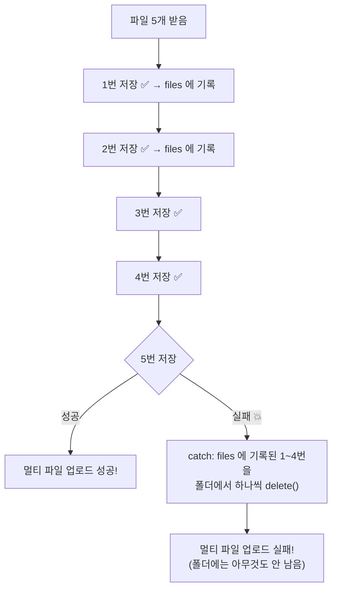
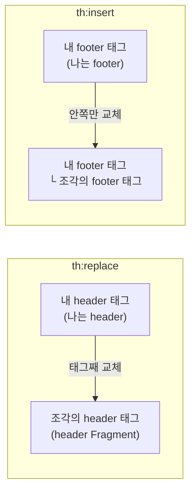
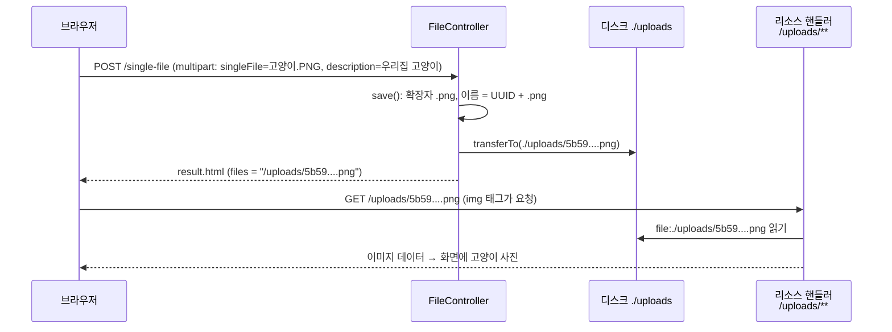

## 들어가며 (Situation)

[10/29]({{ site.baseurl }})에는 ViewResolver와 redirect, 예외 처리 핸들러, 인터셉터를 배웠다.

오늘(10/30)은 Spring MVC 챕터의 마지막 두 개를 다뤘다. 레포 `08_Spring-Web-MVC`의 오전 커밋 세 개(09:47 "1교시", 10:37, 11:18 "타임리프 수업자료 추가")다.

| 챕터 | 주제 | 핵심 |
|------|------|------|
| `chap06-file-upload` | 파일 업로드 | `MultipartFile`, UUID 파일명, 다중 업로드 실패 시 되돌리기, `addResourceHandlers` |
| `chap07-thymeleaf` | 화면 템플릿 문법 | 표현식 6종, 조건·반복, SpringEL, 인라인, **프래그먼트** |

`chap06` 화면 맨 위에 이런 안내가 있다.

> chap06 에서 진행하는 파일관련 처리는 추후에는 권장하지 않는 방식이다. 다만, 현재 우리의 기술 스택 관련에서는 최선의 방식이니 이 부분만 알고 넘어가자!

실무에서는 파일을 서버 폴더가 아니라 **AWS S3 같은 외부 저장소**에 두는 경우가 많다. 오늘은 그 전 단계로, 파일이 서버에 **어떻게 들어오고 어떻게 다시 보이는지**를 익힌다.

## 문제 상황 (Task)

지금까지 폼으로 보낸 값은 **글자**뿐이었다(`name=짜장면&price=7000`). 사진 같은 **파일**은 다르게 다뤄야 한다.

| 과제 | 문제 |
|------|------|
| 파일 받기 | 글자처럼 `name=값`으로 보낼 수 없음. 폼 인코딩부터 바꿔야 함 |
| 파일 이름 | 두 사람이 `스크린샷.png`를 올리면 **덮어쓰기** |
| 여러 파일 | 5개 중 1개만 실패하면 나머지 4개는? |
| 다시 보여 주기 | 프로젝트 폴더에 저장한 파일은 `static`이 아니라서 ``로 안 보임 |
| 화면 공통 부분 | 헤더·푸터를 페이지마다 복사하면, 메뉴 하나 바꿀 때 모든 페이지 수정 |

### 쉽게 비유하면

- **파일 업로드**는 우체국에 **소포**를 보내는 것이다. 편지(글자)와 달리 상자 포장(`multipart/form-data`)을 해야 하고, 우체국(서버)은 상자마다 **송장 번호(UUID)** 를 새로 붙여 창고에 보관한다. 손님이 "제 소포 보여 주세요"라고 하면 **창고 지도(리소스 핸들러)** 를 보고 꺼내 준다.
- **Thymeleaf 프래그먼트**는 **도장**이다. 머리글·바닥글을 도장으로 하나 파 두고, 페이지마다 쾅 찍는다. 도장을 고치면 모든 페이지가 같이 바뀐다.

## 해결 과정 (Action)

### 1. 파일 업로드 — `chap06-file-upload`

#### ⚙️ 업로드 설정 — `application.yaml`

**역할:** 업로드할 수 있는 최대 크기와 **저장 폴더**를 정한다.

```yaml
spring:
  servlet:
    multipart:
      # 파일 1개의 최대 크기 지정
      max-file-size: 200MB
      # 1개의 요청 시 여러 파일의 최대 합계 크기 지정
      max-request-size: 1000MB

# 프로젝트에서 파일을 어디 저장할 건지에 대한 경로 지정
file:
  upload-dir: ./uploads
```

`file.upload-dir`은 Spring이 정한 설정이 아니라 **우리가 만든 설정 값**이다. 코드에서는 `@Value`로 꺼낸다.

```java
// .yaml 에 지정한 환경변수 불러오는 방법
@Value("${file.upload-dir}")
private String uploadDir;     // "./uploads"
```

경로를 코드에 직접 쓰지 않고 설정 파일에 두면, 내 PC와 서버에서 저장 위치가 달라도 **설정 파일만** 바꾸면 된다.

#### 📝 업로드 폼 — `main.html`

**역할:** 파일 하나 / 여러 개를 보내는 폼 두 개.

```html
<h3>single-file 업로드하기(단일파일)</h3>
<form action="single-file" method="post" enctype="multipart/form-data">
    <!-- encoding 을 보내줄 때 맞춰주어야 spring 에서도 알맞은 타입으로 전달 받을 수 있다. -->
    파일 : <input type="file" name="singleFile"> <br>
    파일 설명 : <input type="text" name="description"><br>
    <input type="submit">
</form>

<h3>multi-file 업로드하기(다중파일)</h3>
<form action="multi-file" method="post" enctype="multipart/form-data">
    파일 : <input type="file" name="multiFile" multiple> <br>
    파일 설명 : <input type="text" name="description"><br>
    <input type="submit">
</form>
```

| 속성 | 의미 |
|------|------|
| `method="post"` | 파일은 크기가 커서 주소(GET)에 담을 수 없음 |
| `enctype="multipart/form-data"` | 요청 본문을 **여러 조각**(글자 조각 + 파일 조각)으로 나눠 보냄 |
| `multiple` | 파일 선택 창에서 **여러 개** 고를 수 있게 함 |

`enctype`을 빼먹으면 파일 **이름 글자만** 가고 내용은 가지 않는다. 10/28에 배운 "이름 맞추기"도 여전히 중요하다. `name="singleFile"`이 컨트롤러의 매개변수 이름과 같아야 한다.

| `enctype` | 본문 모양 | 용도 |
|-----------|-----------|------|
| `application/x-www-form-urlencoded` (기본) | `name=짜장면&price=7000` | 글자만 |
| `multipart/form-data` | 조각마다 경계선(boundary)으로 나뉜 덩어리 | 글자 + **파일** |

#### 🎮 업로드 처리 — `FileController`

**역할:** 파일을 받아 새 이름으로 저장하고, 결과 화면에 보여 줄 주소를 담는다.

```java
@Controller
public class FileController {

    @Value("${file.upload-dir}")
    private String uploadDir;

    /* 파일 관련 진행 순서
     * 1. 사용자가 업로드한 파일/설명 확인
     * 2. 파일 저장 경로 확인 및 파일 저장 경로가 없다면 생성
     * 3. 원본 파일명을 UUID 기반의 새로운 이름으로 변경
     * 4. 생성 된 경로에 파일 저장
     * 5. 결과 메세지와 파일 저장 위치 URL 을 Model 에 담아 응답 */
    ...
}
```

**① 파일 하나 — `single()`**

```java
@PostMapping("single-file")
public ModelAndView single(
        @RequestParam MultipartFile singleFile,
        @RequestParam String description,
        ModelAndView mv) {

    try {
        String savedName = save(singleFile);
        mv.addObject("message", "파일 업로드 성공!!");
        mv.addObject("files" , "/uploads/" + savedName);
    } catch (IOException e) {
        mv.addObject("message", "파일 업로드 실패.." + e.getMessage());
    }

    mv.setViewName("result");
    return mv;
}
```

`MultipartFile`은 Spring이 업로드된 파일 한 개를 담아 주는 객체다.

| 메서드 | 돌려주는 것 |
|--------|-------------|
| `getOriginalFilename()` | 사용자 PC에서의 원래 이름 (`스크린샷.png`) |
| `getSize()` | 파일 크기 (바이트) |
| `getContentType()` | 파일 종류 (`image/png`) |
| `isEmpty()` | 파일을 고르지 않았는지 |
| `transferTo(File)` | 지정한 위치에 **저장** |

**② 저장 도우미 — `save()`**

```java
// 파일을 저장하고, 저장 된 파일의 이름을 반환한다.
private String save(MultipartFile file) throws IOException {

    // 파일의 원본 이름 추출  // test.png
    String originName = file.getOriginalFilename();

    // 파일의 확장자 분리   // test / .png / 대문자를 소문자로 변경 (.PNG -> .png)
    String ext = originName.substring(originName.lastIndexOf(".")).toLowerCase();

    // 중복되는 파일명 방지를 위한 UUID
    // 스크린샷.png -> 3829382d2323.png
    String savedName = UUID.randomUUID().toString() + ext;

    // 파일을 저장할 폴더 생성
    File dir = new File(uploadDir).getAbsoluteFile();
    dir.mkdirs();

    // 업로드한 파일을 생성한 디렉터리에 저장할 이름으로 변환 후 저장
    file.transferTo(new File(dir, savedName));

    return savedName;
}
```

```text
originName = "스크린샷.PNG"
        │ lastIndexOf(".") → 마지막 점 위치
        ▼
ext = ".PNG" → toLowerCase() → ".png"
        │
        ▼
savedName = UUID.randomUUID() + ext
          = "5b598c6f-0a9d-4262-9cd8-c2bb90614c79.png"
        │
        ▼
./uploads/5b598c6f-0a9d-4262-9cd8-c2bb90614c79.png 에 저장
```

**🤔 왜 원래 이름으로 저장하지 않을까?**

| 원래 이름으로 저장하면 | UUID로 저장하면 |
|------------------------|-----------------|
| 두 사람이 `스크린샷.png`를 올리면 **나중 것이 덮어씀** | 이름이 겹칠 일이 사실상 없음 |
| 한글·공백·특수문자가 주소에서 문제를 일으킴 | 영문·숫자·하이픈만 |
| `../../중요파일` 같은 이름으로 **다른 폴더**를 노릴 수 있음 | 이름을 서버가 정하니 불가능 |

`UUID`(Universally Unique Identifier)는 **32자리 16진수**로 된 무작위 번호다. 같은 번호가 두 번 나올 확률은 무시해도 될 만큼 작다.

> 비유: 우체국에 들어온 소포에 "엄마 선물"이라고 적혀 있어도, 창고에는 **송장 번호**로 보관한다. "엄마 선물" 상자는 하루에도 수십 개 들어오니까.

**③ 여러 파일 — `multiFileUpload()` + 실패 시 되돌리기**

```java
@PostMapping("multi-file")
public ModelAndView multiFileUpload(@RequestParam("multiFile") List<MultipartFile> multipartFile,
                                    String description, ModelAndView mv) {

    // 여러 개의 파일을 처리하기 위한 DTO 객체 활용
    List<FileDTO> files = new ArrayList<>();
    // 화면에서 접근할 URL 저장용
    List<String> savedFiles = new ArrayList<>();

    try {
        // 전달 받은 여러 개의 파일을 반복
        for (MultipartFile file : multipartFile) {
            String savedName = save(file);
            files.add(new FileDTO(file.getOriginalFilename(), savedName, uploadDir, description));
            savedFiles.add("/uploads/" + savedName);
        }

        mv.addObject("message", "멀티 파일 업로드 성공!");
        mv.addObject("files", savedFiles);
    } catch (Exception e) {

        // 예를 들어 5개 파일을 넣었는데
        // 4개는 정상적으로 저장되고, 1개만 안되면?
        // ex) Transaction 의 rollback 처럼 동작하게 만들 것이다.
        // 실패 시에 이전에 저장된 파일을 삭제
        for (FileDTO file : files) {
            new File(new File(uploadDir).getAbsoluteFile(), file.getSavedName()).delete();
        }
        mv.addObject("message", "멀티 파일 업로드 실패!");
    }

    mv.setViewName("result");
    return mv;
}
```

```java
// 저장한 파일 하나의 정보 (나중에 DB에 저장할 내용)
public class FileDTO {
    private String originFileName;   // 스크린샷.png
    private String savedName;        // 5b598c6f-....png
    private String filePath;         // ./uploads
    private String description;      // 사용자가 쓴 설명
}
```



DB 트랜잭션(11/03 `@Transactional`)은 실패하면 **자동으로** rollback되지만, **파일 저장은 트랜잭션 밖**이다. 그래서 "무엇을 저장했는지"를 `files` 목록에 적어 두었다가 **직접** 지운다. "모두 성공하거나 모두 없던 일로"라는 트랜잭션의 생각을 파일에 손으로 적용한 것이다.

> 비유: 이삿짐 상자 5개를 트럭에 싣다가 5번째에서 트럭이 고장 나면, 이미 실은 4개를 **다시 내려서** 원래대로 돌려놓는 것이다. 어떤 상자를 실었는지 **목록**을 적어 뒀기 때문에 할 수 있다.

#### 🗺️ 저장한 파일 다시 보여 주기 — `WebConfig.addResourceHandlers`

**역할:** `/uploads/...` 주소로 오는 요청을 **프로젝트 폴더 `./uploads`** 와 연결한다.

```java
/* WebMvcConfigurer -> 인터셉터 등록, 정적인 리소스 핸들링!! */
@Configuration
public class WebConfig implements WebMvcConfigurer {

    @Value("${file.upload-dir}")
    private String uploadDir;

    @Override
    public void addResourceHandlers(ResourceHandlerRegistry registry) {
        /*  브라우저에서 src 경로에 대한 요청이 일어나고 있다. == 이미지 내놔!!
         * /uploads/abc.png : 요청 URL
         * 요청 URL 과 저장 폴더 경로를 연결한다. */
        registry.addResourceHandler("/uploads/**")
                .addResourceLocations("file:" + uploadDir + "/");
    }
}
```

```html
<!-- result.html -->
<h3 th:text="${message}"></h3>
<!-- th:each 는 java 의 for 문이라고 생각하면 좋다. -->
<div th:each="file : ${files}">
    
</div>
```

**🤔 왜 이 설정이 필요할까?**

Spring Boot는 기본으로 `resources/static/` 폴더만 주소로 열어 준다. 업로드한 파일은 프로젝트 **바깥쪽** `./uploads` 폴더에 있으니, 아무 설정이 없으면 `/uploads/abc.png`를 요청해도 **404**다.

```text
브라우저: GET /uploads/5b598c6f-....png
             │
             ▼  addResourceHandler("/uploads/**")
             │  addResourceLocations("file:./uploads/")
             ▼
서버 디스크: ./uploads/5b598c6f-....png  → 이미지 응답
```

| 접두사 | 찾는 곳 | 예 |
|--------|---------|----|
| `classpath:` | 빌드된 프로젝트 안 (`resources/`) | `classpath:/static/` |
| `file:` | 컴퓨터의 **실제 폴더** | `file:./uploads/` |

10/29에는 `WebMvcConfigurer`의 `addInterceptors`로 인터셉터를 등록했다. 오늘은 같은 인터페이스의 **`addResourceHandlers`** 로 "주소 ↔ 폴더 지도"를 추가했다.

> 비유: 창고(`./uploads`)에 소포를 넣어 뒀는데, 손님 창구(`/uploads/...`)와 창고 사이에 **통로**가 없으면 꺼내 줄 수가 없다. `addResourceHandlers`가 그 통로를 뚫는다.

### 2. Thymeleaf 문법 — `chap07-thymeleaf`

10/28부터 `th:text`, `th:each` 같은 Thymeleaf 문법을 써 왔다. 오늘은 그 문법을 **한 번에 정리**했다. 강의 자료(`LectureController`)가 네 페이지에 값을 담아 보낸다.

| 주소 | 템플릿 | 다루는 문법 |
|------|--------|-------------|
| `/lecture/expression?title=표현식&no=5&no=6` | `expression.html` | 주석, 표현식 6종, `th:text`/`th:utext`, 인라인, 리터럴 치환 |
| `/lecture/conditional` | `conditional.html` | `th:if`/`th:unless`, `th:switch`, `th:each` + 상태 변수 |
| `/lecture/etc` | `etc.html` | `th:with`, SpringEL (Object · List · Map) |
| `/lecture/fragment` | `fragment.html` | `th:replace`, `th:insert`, 매개변수 있는 프래그먼트 |

`chap07`도 11/04 JPA 미니 프로젝트처럼 실행 클래스가 `config` 패키지에 있어서 `ContextConfiguration`의 `@ComponentScan`으로 스캔 범위를 넓힌다.

```java
// LectureController — 뷰 이름 앞에 '/'를 붙이지 않는다
/* 뷰 이름 앞에 '/'를 붙이면 경로가 "templates//lecture/..."가 되어
 * jar로 배포했을 때 템플릿을 못 찾을 수 있으므로 붙이지 않는다. */
mv.setViewName("lecture/expression");
```

#### 📌 표현식 6종

| 표현식 | 이름 | 용도 | 오늘 예 |
|--------|------|------|---------|
| `${...}` | 변수 | Model 값, 요청 파라미터, 세션 | `${member.name}`, `${param.title}` |
| `*{...}` | 선택 변수 | `th:object`로 고른 객체의 필드 | `th:object="${member}"` + `*{age}` |
| `#{...}` | 메시지 | `messages.properties`의 값 | `#{message.value}` → hello world |
| `@{...}` | 링크 | 주소 만들기 (context path 자동) | `@{/lecture/expression(title='링크', no=1)}` |
| `~{...}` | 조각 | 다른 템플릿의 일부 가져오기 | `~{common/header :: headerFragment}` |
| `[[...]]`, `[(...)]` | 인라인 | 태그 속성 없이 글 사이에 값 넣기 | `[[${hello}]]` |

**변수 표현식이 값을 꺼내는 곳**

```html
<!-- 요청 파라미터 : /lecture/expression?title=표현식&no=5&no=6 -->
<p th:text="${ param.title }"></p>     <!-- 표현식 -->
<p th:text="${ param.no[0] }"></p>     <!-- 5 : 같은 이름이 여러 개면 배열처럼 -->
<p th:text="${ param.no[1] }"></p>     <!-- 6 -->
```

| 꺼낼 곳 | 쓰는 법 |
|---------|---------|
| 요청 파라미터 (쿼리스트링) | `${ param.이름 }` |
| 세션 | `${ session.이름 }` |
| Model / ModelAndView | `${ 이름 }` (앞에 아무것도 안 붙임) |

**선택 변수 표현식 `*{...}`**

```html
<p th:text="${ member.name }"></p>
<!-- th:object로 객체를 선택해두면 *{필드명}으로 해당 객체의 필드를 바로 꺼낼 수 있다. -->
<div th:object="${ member }">
    <p th:text="*{ address }"></p>     <!-- = ${ member.address } -->
</div>
```

> 비유: `${member.address}`는 "**홍길동네** 주소"라고 매번 이름을 부르는 것이다. `th:object`로 "지금부터 홍길동 이야기야"라고 정해 두면 `*{address}`처럼 "**그 집** 주소"라고만 해도 된다.

**링크 표현식 `@{...}`**

```html
<a th:href="@{/}">메인으로</a>
<!-- 결과: /lecture/expression?title=링크&no=1 -->
<a th:href="@{/lecture/expression(title='링크', no=1)}">파라미터를 포함한 링크</a>
```

`/`로 시작하는 경로에는 애플리케이션의 **context path**가 자동으로 붙는다. 앱이 `/myapp` 아래에 배포되면 `@{/}`가 `/myapp/`이 된다. 직접 `href="/"`라고 쓰면 그런 처리가 안 된다.

#### 📌 `th:text` vs `th:utext` — 그리고 XSS

```java
// LectureController
mv.addObject("hello", "hello!<h3>Thymeleaf</h3>");
```

```html
<li th:text="${ hello }"></li>    <!-- 화면: hello!<h3>Thymeleaf</h3>  (글자 그대로) -->
<li th:utext="${ hello }"></li>   <!-- 화면: hello! + 큰 제목 Thymeleaf  (태그로 해석) -->
```

| 속성 | 태그 처리 | 안전성 |
|------|-----------|--------|
| `th:text` | `<` → `&lt;`로 바꿔서(escape) **글자로** 보여 줌 | ✅ 기본으로 이것을 쓴다 |
| `th:utext` | 태그를 **그대로** 해석 | ⚠️ 사용자가 쓴 값에 `<script>`가 있으면 실행됨 (XSS) |

> 수업 주석: `th:utext`는 사용자가 입력한 값을 그대로 출력하면 `<script>` 같은 악성 코드가 실행될 수 있다(XSS 공격). 신뢰할 수 있는 값에만 사용하고, 기본적으로는 `th:text`를 사용한다.

11/16 GRAVIT 리포트에서 "`<script>`와 ``를 넣은 코멘트가 글자로 보였고 실행되지 않았다"가 바로 이 원칙을 지킨 결과다.

#### 📌 인라인 표현식과 자바스크립트

```html
<li th:inline="text">[[${ hello }]]</li>   <!-- th:text 와 같음 (escape) -->
<li>[(${ hello })]</li>                    <!-- th:utext 와 같음 -->
<li th:inline="none">[[${ hello }]]</li>   <!-- 인라인 끔 → [[${ hello }]] 글자 그대로 -->
```

```html
<script th:inline="javascript">
    /* 3) 내추럴 템플릿 (권장)
     * 정적 페이지에서는 주석 뒤의 '기본값'이 사용되고,
     * 동적 페이지에서는 주석과 기본값이 지워지고 서버의 값으로 바뀐다.
     * 정적/동적 페이지 모두 문법 오류가 발생하지 않는다. */
    let hello = /*[[${ hello }]]*/ '기본값';
    alert(hello);
</script>
```

| 쓰는 법 | 서버에서 (동적) | 파일만 열면 (정적) |
|---------|-----------------|--------------------|
| `let hello = [[${hello}]];` | ✅ `"hello!..."` | ❌ 문법 오류 |
| `let hello = "[[${hello}]]";` | ❌ `""hello!...""` 따옴표 중복 | 글자 그대로 |
| `let hello = /*[[${hello}]]*/ '기본값';` | ✅ | ✅ `'기본값'` |

세 번째 방식을 **내추럴 템플릿**이라고 한다. 서버 없이 HTML 파일만 열어도 깨지지 않는 것이 Thymeleaf의 장점이다. 11/04 JPA 미니 프로젝트의 `fetch` 코드도 `<script>` 안에서 동작했다.

#### 📌 주석 두 종류

```html
<!--/* parser-level 주석 */-->      <!-- Thymeleaf가 처리할 때 제거 → 사용자에게 안 보임 -->
<!--/*/ prototype-only 주석 /*/-->  <!-- 정적일 땐 주석, Thymeleaf 처리 후에는 화면에 보임 -->
```

일반 HTML 주석 `<!-- -->`은 브라우저의 "페이지 소스 보기"에 **그대로 보인다.** 사용자에게 보이면 안 되는 개발 메모는 parser-level 주석에 쓴다.

#### 📌 조건문 — `th:if`, `th:unless`, `th:switch`

```html
<p th:if="${ num > 0 }">넘어온 값은 0보다 크다.</p>              <!-- num = 1 → 보임 -->
<p th:unless="${ num < 0 }">넘어온 값은 0보다 작지 않다.</p>     <!-- false 일 때 보임 -->

<!-- and나 or를 사용해서 다중 조건 처리도 가능하다. -->
<p th:if="${ num > 0 and num <= 10 }">1부터 10까지의 양수</p>
<!-- #strings 유틸리티 객체로 null 처리 -->
<p th:if="${ !#strings.isEmpty(str) and str == '바나나' }">바나나 좋아요!</p>

<th:block th:switch="${ str }">
    <span th:case="사과">사과가 선택되었습니다</span>
    <span th:case="바나나">바나나가 선택되었습니다</span>
    <!-- th:case="*"는 어떤 case에도 해당하지 않을 때 선택된다. (switch문의 default와 같다.) -->
    <span th:case="*">사과도 바나나도 아닙니다</span>
</th:block>
```

`<th:block>`은 **화면에 아무 태그도 남기지 않는** 상자다. `<div>`로 감싸면 결과 HTML에 `<div>`가 생기지만, `th:block`은 Thymeleaf가 처리한 뒤 사라진다.

#### 📌 반복문 — `th:each`와 상태 변수

```html
<tr th:each="member, stat : ${ memberList }">
    <td th:text="${ member.name }"></td>
    <td th:text="${ stat.index }"></td>   <!-- 0부터 -->
    <td th:text="${ stat.count }"></td>   <!-- 1부터 -->
    <td th:text="${ stat.size }"></td>    <!-- 전체 개수 4 -->
    <td th:text="${ stat.even }"></td>    <!-- 짝수 번째? -->
    <td th:text="${ stat.first }"></td>   <!-- 첫 번째? -->
    <td th:text="${ stat.last }"></td>    <!-- 마지막? -->
</tr>
```

| 상태 변수 | 의미 | Java로 치면 |
|-----------|------|-------------|
| `index` | 0부터 시작하는 번호 | `for (int i = 0; …)`의 `i` |
| `count` | 1부터 시작하는 번호 | `i + 1` |
| `size` | 전체 개수 | `list.size()` |
| `current` | 지금 요소 | `list.get(i)` |
| `even` / `odd` | 짝수·홀수 번째 여부 | `(i + 1) % 2 == 0` |
| `first` / `last` | 처음·마지막 여부 | `i == 0` / `i == size - 1` |

`, stat`을 생략하면 **`변수명 + Stat`** 이라는 이름으로 자동으로 생긴다(`member` → `memberStat`).

```html
<!-- #numbers 유틸리티로 5부터 10까지 반복 -->
<th:block th:each="num : ${#numbers.sequence(5, 10) }">
    <a th:href="@{|/numbering/${ numStat.count }|}" th:text="번호 + ${ num }"></a>
</th:block>
```

#### 📌 `th:with`와 SpringEL — 페이지 버튼 만들기

```java
// LectureController.etc()
SelectCriteria selectCriteria = new SelectCriteria(1, 10, 3);   // 시작 1, 끝 10, 지금 3페이지
// 키 이름 없이 객체만 담으면 클래스 이름의 첫 글자를 소문자로 바꾼 이름이 키가 된다.
mv.addObject(selectCriteria);   // → "selectCriteria"
```

```html
<th:block th:with="start = ${ selectCriteria.startPage }, last = ${ selectCriteria.endPage }">
    <th:block th:each="p : ${ #numbers.sequence(start, last) }">
        <!-- eq(==), ne(!=), gt(>), lt(<), ge(>=), le(<=) 처럼 비교 연산자를 문자로도 쓸 수 있다. 현재 페이지 버튼만 비활성화 -->
        <th:block th:if="${ selectCriteria.pageNo eq p }">
            <button th:text="${ p }" disabled></button>
        </th:block>
        <th:block th:if="${ selectCriteria.pageNo ne p }">
            <button th:text="${ p }"></button>
        </th:block>
    </th:block>
</th:block>
```

```text
[1] [2] [3] [4] [5] [6] [7] [8] [9] [10]
         ▲ 지금 페이지(3)만 disabled
```

`mv.addObject(객체)`처럼 **이름 없이** 담으면 클래스 이름의 첫 글자를 소문자로 바꾼 이름이 키가 된다. 10/28 `@ModelAttribute`의 기본 이름 규칙(`MenuDTO` → `menuDTO`)과 같다.

**SpringEL로 Object · List · Map 꺼내기**

```html
<!-- Object : .필드명, ['필드명'], .getter() 세 가지 방식 모두 내부적으로 getter를 호출한다. -->
<li th:text="${ member.name }"></li>
<li th:text="${ member['age'] }"></li>
<li th:text="${ member.getGender() }"></li>

<!-- List -->
<li th:text="${ memberList[1].name }"></li>
<li th:text="${ memberList.get(1).address }"></li>

<!-- Map -->
<li th:text="${ memberMap['m03'].name }"></li>
<!-- Map을 th:each로 반복하면 각 요소는 Map.Entry이며 key, value로 꺼낼 수 있다. -->
<li th:each="entry : ${ memberMap }" th:text="|${ entry.key } : ${ entry.value.name }|"></li>
```

⚠️ 필드가 `private`이라서 `member.name`도 **getter를 부른다.** getter가 없으면 세 방식 모두 에러다. 그래서 `MemberDTO`에는 getter가 모두 있다.

`memberMap`을 `HashMap`이 아니라 **`LinkedHashMap`** 으로 만든 이유도 주석에 있다. `HashMap`은 순서를 보장하지 않아서, 화면에 `m01 → m02 → m03 → m04` 순서로 나오게 하려면 넣은 순서를 기억하는 `LinkedHashMap`이 필요하다.

#### 📌 리터럴 치환 `|...|`

```html
<p th:object="${ member }" th:text="|name = '*{ name }'|"></p>   <!-- name = '홍길동' -->
```

`'name = ' + ${member.name}`처럼 `+`로 잇지 않고, **백틱 문자열**(11/17 JavaScript)처럼 한 줄에 쓴다.

#### 📌 프래그먼트 — 공통 영역을 도장처럼

**역할:** 헤더·푸터·사이드바처럼 **모든 페이지에 반복되는 부분**을 한 파일에 두고 불러 쓴다.

> 수업 주석: 만약 위에 영역을 매번 페이지에 추가하게 된다면 Nav가 변경되어야 하는 경우 반복적인 작업을 페이지 수 만큼 반복해야 할 것이다. 이러한 문제를 해결하기 위해서 Fragment 문법을 이용하여 공통 영역을 처리한다.

```html
<!-- common/header.html : 도장 만들기 -->
<header th:fragment="headerFragment" class="header">
    <h1> header Fragment</h1>
</header>

<!-- common/aside.html : 매개변수를 받는 도장 -->
<aside th:fragment="asideFragment(parameter, parameter1)" class="aside">
    <ul>
        <li th:text="${parameter}"></li>
        <li th:text="${parameter1}"></li>
    </ul>
</aside>
```

```html
<!-- lecture/fragment.html : 도장 찍기 -->
<header th:replace="~{common/header :: headerFragment}">
    <h1>나는 header</h1>
</header>

<aside th:replace="~{common/aside :: asideFragment(${test1}, ${test2})}"></aside>

<footer th:insert="~{common/footer :: footerFragment}">
    <h2>나는 footer</h2>
</footer>
```

`~{템플릿 경로 :: 조각 이름}`에서 경로는 `templates` 기준이고 `.html`은 생략한다.

| 문법 | 동작 | 결과 HTML |
|------|------|-----------|
| `th:replace` | 내 태그를 **통째로** 조각으로 교체 | `<header class="header"><h1> header Fragment</h1></header>` |
| `th:insert` | 내 태그는 **남기고 안쪽**에 조각을 넣음 | `<footer><footer class="footer"><h1> footer Fragment</h1></footer></footer>` |



> 비유: `th:replace`는 **스티커를 떼고 새 스티커를 붙이는 것**, `th:insert`는 **액자는 그대로 두고 안의 사진만 바꾸는 것**이다.

`asideFragment(${test1}, ${test2})`처럼 **매개변수**를 넘기면 같은 도장으로 페이지마다 다른 내용을 찍을 수 있다. Java 메서드에 인자를 넘기는 것과 같다.

#### 📌 `sec:authorize` 예고

`etc.html`에는 주석으로 Spring Security 문법이 미리 나온다.

```html
<!--/*
<th:block sec:authorize="isAuthenticated()">로그인 했음</th:block>
<th:block sec:authorize="isAnonymous()">로그인 하지 않음</th:block>
*/-->
```

지금은 Security가 없어서 `sec:` 속성을 해석하지 못하므로(두 문장이 모두 보임) 주석 처리했다. [11/05]({{ site.baseurl }})에 `thymeleaf-extras-springsecurity6` 의존성을 넣고 실제로 쓴다.

### 시행착오: 다시 볼 부분

실행해 보지는 않았다. 코드를 따라가며 확인할 곳을 정리했다.

#### ① 확장자 없는 파일, 파일을 안 고른 경우

`save()`는 `originName.lastIndexOf(".")`로 확장자를 자른다. 파일 이름에 **점이 없으면** `lastIndexOf`가 `-1`을 돌려주고, `substring(-1)`에서 `StringIndexOutOfBoundsException`이 난다. 파일을 고르지 않고 제출해도 원래 이름이 빈 문자열(`""`)이라 같은 일이 생긴다.

그런데 `single()`의 `catch`는 **`IOException`만** 잡는다. 이 예외는 `RuntimeException`이라 잡히지 않고 그대로 에러 페이지가 나올 것이다.

```java
// 예시 코드
if (file.isEmpty()) {
    throw new IllegalArgumentException("파일을 선택해 주세요.");
}
String originName = file.getOriginalFilename();
int dot = originName.lastIndexOf(".");
String ext = (dot == -1) ? "" : originName.substring(dot).toLowerCase();
```

#### ② 아무 파일이나 올리고, 그대로 보여 준다

확장자나 파일 종류를 검사하지 않는다. 누군가 `.html` 파일에 스크립트를 넣어 올리면, `/uploads/xxx.html` 주소로 **그 파일이 그대로 열린다.** 그 페이지를 다른 사람이 열면 스크립트가 실행될 수 있다(저장형 XSS). 이미지 업로드라면 `.png`, `.jpg` 같은 **허용 목록**만 받는 것이 안전하다.

```java
// 예시 코드
private static final Set<String> ALLOWED = Set.of(".png", ".jpg", ".jpeg", ".gif");

if (!ALLOWED.contains(ext)) {
    throw new IllegalArgumentException("이미지 파일만 올릴 수 있습니다.");
}
```

#### ③ 업로드한 파일이 Git에 올라가 있다

레포의 `chap06-file-upload/uploads/` 폴더에 실습 중 올린 PNG 5개가 **커밋되어** 있다. 사용자가 올린 파일은 코드가 아니므로 `.gitignore`에 `uploads/`를 넣어 저장소에서 빼는 편이 좋다. 실제 서비스였다면 남의 사진이 저장소에 공개될 수도 있다.

#### ④ `/lecture/expression`을 주소만 쳐서 들어가면 500

수업 주석에도 적혀 있다. 이 페이지는 `?title=표현식&no=5&no=6`이 있어야 한다. 주소창에 `/lecture/expression`만 입력하면 `param.no`가 `null`이라 `param.no[0]`에서 에러가 난다. 화면에서 값이 없을 수 있다면 `th:if="${param.no != null}"`로 감싸 두는 것이 안전하다.

### 오늘의 Java 흐름 한눈에 보기

사진 한 장을 올리고 결과 화면에서 보기까지 따라가 보자.



초등학생에게 설명하듯 정리하면 이렇다.

1. **소포 포장**: 폼이 사진을 **소포 상자**(`multipart/form-data`)에 넣어 우체국(서버)에 보낸다. 설명 쪽지도 같이 넣는다.
2. **소포 받기**: 우체국 직원(`FileController`)이 상자(`MultipartFile`)를 받는다.
3. **송장 붙이기**: 원래 이름 "고양이.PNG"에서 꼬리표(`.png`)만 떼어 두고, **새 송장 번호**(UUID)를 붙인다.
4. **창고에 넣기**: 창고(`./uploads`)가 없으면 만들고(`mkdirs`), 소포를 넣는다(`transferTo`).
5. **영수증 주기**: "업로드 성공!"과 함께 "창고 `/uploads/송장번호.png`에 있어요"라고 적힌 영수증(`result.html`)을 준다.
6. **사진 보기**: 영수증의 ``가 "그 사진 보여 주세요"라고 다시 요청한다. **창고 통로**(`addResourceHandlers`)를 따라가 사진을 꺼내 보여 준다.

## 결과 (Result)

| 하고 싶은 일 | 오늘 방법 | 핵심 코드 |
|--------------|-----------|-----------|
| 파일 받기 | `enctype="multipart/form-data"` + `MultipartFile` | `@RequestParam MultipartFile singleFile` |
| 이름 충돌 막기 | UUID + 원래 확장자 | `UUID.randomUUID() + ext` |
| 여러 파일 중 실패 시 정리 | 저장 목록을 기억했다가 `delete()` | `for (FileDTO f : files) …delete()` |
| 저장한 파일 다시 보여 주기 | 주소 ↔ 폴더 연결 | `addResourceHandler("/uploads/**").addResourceLocations("file:…")` |
| 화면 공통 영역 | 프래그먼트 | `th:replace="~{common/header :: headerFragment}"` |
| 안전한 출력 | escape | `th:text` (기본), `th:utext`는 믿을 수 있는 값에만 |

**배운 점**

- 파일은 글자와 **포장 방식**부터 다르다. `multipart/form-data`가 없으면 파일 내용이 서버에 가지 않는다.
- 서버에 저장하는 이름은 **서버가 정한다**(UUID). 덮어쓰기, 한글 주소 문제, 경로 조작을 한 번에 막는다.
- 파일 저장은 DB 트랜잭션 밖이라, "모두 성공 아니면 모두 취소"를 **직접** 구현해야 한다.
- 프로젝트 바깥 폴더는 `addResourceHandlers`로 **통로를 뚫어야** 브라우저에서 보인다. 10/29의 `WebMvcConfigurer`가 인터셉터뿐 아니라 이런 설정 창구라는 것도 확인했다.
- Thymeleaf의 기본은 **`th:text`(escape)** 다. `th:utext`는 XSS 위험이 있어 믿을 수 있는 값에만 쓴다.
- 공통 화면은 **프래그먼트**로 한 곳에 두면, 고칠 때 한 파일만 고치면 된다.

## 더 학습하면 좋은 개념

- **외부 파일 저장소 (AWS S3, Presigned URL)** — 수업 화면의 "추후에는 권장하지 않는 방식"이 가리키는 다음 단계다. 서버가 여러 대일 때 각 서버 폴더에 파일을 두면 생기는 문제와 해결 방법을 알 수 있다.
- **파일 업로드 보안 (확장자·MIME 검사, 저장형 XSS, `Content-Disposition`)** — 오늘 시행착오 ②의 정식 내용이다. 업로드한 파일을 "다운로드"로 내려주는 방법과 "화면에 열어 주는" 방법의 차이를 알아 두자.
- **XSS(Cross-Site Scripting)와 HTML escape** — `th:text`와 `th:utext`의 차이가 왜 보안 문제인지, 11/05 CSRF와는 무엇이 다른지 비교해 보자.
- **Thymeleaf Layout Dialect** — 오늘은 조각을 페이지마다 **불러왔다**. 반대로 공통 **틀(layout)** 하나에 페이지 내용을 끼워 넣는 방식이다. 11/05 Security 예제의 `layout:fragment="content"`가 이것이다.
- **국제화(i18n)와 `MessageSource`** — 오늘 `#{message.value}`로 읽은 `messages.properties`를 `messages_en.properties`, `messages_ko.properties`로 나누면 언어별 화면을 만들 수 있다.

## 참고 자료

- [Spring Framework 공식 문서 - Multipart Resolver](https://docs.spring.io/spring-framework/reference/web/webmvc/mvc-servlet/multipart.html)
- [Spring Framework 공식 문서 - Multipart (Controller)](https://docs.spring.io/spring-framework/reference/web/webmvc/mvc-controller/ann-methods/multipart-forms.html)
- [Spring Framework 공식 문서 - MVC Config: Static Resources](https://docs.spring.io/spring-framework/reference/web/webmvc/mvc-config/static-resources.html)
- [Spring Boot 공식 문서 - Externalized Configuration (@Value)](https://docs.spring.io/spring-boot/reference/features/external-config.html)
- [Spring Guides - Uploading Files](https://spring.io/guides/gs/uploading-files)
- [Thymeleaf 공식 문서 - Using Thymeleaf 3.1](https://www.thymeleaf.org/doc/tutorials/3.1/usingthymeleaf.html)
- [Thymeleaf 공식 문서 - Template Layout (Fragments)](https://www.thymeleaf.org/doc/tutorials/3.1/usingthymeleaf.html#template-layout)
- [Thymeleaf 공식 문서 - Expression Utility Objects](https://www.thymeleaf.org/doc/tutorials/3.1/usingthymeleaf.html#appendix-b-expression-utility-objects)
- [OWASP - File Upload Cheat Sheet](https://cheatsheetseries.owasp.org/cheatsheets/File_Upload_Cheat_Sheet.html)
- [Java 공식 문서 - java.util.UUID](https://docs.oracle.com/en/java/javase/21/docs/api/java.base/java/util/UUID.html)
