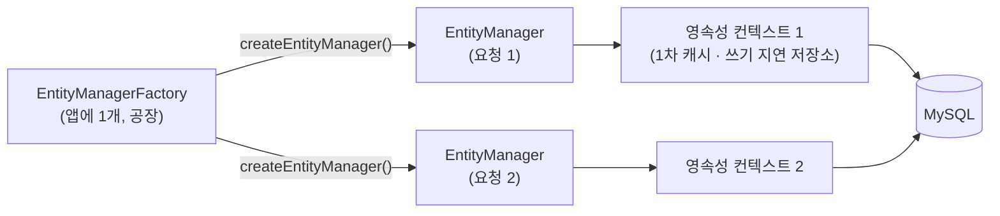
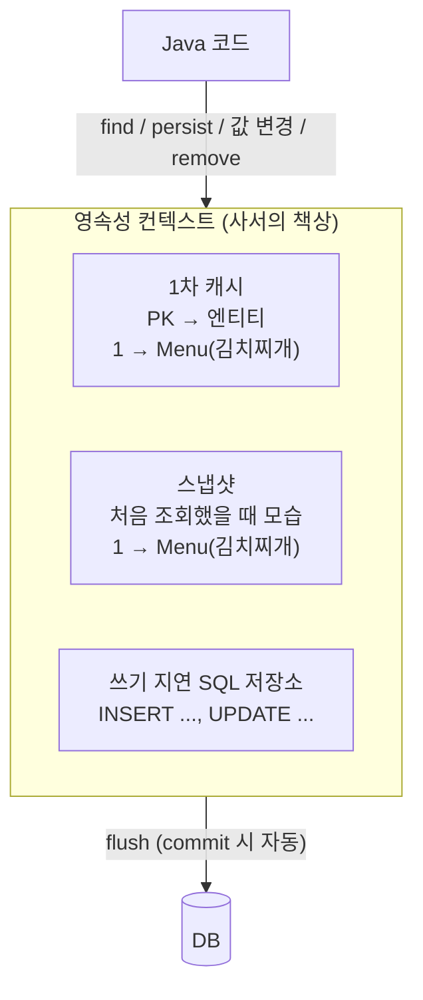
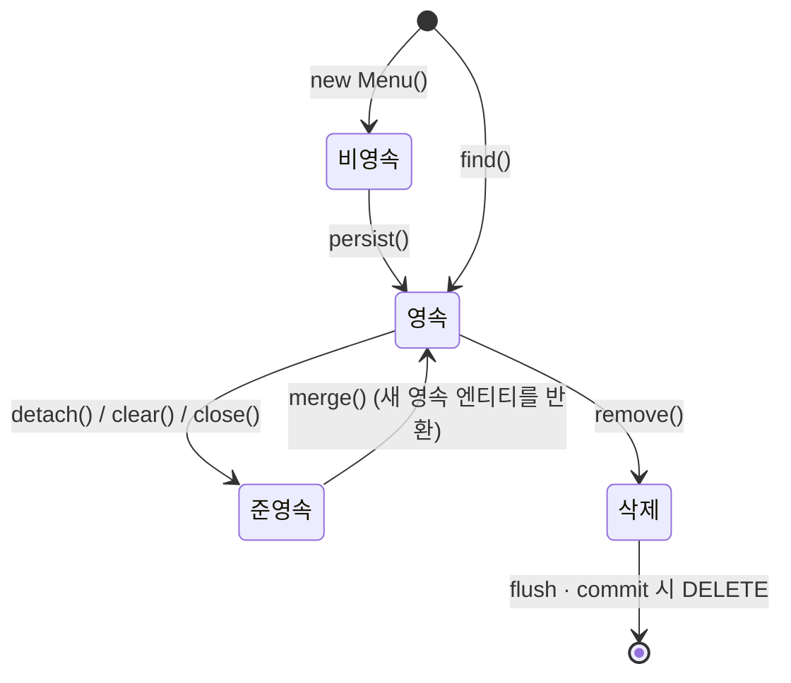
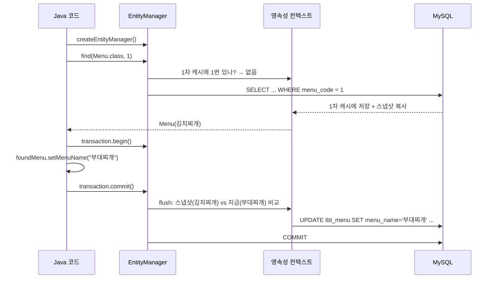

## 들어가며 (Situation)

10/14~10/19에는 **JDBC**로 DB를 다뤘다. `Connection`, `PreparedStatement`, `ResultSet`을 직접 열고 닫고, 조회 결과를 DTO에 한 칸씩 옮겨 담았다.


| 챕터 | 섹션 | 주제 |
|------|------|------|
| `chap01-jpa-intro` | `section01/jdbc` | JDBC를 직접 쓸 때의 **문제점 4가지** |
| | `section02` | 같은 문제를 **JPA로 해결** |
| `chap02-persistence-context` | `section01` | `EntityManager`로 하는 CRUD (`find`, `persist`, 변경 감지, `remove`) |
| | `section02/lifecycle` | **엔티티 생명주기** (비영속 · 영속 · 준영속 · 삭제, `merge`) |

예제 DB는 메뉴(`tbl_menu`)와 카테고리(`tbl_category`)가 있는 `menudb`다.

```groovy
dependencies {
    implementation 'org.springframework.boot:spring-boot-starter-data-jpa'
    compileOnly 'org.projectlombok:lombok'
    runtimeOnly 'com.mysql:mysql-connector-j'
    annotationProcessor 'org.projectlombok:lombok'
}
```

```yaml
spring:
  datasource:
    driver-class-name: com.mysql.cj.jdbc.Driver
    url: jdbc:mysql://localhost:3306/menudb
    username: wanted
    password: wanted
  jpa:
    # jpa 가 알아서 생성해주는 sql 구문 보는 설정
    show-sql: true
    hibernate:
      # none - 미리 읽혀둔 ddl-script 로만 진행
      ddl-auto: none
    properties:
      hibernate:
        # sql 구문을 보기 좋게 포멧팅
        format_sql: true
```

## 문제 상황 (Task)

JDBC로 메뉴 조회 하나를 만들 때 썼던 코드를 떠올려 보자. SQL을 쓰고, 연결을 열고, 결과를 한 칸씩 옮기고, 연결을 닫는다. 기능이 늘수록 같은 코드가 계속 반복됐다.

오늘의 과제는 두 가지다.

1. JDBC의 **불편함이 정확히 무엇인지** 네 가지로 나눠 보기
2. JPA가 그것을 **어떻게** 해결하는지, 그 중심에 있는 **영속성 컨텍스트**가 무엇인지 이해하기

### 쉽게 비유하면

- **JDBC**는 도서관에서 책을 빌릴 때마다 **사서 없이 직접 서고에 들어가** 책을 찾고, 대출 장부에 손으로 적고, 반납도 직접 꽂아 두는 것이다.
- **JPA**는 **사서(EntityManager)** 에게 "3번 책 주세요"라고만 말하는 것이다. 사서는 책을 찾아 주고, 내 **책상(영속성 컨텍스트)** 에 올려 둔다. 내가 책에 메모를 하면 사서가 알아서 장부에 반영한다.

## 해결 과정 (Action)

### 1. JDBC를 직접 쓸 때의 문제 4가지 — `JdbcProblem`

**역할:** Spring이 만든 `DataSource`(커넥션 풀)에서 `Connection`만 꺼내 쓰고, 나머지(SQL 작성, 실행, 결과 → 객체 변환)는 **모두 직접** 한다.

```java
@Component
public class JdbcProblem {

    private final DataSource dataSource;

    public JdbcProblem(DataSource dataSource) {
        this.dataSource = dataSource;
    }
    ...
}
```

테이블 구조에 맞춰 만든 `Menu`는 카테고리를 **객체가 아닌 값(FK)** 으로 가진다.

```java
/* tbl_menu 테이블의 한 행을 담기 위한 클래스
 * - 테이블 구조에 맞춰서 만들었기 때문에
 * - 카테고리를 객체(Category)가 아닌 categoryCode 값(FK)으로 가지고 있다. */
@NoArgsConstructor
@AllArgsConstructor
@Getter
@Setter
@ToString
public class Menu {
    private int menuCode;
    private String menuName;
    private int menuPrice;
    private int categoryCode;
    private String orderableStatus;
}
```

#### 문제 ① 코드 중복과 수작업 매핑

```java
/* 1. 데이터 변환(DTO), SQL 구문 작성, JDBC 코드 중복작성 문제
 * - Connection, Statement, ResultSet 을 생성하고 반납하는 코드가 조회마다 반복된다.
 * - ResultSet 의 컬럼 값을 객체의 필드에 하나씩 옮겨 담는 코드도 직접 작성해야 한다. */
public void findAllMenu() {

    String query = "SELECT menu_code, menu_name, menu_price,category_code, orderable_status FROM tbl_menu";
    List<Menu> menuList = new ArrayList<>();

    // try-with-resources : try 블럭이 끝나면 Connection, Statement, ResultSet 을 자동으로 반납한다.
    try (Connection con = dataSource.getConnection();
         Statement stmt = con.createStatement();
         ResultSet rset = stmt.executeQuery(query)) {

        while (rset.next()) {
            // 조회 결과(행) 1개를 객체 1개로 직접 옮겨 담는다.
            Menu menu = new Menu();
            menu.setMenuCode(rset.getInt("menu_code"));
            menu.setMenuName(rset.getString("menu_name"));
            menu.setMenuPrice(rset.getInt("menu_price"));
            menu.setCategoryCode(rset.getInt("category_code"));
            menu.setOrderableStatus(rset.getString("orderable_status"));

            menuList.add(menu);
        }

    } catch (SQLException e) {
        throw new RuntimeException(e);
    }
}
```

10/14에 `finally`에서 하나씩 `close()`하던 것을 **try-with-resources**로 줄였지만, 조회마다 이 틀을 **다시** 써야 하는 건 그대로다.

#### 문제 ② SQL에 의존적인 개발

> client 가 요구사항을 변경한다. → 메뉴 목록을 조회할 때 **카테고리 이름도 같이** 보여주세요!

이 한마디에 바뀌는 것이 세 가지다.

| 바뀌는 것 | 내용 |
|-----------|------|
| SQL | `JOIN tbl_category` 추가 |
| 담을 객체 | `MenuCategoryDTO`를 **새로** 만듦 |
| 매핑 코드 | `rset.getString("category_name")` … 다시 작성 |

```java
/* "메뉴 조회 시 카테고리 이름도 보여주세요" 라는 요구사항 때문에 새로 만든 클래스
 * - SQL 이 바뀔 때마다 이런 클래스가 계속 늘어나게 된다. */
public class MenuCategoryDTO {
    private int menuCode;
    private String menuName;
    private int menuPrice;
    private String categoryName;
    private String orderableStatus;
}
```

> 요구사항이 바뀔 때마다 SQL → 객체 → 매핑 코드가 연쇄적으로 수정된다. **객체 중심이 아닌 SQL(테이블) 중심으로 개발**하게 되는 것이다.

#### 문제 ③ 패러다임 불일치

| 관점 | 1:N 관계를 표현하는 방법 |
|------|--------------------------|
| SQL (테이블) | `tbl_menu`가 `category_code`라는 **값**(FK)을 가짐 |
| Java (객체) | `Menu`가 `Category` **객체**를 필드로 가짐 → `menu.getCategory()` |

테이블에 맞춘 `Menu`는 `categoryCode` 숫자만 있다. 카테고리 정보가 필요하면 **SQL을 한 번 더** 실행해서 직접 조립해야 한다.

```java
public void findMenuAndCategory(int menuCode) {
    Menu menu = findMenuByMenuCode(menuCode);

    // menu.getCategory() 처럼 객체를 탐색할 수 없다.
    // categoryCode 값으로 카테고리를 다시 조회해야 한다.
    Category category = findCategoryByCategoryCode(menu.getCategoryCode());
}
```

> 비유: 친구 집에 가려는데, 내 수첩에는 친구 **주소 번호**만 적혀 있다. 그 번호로 **주소록을 다시 찾아야** 친구를 만날 수 있다. 객체 세계에서는 친구를 바로 부르면(`menu.getCategory()`) 되는데 말이다.

#### 문제 ④ 동일성 보장 문제

```java
public void compareSameMenu(int menuCode) {

    Menu menu1 = findMenuByMenuCode(menuCode);
    Menu menu2 = findMenuByMenuCode(menuCode);

    System.out.println("menu1 == menu2 : " + (menu1 == menu2));   // false

    /* 하나의 DB 에서 동일한 행에 해당하는 데이터를 꺼냈는데
     * 각기 다른 객체에 담았을 때 발생하는 동일성 보장 문제
     * -> 한 객체에서 수정을 하게 되면 다른 객체는 수정을 알아차릴 수 없다. */
    menu1.setMenuName("이름 변경 테스트");

    System.out.println("menu1.getMenuName() = " + menu1.getMenuName());   // 이름 변경 테스트
    System.out.println("menu2.getMenuName() = " + menu2.getMenuName());   // 원래 이름
}
```

DB의 **같은 행**인데 Java에서는 **다른 객체 두 개**가 생긴다. 조회할 때마다 `new Menu()`를 하기 때문이다.

> 비유: 같은 사람을 사진으로 두 번 찍으면 **사진이 두 장** 생긴다. 한 장에 낙서해도 다른 사진은 그대로다. 그런데 둘 다 "같은 사람"이라고 믿고 쓰면 혼란이 생긴다.

### 2. 같은 문제를 JPA로 해결 — `section02`

#### 🍜 엔티티 — `Menu`, `Category`

**역할:** 테이블과 짝을 이루는 클래스. JPA가 관리한다는 표시(`@Entity`)를 붙인다.

```java
/* @Entity : JPA 가 관리하는 객체라는 것을 명시.
 * @Table : 해당 엔티티 객체와 매핑이 될 테이블 이름 지정. */
@Entity
@Table(name = "tbl_menu")
@NoArgsConstructor
@AllArgsConstructor
@Getter
@ToString
public class Menu {

    @Id
    @Column(name = "menu_code")
    private int menuCode;

    @Column(name = "menu_name")
    private String menuName;

    @Column(name = "menu_price")
    private int menuPrice;

    /* categoryCode 필드는 실제로는 Category 테이블의 fk 를 지칭한다.
     * Java 객체로 해당 연관관계를 표현하는 방법은
     * Category 엔티티를 Menu 엔티티에서 필드로 가지고 있으면 된다. */
    @ManyToOne
    @JoinColumn(name = "category_code")
    private Category category;

    @Column(name = "orderable_status")
    private String orderableStatus;

    public void changeMenuName(String s) {
        this.menuName = s;
    }
}
```

```java
@Entity
@Table(name = "tbl_category")
@NoArgsConstructor
@AllArgsConstructor
@Getter
@ToString
public class Category {

    @Id
    @Column(name = "category_code")
    private int categoryCode;

    @Column(name = "category_name")
    private String categoryName;

    @Column(name = "ref_category_code")
    private Integer refCategoryCode;
}
```

| 어노테이션 | 의미 |
|------------|------|
| `@Entity` | JPA가 관리하는 객체 |
| `@Table(name = "tbl_menu")` | 연결할 테이블 |
| `@Id` | 기본키(PK) |
| `@Column(name = "menu_name")` | 필드 ↔ 컬럼 |
| `@ManyToOne` + `@JoinColumn(name = "category_code")` | **여러 메뉴 → 한 카테고리**. FK 컬럼 `category_code`를 `Category` **객체**로 |

`int categoryCode` 대신 `Category category`를 필드로 둔 것이 핵심이다. 문제 ③이 여기서 풀린다.

#### 🧑‍💼 해결 — `JpaSolution`

```java
/* JPA 란?
 * 자바 진영의 ORM (Object Relational Mapping) 기술 표준이다.
 * Java 객체를 Database 와 매핑한다. */
@Component
public class JpaSolution {

    /* PersistenceContext 는 Entity 객체를 관리하는 컨테이너이다.
     * Application 에서 만든 Entity 객체를 EntityManager 를 통해서
     * PersistenceContext 에 넣을 수도 있고, 조회할 수도 있다. */
    @PersistenceContext
    private EntityManager manager;

    /* 1. JDBC -> JPA 해결 포인트
     * SQL 작성, JDBC 코드 , DB 데이터 <-> Java 객체 매핑 코드
     * 위 3가지 내용은 JPA 를 사용했을 때 자동으로 수행해준다. */
    public void findMenu(int menuCode) {
        Menu foundMenu = manager.find(Menu.class , menuCode);
        System.out.println(foundMenu);
    }

    /* 2. 메뉴 조회 시 해당 메뉴의 모든 정보와 카테고리 정보를 조회.
     * ex) 2, 파스타 , 2000 , Y , Category( 1 , 양식 , 식사 )
     * 데이터베이스와 Java 객체간의 패러다임 불일치 문제 해결 */
    public void findMenuAndCategory(int menuCode) {
        Menu foundMenu = manager.find(Menu.class , menuCode);
        System.out.println(foundMenu);
    }

    /* 3. 동일성 보장 문제 해결
     * 동일한 트렌젝션 내부에서 같은 PK 값으로 조회 한 엔티티는 항상 같은 객체를 반환한다. */
    @Transactional(readOnly = true)
    public void compareSameMenu(int menuCode) {
        Menu menu1 = manager.find(Menu.class, menuCode);
        Menu menu2 = manager.find(Menu.class, menuCode);

        System.out.println("menu1 == menu2 : " + (menu1 == menu2));   // true

        menu1.changeMenuName("테스트!");
        System.out.println("menu1 = " + menu1.getMenuName());   // 테스트!
        System.out.println("menu2 = " + menu2.getMenuName());   // 테스트! (같은 객체니까)
    }
}
```

| JDBC의 문제 | JPA의 해결 |
|-------------|------------|
| ① 코드 중복·수작업 매핑 | `manager.find(Menu.class, 1)` **한 줄**. SQL·연결·매핑을 JPA가 |
| ② SQL 의존 | 객체만 다루면 SQL은 JPA가 만듦. 카테고리 이름이 필요하면 `menu.getCategory().getCategoryName()` |
| ③ 패러다임 불일치 | `@ManyToOne Category category` → **객체 그래프 탐색** |
| ④ 동일성 보장 | 같은 트랜잭션 안에서 같은 PK면 **같은 객체** (`menu1 == menu2` → `true`) |

**`@Transactional`이 하는 일**

```text
메서드 시작  → 트랜잭션 시작 (begin)
메서드 정상 종료 → commit
메서드 중 예외   → rollback
readOnly = true → 조회 전용 트랜잭션
```

④에서 `@Transactional`을 붙인 이유가 있다. 트랜잭션이 없으면 `find()`를 부를 때마다 **새 영속성 컨텍스트**가 쓰여서 두 객체가 달라질 수 있다. 트랜잭션 하나 안에서 **같은 책상(영속성 컨텍스트)** 을 쓰기 때문에 같은 객체가 나온다.

### 3. EntityManager로 CRUD — `chap02` `section01`

**역할:** `EntityManagerFactory`에서 `EntityManager`를 **기능마다 새로** 만들고, 트랜잭션도 **직접** 시작·커밋한다. JPA가 내부에서 어떻게 움직이는지 보기 위한 예제다.

```java
@Component
public class EntityManagerCRUD {

    /* 엔티티 매니저는 기능 1개 당 1개의 매니저를 별도로 생성해야 한다.
     * 즉 필드에서 매니저를 공유하는 것이 아닌, 1개의 요청 시 1개의 매니저만 존재해야 한다. */
    private final EntityManagerFactory factory;

    public EntityManagerCRUD(EntityManagerFactory factory) {
        this.factory = factory;
    }
    ...
}
```



> 비유: `EntityManagerFactory`는 **사서를 뽑는 인사팀**이고, `EntityManager`는 손님 한 명을 맡는 **사서**다. 사서마다 자기 **책상(영속성 컨텍스트)** 이 있다. 손님 두 명이 사서 한 명을 같이 쓰면 책상이 뒤섞인다.

#### 조회 — `find()`

```java
public void findMenuByMenuCode(int menuCode) {
    // manager 는 1회 요청 시 인스턴스를 생성하며 요청이 종료되면 없앤다.
    EntityManager manager = factory.createEntityManager();

    Menu foundMenu = manager.find(Menu.class, menuCode);
    System.out.println("foundMenu = " + foundMenu);
    manager.close();
}
```

#### 등록 — `persist()` + 쓰기 지연

```java
/* Create : 엔티티 객체를 Persistence Context 에 등록 persist(); */
public void registMenu(Menu menu) {

    EntityManager manager = factory.createEntityManager();
    // DML (Insert , Update , Delete) 의 경우 트렌젝션이 매우 중요하다.
    // DML 중 오류가 발생하면 롤백이 반드시 필요하다.
    EntityTransaction transaction = manager.getTransaction();
    transaction.begin();

    try {
        // 엔티티 매니저는 CUD 작업 시 SQL 을 DB 에 바로 반영하지 않는다.
        // "쓰기 지연 SQL 저장소" 에 SQL 을 모아두었다가
        // flush() 시점에 DB 로 SQL 을 보내준다.
        manager.persist(menu);
        // commit() 메서드가 호출되면 flush 가 자동 실행된다.
        transaction.commit();
    } catch (Exception e) {
        transaction.rollback();
    } finally {
        manager.close();
    }
}
```

#### 수정 — `update()`가 없다! 변경 감지

```java
/* Update : update 관련 메서드는 존재하지 않는다.
 * - 영속성 컨텍스트는 엔티티를 처음 조회(find) 하는 순간 엔티티의 상태(스냅샷)을 보관하고 있다.
 * - 보관 된 스냅샷과 commit 시점의 엔티티를 비교해서
 * - 변경 된 부분이 있다면 UPDATE 쿼리문을 만들어서 쓰기 지연 저장소에 등록 후 DB 에 전송한다.
 * - 위 과정을 변경 감지(Dirty Checking) 라고 한다. */
public void modifyMenuName(int menuCode, String menuName) {

    EntityManager manager = factory.createEntityManager();
    Menu foundMenu = manager.find(Menu.class, menuCode);

    EntityTransaction transaction = manager.getTransaction();
    transaction.begin();

    try {
        foundMenu.setMenuName(menuName);   // 값만 바꾼다
        System.out.println("=======commit 하기 전=========");
        transaction.commit();               // 여기서 UPDATE 가 나간다
    } catch (Exception e) {
        transaction.rollback();
    }
    manager.close();
}
```

#### 삭제 — `remove()`

```java
/* Delete : remove(엔티티);
 * - 삭제할 엔티티는 먼저 조회 후 영속성 컨텍스트가 관리하고 있는 상태에서 삭제가 가능하다.
 * - remove(); 메서드를 호출해도 commit() 이 되는 시점에 delete 쿼리문이 DB 로 전송된다. */
public void removeMenu(int menuCode) {

    EntityManager manager = factory.createEntityManager();
    Menu removeMenu = manager.find(Menu.class, menuCode);

    EntityTransaction transaction = manager.getTransaction();
    transaction.begin();

    try {
        manager.remove(removeMenu);
        transaction.commit();
    } catch (Exception e) {
        transaction.rollback();
    }
    manager.close();
}
```

| 작업 | JDBC (10/19) | JPA |
|------|--------------|-----|
| 조회 | `SELECT` + `ResultSet` 매핑 | `find(Menu.class, pk)` |
| 등록 | `INSERT` + `setString` … | `persist(menu)` |
| 수정 | `UPDATE` 직접 작성 | **값만 바꾸기** (변경 감지) |
| 삭제 | `DELETE` 직접 작성 | `remove(menu)` |
| 커밋/롤백 | `con.commit()` / `con.rollback()` | `transaction.commit()` / `rollback()` |

**영속성 컨텍스트 안에는 무엇이 있을까?**



| 칸 | 하는 일 |
|----|---------|
| **1차 캐시** | 한 번 조회한 엔티티를 PK로 보관 → 같은 PK를 또 `find()`하면 **DB에 안 가고** 여기서 꺼냄 (동일성 보장) |
| **스냅샷** | 처음 조회했을 때의 모습을 복사해 둠 → commit 때 지금 모습과 비교 (변경 감지) |
| **쓰기 지연 SQL 저장소** | INSERT·UPDATE·DELETE를 바로 보내지 않고 모아 둠 → flush 때 한꺼번에 전송 |

> 비유: 사서의 책상에는 **꺼내 둔 책**(1차 캐시), **처음 꺼냈을 때 찍어 둔 사진**(스냅샷), **처리할 일 메모지**(쓰기 지연 저장소)가 있다. 마감 시간(commit)이 되면 사서가 책과 사진을 비교해서 바뀐 것만 장부(DB)에 옮겨 적는다.

### 4. 엔티티 생명주기 — `section02/lifecycle`

**역할:** 엔티티가 영속성 컨텍스트와 어떤 관계에 있는지 네 가지 상태로 확인한다. 3~5번 예제는 데이터를 바꾸기 때문에 **마지막에 rollback**해서 실습 데이터를 지킨다.

```java
/* 엔티티의 생명주기
 * - 비영속(new/transient) : 객체를 생성만 한 상태. 영속성 컨텍스트와 전혀 관련이 없다.
 * - 영속(managed)        : 영속성 컨텍스트가 관리하는 상태. (persist, find 등)
 * - 준영속(detached)      : 영속성 컨텍스트가 관리하다가 분리 된 상태. (detach, clear, close)
 * - 삭제(removed)        : 영속성 컨텍스트와 DB 에서 삭제 될 상태. (remove) */
```



#### ① 비영속 — `new`로 만들기만 한 객체

```java
Menu foundMenu = manager.find(Menu.class, menuCode);

Menu newMenu = new Menu();
newMenu.setMenuCode(foundMenu.getMenuCode());
newMenu.setMenuName(foundMenu.getMenuName());
... // 자료형 같고, 값도 똑같음.

System.out.println("foundMenu == newMenu : " + (foundMenu == newMenu));            // false
System.out.println("foundMenu 는 영속 상태인가? " + manager.contains(foundMenu));  // true
System.out.println("newMenu 는 영속 상태인가? " + manager.contains(newMenu));      // false
```

값이 **똑같아도** `new`로 만든 객체는 사서가 모르는 객체다.

#### ② 영속 — 1차 캐시와 동일성

```java
System.out.println("===== 첫 번째 조회 =====");
Menu foundMenu = manager.find(Menu.class, menuCode);   // SELECT 실행
System.out.println("===== 두 번째 조회 =====");
Menu newMenu = manager.find(Menu.class, menuCode);     // SELECT 없음! 1차 캐시에서

System.out.println("foundMenu == newMenu : " + (foundMenu == newMenu));   // true
```

콘솔에서 `SELECT`가 **첫 번째 조회 아래에만** 한 번 찍히는 것을 확인할 수 있다.

#### ③ 준영속 — `detach()`하면 변경 감지에서 빠진다

```java
Menu foundMenu1 = manager.find(Menu.class, menuCode1);
Menu foundMenu2 = manager.find(Menu.class, menuCode2);

// detach() : 특정 엔티티를 영속성 컨텍스트에서 분리해 준영속 상태로 만든다.
// - 준영속 상태가 된 엔티티는 값을 변경해도 변경 감지가 동작하지 않는다.
manager.detach(foundMenu2);

foundMenu1.setMenuPrice(foundMenu1.getMenuPrice() + 1000);
foundMenu2.setMenuPrice(foundMenu2.getMenuPrice() + 1000);

System.out.println("===== flush =====");
manager.flush();        // foundMenu1 의 UPDATE 만 나간다

transaction.rollback();
```

수업 주석이 정리한 **flush**의 핵심은 다음과 같다.

| flush란? | 영속성 컨텍스트의 변경 내용을 DB에 SQL로 **전달**하는 것 |
|----------|------------------------------------------------------------|
| 하는 일 | ① 변경 감지(스냅샷 비교) → ② UPDATE를 쓰기 지연 저장소에 등록 → ③ 모아 둔 SQL 전송 |
| 언제 | `commit()`할 때(자동), `flush()` 직접 호출, **JPQL 실행 직전**(자동) |
| 주의 ① | flush는 영속성 컨텍스트를 **비우는 게 아니다** (1차 캐시 유지) |
| 주의 ② | flush는 SQL을 **보낼 뿐 commit이 아니다** → flush 후 rollback하면 취소됨 |

> 확인해 보기: 가격을 바꾸는 코드는 `===== flush =====` 출력보다 **먼저** 실행되지만, 콘솔의 UPDATE는 그 **아래**에 찍힌다(쓰기 지연). 그리고 두 메뉴를 모두 바꿨는데 **영속 상태인 메뉴의 UPDATE만** 나간다.

| 끊는 방법 | 범위 |
|-----------|------|
| `detach(entity)` | 엔티티 **하나** |
| `clear()` | 영속성 컨텍스트 **전체 초기화** |
| `close()` | 영속성 컨텍스트 **종료** |

#### ④ 삭제 — `remove()`

```java
manager.remove(foundMenu);

// 삭제 상태의 엔티티는 다시 조회해도 null 이 반환된다.
Menu refoundMenu = manager.find(Menu.class, menuCode);   // null

System.out.println("===== flush =====");
manager.flush();          // 여기서 DELETE 가 나간다 (쓰기 지연)

transaction.rollback();
```

#### ⑤ 병합 — `merge()`

```java
Menu detachMenu = manager.find(Menu.class, menuCode);
manager.detach(detachMenu);

// 준영속 상태에서 값을 변경 -> 변경 감지 대상이 아니다.
detachMenu.setMenuName(menuName);

/* merge() : 준영속 상태의 엔티티를 이용해서 새로운 영속 상태의 엔티티를 반환한다.
 * 1. 파라미터로 전달 된 엔티티의 PK 로 1차 캐시에서 엔티티를 찾는다. (없으면 DB 에서 SELECT)
 * 2. 찾아온 영속 엔티티에 준영속 엔티티의 값을 복사한다.
 * 3. 값이 복사 된 영속 엔티티를 반환한다. (파라미터로 전달한 객체가 영속 상태가 되는 것이 아니다!)
 * ※ PK 로 조회 된 엔티티가 없다면 새로운 엔티티로 판단하여 저장(INSERT)한다. */
Menu mergedMenu = manager.merge(detachMenu);

System.out.println("detachMenu == mergedMenu : " + (detachMenu == mergedMenu));      // false
System.out.println("detachMenu 는 영속 상태인가? " + manager.contains(detachMenu));  // false
System.out.println("mergedMenu 는 영속 상태인가? " + manager.contains(mergedMenu));  // true
```

⚠️ 가장 헷갈리는 부분이다. `merge(detachMenu)`를 해도 **`detachMenu`는 여전히 준영속**이다. 영속 상태가 되는 건 **반환값 `mergedMenu`** 다. 그래서 반드시 반환값을 받아서 써야 한다.

> 비유: 사서에게 **책 복사본**(준영속)을 내밀며 "이 내용으로 고쳐 주세요"라고 하면, 사서는 서고에서 **원본**을 꺼내 복사본 내용을 옮겨 적고, 그 **원본**을 책상에 올려 준다. 내가 들고 있는 복사본은 여전히 복사본이다.

### 시행착오: 다시 볼 부분

실행해 보지는 않았다. 코드를 따라가며 확인할 곳을 정리했다.

#### ① `registMenu()`에서 `menuCode`가 0으로 찍힌다

`chap02` `section01`의 `Menu`는 `@Id`만 있고 **`@GeneratedValue`가 없다.** 입력받을 때 메뉴 코드를 넣지 않으니 `menuCode`는 `int` 기본값 `0`으로 `INSERT`된다. MySQL은 `AUTO_INCREMENT` 컬럼에 `0`이 들어오면 다음 번호를 대신 넣어 주지만, JPA는 그 번호를 모른다. 그래서 "등록 된 메뉴 : Menu(menuCode=0, …)"처럼 찍힐 가능성이 높다. 11/03에 배우는 `@GeneratedValue(strategy = IDENTITY)`가 이 문제를 푼다.

#### ② `catch`에서 예외를 삼킨다

`registMenu()`, `modifyMenuName()`, `removeMenu()`의 `catch (Exception e)`는 `rollback()`만 하고 **아무것도 출력하지 않는다.** 실패해도 콘솔에는 아무 표시가 없다. 최소한 `e.printStackTrace()`나 메시지 출력이 있으면 원인을 찾기 쉽다.

#### ③ "EntityManager는 필드로 공유하면 안 된다"의 정확한 뜻

`EntityManager` **자체**는 여러 스레드가 함께 쓰면 안 된다. 그래서 `factory.createEntityManager()`로 요청마다 만드는 것이 맞다. 다만 `chap01`처럼 Spring의 **`@PersistenceContext`** 로 주입받은 필드는 진짜 `EntityManager`가 아니라 **프록시**(10/27 AOP)다. 이 프록시가 트랜잭션마다 알맞은 `EntityManager`를 연결해 주기 때문에 필드에 두어도 안전하다. 11/03 `MemberRepository`도 이 방식을 쓴다.

### 오늘의 Java 흐름 한눈에 보기

`modifyMenuName(1, "부대찌개")`를 실행했을 때를 따라가 보자.



초등학생에게 설명하듯 정리하면 이렇다.

1. **사서 부르기**: 인사팀(`EntityManagerFactory`)이 나를 맡을 사서(`EntityManager`)를 한 명 보내 준다.
2. **책 빌리기**: "1번 책 주세요"(`find`). 사서는 책상(1차 캐시)을 먼저 보고, 없으면 서고(DB)에서 꺼내 와서 책상에 올린다. 이때 책을 **사진으로 한 장 찍어** 둔다(스냅샷).
3. **작업 시작**: "지금부터 작업 시작!"(`begin`).
4. **메모하기**: 책 제목을 "부대찌개"로 고쳐 쓴다. 이때는 장부(DB)에 아무 일도 안 일어난다.
5. **마감**: "작업 끝!"(`commit`). 사서가 지금 책과 아까 찍은 사진을 비교한다. 제목이 바뀌었다!
6. **장부 정리**: 사서가 바뀐 부분만 장부에 옮겨 적는다(`UPDATE`). 나는 `update()`라는 말을 한 번도 하지 않았다.

## 결과 (Result)

같은 기능을 JDBC와 JPA로 비교하면 다음과 같다.

| 기능 | JDBC (`JdbcProblem`) | JPA (`JpaSolution`, `EntityManagerCRUD`) |
|------|----------------------|------------------------------------------|
| 메뉴 전체 조회 | SQL + try-with-resources + 매핑 **약 20줄** | (11/04에 `findAll()`) |
| 메뉴 1개 조회 | SQL + `PreparedStatement` + 매핑 **약 25줄** | `manager.find(Menu.class, code)` **1줄** |
| 메뉴 + 카테고리 | SQL **2번** + 조립 코드 | `@ManyToOne` 필드 → `find` **1번** |
| 같은 행 두 번 조회 | 다른 객체 (`==` false) | 같은 객체 (`==` true), `SELECT`도 **1번** |
| 수정 | `UPDATE` 직접 작성 | 값만 바꾸기 (UPDATE 문장 **0줄**) |

**배운 점**

- JDBC의 불편함은 네 가지로 정리된다. **코드 중복, SQL 의존, 패러다임 불일치, 동일성 미보장.**
- JPA의 핵심은 **영속성 컨텍스트**다. 1차 캐시(동일성), 스냅샷(변경 감지), 쓰기 지연 저장소(모아서 전송) 세 칸을 이해하면 JPA 동작 대부분이 설명된다.
- **`update()` 메서드는 없다.** 영속 상태의 엔티티 값을 바꾸면 commit 때 알아서 UPDATE가 나간다.
- **flush는 commit이 아니다.** SQL을 보낼 뿐이라 rollback하면 취소된다.
- `merge()`는 준영속 객체를 영속으로 **바꾸는 게 아니라**, 새 영속 객체를 **돌려준다.**

## 더 학습하면 좋은 개념

- **ORM과 Hibernate** — JPA는 표준(인터페이스)이고, 실제로 일하는 구현체가 Hibernate다. 콘솔에 찍히는 SQL을 누가 만드는지 알 수 있다.
- **즉시 로딩(EAGER)과 지연 로딩(LAZY)** — 오늘 `@ManyToOne`은 기본이 즉시 로딩이라 메뉴를 조회할 때 카테고리도 함께 가져온다. 11/04·11/16에 본 N+1 문제가 여기서 출발한다.
- **트랜잭션 격리 수준과 `@Transactional(readOnly = true)`** — 읽기 전용 트랜잭션에서 변경 감지가 어떻게 달라지는지, 왜 조회에 붙이는지 알아 두자.
- **`persist` vs `merge`, 그리고 Spring Data JPA의 `save()`** — 11/04에 쓴 `save()`가 내부에서 둘 중 무엇을 부르는지 알면 "새 엔티티인가?" 판단 기준이 보인다.
- **JPQL** — 오늘 주석에 나온 "JPQL 실행 직전 자동 flush"의 그 JPQL이다. 테이블이 아니라 엔티티를 대상으로 쓰는 쿼리 언어다.

## 참고 자료

- [Jakarta Persistence 3.1 명세](https://jakarta.ee/specifications/persistence/3.1/jakarta-persistence-spec-3.1)
- [Jakarta Persistence API - EntityManager](https://jakarta.ee/specifications/persistence/3.1/apidocs/jakarta.persistence/jakarta/persistence/entitymanager)
- [Hibernate ORM 공식 문서 - Persistence Context](https://docs.jboss.org/hibernate/orm/6.6/userguide/html_single/Hibernate_User_Guide.html#pc)
- [Hibernate ORM 공식 문서 - Flushing](https://docs.jboss.org/hibernate/orm/6.6/userguide/html_single/Hibernate_User_Guide.html#flushing)
- [Spring Framework 공식 문서 - Declarative Transaction Management (@Transactional)](https://docs.spring.io/spring-framework/reference/data-access/transaction/declarative/annotations.html)
- [Spring Framework 공식 문서 - JPA (Injecting EntityManager)](https://docs.spring.io/spring-framework/reference/data-access/orm/jpa.html)
- [Java 공식 문서 - try-with-resources](https://docs.oracle.com/javase/tutorial/essential/exceptions/tryResourceClose.html)
