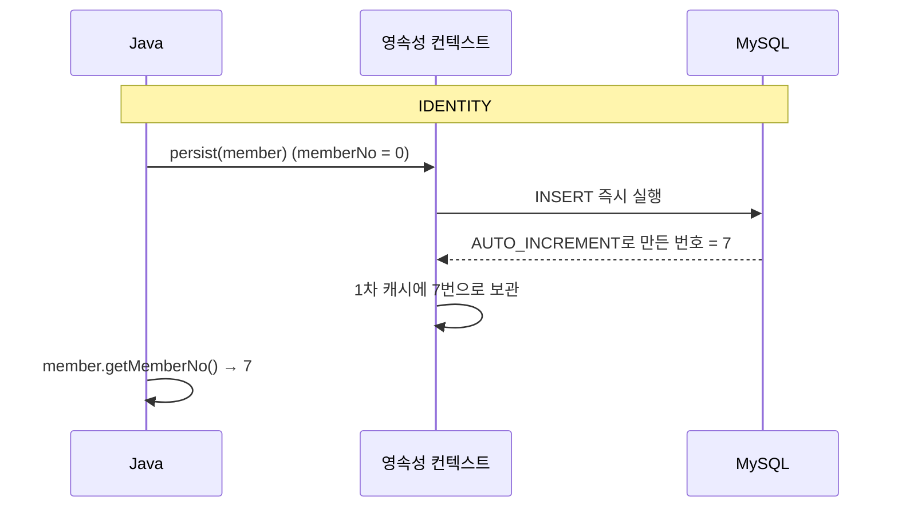
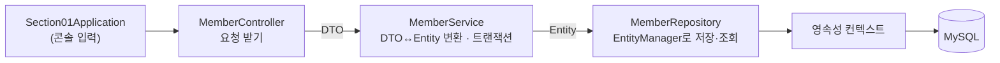
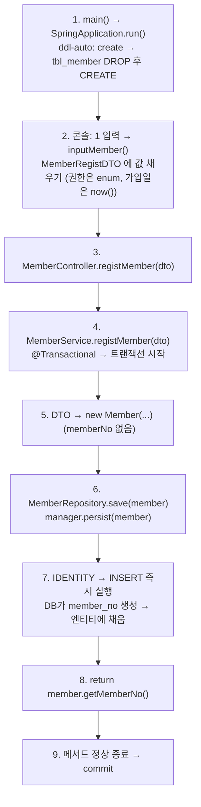

## 들어가며 (Situation)

[11/02]({{ site.baseurl }})에는 JPA가 JDBC의 문제를 어떻게 푸는지 보고, `EntityManager`와 영속성 컨텍스트, 엔티티 생명주기를 배웠다.

오늘(11/03)은 `chap03-entity-mapping`의 `section01`로 **엔티티를 테이블에 매핑하는 방법**을 자세히 배웠다. 예제는 **회원(`Member`) 등록·조회**다.

| 파일 | 역할 |
|------|------|
| `Member` | 엔티티. `@Column` 속성, `@GeneratedValue`, `@Enumerated` |
| `MemberRole` | 회원 권한 enum |
| `MemberRegistDTO` | 입력값을 담는 DTO |
| `MemberController` → `MemberService` → `MemberRepository` | 10/19 JDBC 때와 같은 **계층 구조**를 JPA로 |
| `Section01Application` | 콘솔 메뉴로 실행 |

이번에는 `application.yaml`의 `ddl-auto`가 **`create`** 다. 테이블을 SQL 스크립트로 미리 만들지 않고, **엔티티를 보고 JPA가 직접 만든다.**

```yaml
spring:
  jpa:
    show-sql: true
    hibernate:
      # create - App 실행 시 테이블 새로 생성한다.
      # create-drop - App 실행 시 테이블 생성, 종료 시 삭제
      # update - 개발 중 변경 된 테이블 구조 반영
      # none - 미리 읽혀둔 ddl-script 로만 진행
      ddl-auto: create
    properties:
      hibernate:
        format_sql: true
```

## 문제 상황 (Task)

11/02의 `Menu`는 `@Id`, `@Column(name = ...)`만 썼다. 그런데 실제 회원 테이블에는 규칙이 많다.

| 요구사항 | 어떻게 표현할까? |
|----------|------------------|
| 회원 번호는 DB가 **자동으로** 1, 2, 3 … | ? |
| 아이디는 **필수**, **중복 불가**, **10자 이하** | ? |
| 주소는 길게 (900자) | ? |
| 가입일은 날짜 + 시간 | ? |
| 권한은 `ROLE_MEMBER`, `ROLE_ADMIN` **둘 중 하나만** | ? |
| 상태는 기본값 `'Y'` | ? |

그리고 11/02처럼 `EntityManager`와 트랜잭션을 한 클래스에서 직접 다루면 코드가 섞인다. 10/19 JDBC 때처럼 **계층을 나눠야** 한다.

오늘의 과제는 두 가지다.

1. 테이블 규칙을 **엔티티 어노테이션**으로 표현하기
2. **Controller → Service → Repository** 계층에서 JPA를 쓰기

### 쉽게 비유하면

엔티티 클래스는 **회원 가입 신청서 양식**이다.

- `@Column(nullable = false)`는 신청서에 **빨간 별표(필수)** 를 다는 것이다.
- `@Column(unique = true)`는 "**이미 있는 아이디는 안 돼요**" 도장이다.
- `@GeneratedValue`는 **번호표 기계**다. 회원 번호는 신청자가 쓰지 않고 기계가 뽑아 준다.
- `@Enumerated`의 enum은 **체크박스**다. 빈칸에 아무 글자나 쓰는 대신, 정해진 보기 중에서만 고른다.
- `ddl-auto: create`는 이 양식을 보고 **인쇄소가 서류철(테이블)을 새로 만들어 주는** 것이다.

## 해결 과정 (Action)

### 1. 회원 엔티티 — `Member`

**역할:** `tbl_member` 테이블과 짝을 이루는 엔티티. 테이블의 규칙을 어노테이션으로 표현한다.

```java
@NoArgsConstructor
@AllArgsConstructor
@Getter
@ToString
@Entity
@Table(name = "tbl_member")
public class Member {

    public Member(String memberId, String memberPwd, String memberName, String phone,
                  String address, LocalDateTime enrollDate, MemberRole memberRole, String status) {
        this.memberId = memberId;
        this.memberPwd = memberPwd;
        this.memberName = memberName;
        this.phone = phone;
        this.address = address;
        this.enrollDate = enrollDate;
        this.memberRole = memberRole;
        this.status = status;
    }

    @Id
    @Column(name = "member_no")
    @GeneratedValue(strategy = GenerationType.IDENTITY)
    private int memberNo;

    @Column(name = "member_id", nullable = false,
            unique = true, columnDefinition = "varchar(10)")
    private String memberId;

    @Column(name = "member_pwd", nullable = false)
    private String memberPwd;

    @Column(name = "member_name")
    private String memberName;

    @Column(name = "phone", unique = true)
    private String phone;

    @Column(name = "address", length = 900)
    private String address;

    @Column(name = "enroll_date")
    private LocalDateTime enrollDate;

    @Column(name = "member_role")
    @Enumerated(EnumType.STRING)
    private MemberRole memberRole;

    @Column(name = "status", columnDefinition = "char(1) default 'Y'")
    private String status;
}
```

직접 만든 생성자에는 **`memberNo`가 없다.** 회원 번호는 DB가 만들어 주기 때문에 받을 필요가 없다. (`@AllArgsConstructor`가 만든 전체 필드 생성자도 따로 있다.)

#### `@Column`의 주요 속성

```java
/* @Column 의 주요 속성
 * - name             : 매핑할 컬럼 이름 (기본값 : 필드 이름)
 * - nullable         : null 허용 여부 (false -> NOT NULL 제약조건)
 * - unique           : UNIQUE 제약조건 추가
 * - columnDefinition : 컬럼 정의(자료형, 기본값 등)를 직접 작성
 * - length           : 문자열 컬럼의 길이 (기본값 255)
 * ※ 위 속성들은 JPA 가 테이블을 생성(DDL)할 때 사용 된다. */
```

| 필드 | 속성 | 만들어지는 DDL (개념상) |
|------|------|-------------------------|
| `memberId` | `nullable = false, unique = true, columnDefinition = "varchar(10)"` | `member_id varchar(10) not null` + `unique` |
| `memberPwd` | `nullable = false` | `member_pwd varchar(255) not null` |
| `phone` | `unique = true` | `phone varchar(255)` + `unique` |
| `address` | `length = 900` | `address varchar(900)` |
| `status` | `columnDefinition = "char(1) default 'Y'"` | `status char(1) default 'Y'` |

⚠️ 주석의 마지막 줄이 중요하다. 이 속성들은 **JPA가 테이블을 만들 때(DDL)** 쓰인다. `ddl-auto: none`으로 테이블을 SQL 스크립트로 만들었다면, `length = 900`을 적어도 DB의 컬럼 길이가 바뀌지 않는다. 엔티티와 실제 테이블이 **따로 놀 수 있다**는 뜻이다.

#### `@GeneratedValue` — 기본키 자동 생성 전략

```java
/* @GeneratedValue : PK 값을 자동으로 생성하는 전략
 * - IDENTITY : PK 생성을 DB 에 위임한다. (MySQL 의 AUTO_INCREMENT)
 *              INSERT 를 실행해야 PK 를 알 수 있으므로 persist() 시점에 바로 INSERT 가 실행된다. (쓰기 지연 X)
 * - SEQUENCE : DB 의 시퀀스 객체를 사용한다. (Oracle, PostgreSQL 등)
 *              persist() 시점에 시퀀스에서 PK 만 먼저 가져오고, INSERT 는 flush 시점에 실행된다. (쓰기 지연 O)
 * - TABLE    : 키 생성 전용 테이블을 만들어 사용한다.
 * - AUTO     : DB 에 맞춰 자동으로 선택한다. (기본값) */
```

| 전략 | PK를 만드는 곳 | INSERT 시점 | 쓰기 지연 | 주로 쓰는 DB |
|------|----------------|-------------|-----------|--------------|
| `IDENTITY` | DB (`AUTO_INCREMENT`) | **`persist()` 즉시** | ❌ | MySQL |
| `SEQUENCE` | DB 시퀀스 객체 | flush 시점 | ✅ | Oracle, PostgreSQL |
| `TABLE` | 키 전용 테이블 | flush 시점 | ✅ | 모든 DB (느림) |
| `AUTO` | DB에 맞춰 자동 선택 | 선택된 전략대로 | - | 기본값 |

**🤔 왜 `IDENTITY`는 쓰기 지연이 안 될까?**

11/02에서 영속성 컨텍스트의 1차 캐시는 **PK를 열쇠로** 엔티티를 보관한다고 했다. 그런데 `IDENTITY`는 **INSERT를 해 봐야** DB가 PK를 알려 준다. 1차 캐시에 넣으려면 PK가 필요하니, `persist()`하는 순간 **바로 INSERT**를 보낼 수밖에 없다.



> 비유: 은행 번호표 기계(`IDENTITY`)는 **창구에 서류를 내야** 번호를 찍어 준다. 그래서 서류를 모았다가 한꺼번에 낼 수가 없다. 시퀀스(`SEQUENCE`)는 **번호표를 먼저 뽑아 두고**, 서류는 나중에 한꺼번에 내는 방식이다.

11/02 `chap02`의 `Menu`에 `@GeneratedValue`가 없어서 등록할 때 `menuCode`가 `0`으로 찍히던 문제가 이것으로 풀린다.

#### 날짜·시간 타입

```java
/* 📌 날짜 및 시간 타입 매핑
 * ▶ LocalDate: 날짜만 저장 (yyyy-MM-dd)
 * ▶ LocalDateTime: 날짜 + 시간 저장 (yyyy-MM-dd HH:mm:ss)
 * 🎯 JPA는 Hibernate 5 이상에서 java.time 패키지를 자동 지원함 */
@Column(name = "enroll_date")
private LocalDateTime enrollDate;
```

| Java 타입 | DB 타입 (MySQL) | 저장 모양 |
|-----------|-----------------|-----------|
| `LocalDate` | `DATE` | `2026-11-03` |
| `LocalDateTime` | `DATETIME` | `2026-11-03 10:57:40` |

예전처럼 `java.util.Date`에 `@Temporal`을 붙일 필요가 없다.

### 2. 회원 권한 — `MemberRole` + `@Enumerated`

**역할:** 권한처럼 **정해진 값만** 써야 하는 것을 enum으로 강제한다.

```java
/* enum (열거형)
 * enum 타입은 시스템 정책 상 정해져 있는 값
 * 즉, 제한 된 값만 사용하기 위해 강제화 할 수 있는 역할의 클래스이다.
 * ex) 성별, 권한 등등 정해져 있는 값 */
public enum MemberRole {
    // 우리 프로젝트에서 회원의 권한은 2개로 고정!
    ROLE_MEMBER , ROLE_ADMIN;
}
```

`String role`로 두면 `"admin"`, `"ADMIN"`, `"관리자"`, `"amdin"`(오타)이 모두 들어갈 수 있다. enum이면 **두 값 외에는 컴파일조차 안 된다.**

```java
@Column(name = "member_role")
@Enumerated(EnumType.STRING)
private MemberRole memberRole;
```

```java
/* @Enumerated
 * - ORDINAL : Enum 타입을 필드 순서로 매핑
 *   - 장점 : 0, 1 이런 식으로 저장되기 때문에 메모리 효율성 좋음
 *   - 단점 : 가독성이 떨어지며 필드 추가, 순서 변경 시 데이터 혼돈
 * - STRING : Enum 타입을 문자열로 매핑
 *   - 권장하는 방식이다. 실무에서는 Enum 타입을 매핑할때 String 으로 한다.
 *   - 장점 : 가독성이 좋으며, 이름으로 저장하기 때문에 순서 변경 지장 없음
 *   - 단점 : 데이터 크기가 숫자보다 크다. <- 하지만 큰 단점은 아니다.
 * ※ Hibernate 6 + MySQL 에서는 STRING 으로 매핑하면 컬럼이 MySQL 의 enum('ROLE_ADMIN','ROLE_MEMBER') 타입으로 생성된다.
 *   varchar 타입으로 만들고 싶다면 columnDefinition = "varchar(20)" 처럼 직접 지정한다. */
```

**🤔 `ORDINAL`은 왜 위험할까?**

| 상황 | enum 정의 | `ROLE_ADMIN`이 저장되는 값 |
|------|-----------|-----------------------------|
| 처음 | `ROLE_MEMBER, ROLE_ADMIN` | `ORDINAL` → **1** / `STRING` → `"ROLE_ADMIN"` |
| 나중에 맨 앞에 `ROLE_GUEST` 추가 | `ROLE_GUEST, ROLE_MEMBER, ROLE_ADMIN` | `ORDINAL`이면 DB의 **1**이 이제 `ROLE_MEMBER`로 읽힘 😱 |

`ORDINAL`은 **순서 번호**를 저장한다. enum의 순서가 바뀌면 이미 저장된 숫자의 **뜻이 조용히 바뀐다.** 관리자가 하루아침에 일반 회원이 될 수 있다.

> 비유: 반 친구들을 **번호**(1번, 2번)로 기록해 두면, 전학생이 1번으로 들어오는 순간 모든 기록이 한 칸씩 밀린다. **이름**으로 기록하면 그런 일이 없다.

11/04 JPA 미니 프로젝트의 리포트에서 본 "상태 칼럼 17개가 모두 `@Enumerated(STRING)`"이 이 원칙을 지킨 것이다.

### 3. 계층 나누기 — Controller → Service → Repository

10/19 JDBC 때 만든 계층 구조를 그대로 JPA에 옮겼다.



#### 📦 입력 상자 — `MemberRegistDTO`

**역할:** 화면(콘솔)에서 받은 값을 담아 Service로 나른다.

```java
@NoArgsConstructor
@AllArgsConstructor
@Getter
@Setter
@ToString
public class MemberRegistDTO {

    public MemberRegistDTO(String memberId, String memberPwd, String memberName, String phone) {
        this.memberId = memberId;
        this.memberPwd = memberPwd;
        this.memberName = memberName;
        this.phone = phone;
    }

    private String memberId;
    private String memberPwd;
    private String memberName;
    private String phone;
    private String address;
    private LocalDateTime enrollDate;
    private MemberRole memberRole;
    private String status;
}
```

#### 🎮 요청 받기 — `MemberController`

**역할:** 요청을 받아 Service에 넘긴다. 10/26에 배운 **생성자 주입**으로 Service를 받는다.

```java
@Controller
public class MemberController {

    private final MemberService memberService;

    // Controller 에서 Service Bean 을 주입(의존)
    @Autowired
    public MemberController(MemberService memberService) {
        this.memberService = memberService;
    }

    public void registMember(MemberRegistDTO memberRegistDTO) {
        int memberNo = memberService.registMember(memberRegistDTO);
    }

    public void findMember(int memberNo) {
        MemberRegistDTO foundMember = memberService.findByMemberNo(memberNo);
        System.out.println("foundMember = " + foundMember);
    }
}
```

#### 🧑‍🍳 비즈니스 로직 — `MemberService`

**역할:** DTO ↔ Entity 변환, Repository 호출, **트랜잭션 관리**.

```java
@Service
public class MemberService {

    private final MemberRepository memberRepository;

    @Autowired
    public MemberService(MemberRepository memberRepository) {
        this.memberRepository = memberRepository;
    }

    /* Service
     * 1. 비즈니스 로직 작성 (시스템 정책)
     * 2. DAO 데이터베이스 접근 객체의 메서드를 호출한다.
     * 3. 트랜젝션 관리
     * - 여러 시스템 비즈니스 로직이 섞이게 되며
     * - 1개라도 실패 시 rollback 작업이 매우 중요하다.! */

    // 메서드 실행 시 begin()
    // 메서드 종료 시 - 정상 종료 : commit() , 예외 발생 : rollback();
    @Transactional
    public int registMember(MemberRegistDTO dto) {

        // 1. DTO -> Entity
        Member member = new Member(
                dto.getMemberId(), dto.getMemberPwd(), dto.getMemberName(), dto.getPhone(),
                dto.getAddress(), dto.getEnrollDate(), dto.getMemberRole(), dto.getStatus()
        );

        // 2. 변환 된 Entity 를 JPA 를 사용하는 DAO 계층에 전달한다.
        memberRepository.save(member);

        return member.getMemberNo();
    }

    /* 읽기 전용 트랜젝션은 불필요한 변경 감지를 하지 않는다. */
    @Transactional(readOnly = true)
    public MemberRegistDTO findByMemberNo(int memberNo) {

        // 1. 영속성 컨텍스트에서 PK 엔티티 find(PK);
        Member foundMember = memberRepository.findByMemberNo(memberNo);

        // 2. Entity 객체를 DTO 변환
        return new MemberRegistDTO(
                foundMember.getMemberId(),
                foundMember.getMemberPwd(),
                foundMember.getMemberName(),
                foundMember.getPhone()
        );
    }
}
```

`registMember()`가 `save()` 바로 다음 줄에서 `member.getMemberNo()`를 돌려줄 수 있는 이유가 바로 **`IDENTITY` 전략**이다. `persist()` 순간 INSERT가 나가고 DB가 만든 번호가 엔티티에 채워지기 때문이다.

**11/02와 비교: 트랜잭션을 누가 여닫나?**

| 11/02 `EntityManagerCRUD` | 11/03 `MemberService` |
|---------------------------|-----------------------|
| `EntityTransaction tx = manager.getTransaction();` | `@Transactional` 한 줄 |
| `tx.begin();` | (메서드 시작 시 자동) |
| `try { ... tx.commit(); }` | (정상 종료 시 자동 commit) |
| `catch (Exception e) { tx.rollback(); }` | (예외 시 자동 rollback) |
| `finally { manager.close(); }` | (자동) |

10/27에 배운 **AOP 프록시**가 메서드 앞뒤에 `begin`/`commit`/`rollback`을 끼워 넣어 주는 것이다.

> 비유: 11/02에는 가게 문을 **내가 직접** 열고 닫았다. `@Transactional`은 **자동문**이다. 손님(메서드)이 들어오면 열리고, 나가면 닫히고, 사고(예외)가 나면 원래대로 되돌린다.

#### 📚 DB 접근 — `MemberRepository`

**역할:** `EntityManager`로 엔티티를 영속성 컨텍스트에 넣고(`persist`), 꺼낸다(`find`).

```java
/* JDBC 에서는 DB 접근 객체를 DAO 라고 명칭한다.
 * 다만, Spring 환경에서 JPA 를 사용할 때는 DAO 계층을
 * Repository 로 표현하기 때문에 이제부터는 DAO == Repository 이렇게 인식하자! */
@Repository
public class MemberRepository {

    // DAO 계층
    // Persistence Context 에 Entity 객체 전달
    // 전달 시에는 Entity Manager 를 통해서 전달
    @PersistenceContext
    private EntityManager manager;

    public void save(Member member) {
        // 1. 전달 받은 엔티티 객체를 매니저에게 persist(엔티티 객체)
        manager.persist(member);
    }

    public Member findByMemberNo(int memberNo) {
        // 찾아 온 회원 1명을 return
        return manager.find(Member.class, memberNo);
    }
}
```

| 계층 | JDBC (10/19) | JPA (11/03) | JPA + Spring Data (11/04) |
|------|--------------|-------------|---------------------------|
| DB 접근 이름 | DAO | Repository (클래스) | Repository (**인터페이스**) |
| 저장 | `PreparedStatement` + `INSERT` | `manager.persist(member)` | `repository.save(member)` (메서드 안 써도 됨) |
| 조회 | `SELECT` + `ResultSet` 매핑 | `manager.find(Member.class, no)` | `repository.findById(no)` |
| 트랜잭션 | `con.commit()` 직접 | `@Transactional` | `@Transactional` |

오늘의 `MemberRepository`는 11/04에 `JpaRepository`를 상속한 **인터페이스**로 바뀐다. 오늘 직접 쓴 `persist`, `find`를 Spring Data JPA가 대신 만들어 주는 것이다.

### 4. 실행 — `Section01Application`

```java
private static MemberRegistDTO inputMember(Scanner sc) {

    MemberRegistDTO newMember = new MemberRegistDTO();

    System.out.print("아이디(10자 이내) : ");
    newMember.setMemberId(sc.nextLine());
    System.out.print("비밀번호 : ");
    newMember.setMemberPwd(sc.nextLine());
    System.out.print("이름 : ");
    newMember.setMemberName(sc.nextLine());
    System.out.print("전화번호 : ");
    newMember.setPhone(sc.nextLine());
    System.out.print("주소 : ");
    newMember.setAddress(sc.nextLine());
    System.out.print("권한 (1. 일반회원 2. 관리자) : ");
    newMember.setMemberRole("2".equals(sc.nextLine()) ? MemberRole.ROLE_ADMIN : MemberRole.ROLE_MEMBER);

    newMember.setEnrollDate(LocalDateTime.now());
    newMember.setStatus("Y");

    return newMember;
}
```

권한은 사용자가 글자를 치는 게 아니라 **1 또는 2**를 고르면 코드가 enum으로 바꿔 준다. 문자열 오타가 들어갈 틈이 없다.

### 시행착오: 다시 볼 부분

실행해 보지는 않았다. 코드를 따라가며 확인할 곳을 정리했다.

#### ① `ddl-auto: create`는 실행할 때마다 테이블을 지운다

`create`는 앱을 켤 때마다 엔티티에 해당하는 테이블을 **drop 후 새로 만든다.** 어제 등록한 회원이 오늘 실행하면 사라진다. 실습에는 편하지만, 실수로 운영 DB에 연결한 채 켜면 큰 사고가 난다. 11/04 미니 프로젝트에서 `none`으로 돌아간 이유다.

| 값 | 기존 데이터 |
|----|-------------|
| `create` | 실행할 때마다 **삭제** ⚠️ |
| `create-drop` | 종료할 때 **삭제** ⚠️ |
| `update` | 유지 (컬럼 추가 정도만 반영) |
| `none` | 유지 (아무것도 안 함) |

#### ② 없는 회원 번호로 조회하면 `NullPointerException`

`manager.find()`는 데이터가 없으면 **`null`** 을 돌려준다. `findByMemberNo()`는 `null` 확인 없이 바로 `foundMember.getMemberId()`를 부르므로 `NullPointerException`이 날 것이다. 11/04에 배운 `Optional` + `orElseThrow()`가 이 문제를 푼다.

```java
// 예시 코드: null 확인
Member foundMember = memberRepository.findByMemberNo(memberNo);
if (foundMember == null) {
    throw new IllegalArgumentException(memberNo + "번 회원이 없습니다.");
}
```

#### ③ `default 'Y'`는 `null`을 보내면 적용되지 않는다

`columnDefinition = "char(1) default 'Y'"`로 DB 기본값을 줬다. 하지만 JPA는 INSERT할 때 `status` 컬럼에 값을 **항상 명시해서** 보낸다. 엔티티의 `status`가 `null`이면 `null`이 그대로 들어가고 기본값 `'Y'`는 쓰이지 않는다. 지금은 `inputMember()`가 `setStatus("Y")`를 해 줘서 문제가 없다. 기본값은 DB보다 **엔티티 생성 시점**에 채우는 편이 확실하다(11/04 `Menu.create()`가 판매 상태를 항상 `"Y"`로 시작하는 것처럼).

#### ④ 등록 후 회원 번호를 보여 주지 않는다

`MemberController.registMember()`는 `memberNo`를 받기만 하고 출력하지 않는다. 회원 등록 후 몇 번으로 저장됐는지 알 수 없어서 바로 조회해 보기 어렵다. `System.out.println(memberNo + "번 회원 등록 완료")` 한 줄이면 `IDENTITY`의 동작도 눈으로 확인할 수 있다.

### 오늘의 Java 흐름 한눈에 보기

콘솔에서 "1. 회원 등록"을 골랐을 때를 따라가 보자.



초등학생에게 설명하듯 정리하면 이렇다.

1. **서류철 만들기**: 앱을 켜면 인쇄소(`ddl-auto: create`)가 회원 양식(`Member`)을 보고 **새 서류철**(`tbl_member`)을 만든다. 예전 서류철은 버린다.
2. **신청서 쓰기**: 콘솔에서 아이디, 비밀번호 등을 적는다. 권한은 1·2 중에서 **체크**(enum)하고, 가입일은 시계(`now()`)가 찍어 준다.
3. **접수 창구**: 창구(`Controller`)가 신청서를 담당자(`Service`)에게 넘긴다.
4. **자동문 열림**: 담당자 방에 들어가는 순간 **자동문**(`@Transactional`)이 열린다.
5. **정식 서류로 옮겨 적기**: 담당자가 신청서(DTO)를 정식 회원 카드(`Member`)로 옮겨 적는다. 회원 번호 칸은 비워 둔다.
6. **보관함에 넣기**: 보관 담당(`Repository`)이 사서(`EntityManager`)에게 카드를 건넨다(`persist`).
7. **번호표 찍기**: 번호표 기계(`IDENTITY`)는 서류를 내야 번호를 주니까, 사서가 **바로** 장부에 적고(INSERT) 번호를 받아 카드에 적는다.
8. **자동문 닫힘**: 담당자가 번호를 들고 나오면 자동문이 닫히며 **확정**(commit)된다.

## 결과 (Result)

11/02와 오늘을 비교하면 다음과 같다.

| 항목 | 11/02 | 11/03 |
|------|-------|-------|
| 테이블 생성 | SQL 스크립트 (`ddl-auto: none`) | 엔티티 보고 JPA가 생성 (`ddl-auto: create`) |
| PK | 직접 입력 (`@Id`만) → 등록 시 0 | `@GeneratedValue(IDENTITY)` → DB가 생성, `persist` 직후 사용 가능 |
| 제약조건 | 없음 | `nullable`, `unique`, `length`, `columnDefinition` |
| 정해진 값 | `String` | `enum` + `@Enumerated(STRING)` |
| 트랜잭션 | `begin`/`commit`/`rollback`/`close` 직접 (약 8줄) | `@Transactional` **1줄** |
| 구조 | 한 클래스에 모두 | Controller · Service · Repository **3계층** |

**배운 점**

- `@Column` 속성은 **테이블을 만들 때(DDL)** 쓰인다. `ddl-auto: none`이면 엔티티에 적어도 DB가 바뀌지 않으니, 엔티티와 실제 테이블을 함께 맞춰야 한다.
- `IDENTITY`는 INSERT를 해야 PK를 알 수 있어서 **쓰기 지연이 안 된다.** 대신 `persist()` 직후 바로 번호를 쓸 수 있다.
- enum은 **`STRING`으로** 저장한다. `ORDINAL`은 순서가 바뀌는 순간 기존 데이터의 뜻이 조용히 바뀐다.
- `@Transactional`은 11/02에 직접 쓰던 트랜잭션 코드를 **AOP 프록시**가 대신 써 주는 것이다.
- JDBC의 DAO가 JPA에서는 **Repository**가 된다. 다음 단계(11/04)는 그 Repository마저 인터페이스로 줄이는 Spring Data JPA다.

## 더 학습하면 좋은 개념

수업 코드 주석에 **"블로그 작성 키워드"** 로 두 가지가 적혀 있었다. 이 두 가지를 먼저 넣었다.

- **Checked 예외 / Unchecked 예외의 `@Transactional` 동작 방식** — `@Transactional`은 기본으로 **Unchecked 예외(`RuntimeException`, `Error`)일 때만 rollback**하고, Checked 예외(`IOException` 등)는 commit한다. 왜 그렇게 정했는지, `rollbackFor`로 어떻게 바꾸는지 알아 두자.
- **`@Transactional`의 전파(Propagation)** — 트랜잭션 메서드가 다른 트랜잭션 메서드를 부를 때 하나로 합칠지(`REQUIRED`, 기본값), 새로 열지(`REQUIRES_NEW`) 정하는 규칙이다. 여러 Service가 얽힐 때 rollback 범위가 여기서 정해진다.
- **`@Transactional`의 자기 호출(self-invocation) 문제** — 10/27 AOP에서 본 것처럼, 같은 클래스 안에서 `this.method()`로 부르면 프록시를 거치지 않아 트랜잭션이 적용되지 않는다.
- **`@Enumerated` 대신 `AttributeConverter`** — enum을 DB에 `"Y"`/`"N"`처럼 원하는 값으로 저장하고 싶을 때 쓰는 방법이다.
- **스키마 관리 도구 (Flyway, Liquibase)** — `ddl-auto: create`의 위험 없이 테이블 변경 이력을 SQL 파일로 관리하는 방법이다. 11/16 GRAVIT 리포트의 "Flyway V1~V8"이 그것이다.

## 참고 자료

- [Jakarta Persistence API - @Column](https://jakarta.ee/specifications/persistence/3.1/apidocs/jakarta.persistence/jakarta/persistence/column)
- [Jakarta Persistence API - @GeneratedValue / GenerationType](https://jakarta.ee/specifications/persistence/3.1/apidocs/jakarta.persistence/jakarta/persistence/generationtype)
- [Jakarta Persistence API - @Enumerated / EnumType](https://jakarta.ee/specifications/persistence/3.1/apidocs/jakarta.persistence/jakarta/persistence/enumtype)
- [Hibernate ORM 공식 문서 - Identifier generators](https://docs.jboss.org/hibernate/orm/6.6/userguide/html_single/Hibernate_User_Guide.html#identifiers-generators)
- [Spring Boot 공식 문서 - Initialize a Database Using Hibernate (ddl-auto)](https://docs.spring.io/spring-boot/how-to/data-initialization.html#howto.data-initialization.using-hibernate)
- [Spring Framework 공식 문서 - Rolling Back a Declarative Transaction](https://docs.spring.io/spring-framework/reference/data-access/transaction/declarative/rolling-back.html)
- [Spring Framework 공식 문서 - Transaction Propagation](https://docs.spring.io/spring-framework/reference/data-access/transaction/declarative/tx-propagation.html)
