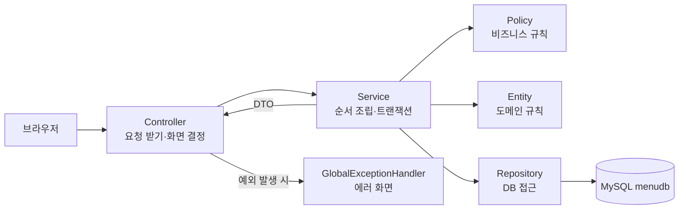
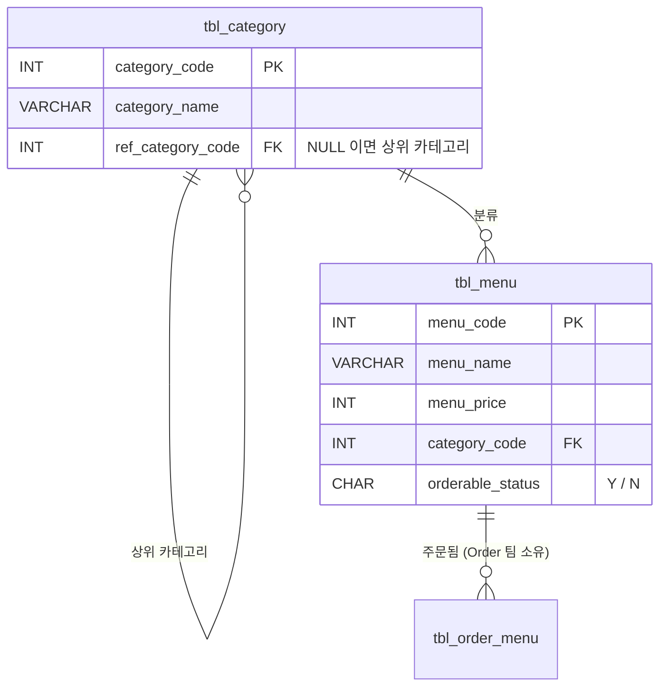
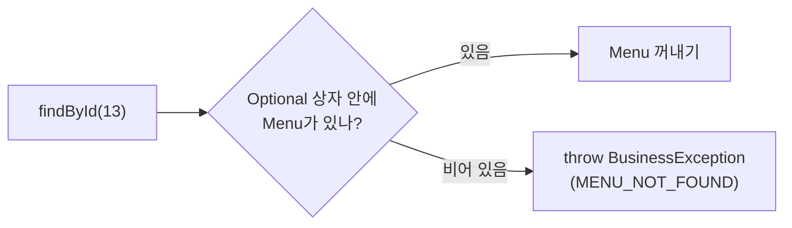
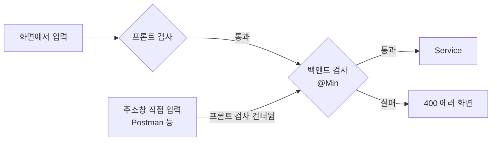
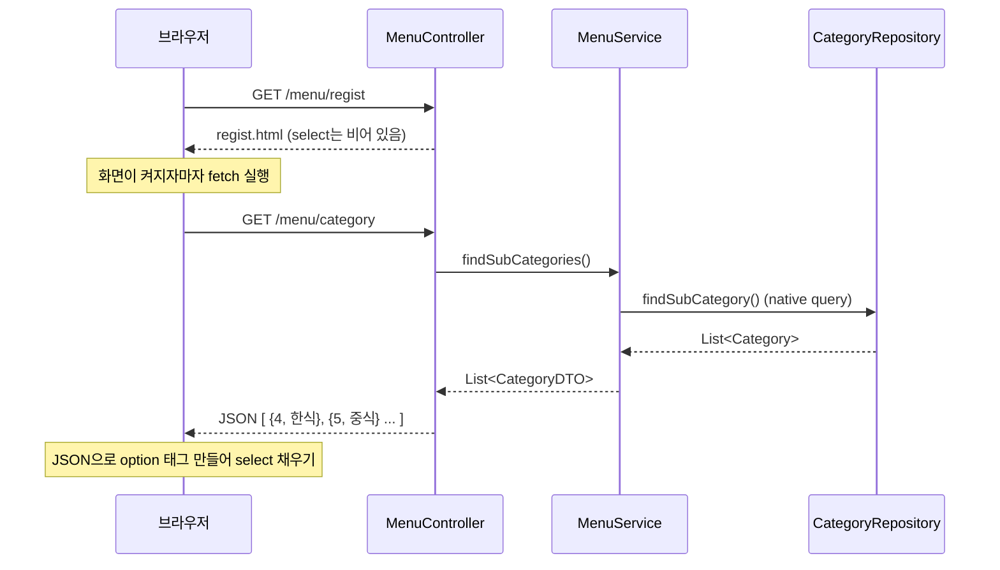
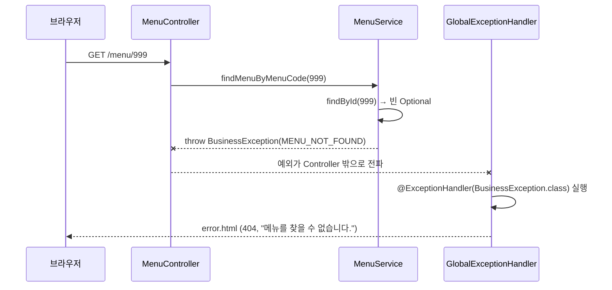
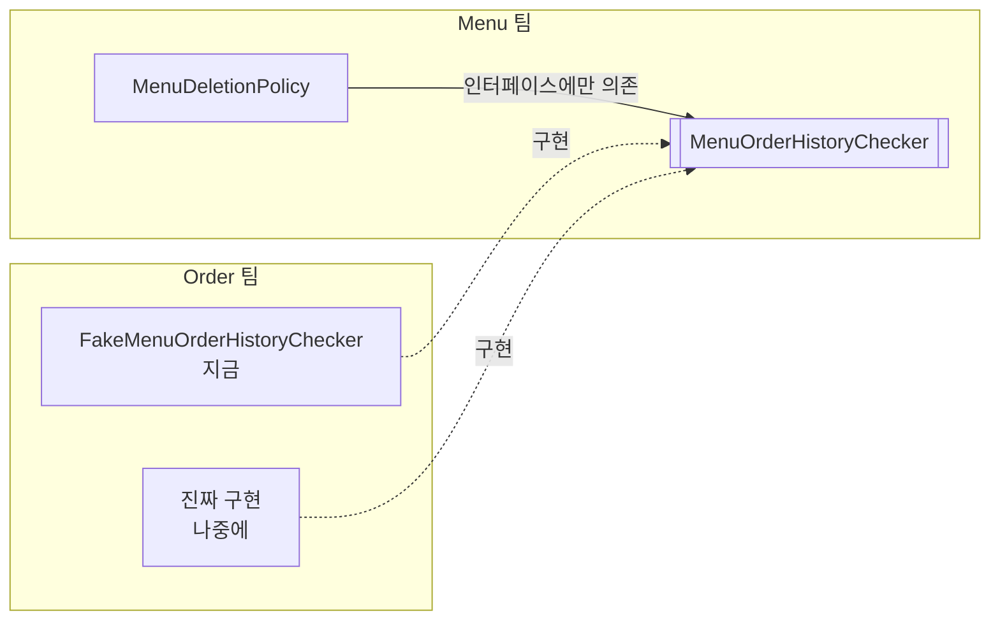
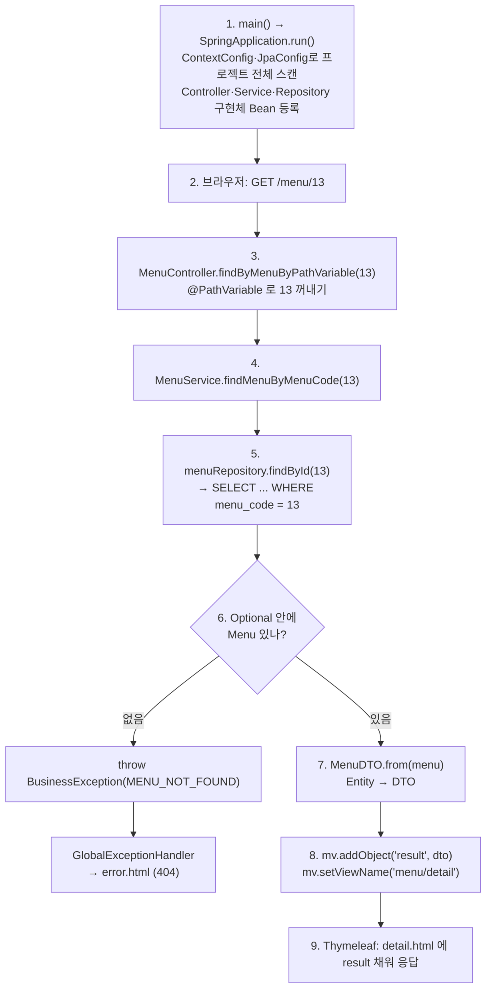

## 들어가며 (Situation)

11/02~11/03에는 JPA 기본기를 배웠다. JDBC의 불편함, `EntityManager`, 영속성 컨텍스트, 엔티티 매핑이 그 내용이다.

오늘(11/04)은 지금까지 배운 것을 모두 합쳐 **`module07-jpa-mini-project`**, 즉 **레스토랑 메뉴 관리 웹 서비스**를 만들기 시작했다.

| 항목 | 내용 |
|------|------|
| 사용자 | 매장 관리자 (메뉴 조회 / 등록 / 수정 / 판매중지 / 삭제) |
| 기술 | Java 21, Spring Boot 3.5, Spring Data JPA, Thymeleaf, MySQL 8, Validation |
| 출발점 | **PRD**(제품 요구사항 문서) `README.md` + `TODO`가 뚫려 있는 코드 |
| 오늘 진도 | 메뉴 1건 조회, 가격 검색, 카테고리 목록(JSON), 예외 처리 일부 |

이번 프로젝트는 코드보다 **문서(PRD)가 먼저**다. README 첫 줄에 이렇게 적혀 있다.

> 이 문서 하나만 보고 개발할 수 있어야 한다. 코드를 짜다가 막히면 코드가 아니라 **이 문서를 먼저 본다.**

`build.gradle`에는 새 의존성 두 개가 추가됐다.

```groovy
dependencies {
    implementation 'org.springframework.boot:spring-boot-starter-data-jpa'
    implementation 'org.springframework.boot:spring-boot-starter-thymeleaf'
    // validation 의존성 -> 유효성 검사 라이브러리
    implementation 'org.springframework.boot:spring-boot-starter-validation'
    implementation 'org.springframework.boot:spring-boot-starter-web'
    compileOnly 'org.projectlombok:lombok'
    // devtools 의존성 -> 코드가 변경되면 자동으로 어플리케이션을 재시작 해준다.
    developmentOnly 'org.springframework.boot:spring-boot-devtools'
    runtimeOnly 'com.mysql:mysql-connector-j'
    annotationProcessor 'org.projectlombok:lombok'
}
```

| 의존성 | 하는 일 |
|--------|---------|
| `spring-boot-starter-validation` | `@NotBlank`, `@Min` 같은 **입력값 검사** 어노테이션 사용 |
| `spring-boot-devtools` | 코드를 고치면 앱을 **자동 재시작** |

## 문제 상황 (Task)

기능이 몇 개 안 되는 프로젝트라도 규칙(정책)이 많다.

- 메뉴 이름은 필수이고 30자 이하여야 한다.
- 이미 판매중지된 메뉴는 다시 판매중지할 수 없다.
- 이름이 중복되면 안 된다.
- 주문 이력이 있는 메뉴는 삭제할 수 없다. 주문 데이터는 **다른 팀** 것이다.

이 규칙을 전부 `Service`의 `if`문에 넣으면 금방 스파게티가 된다. 오늘의 과제는 다음 두 가지다.

1. PRD의 각 장(화면, API, 정책, 에러, DB)을 **어떤 클래스에 옮길지** 정하기
2. 각 계층이 **자기 일만 하도록** 책임 나누기

### 쉽게 비유하면

식당에 비유하면 이렇다.

- **PRD**는 식당 **운영 매뉴얼**이다. "메뉴판에는 이렇게 쓴다", "품절이면 이렇게 안내한다"가 다 적혀 있다.
- 직원(클래스)은 각자 맡은 일만 한다. 매뉴얼에 없는 상황이면 직원이 마음대로 정하지 않고 **매뉴얼부터 고친다.**

## 해결 과정 (Action)

### 0. 큰 그림: PRD → 코드 지도

README에는 PRD의 각 장이 코드의 어느 계층으로 가는지 정리되어 있다.

```text
화면 설계  ->  templates, View 이름, Model 이름
API 명세   ->  Controller
정책 정의  ->  DTO(입력) / Entity(도메인) / Policy(비즈니스)  ->  Service 는 이것들을 순서대로 호출
에러 정의  ->  ErrorCode, GlobalExceptionHandler
DB 설계    ->  Entity, Repository
협업 계약  ->  인터페이스 + Fake
```

패키지 구조도 이 지도대로 나뉘어 있다.

```text
com.wanted.project
├── domain
│   ├── menu
│   │   ├── controller   MenuController
│   │   └── model
│   │       ├── dao      MenuRepository, CategoryRepository
│   │       ├── dto      MenuDTO, CategoryDTO
│   │       ├── entity   Menu, Category
│   │       ├── policy   MenuNamePolicy, MenuCategoryPolicy, MenuDeletionPolicy, MenuOrderHistoryChecker
│   │       └── service  MenuService
│   └── order            FakeMenuOrderHistoryChecker  (Order 팀 영역)
└── global
    ├── config           Application, ContextConfig, JpaConfig, IndexController
    └── exception        BusinessException, ErrorCode, GlobalExceptionHandler
```

요청 하나는 아래 순서로 흐른다.



### 1. 설정 — `global/config`

#### ⚙️ 실행 클래스 — `Module07JpaMiniProjectApplication`

**역할:** `main`을 실행해 서버를 켠다. 스캔 범위 설정은 다른 클래스에 맡긴다.

```java
@SpringBootApplication
public class Module07JpaMiniProjectApplication {

    public static void main(String[] args) {
        SpringApplication.run(Module07JpaMiniProjectApplication.class, args);
    }
}
```

#### 🔍 스캔 범위 넓히기 — `ContextConfig`, `JpaConfig`

**역할:** 실행 클래스가 `global.config` 패키지 안에 있어서 기본 스캔 범위가 너무 좁다. 그래서 스캔 범위를 프로젝트 전체(`com.wanted.project`)로 넓힌다.

```java
@Configuration
@ComponentScan(basePackages = "com.wanted.project")
public class ContextConfig {
}
```

```java
@Configuration
@EnableJpaRepositories(basePackages = "com.wanted.project")
@EntityScan(basePackages = "com.wanted.project")
public class JpaConfig {
}
```

**🤔 왜 필요할까?**

`@SpringBootApplication`은 **자기가 있는 패키지와 그 아래**만 찾아본다(10/26에 배운 `@ComponentScan`). 실행 클래스가 `global.config`에 있으면 `domain.menu...`는 "옆집"이라서 못 찾는다.

```text
com.wanted.project
├── domain.menu...      ← 기본 스캔으로는 못 찾음 ❌
└── global.config       ← 실행 클래스가 여기 있음 (여기 아래만 찾음)
```

| 설정 | 찾는 대상 |
|------|-----------|
| `@ComponentScan` | `@Controller`, `@Service`, `@Component`, `@ControllerAdvice` 같은 일반 Bean |
| `@EnableJpaRepositories` | `JpaRepository`를 상속한 Repository 인터페이스 |
| `@EntityScan` | `@Entity` 클래스 |

> 비유: 반장(실행 클래스)이 "우리 반 출석 부를게"라고 하면 옆 반 친구는 안 불린다. 그래서 "**학년 전체** 출석 부를게"라고 범위를 넓혀 준 것이다.

#### 🏠 메인 화면 — `IndexController`

**역할:** `/`, `/main` 요청이 오면 메인 화면을 보여 준다. 화면 이동만 한다.

```java
@Controller
public class IndexController {

    @GetMapping(value = {"/" , "/main"})
    public String mainPage() {
        return "main/main";
    }
}
```

`value = {"/", "/main"}`처럼 **주소 여러 개를 배열로** 한 메서드에 연결할 수 있다.

#### 🗄️ DB 연결 — `application.yaml`

```yaml
spring:
  datasource:
    driver-class-name: com.mysql.cj.jdbc.Driver
    url: jdbc:mysql://localhost:3306/menudb
    username: wanted
    password: wanted
  jpa:
    show-sql: true
    database: mysql
    hibernate:
      # 기존의 읽혀둔 DB Script 를 사용하며
      # 새롭게 Entity 를 추가하거나, 변경하는 것은 불가능하다.
      ddl-auto: none
    properties:
      hibernate:
        format_sql: true
```

| `ddl-auto` 값 | 의미 | 언제 |
|---------------|------|------|
| `none` | JPA가 테이블을 **건드리지 않음** | 오늘처럼 SQL 스크립트로 테이블을 미리 만들어 둘 때 |
| `update` | Entity에 맞게 테이블을 **고침**(컬럼 추가 등) | 개발 중 테이블이 자주 바뀔 때 |
| `create` | 실행할 때마다 테이블을 **지우고 새로** 만듦 | 연습·테스트용 |

### 2. DB 설계 → Entity

PRD 8장의 테이블 구조는 다음과 같다.



#### 🍜 메뉴 — `Menu`

**역할:** `tbl_menu` 테이블 한 행과 짝을 이루는 객체. 메뉴를 **만드는 규칙**과 **바꾸는 규칙**을 스스로 책임진다.

```java
@NoArgsConstructor
@AllArgsConstructor(access = AccessLevel.PRIVATE)
@Getter
@ToString
@Entity
@Table(name = "tbl_menu")
public class Menu {

    @Id
    @Column(name = "menu_code")
    @GeneratedValue(strategy = GenerationType.IDENTITY)
    private int menuCode;

    @Column(name = "menu_name")
    private String menuName;

    @Column(name = "menu_price")
    private int menuPrice;

    @Column(name = "category_code")
    private int categoryCode;

    @Column(name = "orderable_status")
    private String orderableStatus;

    public static Menu create(String menuName, int menuPrice, int categoryCode) {
        // TODO 3 : 신규 메뉴 생성 (판매상태는 항상 "Y")
        return null;
    }

    public void changeMenuName(String newMenuName) { /* TODO 4 */ }
    public void stopSelling()       { /* TODO 5 */ }
    public void resumeSelling()     { /* TODO 5 */ }
    public void validateDeletable() { /* TODO 5 */ }
}
```

| 어노테이션 | 의미 |
|------------|------|
| `@Entity` | "이 클래스는 JPA가 관리하는 Entity예요" |
| `@Table(name = "tbl_menu")` | 연결할 테이블 이름 |
| `@Id` | 기본키(PK) |
| `@GeneratedValue(strategy = IDENTITY)` | PK 번호를 DB의 `AUTO_INCREMENT`가 만든다 |
| `@Column(name = "menu_name")` | 필드 ↔ 컬럼 이름 연결 (`menuName` ↔ `menu_name`) |

**🤔 왜 `@Setter`가 없을까?**

`setOrderableStatus("N")`처럼 아무 데서나 값을 바꿀 수 있으면 "이미 판매중지인데 또 판매중지" 같은 규칙을 지킬 곳이 없다. 그래서 다음처럼 만들었다.

- **전체 필드 생성자는 `private`**: 밖에서 `new Menu(...)`로 아무렇게나 만들 수 없다.
- **setter 없음**: `create()`, `changeMenuName()`, `stopSelling()`처럼 **이름 있는 메서드로만** 만들고 바꾼다.

> 비유: 은행 통장에 `setBalance()`가 있으면 누구나 잔액을 바꿀 수 있다. 그래서 통장은 `입금()`, `출금()` 버튼만 있고, 출금 버튼이 "잔액이 부족해요"를 직접 검사한다.

`categoryCode`는 `@ManyToOne Category`가 아니라 **`int`** 로 두었다. PRD는 "다른 도메인은 **ID로 참조**한다"고 정했다.

#### 🗂️ 카테고리 — `Category`

**역할:** `tbl_category` 한 행과 짝을 이룬다. 조회 전용이라 값을 바꾸는 메서드가 없다.

```java
@NoArgsConstructor
@AllArgsConstructor
@Getter
@ToString
@Entity
@Table(name = "tbl_category")
public class Category {

    @Id
    @Column(name = "category_code")
    private int categoryCode;

    @Column(name = "category_name")
    private String categoryName;

    @Column(name = "ref_category_code")
    private Integer refCategoryCode;    // 최상위 카테고리는 NULL 이므로 int 가 아닌 Integer

    public boolean isSubCategory() {
        // TODO 3
        return false;
    }
}
```

**`int` vs `Integer`**: `int`는 빈칸(`null`)을 담을 수 없다. 상위 카테고리(식사, 음료, 디저트)는 `ref_category_code`가 `NULL`이다. 그래서 `null`을 담을 수 있는 **`Integer`** 를 쓴다.

| 상위 카테고리 (`ref` = NULL, 등록 불가) | 하위 카테고리 (등록 가능) |
|------------------------------------------|---------------------------|
| 1 식사 | 4 한식, 5 중식, 6 일식, 7 퓨전 |
| 2 음료 | 8 커피, 9 쥬스, 10 기타 |
| 3 디저트 | 11 동양, 12 서양 |

### 3. Repository — SQL을 안 써도 되는 DAO

#### 📚 메뉴 저장소 — `MenuRepository`

**역할:** `Menu` Entity의 DB 접근 담당. **인터페이스만 만들면 구현체는 Spring Data JPA가 만든다.**

```java
/* comment.
 *   JpaRepository 란? 영속성 컨텍스트와 엔티티 매니저를 구현한
 *   구현체이다. 따라서 우리는 interface 로 dao 계층을 만들고
 *   상속을 받게 되면 모든 기능을 사용할 수 있게 된다.
 *   JpaRepository<관리할 엔티티, 해당 엔티티의 @Id 컬럼의 타입>
 */
@Repository
public interface MenuRepository extends JpaRepository<Menu, Integer> {

    /* QueryMethod
     *  장점 : 조건이 적다면 메서드로만 기능을 구현하기 편하다.
     *  단점 : 조건이 많아지거나, Join 이 일어나는 경우 가독성과
     *        정확한 메서드를 구현하기 힘들어진다. */
    List<Menu> findByMenuPriceGreaterThanOrderByMenuPrice(int menuPrice);
}
```

`JpaRepository<Menu, Integer>`만 상속하면 아래 메서드를 **공짜로** 쓸 수 있다.

| 메서드 | 하는 일 | JDBC 시절에는 |
|--------|---------|---------------|
| `findById(id)` | PK로 1건 조회 | `SELECT ... WHERE menu_code = ?` 직접 작성 |
| `findAll()` / `findAll(Sort)` | 전체 조회 (정렬 가능) | `SELECT * FROM tbl_menu ORDER BY ...` |
| `save(entity)` | 저장 | `INSERT ...` |
| `delete(entity)` | 삭제 | `DELETE ...` |

**쿼리 메서드: 메서드 이름이 곧 SQL**

```text
findBy   MenuPrice   GreaterThan   OrderBy   MenuPrice
  │         │            │            │          │
SELECT   WHERE menu_price  >  ?    ORDER BY  menu_price (ASC)
```

```sql
-- 이 메서드로 만들어지는 SQL (개념상)
SELECT * FROM tbl_menu WHERE menu_price > ? ORDER BY menu_price ASC;
```

`GreaterThan`은 **초과(`>`)** 다. 이상(`>=`)이 필요하면 `GreaterThanEqual`을 쓴다. PRD도 "입력 가격 **초과**"로 정했다.

> 비유: 도서관 사서에게 "가격이 1만 원**보다 비싼** 책을, 가격 **순서대로** 찾아 주세요"라고 **문장으로** 말하면, 사서(Spring Data JPA)가 알아서 SQL로 바꿔서 찾아 준다.

#### 🗂️ 카테고리 저장소 — `CategoryRepository`

**역할:** 하위 카테고리만 골라 오기. 쿼리 메서드로 표현하기 어려워서 **SQL을 직접** 쓴다.

```java
@Repository
public interface CategoryRepository extends JpaRepository<Category, Integer> {

    // @Query 어노테이션은 직접 SQL 구문을 작성할 수 있게 해준다.
    // 1. JPQL : 엔티티를 대상으로 SQL 구문 작성
    // 2. Native Query : 실제 사용 DB 의 SQL 구문을 작성
    // 기본값은 jpql 이다. nativeQuery = true 로 해야지 실제 SQL 을 작성할 수 있다.
    @Query(value = "select * from tbl_category m where ref_category_code is not null order by category_code",
           nativeQuery = true)
    List<Category> findSubCategory();
}
```

| 방법 | 대상 | 예시 | 장점 / 단점 |
|------|------|------|-------------|
| 쿼리 메서드 | Entity 필드 | `findByMenuPriceGreaterThan` | 짧고 편함 / 조건이 많으면 이름이 너무 길어짐 |
| `@Query` JPQL (기본값) | **Entity**와 필드 | `select c from Category c where c.refCategoryCode is not null` | DB가 바뀌어도 그대로 / JPQL 문법을 따로 익혀야 함 |
| `@Query(nativeQuery = true)` | **실제 테이블**과 컬럼 | `select * from tbl_category where ref_category_code is not null` | 익숙한 SQL 그대로 / 특정 DB(MySQL) 문법에 묶임 |

### 4. DTO — Entity를 밖으로 내보내지 않기

#### 📦 메뉴 DTO — `MenuDTO`

**역할:** 화면(Controller) ↔ Service 사이에서 메뉴 데이터를 나르는 상자. **Entity → DTO 변환**(`from()`)도 맡는다.

```java
@NoArgsConstructor
@AllArgsConstructor
@Getter
@Setter
@ToString
public class MenuDTO {

    private int menuCode;
    private String menuName;      // TODO 2 : @NotBlank, @Size(max = 30)
    private int menuPrice;        // TODO 2 : @Min(0)
    private int categoryCode;     // TODO 2 : @Positive
    private String orderableStatus;

    public static MenuDTO from(Menu menu) {
        return new MenuDTO(
                menu.getMenuCode(),
                menu.getMenuName(),
                menu.getMenuPrice(),
                menu.getCategoryCode(),
                menu.getOrderableStatus()
        );
    }
}
```

#### 📦 카테고리 DTO — `CategoryDTO`

**역할:** 카테고리 데이터를 나르는 상자. `@ResponseBody`로 반환되면 **getter를 통해 JSON**으로 바뀐다.

```java
@NoArgsConstructor
@AllArgsConstructor
@Getter
@Setter
@ToString
public class CategoryDTO {

    private int categoryCode;
    private String categoryName;
    private Integer refCategoryCode;

    public static CategoryDTO from(Category category) {
        return new CategoryDTO(
                category.getCategoryCode(),
                category.getCategoryName(),
                category.getRefCategoryCode()
        );
    }
}
```

**🤔 Entity를 그대로 Controller에 주면 안 될까?**

| 문제 | 설명 |
|------|------|
| 마음대로 수정될 위험 | Entity는 영속성 컨텍스트가 관리한다(11/02). 화면 쪽에서 값을 건드리면 **변경 감지로 DB까지 바뀔 수** 있다. |
| 화면 요구에 Entity가 휘둘림 | 화면마다 보여 줄 값이 다르다. 그때마다 Entity를 고치면 DB 구조와 화면이 엉킨다. |
| 보여 주면 안 되는 값 | 나중에 비밀번호 같은 필드가 생기면 그대로 화면·JSON에 나간다. |

그래서 규칙은 **"Entity는 Service 밖으로 나가지 않는다."** 이다. `from()`을 DTO 쪽에 두는 이유는 **Entity가 DTO를 몰라야** 하기 때문이다. Entity는 DB와 규칙에만 집중한다.

> 비유: 은행 금고(Entity) 속 돈을 손님에게 직접 만지게 하지 않는다. **영수증(DTO)** 에 금액을 옮겨 적어서 건넨다.

### 5. Service — 순서만 조립하기

#### 🧑‍🍳 메뉴 서비스 — `MenuService`

**역할:** 조회 → 규칙 확인(Policy) → 변경(Entity) → 저장 → DTO 변환의 **순서**를 조립한다. 규칙을 직접 판단하지 않는다.

```java
@Service
@RequiredArgsConstructor
public class MenuService {

    // TODO 0 : DAO 계층 의존성 주입
    private final MenuRepository menuRepository;
    private final CategoryRepository categoryRepository;

    public MenuDTO findMenuByMenuCode(int menuCode) {
        // findById() 메서드는 JPA 가 미리 구현해둔 메서드이다.
        // 해당 메서드의 반환 타입은 Optional<엔티티> 이다.
        Menu foundMenu = menuRepository.findById(menuCode)
                // 메뉴가 없다면 예외 발생!
                .orElseThrow(() -> new BusinessException(ErrorCode.MENU_NOT_FOUND));

        // Entity -> DTO 로 변환하는 from() 메서드
        MenuDTO menuDTO = MenuDTO.from(foundMenu);

        return menuDTO;
    }

    public List<CategoryDTO> findSubCategories() {
        List<Category> categoryList = categoryRepository.findSubCategory();

        return categoryList.stream()
                .map(CategoryDTO::from)
                .toList();
    }

    public List<MenuDTO> findByMenuPrice(int menuPrice) {
        List<Menu> menuList = menuRepository.findByMenuPriceGreaterThanOrderByMenuPrice(menuPrice);

        for (Menu menu : menuList) {
            System.out.println("menu = " + menu);
        }

        // stream 문법 : for 문의 경우 코드가 많고, 복잡하다는 단점이 있다.
        // stream 은 그 단점을 짧은 코드로 해결할 수 있는 문법이다.
        List<MenuDTO> dtos = menuList.stream()
//              .map(menu -> MenuDTO.from(menu))
                .map(MenuDTO::from)
                .toList();

        return dtos;
    }

    // TODO 2, 3, 5, 6, 7, 8 : findMenuList, registNewMenu, modifyMenuName, deleteMenu, stopSelling, resumeSelling
}
```

**`@RequiredArgsConstructor`: 생성자 주입 자동화**

10/26에 배운 **생성자 주입**을 Lombok이 대신 써 준다. `final` 필드를 받는 생성자를 자동으로 만들고, 생성자가 하나뿐이라 Spring이 그 생성자로 Bean을 넣어 준다.

```java
// 예시 코드: @RequiredArgsConstructor 가 대신 만들어 주는 생성자
public MenuService(MenuRepository menuRepository, CategoryRepository categoryRepository) {
    this.menuRepository = menuRepository;
    this.categoryRepository = categoryRepository;
}
```

**`Optional` + `orElseThrow`: "없을 수도 있음" 상자**

`findById(13)`은 메뉴를 바로 주지 않고 **`Optional<Menu>`라는 상자**에 담아 준다. 13번 메뉴가 없으면 **빈 상자**가 온다.



> 비유: 택배 상자를 받았는데 열어 보니 비어 있을 수도 있다. `orElseThrow`는 "**열어 봐서 비어 있으면 바로 고객센터(예외)에 신고**해"라는 뜻이다. 빈 상자(`null`)를 모르고 쓰다가 `NullPointerException`이 나는 걸 막아 준다.

**`stream().map(MenuDTO::from).toList()`: 컨베이어 벨트**

```text
[Menu, Menu, Menu]  ──map(MenuDTO::from)──▶  [MenuDTO, MenuDTO, MenuDTO]
```

| 방식 | 코드 |
|------|------|
| for문 | `List<MenuDTO> dtos = new ArrayList<>(); for (Menu m : menuList) { dtos.add(MenuDTO.from(m)); }` |
| 람다 | `.map(menu -> MenuDTO.from(menu))` |
| 메서드 참조 | `.map(MenuDTO::from)` ← 람다를 더 줄인 모양 |

> 비유: 컨베이어 벨트 위로 Menu가 하나씩 지나가면, `map` 기계가 하나씩 MenuDTO로 **포장을 바꿔** 준다. `toList()`는 포장된 것들을 상자에 모으는 마지막 단계다.

### 6. Controller — 받고, 검사하고, 화면 정하기

#### 🎮 메뉴 컨트롤러 — `MenuController`

**역할:** `/menu/**` 요청을 받아 Service를 부르고, 결과를 화면(View)이나 JSON으로 돌려준다. **try-catch를 쓰지 않는다.** 예외는 `GlobalExceptionHandler`가 처리한다.

```java
@Controller
// 해당 어노테이션은 필드들에 대한 생성자를 자동으로 추가해준다.
@RequiredArgsConstructor
@RequestMapping("/menu/*")
public class MenuController {

    private final MenuService menuService;
    ...
}
```

##### (1) 메뉴 1건 조회 — `@PathVariable` + `ModelAndView`

```java
@GetMapping("/{menuCode}")
// URL 을 통해 넘어오는 값은 @PathVariable 어노테이션으로 꺼내올 수 있다.
public ModelAndView findByMenuByPathVariable(@PathVariable int menuCode, ModelAndView mv) {
    MenuDTO findMenu = menuService.findMenuByMenuCode(menuCode);

    // 컨트롤러는 View 를 리턴하며, 응답 값을 View 에 보내준다.
    mv.addObject("result", findMenu);
    mv.setViewName("menu/detail");

    return mv;
}
```

`menu/detail.html`은 `result`를 꺼내 쓴다.

```html
<td th:text="${result.menuCode}"></td>
<td th:text="${result.menuName}"></td>
<td th:text="${result.menuPrice} + '원'"></td>
```

**`ModelAndView` = `Model` + 뷰 이름을 한 상자에**

10/28에는 `Model`에 값을 담고 `String`으로 화면 이름을 돌려줬다. `ModelAndView`는 이 둘을 **한 객체에** 담는다.

| 10/28 방식 | 오늘 방식 |
|------------|-----------|
| `model.addAttribute("result", dto);` | `mv.addObject("result", dto);` |
| `return "menu/detail";` | `mv.setViewName("menu/detail"); return mv;` |
| redirect: `return "redirect:/menu/list";` | redirect: `mv.setViewName("redirect:/menu/list");` |

> 비유: `Model` + `String`은 **음식(쟁반)과 접시 이름(쪽지)을 따로** 건네는 것이다. `ModelAndView`는 음식과 쪽지를 **도시락 통 하나에** 넣어 건네는 것이다.

##### (2) 가격 검색 — 쿼리스트링 + 백엔드 유효성 검사

```java
@GetMapping("/querymethod")
public void queryPage() {}

/* comment.
 *   해당 메서드는 /search?menuPrice=1000
 *   이런 식으로 queryString 데이터가 오게 된다.
 *   ? 유무로 pathVariable / queryString 을 구분하면 좋다.
 *   중요.
 *   유효성 검사의 경우 front (js) 에서도 진행할 수 있다.
 *   다만, front 에서만 진행하게 되면 url 조작, body 조작 시에는
 *   막을 수 있는 방법이 없다.
 *   따라서 백엔드에서도 유효성 검사를 진행해야 한다. */
@GetMapping("/search")
public ModelAndView findByMenuPrice(@RequestParam
                                    @Min(value = 0, message = "가격은 0원 이상 입력!") int menuPrice,
                                    ModelAndView mv) {
    List<MenuDTO> menuList = menuService.findByMenuPrice(menuPrice);

    mv.addObject("menuList", menuList);
    mv.addObject("price", menuPrice);
    mv.setViewName("menu/searchResult");

    return mv;
}
```

검색 폼(`querymethod.html`)은 `method="get"`이라 값이 주소 뒤에 붙는다.

```html
<form action="/menu/search" method="get">
    <input type="number" name="menuPrice" placeholder="예: 10000">
    <button type="submit">검색하기</button>
</form>
```

결과 화면은 `th:each`로 목록을 반복한다.

```html
<h3 th:text="|💰 ${price}원 초과 메뉴 목록|"></h3>
<tr th:each="result : ${menuList}">
    <td th:text="${result.menuName}"></td>
    ...
</tr>
```

| 값 보내는 방식 | 주소 모양 | 꺼내는 방법 | 구분 |
|----------------|-----------|-------------|------|
| PathVariable | `/menu/13` | `@PathVariable` | `?` 없음 |
| QueryString | `/menu/search?menuPrice=10000` | `@RequestParam` | `?` 있음 |

**🤔 왜 백엔드에서도 검사해야 할까?**

화면의 `<input type="number" min="0">`나 JavaScript 검사는 **브라우저 안에서만** 동작한다. 누군가 주소창에 `/menu/search?menuPrice=-5000`을 직접 치면 화면 검사는 그냥 건너뛰어진다.



> 비유: 학교 정문 경비(프론트)가 있어도, 담을 넘어오는 사람은 막지 못한다. 그래서 **교실 문 앞(백엔드)에서도 한 번 더** 확인한다.

정책을 어디에서 검사할지는 PRD가 정해 두었다.

```text
입력값 자체만 보면 판단 가능한가? (빈 값, 길이, 범위)    -> 입력 정책    : MenuDTO / Controller (@Valid)
Entity 의 "현재 상태" 를 봐야 판단 가능한가?             -> 도메인 정책  : Entity (Menu)
DB 조회나 다른 도메인 정보가 필요한가?                   -> 비즈니스 정책 : Policy 클래스
```

| 정책 종류 | 예 | 검사 위치 |
|-----------|----|-----------|
| 입력 | 가격은 0원 이상, 이름은 30자 이하 | `@Min`, `@NotBlank`, `@Size` (DTO / Controller) |
| 도메인 | 이미 판매중지된 메뉴는 판매중지 불가 | `Menu.stopSelling()` |
| 비즈니스 | 메뉴 이름 중복 금지 (DB를 봐야 앎) | `MenuNamePolicy` |

##### (3) 카테고리 목록 — `@ResponseBody`로 JSON 보내기

```java
/* comment. @ResponseBody
 *   등장 이유!
 *   - 현재 Controller 는 마지막 책임은 View 를 return 해주는 것이다.
 *   한계점.
 *   만약 메인 페이지에서 메뉴 목록, 주문 목록, 회원 목록을
 *   전부 보여주게 기획을 했다면?
 *   여러 사람들이 작업한 결과물을 반복해서 또 작성해야 한다.
 *   ---
 *   @ReponseBody 는 응답 시 View 를 리턴하는 것이 아닌 Data 를 리턴한다.
 *   == Controller 의 View 리턴 책임을 없애주며, 데이터만 응답할 수 있도록 해준다. */
@GetMapping("/category")
@ResponseBody
public List<CategoryDTO> findCategoryList() {
    return menuService.findSubCategories();
}
```

`@ResponseBody`가 붙으면 반환값은 **화면 이름이 아니라 데이터 그 자체**가 된다. `List<CategoryDTO>`가 getter를 거쳐 JSON으로 바뀐다.

```json
[
  { "categoryCode": 4, "categoryName": "한식", "refCategoryCode": 1 },
  { "categoryCode": 5, "categoryName": "중식", "refCategoryCode": 1 }
]
```

이 JSON은 메뉴 등록 화면(`regist.html`)의 JavaScript **`fetch`** 가 받아서 `<select>` 옵션을 만든다.

```html
<select name="categoryCode" id="categoryCode"></select>

<script>
    // fetch 는 해당 페이지가 켜질 때 비동기 방식으로 호출이 된다.
    fetch('/menu/category')
        // 문자열 형태의 데이터를 javaScript 객체로 변환
        .then(res => res.json())
        // data == json 로 변환 된 카테고리 리스트
        .then(data => {
            const $categoryCode = document.getElementById("categoryCode");

            // 카테고리 리스트를 순회하며 option 태그를 만들어서 대입
            for (let index in data) {
                const $option = document.createElement("option");
                $option.value = data[index].categoryCode;
                $option.textContent = data[index].categoryName;
                $categoryCode.appendChild($option);
            }
        });
</script>
```



| 비교 | `@ResponseBody` 없음 | `@ResponseBody` 있음 |
|------|----------------------|----------------------|
| `return`의 의미 | 화면 이름 (`"menu/regist"`) | **데이터 자체** (`List<CategoryDTO>`) |
| 응답 | 완성된 HTML | JSON |
| 받는 쪽 | 브라우저가 바로 그림 | JavaScript(`fetch`)가 받아서 사용 |

> 비유: 지금까지 Controller는 **완성된 도시락(HTML)** 을 만들어 줬다. `@ResponseBody`는 **반찬(데이터)만** 주는 것이다. 반찬만 주면 메인 화면, 주문 화면 어디서든 그 반찬을 가져다 **자기 도시락에 담을 수** 있다.

### 7. 예외 처리 — 한 곳에서 모아 처리하기

#### 🚨 비즈니스 예외 — `BusinessException`

**역할:** 규칙을 어겼을 때 던지는 예외. 어떤 규칙인지는 `ErrorCode`로 구분한다. `RuntimeException`이라 `throws` 선언이 필요 없다.

```java
@Getter
public class BusinessException extends RuntimeException {

    private final ErrorCode errorCode;

    public BusinessException(ErrorCode errorCode) {
        super(errorCode.getMessage());
        this.errorCode = errorCode;
    }
}
```

#### 📋 에러 목록 — `ErrorCode`

**역할:** 예외 종류를 **한 곳에 모아 둔 목록**(enum). HTTP 상태코드와 사용자에게 보여 줄 메시지를 함께 갖는다.

```java
@Getter
@RequiredArgsConstructor
public enum ErrorCode {

    /* 조회 대상 없음 */
    MENU_NOT_FOUND(HttpStatus.NOT_FOUND, "메뉴를 찾을 수 없습니다."),
    CATEGORY_NOT_FOUND(HttpStatus.NOT_FOUND, "카테고리를 찾을 수 없습니다."),

    /* 도메인 규칙 위반 (Entity 가 자신의 "현재 상태" 로 판단) */
    ALREADY_STOPPED_MENU(HttpStatus.CONFLICT, "이미 판매중지된 메뉴입니다."),
    ALREADY_ON_SALE_MENU(HttpStatus.CONFLICT, "이미 판매중인 메뉴입니다."),
    ON_SALE_MENU_CANNOT_DELETE(HttpStatus.CONFLICT, "판매중인 메뉴는 삭제할 수 없습니다. 먼저 판매중지해주세요."),

    /* 비즈니스 규칙 위반 (Policy 가 판단) */
    DUPLICATE_MENU_NAME(HttpStatus.CONFLICT, "이미 존재하는 메뉴 이름입니다."),
    NOT_SUB_CATEGORY(HttpStatus.BAD_REQUEST, "메뉴는 하위 카테고리에만 등록할 수 있습니다."),
    ORDERED_MENU_CANNOT_DELETE(HttpStatus.CONFLICT, "주문 이력이 있는 메뉴는 삭제할 수 없습니다.");

    private final HttpStatus status;
    private final String message;
}
```

예외마다 `MenuNotFoundException`, `DuplicateMenuNameException`... 클래스를 따로 만들지 않는다. 대신 **예외 클래스 하나 + 상수 여러 개**로 표현한다. 메시지를 바꿀 때도 여기 한 곳만 고치면 된다.

| 상태코드 | 의미 | 오늘의 예 |
|----------|------|-----------|
| 400 Bad Request | 요청 값이 잘못됨 | 가격이 음수, 상위 카테고리에 등록 |
| 404 Not Found | 찾는 대상이 없음 | 없는 메뉴 번호 |
| 409 Conflict | 현재 상태와 **충돌** | 이미 판매중지, 이름 중복 |
| 500 Internal Server Error | 서버 내부 오류 | 예상하지 못한 예외 |

#### 🛡️ 전역 예외 처리기 — `GlobalExceptionHandler`

**역할:** 모든 Controller에서 터진 예외를 **한 곳에서 받아** 에러 화면(`error/error`)으로 응답한다.

```java
@Slf4j
// 예외처리를 전역으로 핸들링 하기 위해서는 해당 어노테이션이 반드시 필요하다.
@ControllerAdvice
public class GlobalExceptionHandler {

    @ExceptionHandler(BusinessException.class)
    public ModelAndView handleBusinessException(BusinessException e) {
        return errorPage(e.getErrorCode().getStatus(), e.getMessage());
    }

    @ExceptionHandler(HandlerMethodValidationException.class)
    public ModelAndView handleMethodValidation(HandlerMethodValidationException e) {
        // @RequestParam 에 직접 붙인 @Min 조건을 만족하지 못하면 동작.
        String message = e.getMessage();
        return errorPage(HttpStatus.BAD_REQUEST, message);
    }

    // TODO 2, 4, 5, 6, 7 : BindException, 파라미터 누락/타입 불일치, DB 제약조건, 없는 URL, 그 외 모든 예외

    /* 에러 화면(error/error) 에 상태코드와 메시지를 담아 반환한다. (제공 코드) */
    private ModelAndView errorPage(HttpStatus status, String message) {
        ModelAndView mv = new ModelAndView("error/error");
        mv.setStatus(status);
        mv.addObject("status", status.value());
        mv.addObject("message", message);
        return mv;
    }
}
```

```html
<!-- error/error.html -->
<p class="status" th:text="${status}">500</p>
<p class="message" th:text="|😥 ${message}|">오류가 발생했습니다.</p>
```

`/menu/999`(없는 메뉴)를 요청하면 예외가 이렇게 이동한다.



| 비교 | try-catch를 곳곳에 | `@ControllerAdvice` |
|------|--------------------|---------------------|
| Controller 코드 | 메서드마다 `try { ... } catch (...) { ... }` | **정상 흐름만** 작성 |
| 에러 화면 변경 | 모든 catch를 찾아 수정 | `errorPage()` 한 곳만 수정 |
| 새 예외 추가 | 모든 메서드에 catch 추가 | `@ExceptionHandler` 메서드 하나 추가 |

> 비유: 교실마다 보건 선생님을 두는 대신, 학교에 **보건실 하나**를 둔다. 어느 교실에서 다쳐도(예외) 보건실(`GlobalExceptionHandler`)로 가면 된다. 다친 종류(예외 타입)에 따라 다른 처치(`@ExceptionHandler`)를 한다.

### 8. 다른 팀과의 약속 — 인터페이스 + Fake

#### 🤝 계약 — `MenuOrderHistoryChecker`

**역할:** "이 메뉴가 주문된 적 있어?"를 묻는 **인터페이스**. 필요한 쪽(Menu 팀)이 정의하고, 정보를 가진 쪽(Order 팀)이 구현한다.

```java
/*
 *   Order 는 메뉴 가격 때문에 Menu 에 의존하므로, Menu 가 Order 를 직접 의존하면 순환 의존이 생긴다.
 *   인터페이스를 Menu 쪽에 두면 의존 방향이 Order -> Menu 한 방향으로 유지된다. (의존성 역전)
 */
public interface MenuOrderHistoryChecker {

    boolean hasOrdered(int menuCode);
}
```

#### 🎭 가짜 구현 — `FakeMenuOrderHistoryChecker`

**역할:** Order 팀 구현이 나오기 전까지 쓰는 **가짜**. 1, 2, 3번 메뉴는 주문 이력이 있다고 대답한다.

```java
@Component
public class FakeMenuOrderHistoryChecker implements MenuOrderHistoryChecker {

    private static final Set<Integer> ORDERED_MENU_CODES = Set.of(1, 2, 3);

    @Override
    public boolean hasOrdered(int menuCode) {
        return ORDERED_MENU_CODES.contains(menuCode);
    }
}
```



10/26의 `PaymentService` 예제와 같은 원리(**OCP + DI**)다. Order 팀이 진짜 구현을 만들면 **Fake만 지우면** 된다. Menu 팀 코드는 한 줄도 안 바뀐다.

> 비유: 콘센트(인터페이스) 모양만 미리 정해 두면, 지금은 **장난감 플러그(Fake)** 로 연습하다가 나중에 **진짜 플러그**로 바꿔 꽂으면 된다. 벽(Menu 팀 코드)을 뜯을 필요가 없다.

#### 📏 정책 클래스 — `MenuNamePolicy` 외 (PART 3, 아직 TODO)

**역할:** DB 조회나 다른 팀 정보가 있어야 판단할 수 있는 **비즈니스 규칙**을 맡는다. 오늘은 뼈대만 있다.

```java
@Component
@RequiredArgsConstructor
public class MenuNamePolicy {

    // TODO 0 : MenuRepository 주입받기

    public void validateNewName(String menuName) {
        // TODO 1 : 같은 이름이 있으면 BusinessException(ErrorCode.DUPLICATE_MENU_NAME)
    }

    public void validateRename(int menuCode, String newMenuName) {
        // TODO 2 : "자기 자신을 제외하고" 같은 이름이 있으면 DUPLICATE_MENU_NAME
    }
}
```

| 클래스 | 맡은 규칙 | 필요한 것 |
|--------|-----------|-----------|
| `MenuNamePolicy` | 메뉴 이름 중복 금지 | `MenuRepository` (`existsByMenuName...`) |
| `MenuCategoryPolicy` | 하위 카테고리에만 등록 | `CategoryRepository` + `Category.isSubCategory()` |
| `MenuDeletionPolicy` | 주문 이력 있으면 삭제 금지 | `MenuOrderHistoryChecker` (인터페이스) |

### 오늘 완성된 것 / 남은 TODO

| 구분 | 완성 ✅ | 남음 (숙제) |
|------|---------|-------------|
| Controller | 1건 조회, 가격 검색, 카테고리 JSON | 전체 목록(TODO 2 "숙제!"), 등록, 수정, 삭제, 판매중지/재개 |
| Service | `findMenuByMenuCode`, `findByMenuPrice`, `findSubCategories` | `findMenuList`, `registNewMenu`, `modifyMenuName`, `deleteMenu`, `stopSelling`, `resumeSelling` |
| Repository | `findByMenuPriceGreaterThanOrderByMenuPrice`, `findSubCategory` | `existsByMenuName`, `existsByMenuNameAndMenuCodeNot` |
| DTO | `MenuDTO.from()`, `CategoryDTO.from()` | `MenuDTO` 검증 어노테이션 |
| Entity | 매핑 | `create()`, `changeMenuName()`, 판매 상태 규칙, `isSubCategory()` |
| 예외 | `BusinessException`, `HandlerMethodValidationException` 처리 | 나머지 `@ExceptionHandler` 5개 |
| Policy | - | 3개 전부 |

### 시행착오: 다시 볼 부분

수업 코드를 흐름대로 따라가면서 확인해 볼 곳을 정리했다. 실제로 실행해 보지는 않았으니 직접 돌려 보며 확인하면 좋다.

#### ① 주석은 "이상", 코드는 "초과"

`MenuController`의 주석은 `TODO 3 : menuPrice 이상의 모든 메뉴 조회`이고, `MenuService` 주석도 "이상"이라고 적혀 있다. 하지만 쿼리 메서드는 `GreaterThan`, 즉 **초과(`>`)** 다. PRD와 화면(`"원 초과"`)도 **초과**가 맞으니 코드가 맞고 주석이 틀린 것이다.

| 쿼리 메서드 키워드 | SQL |
|--------------------|-----|
| `GreaterThan` | `>` (초과) |
| `GreaterThanEqual` | `>=` (이상) |

#### ② `@Min` 에러 메시지가 그대로 안 보일 수 있다

`handleMethodValidation()`은 `e.getMessage()`를 화면에 보낸다. 하지만 `HandlerMethodValidationException.getMessage()`는 `@Min`에 적은 `"가격은 0원 이상 입력!"`이 아니라, **"Validation failure" 같은 일반 문구**를 돌려줄 가능성이 높다. PRD는 "첫 번째 검증 에러의 message"를 보여 주라고 했다. 그러니 검증 결과 목록에서 첫 번째 에러의 메시지를 꺼내야 할 것으로 보인다. 정확한 API는 [Spring 공식 문서의 Validation 부분](https://docs.spring.io/spring-framework/reference/web/webmvc/mvc-controller/ann-validation.html)을 확인해 보자.

#### ③ `null`을 돌려주는 `@ExceptionHandler`

`handleBadRequest()`, `handleNoResource()`, `handleException()` 등은 아직 `return null;`이다. 예를 들어 `/menu/abc`(숫자 자리에 문자)를 요청하면 `handleBadRequest()`가 예외를 잡는다. 그런데 화면 정보를 돌려주지 않으니 **에러 화면 대신 빈 화면**이나 예상과 다른 응답이 나올 수 있다. TODO를 채우기 전까지는 주의하자.

#### ④ `findById` 주석의 오해

`MenuService` 주석에는 "DB에 데이터가 없으면 Error가 발생하지만, Optional 타입은 null을 담게 되어…"라고 적혀 있다. 정확히는 `findById()`는 데이터가 없어도 **에러를 내지 않고 빈 `Optional`** 을 돌려준다. 에러(`BusinessException`)는 우리가 `orElseThrow()`로 **직접** 던지는 것이다.

### 오늘의 Java 흐름 한눈에 보기

메인 화면에서 **"🍽 특정 메뉴 조회"(`/menu/13`)** 버튼을 눌렀을 때를 따라가 보자.



초등학생에게 설명하듯 정리하면 이렇다.

1. **가게 문 열기**: `main()`이 식당을 연다. 학년 전체 출석(`ContextConfig`, `JpaConfig`)을 불러서 직원들을 모두 출근시킨다. 창고 담당(`MenuRepository`)은 Spring Data JPA가 **대신 만들어 준** 직원이다.
2. **주문**: 손님이 "13번 메뉴 보여 주세요"(`/menu/13`)라고 말한다.
3. **카운터(Controller)**: 주소에 적힌 13을 꺼내서(`@PathVariable`) 주방장에게 전한다.
4. **주방장(Service)**: 창고 담당에게 "13번 꺼내 와"라고 한다.
5. **창고(Repository)**: `findById(13)`으로 찾아서 **상자(Optional)** 에 담아 온다.
6. **상자 확인**: 비어 있으면 보건실(`GlobalExceptionHandler`)로 보낸다. "메뉴를 찾을 수 없습니다" 화면이 나간다.
7. **영수증 쓰기**: 상자에 메뉴가 있으면 진짜 메뉴(Entity) 대신 **영수증(DTO)** 에 옮겨 적는다.
8. **도시락 통 싸기**: 카운터가 도시락 통(`ModelAndView`)에 영수증(`result`)과 접시 이름(`menu/detail`)을 넣는다.
9. **서빙**: Thymeleaf가 `detail.html`에 값을 채워 손님에게 보여 준다.

## 결과 (Result)

JDBC로 만들던 때(10/19 계층형 CRUD)와 같은 일을 비교하면 다음과 같다.

| 항목 | JDBC (10/19) | JPA 미니 프로젝트 (오늘) |
|------|--------------|--------------------------|
| 1건 조회 DAO | `PreparedStatement` + `ResultSet` + 매핑 코드 약 20줄 | `findById()` **0줄** (상속만) |
| 가격 검색 SQL | XML/properties에 SQL 작성 + DAO 메서드 | 메서드 이름 **1줄** |
| 생성자 주입 | 생성자 직접 작성 | `@RequiredArgsConstructor` |
| 예외 처리 | 메서드마다 try-catch | `@ControllerAdvice` **한 곳** |
| 규칙 위치 | Service `if`문에 섞임 | 입력(DTO) / 도메인(Entity) / 비즈니스(Policy)로 분리 |

**배운 점**

- **PRD가 정확하면 "어디에 무엇을 짤지" 고민이 줄어든다.** 화면, API, 정책, 에러, DB 장이 각각 templates, Controller, DTO/Entity/Policy, ErrorCode, Entity/Repository로 1:1 대응한다.
- **정책은 "무엇을 보고 판단하는가"로 위치가 정해진다.** 입력값만 보면 되면 DTO, 현재 상태를 봐야 하면 Entity, DB나 다른 팀 정보가 필요하면 Policy에 둔다.
- **Entity는 Service 밖으로 나가지 않는다.** DTO가 경계 역할을 한다.
- 프론트 검사만으로는 부족하다. **백엔드 유효성 검사**는 필수다.
- `@ResponseBody`로 **데이터만** 돌려주면, 화면은 `fetch`로 필요한 곳에서 가져다 쓸 수 있다.

## 더 학습하면 좋은 개념

- **변경 감지(Dirty Checking)와 `@Transactional`** — 오늘 남은 TODO(이름 수정, 판매중지)는 `save()` 없이 Entity 값만 바꿔도 UPDATE가 된다고 PRD에 적혀 있다. 11/02에 배운 영속성 컨텍스트가 실제로 쓰이는 지점이다.
- **Bean Validation과 `@Valid` / `BindingResult`** — 등록 TODO에서 `MenuDTO`에 `@NotBlank`, `@Size`, `@Positive`를 붙이고 `@Valid`로 검사한다. `BindException`과 `HandlerMethodValidationException`의 차이를 알면 에러 메시지를 정확히 꺼낼 수 있다.
- **JPQL과 `@Query`** — 오늘은 native query만 썼다. JPQL은 테이블이 아닌 Entity를 대상으로 쓰기 때문에 DB가 바뀌어도 코드를 고칠 필요가 적다.
- **`@RestController`와 REST API 설계** — `@ResponseBody`를 클래스 전체에 적용한 형태다. 화면 없이 JSON만 주고받는 백엔드를 만들 때 기본이 된다.
- **의존성 역전 원칙(DIP)** — `MenuOrderHistoryChecker`를 Menu 쪽에 둔 이유다. 팀·모듈 간 순환 의존을 끊는 설계 원칙이다.

## 참고 자료

- [Spring Data JPA 공식 문서 - Query Methods](https://docs.spring.io/spring-data/jpa/reference/jpa/query-methods.html)
- [Spring Data JPA 공식 문서 - Repository Query Keywords](https://docs.spring.io/spring-data/jpa/reference/repositories/query-keywords-reference.html)
- [Spring Framework 공식 문서 - @ResponseBody](https://docs.spring.io/spring-framework/reference/web/webmvc/mvc-controller/ann-methods/responsebody.html)
- [Spring Framework 공식 문서 - Validation (Controller)](https://docs.spring.io/spring-framework/reference/web/webmvc/mvc-controller/ann-validation.html)
- [Spring Framework 공식 문서 - Controller Advice](https://docs.spring.io/spring-framework/reference/web/webmvc/mvc-controller/ann-advice.html)
- [Spring Boot 공식 문서 - Data Access (JPA, ddl-auto)](https://docs.spring.io/spring-boot/how-to/data-initialization.html)
- [Jakarta Persistence 공식 문서](https://jakarta.ee/specifications/persistence/)
- [Java 공식 문서 - Optional](https://docs.oracle.com/en/java/javase/21/docs/api/java.base/java/util/Optional.html)
- [MDN - Fetch API 사용하기](https://developer.mozilla.org/ko/docs/Web/API/Fetch_API/Using_Fetch)
