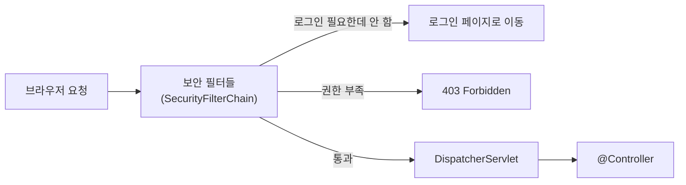
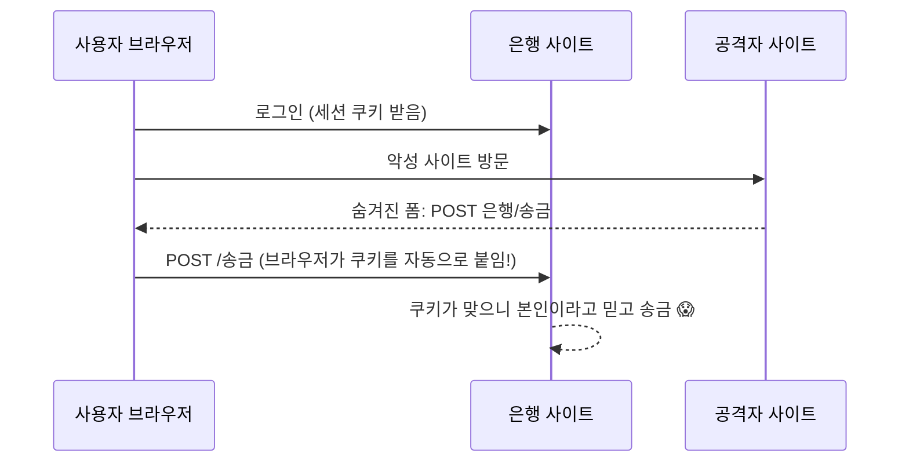
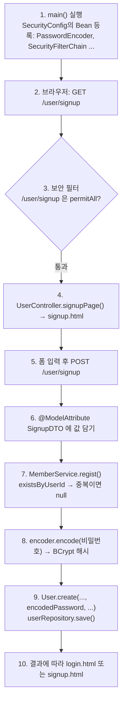

## 들어가며 (Situation)

11/04까지 JPA 미니 프로젝트로 메뉴 관리 서비스를 만들었다. 그런데 이 서비스에는 **로그인이 없었다.** 누구나 메뉴를 등록하고 지울 수 있었다.

오늘(11/05)부터 **Spring Security**를 배운다. 예제는 `module01-security-session`, **세션 기반** 로그인 프로젝트다.

| 항목 | 내용 |
|------|------|
| 기능 | 회원가입, 로그인/로그아웃, 권한별 페이지 접근, 관리자 로그인 로그 조회 |
| 인증 방식 | **세션**(`JSESSIONID` 쿠키) |
| 권한 | `USER`, `ADMIN` |
| 기술 | Spring Boot, Spring Security, Spring Data JPA, Thymeleaf, MySQL |

```groovy
dependencies {
    implementation 'org.springframework.boot:spring-boot-starter-data-jpa'
    // Spring 에서 제공하는 인증/인가 기능을 사용하기 위한 의존성
    implementation 'org.springframework.boot:spring-boot-starter-security'
    implementation 'org.springframework.boot:spring-boot-starter-thymeleaf'
    implementation 'org.springframework.boot:spring-boot-starter-web'
    // Thymeleaf 문법으로 security 관련 문법 사용하기 위한 확장 의존성
    implementation 'org.thymeleaf.extras:thymeleaf-extras-springsecurity6'
    testImplementation 'org.springframework.security:spring-security-test'
    ...
}
```

> 레포에는 11/06 커밋만 있다. 첫 커밋(11:05)에 이미 완성되어 있던 **회원가입과 보안 설정**을 11/05 내용으로, 그 뒤 채운 **로그인 처리**를 [11/06 글]({{ site.baseurl }})로 나눠 정리했다.

## 문제 상황 (Task)

로그인 기능을 직접 만든다고 생각해 보자. 10/23에 Servlet으로 세션과 필터를 배웠으니 만들 수는 있다. 하지만 챙길 것이 너무 많다.

| 챙길 것 | 직접 만들면 |
|---------|-------------|
| 비밀번호 저장 | 그대로 저장하면 DB가 털렸을 때 모든 비밀번호가 노출됨. 안전한 암호화를 직접 골라야 함 |
| 로그인 확인 | 아이디 조회, 비밀번호 비교, 세션 저장을 매번 직접 |
| 페이지마다 권한 검사 | 컨트롤러마다 `if (session.getAttribute("user") == null)` |
| 로그아웃 | 세션 무효화, 쿠키 삭제 |
| 공격 방어 | CSRF, 세션 고정 공격, 동시 로그인 제한 … |

오늘의 과제는 이 일을 **Spring Security에게 맡기고**, 우리는 **규칙만 선언**하는 방법을 익히는 것이다.

### 쉽게 비유하면

Spring Security는 **건물 입구의 보안 게이트**다.

- **회원가입**은 출입증을 발급받는 것이다. 이때 비밀번호는 **봉인된 봉투**(BCrypt)에 넣어 보관한다.
- **SecurityFilterChain**은 게이트에 붙은 **출입 규칙표**다. "1층 로비는 누구나, 2층 사무실은 직원만, 3층 서버실은 관리자만".
- 손님은 사무실(컨트롤러)에 가기 **전에** 반드시 게이트(필터)를 통과해야 한다.

## 해결 과정 (Action)

### 0. 큰 그림: 요청은 컨트롤러보다 필터를 먼저 지난다

10/23에 배운 **Filter**를 떠올려 보자. 필터는 Servlet(컨트롤러)보다 먼저 요청을 받는다. Spring Security는 이 필터 자리에 **보안 필터 여러 개를 줄줄이 세워** 둔다.



`SecurityConfig` 주석에 오늘 배울 흐름이 지도처럼 정리되어 있다.

```text
■ 회원가입
  ① GET  /user/signup  -> UserController.signupPage()   : 회원가입 화면 보여주기
  ② POST /user/signup  -> UserController.signup()       : 입력값(SignupDTO) 받기
  ③ MemberService.regist()                             : 비밀번호 암호화(PasswordEncoder) 후 User.create()
  ④ UserRepository.save()                              : DB 저장

■ 로그인 (POST /auth/login 을 처리하는 컨트롤러는 우리가 만들지 않는다! Security 필터가 가로챈다.)
  ① GET  /auth/login   -> AuthController.login()        : 로그인 화면 보여주기
  ② POST /auth/login   -> Security 필터                  : formLogin 설정대로 user / pass 값을 꺼낸다.
  ③ AuthService.loadUserByUsername()                   : 아이디로 회원 조회
  ④ ~ ⑥ (11/06에 정리)

■ 로그아웃
  POST /auth/logout -> 세션 무효화 + 쿠키 삭제 -> "/" 로 이동 (이것도 컨트롤러 없이 Security 가 처리)
```

패키지 구조는 11/04 JPA 미니 프로젝트와 같은 방식(`domain` / `global`)이다.

```text
com.wanted.securitysession
├── domain
│   ├── auth        SecurityConfig, AuthController, AuthService, AuthDetails, 핸들러 2개
│   └── user        UserController, AdminController, MemberService, User, LoginLog, Repository 2개, DTO 2개
└── global.config   Application, ContextConfig, JpaConfig, IndexController
```

### 1. DB 준비 — `create_tables.sql`

**역할:** 회원 테이블과 로그인 로그 테이블을 만든다. `ddl-auto: none`이라서 JPA가 아니라 이 스크립트로 직접 만든다.

```sql
CREATE TABLE IF NOT EXISTS TBL_USER
(
    USER_NO              INT AUTO_INCREMENT COMMENT '사용자 번호',
    USER_ID              VARCHAR(30) NOT NULL COMMENT '사용자 아이디',
    USER_NAME            VARCHAR(30) COMMENT '사용자 이름',
    PASSWORD             VARCHAR(100) NOT NULL COMMENT '사용자 비밀번호',
    USER_ROLE            VARCHAR(50) NOT NULL COMMENT '사용자 권한',
    LOGIN_FAIL_COUNT     INT NOT NULL DEFAULT 0 COMMENT '로그인 실패 횟수',
    IS_ACCOUNT_LOCKED    BOOLEAN NOT NULL DEFAULT FALSE COMMENT '계정 잠금 여부',
    CONSTRAINT pk_user_no PRIMARY KEY (USER_NO),
    CONSTRAINT uk_user_id UNIQUE (USER_ID)
) ENGINE=INNODB COMMENT '고객정보';

CREATE TABLE IF NOT EXISTS TBL_LOGIN_LOG
(
    ID                   BIGINT AUTO_INCREMENT COMMENT '로그 ID',
    USER_ID              VARCHAR(30) NOT NULL COMMENT '사용자 아이디',
    LOGIN_TIME           DATETIME NOT NULL COMMENT '로그인 시간',
    SUCCESS              BOOLEAN NOT NULL COMMENT '성공 여부',
    IP_ADDRESS           VARCHAR(45) COMMENT 'IP 주소',
    CONSTRAINT pk_log_id PRIMARY KEY (ID)
) ENGINE=INNODB COMMENT '로그인 로그';
```

`PASSWORD`가 `VARCHAR(100)`인 이유는 **암호화된 비밀번호가 원래보다 훨씬 길기** 때문이다. BCrypt 결과는 60자다.

`application.yaml`의 `ddl-auto` 옵션도 정리되어 있다.

| 값 | 동작 | 언제 |
|----|------|------|
| `create` | 실행 시 테이블 drop 후 새로 생성 (기존 데이터 삭제) | 연습 |
| `create-drop` | 시작 시 생성, 종료 시 삭제 | 테스트 |
| `update` | 변경된 엔티티만 반영 | 개발 |
| `none` | 아무것도 안 함 → SQL 스크립트로 직접 생성 | **오늘** |

### 2. 회원 엔티티 — `User`

**역할:** `TBL_USER` 한 행과 짝을 이루는 객체. 11/04처럼 **setter 없이** 정적 팩토리 메서드로만 만든다.

```java
@NoArgsConstructor
/* 전체 필드 생성자를 private 으로 막아두었다.
 * 외부에서는 아래의 정적 팩토리 메서드 User.create(...) 로만 User 를 만들 수 있다. */
@AllArgsConstructor(access = AccessLevel.PRIVATE)
@Getter
@ToString
@Entity
@Table(
    name = "TBL_USER",
    uniqueConstraints = {
        @UniqueConstraint(name = "uk_user_id", columnNames = "USER_ID")
    }
)
public class User {

    @Id
    @GeneratedValue(strategy = GenerationType.IDENTITY)
    @Column(name = "USER_NO")
    private Integer userCode;

    @Column(name = "USER_ID", nullable = false, length = 30)
    private String userId;

    @Column(name = "USER_NAME", length = 30)
    private String userName;

    @Column(name = "PASSWORD", nullable = false, length = 100)
    private String password;

    @Column(name = "USER_ROLE", nullable = false, length = 50)
    private String userRole;

    @Column(name = "LOGIN_FAIL_COUNT", nullable = false)
    private int loginFailCount;

    @Column(name = "IS_ACCOUNT_LOCKED", nullable = false)
    private boolean isAccountLocked;

    /* [회원가입 ③] 신규 회원 생성용 정적 팩토리 메서드
     * - password 는 반드시 "암호화 된 값" 을 전달 받는다.
     * - userCode 는 DB 가 만들어주는 값(IDENTITY)이므로 받지 않는다.
     * - 신규 회원은 실패 횟수 0, 잠금 해제 상태로 시작한다. */
    public static User create(String userId, String userName, String encodedPassword, String userRole) {
        return new User(null, userId, userName, encodedPassword, userRole, 0, false);
    }
}
```

`create()`의 매개변수 이름이 `password`가 아니라 **`encodedPassword`** 다. "여기에는 암호화된 값만 넣으라"는 약속을 이름으로 드러낸 것이다.

### 3. 회원가입 — `SignupDTO`, `UserController`, `MemberService`

#### 📦 입력 상자 — `SignupDTO`

**역할:** 회원가입 폼에서 넘어오는 값을 담는다. 10/28에 배운 `@ModelAttribute`처럼 **input의 `name`과 필드 이름이 같아야** 한다.

```java
// [회원가입 ②] 회원가입 form 에서 넘어오는 값을 담는 DTO (input 의 name 과 필드명이 일치해야 한다.)
@NoArgsConstructor
@AllArgsConstructor
@Getter
@Setter
@ToString
public class SignupDTO {

    private String userId;
    private String userName;
    private String userPass;
    private String role;
}
```

```html
<!-- user/signup.html -->
<form th:action="@{/user/signup}" method="post">
    <input type="text" name="userId" />
    <input type="text" name="userName" />
    <input type="password" name="userPass" />
    <select name="role">
        <option value="USER">일반회원</option>
        <option value="ADMIN">관리자</option>
    </select>
    <button type="submit">회원가입</button>
</form>
```

#### 🎮 회원가입 요청 — `UserController`

**역할:** 회원가입 화면을 보여 주고(GET), 가입 요청을 받아 결과에 따라 화면을 고른다(POST).

```java
@Controller
@RequestMapping("/user")
@RequiredArgsConstructor
public class UserController {

    private final MemberService memberService;

    // [회원가입 ①] 회원가입 화면 보여주기
    @GetMapping("/signup")
    public String signupPage() {
        return "user/signup";
    }

    /* [회원가입 ②] 회원가입 요청 처리
     * MemberService.regist() 의 반환값으로 결과를 구분한다.
     * - null : 중복 아이디 / 0 : 서버 오류 / 1 이상 : 가입 성공(생성된 회원 번호) */
    @PostMapping("/signup")
    public ModelAndView signup(@ModelAttribute SignupDTO signupDTO, ModelAndView mv) {

        Integer result = memberService.regist(signupDTO);
        String message;

        if (result == null) {
            message = "중복회원이 존재합니다.";
            mv.setViewName("user/signup");
        } else if (result == 0) {
            message = "서버에서 오류가 발생하였습니다.";
            mv.setViewName("user/signup");
        } else {
            message = "회원가입이 완료되었습니다.";
            mv.setViewName("auth/login");
        }

        mv.addObject("message", message);
        return mv;
    }
}
```

반환 타입이 `int`가 아니라 **`Integer`** 인 이유는 "중복 아이디"를 **`null`** 로 표현하기 위해서다. `int`는 `null`을 담을 수 없다.

| `regist()` 반환값 | 의미 | 이동할 화면 |
|-------------------|------|-------------|
| `null` | 중복 아이디 | 회원가입 화면 |
| `0` | 서버 오류 | 회원가입 화면 |
| `1` 이상 | 가입 성공 (생성된 회원 번호) | 로그인 화면 |

#### 🧑‍🍳 회원가입 처리 — `MemberService.regist()`

**역할:** 중복 아이디를 확인하고, **비밀번호를 암호화**해서 저장한다.

```java
@Service
@RequiredArgsConstructor
public class MemberService {

    private final UserRepository userRepository;
    // SecurityConfig 에 Bean 으로 등록한 BCryptPasswordEncoder 가 주입된다.
    private final PasswordEncoder encoder;

    /* 1. [회원가입 ③] 회원가입 */
    @Transactional
    public Integer regist(SignupDTO signupDTO) {

        // 중복 아이디 체크 -> 중복이면 null 반환
        if (userRepository.existsByUserId(signupDTO.getUserId())) {
            return null;
        }

        try {
            // 비밀번호는 절대 그대로 저장하지 않는다! 암호화 된 값으로 Entity 를 만든다.
            User user = User.create(
                    signupDTO.getUserId(),
                    signupDTO.getUserName(),
                    // encode(암호화 필요한 값) 메서드는 Bcrypt 알고리즘을 적용해준다.
                    encoder.encode(signupDTO.getUserPass()),
                    signupDTO.getRole()
            );

            // [회원가입 ④] 저장 후 생성된 사용자 코드 반환
            User savedUser = userRepository.save(user);
            return savedUser.getUserCode();

        } catch (Exception e) {
            e.printStackTrace();
            return 0; // 서버 오류를 0 으로 표시
        }
    }
}
```

```java
@Repository
public interface UserRepository extends JpaRepository<User, Integer> {

    // [로그인 ③] 사용자 ID 로 사용자 찾기 (없을 수도 있으므로 Optional)
    Optional<User> findByUserId(String userId);

    // [회원가입 ③] 사용자 ID 가 이미 존재하는지 확인 (중복 ID 체크)
    boolean existsByUserId(String userId);
}
```

`existsByUserId`는 11/04에 배운 **쿼리 메서드**다. 이름만으로 "이 아이디가 있나?"를 묻는 `SELECT`가 만들어진다.

### 4. 비밀번호 암호화 — `BCryptPasswordEncoder`

**역할:** 비밀번호를 **되돌릴 수 없는 값**(해시)으로 바꾼다. `SecurityConfig`에 Bean으로 등록해 두면 `MemberService`가 주입받아 쓴다.

```java
/* 비밀번호를 인코딩하기 위한 Bean  ([회원가입 ③] 암호화, [로그인 ⑤] 비교 에서 사용)
 * Bcrypt 는 비밀번호 해싱에 가장 많이 사용되는 알고리즘 중 하나이다.
 * 사용 이유
 * 1. 보안성 : 해시 함수에 무작위 솔트를 적용하여 생성한다.
 * 2. 비용 증가 : 매개변수에 값을 주면 암호 생성 시간을 조절할 수 있어 무차별 공격을 어렵게 한다.
 * 3. 호환성 : 높은 보안 수준 및 데이터베이스에 저장하기 쉬운 특징
 * 4. 알고리즘 신뢰성 : 보안에 대한 검증과 평가를 거친 알고리즘으로 문제없이 계속 사용 중 */
@Bean
public PasswordEncoder passwordEncoder() {
    return new BCryptPasswordEncoder();
}
```

같은 비밀번호 `1234`를 두 번 암호화하면 **매번 다른 값**이 나온다. 무작위 **솔트(salt)** 가 섞이기 때문이다.

```text
encoder.encode("1234")  →  $2a$10$N9qo8uLOickgx2ZMRZoMye...  (60자)
encoder.encode("1234")  →  $2a$10$7EqJtq98hPqEX7fNZaFWoO...  (매번 다름!)
                            │  │  └─ 솔트 + 해시
                            │  └──── 비용(cost) 10 → 2¹⁰번 반복
                            └─────── BCrypt 버전
```

그럼 로그인할 때는 어떻게 비교할까? 다시 암호화해서 같은지 보는 게 아니라 **`matches()`** 를 쓴다. 저장된 값 안에 솔트가 들어 있어서, 입력한 비밀번호를 **같은 솔트로** 해시해 비교한다(11/06의 [로그인 ⑤]에서 Security가 대신 해 준다).

```java
// 예시 코드
encoder.matches("1234", "$2a$10$N9qo8uLOickgx2ZMRZoMye...");  // true
encoder.matches("1235", "$2a$10$N9qo8uLOickgx2ZMRZoMye...");  // false
```

| 방식 | 저장되는 값 | DB가 털리면 |
|------|-------------|-------------|
| 평문 저장 | `1234` | 비밀번호가 그대로 노출 ❌ |
| 단순 해시 (SHA-256) | 항상 같은 값 | 미리 계산된 표(레인보우 테이블)로 역추적 가능 ⚠️ |
| **BCrypt** | 솔트 + 느린 해시 | 사람마다 솔트가 달라 표가 소용없고, 일부러 느려서 무차별 대입이 어려움 ✅ |

> 비유: 비밀번호를 **믹서기에 갈아서** 보관하는 것이다. 갈아 버린 주스를 다시 과일로 되돌릴 수는 없다. 로그인할 때는 입력한 과일을 **같은 믹서기, 같은 레시피(솔트)** 로 갈아서 주스 맛이 같은지 비교한다. 레시피에 사람마다 다른 **비밀 재료(솔트)** 가 들어가서, 같은 과일이라도 사람마다 주스 맛이 다르다.

### 5. 보안 규칙표 — `SecurityConfig`

**역할:** 모든 요청이 컨트롤러에 도착하기 **전에** 거치는 보안 규칙을 한곳에 선언한다. 오늘 수업의 핵심이다.

```java
@Configuration
@EnableWebSecurity
public class SecurityConfig {

    @Bean
    public PasswordEncoder passwordEncoder() { return new BCryptPasswordEncoder(); }

    // 세션 생성/소멸을 SessionRegistry 에 알려 준다 (활성 사용자 수 계산에 사용)
    @Bean
    public HttpSessionEventPublisher httpSessionEventPublisher() { return new HttpSessionEventPublisher(); }

    @Bean
    public SessionRegistry sessionRegistry() { return new SessionRegistryImpl(); }

    // 정적 리소스(static 하위 css, js, image 등)에 대한 요청은 Security 검사에서 제외한다.
    @Bean
    public WebSecurityCustomizer webSecurityCustomizer() {
        return web -> web.ignoring().requestMatchers(PathRequest.toStaticResources().atCommonLocations());
    }

    /* SecurityFilterChain : 모든 요청이 컨트롤러에 도착하기 "전에" 거치는 보안 규칙 모음
     * - AuthSuccessHandler, AuthFailHandler 는 @Component 로 등록된 Bean 이므로
     *   매개변수로 선언만 하면 Spring 이 주입해준다. */
    @Bean
    public SecurityFilterChain configure(HttpSecurity http,
                                         AuthFailHandler authFailHandler,
                                         AuthSuccessHandler authSuccessHandler,
                                         SessionRegistry sessionRegistry) throws Exception {
        ... // 아래 1~6
        return http.build();
    }
}
```

`configure()` 안의 설정 6가지를 하나씩 보자.

#### ① 요청 별 접근 권한 — `authorizeHttpRequests`

```java
http.authorizeHttpRequests(auth -> {
    auth.requestMatchers("/auth/login", "/user/signup", "/auth/fail", "/").permitAll(); // 누구나 접근 가능
    auth.requestMatchers("/admin/*").hasAnyAuthority("ADMIN");                         // ADMIN 만
    auth.requestMatchers("/user/*").hasAnyAuthority("USER", "ADMIN");                  // USER, ADMIN
    // authenticated() -> 이미 로그인(인증)이 된 사람만 가능
    auth.anyRequest().authenticated();                                                 // 나머지는 로그인만 하면 가능
})
```

규칙은 **위에서부터 순서대로** 검사하고, 처음 맞는 규칙 하나만 적용된다.

| 경로 | 규칙 | 로그인 안 함 | USER | ADMIN |
|------|------|--------------|------|-------|
| `/`, `/auth/login`, `/user/signup`, `/auth/fail` | `permitAll()` | ✅ | ✅ | ✅ |
| `/admin/*` | `hasAnyAuthority("ADMIN")` | 로그인 페이지로 | ❌ 403 | ✅ |
| `/user/*` | `hasAnyAuthority("USER", "ADMIN")` | 로그인 페이지로 | ✅ | ✅ |
| 그 외 | `authenticated()` | 로그인 페이지로 | ✅ | ✅ |

> 순서가 중요한 이유: `/user/signup`도 `/user/*`에 해당한다. `permitAll()` 줄이 **먼저** 있어서 로그인 없이 회원가입 화면에 들어갈 수 있다. 순서를 바꾸면 회원가입하려면 로그인부터 해야 하는 이상한 상황이 된다.

**인증(Authentication) vs 인가(Authorization)**

| | 인증 | 인가 |
|---|------|------|
| 질문 | "**너 누구야?**" | "**너 이거 해도 돼?**" |
| 오늘 코드 | `formLogin`, `authenticated()` | `hasAnyAuthority("ADMIN")` |
| 실패하면 | 로그인 페이지로 (또는 401) | 403 Forbidden |
| 비유 | 출입증 확인 | 출입증에 적힌 층수 확인 |

#### ② 로그인 설정 — `formLogin`

```java
.formLogin(login -> {
    login.loginPage("/auth/login");           // 로그인 페이지 GET 요청 경로 (AuthController 에 핸들러 메서드가 있어야 한다.)
    login.usernameParameter("user");          // 사용자 id 입력 필드 (input 의 name 과 일치)
    login.passwordParameter("pass");          // 사용자 pass 입력 필드 (input 의 name 과 일치)
    login.successHandler(authSuccessHandler); // [로그인 ⑥-1] 성공 시 실행
    login.failureHandler(authFailHandler);    // [로그인 ⑥-2] 실패 시 실행
})
```

```html
<!-- auth/login.html -->
<!-- [로그인 ②] POST /auth/login 은 컨트롤러가 아닌 Security 필터가 처리한다. -->
<form th:action="@{/auth/login}" method="post">
    <!-- name 은 SecurityConfig 의 usernameParameter("user") 와 일치해야 한다. -->
    <input type="text" id="user" name="user">
    <!-- name 은 SecurityConfig 의 passwordParameter("pass") 와 일치해야 한다. -->
    <input type="password" id="pass" name="pass">
    <!-- name 은 SecurityConfig 의 rememberMeParameter("remember-me") 와 일치해야 한다. -->
    <input type="checkbox" name="remember-me"> 이 컴퓨터에서 로그인 유지하기
    <button type="submit">로그인</button>
</form>
```

10/28에 배운 "**이름 맞추기**"가 여기서도 중요하다. 폼의 `name="user"`와 `usernameParameter("user")`가 다르면 Security가 아이디를 찾지 못한다.

#### ③ 로그인 유지 — `rememberMe`

```java
.rememberMe(rememberMe -> {
    rememberMe.rememberMeParameter("remember-me"); // 체크박스 name 속성과 일치
    rememberMe.tokenValiditySeconds(86400);        // 토큰 유효 기간 : 24시간 (초 단위)
    rememberMe.key("remember-me-secret-key");      // Remember Me 토큰 생성에 사용되는 Key
})
```

체크박스를 켜고 로그인하면 `remember-me` 쿠키가 생긴다. **브라우저를 껐다 켜서 세션이 사라져도** 이 쿠키로 다시 로그인된다.

#### ④ 로그아웃 — `logout`

```java
.logout(logout -> {
    logout.logoutUrl("/auth/logout");      // 로그아웃 처리 URL
    logout.deleteCookies("JSESSIONID");    // 세션 쿠키 삭제
    logout.deleteCookies("remember-me");   // Remember Me 쿠키 삭제
    logout.invalidateHttpSession(true);    // 세션 소멸
    logout.logoutSuccessUrl("/");          // 로그아웃 후 이동할 페이지
})
```

10/23에 Servlet으로 직접 했던 `session.invalidate()`와 쿠키 삭제를 **설정 몇 줄**로 끝낸다.

#### ⑤ 세션 관리 — `sessionManagement`

```java
.sessionManagement(session -> {
    session.maximumSessions(1).sessionRegistry(sessionRegistry); // 한 계정 당 동시 접속 세션 1개로 제한
    session.invalidSessionUrl("/");                              // 세션 만료 시 이동할 페이지
})
```

`maximumSessions(1)`이면 같은 아이디로 다른 브라우저에서 로그인할 때 **먼저 로그인한 쪽의 세션이 만료**된다(기본 동작).

#### ⑥ CSRF 보호 — `csrf`

```java
/* 6. CSRF(Cross-Site Request Forgery) 보호 설정
 * - 공격자가 사용자의 권한을 이용하여 악의적인 요청을 전송하는 공격
 * - 예 : 사용자가 로그인한 상태에서 공격자의 악성 사이트 방문 시,
 *        자동으로 은행 송금 요청이 실행되는 경우
 * 이번 수업에서는 학습 목적으로 비활성화한다. (프로덕션 환경에서는 반드시 활성화!)
 * - 세션 기반 인증 사용 시 -> CSRF 보호 필수
 * - JWT 토큰 기반 인증 시 -> CSRF 보호 불필요 (Stateless) */
.csrf(csrf -> csrf.disable());
```



> 비유: 내가 은행에 로그인한 상태로 이상한 사이트를 열었더니, 그 사이트가 **내 이름으로 은행에 송금 신청서**를 몰래 제출하는 것이다. 은행은 내 출입증(세션 쿠키)이 붙어 있으니 내가 보낸 줄 안다. CSRF 보호를 켜면 은행이 내준 **일회용 확인 번호(CSRF 토큰)** 가 없는 신청서는 거절한다.

| 설정 | 하는 일 | Servlet으로 직접 하면 (10/23) |
|------|---------|-------------------------------|
| `authorizeHttpRequests` | 경로별 권한 검사 | 필터에서 `if` 문으로 직접 검사 |
| `formLogin` | 로그인 처리 | 로그인 Servlet + 세션 저장 직접 |
| `rememberMe` | 로그인 유지 쿠키 | 쿠키 발급·검증 직접 |
| `logout` | 세션·쿠키 정리 | `session.invalidate()` + 쿠키 삭제 직접 |
| `sessionManagement` | 동시 접속 제한 | 사용자별 세션 목록 직접 관리 |
| `csrf` | 위조 요청 차단 | 토큰 발급·검증 직접 |

### 6. 로그인 화면과 회원 조회 — `AuthController`, `AuthService`

#### 🎮 로그인 화면 — `AuthController`

**역할:** 로그인 **화면만** 보여 준다(GET). 로그인 처리(POST)는 여기에 없다.

```java
@Controller
@RequestMapping("/auth")
public class AuthController {

    /* [로그인 ①] 로그인 화면 보여주기 (GET)
     * 로그인 처리(POST /auth/login) 메서드는 여기에 없다.
     * form 이 POST 로 전송되면 컨트롤러가 아닌 Security 필터가 가로채서 처리한다. ([로그인 ②]) */
    @GetMapping("/login")
    public String login() {
        return "auth/login";
    }

    // [로그인 ⑥-2] AuthFailHandler 가 이동시킨 실패 안내 페이지
    @GetMapping("/fail")
    public ModelAndView loginFail(@RequestParam String message, ModelAndView mv) {
        mv.addObject("message", message);
        mv.setViewName("auth/fail");
        return mv;
    }
}
```

**🤔 POST `/auth/login`을 받는 컨트롤러가 없는데 어떻게 로그인될까?**

Security의 로그인 필터(`UsernamePasswordAuthenticationFilter`)가 `formLogin`에 적은 경로로 오는 **POST 요청을 가로챈다.** 요청은 컨트롤러까지 가지 않는다.

> 비유: 은행 창구(컨트롤러)에 가기 전에, 입구의 **번호표 기계(필터)** 가 신분증 확인을 대신 처리하는 것이다.

#### 🔍 회원 조회 — `AuthService` (`UserDetailsService`)

**역할:** Security가 "이 아이디의 회원 정보를 가져와 줘"라고 부르는 메서드를 구현한다. **조회만** 하고, 비밀번호 비교는 Security가 한다.

```java
/* [로그인 ③] UserDetailsService
 * - Security 가 로그인 시 "이 아이디의 회원 정보를 가져와줘" 라고 호출하는 인터페이스이다.
 * - loadUserByUsername 을 필수로 구현해야 한다.
 * - 우리는 회원을 "조회" 만 한다. 비밀번호 비교는 Security 가 직접 한다. ([로그인 ⑤]) */
@Service
@RequiredArgsConstructor
public class AuthService implements UserDetailsService {

    private final MemberService memberService;

    @Override
    public UserDetails loadUserByUsername(String username) throws UsernameNotFoundException {

        LoginUserDTO loginUser = memberService.findByUsername(username);

        if (Objects.isNull(loginUser)) {
            throw new UsernameNotFoundException("회원정보가 존재하지 않습니다!");
        }

        return new AuthDetails(loginUser);
    }
}
```

```java
// MemberService
public LoginUserDTO findByUsername(String username) {
    return userRepository.findByUserId(username)
                         .map(LoginUserDTO::from)
                         .orElse(null);
}
```

반환 타입 `AuthDetails`(`UserDetails` 구현체)와 그 뒤의 흐름은 [11/06 글]({{ site.baseurl }})에서 이어진다.

### 7. 화면에서 로그인 정보 쓰기 — Thymeleaf `sec:` 문법

**역할:** `thymeleaf-extras-springsecurity6` 의존성 덕분에 화면에서 **로그인 상태와 권한**에 따라 다른 내용을 보여 줄 수 있다.

```html
<!-- index.html -->
<div sec:authorize="isAuthenticated()">
    현재 로그인 사용자: <span sec:authentication="name"></span>
</div>
<div sec:authorize="isAnonymous()">
    현재 로그인 상태가 아닙니다.
</div>

<a th:href="@{/admin/logs}" sec:authorize="hasAnyAuthority('ADMIN')">관리자 페이지</a>
<a th:href="@{/user/page}"  sec:authorize="hasAnyAuthority('USER', 'ADMIN')">사용자 페이지</a>

<form th:action="@{/auth/logout}" th:method="post" sec:authorize="isAuthenticated()">
    <button type="submit">로그아웃</button>
</form>
```

| 문법 | 의미 |
|------|------|
| `sec:authorize="isAuthenticated()"` | 로그인한 사람에게만 보임 |
| `sec:authorize="isAnonymous()"` | 로그인 **안 한** 사람에게만 보임 |
| `sec:authorize="hasAnyAuthority('ADMIN')"` | ADMIN 권한이 있을 때만 보임 |
| `sec:authentication="name"` | 로그인한 사용자의 아이디 출력 |

⚠️ `sec:authorize`는 **화면에서 버튼을 숨길 뿐**이다. 주소창에 `/admin/logs`를 직접 치면 화면 검사는 건너뛴다. 진짜 차단은 `SecurityConfig`의 `authorizeHttpRequests`가 한다. 11/04에 배운 "프론트 검사만으로는 부족하다"와 같은 이야기다.

### 시행착오: 다시 볼 부분

실제로 실행해 보지는 않았다. 코드를 따라가며 확인할 곳만 정리했다.

#### ① 누구나 ADMIN으로 가입할 수 있다

회원가입 폼에 권한 선택(`USER` / `ADMIN`)이 있다. 수업에서 두 권한을 쉽게 시험하려는 설정이다. 실제 서비스라면 가입은 항상 `USER`로 하고, ADMIN은 관리자가 따로 부여해야 한다. 지금은 **아무나 관리자**가 될 수 있다.

#### ② CSRF를 끈 상태

수업 주석대로 학습용이다. 세션 기반 인증에서는 **반드시 켜야** 한다. 켜면 Thymeleaf의 `th:action`이 폼에 CSRF 토큰을 자동으로 넣어 준다.

#### ③ `regist()`의 `catch (Exception e)`

중복 아이디는 `existsByUserId`로 먼저 확인하지만, 두 사람이 **같은 순간** 같은 아이디로 가입하면 둘 다 확인을 통과할 수 있다. 그때는 DB의 `uk_user_id` 유일 제약이 막고, 그 예외가 `catch`에 잡혀 "서버 오류(0)"로 안내된다. 실제로는 "중복 아이디"인데 말이다. 11/16 평가 리포트에서 본 "**확인하고 저장하는 사이에 다른 요청이 끼어드는**" 문제와 같은 모양이다.

### 오늘의 Java 흐름 한눈에 보기

회원가입 버튼을 눌렀을 때를 따라가 보자.



초등학생에게 설명하듯 정리하면 이렇다.

1. **건물 문 열기**: `main()`이 건물을 열고, 입구에 **보안 게이트**(SecurityFilterChain)와 **믹서기**(PasswordEncoder)를 설치한다.
2. **게이트 통과**: 손님이 "회원가입 하러 왔어요"(`/user/signup`)라고 하자 게이트가 규칙표를 본다. "회원가입은 누구나(`permitAll`)" → 통과.
3. **신청서 받기**: 회원가입 창구(`UserController`)가 빈 신청서(`signup.html`)를 준다.
4. **신청서 제출**: 손님이 아이디·이름·비밀번호를 적어 낸다. 창구는 신청서를 상자(`SignupDTO`)에 담는다.
5. **중복 확인**: 담당자(`MemberService`)가 "이 아이디 벌써 있나요?"를 장부(`UserRepository`)에 묻는다.
6. **비밀번호 갈기**: 비밀번호를 **믹서기에 갈아서**(BCrypt) 주스로 만든다. 원래 비밀번호는 어디에도 남기지 않는다.
7. **출입증 만들기**: `User.create()`로 출입증을 만들어 장부에 저장한다.
8. **안내**: "가입 완료! 로그인하세요"와 함께 로그인 화면으로 보낸다.

## 결과 (Result)

로그인 기능을 Servlet으로 직접 만들 때(10/23)와 비교하면 다음과 같다.

| 기능 | Servlet 직접 구현 (10/23) | Spring Security (오늘) |
|------|---------------------------|------------------------|
| 경로별 권한 검사 | 필터에 `if` 문 여러 개 | `authorizeHttpRequests` **4줄** |
| 로그인 처리 | 로그인 Servlet + 세션 저장 | `formLogin` 설정 **5줄** + 조회 메서드 1개 |
| 비밀번호 저장 | (평문이거나 직접 구현) | `encoder.encode()` **한 줄** |
| 로그아웃 | 세션 무효화 + 쿠키 삭제 직접 | `logout` 설정 **5줄** |
| 로그인 유지 / 동시 접속 제한 / CSRF | 직접 구현 | 설정 각 1~3줄 |

**배운 점**

- Spring Security는 **필터**다. 10/23에 배운 필터 개념 위에 보안 필터를 줄줄이 세운 것이라, 요청은 컨트롤러보다 **먼저** 검사받는다.
- 로그인 POST를 처리하는 컨트롤러는 **우리가 만들지 않는다.** 우리는 "회원을 어떻게 찾는지"(`UserDetailsService`)만 알려 준다.
- 비밀번호는 **절대 평문으로 저장하지 않는다.** BCrypt는 솔트와 일부러 느린 해시로 같은 비밀번호도 매번 다른 값을 만든다.
- 권한 규칙은 **위에서부터 순서대로** 검사한다. `permitAll` 같은 넓은 허용을 어디에 두느냐에 따라 결과가 바뀐다.
- 화면의 `sec:authorize`는 편의 기능이고, 진짜 차단은 서버 설정이 한다.

## 더 학습하면 좋은 개념

- **Spring Security 필터 체인 구조 (`DelegatingFilterProxy`, `FilterChainProxy`)** — 오늘 "보안 게이트"라고 부른 것의 실제 구조다. Servlet 필터와 Spring Bean이 어떻게 이어지는지 알면 디버깅이 쉬워진다.
- **SecurityContext와 SecurityContextHolder** — 로그인한 사용자 정보가 요청마다 어디에 담기는지다. 11/06의 `AuthDetails`가 세션에서 꺼내져 이곳에 놓인다.
- **해시와 솔트, 키 스트레칭 (BCrypt · Argon2 · PBKDF2)** — 비밀번호 저장 방식의 차이와, 왜 "느린 해시"가 좋은지 이해할 수 있다.
- **CSRF 토큰과 SameSite 쿠키** — 오늘 끈 설정을 켰을 때 무엇이 달라지는지, 세션 방식과 JWT 방식에서 왜 필요성이 다른지 알아 두자.
- **세션 고정 공격(Session Fixation)** — 로그인할 때 세션 ID를 바꿔야 하는 이유다. Spring Security가 기본으로 막아 준다.

## 참고 자료

- [Spring Security 공식 문서 - Architecture](https://docs.spring.io/spring-security/reference/servlet/architecture.html)
- [Spring Security 공식 문서 - Authorize HttpServletRequests](https://docs.spring.io/spring-security/reference/servlet/authorization/authorize-http-requests.html)
- [Spring Security 공식 문서 - Form Login](https://docs.spring.io/spring-security/reference/servlet/authentication/passwords/form.html)
- [Spring Security 공식 문서 - Password Storage](https://docs.spring.io/spring-security/reference/features/authentication/password-storage.html)
- [Spring Security 공식 문서 - Remember-Me Authentication](https://docs.spring.io/spring-security/reference/servlet/authentication/rememberme.html)
- [Spring Security 공식 문서 - Handling Logouts](https://docs.spring.io/spring-security/reference/servlet/authentication/logout.html)
- [Spring Security 공식 문서 - Cross Site Request Forgery (CSRF)](https://docs.spring.io/spring-security/reference/servlet/exploits/csrf.html)
- [Thymeleaf + Spring Security integration basics](https://www.thymeleaf.org/doc/articles/springsecurity.html)
