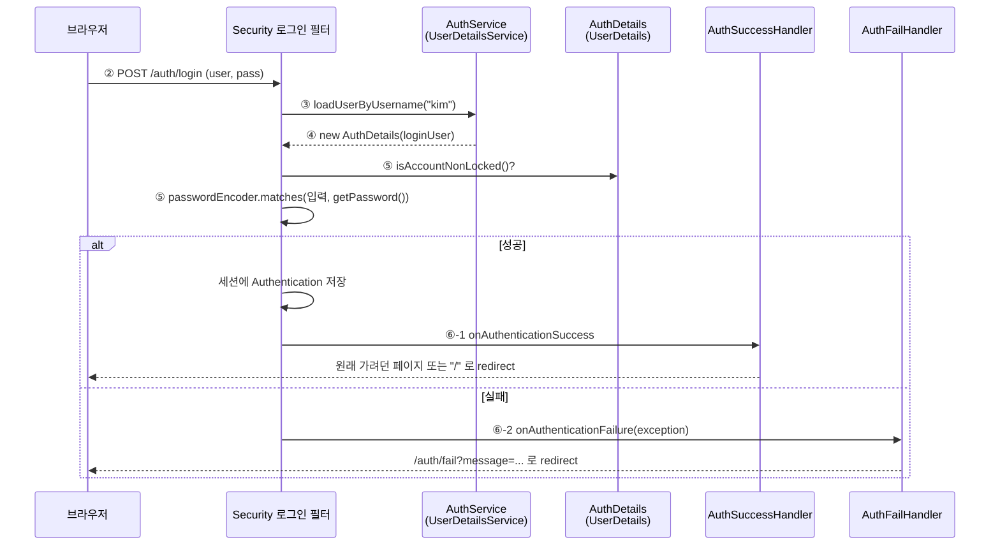
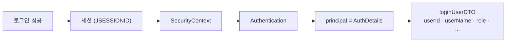
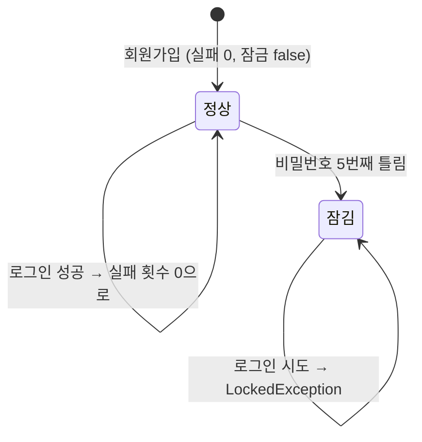
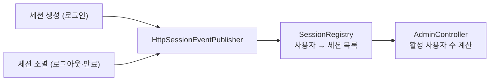
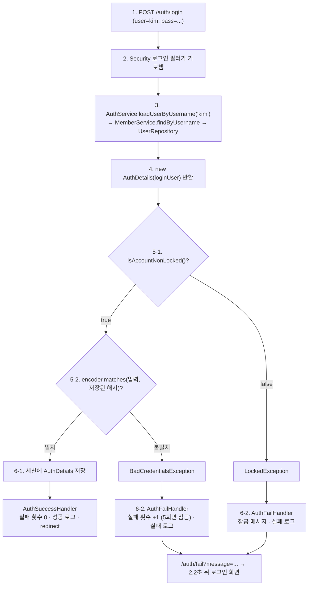

## 들어가며 (Situation)

[11/05]({{ site.baseurl }})에는 `module01-security-session` 프로젝트로 **회원가입(BCrypt)** 과 **SecurityFilterChain 설정**을 배웠다. 로그인 POST는 컨트롤러가 아니라 Security 필터가 가로챈다는 것까지 봤다.

오늘(11/06)은 그 **로그인 처리 안쪽**을 채웠다. 수업 코드의 `TODO`를 하나씩 구현하는 방식이었다.

| 파일 | 오늘 채운 것 |
|------|--------------|
| `AuthDetails` | `UserDetails` 구현: 권한 목록, 비밀번호, 아이디, 계정 잠금 여부 |
| `AuthSuccessHandler` | 로그인 성공 시: 실패 횟수 초기화 + 성공 로그 저장 + 페이지 이동 |
| `AuthFailHandler` | 로그인 실패 시: 원인별 메시지 + 실패 횟수 증가(5회 잠금) + 실패 로그 저장 + 실패 페이지 이동 |
| `AuthService` | "반환한 객체가 곧 세션에 저장되는 객체"라는 설명 추가 |
| `SecurityConfig` | `/*` 전체 허용 실험 줄(주석) 추가 |

## 문제 상황 (Task)

Security가 로그인을 대신 처리해 주는 건 편하다. 하지만 서비스에는 **우리만의 규칙**이 있다.

| 요구사항 | Security 기본 동작만으로는 |
|----------|----------------------------|
| DB의 회원 정보로 로그인 | Security는 우리 `User` 테이블 구조를 모름 |
| 비밀번호를 **5번 틀리면 계정 잠금** | 실패 횟수를 세지 않음 |
| 로그인 **성공·실패 기록** 남기기 | 기록하지 않음 |
| 실패 이유를 **친절한 한국어 메시지**로 | 기본 실패 페이지로만 이동 |
| 관리자가 **지금 접속 중인 사용자 수** 보기 | 직접 세어야 함 |

과제는 Security의 흐름은 그대로 두고, **정해진 자리(끼워 넣는 지점)에 우리 코드를 꽂는 것**이다.

### 쉽게 비유하면

Security는 **놀이공원 입구의 자동 게이트**다. 게이트 회사는 게이트를 만들어 주지만, 우리 놀이공원의 회원 명부나 규칙은 모른다. 그래서 정해진 자리에 우리 것을 끼워 넣는다.

- **`AuthService`** = 게이트가 "이 회원번호 명부에서 찾아 줘"라고 할 때 명부를 펼쳐 주는 **명부 담당**
- **`AuthDetails`** = 게이트가 읽을 수 있는 모양으로 만든 **회원 카드** (비밀번호, 권한, 잠금 여부가 적혀 있음)
- **`AuthSuccessHandler`** = 통과한 손님에게 "환영합니다"라고 하고 방문 기록을 남기는 **안내 직원**
- **`AuthFailHandler`** = 막힌 손님에게 이유를 설명하고, 5번 틀리면 카드를 정지시키는 **경비 직원**

## 해결 과정 (Action)

### 0. 큰 그림: 로그인 한 번의 전체 흐름

`SecurityConfig` 주석의 로그인 지도에서 오늘 다룰 부분은 ③~⑥이다.

```text
① GET  /auth/login   -> AuthController.login()        : 로그인 화면 보여주기
② POST /auth/login   -> Security 필터                  : formLogin 설정대로 user / pass 값을 꺼낸다.
③ AuthService.loadUserByUsername()                   : 아이디로 회원 조회 (MemberService -> UserRepository)
④ AuthDetails 반환                                    : 조회한 회원 정보를 Security 가 이해하는 타입으로 감싼다.
⑤ Security 가 직접 검사                               : 계정 잠금 여부(isAccountNonLocked), 비밀번호 일치(PasswordEncoder.matches)
⑥-1 성공 -> 세션에 인증 정보 저장 -> AuthSuccessHandler : 실패 횟수 초기화 + 성공 로그 저장 -> 페이지 이동
⑥-2 실패 -> AuthFailHandler                           : 실패 횟수 증가(5회 시 잠금) + 실패 로그 저장 -> /auth/fail
```



우리가 직접 만드는 것은 **③ 명부 조회, ④ 회원 카드, ⑥ 성공·실패 후처리**뿐이다. ⑤의 비밀번호 비교는 Security가 한다.

### 1. 회원 카드 — `AuthDetails` (`UserDetails` 구현)

**역할:** 우리 회원 정보(`LoginUserDTO`)를 Security가 이해하는 모양(`UserDetails`)으로 감싼다. **로그인에 성공하면 이 객체가 세션에 저장**되어 이후 요청에서 "로그인한 사용자"로 쓰인다.

```java
/* [로그인 ④] UserDetails 구현체
 * - AuthService.loadUserByUsername() 이 반환하는 타입이다.
 * - 우리가 만든 LoginUserDTO 를 Security 가 이해할 수 있는 형태(UserDetails)로 감싼다.
 * - 로그인 성공 시 이 객체가 세션에 저장되어 이후 요청에서 "로그인한 사용자" 로 사용된다.
 * [로그인 ⑤] Security 는 아래 메서드들을 호출해서 로그인 가능 여부를 직접 판단한다.
 * - getPassword()         : 입력한 비밀번호와 비교할 DB 비밀번호
 * - isAccountNonLocked()  : 잠긴 계정인지
 * - getAuthorities()      : 권한 검사(hasAnyAuthority) 에 사용할 권한 목록 */
@NoArgsConstructor
@AllArgsConstructor
@Getter
@Setter
public class AuthDetails implements UserDetails {

    /* 해당 클래스는 Session 저장소에 저장 될 사용자의 정보를 정의하는 클래스이다.
     * 해당 클래스에 정의한 정보를 토대로 화면에서 사용자 정보를 꺼내올 수 있게 된다. */
    private LoginUserDTO loginUserDTO;

    /* 권한 정보를 반환하는 메서드이다.
     * SecurityConfig 의 hasAnyAuthority("ADMIN") 같은 권한 검사에 사용된다. */
    @Override
    public Collection<? extends GrantedAuthority> getAuthorities() {
        // 해당 메서드의 반환타입이 Collection 인 이유는 다중 권한 때문이다.
        Collection<GrantedAuthority> authorities = new ArrayList<>();
        loginUserDTO.getRole().forEach(role -> authorities.add(() -> role));

        return authorities;
    }

    // 사용자의 비밀번호를 반환한다. 사용자가 입력한 비밀번호와 비교할 때 사용된다.
    @Override
    public String getPassword() {
        return loginUserDTO.getPassword();
    }

    // 사용자의 아이디를 반환한다.
    @Override
    public String getUsername() {
        return loginUserDTO.getUserId();
    }

    /* 아래 4개의 메서드는 false 를 반환하면 해당 계정을 사용할 수 없다.
     * 이번 수업에서는 "계정 잠금" 만 실제 값으로 판단하고 나머지는 true 로 둔다. */
    @Override
    public boolean isAccountNonExpired() { return true; }

    @Override
    public boolean isAccountNonLocked() {
        return !loginUserDTO.isAccountLocked();
    }

    @Override
    public boolean isCredentialsNonExpired() { return true; }

    @Override
    public boolean isEnabled() { return true; }
}
```

**`UserDetails`의 메서드 7개 정리**

| 메서드 | Security가 묻는 질문 | 오늘 구현 |
|--------|----------------------|-----------|
| `getUsername()` | 아이디가 뭐야? | `loginUserDTO.getUserId()` |
| `getPassword()` | 비교할 (암호화된) 비밀번호는? | `loginUserDTO.getPassword()` |
| `getAuthorities()` | 무슨 권한이 있어? | `"USER,ADMIN"` → 권한 목록 |
| `isAccountNonExpired()` | 계정이 만료되지 **않았지**? | 항상 `true` |
| `isAccountNonLocked()` | 계정이 잠기지 **않았지**? | DB의 잠금 여부를 **뒤집어서** 반환 |
| `isCredentialsNonExpired()` | 비밀번호가 만료되지 **않았지**? | 항상 `true` |
| `isEnabled()` | 계정이 활성 상태지? (탈퇴·삭제 아님) | 항상 `true` |

⚠️ 이름이 **`isAccountNon**Locked`** 이라서 헷갈리기 쉽다. "잠기지 **않았나**?"를 묻는 것이다. DB에는 "잠겼나?"(`isAccountLocked`)가 저장되어 있으니 **`!`로 뒤집어야** 한다.

| DB `IS_ACCOUNT_LOCKED` | `isAccountNonLocked()` 반환 | 결과 |
|------------------------|-----------------------------|------|
| `false` (안 잠김) | `!false` = `true` | 로그인 진행 |
| `true` (잠김) | `!true` = `false` | `LockedException` → 로그인 거부 |

**권한 문자열 → `GrantedAuthority` 목록**

DB에는 권한이 `"USER,ADMIN"`처럼 **쉼표로 이은 문자열 하나**로 저장된다. `LoginUserDTO.getRole()`이 이를 나눈다.

```java
// LoginUserDTO — 권한 문자열을 List 로 변환한다. 예 : "USER,ADMIN" -> ["USER", "ADMIN"]
public List<String> getRole() {
    if (this.userRole != null && this.userRole.length() > 0) {
        return Arrays.asList(this.userRole.split(","));
    }
    return new ArrayList<>();
}
```

```text
"USER,ADMIN"  ──split(",")──▶  ["USER", "ADMIN"]  ──forEach──▶  [GrantedAuthority("USER"), GrantedAuthority("ADMIN")]
```

`authorities.add(() -> role)`가 낯설 수 있다. `GrantedAuthority`는 **메서드가 하나뿐인 인터페이스**(`getAuthority()`)라서, 10/27·11/17에 본 것처럼 **람다**로 바로 만들 수 있다.

```java
// 예시 코드: 아래 두 코드는 같은 일을 한다
authorities.add(() -> role);

authorities.add(new GrantedAuthority() {
    @Override
    public String getAuthority() {
        return role;
    }
});
```

`getAuthorities()`의 반환 타입이 `Collection`인 이유는 한 사람이 **권한을 여러 개** 가질 수 있기 때문이다.

> 비유: `AuthDetails`는 **놀이공원 연간 회원 카드**다. 카드 앞면에 이름(아이디), 뒷면 마그네틱에 암호(비밀번호), 스티커로 이용 가능 구역(권한)이 붙어 있고, 정지된 카드면 빨간 도장(잠금)이 찍혀 있다. 게이트는 이 카드만 읽으면 된다.

### 2. 명부 조회 — `AuthService`

**역할:** 11/05에 만든 `loadUserByUsername()`이다. 오늘은 한 가지 사실이 주석으로 더해졌다.

```java
@Override
public UserDetails loadUserByUsername(String username) throws UsernameNotFoundException {

    LoginUserDTO loginUser = memberService.findByUsername(username);

    if (Objects.isNull(loginUser)) {
        throw new UsernameNotFoundException("회원정보가 존재하지 않습니다!");
    }

    /* return 되는 객체가 곧 Session 에 저장되는 객체! */
    return new AuthDetails(loginUser);
}
```

로그인에 성공하면 이 `AuthDetails`가 세션에 들어간다. 그래서 다음 요청부터는 DB를 다시 조회하지 않고 **세션의 `AuthDetails`** 로 "이 사람은 누구이고 무슨 권한이 있는지"를 안다.



화면에서는 이렇게 꺼낼 수 있다(수업 코드 `admin.html`의 주석).

```html
<!-- Security 인증 객체 -->
<span th:text="${#authentication.principal}"></span>
<!-- 커스텀 사용자 로그인 객체 접근 -->
<span th:text="${#authentication.principal.loginUserDTO.userId}"></span>
```

### 3. 로그인 성공 — `AuthSuccessHandler`

**역할:** Security가 아이디·비밀번호 검사를 통과시킨 **직후**에 호출된다. 기본 동작(페이지 이동)은 부모 클래스에 맡기고, 필요한 기능만 더한다.

```java
/* [로그인 ⑥-1] 로그인 성공 핸들러
 * - 이 시점에는 이미 세션에 로그인 정보(Authentication)가 저장되어 있다.
 * 추가 기능
 * 1. 로그인 실패 횟수 초기화 (예 : 4번 실패 후 성공하면 0 으로 리셋)
 * 2. 로그인 성공 로그 저장 */
@Component
@RequiredArgsConstructor
public class AuthSuccessHandler extends SimpleUrlAuthenticationSuccessHandler {

    private final MemberService memberService;
    private final LoginLogRepository loginLogRepository;

    @Override
    public void onAuthenticationSuccess(HttpServletRequest request, HttpServletResponse response,
                                        Authentication authentication) throws IOException, ServletException {

        String username = authentication.getName();

        /* 1. 로그인 실패 횟수 초기화 */
        memberService.resetLoginFailCount(username);

        /* 2. 로그인 성공 로그 저장 */
        LoginLog log = LoginLog.create(
                // RemoteAddr(접속 컴퓨터 IP)
                username, true, request.getRemoteAddr()
        );
        loginLogRepository.save(log);

        /* 3. 페이지 이동
         * -> 로그인 전에 가려던 페이지가 있으면 그 페이지로, 없으면 "/" 로 redirect 한다. */
        super.onAuthenticationSuccess(request, response, authentication);
    }
}
```

**🤔 왜 인터페이스를 직접 구현하지 않고 상속받을까?**

```text
AuthenticationSuccessHandler (interface)       ← 메서드 하나만 약속
        ▲
SimpleUrlAuthenticationSuccessHandler (class)  ← "로그인 후 어디로 보낼지"가 이미 구현됨
        ▲
AuthSuccessHandler (우리 클래스)                ← 앞에 우리 일만 추가하고 super 호출
```

인터페이스를 직접 구현하면 redirect 처리도 직접 써야 한다. 이미 구현된 클래스를 **상속**하면 우리 일(로그 저장 등)만 하고 마지막에 `super.onAuthenticationSuccess(...)`로 **원래 동작**을 이어 갈 수 있다. 10/21에 배운 "오버라이딩 + 부모 메서드 호출"의 실전 예다.

`super`의 부모 쪽(`SavedRequestAwareAuthenticationSuccessHandler`)은 "로그인 전에 가려던 페이지"를 기억해 둔다. 예를 들어 로그인 안 한 상태로 `/user/page`에 갔다가 로그인 페이지로 튕겼다면, 로그인 성공 후 `/user/page`로 돌아간다.

### 4. 로그인 실패 — `AuthFailHandler`

**역할:** ③~⑤ 중 어디서든 문제가 생기면 호출된다. 실패 원인은 매개변수 **`exception`의 타입**으로 구분한다.

```java
/* [로그인 ⑥-2] 로그인 실패 핸들러
 * 패키지 구조
 * AuthenticationFailureHandler(interface) -> SimpleUrlAuthenticationFailureHandler(class) -> AuthFailHandler
 * 추가 기능
 * 1. 로그인 실패 횟수 증가 (5회 이상이면 계정 잠금)
 * 2. 로그인 실패 로그 저장 */
@Component
@RequiredArgsConstructor
public class AuthFailHandler extends SimpleUrlAuthenticationFailureHandler {

    private final MemberService memberService;
    private final LoginLogRepository loginLogRepository;

    @Override
    public void onAuthenticationFailure(HttpServletRequest request, HttpServletResponse response,
                                        AuthenticationException exception) throws IOException, ServletException {

        String errorMessage; // 실패 시 전달 할 변수 선언.
        // 인증객체가 없기 때문에 request 에서 id 꺼내오기
        String username = request.getParameter("user");

        /* 1. 실패 원인 별 메시지 만들기 (+ 비밀번호 오류 시 실패 횟수 증가) */
        if (exception instanceof BadCredentialsException) {
            // 사용자의 아이디가 DB 에 존재하지 않는 경우, 또는 비밀번호가 맞지 않는 경우 발생한다.
            errorMessage = "아이디가 존재하지 않거나 비밀번호가 일치하지 않습니다.";

            // 로그인 실패 횟수 증가
            if (username != null && !username.isEmpty()) {
                memberService.incrementLoginFailCount(username);
                errorMessage += " (실패 횟수: 누적)";
            }
        } else if (exception instanceof LockedException) {
            // 계정이 잠긴 상태 (AuthDetails.isAccountNonLocked() 가 false -> 5회 이상 로그인 실패)
            errorMessage = "계정이 잠겨있습니다. 관리자에게 문의하세요.";
        } else if (exception instanceof InternalAuthenticationServiceException) {
            // 서버에서 사용자 정보를 검증하는 과정에서 발생하는 에러이다.
            errorMessage = "서버에서 오류가 발생되었습니다.";
        } else if (exception instanceof UsernameNotFoundException) {
            // DB 에 사용자의 정보가 없는 경우 발생하는 오류이다. (AuthService 에서 던진 예외)
            errorMessage = "존재하지 않는 아이디입니다.";
        } else if (exception instanceof AuthenticationCredentialsNotFoundException) {
            // 인증 정보가 없는 상태에서 보안처리된 리소스에 접근하는 경우 발생한다.
            errorMessage = "인증 요청이 거부되었습니다.";
        } else {
            errorMessage = "알 수 없는 오류로 로그인 요청을 처리할 수 없습니다.";
        }

        /* 2. 로그인 실패 로그 저장 */
        loginLogRepository.save(LoginLog.create(username, false, request.getRemoteAddr()));

        /* 3. 실패 안내 페이지로 이동 -> AuthController.loginFail() */
        // URL 에 한글을 그대로 넣을 수 없으므로 인코딩
        errorMessage = URLEncoder.encode(errorMessage, "UTF-8");
        setDefaultFailureUrl("/auth/fail?message=" + errorMessage);

        // 부모의 메서드를 호출하여 위에서 설정한 경로로 이동시킨다.
        super.onAuthenticationFailure(request, response, exception);
    }
}
```

**실패 원인별 예외**

| 예외 | 언제 | 화면 메시지 | 실패 횟수 |
|------|------|-------------|-----------|
| `BadCredentialsException` | 비밀번호 불일치 (또는 없는 아이디, 아래 시행착오 ①) | 아이디가 존재하지 않거나 비밀번호가 일치하지 않습니다. | **+1** |
| `LockedException` | `isAccountNonLocked()`가 `false` | 계정이 잠겨있습니다. 관리자에게 문의하세요. | - |
| `InternalAuthenticationServiceException` | 회원 조회 중 서버 오류 (DB 연결 실패 등) | 서버에서 오류가 발생되었습니다. | - |
| `UsernameNotFoundException` | `AuthService`가 던진 예외 | 존재하지 않는 아이디입니다. | - |
| `AuthenticationCredentialsNotFoundException` | 인증 정보 없이 보안 리소스 접근 | 인증 요청이 거부되었습니다. | - |

**🤔 실패 핸들러에서는 왜 `request.getParameter("user")`로 아이디를 꺼낼까?**

성공 핸들러는 `authentication.getName()`으로 아이디를 꺼냈다. 하지만 실패했을 때는 **인증 객체(`Authentication`)가 없다.** 그래서 사용자가 폼에 입력한 값을 `request`에서 직접 꺼낸다. 10/21에 배운 `req.getParameter()` 그대로다.

**🤔 왜 메시지를 인코딩할까?**

```text
/auth/fail?message=계정이 잠겨있습니다.            ← 한글·공백이 주소에 그대로 ❌
/auth/fail?message=%EA%B3%84%EC%A0%95%EC%9D%B4+... ← URLEncoder.encode(..., "UTF-8") ✅
```

주소(URL)에는 한글과 공백을 그대로 넣을 수 없다. 인코딩하면 `%EA%B3%84...` 같은 안전한 글자로 바뀌고, `AuthController.loginFail(@RequestParam String message)`가 받을 때 Spring이 자동으로 다시 한글로 풀어 준다.

### 5. 실패 횟수와 계정 잠금 — `User`, `MemberService`

**역할:** "5번 틀리면 잠금" 규칙은 **엔티티(`User`)가 스스로** 지킨다. `MemberService`는 회원을 찾아서 시키기만 한다.

```java
// User — [로그인 ⑥-2] 로그인 실패 시 호출되는 도메인 메서드
// - 실패 횟수를 1 증가시키고, 5회 이상이면 계정을 잠근다.
// - 영속 상태의 Entity 값만 바꾸면 트랜잭션 커밋 시
//   변경 감지(dirty checking)로 UPDATE 가 실행된다. (save 호출 불필요)
public void increaseLoginFailCount() {
    this.loginFailCount++;

    if (this.loginFailCount >= 5) {
        this.isAccountLocked = true;
    }
}

// [로그인 ⑥-1] 로그인 성공 시 실패 횟수 초기화
public void resetLoginFailCount() {
    this.loginFailCount = 0;
}
```

```java
// MemberService
/* 3. [로그인 ⑥-2] 로그인 실패 횟수 증가 (AuthFailHandler 에서 호출)
 * - ifPresent : 회원이 존재할 때만 실행한다. (없는 아이디로 로그인 시도한 경우 무시)
 * - 값 변경은 Entity 의 도메인 메서드가 하고, UPDATE 는 변경 감지가 처리한다. */
@Transactional
public void incrementLoginFailCount(String username) {
    userRepository.findByUserId(username)
                  .ifPresent(User::increaseLoginFailCount);
}

/* 4. [로그인 ⑥-1] 로그인 실패 횟수 초기화 (AuthSuccessHandler 에서 호출) */
@Transactional
public void resetLoginFailCount(String username) {
    userRepository.findByUserId(username)
                  .ifPresent(User::resetLoginFailCount);
}
```

`save()`를 부르지 않는데도 DB가 바뀌는 이유는 11/02에 배운 **변경 감지(dirty checking)** 다. `@Transactional` 안에서 조회한 엔티티는 영속성 컨텍스트가 원래 모습을 기억해 두고, 트랜잭션이 끝날 때 바뀐 값을 `UPDATE`로 반영한다.



> 비유: 비밀번호를 틀릴 때마다 회원 카드 뒷면에 **바를 정(正) 자를 한 획씩** 긋는다. 다섯 획이 되면 카드에 **빨간 정지 도장**을 찍는다. 중간에 한 번이라도 맞히면 획을 다 지운다. 정지 도장은 관리자만 지울 수 있다.

### 6. 로그인 기록 — `LoginLog`

**역할:** 로그인 성공·실패 한 번마다 한 줄씩 남는 기록. 성공·실패 핸들러 **양쪽**에서 쓴다.

```java
@NoArgsConstructor
@AllArgsConstructor(access = AccessLevel.PRIVATE)
@Getter
@ToString
@Entity
@Table(name = "TBL_LOGIN_LOG")
public class LoginLog {

    @Id
    @GeneratedValue(strategy = GenerationType.IDENTITY)
    private Long id;

    @Column(name = "USER_ID", nullable = false)
    private String userId;

    @Column(name = "LOGIN_TIME", nullable = false)
    private LocalDateTime loginTime;

    @Column(name = "SUCCESS", nullable = false)
    private boolean success;

    @Column(name = "IP_ADDRESS")
    private String ipAddress;

    /* [로그인 ⑥] 로그인 로그 생성용 정적 팩토리 메서드
     * - 로그인 시간은 "지금" 이므로 외부에서 받지 않고 여기서 채운다. */
    public static LoginLog create(String userId, boolean success, String ipAddress) {
        return new LoginLog(null, userId, LocalDateTime.now(), success, ipAddress);
    }
}
```

`request.getRemoteAddr()`는 **접속한 컴퓨터의 IP 주소**다. 로컬에서 테스트하면 `0:0:0:0:0:0:0:1`(IPv6의 localhost)이나 `127.0.0.1`이 찍힌다.

### 7. 관리자 화면 — `AdminController`와 `SessionRegistry`

**역할:** 로그인 로그 전체(최신순)와 **현재 접속 중인 사용자 수**를 보여 준다. `/admin/*`는 `SecurityConfig`에서 ADMIN만 허용했으므로, 이 메서드가 실행되었다면 이미 "로그인 + ADMIN" 검사를 통과한 상태다.

```java
@Controller
@RequiredArgsConstructor
public class AdminController {

    private final LoginLogRepository loginLogRepository;
    private final SessionRegistry sessionRegistry;

    @GetMapping("/admin/logs")
    public ModelAndView getLoginLogs(ModelAndView mv) {

        /* 1. 로그인 로그 전체 조회 (최신순) */
        List<LoginLog> logs = loginLogRepository.findAllByOrderByLoginTimeDesc();

        /* 2. 현재 활성 사용자 수 계산
         * - getAllPrincipals() 는 SessionRegistry 가 알고 있는 사용자 목록을 반환한다.
         * - 단순히 size() 를 사용하면 이미 로그아웃했거나 세션이 만료된 사용자가 포함될 수 있으므로
         *   각 사용자(principal)가 실제로 만료되지 않은 세션을 가지고 있는지 확인한 뒤 카운트한다. */
        int activeUserCount = 0;

        for (Object principal : sessionRegistry.getAllPrincipals()) {
            // false 옵션은 만료된 세션을 제외한다.
            List<SessionInformation> sessions = sessionRegistry.getAllSessions(principal, false);

            // 살아있는 세션이 하나라도 있는 사용자만 활성 사용자로 간주한다.
            if (!sessions.isEmpty()) {
                activeUserCount++;
            }
        }

        /* 3. 화면에 데이터 전달 */
        mv.addObject("logs", logs);
        mv.addObject("activeUsers", activeUserCount);
        mv.setViewName("admin/admin");
        return mv;
    }
}
```

```java
// LoginLogRepository — 관리자 페이지 : 로그인 로그 전체를 로그인 시간 내림차순(최신순)으로 조회
List<LoginLog> findAllByOrderByLoginTimeDesc();
```

`SessionRegistry`가 활성 세션을 정확히 알려면, 11/05 `SecurityConfig`에 등록한 **`HttpSessionEventPublisher`** 가 필요하다. 세션이 생기고 사라질 때 그 사실을 `SessionRegistry`에 알려 주는 역할이다.



### 8. URL 권한 검사 vs 메서드 권한 검사 — `IndexController`

**역할:** 권한을 검사하는 두 가지 방법을 비교한다.

```java
/* [방법 1] URL 단위 권한 검사 (SecurityConfig 의 authorizeHttpRequests)
 * - SecurityConfig 의 규칙이 컨트롤러보다 "먼저" 검사된다.
 * - 권한이 없으면 이 메서드는 실행조차 되지 않는다. */
@GetMapping("/admin/page")      // "/admin/*" 규칙 -> ADMIN 만 접근 가능
public String admin() {
    return "admin/admin";
}

/* [방법 2] 메서드 단위 권한 검사 (@PreAuthorize)
 * - "/method/*" 는 SecurityConfig 에 따로 규칙이 없다. -> anyRequest().authenticated() 로 로그인만 하면 통과
 * - 하지만 핸들러 메서드에 붙은 @PreAuthorize 가 메서드 실행 "직전" 에 권한을 한 번 더 검사한다.
 * - SecurityConfig 에 @EnableMethodSecurity 가 있어야 동작한다. */
@GetMapping("/method/admin")
// TODO @PreAuthorize 로 ADMIN 만 호출 가능하도록 막아보자.
@ResponseBody
public String methodAdmin() {
    return "ADMIN 권한 확인 완료! (@PreAuthorize 통과)";
}
```

| 방식 | 어디에 적나 | 장점 |
|------|-------------|------|
| URL 방식 (`authorizeHttpRequests`) | `SecurityConfig` 한 곳 | 경로 단위로 한눈에 관리 |
| 메서드 방식 (`@PreAuthorize`) | 각 핸들러 메서드 위 | 같은 컨트롤러 안에서도 메서드마다 다르게 |

이 부분은 레포에 **TODO로 남아 있다.** 완성하면 아래 모양이 된다.

```java
// 예시 코드: TODO 를 채운 모양
@Configuration
@EnableWebSecurity
@EnableMethodSecurity            // @PreAuthorize 를 켠다
public class SecurityConfig { ... }

@GetMapping("/method/admin")
@PreAuthorize("hasAuthority('ADMIN')")
@ResponseBody
public String methodAdmin() { ... }

@GetMapping("/method/user")
@PreAuthorize("hasAnyAuthority('USER', 'ADMIN')")
@ResponseBody
public String methodUser() { ... }
```

`@PreAuthorize`는 10/27에 배운 **AOP 프록시**로 동작한다. 메서드 호출을 프록시가 가로채서 "권한 있어?"를 먼저 확인하는 것이다.

### 9. 컨트롤러에서 로그인 사용자 꺼내기 — `@AuthenticationPrincipal`

`UserController`에 주석으로 남겨 둔 예시가 있다.

```java
// View 에서 Session 에 저장 된 회원의 PK 를 hidden input 같은 걸로 넘기면,
// 사용자가 값을 바꿔서 다른 사람 ID로 글을 등록하는 것처럼 조작할 수 있다.
// 반면 서버에서 현재 로그인한 사용자를 기준으로 작성자를 정하면, 클라이언트가 작성자 정보를 마음대로 바꿀 수 없다.
// @AuthenticationPrincipal AuthDetails authDetails 를 활용해서 로그인 한 사용자의 정보를 꺼내보자.
@PostMapping("/posts")
public String createPost(@AuthenticationPrincipal AuthDetails authDetails,
                         PostRequest request) {
    postService.create(request.getTitle(), request.getContent(), authDetails.getUsername());
    return "redirect:/posts";
}
```

| 작성자를 정하는 방법 | 조작 가능? |
|----------------------|------------|
| 폼의 `<input type="hidden" name="writer" value="kim">` | ✅ 개발자 도구로 `value`를 바꾸면 남의 이름으로 글 작성 |
| 서버에서 `@AuthenticationPrincipal AuthDetails` | ❌ 세션에 있는 로그인 정보라 클라이언트가 못 바꿈 |

> 비유: 시험지 이름 칸을 **학생이 직접 쓰게** 하면 친구 이름을 쓸 수 있다. **선생님이 출석부를 보고** 이름을 찍어 주면 바꿀 수 없다.

### 시행착오: 다시 볼 부분

실행해 보지는 않았다. 코드와 Spring Security 기본 동작을 따라가며 확인할 곳을 정리했다. 동작은 [Spring Security 공식 문서](https://docs.spring.io/spring-security/reference/servlet/authentication/passwords/dao-authentication-provider.html)에서 함께 확인해 보자.

#### ① "존재하지 않는 아이디입니다" 메시지는 거의 안 나온다

`AuthService`가 `UsernameNotFoundException`을 던져도, Security는 기본 설정에서 이를 **`BadCredentialsException`으로 바꿔서** 실패 핸들러에 넘긴다(`hideUserNotFoundExceptions` 기본값 `true`). "아이디가 없다"와 "비밀번호가 틀렸다"를 구분해 알려 주면, 공격자가 **어떤 아이디가 가입되어 있는지** 알아낼 수 있기 때문이다.

그래서 없는 아이디로 로그인하면 첫 번째 `if` 메시지가 나온다. 이때 `incrementLoginFailCount`도 호출되지만 `ifPresent` 덕분에 아무 일도 일어나지 않는다. 다만 메시지 끝에 "(실패 횟수: 누적)"은 붙는다.

#### ② 잠긴 계정은 비밀번호를 맞혀도 로그인되지 않는다

Security는 **비밀번호를 비교하기 전에** 계정 상태(잠금·비활성·만료)를 먼저 확인한다. 그래서 잠긴 계정은 비밀번호가 맞아도 `LockedException`이 난다. 의도한 동작이다. 다만 **잠금을 푸는 기능이 아직 없다.** `resetLoginFailCount()`는 횟수만 0으로 만들고 `isAccountLocked`는 그대로 둔다. 지금은 DB에서 직접 풀어야 한다.

#### ③ `equals()` / `hashCode()` TODO가 남아 있다

`AuthDetails` 주석에 이유가 적혀 있다.

> SessionRegistry 는 내부적으로 Map 형태로 사용자를 관리한다. 같은 사용자라도 로그인할 때마다 새로운 AuthDetails 객체가 생성되므로, 기본 Object.equals()(주소값 비교)를 쓰면 서로 다른 사용자로 인식된다. → 동시 접속 제한(maximumSessions), 활성 사용자 수 계산이 틀어진다.

지금 상태에서는 같은 아이디로 브라우저 두 개에서 로그인하면 **다른 사람 둘로** 보여서, `maximumSessions(1)`이 동작하지 않고 활성 사용자 수도 2로 셀 가능성이 높다. 채우면 이런 모양이다.

```java
// 예시 코드: TODO 를 채운 모양 — userId 기준으로 같은 사용자 판단
@Override
public boolean equals(Object o) {
    if (this == o) return true;
    if (!(o instanceof AuthDetails that)) return false;
    return Objects.equals(getUsername(), that.getUsername());
}

@Override
public int hashCode() {
    return Objects.hash(getUsername());
}
```

`equals()`와 `hashCode()`는 **반드시 같은 기준으로 함께** 오버라이딩해야 한다. 한쪽만 바꾸면 `HashMap`이 같은 사용자를 다른 칸에 넣는다.

#### ④ `@EnableMethodSecurity` / `@PreAuthorize` TODO

아직 채워지지 않아서, 지금은 **로그인만 하면 USER도 `/method/admin`에 들어갈 수 있다.** 8번의 예시 코드처럼 채워야 403이 난다.

#### ⑤ 세션에 비밀번호 해시가 남는다

`AuthDetails` → `LoginUserDTO`에 암호화된 비밀번호가 들어 있고, 이 객체가 그대로 세션에 저장된다. Security는 `CredentialsContainer`를 구현한 객체만 로그인 후 비밀번호를 지워 준다. 해시라서 바로 위험하지는 않지만, 세션에 필요 없는 값은 두지 않는 편이 안전하다.

### 오늘의 Java 흐름 한눈에 보기

`kim`이 비밀번호를 **틀렸을 때**와 **맞혔을 때**를 따라가 보자.



초등학생에게 설명하듯 정리하면 이렇다.

1. **카드 내밀기**: 김 학생이 게이트에 아이디와 비밀번호를 낸다.
2. **게이트가 가로채기**: 창구(컨트롤러)까지 가지 않고 **자동 게이트**(Security 필터)가 받는다.
3. **명부 찾기**: 게이트가 명부 담당(`AuthService`)에게 "kim 찾아 줘" 한다. 명부 담당은 장부를 뒤져 **회원 카드**(`AuthDetails`)를 만들어 준다.
4. **정지 도장 확인**: 게이트가 카드에 빨간 정지 도장이 있는지 먼저 본다. 있으면 바로 "정지된 카드예요".
5. **암호 확인**: 도장이 없으면, 김 학생이 낸 비밀번호를 **같은 믹서기**로 갈아서 카드 뒷면의 주스와 비교한다.
6. **맞혔을 때**: 게이트가 카드를 **사물함(세션)** 에 넣어 둔다. 안내 직원(`AuthSuccessHandler`)이 바를 정 자를 지우고, 방문 기록을 남기고, 원래 가려던 곳으로 보내 준다.
7. **틀렸을 때**: 경비 직원(`AuthFailHandler`)이 바를 정 자를 한 획 긋고(5획이면 정지 도장), 실패 기록을 남기고, "왜 안 됐는지" 안내 화면으로 보낸다.
8. **다음 방문**: 이제 김 학생은 페이지를 옮길 때마다 비밀번호를 다시 내지 않는다. 게이트가 **사물함 열쇠(JSESSIONID 쿠키)** 만 보고 사물함 속 카드를 꺼내 확인한다.

## 결과 (Result)

오늘 끼워 넣은 코드와 그 결과를 정리하면 다음과 같다.

| 끼워 넣는 지점 | 우리 클래스 | 결과 |
|----------------|-------------|------|
| 회원 조회 (`UserDetailsService`) | `AuthService` | 우리 `TBL_USER`로 로그인 |
| 회원 카드 (`UserDetails`) | `AuthDetails` | 권한 `"USER,ADMIN"` 지원, DB 잠금 여부 반영 |
| 성공 후처리 (`AuthenticationSuccessHandler`) | `AuthSuccessHandler` | 실패 횟수 초기화, 성공 로그, 원래 페이지로 이동 |
| 실패 후처리 (`AuthenticationFailureHandler`) | `AuthFailHandler` | 원인별 한국어 메시지, **5회 실패 시 잠금**, 실패 로그 |
| 세션 목록 (`SessionRegistry`) | `AdminController` | 활성 사용자 수 표시 |

| 비교 | Servlet 직접 구현 (10/23) | Spring Security (11/05~06) |
|------|---------------------------|----------------------------|
| 비밀번호 비교 | 직접 `equals` (평문이면 위험) | Security가 `matches()`로 |
| 계정 잠금 확인 | 로그인 로직 안에 `if` | `isAccountNonLocked()` 하나 구현 |
| 성공·실패 후처리 | 로그인 Servlet 안에 섞임 | 핸들러 클래스 두 개로 **분리** |
| 다음 요청의 사용자 확인 | `session.getAttribute("user")` | `@AuthenticationPrincipal`, `sec:authentication` |

**배운 점**

- Spring Security는 흐름을 정해 두고 **끼워 넣는 지점(인터페이스)** 을 열어 둔다. 우리는 `UserDetailsService`, `UserDetails`, 핸들러 두 개만 구현하면 된다.
- 핸들러는 인터페이스를 직접 구현하는 대신 **이미 구현된 클래스를 상속**하고, 우리 일만 한 뒤 `super`로 원래 동작을 이어 간다.
- "5번 틀리면 잠금" 같은 규칙은 **엔티티 메서드**(`increaseLoginFailCount`)에 두고, 저장은 **변경 감지**에 맡긴다. 11/04 JPA 미니 프로젝트에서 배운 "도메인 규칙은 엔티티에"와 같은 원칙이다.
- 보안에서는 친절함과 안전이 부딪친다. "없는 아이디입니다"라고 알려 주면 편하지만, 그 자체가 정보 유출이 되어서 Security는 기본으로 숨긴다.
- `equals()`/`hashCode()`처럼 눈에 안 띄는 부분이 동시 접속 제한 같은 기능을 좌우한다.

## 더 학습하면 좋은 개념

- **`AuthenticationManager`와 `DaoAuthenticationProvider`** — 오늘 "게이트"라고 부른 로그인 검사의 실제 담당자다. 계정 상태 확인 → 비밀번호 비교 순서가 여기서 정해진다.
- **`SecurityContextHolder`와 세션 저장 방식** — 로그인 후 `AuthDetails`가 어디에 저장되고, 다음 요청에서 어떻게 다시 꺼내지는지 알면 `@AuthenticationPrincipal`의 원리가 보인다.
- **`equals()` / `hashCode()` 계약** — `HashMap`, `HashSet`이 객체를 찾는 원리다. 오늘의 `SessionRegistry` 문제처럼 컬렉션에 객체를 키로 넣을 때마다 중요하다.
- **메서드 보안 (`@EnableMethodSecurity`, `@PreAuthorize`, SpEL)** — 남은 TODO다. URL 방식과 섞어 쓸 때의 순서, 10/27 AOP 프록시와의 관계를 함께 보자.
- **JWT 기반 인증 (Stateless)** — 세션 대신 토큰으로 로그인 상태를 유지하는 방식이다. 11/05 CSRF 주석의 "JWT 토큰 기반 인증 시 CSRF 보호 불필요"가 왜 그런지 이해할 수 있다.

## 참고 자료

- [Spring Security 공식 문서 - Servlet Authentication Architecture](https://docs.spring.io/spring-security/reference/servlet/authentication/architecture.html)
- [Spring Security 공식 문서 - UserDetailsService](https://docs.spring.io/spring-security/reference/servlet/authentication/passwords/user-details-service.html)
- [Spring Security 공식 문서 - UserDetails](https://docs.spring.io/spring-security/reference/servlet/authentication/passwords/user-details.html)
- [Spring Security 공식 문서 - DaoAuthenticationProvider](https://docs.spring.io/spring-security/reference/servlet/authentication/passwords/dao-authentication-provider.html)
- [Spring Security 공식 문서 - Authentication Persistence and Session Management](https://docs.spring.io/spring-security/reference/servlet/authentication/session-management.html)
- [Spring Security 공식 문서 - Method Security](https://docs.spring.io/spring-security/reference/servlet/authorization/method-security.html)
- [Spring Security 공식 문서 - @AuthenticationPrincipal](https://docs.spring.io/spring-security/reference/servlet/integrations/mvc.html#mvc-authentication-principal)
- [Java 공식 문서 - Object.equals / hashCode](https://docs.oracle.com/en/java/javase/21/docs/api/java.base/java/lang/Object.html#equals(java.lang.Object))
- [Java 공식 문서 - URLEncoder](https://docs.oracle.com/en/java/javase/21/docs/api/java.base/java/net/URLEncoder.html)
