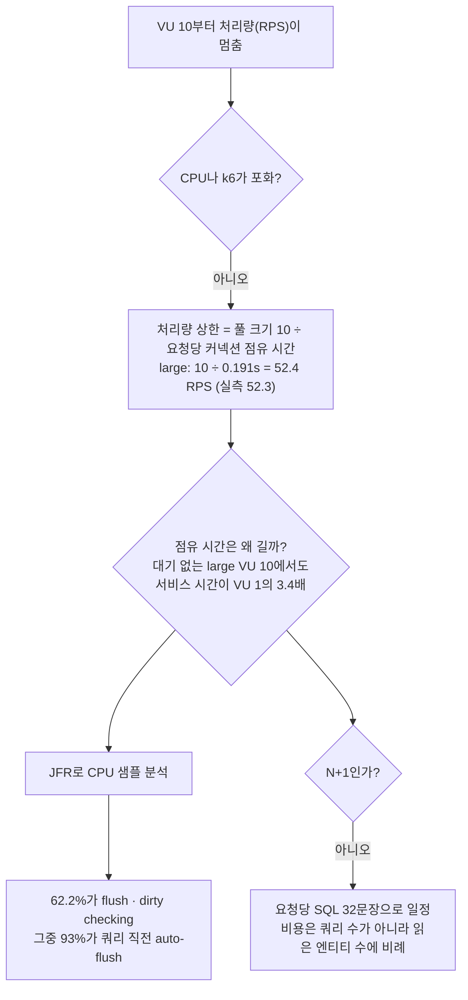

## 들어가며 (Situation)

부트캠프 4인 팀(4팀 삼도류)이 **2026-11-03 ~ 11-12** 동안 만든 프로젝트 **GRAVIT**의 결과물 모음 페이지, [GRAVIT Showcase](https://gravit-showcase.vercel.app/)를 정리한다.

> **GRAVIT** — GitHub 기반 3D 프로젝트 학습 플랫폼
> 팀 GitHub 레포의 이슈 · PR을 읽어 3D 우주정거장 사무실로 보여 주고, PR 익명 평가 · 회의 안건 · 도움 요청 · 회고 리포트를 앱 안에서 다룬다. **GitHub 원본은 읽기만 한다.**


| 항목 | 내용 |
|------|------|
| 기간 | 2026-11-03 ~ 11-12 (10일) |
| 팀 | 4명 |
| 프론트엔드 | React 19, TypeScript, Three.js · React Three Fiber |
| 백엔드 | Spring Boot 4, Spring Security, MySQL 8.4, Flyway |
| 외부 연동 | GitHub App (읽기 전용) |

10일 동안 남긴 협업 기록은 다음과 같다.

| 기록 | 숫자 | 비고 |
|------|------|------|
| 병합된 PR | **203** | 201개 리뷰 승인 |
| 종료된 Issue | **144** | 열린 Issue 0 |
| 성공한 CI 실행 | **367** | 실패 4 · 취소 67 |

## 문제 상황 (Task)

쇼케이스 페이지는 두 가지 과제를 안고 만들어졌다.

1. **무엇을 만들었는지** 화면으로 보여 주기
2. **어디까지 검증했는지**를 과장 없이 적기

두 번째가 특히 눈에 띈다. 페이지 곳곳에 이런 문장이 있다.

> CI 성공은 E2E 성공이 아니다.
> 외부 보안 진단 · 침투 테스트가 아니다.
> 병합된 최종 main에서는 다시 측정하지 않았다.

그리고 기술적으로 가장 큰 과제는 **Snapshot API 성능**이었다. Snapshot은 3D 사무실 화면 전체(팀원 · 이슈 · PR · 요구사항 · 안건 · 회의 · 도움 요청 · 동기화 상태)를 **한 번에** 돌려주는 API다. 같은 사무실을 팀원 여럿이 동시에 열고, 프로젝트가 진행될수록 데이터가 커진다.

### 쉽게 비유하면

GRAVIT은 **팀 프로젝트를 우주정거장 게임처럼** 보여 준다.

- 이슈 · PR은 정거장 안의 **상자**가 된다.
- 팀원은 각자 **작업 포드**에 앉아 있다.
- 회의는 정거장 가운데 **브리지**에서 열린다.
- 강사는 옆에 떠 있는 **강사 우주선**에 있다.

Snapshot API는 이 정거장 **전체 사진을 한 장으로 찍어 보내는** 일이다. 사진에 담을 물건이 많아질수록, 찍는 사람이 많아질수록 느려진다.

## 해결 과정 (Action)

### 1. 주요 구현 결과

쇼케이스는 화면마다 배지로 실행 방식을 구분한다.

| 배지 | 의미 |
|------|------|
| **Mock** | 서버 없이 브라우저 seed 데이터로 실행한 화면 · main `7b60c21`(2026-11-10) 기준 |
| **Server** | Spring API 서버 + 시연 사무실 seed 데이터(실제 GitHub 레포 아님) · 2026-11-10 촬영 |

실제 GitHub 레포를 동기화한 화면 캡처는 아직 없다고 밝혀 두었다.

| 기능 | 설명 | 화면 |
|------|------|------|
| 3D 우주정거장 사무실 | 팀 레포의 이슈 · PR이 정거장 안의 오브젝트가 되고, 팀원은 작업 포드에, 회의는 브리지에서 | 이슈 상자를 클릭하면 상세 서랍이 열리고 카메라가 그 상자로 다가감 |
| Issue · PR 관리 | GitHub 원본은 **읽기 전용**. 상태 · 담당 변경은 GitHub 화면으로 보내고, 앱에서는 보기 · 익명 평가만 | 평가 회차별 추천 · 비추천과 이유(평가자 표시 없음), 내 PR은 평가 불가 |
| 드래그로 회의 안건 올리기 | 이슈 · PR 상자를 브리지로 끌어 안건을 올리고, 회의를 시작하면 팀원이 브리지로 모임 | 상단 바에 회의 시간 · 참석 · 안건 수 |
| 요구사항과 Issue 연결 | 레포의 요구사항 명세 문서를 읽어 요구사항별 연결 이슈와 진행률 | 이슈 상자를 요구사항 판에 드래그 |
| 도움 요청과 강사 답변 | 학생이 강사에게 **요청한 건만** 강사가 답함. 강사는 그 밖의 사무실 데이터를 바꿀 수 없음 | 강사 요청함 |
| 기술 결정 카드와 꼬리질문 | 머지 · 닫힌 내 PR로 기술 결정 카드를 쓰고 강사에게 꼬리질문 요청. 본인과 지정 강사만 봄 | 카드 아래에 강사 꼬리질문 |
| 회의 결정 피드백 | 회의 결정을 기록하고, 요청하면 강사가 피드백 | 결론 · 더 알아볼 사람 · 다룬 회의 |
| 회고 리포트 | 학습 타임라인과 회고 리포트로 배운 것 정리 | 개편 후 화면을 다시 촬영할 예정 |


**설계에서 눈에 띄는 선택**

| 선택 | 이유 |
|------|------|
| GitHub는 **읽기만** | 원본 데이터를 앱이 망가뜨릴 수 없음. 상태 · 담당 변경은 GitHub 화면으로 보냄 |
| PR 평가는 **익명**, 사람별 합계 · 순위 없음 | 평가가 경쟁이 아니라 배움이 되도록 |
| 강사는 **요청받은 건만** 답함 | 강사가 팀의 결정을 대신하지 않도록 |
| 개인 기록은 **본인과 지정 강사만** | 기술 결정 카드 · 회고는 솔직하게 쓸 수 있어야 함 |

### 2. 테스트와 검증: 무엇을 주장하고, 무엇을 주장하지 않는가

#### CI — GitHub Actions

| 작업 | 실행 내용 |
|------|-----------|
| frontend | `npm ci` → `npm run lint`(oxlint) → `npm run test:contract`(계약 예시 JSON 기준) → `npm run build` |
| backend | MySQL 서비스 컨테이너를 띄우고 `./gradlew test bootJar` — 단위 · 통합 테스트 전체 |

최신 main `499289b`에서 두 작업 모두 성공했다. 취소가 67번인 이유도 적혀 있다. 워크플로가 `cancel-in-progress`라서 같은 브랜치에 새 실행이 오면 이전 실행이 취소된다.

**Playwright E2E** spec 36개는 mock 모드 기준으로 **로컬에서만** 돈다. CI에 들어 있지 않고 공개 실행 보고서도 없어서, 페이지는 **E2E 통과를 주장하지 않는다.**

#### 보안 · 권한 (자동 테스트)

| 검증 항목 | 기대 동작 | 테스트 |
|-----------|-----------|--------|
| 사무실 접근 격리 | 들어갈 수 없는 사무실 · 다른 사무실 ID는 **404**로 존재를 숨김(IDOR 방어). 사무실 경로의 **모든** API를 자동으로 모아 인가 누락 검사 | `WorkspaceAccessScenarioTest`, `WorkspaceEndpointGuardTest` |
| 역할별 인가 | 로그인 → 사무실 접근 → 역할 순서. 미인증 401, 역할 위반 403. GitHub 토큰은 서버 세션에만 | `AuthorizationIntegrationTest`, `LoginRepoRolesIntegrationTest` |
| 강사 쓰기 제한 | 계약이 연 쓰기 밖의 사무실 쓰기 API는 모두 403. 강사 지정은 **요청마다 DB에서** 확인 | `InstructorWriteGuardIntegrationTest`, `InstructorAssignmentAuthorizationTest` |
| 심사용 로그인 · 개인 기록 | 심사용 로그인은 기본 꺼짐(404), 세션 ID 재발급, 반복 실패 제한. 기술 결정 카드는 본인과 지정 강사만 | `ReviewLoginIntegrationTest`, `DecisionCardAccessIntegrationTest` 등 |

> 비유: 남의 반 사물함 번호를 넣어서 열어 보려 하면 "**그런 사물함 없어요**(404)"라고 답한다. "있는데 못 열어요(403)"라고 하면 그 반에 사물함이 있다는 사실이 새어 나가기 때문이다. 이것이 **IDOR**(남의 ID를 끼워 넣어 접근하는 공격) 방어다.

### 3. 성능 개선 — Snapshot API

쇼케이스에서 가장 깊이 있는 부분이다. 공개 요약 문서(`gravit-performance-summary.md`)의 내용을 따라가 보자.

#### 측정 조건

| 항목 | 값 |
|------|----|
| 기준 코드 | `main` `537e4e2` (기능 개발 완료 시점) |
| 서버 | JVM 1GB, Hikari 커넥션 풀 최대 **10**(기본값), OSIV 켜짐(기본값), 동기화 폴링 끔 |
| DB | 개발 DB와 분리한 전용 MySQL 8.4.13 컨테이너 |
| 부하 도구 | **k6** — 정해진 수의 가상 사용자(VU)가 쉬지 않고 요청 |
| 데이터셋 | small(이슈 6 · PR 4, 약 9KB) · medium(이슈 60 · PR 40, 약 80KB) · large(이슈 600 · PR 400 · 요구사항 500, 약 788KB) |
| 비교 방식 | 워밍업 30초 · 측정 60초 · **3회 반복**, 3회 중앙값과 범위로 비교. **범위가 겹치면 개선으로 주장하지 않음** |

#### 찾은 병목 (Before)



| 병목 | 근거 |
|------|------|
| ① 커넥션 풀 처리량 정체 | 세 데이터셋 모두 VU 10부터 RPS가 멈춤. 계산한 상한(52.4)과 실측(52.3)이 일치 |
| ② Hibernate auto-flush와 dirty checking | JFR 진단에서 CPU 샘플의 **62.2%**, 그중 **93%**가 쿼리 직전 auto-flush |
| ③ N+1은 **아니었다** | 요청당 SQL은 데이터 크기와 관계없이 32문장(SELECT 23)으로 일정 |

**처리량 상한 계산이 맞아떨어진 이유**

커넥션이 10개뿐이고, 요청 하나가 커넥션을 0.191초 쥐고 있으면 1초에 처리할 수 있는 요청은 최대 `10 ÷ 0.191 ≈ 52.4`개다. 사용자를 아무리 늘려도 이 이상은 안 된다.

> 비유: 계산대가 10개이고 손님 한 명 계산에 0.19초가 걸리면, 1초에 52명이 최대다. 손님이 100명 몰려도 줄만 길어진다. **계산대를 늘리기 전에, 왜 한 명당 0.19초나 걸리는지**를 봐야 한다.

**auto-flush와 dirty checking이 뭘까?**

JPA는 영속성 컨텍스트에 올라온 엔티티의 **원래 모습(스냅샷)** 을 기억해 둔다. 그리고 쿼리를 날리기 직전에(`FlushMode.AUTO`) "혹시 바뀐 엔티티가 있나?"를 **하나하나 비교**한다. 바뀐 게 있으면 쿼리 결과가 틀리지 않도록 먼저 DB에 반영(flush)하기 위해서다. 이 비교가 **dirty checking**이다.

Snapshot은 화면 전체를 조립하느라 **엔티티를 아주 많이 읽고**, 그 사이에 **쿼리를 23번** 날린다. 쿼리를 날릴 때마다 지금까지 읽은 엔티티 전부를 다시 비교하니, 엔티티가 많을수록 비용이 크게 늘어난다.

```text
쿼리 1 직전: 엔티티 10개 비교
쿼리 2 직전: 엔티티 50개 비교
쿼리 3 직전: 엔티티 120개 비교
...
쿼리 23 직전: 지금까지 읽은 엔티티 전부 비교   ← 읽기만 하는데도!
```

> 비유: 숙제 검사를 받는데, 선생님이 **새 문제를 풀 때마다 지금까지 푼 공책 전체를 처음부터 다시 검사**하는 상황이다. 실제로는 아무것도 고치지 않았는데도 말이다.

#### 해결

1. **Snapshot 조립 구간에서만** Hibernate flush 모드를 `COMMIT`으로 바꿨다. 들어갈 때 먼저 flush하고, `finally`에서 원래 모드로 되돌린다.
2. 트랜잭션은 **쓰기 가능 그대로** 뒀다. 동기화 상태 행을 처음 만들 때 쓰기가 필요해서 `readOnly`로 바꿀 수 없었다.

요약 문서의 설명을 코드로 옮기면 대략 이런 모양이다.

```java
// 예시 코드 — 요약 문서의 설명을 바탕으로 쓴 것. 실제 구현은 PR #310 참고
Session session = entityManager.unwrap(Session.class);
FlushMode original = session.getHibernateFlushMode();

session.flush();                                // 들어갈 때 밀린 변경을 먼저 반영
session.setHibernateFlushMode(FlushMode.COMMIT); // 조립 중에는 쿼리 직전 auto-flush를 하지 않음
try {
    return assembleSnapshot(workspaceId);       // 엔티티를 많이 읽는 조립 구간
} finally {
    session.setHibernateFlushMode(original);    // 원래 모드로 복원
}
```

| FlushMode | 언제 flush하나 | dirty checking |
|-----------|----------------|----------------|
| `AUTO` (기본) | 커밋할 때 + **쿼리 직전**(필요하다고 판단되면) | 쿼리마다 |
| `COMMIT` | **커밋할 때만** | 커밋 때 한 번 |

조립 구간은 **읽기만** 하므로, 쿼리 직전 flush를 건너뛰어도 결과가 달라지지 않는다. 실제로 변경 전후 Snapshot 응답은 small · medium · large 모두 **노드 단위로 같았다**(시각에 따라 바뀌는 필드 2개 제외).

#### 같은 PR에서 고친 동시성 결함

동기화 상태 행이 없는 사무실에 **첫 요청이 동시에** 오면, 둘 다 "없네, 만들자"로 INSERT를 해서 UNIQUE 충돌로 한쪽이 **503**이 됐다. 최적화 전 코드에서도 재현된 기존 결함이었다.

- 해결: `INSERT … ON DUPLICATE KEY UPDATE` + 잠금 읽기(`PESSIMISTIC_READ`)

| 조건 | 수정 전 | 수정 후 |
|------|---------|---------|
| 동시 첫 조회 2개 × 5라운드 | 매 라운드 200 + 503 | 모두 200 |
| 동시 첫 조회 4개 × 5라운드 | — | 모두 200 |
| 동기화 상태 행 | 1개 | 1개 |

반영: Issue [#309](https://github.com/SamdoRyu/GRAVIT/issues/309) · PR [#310](https://github.com/SamdoRyu/GRAVIT/pull/310) (2026-11-10 병합).

#### 기각한 실험 — OSIV 끄기

auto-flush를 고친 뒤에도 커넥션 점유 시간이 서비스 시간보다 길어서 **OSIV(open-in-view)를 끄는 실험**도 했다.

| 지표 | 결과 |
|------|------|
| 커넥션 1회 점유 시간 | 줄어듦 |
| 요청당 커넥션 획득 | 1회 → **2회** |
| SELECT | 23 → 24 |
| 처리량 | 범위가 겹쳐 **변화 없음** |
| VU 50 p95 | 약 760~800 → 약 **1,040ms** (나빠짐) |

개선 신호가 없어 정식 측정을 하지 않았고, **OSIV는 켠 상태로 유지**했다. 효과가 없었던 실험도 기록으로 남긴 것이다.

## 결과 (Result)

### Before / After (3회 중앙값)

| 조건 | p95 (ms) | RPS | p99 (ms) | 판정 |
|------|----------|-----|----------|------|
| small · VU 1 | 24.0 → 22.7 (−5.4%) | 48.1 → 50.4 | 26.4 → 25.5 | **잡음 범위** (3회 범위가 겹침) |
| medium · VU 20 | 135.5 → 121.7 (−10.2%) | 160.4 → 180.1 (+12.3%) | 142.0 → **161.5 (악화)** | p95 · RPS 개선 / p99 악화 |
| large · VU 1 | 68.6 → 51.7 (−24.6%) | 15.9 → 21.6 (+35.8%) | 74.5 → 56.2 | 개선 |
| large · VU 10 | 236.8 → 164.3 (**−30.6%**) | 48.1 → 69.8 (**+45.1%**) | 256.5 → 177.3 | 개선 |
| large · VU 50 | 1111.2 → 788.9 (−29.0%) | 48.5 → 69.9 (+44.1%) | 1204.8 → 845.8 | 개선 |

**원인이 실제로 사라졌는지도 확인했다.**

| 지표 | Before → After | 조건 |
|------|----------------|------|
| 쿼리 직전 dirty check | 19 → **0회** | 합성 데이터(이슈 40 · PR 20) Snapshot 1회 |
| auto-flush가 검사한 엔티티 | 760 → **0개** | 같은 테스트 |
| JFR CPU 중 flush · dirty check 비중 | 62.2% → **13.4%** | large VU 10 진단 실행 |
| 서비스 평균 시간 | 177.4 → **114.6ms** | large VU 50 |
| 요청당 SQL 문장 수 | 변화 없음 | 모든 조건 |

### 역할이 섞인 협업 부하 (QA-LITE)

레포 관리자 · 참여자 · 강사 세션이 각자 1~3초씩 쉬며 도움 요청 · 댓글 · 안건 · 요구사항 연결 · 평가를 섞어 보낸 60초 실행이다.

| 단계 | 요청(60초) | RPS | p95 (ms) | 예상 밖 응답 |
|------|------------|-----|----------|--------------|
| VU 5 | 422 | 7.0 | 41.7 | 0 |
| VU 10 | 865 | 14.4 | 35.8 | 0 |
| VU 20 | 1,718 | 28.6 | 34.3 | 0 |

**쓰기 성공 수와 DB 행 수가 일치했다.** 도움 요청 304 = 304, 댓글 · 강사 답변 451 = 451, 안건 올리기 → 거두기 226 = 226, 평가 253회 → 160행(같은 회차 · 평가자는 갱신, 중복 0).

### 측정 한계 (쇼케이스가 직접 밝힌 것)

- small VU 1은 Before/After 3회 범위가 겹쳐 **측정 잡음**으로 본다.
- medium VU 20의 p99는 142.0 → 161.5ms로 **나빠졌고, 원인은 확인하지 못했다.**
- After 수치는 같은 변경을 담은 **실험 브랜치**에서 잰 값이다. 병합된 최종 main에서는 다시 측정하지 않았다.
- 로컬 PC 1대(서버 · DB · k6 동일 머신), 합성 데이터, GitHub 동기화 폴링 끔 — **운영 환경 측정이 아니다.**

### 배운 점

- **처리량이 멈추면 먼저 계산해 본다.** `풀 크기 ÷ 점유 시간`이 실측과 맞아떨어지면, 병목은 "커넥션 수"가 아니라 "커넥션을 쥔 시간"이다.
- **N+1만 의심하지 않는다.** 쿼리 수는 일정했고, 진짜 원인은 쿼리 직전마다 반복되는 **dirty checking**이었다. 프로파일러(JFR)로 CPU를 직접 봐야 찾을 수 있었다.
- **고친 것은 원인이 사라졌는지로 확인한다.** 응답 시간뿐 아니라 "dirty check 19 → 0회", "검사한 엔티티 760 → 0개"를 함께 쟀다.
- **좋아지지 않은 숫자도 적는다.** p99 악화, 잡음 범위, 기각한 OSIV 실험까지 적어 둔 덕분에 수치를 믿을 수 있다.

## 더 학습하면 좋은 개념

- **영속성 컨텍스트와 dirty checking** — JPA가 엔티티 변경을 자동으로 감지하는 원리다. 편리함의 대가로 엔티티가 많을 때 CPU를 쓴다는 것을 이번 사례가 보여 준다.
- **Hibernate FlushMode (`AUTO` · `COMMIT` · `MANUAL`)** — 언제 DB에 반영할지 정하는 설정이다. 읽기 위주 구간에서 어떻게 조정할 수 있는지, `@Transactional(readOnly = true)`와는 어떻게 다른지 알아 두면 좋다.
- **HikariCP 커넥션 풀과 리틀의 법칙(Little's Law)** — "처리량 = 동시 처리 수 ÷ 처리 시간" 관계다. 풀 크기를 정하거나 처리량 상한을 계산할 때 쓴다.
- **k6 부하 테스트와 p95 · p99 지표** — 평균이 아니라 백분위수로 보는 이유, 3회 반복과 범위 비교가 필요한 이유를 익히면 성능 개선을 "주장할 수 있는 숫자"로 만들 수 있다.
- **JFR(Java Flight Recorder)** — 운영 중인 JVM의 CPU · 메모리 · 락을 거의 부담 없이 기록하는 도구다. "어디서 시간이 쓰이는가"를 추측 대신 데이터로 답하게 해 준다.

## 참고 자료

- [GRAVIT Showcase](https://gravit-showcase.vercel.app/)
- [GRAVIT GitHub 저장소](https://github.com/SamdoRyu/GRAVIT)
- [성능 개선 PR #310](https://github.com/SamdoRyu/GRAVIT/pull/310) · [Issue #309](https://github.com/SamdoRyu/GRAVIT/issues/309)
- [Hibernate ORM 공식 문서 - Flushing](https://docs.jboss.org/hibernate/orm/6.6/userguide/html_single/Hibernate_User_Guide.html#flushing)
- [Jakarta Persistence - FlushModeType](https://jakarta.ee/specifications/persistence/3.1/apidocs/jakarta.persistence/jakarta/persistence/flushmodetype)
- [HikariCP 공식 위키 - About Pool Sizing](https://github.com/brettwooldridge/HikariCP/wiki/About-Pool-Sizing)
- [Grafana k6 공식 문서](https://grafana.com/docs/k6/latest/)
- [Oracle 공식 문서 - JDK Flight Recorder](https://docs.oracle.com/en/java/java-components/jdk-mission-control/9/user-guide/using-jdk-flight-recorder.html)
- [MySQL 공식 문서 - INSERT ... ON DUPLICATE KEY UPDATE](https://dev.mysql.com/doc/refman/8.4/en/insert-on-duplicate.html)
