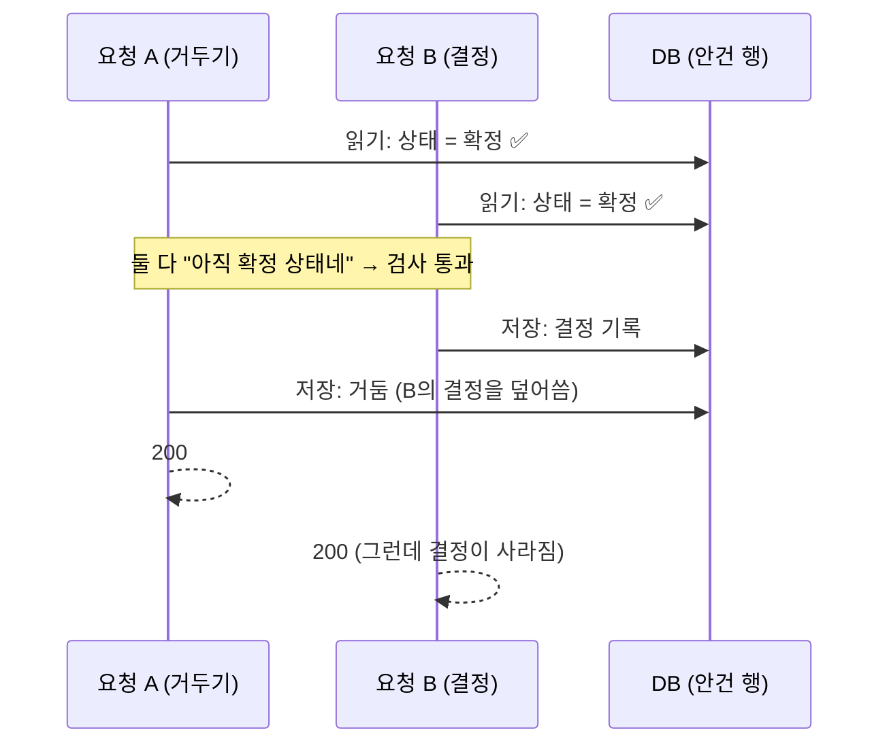
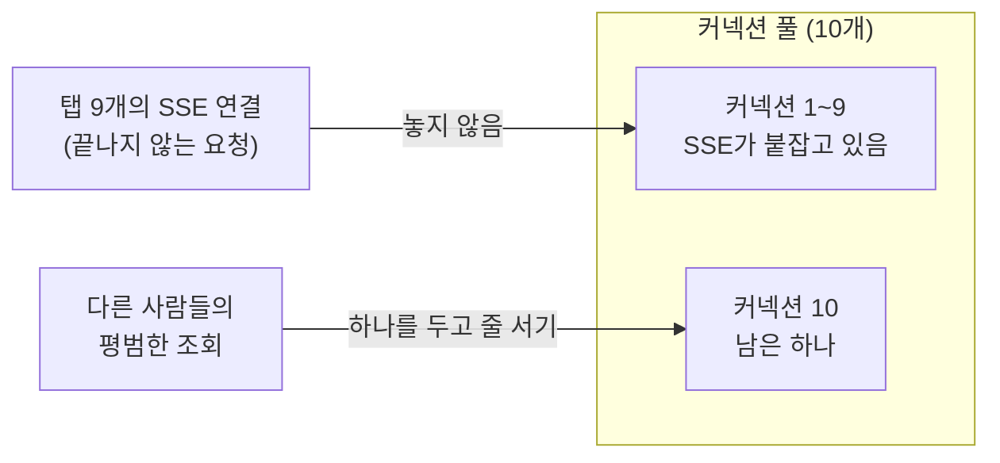
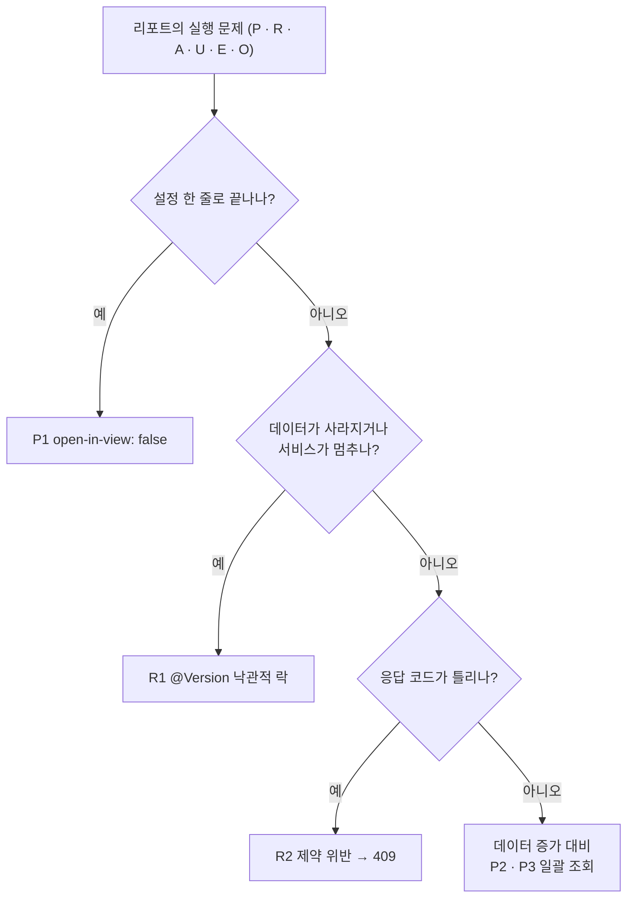
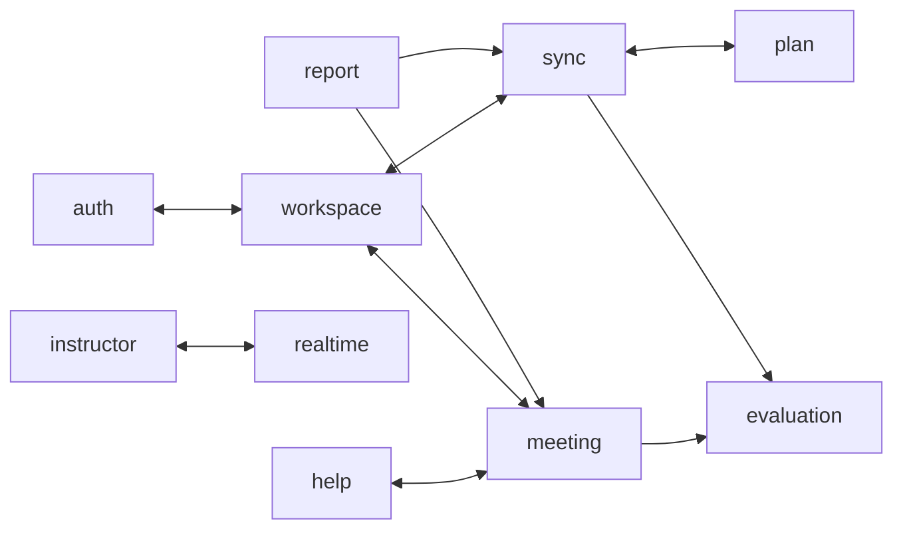
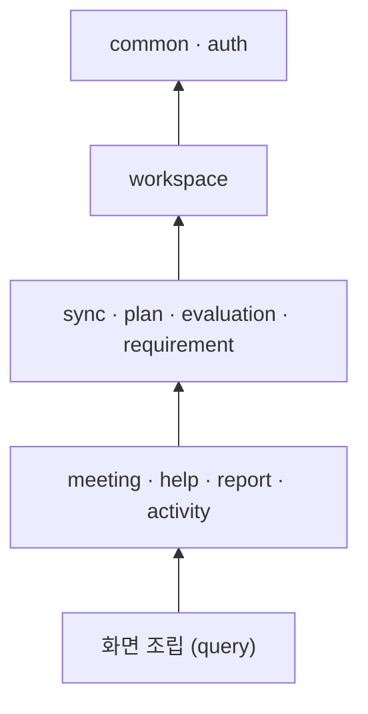
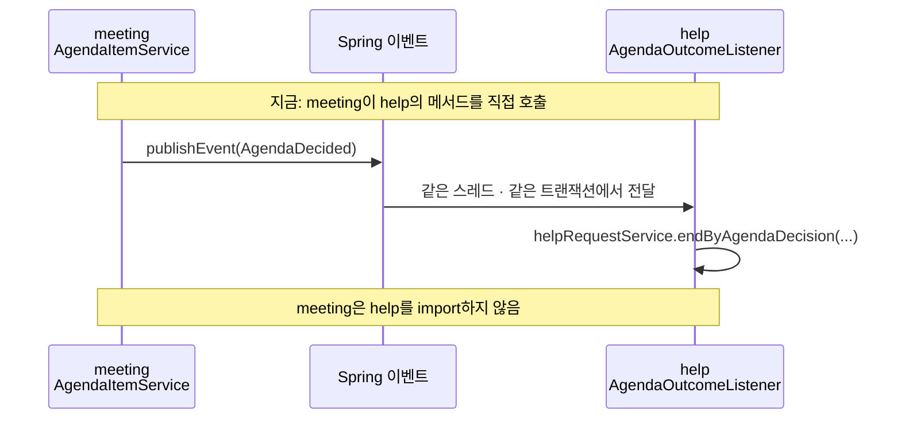
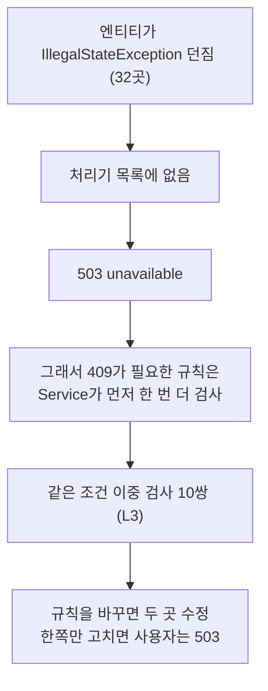
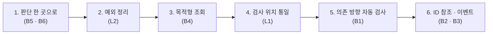

## 들어가며 (Situation)

4팀 삼도류의 프로젝트 **GRAVIT**는 GitHub 저장소와 연동되는 **팀 학습 협업 사무실** 서비스다. 팀원이 이슈·PR을 보고, 서로 평가하고, 회의·안건·도움 요청·스탠드업을 기록하고, 마지막에 회고 리포트를 만든다. 실시간 반영(SSE)과 3D 사무실 화면도 있다. 프로젝트 소개와 성능 개선 과정은 [쇼케이스 정리]({{ site.baseurl }})에 있다.

발표를 앞두고 **AI 코드 검증 리포트**를 받았다. 리포트 기준은 다음과 같다.

| 항목 | 내용 |
|------|------|
| 대상 | `SamdoRyu/GRAVIT` main `499289b` (2026-11-12 10:07), 백엔드 Java 378개 파일 |
| 기준 문서 | 요구사항 명세서, 정책 정의서, API 명세서, `docs/CONTRACTS_API.md`, Flyway V1~V8 |
| 실행 환경 | Windows 11, JDK 21, 로컬 MySQL 8.0, 시연 사무실 + 심사용 계정 4개 |
| 점수 | **없음**. 대신 "지금의 선택이 통하는 조건 / 깨지는 상황 / 그때의 선택지"를 적음 |

리포트는 크게 두 부분이라, 이 글도 두 부분으로 나눠 정리한다.

| 부분 | 내용 | 심각도 기준 |
|------|------|-------------|
| **1부. 실행으로 확인한 것** | 서버를 직접 실행: 권한, 동시 요청, 성능, 실제 화면 사용, 잘못된 입력 | **결과** (서비스가 멈추거나 기록이 사라지면 높음) |
| **2부. 코드 구조** | 도메인 경계, 계층별 책임, 문서 대 코드, 점검표 72항목 | **바꾸는 비용** (컴파일러가 못 잡는 결합이면 높음) |

## 문제 상황 (Task)

리포트의 첫 문장이 결과를 요약한다.

> 하나씩 요청할 때는 명세 그대로였고, 패키지 사이는 한 덩어리로 묶여 있습니다.

**실행 쪽 숫자**

| 숫자 | 의미 |
|------|------|
| **291 / 291** | 네 역할(비로그인, 참여자, 레포 관리자, 강사)로 보낸 요청이 명세의 응답과 일치 |
| **59 / 59** | 다른 사무실의 ID를 끼워 넣은 요청이 모두 차단 |
| **792개** | 팀이 쓴 백엔드 테스트 모두 통과 |
| **40 / 47** | 잘못된 입력 47가지 중 기대한 응답을 낸 것 |
| **45건** | 생각해 볼 지점 (높음 8 · 중간 19 · 낮음 18) |

**구조 쪽 숫자**

| 숫자 | 의미 |
|------|------|
| **14 / 14** | import를 따라가면 **서로에게 닿는** 업무 패키지. 서로 import하는 쌍 15개 |
| **45 / 62** | 엔티티 연관관계 중 **다른 도메인의 엔티티**를 객체로 가리키는 칸 |
| **83곳** | Service가 다른 도메인 Service를 **구체 클래스로** 주입받는 곳 (직접 만든 인터페이스는 1개) |
| **높음 8건 중 6건** | 이 구조에서 나온 문제 |

즉 **"한 명이, 한 번에 하나씩, 작은 데이터로"** 쓸 때는 문제가 없다. 실행 쪽 문제는 다음 세 상황에 모여 있었다.

1. 요청이 **동시에** 올 때
2. 데이터가 **시연 규모보다 커질** 때
3. 탭을 **여러 개** 열거나 **오래** 켜 둘 때

구조 쪽 과제는 하나다. **"지금 돌아가는 코드"를 "바꾸기 쉬운 코드"로 만들려면 어디부터 손대야 하는가?**

발표 전에 꼭 알아 둘 것은 네 가지였다.

| 증상 | 원인 | 바로 할 수 있는 대처 |
|------|------|----------------------|
| 시연 사무실을 여러 탭으로 열어 실시간 연결이 9개가 되면 **모든 화면이 멈춤** | P1 | 설정 한 줄 (`open-in-view: false`) |
| 빈 DB에서 여러 계정이 동시에 처음 로그인하면 **시연 사무실이 여러 개** 생김 | R3 | 서버를 띄운 뒤 한 계정으로 먼저 로그인 |
| 같은 브라우저에서 사무실 탭을 **7개째** 열면 화면이 안 뜸 | U1 | 시연 중 탭을 적게 열기 |
| 시연 사무실 타임라인에 **「내가 남긴 평가」가 안 나옴** | D1 | 미리 알고 시연하기 |

### 쉽게 비유하면

**실행 쪽**은 **놀이공원 안전 점검**과 비슷하다.

- 손님이 한 명씩 놀이기구를 타면(요청 하나씩) 모두 정상이었다.
- 그런데 **두 사람이 같은 순간 같은 좌석에 앉으려** 하거나(동시 요청), **손님이 100배로 늘거나**(데이터 증가), **한 사람이 줄을 6개 동시에 서면**(탭 여러 개) 문제가 생겼다.

**구조 쪽**은 **학교 동아리 14개**의 사물함과 비슷하다.

- 지금은 **모든 동아리가 서로의 사물함 열쇠를 갖고 있다.** 급할 때 남의 사물함에서 바로 꺼내 쓰니 편하다.
- 그런데 축구부가 사물함 위치를 바꾸면, 축구부 사물함을 쓰던 **다른 동아리 6곳이 모두 헷갈린다.** 누가 축구부 사물함을 쓰는지 목록도 없다.
- 리포트의 제안은 "**사물함은 주인만 열고, 다른 동아리는 주인에게 부탁하라**"는 것이다.

## 해결 과정 (Action)

리포트는 문제마다 **통하는 조건 → 깨지는 상황 → 다음 단계 → 선택지 비교** 순서로 설명한다. 이 글도 같은 순서로 정리한다. 코드는 모두 **리포트가 제안한 스케치**이고, 리포트가 실제로 적용해 실행해 본 것은 `open-in-view` 설정 하나뿐이다.

### 1부. 실행으로 확인한 것

#### 1-0. 먼저, 잘한 선택

문제만 있는 게 아니다. 리포트는 실행이나 코드로 근거를 확인한 **잘한 선택**도 적었다.

| 잘한 선택 | 내용 | 근거 |
|-----------|------|------|
| 사무실 접근 검사를 한 곳에, **기본은 거부** | 새 API가 검사를 빠뜨려도 열리지 않고 닫힘. 모든 경로가 검사를 거치는지 테스트로 확인 | 291건 일치, `WorkspaceEndpointGuardTest` |
| 권한 없는 사무실은 **404** | "있는데 못 들어감(403)"과 "없음(404)"을 구분하지 않아 다른 팀 사무실의 존재가 드러나지 않음 | 59가지 경로 모두 차단 |
| 마지막 방어선은 **DB 제약** | "진행 중 회의는 하나" 같은 조건부 규칙도 생성 열 + 유일 제약으로 표현 | 같은 요청 10개 동시 전송 13가지에서 중복 행 0건 |
| 오류 응답은 **한 모양, 코드 8개** | 깨진 JSON, 알 수 없는 필드, 길이 초과가 모두 `400 invalid` | 잘못된 입력 47가지 중 40가지 기대대로 |
| GitHub **읽기 전용을 세 겹**으로 | 읽기 메서드만 있는 인터페이스 + 가드 + 테스트 | `GithubReader`, `ReadOnlyGithubGuard` |
| 엔티티 31개가 **같은 규칙** | 연관 62칸 모두 지연 로딩, cascade·양방향 0, `@Setter` 0, 엔티티가 응답에 직접 나가지 않음 | 코드 |
| 로그인 실패에서 **정보를 흘리지 않음** | 없는 아이디와 틀린 비밀번호가 같은 문구·비슷한 시간, 로그인하면 세션 ID 교체 | 61ms vs 67ms, 쿠키 재사용 401 |
| **못 한 것을 못 했다고** 적음 | 명세서의 [부분]·[미구현]·[보류] 19건이 코드와 모두 일치 | 요구사항 81건 대조 |

> 비유: 우리 놀이공원은 **입구 게이트가 기본으로 잠겨 있고**, 표가 없는 손님에게는 "그런 놀이기구 없어요"라고 답한다. 다른 팀 놀이기구가 있는지조차 알려 주지 않는 것이다.

#### 1-1. 권한: 291건 모두 명세대로

버튼이 화면에 없어도 **주소와 본문을 직접 만들어** 보냈다. 화면이 아니라 서버가 막은 결과다.

| 기능 | 비로그인 | 참여자 | 레포 관리자 | 강사 |
|------|----------|--------|-------------|------|
| 사무실 화면 읽기 | 401 | 허용 | 허용 | 허용 |
| 팀 설정 · 강사 지정 · 요구사항 연결 | 401 | 403 | 허용 | 403 |
| 안건 올리기 · 회의 · 결정 기록 | 401 | 허용 | 허용 | 403 |
| 안건 거두기 | 401 | 올린 사람만 | 올린 사람만 | 403 |
| 도움 요청 닫기 · 영구 삭제 | 401 | 요청자만 | 요청자만 | 403 |
| 강사 요청함 | 401 | 403 | 403 | 허용 |
| **다른 사무실의 모든 것** | 401 | **404** | **404** | **404** |

인증·세션도 확인했다.

- CSRF 헤더나 출처(Origin)가 없거나 틀리면 `403 invalid`
- 로그인하면 세션 ID가 바뀌고, 쿠키는 `HttpOnly`, `SameSite=Lax`
- 로그아웃은 POST만, 로그아웃한 쿠키를 다시 보내면 401
- 저장소와 커밋 이력에서 토큰·비밀번호·키 파일을 찾지 못함

그래도 생각해 볼 지점이 다섯 개 있었다.

##### A1 세션에 넣어 둔 역할은 언제까지 유효한가 (중간)

| 실험 | 결과 |
|------|------|
| 팀원에서 뺀 뒤, 같은 세션으로 도움 요청 작성 | **201** (성공해 버림) |
| 관리자에서 내린 뒤, 같은 세션으로 팀 설정 변경 | **200** (성공해 버림) |

로그인할 때 한 번 GitHub 권한을 확인하고 **세션에 역할을 적어 둔다.** 세션은 마지막 요청 뒤 60분 동안 살고, 쓰는 동안은 계속 연장된다.

> 비유: 세션은 **로그인할 때 받은 손목 팔찌**다. 관리 사무실 명단(DB)에서 이름을 지워도, 손목에 찬 팔찌는 스스로 바뀌지 않는다.

강사 지정은 **요청마다 DB에서 확인**해서 바로 끝나는데, 팀원 역할은 그렇지 않았다.

| 선택지 | 얻는 것 | 치르는 것 | 리포트 의견 |
|--------|---------|-----------|-------------|
| 지금처럼 세션 값만 | 추가 조회 없음 | 변경이 60분 이상 늦게 반영 | 4명·2주면 수용 가능, 문서화 필요 |
| **요청마다 팀원 행 확인** | 다음 요청부터 차단 | 기본키 조회 1회 | **가장 단순, 권장** |
| 변화를 감지하면 세션 끊기 | 평소 요청은 그대로 | 사용자별 세션 찾기, 서버 여러 대면 공유 저장소 | 지금 규모에는 과함 |

##### A2~A5 (낮음)

| 번호 | 문제 | 다음 단계 |
|------|------|-----------|
| A2 | 15분 안에 5번 틀리면 잠그는데, **계정 단위**라 아이디만 아는 사람이 일부러 잠글 수 있음 | 계정 + 접속 주소를 함께 세거나, 잠그는 대신 응답을 점점 늦추기 |
| A3 | 정책은 "활동 시간은 본인 리포트에만"인데 `GET …/activities`로 **남의 30분·60분이 보임** | 응답에서 남의 `durationMinutes`를 빼거나 정책 문장을 계약에 맞추기 |
| A4 | 명세 문서 경로에 `../../etc/passwd`가 그대로 저장됨(200) | 경로 조각이 `.`이나 `..`이면 400으로 거절 |
| A5 | 회고 마크다운 익명화에서 **별명, PR 주소 속 이름**은 남고, 본문의 `#`이 가짜 제목이 됨 | 줄 앞의 `#` 이스케이프, 한계를 화면에 안내 |

#### 1-2. 같은 요청이 동시에 오면

더블 클릭, 두 탭, 두 사람이 같은 순간에 누르는 상황이다. **같은 요청 10개를 한꺼번에** 보냈더니 13가지 시나리오 모두에서 **중복 데이터는 생기지 않았다.** 차이는 막힌 요청에게 **무엇이라고 답하는가**에 있었다.

| 시나리오 (동시 10건) | 응답 | 판단 |
|----------------------|------|------|
| 회의 시작 | 201 × 1, 409 × 9 | ✅ 기대대로 |
| 수동 동기화 | 202 × 1, 409 × 9 | ✅ 기대대로 |
| 같은 사람이 같은 회차에 평가 | 200 × 2, **503 × 8** | ⚠️ 503으로 샘 |
| 스탠드업 처음 쓰기 (같은 날짜) | 200 × 1, **503 × 9** | ⚠️ 503으로 샘 |
| 활동 확인 (같은 사람) | 200 × 1, 409 × 9 | ⚠️ 계약은 "이미 확인했으면 그대로 200" |
| 닫기 5번 + 코멘트 5번 | 200 × 4, 201 × 1, 409 × 3, 503 × 2 | ❌ **닫기 4건이 모두 성공**(덮어쓰기) |

##### R1 안건 거두기와 결정 기록이 겹치면 한쪽이 덮어씀 (높음)

두 요청을 같은 순간에 보내는 실험을 **40회** 했다. 하나만 성공해야 하는데 결과는 다음과 같았다.

| 결과 | 횟수 |
|------|------|
| 거두기만 성공, 결정은 409 | 9회 |
| 결정만 성공, 거두기는 409 | 10회 |
| 둘 다 200, 실제로는 결정만 남음 | 15회 |
| **둘 다 200, 결정 기록이 사라짐** | **6회** |

실제 화면에서도 재현됐다. 두 사람이 같은 안건에 "화요일 배포"와 "목요일 배포"를 동시에 저장하면, **오류 안내 없이 한쪽만 남는다.**



"**읽어서 확인한 뒤 바꾸는**"(check-then-act) 코드가 동시에 실행될 때 생기는 **경쟁 조건**(race condition)이다. 유일 제약은 "행이 두 개 생기는 것"은 막지만 "**한 행을 두 번 고치는 것**"은 막지 못한다.

> 비유: 도서관 책 한 권을 두 사람이 동시에 "대출 가능하네!" 확인하고 둘 다 대출 도장을 찍는 상황이다. 나중에 찍은 도장만 장부에 남고, 먼저 찍은 사람은 자기가 빌린 줄 안다.

리포트가 제안한 해결은 **낙관적 락**이다. 저장할 때 "내가 읽은 뒤 누가 고쳤는가"를 버전 번호로 확인해, 누가 먼저 고쳤으면 내 저장을 거절한다.

```java
// 리포트 제안 코드 (실행해 보지 않음)
// AgendaItem, HelpRequest
@Version
private Long version;

// GlobalExceptionHandler
@ExceptionHandler(ObjectOptimisticLockingFailureException.class)
public ResponseEntity<ErrorResponse> handleStale(Exception e) {
    return respond(ErrorCode.CONFLICT); // 화면은 최신 데이터를 다시 읽는다
}
```

```sql
-- V9__add_version.sql
ALTER TABLE agenda_item ADD COLUMN version BIGINT NOT NULL DEFAULT 0;
ALTER TABLE help_request ADD COLUMN version BIGINT NOT NULL DEFAULT 0;
```

| 선택지 | 동작 | 치르는 것 | 이 팀에 |
|--------|------|-----------|---------|
| **낙관적 락** (`@Version`) | 읽은 뒤 누가 고쳤으면 저장 때 실패 | 버전 칸 + 마이그레이션, 진 쪽은 다시 시도 | **권장.** 충돌이 드문 4인 팀에 맞음 |
| 비관적 락 (`FOR UPDATE`) | 먼저 읽은 요청이 끝날 때까지 대기 | 커넥션 점유, 락 순서가 엇갈리면 교착 | 영구 삭제에 이미 사용 |
| 조건부 UPDATE | `WHERE status='CONFIRMED'`, 바뀐 행이 0이면 409 | 상태 전이를 쿼리로 써야 함 | 동기화 시작 표시에 이미 사용 |

> 낙관적 락 비유: 위키 문서를 고칠 때 "**3번째 버전**을 보고 고쳤어요"라고 적어 낸다. 그사이 누가 4번째 버전을 만들었으면 "다시 읽고 고치세요"라고 돌려보낸다.

##### R2 막힌 요청이 409 대신 503을 받음 (중간)

| 실험 | 503 비율 |
|------|----------|
| 같은 사람의 평가 동시 저장 | 8 / 10 |
| 같은 날 스탠드업 첫 저장 | 9 / 10 |
| 영구 삭제와 겹친 코멘트 | 15 / 40 |

데이터는 안전하다. 문제는 **응답 코드**다. 평가 저장은 `try`가 있지만, 기본키가 자동 증가면 `save()`가 **그 앞줄에서 곧바로 INSERT**를 보낸다. 그래서 제약 위반이 `try` 밖에서 터지고, 처리기 목록에 없는 예외라 503이 된다.

503을 받은 화면은 "제출됐는지 확인하지 못했어요"를 보인다. 하지만 실제로는 다른 요청이 저장을 끝낸 상태다.

| 코드 | 의미 | 사용자 행동 |
|------|------|-------------|
| 409 Conflict | "다른 사람이 먼저 바꿨어요" | **다시 읽기** |
| 503 Service Unavailable | "서버가 아파요" | 잠시 뒤 다시 (자동 재전송 안 함) |

```java
// 리포트 제안 코드: 전역 그물 한 겹 (실행해 보지 않음)
@ExceptionHandler(DataIntegrityViolationException.class)
public ResponseEntity<ErrorResponse> handleConstraint(DataIntegrityViolationException e) {
    log.warn("제약 위반: {}", e.getMostSpecificCause().getClass().getSimpleName());
    return respond(ErrorCode.CONFLICT);
    // NOT NULL 위반 같은 진짜 버그까지 409가 되지 않게,
    // 제약 이름이 uk_ 로 시작할 때만 바꾸는 방법도 있다
}
```

##### R3 빈 DB에서 여러 사람이 동시에 처음 로그인하면 (중간)

| 결과 | 값 |
|------|----|
| 동시 로그인 8건 뒤 생긴 시연 사무실 | **4개** |
| 비밀번호가 맞는데 401을 받은 로그인 | 4 / 8 |

시연 사무실은 첫 로그인 때 "**없으면 만든다**"로 생긴다. 동시에 오면 여러 요청이 모두 "없다"고 판단한다. 강사 계정은 네 사무실에 모두 들어갈 수 있었다.

- **발표 전 대처**: 서버를 띄운 뒤 한 계정으로 먼저 로그인해 둔다.
- **코드 대처**: 서버가 켜질 때 미리 만들거나, "시연 사무실은 하나"를 생성 열 + 유일 제약으로 DB에 적는다(진행 중 회의에 이미 쓴 방법).

#### 1-3. 어디가 데이터에 비례해 느려지는가

데이터를 세 단계로 불려서 **요청 한 번의 SQL 수**를 셌다.

| 데이터 | 시드 | 팀 저장소 실제 규모 | 그 5배 |
|--------|------|---------------------|--------|
| 이슈 | 6 | 144 | 720 |
| PR | 4 | 203 | 1,015 |
| 평가 | 3 | 540 | 2,733 |
| 내 PR | 1 | 51 | 254 |

| API | 시드 | 실제 규모 | 5배 |
|-----|------|-----------|-----|
| **학습 타임라인 1쪽** | 12 | **162** | **771** |
| **회고 리포트 상세** | 17 | **58** | **220** |
| 사무실 Snapshot | 28 | 28 | 28 |
| 스탠드업 채우기 | 9 | 9 | 9 |
| 강사 요청함 | 7 | 7 | 7 |
| PR 평가 회차 | 5 | 5 | 5 |

**타임라인과 리포트만 데이터에 비례**하고, 나머지는 PR이 250배가 되어도 쿼리 수가 같다.

##### P1 실시간 연결이 DB 커넥션을 붙잡음 (높음)

| 측정 | 값 |
|------|----|
| 다른 사용자의 조회가 멈추기 시작 | **9번째 연결부터** (그 전에는 3~18ms) |
| 연결을 모두 끊은 뒤 정상으로 돌아오기까지 | 35~51초 |
| `open-in-view=false`일 때 연결 60개를 열어도 | 최대 30ms |

Spring Boot는 기본으로 **`open-in-view`(OSIV)** 를 켜 둔다. 요청이 끝날 때까지 DB 커넥션을 놓지 않는 설정이다. 보통 요청은 금방 끝나니 문제가 없다.

그런데 **SSE는 끝나지 않는 요청**이다. 사무실 화면을 열어 두는 동안 연결이 계속 살아 있다. 연결을 열 때 접근 확인으로 DB를 한 번 읽는데, 그 커넥션이 **연결 내내 묶인다.** 커넥션 풀은 10개다.



> 비유: 식당 의자가 10개인데, 손님 9명이 **밥을 다 먹고도 일어나지 않고** 앉아 있다(SSE). 새로 온 손님은 의자 하나를 두고 줄을 서야 한다.

해결은 **설정 한 줄**이다. 리포트는 이 설정을 실제로 적용해서 역할별 요청 291건을 다시 보냈고, **전부 통과**했다. 지연 로딩 예외도 0건이었다.

```yaml
spring:
  jpa:
    open-in-view: false
```

| 선택지 | 동작 | 치르는 것 | 확인 |
|--------|------|-----------|------|
| **`open-in-view=false`** | 트랜잭션이 끝나면 커넥션을 돌려줌 | Service 밖 지연 로딩이 있으면 예외 | **실행으로 확인. 권장** |
| SSE 경로에서 DB 읽지 않기 | 접근 확인을 세션 값만으로 | 강사 "요청마다 DB 확인" 규칙과 충돌 | 코드로만 검토 |
| 커넥션 풀 키우기 | 한계가 더 큰 수로 이동 | 원인은 그대로 | 권하지 않음 |

**📌 팀의 이전 실험과 비교하기**

팀은 11/10 Snapshot 성능 개선 때 이미 OSIV 끄기를 실험했고, **기각**했다([쇼케이스 정리]({{ site.baseurl }}) 참고). 두 결론은 서로 다른 질문에 대한 답이라 모순이 아니다.

| | 11/10 팀 실험 | 11/16 리포트 |
|---|---------------|--------------|
| 본 것 | Snapshot API **처리량** (k6, 짧은 요청) | **SSE 연결**(끝나지 않는 요청)이 커넥션을 쥐는 문제 |
| OSIV를 끄면 | 처리량 변화 없음, VU 50 p95 악화 | 연결 60개에서도 최대 30ms, 291건 통과 |
| 결론 | 처리량 개선 수단으로는 효과 없음 → 유지 | 커넥션 고갈 방지 수단으로 권장 |

같은 설정이라도 **어떤 문제를 풀려고 하느냐**에 따라 판단이 달라진다. 끈다면 Snapshot의 p95가 나빠졌던 11/10 결과도 함께 다시 확인해야 한다.

##### P2 학습 타임라인: 쪽은 나눴지만 비용은 나뉘지 않음 (중간)

| 측정 | 내 PR 1개 | 51개 | 254개 |
|------|-----------|------|-------|
| 쿼리 수 | 12 | 162 | 771 |
| 응답 시간(중앙값) | 30ms | 78ms | 229ms |

**1쪽을 요청하든 6쪽을 요청하든 비용이 같다.** 내 PR마다 "PR · 회차 · 평가" 조회 세 개가 반복되는 **N+1** 모양이고, 전체를 만든 뒤 메모리에서 한 쪽을 자른다. 코드 주석은 "4인·2주 규모면 충분"이라고 적었지만, 이 팀은 **9일 동안 PR 203개**를 만들었다.

```java
// 리포트 제안 코드: 일괄 조회 (실행해 보지 않음)
// EvaluationRoundRepository
@Query("select r from EvaluationRound r where r.submission.id in :submissionIds")
List<EvaluationRound> findBySubmissionIdIn(Collection<Long> submissionIds);
// 평가는 이미 있는 findByRoundIdInOrderByIdAsc(roundIds) 로 한 번에
```

```text
지금:    PR 1개 → 3회, PR 2개 → 3회, ... PR 254개 → 3회   = 254 × 3
바꾸면:  모든 PR의 회차 IN (…) → 1회, 모든 회차의 평가 IN (…) → 1회 = 고정
```

> 비유: 마트에서 물건 254개를 살 때, 물건 **하나 살 때마다 집에 갔다 오는** 것이 N+1이다. 장바구니에 **한꺼번에 담아** 오면 왕복 한 번이다.

##### P3~P6

| 번호 | 문제 | 숫자 | 다음 단계 |
|------|------|------|-----------|
| P3 (중간) | 회고 리포트가 **카드마다 PR을 하나씩** 지연 로딩 | 쿼리 17 → 58 → 220 | `join fetch`로 카드와 PR을 한 번에 (이미 7곳에서 쓰는 방법) |
| P4 (중간) | 명세 문서 제목 줄 처리 정규식이 **길이의 제곱** | 공백 5천 자 106ms → 4만 자 **6.7초** | 끝에서부터 걷어 내는 반복문, 한 줄 길이 상한 |
| P5 (중간) | 동기화 **트랜잭션 안에서 GitHub 호출** | 측정 불가 (PR마다 3번, 호출당 10초 제한) | GitHub에서 먼저 다 읽고, 짧은 트랜잭션 하나로 저장 |
| P6 (낮음) | Snapshot: 쿼리는 28회 고정인데 **응답 크기**가 늘어남 | 12KB → 438KB → **2,186KB** | 오래 닫힌 항목 빼기, 바뀐 조각만 다시 읽기 |

```java
// 리포트 제안 코드: P3 join fetch (실행해 보지 않음)
@Query("select c from DecisionCard c join fetch c.submission where c.id in :ids")
List<DecisionCard> findWithSubmissionByIdIn(Collection<Long> ids);
```

P6은 쿼리 수 설계는 잘했지만, 화면이 **변경 알림마다 Snapshot을 다시 읽기** 때문에 한 명의 쓰기가 모든 팀원의 2MB 다운로드가 된다는 점이 문제다.

#### 1-4. 실제 사용자처럼 눌러 보면

네 계정(참여자 2 · 레포 관리자 · 강사)을 **각자 다른 Chrome 창**으로 동시에 접속시키고, 하루 동안 팀이 쓸 법한 순서대로 **170개 동작**을 했다.

**잘 동작한 것**

| 항목 | 결과 |
|------|------|
| 실시간 반영 | 한 사람의 쓰기가 다른 사람 화면에 **0.3초** 만에 뜸 |
| 두 번 누르기 | 더블 클릭해도 한 건만 생성, 응답 중에는 버튼 비활성 |
| 서버가 아플 때 | 503과 연결 끊김 모두에서 **쓰던 글이 그대로** 남음 |
| 역할별 화면 | 작성자·강사에게는 평가 칸 대신 이유, 요청자에게만 닫기 버튼 |
| 태그 입력 | `<script>`, ``가 글자로 보이고 실행되지 않음 |
| 삭제 확인 | "다른 사람이 쓴 코멘트 6개, 강사 답변 1개도 함께 지워져요"를 세어서 보여 줌 |

**새로 발견한 문제**

##### U1 같은 브라우저에서 탭을 7개째 열면 화면이 뜨지 않음 (중간)

| 측정 | 값 |
|------|----|
| 6개 탭까지 | 0.3~0.4초에 열림 |
| 7번째 탭 | "Loading…"에서 **20초 넘게** 멈춤 |
| 같은 순간 다른 브라우저 사용자 | 0.25초 정상 |

브라우저는 **HTTP/1.1에서 한 주소에 동시 연결을 6개까지만** 연다. 사무실 탭 하나가 SSE 연결 하나를 계속 쥐고 있으니, 6개가 자리를 다 차지하면 7번째 탭은 페이지 자체를 받지 못한다. **서버 쪽 P1과는 다른 원인**이라 P1을 고쳐도 남는다(관찰한 동작에서 추정한 원인).

```javascript
// 리포트 제안 코드: 보이지 않는 탭은 연결을 쉬게 (실행해 보지 않음)
document.addEventListener('visibilitychange', () => {
  if (document.hidden) source.close()                  // 숨은 탭은 연결을 놓는다
  else { source = connect(); reloadSnapshot() }       // 돌아오면 다시 잇고 한 번 새로 읽는다
})
```

| 선택지 | 얻는 것 | 치르는 것 | 이 팀에 |
|--------|---------|-----------|---------|
| **숨은 탭의 연결 끊기** | 보이는 탭만 연결을 씀 | 돌아왔을 때 한 번 다시 읽기 | **권장, 가장 작은 변경** |
| `BroadcastChannel`로 탭끼리 연결 하나 공유 | 탭 수와 무관하게 연결 하나 | 어느 탭이 연결을 쥘지 정하는 코드 | 탭을 많이 여는 사용이 확인되면 |
| HTTP/2로 배포 | 제한이 100개 안팎으로 | HTTPS, 프록시 설정 | 배포 단계에서 |

##### U2 세션이 끝난 순간 쓰던 글이 사라짐 (중간)

세션은 **마지막 요청 뒤 60분**에 끝난다. 긴 글을 천천히 쓰는 동안에는 요청이 없으니, **오래 쓴 글일수록 사라질 가능성이 크다.** 같은 정책이 503에서는 "작성한 내용은 그대로 있어요"를 지키는데 401에서는 지키지 못했다.

- 다음 단계: 로그인 안내를 폼 위에 덮는 방식으로 띄우거나, 쓰는 중인 글을 `sessionStorage`에 두었다가 돌아왔을 때 채운다.

##### U3~U8 (낮음)

| 번호 | 무엇을 했더니 | 어떻게 됐나 |
|------|---------------|-------------|
| U3 | 상대가 도움 요청을 닫음 | 내가 쓰던 코멘트가 **입력 칸과 함께 안내 없이** 사라짐 |
| U4 | 브라우저 뒤로 가기 | 이전 화면이 아니라 **앱 밖으로** 나감. 주소가 늘 `/` 하나 |
| U5 | 아무것도 안 쓰고 스탠드업 저장 | 빈 스탠드업이 "저장했어요"와 함께 저장 |
| U6 | 재료 없는 PR로 카드 만들기 | 9칸 모두 빈데 "재료가 있는 칸이 채워졌어요" |
| U7 | 심사용 계정으로 쓰다가 세션 만료 | "**GitHub** 계정으로 다시 로그인하면…" 문구 |
| U8 | 같은 사람의 코멘트를 두 화면에서 보기 | 목록에는 `seed-lee`, 다른 곳에는 `review-member2` |

#### 1-5. 잘못된 입력과 운영

깨진 JSON, 빈 본문, 5,000단 중첩, 5MB 본문, 20자리 ID 등 **47가지**를 보냈고 40가지가 기대대로였다. 기대와 달랐던 것만 모으면 다음과 같다.

| 입력 | 기대 | 실제 | 무슨 일이 일어나는가 |
|------|------|------|----------------------|
| `content`가 숫자 | 400 | **201** | 숫자 12345가 문자열 "12345"로 바뀌어 저장 |
| 이모지 2,000자 | 201 | **400** | 길이를 UTF-16 단위로 세서 이모지 한 글자가 2로 계산 |
| `Accept: xml`인데 오류 응답 | 404 | **500** | 오류 JSON을 쓸 수 없어 본문 없는 500 |
| 마감 +99999년 | 400 | **503** | 형식은 맞지만 DB가 담을 수 없는 날짜 |
| 명세 경로에 `../` | 400 | **200** | `..` 조각이 그대로 저장 (A4) |
| 끝난 회의 ID로 결정 기록 | 409 | 200 | 계약에 규정이 없는 부분 |
| 폭 없는 공백(U+200B)만 | 400 | **201** | 눈에 안 보이는 글자만으로 된 글이 저장 |

| 번호 | 문제 | 다음 단계 |
|------|------|-----------|
| E1 (낮음) | 날짜는 **형식만** 검증. 1900년 스탠드업이 저장되고, 2126년 끝 날짜로 화면에 "D-36537" | 프로젝트 기간 기준의 범위 검증 |
| E2 (낮음) | 글자 수를 UTF-16으로 셈, 숫자가 문자열로 강제 변환, 폭 없는 공백 통과 | 코드 포인트로 세기(`content.codePointCount(0, content.length())`), Jackson 타입 변환 설정 조사 |
| O1 (낮음) | 503의 원인을 찾을 때 **어느 요청이었는지 로그로 알 수 없음**. DB 커넥션이 바닥난 동안에도 `/api/health`는 200 | 요청 ID를 MDC에, 요청 로그 인터셉터, 헬스 체크에 DB 연결 포함 |

```java
// 리포트 제안 코드: 요청 ID (실행해 보지 않음)
public class RequestIdFilter extends OncePerRequestFilter {
    protected void doFilterInternal(HttpServletRequest req, HttpServletResponse res, FilterChain chain)
            throws ServletException, IOException {
        MDC.put("requestId", UUID.randomUUID().toString().substring(0, 8));
        try { chain.doFilter(req, res); } finally { MDC.clear(); }
    }
}
// logging.pattern.level: "%5p [%X{requestId}]"
```

화면 탐색 동안 쌓인 **ERROR 로그 54건은 전부** 사용자가 탭을 닫거나 새로고침했을 때 생긴 `AsyncRequestNotUsableException`이었다. 진짜 오류를 찾기 어렵게 만드는 소음이다.

#### 1-6. 실행에서 나온 다음 단계 (우선순위)

리포트는 **효과가 크고 변경이 작은 것부터** 순서를 정했다.

| 순서 | 무엇을 | 왜 먼저인가 | 변경의 크기 | 문제 |
|------|--------|-------------|-------------|------|
| 1 | `open-in-view: false` | 실시간 연결 9개로 전체가 멈추는 것을 막음. 끈 상태의 동작 확인됨 | 설정 한 줄 | P1 |
| 2 | 안건·도움 요청에 `@Version`, 충돌은 409 | 성공 응답을 받은 결정 기록이 사라지지 않음 | 엔티티 2개, 마이그레이션 1개 | R1 |
| 3 | 유일 제약 위반을 전역에서 409로 | 503이 진짜 장애만 뜻하게 됨 | 예외 처리 1곳 | R2 |
| 4 | 시연 사무실을 서버가 켜질 때 생성 | 동시 첫 로그인의 중복 생성 방지 | 초기화 코드 1곳 | R3 |
| 5 | 타임라인 일괄 조회, 리포트 `join fetch` | 데이터에 비례하던 두 곳의 쿼리 수 고정 | Repository 메서드 2개 | P2 · P3 |
| 6 | 날짜 범위, 경로 `..`, 보이지 않는 글자 검증 | 저장 단계까지 가서 실패하는 입력을 문 앞에서 거절 | DTO 검증 몇 줄 | E1 · E2 · A4 |
| 7 | 제목 줄 정규식을 반복문으로 | 문서 한 줄로 동기화가 멈추는 경로 제거 | 메서드 1개 | P4 |
| 8 | 요청 ID와 요청 로그, DB를 보는 헬스 체크 | 다음 문제를 로그만으로 찾음 | 필터 1개, 인터셉터 1개 | O1 |
| 9 | 숨은 탭 연결 끊기, 쓰던 글을 `sessionStorage`에 | 탭 7개 제한과 세션 만료 때의 글 유실 방지 | 프론트 훅 2개 | U1 · U2 |
| 10 | 팀원 역할 확인 방식을 정하고 문서에 | 유지하더라도 한계가 문서에 있으면 "선택"이 됨 | 조회 1회 또는 문서 한 문단 | A1 |




### 2부. 코드 구조

2부는 실행 결과가 아니라 **바꾸는 비용**을 본다.

| 묶음 | 질문 | 문제 수 |
|------|------|---------|
| 도메인 경계 (B) | 도메인 사이의 선은 어디에 그어져 있는가 | 8건 (높음 6) |
| 계층과 객체 (L) | 층마다 자기 일만 하고 있는가 | 11건 |
| 문서 대 코드 (D) | 문서와 실제가 같은가 | 1건 |
| 점검표 | 72항목 판정 | 충족 16 · 부분 22 · 미충족 27 |

| 심각도 | 구조 문제에서의 뜻 |
|--------|---------------------|
| 높음 | 한 도메인의 변경이 여러 도메인을 고치게 하는데 **컴파일러가 빠진 곳을 알려 주지 않거나**, 따로 떼어 시험할 수 없는 결합 |
| 중간 | 한 계층·한 클래스 안에서 책임이 섞여 수정 범위가 넓어지거나, 번지더라도 컴파일러가 알려 주는 것 |
| 낮음 | 관례 어긋남, 국소 중복 |

> 업무 패키지 14개는 import를 따라가 보면 모두 서로에게 닿습니다. 한 패키지를 고치면 나머지가 함께 흔들릴 수 있는 **한 덩어리**라는 뜻입니다.

#### 2-0. 팀이 이미 잘 지킨 것

리포트는 구조 문제를 말하기 전에 **통하는 조건**부터 적었다. 지금 구조가 엉망이라는 뜻이 아니라, **규모가 커질 때의 비용**을 말하는 것이다.

| 지킨 규칙 | 결과 |
|-----------|------|
| "다른 패키지는 그 Service로만 부른다" | 다른 도메인 **Repository 주입 0건** |
| 생성자 주입 100% | 빈 순환 0, `@Lazy` 0, `@Autowired` 0 |
| 엔티티 규칙 통일 | 연관 62칸 모두 지연 로딩, cascade·양방향 0, `@Setter` 0 |
| Controller 얇게 | 21개 모두 Repository 주입 0, 응답 가공 0 |
| `@Transactional` 위치 | 118건 모두 Service, 그중 `readOnly` 61건 |
| 구조를 테스트로 지킴 | `WorkspaceEndpointGuardTest`, `NoRankingFieldsTest` |

> 같은 사람들이 모든 패키지를 함께 고치고 한 번에 배포하는 동안에는 서로 직접 부르는 것이 가장 빠릅니다.

#### 2-1. 도메인 경계 (B)

먼저 전체 그림이다. 행의 도메인이 열의 도메인을 import하는 줄 수를 센 히트맵에서 많이 얽힌 곳만 뽑으면 다음과 같다.

| 도메인 | 다른 도메인을 가져옴 | 다른 도메인에 끌려 들어옴 |
|--------|----------------------|---------------------------|
| workspace (사무실·팀원) | 54줄 | **73줄** |
| auth (인증·권한) | 14줄 | **97줄** |
| report (회고 리포트) | **54줄** | 2줄 |
| sync (GitHub 동기화) | **48줄** | 27줄 |
| meeting (회의·안건) | 42줄 | 21줄 |

##### B1 업무 패키지 14개가 import로 모두 이어진 한 덩어리 (높음)



위 그림은 15쌍 중 일부다. 화살표를 따라가면 **출발한 도메인으로 돌아온다.**

**깨지는 상황**

| 상황 | 무슨 일이 생기나 |
|------|------------------|
| 팀원 교대 | 한 도메인을 다른 사람이 맡으면 "어디까지 고치면 되는가"의 경계가 없어 컴파일 오류로 하나씩 찾음 |
| 떼어 내기 | 동기화를 별도 작업자로 옮기려 해도 sync는 7개 도메인을 가져오고, 7개 도메인이 sync를 가져옴 |
| 단독 시험 | 권한 검사 `AuthorizationService`가 시연 사무실 ID **하나**를 읽으려고 `DemoWorkspaceService`를 주입함. 그 클래스는 시연 사무실을 **만들고 동기화까지** 함. 그래서 Controller 21개 중 20개가 쓰는 인가 검사를 띄우면 동기화·GitHub 어댑터·평가·요구사항이 함께 들어옴 |

| Service | 직접 주입 | 따라 들어오는 빈 | 닿는 다른 도메인 |
|---------|-----------|------------------|------------------|
| `WorkspaceSnapshotService` | 10 | 19 | 11 |
| `AuthorizationService` | 4 | 17 | 8 |
| `RetroReportService` | 5 | 15 | 11 |

> 비유: 출입증 확인(권한 검사)을 하려고 경비원을 불렀는데, 경비원이 **건물 관리팀, 택배팀, 청소팀**을 줄줄이 데리고 온다. 출입증만 보면 되는데 말이다.

**다음 단계: 의존 방향을 한 줄로 정하기**



위층은 아래층을 부를 수 있고, **반대는 막는다.** 아래층이 위층의 답이 필요하면 아래층이 질문을 **인터페이스로 정의**하고 위층이 구현한다. 이것이 **의존 역전 원칙(DIP)** 이다. 정한 방향은 테스트로 고정한다.

리포트가 제안한 첫걸음은 **인가 검사가 동기화를 끌고 오지 않게** 읽기와 만들기를 나누는 것이다.

```java
// 리포트 제안 코드 (실행해 보지 않음)
// workspace/service/WorkspaceService — 읽기만. 동기화를 모른다
@Transactional(readOnly = true)
public Optional<Long> findDemoWorkspaceId() {
    return workspaceRepository.findByKind(WorkspaceKind.DEMO).stream()
            .map(Workspace::getId).min(Long::compare);
}

// workspace — 만들기는 서버가 켜질 때 한 번
@Component
class DemoWorkspaceInitializer {
    private final AppProperties appProperties;
    private final DemoWorkspaceService demoWorkspaceService;
    // 생성자 생략

    @EventListener(ApplicationReadyEvent.class)
    void ensure() {
        if (appProperties.reviewLoginEnabled()) {   // 심사용 로그인이 켜진 환경에서만
            demoWorkspaceService.ensureDemoWorkspace(Instant.now());
        }
    }
}

// auth — AuthorizationService, ReviewAccountService 는 읽기만 한다
return workspaceService.findDemoWorkspaceId().map(List::of).orElse(List.of());
// → auth가 DemoWorkspaceService(→ SyncService → GitHub 어댑터)를 주입하지 않는다
```

이 변경 하나로 1부의 **R3(동시 첫 로그인 때 시연 사무실 여러 개)** 도 함께 사라진다.

| 선택지 | 얻는 것 | 치르는 것 | 이 팀에 |
|--------|---------|-----------|---------|
| 방향 규칙 + import 검사 테스트 | 새 순환이 빌드에서 막힘 | 지금 15쌍은 예외 목록으로 시작 | **먼저** |
| 읽기와 만들기 분리 (위 코드) | 인가 검사가 동기화·GitHub를 모름, R3 해결 | 초기화 클래스 하나 | **바로 가능** |
| 화면 조립을 위층 패키지로 (B7) | 서로 가져오는 쌍 15 → 10 (가정 계산) | 파일 이동 | 위와 함께 |
| 아래층 인터페이스로 역방향 뒤집기 | 컴파일 의존이 한 방향 | "구현이 하나뿐인 인터페이스 금지" 규칙과 충돌 | 규칙에 "도메인 경계용 예외" 추가 시 |
| Spring Modulith 같은 도구 | 경계 검증 + 문서화 | 의존성 추가, 패키지 구조 변경 | 학습 과제 |

##### B2 연관관계 62칸 중 45칸이 다른 도메인 엔티티를 가리킴 (높음)

| 숫자 | 의미 |
|------|------|
| 45 / 62 | 다른 도메인 엔티티를 객체로 가리키는 칸. 엔티티 31개 중 27개 |
| 27개 파일 | workspace 밖에서 `Member`를 import하는 파일 (6개 도메인) |
| 6곳 | "다른 사무실 차단" 조건이 **남의 연관을 타고** 가는 조회 |

팀 계약은 "연관관계는 기본 단방향 N–1"이고 코드가 그대로 따른다. cascade가 없어서 **연쇄 삭제** 문제는 없다. 결합은 "**컴파일과 쿼리**"에 있다.

| 상황 | 무슨 일이 생기나 |
|------|------------------|
| 모델 변경 | "강사도 사무실 참여자 행을 갖는다"처럼 팀원 모델을 바꾸면 6개 도메인 27개 파일이 함께 움직임 |
| 규칙 변경 | help 엔티티가 meeting의 테이블 이름·칸 이름·상태 글자 `'WITHDRAWN'`을 **SQL 문자열**(`@Formula`)로 앎. meeting이 상태 이름을 바꾸면 컴파일도 기동도 통과하고, 읽을 때에야 SQL 오류 |
| 보안 경계 | 활동 기록은 작성 팀원(`Member`)의 사무실로, 평가 회차는 PR(`Submission`)의 사무실로 거름. `Member`의 사무실 관계를 바꾸는 사람이 다른 도메인의 격리 조건까지 바꾸게 됨 |

**다음 단계: "다른 도메인은 ID로 가리킨다"**

팀 안에 본보기가 이미 있다. `AgendaItem`은 도움 요청과 평가 회차를 `Long` ID로 가리킨다. 그런데 같은 엔티티가 Task·PR은 **객체로** 가리킨다. 두 기준 중 하나로 맞추는 것이 출발점이다.

```java
// 리포트 제안 코드 (실행해 보지 않음)
// help/domain/HelpRequest.java — 지금: meeting의 엔티티를 객체로
@ManyToOne(fetch = FetchType.LAZY)
@JoinColumn(name = "from_standup_id")
private Standup fromStandup;

// 바꾼 모양 — 표와 외래키는 그대로, 같은 칸을 ID로 읽는다
@Column(name = "from_standup_id")
private Long fromStandupId;
```

| 비교 | 객체 참조 `Standup fromStandup` | ID 참조 `Long fromStandupId` |
|------|--------------------------------|------------------------------|
| help가 아는 것 | meeting의 `Standup` 클래스 전체 | 숫자 하나 |
| 화면 만들기 | `join fetch` 한 줄로 편함 | ID를 모아 meeting에 한 번 더 조회 |
| meeting이 `Standup`을 바꾸면 | help도 영향 | help는 몰라도 됨 |
| 따로 떼어 시험 | 어려움 | 쉬움 |

> 비유: 친구 집 **열쇠**(객체 참조)를 갖고 있으면 언제든 들어가 냉장고를 열 수 있다. 친구가 이사 가면 열쇠는 쓸모없어진다. 친구의 **전화번호**(ID)만 갖고 있으면, 필요할 때 전화해서 부탁하면 된다.

리포트가 이 팀에 가장 현실적이라고 본 선택은 **공유 핵심(`Workspace`, `AppUser`)만 객체 참조를 허용**하고 나머지는 ID로 바꾸는 것이다. `Workspace`는 모든 표의 사무실 기준이기 때문이다.

##### B3 다른 도메인의 상태를 직접 바꾸는 곳 15곳 (높음)

| 숫자 | 의미 |
|------|------|
| 15곳 | 다른 도메인의 상태를 바꾸는 호출 (서로 바꾸는 쌍: help ↔ meeting, workspace ↔ sync) |
| 5개 도메인 | 동기화 트랜잭션 **하나**가 바꾸는 도메인 |
| 13곳 | `EntityManager`로 다른 도메인 엔티티를 만들고 읽는 곳 ("Repository 직접 사용 금지" 규칙 밖의 길) |

help의 상태 전이 3개(`moveToAgenda`, `returnFromAgenda`, `endByAgendaDecision`)는 **meeting만** 부른다. "도움 요청이 언제 끝나는가"가 meeting의 결정 흐름 안에 있는 셈이다. 도움 요청에 "강사 답변 대기" 같은 상태를 더하면 meeting도 고쳐야 하고, 빠뜨려도 컴파일러는 알려 주지 않는다.

**다음 단계: 사실만 알리고, 상태의 주인이 받는다**



```java
// 리포트 제안 코드 (실행해 보지 않음)
// meeting — 사실만 담는다
public record AgendaDecided(Long workspaceId, Long sourceHelpRequestId, Instant decidedAt) {}

// AgendaItemService.decide 안
if (item.getKind() == AgendaKind.HELP_REQUEST) {
    events.publishEvent(new AgendaDecided(workspaceId, item.getSourceHelpRequestId(), now));
}

// help — 「도움 요청이 언제 끝나는가」는 help가 정한다
@Component
public class AgendaOutcomeListener {
    private final HelpRequestService helpRequestService;

    public AgendaOutcomeListener(HelpRequestService helpRequestService) {
        this.helpRequestService = helpRequestService;
    }

    @EventListener // 같은 스레드 · 같은 트랜잭션에서 바로 실행
    public void on(AgendaDecided e) {
        helpRequestService.endByAgendaDecision(e.workspaceId(), e.sourceHelpRequestId(), e.decidedAt());
    }
}
```

Spring의 기본 이벤트는 **발행한 스레드에서 바로** 실행된다. 그래서 팀이 원하는 "한 트랜잭션"(모두 성공하거나 모두 취소)이 그대로 지켜진다. 리스너가 던진 예외는 `decide`까지 올라가 함께 되돌린다.

> 비유: 지금은 회의 담당(meeting)이 **도움 요청 게시판에 직접 들어가서** "해결됨" 도장을 찍는다. 이벤트 방식은 회의 담당이 "**3번 안건이 결정됐어요!**"라고 방송만 하고, 도움 요청 담당(help)이 듣고 자기 게시판에 도장을 찍는 것이다.

| 선택지 | 얻는 것 | 치르는 것 | 이 팀에 |
|--------|---------|-----------|---------|
| 지금처럼 직접 호출 + 한 트랜잭션 | 흐름이 한 메서드에 보임 | 부르는 쪽이 상대 규칙을 앎, 순환 유지 | 유지한다면 "누가 누구의 상태를 바꾸는가" 표를 문서로 |
| **같은 트랜잭션의 이벤트** (`@EventListener`) | 한 트랜잭션 유지, 화살표 한 방향 | 흐름이 두 클래스로 나뉨 | **help ↔ meeting에 추천** |
| 커밋 뒤 이벤트 (`AFTER_COMMIT`) | 가장 느슨함, 동기화 트랜잭션이 짧아짐 | 실패 재처리 장치 필요, 잠깐 어긋난 상태 | 동기화 → 평가·요구사항처럼 늦어도 되는 곳 |

##### B4 화면용 응답(Snapshot 조각)을 다른 도메인이 업무 재료로 씀 (높음)

| 숫자 | 의미 |
|------|------|
| 12 → 162 → 771 | 학습 타임라인 쿼리 수 (1부 P2와 같은 측정) |
| 12곳 | 화면(Snapshot)용 전체 목록 메서드를 다른 Service가 업무 재료로 부르는 곳 |
| mock 11개 | `DecisionCardService` 하나를 시험하려고 만든 가짜 객체 |

Snapshot은 팀 계약의 "**읽기의 중심**"이다. 그런데 **화면 응답 계약이 내부 계약이 되어 버렸다.** 화면 요구로 `SubmissionDto`의 필드가 바뀌면 기술 결정 카드·타임라인·회고 리포트가 함께 달라진다. 비교가 `"submission"` 같은 **문자열**이라 컴파일러는 알려 주지 않고 빈 결과가 나온다.

**다음 단계: 주는 쪽에 목적형 조회를 둔다.** 팀은 같은 타임라인의 반쪽에서 이미 그렇게 했다. "내가 남긴 평가"는 목적형 조회 하나(`evaluationsGivenBy`)와 서비스 사이 전용 record(`GivenEvaluation`)로 가져온다.

```java
// 리포트 제안 코드 (실행해 보지 않음)
// evaluation — GivenEvaluation과 같은 모양. 평가자는 담지 않는다(익명)
public record ReceivedEvaluation(Long submissionId, Instant roundOpenedAt, Verdict verdict, String reason) {}

/** 이 팀원이 쓴 PR들이 받은 평가 — PR 수와 관계없이 한 번에. */
@Transactional(readOnly = true)
public List<ReceivedEvaluation> evaluationsReceivedBy(Long workspaceId, Long authorMemberId) { … }
```

> 비유: 학교 **게시판 전체 사진**(Snapshot)을 찍어서 그중 내 이름만 찾는 대신, 담임 선생님께 "**제 성적표만** 주세요"라고 묻는 것이다.

##### B5 · B6 같은 판단이 여러 곳에 흩어짐 (높음)

두 문제는 모양이 같다. **같은 질문에 대한 답을 여러 곳이 각자 계산**한다.

| 번호 | 질문 | 사본 수 | 이미 생긴 문제 |
|------|------|---------|----------------|
| B5 | "열린 PR인가?" (OPEN 또는 DRAFT) | **5곳** (5개 도메인). 주인 enum `SubmissionState`에는 판단 메서드 0개 | 새 상태를 더하면 4곳은 "열리지 않음", meeting의 사본만 "머지·닫힘 아님"으로 봄 (코드로 추정) |
| B5 | "시연 사무실인가?" | **7곳**이 `==`/`!=`로 비교 | 세 번째 종류가 생기면 6곳은 GitHub 쪽, 1곳은 시연 쪽으로 감 |
| B6 | "이 사용자가 강사인가?" | **6곳** (3개 도메인) | 막은 심사용 강사 계정의 **실시간 연결이 최대 60분 유지** (일반 요청은 바로 막힘) |

B6의 어긋남은 이렇다. 운영자가 심사용 강사 계정을 막으면 일반 요청은 다음 요청부터 막힌다. 그런데 실시간 연결의 30초 재확인은 **심사용 계정이면 무조건 통과**시킨다. 같은 질문에 두 답이 나온 것이다.

**다음 단계: 판단을 주인에게 모으고, 빠짐없음은 컴파일러가 확인**

```java
// 리포트 제안 코드 (실행해 보지 않음)
// sync/domain/SubmissionState.java
/** 열린 PR — Draft 포함. 평가 · 카드 · 재평가 · 막힘 · 열린 PR 수가 모두 이것을 부른다. */
public boolean isOpen() {
    return switch (this) {
        case OPEN, DRAFT -> true;
        case MERGED, CLOSED -> false;
    };
}

/** 리뷰를 기다리는 PR — Draft 제외. */
public boolean awaitsReview() {
    return this == OPEN;
}
```

`switch` 식에 `default`가 없으면, 상태를 하나 더할 때 **이 메서드에서 컴파일 오류**가 난다. 빠뜨린 곳을 사람이 아니라 컴파일러가 알려 준다. 팀의 `HelpRequestStatus`가 이미 이 방식이다.

```java
// 리포트 제안 코드 (실행해 보지 않음)
// auth — 「이 사무실에서 지금 강사로 행동할 수 있는가」를 한 곳에서
@Service
public class InstructorPolicy {
    public boolean isInstructorIn(AppPrincipal principal, Long workspaceId) {
        if (principal.accountType() == AccountType.REVIEW) {
            return reviewAccountService.isReviewInstructor(principal.userId()); // 막힌 계정이면 false
        }
        return appProperties.isAllowlistedInstructor(principal.githubUserId())
                && instructorAssignmentService.isCurrentlyAssigned(workspaceId, principal.githubUserId());
    }
}

// realtime/WorkspaceEventHub — 심사용 계정 예외를 따로 두지 않는다
private boolean stillAllowed(Subscription s) {
    return s.access().role() != WorkspaceRole.INSTRUCTOR
            || instructorPolicy.isInstructorIn(s.principal(), s.access().workspaceId());
}
```

> 비유: "키가 140cm 넘으면 탈 수 있음" 규칙을 놀이기구 **5곳의 직원이 각자 외우고** 있으면, 규칙이 145cm로 바뀌었을 때 한 명은 꼭 못 듣는다. **입구에 눈금자 하나**를 세워 두면 모두 같은 기준을 쓴다.

##### B7 · B8 (중간)

| 번호 | 문제 | 다음 단계 |
|------|------|-----------|
| B7 | 기반 도메인 workspace가 **화면 조립**(Snapshot)을 맡아 9개 도메인 Service를 주입받음. 동기화 패키지 sync가 핵심 업무 엔티티(Task·Submission)를 가짐 | 화면 조립을 맨 위 `query/` 패키지로 옮김 → 가정 계산으로 서로 가져오는 쌍 **15 → 10** |
| B8 | 실시간 알림 허브를 **12개 Service가 28곳에서 직접** 부르고, 다시 읽을 화면 조각 이름을 각자 고름 | 도메인은 "무엇이 바뀌었다"만 이벤트로, "어느 조각을 다시 읽나"는 realtime 한 곳이 `AFTER_COMMIT` 리스너로 결정 |

```text
리포트 제안 패키지 구조 (B7)
com.samdoryu.backend
├─ query/       ← 새 패키지. 모든 도메인 위에서 읽기만 한다
│  ├─ WorkspaceSnapshotService · WorkspaceSnapshotController  (workspace에서)
│  └─ InstructorInboxService · InstructorInboxController      (instructor에서)
├─ workspace/   ← 사무실 · 팀원 · 팀 설정만. 위쪽 업무 도메인을 import하지 않는다
└─ sync/        ← 「GitHub → 앱으로 옮겨 적기」
```

#### 2-2. 계층과 객체 (L)

리포트는 "Controller는 요청과 응답, Service는 유스케이스, 엔티티는 규칙과 상태, DTO는 옮기는 값, Repository는 저장"이라는 경계를 층마다 확인했다. 백엔드 본 코드 263개 클래스(13,091줄)가 대상이다.

| 층 | 클래스 수 | 센 것 | 문제 |
|----|-----------|-------|------|
| Controller | 21 | 쓰기 핸들러 36개 중 역할·소유 검사를 Controller 13, Service 21 | L1 · L5 |
| Service | 33 + 7 | 다른 도메인 Service 주입 83곳, Repository를 그대로 넘기는 공개 메서드 19 | L4 · L7 · L10 |
| 엔티티·enum | 31 · 20 | 가드 없는 상태 변경 3개, 엔티티와 Service의 이중 검사 10쌍 | L3 |
| DTO | 79 | 응답 DTO를 규칙 판단 입력으로 쓰는 클래스 6개, 길이 한도 39개 중 리터럴 36 | L9 · L10 |
| Repository | 31 | 부모를 거쳐서만 쓰는 자식 9개에도 Repository, 규칙이 메서드 이름에 박힌 메서드 11 | L8 |
| common | — | 처리기 목록 밖 예외는 503, 원인을 버리는 변환 14곳 | L2 · L6 |

##### L1 역할·소유 검사가 네 곳에, 같은 규칙이 세 가지 순서로 (중간)

지금 동작은 맞다(291/291). 이 항목은 **바꾸는 비용**을 본다.

검사가 Controller, Service, 가드, 실시간 허브 **네 곳**에 나뉜다. 같은 "레포 관리자만" 규칙도 세 가지 순서로 구현됐다.

| 기능 | "레포 관리자만" 검사 위치 |
|------|---------------------------|
| 강사 지정 | 대상 조회 **전**, Controller |
| 요구사항 연결 | 대상 조회 **뒤**, Service |
| 팀 설정 | Service **첫 줄** |

그래서 참여자가 없는 ID를 보내면 강사 지정은 403, 요구사항 연결은 404를 받는다(코드로 추정). 또 `AgendaItemService.decide`는 "강사는 Controller에서 이미 거부됨"이라는 **주석을 믿는다.** 스케줄러가 부르면 역할 검사 없이 실행된다.

```java
// 리포트 제안 코드: 역할은 대상·상태와 같은 입구에서 (실행해 보지 않음)
@Transactional
public AgendaItemDto decide(WorkspaceAccess access, Long agendaItemId, DecisionRequest request) {
    AgendaItem item = requireItem(access.workspaceId(), agendaItemId); // 3 대상
    Long decidedByMemberId = access.requireTeamMember();               // 4 역할 — 지금은 Controller
    … // 5 상태부터는 지금과 같음
}
```

##### L2 · L3 예외와 상태 규칙이 두 층에 나뉨 (중간)

두 문제는 이어져 있다.



| 숫자 | 의미 |
|------|------|
| 15 / 40 | 영구 삭제와 코멘트 동시 전송 시 503 (다시 보내도 같은 결과인데 "잠시 뒤 다시"로 안내) |
| 8곳 | DB 제약 위반을 Service가 각자 409·404로 바꾸는 catch |
| 14곳 | 원래 예외를 버리는 변환 → "사무실 열기가 가끔 503" 신고가 와도 로그로 원인을 가를 수 없음 |
| 10쌍 | 같은 조건을 Service가 먼저, 엔티티가 다시 검사 |
| 3개 | 상태를 보지 않고 바꾸는 엔티티 메서드 (`HelpRequest.close()` 등) |

리포트의 제안은 **역할 분담**이다.

| 질문 | 맡는 곳 |
|------|---------|
| "**이 상태에서** 이 변경이 되는가" | 엔티티 |
| "**이 사람이** 해도 되는가" | Service |
| "이 예외는 **어떤 응답 코드**인가" | 전역 처리기 한 곳 |

```java
// 리포트 제안 코드 (실행해 보지 않음)
// common/error — HTTP를 모르는 규칙 위반 예외
public class RuleViolationException extends RuntimeException {
    public RuleViolationException(String message) { super(message); }
}

// HelpRequest.close — 지금은 Service가 대신 지키는 규칙을 엔티티가 직접
public void close(HelpComment helpfulComment, String learning, Instant closedAt) {
    if (!status.isOpenForDiscussion()) {
        throw new RuleViolationException("open · discussing 도움 요청만 닫는다");
    }
    this.status = HelpRequestStatus.RESOLVED;
    …
}

// GlobalExceptionHandler — 규칙 위반은 409
@ExceptionHandler(RuleViolationException.class)
public ResponseEntity<ErrorResponse> handleRule(RuleViolationException e) {
    return respond(ErrorCode.CONFLICT);
}

// ApiException — 원인을 싣는 생성자 (응답에는 코드만, 로그에는 원인)
public ApiException(ErrorCode errorCode, String message, Throwable cause) {
    super(message, cause);
    this.errorCode = errorCode;
}
```

> 비유: 지금은 매표소(Service)와 놀이기구 입구(엔티티)가 **둘 다** 키를 잰다. 그런데 입구 직원이 "안 돼요"라고 하면 방송실(처리기)이 "**놀이기구 고장**(503)"이라고 방송한다. 그래서 매표소가 미리 한 번 더 잴 수밖에 없었다. 방송실이 "키가 모자라요(409)"라고 제대로 방송하면 매표소는 표만 팔면 된다.

##### L4~L11

| 번호 | 심각도 | 문제 | 다음 단계 |
|------|--------|------|-----------|
| L4 | 중간 | `AgendaItemService.decide` **한 메서드가 7가지 일**(검증, 조회, 다른 도메인 조회, 상태 변경, 다른 도메인 쓰기 2곳, 알림, 응답). `HelpRequestService` 공개 메서드 14개를 5곳이 나눠 씀 | 단계별 private 메서드로 나누기 → 조회 전용 Service 분리 (**단일 책임 원칙, SRP**) |
| L5 | 중간 | `WorkspaceController.open`이 Service 3개를 이음(만들기 → 세션 → 첫 동기화). 세 호출이 한 트랜잭션이 아님. `Ids.fromPath` 38회 | 첫 동기화는 커밋 뒤 이벤트(`WorkspaceOpened`)로, Controller에는 세션 갱신만 |
| L6 | 중간 | 공통 보안 설정(`common`)이 auth·github 클래스 9개를 import. GitHub 로그인 실패 이유는 화면에 닿지 않음 | 설정을 auth로, 람다를 처리기 클래스로, 실패 이유는 세션에 한 번 |
| L7 | 중간 | `Instant.now()` 18개 파일 28회, `Clock` 주입 Service 0개. 마이크로초 자르기 적용 10 · 누락 15 | `Clock` 빈 + `AppClock.now()`, 마크다운·익명화는 순수 클래스로 |
| L8 | 중간 | 엔티티 31 : Repository 31. "현재 지정" 규칙이 메서드 이름 6개에 박힘 | "무엇이 함께 사라지는가"(애그리거트)를 그림으로 정하고, 개념은 쿼리 한 곳에 |
| L9 | 낮음 | DTO 7개가 업무 계산, 응답에 `@Embeddable` 타입이 나감, JSON 매퍼 4개 | 계산은 도메인으로, `AttributeConverter` 하나 |
| L10 | 낮음 | Repository 호출을 그대로 넘기는 공개 메서드 19개, `"submission"` 문자열 사본, 길이 한도 리터럴 36/39 | 원본 종류는 enum, 한도는 상수 하나로 `@Column`·`@Size` 공유 |
| L11 | 낮음 | 쓰이지 않는 `PeerFeedback`, 스케줄러 스레드 하나를 5분 폴링과 30초 keep-alive가 나눠 씀 | 이슈와 연결해 표시, 폴링은 `syncExecutor`로 |

L7의 `Clock` 주입은 테스트에서 **시간을 고정**할 수 있게 해 준다.

```java
// 리포트 제안 코드 (실행해 보지 않음)
@Component
public class AppClock {
    private final Clock clock;

    public AppClock(Clock clock) { this.clock = clock; }

    public Instant now() {
        return Instant.now(clock).truncatedTo(ChronoUnit.MICROS); // DB 정밀도 규칙을 한 곳에
    }
}
// 설정: @Bean Clock clock() { return Clock.systemUTC(); }
// 테스트: Clock.fixed(…)로 바꿔 끼움 → "자정 경계" 규칙도 시험 가능
```

> 비유: 교실마다 **각자 손목시계**를 보면 1분씩 다를 수 있고, 시험 때 시간을 멈출 수도 없다. **교실 벽시계 하나**(`Clock` 빈)를 모두 보게 하면, 시험 때는 그 시계만 멈추면 된다.

#### 2-3. 문서 대 코드 (D)

요구사항 81건을 대조했다.

| 영역 | 전체 | 구현 | 부분 | 미구현 | 보류 |
|------|------|------|------|--------|------|
| 계정·권한 | 8 | 7 | 1 | 0 | 0 |
| 배움의 흐름 | 24 | 18 | 5 | 1 | 0 |
| 회고 리포트 | 10 | 7 | 0 | 0 | 3 |
| 진행·막힘 | 8 | 4 | 0 | 4 | 0 |
| 그 외 7개 영역 | 31 | 26 | 2 | 2 | 1 |
| **합계** | **81** | **62** | **8** | **7** | **4** |

[부분]·[미구현]·[보류] 표시 19건이 **코드와 모두 일치**했다. 그래도 문서와 실제가 다른 곳이 다섯 군데 있었다(D1, 낮음).

| # | 문서 | 실제 |
|---|------|------|
| ① | `CONTRACTS_API.md`에 동료 피드백 API 2개 | 두 경로 모두 **404**. 테이블과 엔티티만 있음 |
| ② | 타임라인에 "내가 남긴 평가" | 시연 사무실에서는 **안 나옴** (Seed 팀원에 앱 사용자가 연결되지 않음) |
| ③ | 결정할 때 배운 점을 따로 받지 않음 | 결정 API가 `learning`을 받아 저장 |
| ④ | 중간 리포트는 만들지 않음 | 서버는 `kind: "midterm"`을 그대로 받음 |
| ⑤ | 이미 있는 연결은 200 | 동시에 10번 보내면 201 하나와 409 아홉 |

다음 단계는 **보류를 결정한 날 계약 문서에도 같은 표시를 하는 것**이다. ②는 발표에서 타임라인을 시연한다면 미리 알아야 한다.

#### 2-4. 점검표 72항목

리포트는 "**예외 없이 지켜질 때만 충족**"이라는 엄격한 기준으로 판정했다.

| 영역 | 항목 | 충족 | 부분 | 미충족 | 그 외 |
|------|------|------|------|--------|-------|
| 도메인 주도 개발 (D) | 7 | 0 | 2 | 5 | 0 |
| 도메인 간 연동 (I) | 11 | 0 | 3 | 8 | 0 |
| 연관관계 매핑 (A) | 7 | 3 | 1 | 0 | 3 |
| 계층별 책임 (L) | 7 | 1 | 3 | 3 | 0 |
| SOLID 원칙 (S) | 5 | 0 | 3 | 2 | 0 |
| 유지보수성 (M) | 7 | 2 | 3 | 2 | 0 |
| 성능 개선 (P) | 6 | 2 | 3 | 1 | 0 |
| 로깅과 공통 처리 (C) | 9 | 4 | 0 | 3 | 2 |
| 실무 역량 키우기 (R) | 13 | 4 | 4 | 3 | 2 |
| **합계** | **72** | **16** | **22** | **27** | **7** |

**연관관계 매핑**과 **로깅**은 강했고, **도메인 주도 개발**과 **도메인 간 연동**은 대부분 미충족이었다. 리포트는 팀이 **의도적으로 다른 길을 고른 곳**과 그 대가를 따로 적었다.

| 항목 | 이 팀의 선택 | 생각해 볼 것 |
|------|--------------|--------------|
| D-2 · A-2 | 엔티티마다 Repository, cascade 0건. 자식은 Service가 순서대로 저장·삭제 | 의도치 않은 연쇄 삭제가 구조적으로 불가능. 대신 "함께 생기고 사라지는 묶음"을 그림 한 장으로 남기면 D-1에도 답이 됨 |
| D-3 · I-1~4 | Port 없이 상대 Service만 호출. 규칙 "구현이 하나뿐인 인터페이스는 만들지 않는다" | 남의 Repository 금지는 100% 지킴. 대가는 B2 · B4. 패키지 사이를 오가는 값만 작은 record로 바꾸는 것이 중간 지점 |
| I-7 | 서로 import하는 패키지 15쌍, 자동 검사 없음 | "지금 있는 순환은 허용, 새 순환은 실패"로 시작하는 ArchUnit 같은 도구 조사 |
| D-7 · I-6 | 안건 결정·도움 요청 종료·회차 열기를 한 트랜잭션에 | 묶는 쪽을 골랐다면 락도 함께 골라야 함 (1부 R1) |
| P-2 · I-8 | 전체를 읽고 메모리에서 자름 | 한계를 주석으로 적은 것은 좋은 습관. 이제 그 옆에 숫자를 |

#### 2-5. 구조에서 나온 다음 단계 (우선순위)

리포트는 구조 쪽은 **한 번에 다 바꾸기보다, 새 코드부터 규칙을 지키고 자동 검사로 굳히는 순서**가 현실적이라고 했다.

| 순서 | 무엇을 | 왜 먼저인가 | 변경의 크기 | 문제 |
|------|--------|-------------|-------------|------|
| 1 | "열린 PR인가"·"강사인가"를 enum이나 한 클래스로 | **이미 한 곳이 다르게 동작**하는 판정 사본이 사라짐 | 메서드 2개, 호출부 교체 | B5 · B6 |
| 2 | 처리기 목록 밖 예외의 기본 응답과 오류 원인 보존 | 503이 진짜 장애만 뜻하고 로그에 원인이 남음 | 처리기 1곳, 생성자 1개 | L2 |
| 3 | 리포트·타임라인이 필요한 값만 묻는 조회를 쓰게 | 다른 도메인 응답이 바뀌어도 안 깨지고, 쿼리 수도 고정 | 조회 메서드 몇 개 | B4 |
| 4 | 역할·소유 검사를 한 층으로 정하기 | 새 API가 어디서 검사할지 고민하지 않음 | 규칙 문서와 검사 이동 | L1 |
| 5 | 패키지 의존 방향을 정하고 자동 검사로 | 새 순환이 생기는 순간 빌드에서 알 수 있음 | 규칙 문서와 검사 테스트 | B1 |
| 6 | 다른 도메인 엔티티 연관부터 ID 참조로, 남의 상태 변경은 그 도메인 메서드로 | 한 도메인의 변경이 번지는 범위가 줄어듦 | 여러 곳 (새 코드부터) | B2 · B3 |




## 결과 (Result)

**실행으로 확인한 숫자**

| 영역 | 확인한 것 | 결과 |
|------|-----------|------|
| 권한 | 역할별 요청 | **291 / 291** 일치 |
| 사무실 격리 | 다른 사무실 실제 ID 끼워 넣기 | **59 / 59** 차단 |
| 테스트 | 팀 백엔드 테스트 | **792개** 통과 |
| 입력 | 잘못된 입력 | 47가지 중 **40가지** 기대대로 |
| 동시 요청 | 같은 요청 10개 × 13가지 | 중복 데이터 **0건**, 그러나 덮어쓰기 6/40 · 503 다수 |
| 성능 | 실시간 연결 | **9번째**부터 전체 멈춤 → 설정 한 줄로 60개에서 최대 30ms |
| 성능 | 타임라인 쿼리 | 12 → 162 → **771**회 (데이터에 비례) |
| 화면 | 4명 동시 170개 동작 | 실시간 반영 **0.3초**, 새 문제 8건 |

**구조 숫자와 제안 적용 시 기대 변화** (리포트의 가정 계산)

| 항목 | 지금 | 제안 적용 시 (리포트 추정) |
|------|------|-----------------------------|
| 서로 import하는 도메인 쌍 | 15쌍 | 화면 조립 이동 후 **10쌍** (B7 가정 계산) |
| 한 덩어리로 묶인 도메인 | 14개 | **9개 + 2개**로 분리 |
| 권한 검사가 끌고 오는 도메인 | 8개 (빈 17개) | 동기화·GitHub 제외 (B1 스케치) |
| "열린 PR" 판단 사본 | 5곳 | 1곳 (`SubmissionState.isOpen()`) |
| "강사인가" 판단 사본 | 6곳 (1곳 이미 다름) | 1곳 (`InstructorPolicy`) |
| 엔티티·Service 이중 검사 | 10쌍 | 0 (엔티티 규칙 위반 예외 + 처리기 409) |
| 타임라인 쿼리 (PR 254개) | 771회 | PR 수와 무관하게 고정 |

**배운 점**

- **"하나씩 잘 되면 다 잘 된다"는 착각**이었다. 동시 요청, 데이터 증가, 오래 열린 연결은 일부러 실험해야만 드러난다.
- **유일 제약은 중복 행만 막는다.** 한 행을 두 번 고치는 경쟁 조건은 락(낙관적/비관적/조건부 UPDATE) 중 하나를 골라야 막을 수 있다.
- **409와 503의 차이는 사용자 행동을 바꾼다.** 서버가 코드를 잘못 고르면 사용자는 "다시 읽기" 대신 "잠시 뒤 다시"를 하게 된다.
- **기본 설정도 다시 볼 대상이다.** `open-in-view`는 Spring Boot 기본값이지만, 끝나지 않는 요청(SSE)과 만나면 커넥션 풀을 바닥낸다.
- **"다른 패키지는 Service로만"만으로는 경계가 생기지 않는다.** Repository 직접 주입은 0건이었지만, 엔티티 객체 참조·응답 DTO 공유·상태 직접 변경으로 패키지 14개가 한 덩어리가 됐다.
- **같은 규칙의 사본은 언젠가 어긋난다.** "강사인가" 판정 6곳 중 1곳은 이미 다르게 동작했다. 규칙은 **주인 한 곳**에 두고, `switch` 식처럼 **컴파일러가 빠짐을 알려 주는 모양**으로 쓰는 것이 안전하다.
- **"다른 도메인은 ID로, 상태 변경은 주인에게"** 가 경계를 지키는 가장 작은 규칙이다. 팀 안에 이미 본보기(`AgendaItem`의 ID 참조, `GivenEvaluation` 목적형 조회, `HelpRequestStatus`의 enum 규칙)가 있었다.
- 구조 개선은 한 번에 하지 않는다. **새 코드부터 규칙을 지키고, 자동 검사로 굳히는** 순서가 현실적이다.

## 더 학습하면 좋은 개념

- **트랜잭션 격리 수준과 Lost Update, 낙관적 락(`@Version`)** — R1의 덮어쓰기는 대표적인 "갱신 손실"이다. MySQL InnoDB의 기본 격리 수준(REPEATABLE READ)에서 왜 막히지 않는지 이해하면, 낙관적·비관적 락 중 무엇을 고를지 기준이 생긴다.
- **OSIV(Open Session In View)와 N+1 문제** — P1·P2·P3의 원인이다. 커넥션을 언제 돌려주는지, 지연 로딩이 어디서 쿼리를 늘리는지 직접 세어 보는 습관이 필요하다.
- **애그리거트(Aggregate)와 애그리거트 루트** — "무엇이 함께 생기고 사라지는가"를 정하는 DDD 개념이다. 점검표 D-1·D-2와 L8의 출발점이고, Repository를 어디에 둘지의 기준이 된다.
- **의존 역전 원칙(DIP)과 모듈형 모놀리스, ArchUnit / Spring Modulith** — B1의 핵심이다. 패키지 사이 방향을 한쪽으로 정하고, 역방향이 필요하면 인터페이스로 뒤집고, 그 방향을 테스트로 고정한다.
- **Spring 애플리케이션 이벤트(`@EventListener`, `@TransactionalEventListener`)** — B3·B8·L5의 해결 도구다. 같은 트랜잭션에서 실행할지, 커밋 뒤에 실행할지에 따라 정합성과 결합도가 달라진다.

## 참고 자료

- [Spring Boot 공식 문서 - Data Access (`spring.jpa.open-in-view`)](https://docs.spring.io/spring-boot/how-to/data-access.html)
- [Spring Data JPA 공식 문서 - Locking](https://docs.spring.io/spring-data/jpa/reference/jpa/locking.html)
- [Jakarta Persistence - `@Version`](https://jakarta.ee/specifications/persistence/3.1/apidocs/jakarta.persistence/jakarta/persistence/version)
- [Hibernate ORM 공식 문서 - Fetching](https://docs.jboss.org/hibernate/orm/6.6/userguide/html_single/Hibernate_User_Guide.html#fetching)
- [MySQL 공식 문서 - Transaction Isolation Levels](https://dev.mysql.com/doc/refman/8.0/en/innodb-transaction-isolation-levels.html)
- [MDN - Server-sent events 사용하기](https://developer.mozilla.org/ko/docs/Web/API/Server-sent_events/Using_server-sent_events)
- [MDN - Page Visibility API](https://developer.mozilla.org/ko/docs/Web/API/Page_Visibility_API)
- [SLF4J 공식 문서 - MDC](https://www.slf4j.org/manual.html#mdc)
- [Spring Framework 공식 문서 - Application Events](https://docs.spring.io/spring-framework/reference/core/beans/context-introduction.html#context-functionality-events)
- [Spring Framework 공식 문서 - Transaction-bound Events](https://docs.spring.io/spring-framework/reference/data-access/transaction/event.html)
- [Spring Framework 공식 문서 - Exceptions (@ExceptionHandler)](https://docs.spring.io/spring-framework/reference/web/webmvc/mvc-controller/ann-exceptionhandler.html)
- [Spring Modulith 공식 문서](https://docs.spring.io/spring-modulith/reference/)
- [ArchUnit 공식 사용자 가이드](https://www.archunit.org/userguide/html/000_Index.html)
- [Java 공식 문서 - Switch Expressions (JEP 361)](https://openjdk.org/jeps/361)
- [Java 공식 문서 - java.time.Clock](https://docs.oracle.com/en/java/javase/21/docs/api/java.base/java/time/Clock.html)
