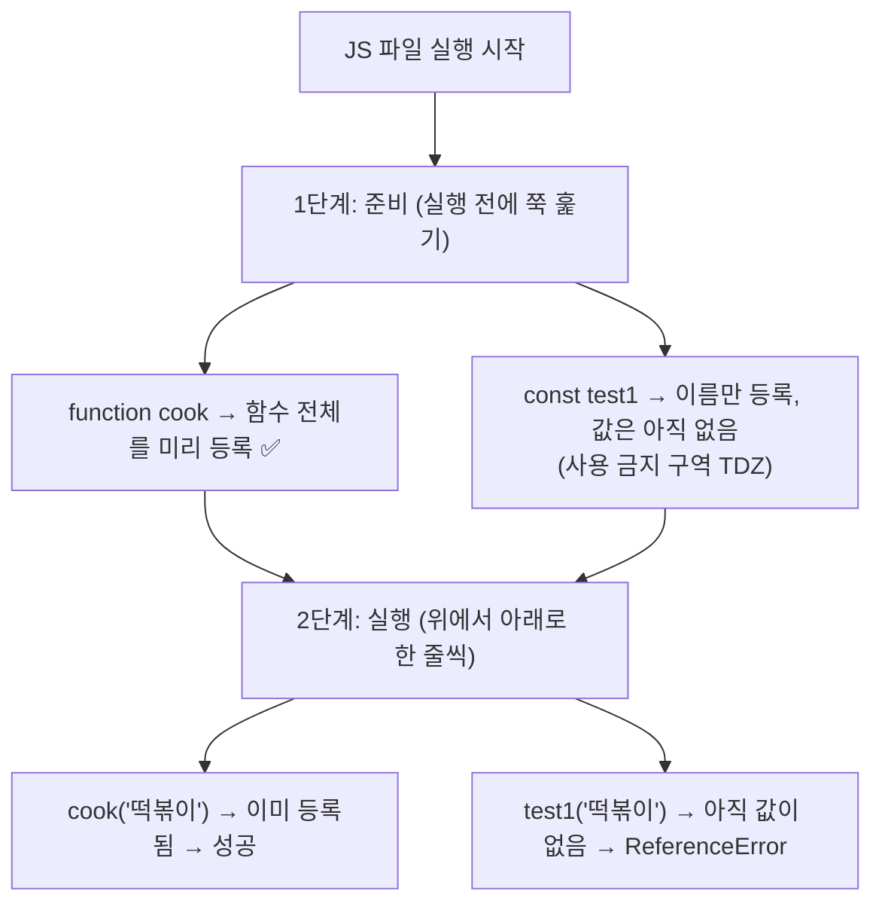
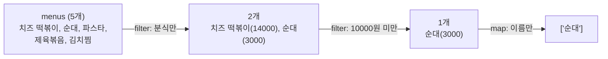
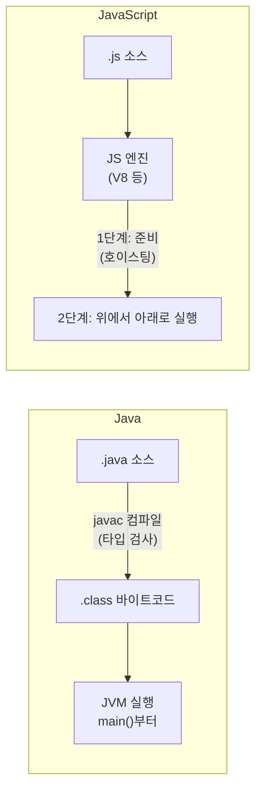
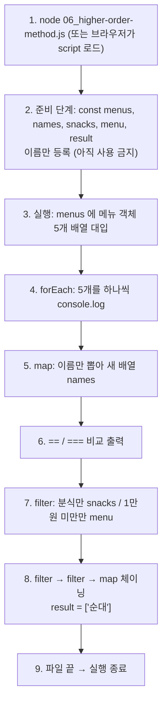

## 들어가며 (Situation)

지금까지는 Java 백엔드(Servlet → Spring → JPA)를 배웠다. 11/04 JPA 미니 프로젝트에서 이미 JavaScript를 잠깐 만났다. 메뉴 등록 화면의 `fetch('/menu/category').then(res => res.json())`이 그것이다.

오늘(11/17)부터 **JavaScript**를 본격적으로 배운다. 첫날은 `01_Core` 폴더의 파일 6개로 **문법의 뼈대**를 익혔다.

| 파일 | 주제 |
|------|------|
| `01_variable.js` | `const`, `let`, 동적 타입, `typeof` |
| `02_object.js` | 객체 `{}`, 프로퍼티 추가·수정 |
| `03_function.js` | 함수 선언문, 함수 표현식, **호이스팅** |
| `04_arrow-function.js` | 화살표 함수 `() => {}` |
| `05_array.js` | 무엇이든 담기는 배열 |
| `06_higher-order-method.js` | 고차함수 `forEach`, `map`, `filter` |

## 문제 상황 (Task)

Java에 익숙한 상태에서 JavaScript를 보면 **비슷하게 생겼는데 규칙이 다르다.**

| 헷갈리는 점 | Java | JavaScript |
|-------------|------|------------|
| 변수 선언 | `String name = "a";` (타입 필수) | `let name = "a";` (타입 없음) |
| 객체 만들기 | 클래스를 먼저 만들고 `new` | `{}`로 바로 만듦 |
| 함수 | 클래스 안의 **메서드**로만 존재 | 함수 혼자 존재, 변수에 담을 수도 있음 |
| 선언 전에 호출 | 메서드 순서 상관없음 | **경우에 따라** 되기도, 안 되기도 함 |

수업 코드에는 **오늘의 미션**도 있었다.

> Java 언어의 동작 원리와 JavaScript 언어의 동작 원리를 비교하고 서로에게 이해시킬 수 있는 자료를 구성하기

그래서 이 글은 **"Java로 치면 무엇인가?"** 를 기준으로 정리한다. 미션용 비교는 맨 뒤 "Java vs JavaScript 동작 원리"에 모았다.

### 쉽게 비유하면

- **Java**는 **이름표가 붙은 서랍장**이다. "양말 서랍"에는 양말만 넣을 수 있다. 다른 걸 넣으려 하면 조립(컴파일)할 때 이미 막힌다.
- **JavaScript**는 **이름표 없는 바구니**다. 양말을 넣었다가 사과를 넣어도 된다. 편하지만, 꺼내 보기 전까지는 뭐가 들었는지 확신할 수 없다.

## 해결 과정 (Action)

### 1. 변수와 동적 타입 — `01_variable.js`

**역할:** `const`/`let`으로 변수를 만들고, 값을 넣을 때마다 타입이 바뀌는 **동적 타입**을 확인한다.

```javascript
// Java : 자료형 변수명 = 리터럴;
// JavaScript : 변수표현식 변수명 = 리터럴;

// const 변수 표현식은 상수의 의미를 가지고 있다.
// 즉 java 에서의 final
const shop = "원티드 식당";
// shop = 1;            // ❌ TypeError: Assignment to constant variable.

let test = 1;
test = "문자열";         // ✅ 숫자 → 문자열로 바꿔도 OK

console.log(test);      // 문자열
```

| 키워드 | 다시 대입 | Java로 치면 | 오늘 수업 |
|--------|-----------|-------------|-----------|
| `const` | ❌ 불가 | `final` 변수 | ✅ |
| `let` | ✅ 가능 | 일반 지역 변수 | ✅ |
| `var` | ✅ 가능 | (옛날 방식, 비슷한 것 없음) | 이름만 등장 |

`var`는 옛날 방식이다. 블록(`{}`)을 무시하는 등 헷갈리는 동작이 많아서 요즘은 `const`를 기본으로 쓰고, 값을 바꿔야 할 때만 `let`을 쓴다.

**동적 타입: 타입은 "넣을 때" 정해진다**

```javascript
let test1;
// typeof : 타입을 반환하는 연산자
console.log(typeof test1);   // undefined

test1 = 1;              console.log(typeof test1);   // number
test1 = "java";         console.log(typeof test1);   // string
test1 = true;           console.log(typeof test1);   // boolean
test1 = null;           console.log(typeof test1);   // object  ← ⚠️
test1 = {};             console.log(typeof test1);   // object
test1 = [];             console.log(typeof test1);   // object  ← ⚠️
test1 = function() {};  console.log(typeof test1);   // function
```

위 주석의 결과는 JavaScript 명세에 정해진 `typeof` 결과값이다(예상 출력).

| 값 | `typeof` 결과 | 주의할 점 |
|----|---------------|-----------|
| 값을 안 넣음 | `undefined` | Java라면 지역 변수를 초기화 안 하고 쓰면 **컴파일 에러** |
| `null` | `object` | JavaScript 초창기부터 내려온 **유명한 버그**인데, 호환성 때문에 고치지 못했다 |
| `[]` | `object` | 배열도 객체의 한 종류다. 배열인지 확인하려면 `Array.isArray([])` |
| `function(){}` | `function` | 함수도 값이라서 변수에 담긴다 |

**🤔 동적 타입의 장단점**

| | 내용 |
|---|------|
| 장점 | 자료형을 신경 쓰지 않고 빠르게 코드를 쓸 수 있다 |
| 단점 | 값이 언제든 다른 타입으로 바뀔 수 있어서, **실행해 보기 전까지는** 코드가 끝까지 잘 동작할지 확신할 수 없다 |

```javascript
// 예시 코드
let test = "문자열";
console.log(test.length);   // 3   (length 는 메서드가 아니라 속성이라 () 없음)

test = 10;
console.log(test.length);   // undefined  ← 에러 없이 조용히 이상한 값이 나옴
```

> 비유: 바구니에 "사과"라고 적힌 메모도 없이 담아 두었다가, 나중에 꺼내서 껍질을 깎으려고 보니 **공**이 들어 있는 상황이다. Java는 바구니에 이름표가 있어서 애초에 공을 못 넣는다.

### 2. 객체 — `02_object.js`

**역할:** 중괄호 `{}`로 **클래스 없이 바로** 객체를 만든다. 객체는 `key: value`(프로퍼티)의 모음이다.

```javascript
// Java 로 치면
// Store : 클래스
// name, category : 클래스의 필드(변수)
// getInfo : 클래스의 메서드
const store = {
    name : '원티드 식당',
    category : '분식',
    getInfo : function() {
        return `${this.name} 은 ${this.category} 전문점 입니다!`
    }
};

console.log(store);
console.log(store.getInfo());   // 원티드 식당 은 분식 전문점 입니다!
```

Java로 같은 걸 만들려면 클래스부터 필요하다.

```java
// 예시 코드: Java 라면
public class Store {
    private String name = "원티드 식당";
    private String category = "분식";

    public String getInfo() {
        return name + " 은 " + category + " 전문점 입니다!";
    }
}
Store store = new Store();
```

**백틱 문자열(템플릿 리터럴)**: `` `${this.name} 은 ...` ``처럼 **백틱(`` ` ``)** 으로 감싸면 `${}` 안에 변수를 바로 넣을 수 있다. Java의 `"..." + name + "..."`보다 읽기 쉽다. 10/28에 Thymeleaf에서 본 `|${price}원 초과|`와 비슷한 모양이다.

**프로퍼티를 나중에 추가·수정하기**

```javascript
const order = { menuName : '치킨' }
console.log(order);          // { menuName: '치킨' }

// 동적으로 프로퍼티 추가
order.sauce = "뿌링클 시즈닝";
console.log(order);          // { menuName: '치킨', sauce: '뿌링클 시즈닝' }

// 프로퍼티 수정
order.sauce = '맛초킹 시즈닝';
console.log(order);          // { menuName: '치킨', sauce: '맛초킹 시즈닝' }
```

**🤔 `const`인데 왜 바꿀 수 있을까?**

`const`는 **"변수가 가리키는 객체를 다른 객체로 바꾸지 마"** 라는 뜻이다. **객체 안의 내용물**을 바꾸는 것은 막지 않는다.

```javascript
// 예시 코드
const order = { menuName: '치킨' };
order.sauce = '양념';         // ✅ 상자 안 내용물 바꾸기 OK
// order = { menuName: '피자' }; // ❌ 상자 자체를 바꿔치기는 불가
```

Java의 `final List<String> list`에 `list.add()`는 되는 것과 같다.

> 비유: `const`는 **사물함 번호**를 고정하는 것이다. 사물함을 다른 번호로 바꿀 수는 없지만, 사물함 **안의 물건**은 넣고 뺄 수 있다.

### 3. 함수 — `03_function.js`

**역할:** 함수를 만드는 두 가지 방법(선언문, 표현식)과 **호이스팅**을 확인한다.

> Java 는 Class 기반의 객체지향 언어라고 한다면, JS 는 function 기반의 객체지향 언어라고 할 수 있다.

#### 함수 선언문 vs 함수 표현식

```javascript
// 함수 선언문
function welcome(name) {
    return `${name} 님 , 반갑습니다~~!`
}
console.log(welcome("조평훈"));

// 함수 표현식 : 함수를 "값"으로 만들어 변수에 담는다
const welcome1 = function welcome1(name) {
    return `${name} 님 , 반갑습니다~~!`
}

const welcome2 = function (name) {        // 이름 없는(익명) 함수
    return `${name} 님 , 반갑습니다~~!`
}

const welcome3 = function hello(name) {   // 변수 이름과 함수 이름이 다름
    return `${name} 님 , 반갑습니다~~!`
}

console.log(welcome1("조평훈"));
console.log(welcome2("조평훈"));
// console.log(hello("조평훈"));   // ❌ ReferenceError: hello is not defined
```

| 방식 | 모양 | 부를 때 쓰는 이름 |
|------|------|-------------------|
| 함수 선언문 | `function welcome() {}` | `welcome` |
| 함수 표현식 (익명) | `const welcome2 = function () {}` | 변수 이름 `welcome2` |
| 함수 표현식 (이름 있음) | `const welcome3 = function hello() {}` | 변수 이름 `welcome3` (`hello`는 **함수 안에서만** 보임) |

`hello("조평훈")`이 주석 처리된 이유가 이것이다. 함수 표현식에 붙인 이름 `hello`는 함수 **안쪽**(예: 자기 자신을 다시 부르는 재귀)에서만 쓸 수 있다. 밖에서는 변수 이름 `welcome3`으로 불러야 한다.

**함수가 "값"이라는 것**이 Java와 가장 큰 차이다. Java의 메서드는 변수에 담을 수 없다. JavaScript 함수는 숫자나 문자열처럼 **변수에 담고, 다른 함수에 넘기고, 돌려받을 수** 있다. 이것이 뒤에 나오는 화살표 함수와 고차함수의 바탕이 된다.

#### 함수 호이스팅

```javascript
/*
    함수 선언문은 런타임 이전에 JS 엔진에 의해 먼저 실행된다(인식).
    따라서 함수 선언문 이전에 해당 함수를 참조하거나
    호출할 수 있게 된다. 이를 호이스팅 이라고 한다.
*/

console.log(cook('떡볶이'));        // ✅ 떡볶이 조리 시~작~!

// 함수 선언
function cook(menuName) {
    return `${menuName} 조리 시~작~!`
}

console.log(test1("떡볶이"))        // ❌ ReferenceError

// 함수 표현식
const test1 = function (menuName) {
    return `${menuName} 조리 시~작~!`
}
```

`cook`은 **선언하기 전에** 불렀는데 잘 동작한다. 하지만 `test1`은 똑같이 선언 전에 불렀는데 에러가 난다. 실행해 보면 `ReferenceError: Cannot access 'test1' before initialization` 같은 에러가 나고, **파일 실행이 거기서 멈춘다.**

**왜 그럴까? JS 엔진은 코드를 두 번 훑는다**



| | 함수 선언문 `function cook(){}` | 함수 표현식 `const test1 = function(){}` |
|---|------|------|
| 1단계(준비)에서 | **함수 전체**가 미리 등록됨 | 변수 이름만 등록, 값은 **아직 없음** |
| 선언 전에 호출하면 | ✅ 동작 | ❌ `ReferenceError` |
| 이유 | 함수 몸통까지 끌어올려짐(호이스팅) | `const`/`let`은 대입하는 줄에 도착해야 값이 생김 |

> 비유: 수업 시작 전에 선생님이 **출석부**를 미리 훑는다고 하자.
> - `function cook`은 출석부에 **이름과 사진, 전화번호까지** 다 적혀 있는 학생이다. 수업 중 언제 불러도 바로 연락된다.
> - `const test1`은 출석부에 **이름만** 적혀 있고 "아직 전학 수속 중"이라고 표시된 학생이다. 그 학생이 실제로 교실에 들어오는 줄(대입하는 줄)이 오기 전에 부르면 "아직 못 불러요!" 에러가 난다.

Java에서는 클래스 안 메서드의 **순서가 상관없다.** 컴파일러가 클래스 전체를 먼저 읽기 때문이다. JavaScript는 **위에서 아래로 실행**하는 스크립트라서 이런 차이가 생긴다.

### 4. 화살표 함수 — `04_arrow-function.js`

**역할:** `function` 키워드를 줄여 쓰는 **화살표 함수** 문법을 익힌다.

```javascript
let message;

message = function() {
    return '주문 접수 OK!👌'
}
console.log(message());

message = () => {
    return '주문 접수 OK!👌'
}
console.log(message());

// 화살표 함수란?
// function 키워드와 중괄호 블럭 , return 키워드를 생략하는 문법이다.
// 주의 : 중괄호 블럭 내에 코드가 많으면 생략할 수 없다.
message = () => '주문 접수 OK!👌'

// 매개변수가 있는 화살표 함수
message = (menuName, menuPrice) => `${menuName} 의 가격 ${menuPrice}`

// 매개변수가 1개 있을 때는 소괄호도 생략이 가능하다.
message = menuName => `${menuName} !!`

console.log(message("신전떡볶이"));   // 신전떡볶이 !!
```

같은 함수가 점점 짧아지는 과정을 보면 다음과 같다.

| 단계 | 코드 | 줄인 것 |
|------|------|---------|
| 1 | `function(name) { return name + '!!' }` | - |
| 2 | `(name) => { return name + '!!' }` | `function` → `=>` |
| 3 | `(name) => name + '!!'` | 한 줄이면 `{}`와 `return` 생략 |
| 4 | `name => name + '!!'` | 매개변수가 1개면 `()` 생략 |

매개변수가 **0개**이거나 **2개 이상**이면 `()`를 꼭 써야 한다. 몸통이 **여러 줄**이면 `{}`와 `return`도 꼭 써야 한다.

**Java 람다와 똑같이 생겼다**

> 화살표 함수를 본따서 Java 에서는 람다 표현식이 등장하기도 하였다.

| JavaScript | Java |
|------------|------|
| `price => price * 0.9` | `price -> price * 0.9` |
| `arr.map(price => price * 0.9)` | `list.stream().map(price -> price * 0.9)` |

11/04 JPA 미니 프로젝트의 `menuList.stream().map(MenuDTO::from)`이 바로 이 모양이었다. 화살표가 `=>`(JS)인지 `->`(Java)인지만 다르다.

```javascript
// 메뉴가격 10% 할인!
const menuPriceList = [4000, 5000 , 140000];
console.log(menuPriceList.map( function(price) {return price * 0.9} ))
console.log(menuPriceList.map( price =>  price * 0.9 ))
// 두 줄 모두 [ 3600, 4500, 126000 ] (예상 출력)
```

### 5. 배열 — `05_array.js`

**역할:** JavaScript 배열은 **아무 타입이나 섞어서** 담을 수 있다는 것을 확인한다.

```javascript
// 1. 배열 리터럴을 통해 생성
const menus = ['제육', '떡볶이' , '순대' , 1 , {name : 'hi'} , function() {}];

for (let i = 0; i < menus.length; i++) {
    console.log(menus[i]);
}
```

| | Java 배열 | JavaScript 배열 |
|---|-----------|-----------------|
| 담을 수 있는 값 | 선언한 **한 가지 타입**만 (`String[]`) | 문자열, 숫자, 객체, 함수 **섞어서** |
| 크기 | 만들 때 고정 | 자유롭게 늘고 줄어듦 (`push`, `pop`) |
| 비슷한 Java 도구 | - | `ArrayList<Object>`에 가까움 |

섞어 담을 수 있다는 건 편하지만 위험하기도 하다. 위 배열에 `menus[i].length`를 하면 문자열은 글자 수, 숫자는 `undefined`가 나온다. 실무에서는 보통 **같은 모양의 값**(예: 메뉴 객체들)만 담는다. 다음 파일의 `menus`가 그 예다.

### 6. 고차함수 — `06_higher-order-method.js`

**역할:** 배열의 내장 고차함수 `forEach`, `map`, `filter`로 for문 없이 배열을 다룬다.

> 고차함수란? **함수를 인자로 전달 받거나, 함수를 반환하는 함수.** 배열의 고차 함수는 **콜백 함수**를 인자로 받아 배열의 요소를 순회하며 처리하게 된다.

```javascript
const menus = [
    { name: '치즈 떡볶이' , category : '분식' , price : 14000 },
    { name: '순대' , category : '분식' , price : 3000 },
    { name: '파스타' , category : '양식' , price : 19000 },
    { name: '제육볶음' , category : '한식' , price : 10000 },
    { name: '김치찜' , category : '한식' , price : 8000 }
];
```

#### `forEach` — 하나씩 꺼내서 일 시키기

```javascript
// forEach : 배열의 각 요소마다 콜백 함수를 실행(반환값 없음)
menus.forEach( menu => console.log(menu) );
```

#### `map` — 하나씩 바꿔서 새 배열 만들기

```javascript
// map : 콜백 함수의 반환 값으로 새로운 배열을 return
const names = menus.map( menu => menu.name );
console.log(names);
// [ '치즈 떡볶이', '순대', '파스타', '제육볶음', '김치찜' ]
```

#### `filter` — 조건에 맞는 것만 골라 새 배열 만들기

```javascript
// filter : 콜백 함수의 반환값이 true 인 요소만 모아 새로운 배열 return
const snacks = menus.filter( menu => menu.category === '분식' );
// → 치즈 떡볶이, 순대

// 가격이 10000원 미만인 메뉴들만 필터링
const menu = menus.filter( menu => menu.price < 10000 );
// → 순대(3000), 김치찜(8000)
```

| 고차함수 | 콜백이 돌려주는 것 | 결과 | 원래 배열 길이 5개일 때 결과 길이 |
|----------|---------------------|------|-----------------------------------|
| `forEach` | (상관없음) | **없음**(`undefined`) | - |
| `map` | 바뀐 값 | 새 배열 | **항상 5개** |
| `filter` | `true` / `false` | 새 배열 | **0~5개** (true인 것만) |

> 비유: 급식 줄에 학생 5명이 서 있다.
> - `forEach`: 선생님이 한 명씩 **"안녕!" 인사만** 한다. 남는 건 없다.
> - `map`: 한 명씩 **이름표만 떼어서** 모은다. 5명이니 이름표도 5장이다.
> - `filter`: **"분식 좋아하는 사람만 손 들어!"** 손 든 학생만 새 줄로 세운다.

#### `==` vs `===`

`filter` 조건에 `===`를 쓴 이유도 배웠다.

```javascript
// == : 동등 비교 (암묵적으로 타입 변환을 통해 같은 값인지 비교)
// === : 일치 비교 (타입과 값이 모두 일치)
console.log(` 1 == '1' : ${1 == '1'}`);     //  1 == '1' : true
console.log(` 1 === '1' : ${1 === '1'}`);   //  1 === '1' : false
```

| 연산자 | 비교 방법 | `1` vs `'1'` |
|--------|-----------|--------------|
| `==` | 타입이 다르면 **몰래 바꿔서** 비교 | `true` (숫자 1로 바꿔서 같다고 봄) |
| `===` | 타입과 값 **둘 다** 같아야 함 | `false` (숫자 ≠ 문자열) |

`==`는 예상 못 한 결과를 만들기 쉽다. 그래서 **항상 `===`를 쓰는 습관**을 들이자. 동적 타입 언어라서 생기는 주의점이다.

#### 고차함수 이어 붙이기 (체이닝)

```javascript
// 분식 중에서 가격이 1만원 미만인 메뉴의 이름 목록
const result = menus
                // 분식들만 모인 메뉴 배열이 된다.
                .filter(menu => menu.category === '분식')
                // 10000원 미만 분식이 모인 메뉴 배열이 된다.
                .filter(menu => menu.price < 10000)
                // 메뉴 이름 return 해서 배열을 만든다.
                .map(menu => menu.name)

console.log(result);   // [ '순대' ]
```



각 단계가 **새 배열**을 돌려주기 때문에 `.`으로 계속 이어 붙일 수 있다. 원래 `menus` 배열은 바뀌지 않는다. Java Stream의 `list.stream().filter(...).filter(...).map(...).toList()`와 같은 흐름이다.

for문으로 쓰면 이렇게 길어진다.

```javascript
// 예시 코드: 같은 일을 for 문으로
const result2 = [];
for (let i = 0; i < menus.length; i++) {
    if (menus[i].category === '분식' && menus[i].price < 10000) {
        result2.push(menus[i].name);
    }
}
```

| 비교 | for문 | 고차함수 체이닝 |
|------|-------|-----------------|
| 읽는 법 | "i를 0부터… if… push…" **어떻게** 하는지 읽어야 함 | "분식만 → 만 원 미만만 → 이름만" **무엇을** 하는지 바로 보임 |
| 빈 배열 준비 | 직접 `[]` 만들고 `push` | 자동으로 새 배열 |
| 원본 배열 | 실수로 바꿀 수 있음 | 바뀌지 않음 |

### 시행착오: 다시 볼 부분

#### ① `03_function.js`는 끝까지 실행되지 않는다

호이스팅을 보여 주려고 넣은 `console.log(test1("떡볶이"))`에서 `ReferenceError`가 나면, **그 아래 코드는 실행되지 않는다.** 파일을 실행하면 `cook` 결과까지만 찍히고 에러로 멈추는 게 정상이다. 일부러 낸 에러이니 확인한 뒤에는 그 줄을 주석 처리하고 다음 내용을 실행하면 된다.

#### ② 주석 속 `test.length()`

`01_variable.js` 주석에 `test.length(); == 3`이라고 적혀 있다. 하지만 JavaScript 문자열의 `length`는 **메서드가 아니라 속성**이라서 `test.length`로 써야 한다. `test.length()`라고 쓰면 `TypeError: test.length is not a function`이 난다. Java의 `str.length()`와 헷갈리기 쉬운 부분이다.

| | Java | JavaScript |
|---|------|------------|
| 문자열 길이 | `str.length()` (메서드) | `str.length` (속성) |
| 배열 길이 | `arr.length` (속성) | `arr.length` (속성) |

#### ③ 객체 메서드에 화살표 함수를 쓰면?

`store.getInfo`는 `function`으로 만들었기 때문에 `this`가 `store`를 가리킨다. 이걸 화살표 함수로 바꾸면 결과가 달라진다.

```javascript
// 예시 코드
const store2 = {
    name: '원티드 식당',
    getInfo: () => `${this.name} 입니다`   // ⚠️ 화살표 함수
};
console.log(store2.getInfo());   // "undefined 입니다" (환경에 따라 다를 수 있음)
```

화살표 함수는 **자기만의 `this`를 갖지 않는다.** 그래서 `this.name`이 `store2.name`을 가리키지 않는다. 객체의 메서드는 `function`(또는 `getInfo() { ... }` 축약 문법)으로 만들고, 콜백(`map`, `filter` 안)에는 화살표 함수를 쓰는 게 안전하다. 수업에서 직접 다룬 내용은 아니니 [MDN 화살표 함수 문서](https://developer.mozilla.org/ko/docs/Web/JavaScript/Reference/Functions/Arrow_functions)에서 확인해 보자.

### 오늘의 미션: Java vs JavaScript 동작 원리

수업 미션("두 언어의 동작 원리를 비교하고 서로에게 이해시킬 수 있는 자료")을 위해 정리한 표다.

| 비교 항목 | Java | JavaScript |
|-----------|------|------------|
| 실행 방식 | `.java` → **컴파일**(`javac`) → `.class` 바이트코드 → **JVM**이 실행 | `.js` 소스를 **JS 엔진**(Chrome V8 등)이 바로 읽어 실행 (내부적으로 JIT 컴파일) |
| 실행 시작점 | `public static void main()` | 파일 **맨 위부터 아래로** |
| 실행 장소 | JVM이 설치된 곳 (서버) | **브라우저**, 또는 Node.js |
| 타입 | **정적 타입**: 선언할 때 타입 고정, 컴파일 때 검사 | **동적 타입**: 대입할 때 타입 결정, 실행해 봐야 앎 |
| 타입 에러 발견 시점 | 컴파일할 때 (실행 전) | 실행하다가 (또는 에러 없이 `undefined`) |
| 객체 만들기 | 클래스 → `new` | `{}` 리터럴로 바로 (클래스 문법도 있음) |
| 함수 | 클래스에 속한 **메서드** | 혼자 존재하는 **값** (변수에 담고, 넘기고, 돌려받음) |
| 선언 순서 | 메서드 순서 상관없음 | 선언문은 호이스팅, `const`/`let`은 선언 후에만 사용 |
| 짧은 함수 | 람다 `x -> x * 2` | 화살표 함수 `x => x * 2` |
| 컬렉션 가공 | Stream `filter().map().toList()` | 배열 `filter().map()` |
| 같은지 비교 | `==`(기본형 값 / 참조 주소), `equals()` | `==`(타입 변환 후 비교), `===`(타입까지 비교) |



> 한 줄 비유: **Java는 "검사를 다 받고 출발하는 비행기"**, **JavaScript는 "일단 출발하고 가면서 길을 확인하는 자전거"** 다. 비행기는 출발 전 점검(컴파일)이 길지만 하늘에서 문제가 덜 생긴다. 자전거는 바로 출발할 수 있지만 길 위에서 넘어질 수 있다(실행 중 에러).

### 오늘의 JavaScript 흐름 한눈에 보기

`06_higher-order-method.js`를 실행하면 JS 엔진이 하는 일을 따라가 보자.



초등학생에게 설명하듯 정리하면 이렇다.

1. **책 펼치기**: JS 엔진이 파일을 연다. Java처럼 `main()`을 찾지 않고 **첫 줄부터** 읽을 준비를 한다.
2. **출석부 훑기**: 먼저 쭉 훑어보면서 등장하는 이름(`menus`, `names`...)을 출석부에 적는다. `const`라서 아직 "사용 금지" 표시를 해 둔다.
3. **급식 줄 세우기**: `menus`에 메뉴 5개를 담는다. 이제 `menus`를 써도 된다.
4. **인사하기(`forEach`)**: 메뉴를 하나씩 불러서 화면에 보여 준다.
5. **이름표 모으기(`map`)**: 메뉴마다 이름만 떼어 새 줄(`names`)에 모은다.
6. **손 들기(`filter`)**: "분식인 사람 손 들어!" 손 든 메뉴만 새 줄(`snacks`)에 세운다.
7. **여러 번 거르기(체이닝)**: 분식만 → 그중 만 원 미만만 → 이름만. 체에 세 번 거르니 `['순대']`만 남는다.
8. **책 덮기**: 마지막 줄까지 읽으면 끝난다.

## 결과 (Result)

같은 일을 Java와 JavaScript로 했을 때 코드 양을 비교하면 다음과 같다.

| 하는 일 | Java | JavaScript |
|---------|------|------------|
| 가게 정보 객체 1개 | 클래스 파일 + 필드 2개 + 메서드 + `new` (약 10줄) | `{}` 리터럴 (약 6줄) |
| 메뉴 가격 10% 할인 목록 | `list.stream().map(p -> p * 0.9).toList()` | `list.map(p => p * 0.9)` |
| 분식·만 원 미만 이름 목록 | `stream().filter().filter().map().toList()` | `filter().filter().map()` (for문 대비 약 6줄 → 4줄) |

**배운 점**

- JavaScript는 **동적 타입**이라 빠르게 쓸 수 있지만, 타입 실수는 **실행해 봐야** 드러난다. 그래서 `===`, `typeof`, `Array.isArray` 같은 확인 도구를 습관처럼 써야 한다.
- 함수가 **값**이라는 점이 핵심이다. 함수를 변수에 담고, 다른 함수(`map`, `filter`)에 넘길 수 있어서 고차함수가 가능하다.
- `function` 선언문은 **호이스팅**되어 위에서 불러도 되지만, `const`로 만든 함수 표현식은 선언 줄 이후에만 쓸 수 있다.
- 화살표 함수와 고차함수는 Java의 **람다**, **Stream**과 거의 같은 모양이다. 지난주 JPA 프로젝트에서 쓴 `stream().map(MenuDTO::from)`의 감각을 그대로 가져올 수 있다.

## 더 학습하면 좋은 개념

- **실행 컨텍스트와 TDZ(Temporal Dead Zone)** — 오늘 본 호이스팅의 진짜 원리다. `var`는 `undefined`로, `let`/`const`는 "사용 금지 구역"으로 미리 등록되는 이유를 이해할 수 있다.
- **`this` 바인딩** — 같은 `this`라도 일반 함수, 메서드, 화살표 함수에서 가리키는 대상이 다르다. 객체와 이벤트 처리를 할 때 가장 많이 헷갈리는 부분이다.
- **스코프와 클로저** — 함수가 "값"이라는 특징 때문에 생기는 개념이다. 함수가 자신이 만들어진 곳의 변수를 기억하는 현상으로, 고차함수를 깊게 쓰려면 필요하다.
- **`reduce`, `find`, `some`/`every`** — 오늘 배운 `forEach`/`map`/`filter`에 이어지는 배열 고차함수다. 합계 구하기, 하나만 찾기, 조건 검사에 쓴다.
- **Promise와 `fetch`, `async`/`await`** — 11/04 메뉴 등록 화면의 `fetch().then()`이 이것이다. 서버(Spring)와 데이터를 주고받으려면 꼭 알아야 한다.

## 참고 자료

- [MDN - JavaScript 안내서: 문법과 자료형](https://developer.mozilla.org/ko/docs/Web/JavaScript/Guide/Grammar_and_types)
- [MDN - const](https://developer.mozilla.org/ko/docs/Web/JavaScript/Reference/Statements/const)
- [MDN - typeof](https://developer.mozilla.org/ko/docs/Web/JavaScript/Reference/Operators/typeof)
- [MDN - 함수](https://developer.mozilla.org/ko/docs/Web/JavaScript/Guide/Functions)
- [MDN - 호이스팅 (용어 사전)](https://developer.mozilla.org/ko/docs/Glossary/Hoisting)
- [MDN - 화살표 함수 표현](https://developer.mozilla.org/ko/docs/Web/JavaScript/Reference/Functions/Arrow_functions)
- [MDN - Array.prototype.map()](https://developer.mozilla.org/ko/docs/Web/JavaScript/Reference/Global_Objects/Array/map)
- [MDN - Array.prototype.filter()](https://developer.mozilla.org/ko/docs/Web/JavaScript/Reference/Global_Objects/Array/filter)
- [MDN - 동치 비교 및 동일성](https://developer.mozilla.org/ko/docs/Web/JavaScript/Equality_comparisons_and_sameness)
