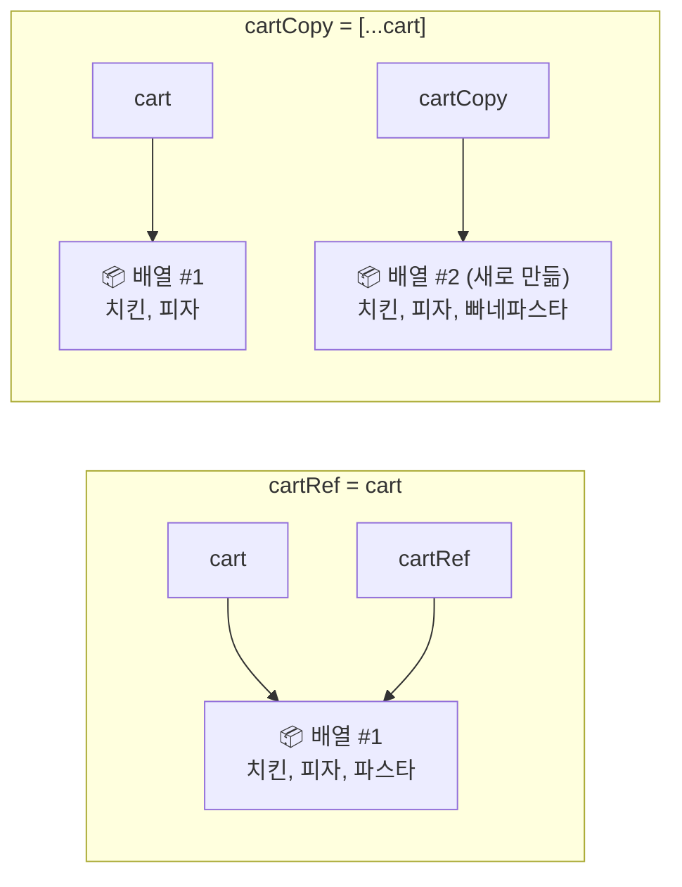
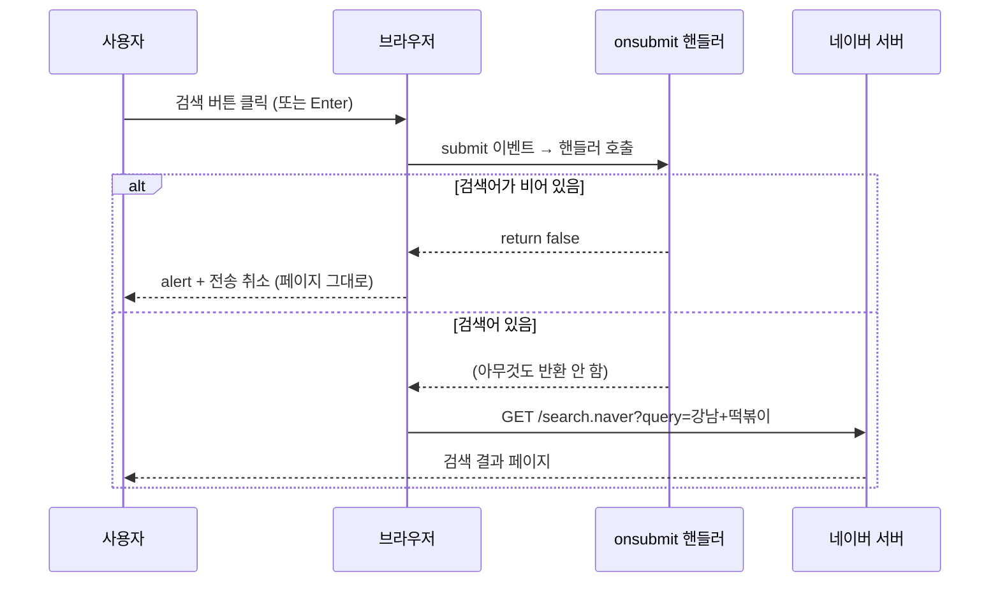
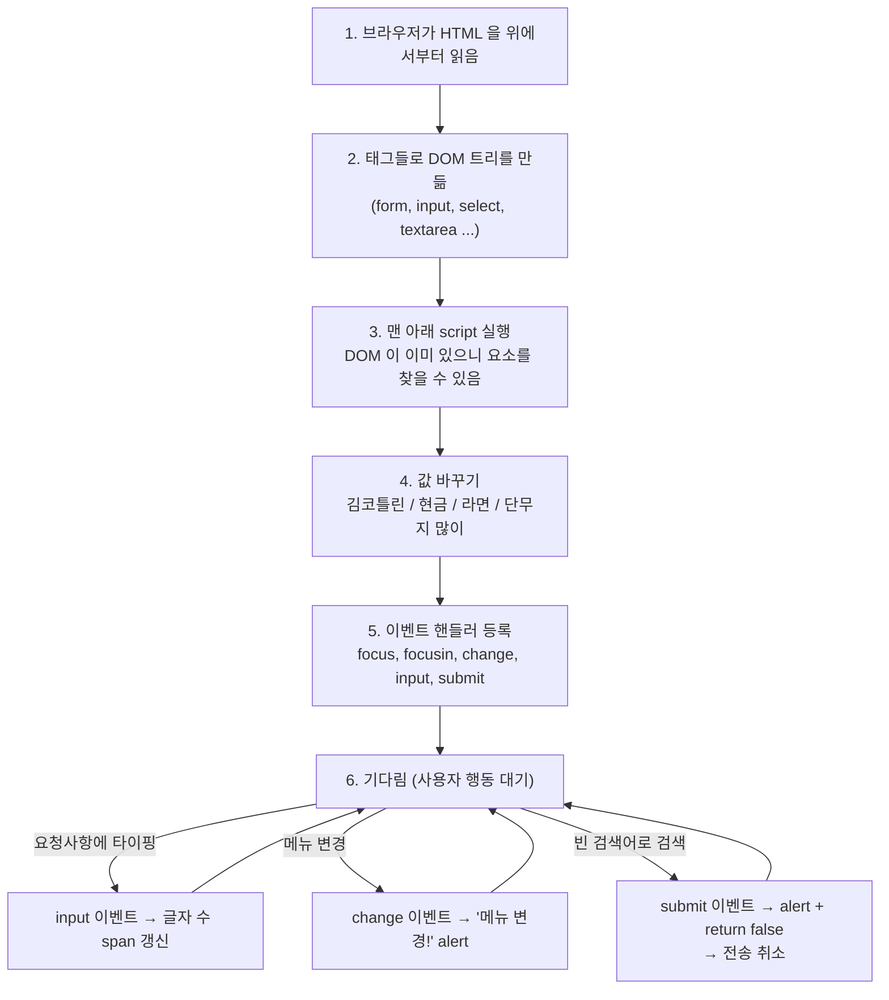

## 들어가며 (Situation)

어제(11/17)는 `01_Core`에서 변수, 객체, 함수, 고차함수까지 **JavaScript 문법의 뼈대**를 배웠다.

오늘(11/18)은 문법을 두 개 더 배운 뒤, 드디어 **브라우저 화면(HTML)을 JavaScript로 움직이는 법**으로 넘어갔다. 이때부터 `.js` 파일 대신 `.html` 파일 안의 `<script>` 태그에 코드를 쓴다.

## 문제 상황 (Task)

Java 백엔드에서는 화면을 바꾸려면 **서버에 다시 요청**해야 했다. Thymeleaf로 HTML을 새로 만들어서 통째로 돌려주는 방식이다.

| 하고 싶은 일 | 서버(Spring + Thymeleaf)로 하면 | 브라우저(JavaScript)로 하면 |
|--------------|-------------------------------|-----------------------------|
| 버튼 누르면 알림 띄우기 | 요청 → 새 페이지 응답 | `addEventListener('click', ...)` 한 줄 |
| 글자 수 실시간 표시 | 사실상 불가능 | `input` 이벤트로 바로 갱신 |
| 빈 검색어 막기 | 서버까지 갔다가 에러 페이지 | `submit` 이벤트에서 전송 취소 |

그래서 오늘 풀어야 할 문제는 세 가지였다.

1. 배열·객체를 **안전하게 복사**하려면? (스프레드, 구조 분해)
2. HTML 안의 특정 태그를 JavaScript가 **어떻게 찾아오나?** (DOM 요소 취득)
3. 사용자가 클릭·입력했을 때 **어떻게 반응하나?** (이벤트)

### 쉽게 비유하면

- **HTML**은 **레고로 만든 집**이다.
- **DOM**은 그 집의 **설계도 겸 리모컨**이다. 브라우저가 HTML을 읽어서 "이 방엔 문 2개, 창문 1개" 하고 나무 모양(트리)으로 정리해 둔다.
- **JavaScript**는 리모컨을 쥔 **나**다. "2층 창문 찾아서(요소 취득) → 노란색으로 칠해(style 변경)", "초인종 누르면(이벤트) → 문 열어(핸들러)"처럼 명령한다.

## 해결 과정 (Action)

### 1. 스프레드 문법 — `07_spread-syntax.js`

**역할:** `...`을 써서 배열과 객체를 **새로 복사**한다. 그냥 `=`로 대입했을 때와 무엇이 다른지 비교한다.

```javascript
const cart = ['치킨' , '피자'];
const cartRef = cart;          // 주소값을 복사 (같은 배열을 가리킴)
const cartCopy = [...cart];    // 값만 복사해서 새로운 배열 생성

cartRef.push('파스타');
console.log(cart , cartRef);
// ['치킨', '피자', '파스타'] ['치킨', '피자', '파스타']   ← 원본도 바뀜!

cartCopy.push('빠네파스타');
console.log(cart , cartCopy);
// ['치킨', '피자', '파스타'] ['치킨', '피자', '파스타', '빠네파스타']  ← 원본은 그대로
```

> 위 주석의 출력값은 코드를 직접 실행해 확인한 것이 아니라 **예상 출력**이다.

비유로 보면 이렇다.

- `cartRef = cart` 는 **장바구니 사진을 찍는 것이 아니라, 같은 장바구니에 손잡이를 하나 더 다는 것**이다. 누가 어느 손잡이로 넣든 같은 바구니에 들어간다.
- `[...cart]` 는 **새 장바구니를 하나 사서 물건을 똑같이 옮겨 담는 것**이다. 새 바구니에 넣어도 원래 바구니는 그대로다.



객체도 똑같이 `{...order}`로 복사한다.

```javascript
const order = { menuName : '뿌링클', qty : 2 };

const orderRef = order;
const orderCopy = {...order};   // 값만 복사 / 주소는 새롭게 만들어짐

console.log(order === orderRef);   // true  (같은 객체)
console.log(order === orderCopy);  // false (내용은 같아도 다른 객체)
```

수업 주석에 정리된 **주소 공유의 단점**은 이것이다.

> 메뉴 데이터를 이곳저곳에서 사용할 때, 주소만 공유하면 한 군데에서 수정했을 때 다른 곳에서는 영문도 모른 채 값이 변경된다.

Java에서 `List<String> b = a;` 하면 같은 리스트를 가리키고, `new ArrayList<>(a)` 해야 새 리스트가 생기는 것과 같은 원리다.

### 2. 구조 분해 할당 — `08_destructuring.js`

**역할:** 배열이나 객체 안의 값을 **한 줄로 꺼내서 각각의 변수**에 담는다.

```javascript
const menuArr = ['치킨' , '피자'];

// 기존 방식
const chi = menuArr[0];
const piz = menuArr[1];

// 구조 분해 할당 : 순서대로 꺼냄
const [chi1 , piz1] = menuArr;
console.log(chi1);  // 치킨
console.log(piz1);  // 피자
```

객체는 **순서가 아니라 이름(key)으로** 꺼낸다.

```javascript
const menu = { name : '치즈알밥', price : 7500, category : '퓨전한식' };

// 객체 구조 분해 할당 시에는 프로퍼티 key 와
// 사용할 변수명이 일치해야 된다.
const {name , price , category} = menu;
console.log(name , price , category);  // 치즈알밥 7500 퓨전한식

// 스프레드 문법과 결합하면 객체 복사도 가능
const {...rest} = menu;
console.log(rest);  // { name: '치즈알밥', price: 7500, category: '퓨전한식' }
```

| 구분 | 배열 구조 분해 | 객체 구조 분해 |
|------|----------------|----------------|
| 모양 | `const [a, b] = arr` | `const {name, price} = obj` |
| 꺼내는 기준 | **순서**(0번, 1번…) | **key 이름** |
| 변수 이름 | 마음대로 지어도 됨 | key와 **같아야** 함 (다르게 쓰면 `undefined`) |

비유하면 **배열은 번호표 순서대로 줄 선 친구들**이라 "첫 번째, 두 번째"로 부르고, **객체는 이름표 단 친구들**이라 "name 나와!"처럼 이름으로 불러야 한다.

### 3. DOM 요소 취득 — `01_get-element.html`

**역할:** `document`에서 원하는 태그를 찾아와 변수에 담고, 스타일을 바꿔 본다.

> JS 는 html + css 로 구성되어 있는 Document 에 접근할 수 있는 프로그래밍 언어이다. (수업 주석)

```html
<div id="store" class="area">
    냠냠분식 본점
    <p id="notice">오늘의 공지 : 떡볶이 1+1</p>
</div>
<div id="store" class="area">냠냠분식 2호점 (id 중복!)</div>
```

```javascript
// id 값으로 요소 노드 취득하기
const $store = document.getElementById('store');
$store.style.backgroundColor = 'yellow';
```

id가 `store`인 div가 2개인데, `getElementById`는 **처음 만난 하나(본점)만** 돌려준다. 그래서 본점만 노랗게 칠해진다. id는 원래 페이지에서 하나만 써야 하는 이름표다.

> 변수 앞의 `$`는 문법이 아니라 **"이 변수에는 DOM 요소가 들어 있다"는 표시**(관례)다.

#### 여러 개를 가져오면 "배열 비슷한 것"이 온다

```javascript
const $snack = document.getElementById('snack');
// id 가 snack 인 ul 태그 하위의 li 태그만 가져오기
const $snackLiList = $snack.getElementsByTagName('li');
// HTMLCollection 타입의 li list 가 반환된다.

// Array.from() 으로 진짜 배열로 변환해야
// forEach , filter , map 같은 배열 전용 메서드를 쓸 수 있다.
const liList = Array.from($snackLiList);
liList.forEach( li => li.style.color = 'red' );
```

`HTMLCollection`은 **유사 배열**이다. 번호(`[0]`)와 `length`는 있지만 어제 배운 `forEach`, `map`, `filter`가 없다. 비유하면 **줄은 서 있지만 반장(배열 메서드)이 없는 무리**라서, `Array.from()`으로 정식 반(배열)을 만들어 줘야 반장에게 일을 시킬 수 있다.

#### CSS 선택자로 가져오기 (권장)

```javascript
// querySelector : 조건에 맞는 요소 중 1번째 하나만 반환
// querySelectorAll : 조건에 맞는 요소들을 모두 반환
const $box = document.querySelector(".box");
$box.style.backgroundColor = 'green';   // "오늘의 추천 메뉴" 박스만 초록색
```

| 메서드 | 찾는 기준 | 돌려주는 것 |
|--------|-----------|-------------|
| `getElementById('store')` | id | 요소 **1개** (없으면 `null`) |
| `getElementsByTagName('li')` | 태그 이름 | `HTMLCollection` (여러 개) |
| `getElementsByClassName('menu')` | class | `HTMLCollection` (여러 개) |
| `querySelector('.box')` | **CSS 선택자** | 첫 번째 요소 **1개** |
| `querySelectorAll('.drink')` | **CSS 선택자** | `NodeList` (여러 개, `forEach` 사용 가능) |

`querySelector`가 권장되는 이유는 CSS에서 쓰던 선택자(`#id`, `.class`, `ul > li`, `input[name=query]`)를 **그대로** 쓸 수 있어서 하나만 익히면 되기 때문이다.

### 4. 이벤트 핸들러 등록과 제거 — `01_event-handler.html`

**역할:** "버튼을 누르면 이 함수를 불러 줘"라고 브라우저에 맡기는 방법 3가지를 비교하고, 맡긴 일을 취소하는 법을 배운다.

> 이벤트 핸들러: 이벤트가 발생했을 때 브라우저에 호출을 위임한 함수. 이 위임하는 것을 **이벤트 핸들러 등록**이라고 한다. (수업 설명)

비유하면 **초인종**이다. "초인종이 울리면(이벤트) 문을 열어 줘(핸들러)"라고 브라우저에게 부탁해 두는 것이다. 언제 울릴지는 모르니, 울릴 때 브라우저가 대신 불러 준다.

#### (1) 어트리뷰트 방식 — HTML 태그에 직접

```html
<button onclick="alert('주문 완료!'); console.log('주문 완료!');">주문하기</button>
<button onmouseover="recommend('김자바');">오늘의 추천 메뉴</button>
```

```javascript
function recommend(name) {
    alert(`${name} 님 , 오늘은 제육을 먹어봐요!`);
}
```

`on` + 이벤트 이름(`onclick`, `onmouseover`) 속성에 **함수 호출문**(`recommend('김자바')`)을 문자열로 적는다. HTML과 JS가 섞여서 관리하기 어렵다.

#### (2) 프로퍼티 방식 — 요소의 `onclick`에 함수 대입

```javascript
const $btnProp = document.getElementById('btn-prop');

$btnProp.onclick = function() {
    alert("프로퍼티 방식으로 이벤트 핸들러 등록!!");
}

// 프로퍼티 방식은 하나의 이벤트에 1개의 이벤트 핸들러만 등록 가능
// 덮어씌워지게 된다.
$btnProp.onclick = () => alert("두번째 이벤트 핸들러 등록!!");
```

버튼을 누르면 **"두번째 이벤트 핸들러 등록!!"만** 뜬다. `onclick`은 변수 하나라서 두 번째로 대입한 함수가 첫 번째를 지워 버린다.

#### (3) `addEventListener` 방식 — 권장

```javascript
const $btnListener = document.getElementById('btn-listener');
// 1번째 인자 : 이벤트 종류 (click, dblclick, mouseover ...)
// 2번째 인자 : 이벤트 발생 시 동작시킬 함수
$btnListener.addEventListener('click', function() {
    alert('결제 완료!')
});

$btnListener.addEventListener('click', function() {
    alert('2번째 addEvent 동작!')
});
```

이번에는 **"결제 완료!" → "2번째 addEvent 동작!"이 차례로 둘 다** 뜬다. 등록한 순서대로 모두 실행된다.

#### (4) 이벤트 핸들러 제거

```javascript
const $btnRemove = document.getElementById('btn-remove');

const handleMouseOver = () => alert('결제 버튼에 마우스 호버!');

// 외부에 정의한 함수를 참조
$btnRemove.addEventListener('mouseover' , handleMouseOver);
// 조건에 따라서 이벤트를 제거해야 할 때 사용 (if 문과 같이 사용됨)
$btnRemove.removeEventListener('mouseover' , handleMouseOver);
```

등록하자마자 제거했으니 "쿠폰 받기" 버튼에 마우스를 올려도 아무 일도 없다. 중요한 점은 **제거하려면 등록할 때와 "같은 함수"를 넘겨야 한다**는 것이다. 그래서 함수를 `handleMouseOver`라는 변수에 따로 담아 두었다. `addEventListener('mouseover', () => alert(...))`처럼 바로 써 넣은 함수는 이름이 없어서 나중에 가리킬 방법이 없다.

| 방식 | 쓰는 곳 | 같은 이벤트에 여러 개 | 제거 |
|------|---------|----------------------|------|
| 어트리뷰트 `onclick="..."` | HTML | ❌ | 속성 지우기 |
| 프로퍼티 `$el.onclick = fn` | JS | ❌ (덮어씀) | `$el.onclick = null` |
| `addEventListener` | JS | ✅ (순서대로 모두 실행) | `removeEventListener(같은 함수)` |

### 5. 이벤트 객체와 `this` — `02_event-object.html`

**역할:** 이벤트가 일어나면 브라우저가 건네주는 **이벤트 객체 `e`** 에서 정보(클릭 좌표 등)를 꺼내 쓴다.

```javascript
const $msg = document.querySelector('.message');

/*
    이벤트가 발생하면 내부적으로 이벤트 객체가 생기고,
    이벤트 객체는 매개변수로 전달 받을 수 있다.
*/
function showCoords(e) {
    console.log(e);
    $msg.textContent = `배달 위치 : ${e.clientX} , ${e.clientY}`;
}

// html 전역(document)에 click 이벤트 등록
document.onclick = showCoords;
```

화면 아무 곳이나 클릭하면 "배달 위치 : 123 , 45"처럼 **클릭한 좌표**가 표시된다. 비유하면 이벤트 객체는 **택배 송장**이다. "언제, 어디서(좌표), 누가(어떤 요소), 무슨 일(click)"이 적혀서 핸들러에게 함께 배달된다.

어트리뷰트 방식에서는 `event`라는 이름으로 넘겨야 한다.

```html
<div class="map" onmouseover="showMapCoords(event)">지도 영역 내부</div>
```

```javascript
const $map = document.querySelector('.map');
function showMapCoords(e) {
    $map.textContent = `지도 : ${e.clientX} , ${e.clientY}`;
}
```

#### 이벤트 핸들러 안의 `this`

```html
<button onclick="handleClick1()">떡볶이</button>
<button onclick="handleClick2(this)">순대</button>
```

```javascript
function handleClick1() {
    // 일반 함수 내부에서 this 를 출력하면
    // 전역 객체인 window 객체가 나온다.
    console.log('click1' , this);   // window
}

function handleClick2(btn) {
    // 호출할 때 this 를 넘겨주면
    // 이벤트가 걸린 DOM 요소(순대 버튼)가 들어온다.
    console.log('click2' , btn);    // <button>순대</button>
}
```

| 호출 모양 | 함수 안에서 받는 것 |
|-----------|---------------------|
| `onclick="handleClick1()"` 안에서 `this` | `window` (전역 객체) |
| `onclick="handleClick2(this)"` 의 인자 | **클릭된 버튼 요소** |

`onclick="..."` 속성 안에 쓴 `this`는 그 버튼 자신이다. 하지만 그 안에서 `handleClick1()`처럼 **일반 함수로 부르면** 함수 안의 `this`는 버튼이 아니라 `window`가 된다. 그래서 버튼이 필요하면 `this`를 **인자로 넘겨줘야** 한다.

> 수업 주석: 이벤트 함수에서 this 는 이벤트 대상 DOM 요소의 정보를 가지게 된다. 따라서 이벤트 발생 시 해당 DOM 을 없애거나 추가 동작을 하고 싶으면 this 를 활용할 수 있다.

HTML에는 `btn1`~`btn4`(김밥, 라면, 튀김, 어묵) 버튼과 "프로퍼티·addEventListener", "화살표 함수" 제목이 미리 준비되어 있다. 아직 스크립트는 작성되지 않았다. 다음 시간에 **방식마다 `this`가 어떻게 달라지는지** 이어서 볼 것으로 보인다.

### 6. 폼 이벤트 — `03_form-event.html`

**역할:** 주문서 폼의 입력값을 JS로 읽고 바꾸며, 입력 상황에 따라 반응하는 이벤트 5가지를 써 본다.

#### 폼과 입력 요소 가져오기

```javascript
console.log(document.forms);            // 문서 안 모든 form (HTMLCollection)
console.log(document.forms.orderForm);  // name 속성 값으로
console.log(document.forms[0]);         // 인덱스로

const $form = document.forms.orderForm;
console.log($form.elements);            // form 안 입력 요소들 (HTMLFormControlsCollection)
```

`name` 속성만 붙여 두면 `$form.username`, `$form.menu`처럼 **이름으로 바로 꺼낼 수 있다.**

#### 값 읽고 바꾸기

```javascript
const $username = $form.username;
$username.value = '김코틀린';            // 텍스트 입력값 변경

const $payment = $form.payment;          // 같은 name 의 라디오 2개
$payment[1].checked = true;              // '현금' 선택

const $menu = $form.menu;
$menu.options[2].selected = true;        // 튀김 선택
$menu.selectedIndex = 3;                 // 김밥 선택 (인덱스로)
$menu.value = 'ramen';                   // 라면 선택 (value 로) → 최종 결과

$form.request.value = '단무지 많이 주세요!';
```

| 요소 | 읽고 쓰는 속성 |
|------|----------------|
| `input`, `textarea` | `.value` |
| `checkbox`, `radio` | `.checked` (true / false) |
| `select` | `.value`(선택된 값), `.selectedIndex`(선택된 번호), `.options`(옵션 목록) |

`select`는 세 줄에 걸쳐 바꿨지만 마지막 줄 `$menu.value = 'ramen'`이 이기므로 화면에는 **라면**이 선택되어 있다.

#### 입력 상황에 반응하는 이벤트

```javascript
// focus / blur : 칸에 들어가면 회색, 나오면 원래대로
$username.onfocus = (e) => e.target.classList.toggle('lightgray');
$username.onblur  = (e) => e.target.classList.toggle('lightgray');

// focusin / focusout : form 에 한 번만 걸어도 안쪽 모든 칸에 적용 (버블링)
$form.addEventListener('focusin',  (e) => e.target.classList.add('focused'));
$form.addEventListener('focusout', (e) => e.target.classList.remove('focused'));

// change : 변경이 "끝났을 때"
$menu.addEventListener('change', () => alert('메뉴 변경!'));
$request.addEventListener('change', () => alert('요청사항 변경!'));

// input : 값이 바뀔 "때마다" → 글자 수 세기
$request.addEventListener('input', (e) => {
    let len = e.target.value.trim().length;
    $form.querySelector('span').textContent = len;
});
```

`e.target`은 **이벤트가 실제로 일어난 요소**다. `focusin`을 `form`에 걸었지만, 사용자가 "주문자" 칸을 클릭하면 `e.target`은 그 칸이다. 그래서 칸 하나하나에 이벤트를 걸지 않아도 된다.

| 이벤트 | 언제 발생? | 버블링 | 비유 |
|--------|------------|--------|------|
| `focus` | 칸에 들어갔을 때 (클릭, Tab) | ❌ | 교실에 **들어옴** |
| `blur` | 칸에서 나갔을 때 | ❌ | 교실에서 **나감** |
| `focusin` / `focusout` | focus / blur와 같음 | ✅ | 학교 정문에서 "누가 어느 교실 들어갔나" 한 번에 확인 |
| `change` | select·radio: 고른 직후 / 글자 칸: **다 쓰고 나갈 때** | ✅ | 시험지 **제출했을 때** 채점 |
| `input` | 값이 바뀔 **때마다** (타이핑, 붙여넣기, 음성 입력) | ✅ | 쓰는 **중에** 옆에서 글자 수 세기 |

> **버블링**은 이벤트가 안쪽 요소에서 바깥쪽(부모)으로 거품처럼 올라가는 것이다. `focus`는 올라가지 않아서 `form`에 걸어 두면 반응하지 않고, `focusin`은 올라가서 `form`에서도 잡힌다.

#### 폼 제출 막기 — `submit`

```html
<form method="GET" action="https://search.naver.com/search.naver" name="search">
    <input type="text" name="query" placeholder="검색할 메뉴를 입력하세요">
    <button type="submit">네이버에서 맛집 검색하기</button>
</form>
```

```javascript
const $searchForm = document.forms.search;

$searchForm.onsubmit = function() {
    let keyword = this.querySelector('input[name=query]').value;

    if(!keyword) {
        alert('검색할 메뉴를 입력하지 않았습니다!');
        return false;   // 폼 전송 취소 (addEventListener 방식에서는 e.preventDefault() 사용)
    }
};
```

검색어가 비어 있으면 `return false`로 **전송을 취소**한다. 서버(네이버)까지 가기 전에 브라우저에서 미리 걸러 주는 것이다. 버튼 클릭뿐 아니라 입력칸에서 **Enter**를 눌러도 `submit`이 일어난다.

| 등록 방식 | 기본 동작(전송) 취소 방법 |
|-----------|--------------------------|
| `onsubmit = function(){ ... }` | `return false` |
| `addEventListener('submit', (e) => { ... })` | `e.preventDefault()` (`return false`는 효과 없음) |



Spring에서 배운 **서버 검증**(`@Valid`, 예외 처리)과 비교하면, 오늘 것은 **클라이언트 검증**이다. 빠르고 편하지만 사용자가 브라우저에서 JS를 꺼 버리면 우회할 수 있다. 그래서 실무에서는 **클라이언트 검증(편의) + 서버 검증(안전)** 을 함께 쓴다.

### 시행착오: 다시 볼 부분

#### ① "깊은 복사 / 얕은 복사"라는 용어

`07_spread-syntax.js` 주석에는 `cartRef = cart`를 "깊은 복사(주소값을 복사)", `[...cart]`를 "얕은 복사(값만 복사)"라고 적혀 있다. 그런데 일반적으로 쓰는 용어는 조금 다르다.

| 코드 | 일반적인 용어 | 새 배열/객체가 생기나? | 안쪽 객체까지 새로 만드나? |
|------|---------------|------------------------|----------------------------|
| `const b = a` | **참조 복사**(주소 공유) — 복사가 아님 | ❌ | ❌ |
| `[...a]`, `{...a}` | **얕은 복사**(shallow copy) | ✅ (겉 한 겹만) | ❌ (안쪽은 주소 공유) |
| `structuredClone(a)` | **깊은 복사**(deep copy) | ✅ | ✅ |

```javascript
// 예시 코드 : 스프레드는 "한 겹"만 복사한다
const order = { menuName: '뿌링클', option: { spicy: false } };
const copy = { ...order };

copy.menuName = '맛초킹';       // 겉 값 → 원본에 영향 없음
copy.option.spicy = true;       // 안쪽 객체 → 원본도 바뀜!
console.log(order.option.spicy); // true (예상 출력)
```

비유하면 스프레드는 **새 도시락통에 반찬을 옮겨 담았는데, 반찬통 안의 작은 소스 통은 원래 것을 그대로 넣은 것**이다. 소스를 먹으면 원래 도시락의 소스도 줄어든다. 오늘 수업 예제는 값이 전부 문자열·숫자(한 겹)라서 스프레드만으로 충분했다. 용어는 [MDN 얕은 복사](https://developer.mozilla.org/en-US/docs/Glossary/Shallow_copy), [MDN 깊은 복사](https://developer.mozilla.org/en-US/docs/Glossary/Deep_copy) 문서 기준으로 기억해 두자.

#### ② "클릭해 보세요"인데 `onmouseover`

`02_event-object.html`의 지도 영역은 문구가 "지도 영역 내부를 클릭해 보세요!"이지만 실제 속성은 `onmouseover`다. 그래서 **마우스를 올리기만 해도** 좌표가 바뀐다. 안에서 클릭하면 `document.onclick`도 함께 동작해서 위쪽 "배달 위치" 문구도 바뀐다.

#### ③ 이벤트 객체 값을 바꿔도 되나?

수업 코드에 `e.pointerType = 'pen';` 줄이 있다. 하지만 `clientX`, `type`, `pointerType` 같은 이벤트 정보는 브라우저가 채워 주는 **읽기 전용 정보**에 가깝다. 대입해도 실제 마우스가 펜으로 바뀌거나 이벤트 동작이 달라지지는 않는다. 이벤트 객체로 할 수 있는 "변경"은 `e.preventDefault()`(기본 동작 취소), `e.stopPropagation()`(버블링 멈춤) 같은 **메서드 호출**이다. [MDN Event 문서](https://developer.mozilla.org/ko/docs/Web/API/Event)에서 각 속성이 읽기 전용인지 확인할 수 있다.

### 오늘의 JavaScript 흐름 한눈에 보기

`03_form-event.html`을 브라우저로 열고, 요청사항에 글을 쓰고, 빈 검색어로 검색해 보는 흐름이다.



초등학생에게 설명하듯 정리하면 이렇다.

1. **집 짓기**: 브라우저가 HTML을 읽고 레고 집(DOM 트리)을 짓는다.
2. **리모컨 켜기**: 맨 아래의 `<script>`가 실행된다. 집이 다 지어진 뒤라서 "주문자 칸", "메뉴 칸"을 찾을 수 있다. (`<script>`를 맨 위에 두면 아직 칸이 없어서 `null`이 나온다.)
3. **칸 채우기**: 주문자를 김코틀린으로, 결제를 현금으로, 메뉴를 라면으로 바꿔 둔다.
4. **초인종 달기**: "칸에 들어오면 회색", "글자 쓰면 글자 수 세기", "검색 누르면 검사하기" 같은 초인종(이벤트 핸들러)을 단다.
5. **기다리기**: 이제 JS는 할 일이 없다. 사용자가 뭔가 할 때까지 조용히 기다린다.
6. **초인종이 울리면**: 글자를 쓰면 `input` 초인종이 울려서 글자 수가 바뀐다. 빈 검색어로 검색하면 `submit` 초인종이 울려서 "입력하지 않았습니다!"를 띄우고 전송을 막는다.
7. **다시 기다리기**: 일을 마치면 다시 5번으로 돌아가 다음 초인종을 기다린다.

어제까지의 `.js` 파일은 **위에서 아래로 한 번 쭉 실행하고 끝**났다. 오늘부터는 **준비해 두고 → 기다렸다가 → 일이 생기면 반응**하는 방식이다. 이것을 **이벤트 기반(event-driven) 프로그래밍**이라고 한다.

## 결과 (Result)

오늘 배운 것을 "같은 일을 하는 코드 양"으로 비교하면 다음과 같다.

| 하는 일 | 이전 방식 | 오늘 배운 방식 |
|---------|-----------|----------------|
| 배열 복사 | `for`문으로 하나씩 `push` (약 3줄) | `[...cart]` (1줄) |
| 객체 값 3개 꺼내기 | `const name = menu.name;` × 3 (3줄) | `const {name, price, category} = menu;` (1줄) |
| 한 버튼에 동작 2개 | 프로퍼티 방식은 덮어써서 **불가능** | `addEventListener` 2번 |
| 입력칸마다 포커스 표시 | 칸마다 `focus`를 각각 등록 (칸 수만큼) | `form`에 `focusin` **1번** |
| 빈 검색어 막기 | 서버 왕복 후 에러 페이지 | 브라우저에서 즉시 차단 (요청 0번) |

**배운 점**

- `=`로 대입하면 **같은 것을 가리킬 뿐** 복사가 아니다. 진짜 새 배열·객체가 필요하면 `...`을 쓰고, 안쪽까지 복사해야 하면 깊은 복사를 따로 해야 한다.
- 구조 분해는 배열은 **순서**, 객체는 **key 이름**으로 꺼낸다.
- DOM 요소는 `querySelector`/`querySelectorAll` 하나로 대부분 해결된다. `getElementsBy...`가 돌려주는 `HTMLCollection`은 배열이 아니라서 `Array.from()`이 필요하다.
- 이벤트 등록은 **`addEventListener`가 표준**이다. 여러 개 등록할 수 있고, 같은 함수를 넘기면 제거할 수 있다.
- 이벤트 핸들러는 **이벤트 객체 `e`** 를 받는다. `e.target`(어디서 일어났나), `e.clientX`(어디를 눌렀나), `e.preventDefault()`(기본 동작 취소)가 가장 많이 쓰인다.

## 더 학습하면 좋은 개념

- **이벤트 전파 (캡처링 → 타깃 → 버블링)** — 오늘 `focusin`이 `form`에서 잡힌 이유다. `e.stopPropagation()`으로 전파를 멈추는 법까지 알면 이벤트 동작을 예측할 수 있다.
- **이벤트 위임(Event Delegation)** — 버블링을 이용해 부모 하나에만 이벤트를 걸고 `e.target`으로 자식을 구분하는 패턴이다. 목록이 100개여도 이벤트 등록은 1번이면 된다.
- **`this` 바인딩과 화살표 함수** — 오늘 비워 둔 `btn1`~`btn4` 예제의 주제다. `addEventListener` 안의 일반 함수와 화살표 함수에서 `this`가 다르게 동작한다.
- **`structuredClone()`과 깊은 복사** — 스프레드가 한 겹만 복사한다는 한계를 해결하는 표준 방법이다. 중첩된 주문 데이터(옵션, 토핑 목록)를 다룰 때 필요하다.
- **`DOMContentLoaded`와 `<script defer>`** — 오늘은 `<script>`를 `body` 맨 아래에 두어서 DOM을 찾을 수 있었다. `head`에 두면서도 안전하게 실행하는 방법이다.

## 참고 자료

- [MDN - 전개 구문(Spread syntax)](https://developer.mozilla.org/ko/docs/Web/JavaScript/Reference/Operators/Spread_syntax)
- [MDN - 구조 분해 할당](https://developer.mozilla.org/ko/docs/Web/JavaScript/Reference/Operators/Destructuring_assignment)
- [MDN - Shallow copy (용어 사전)](https://developer.mozilla.org/en-US/docs/Glossary/Shallow_copy)
- [MDN - Deep copy (용어 사전)](https://developer.mozilla.org/en-US/docs/Glossary/Deep_copy)
- [MDN - Document.getElementById()](https://developer.mozilla.org/ko/docs/Web/API/Document/getElementById)
- [MDN - Document.querySelector()](https://developer.mozilla.org/ko/docs/Web/API/Document/querySelector)
- [MDN - HTMLCollection](https://developer.mozilla.org/ko/docs/Web/API/HTMLCollection)
- [MDN - Array.from()](https://developer.mozilla.org/ko/docs/Web/JavaScript/Reference/Global_Objects/Array/from)
- [MDN - EventTarget.addEventListener()](https://developer.mozilla.org/ko/docs/Web/API/EventTarget/addEventListener)
- [MDN - EventTarget.removeEventListener()](https://developer.mozilla.org/ko/docs/Web/API/EventTarget/removeEventListener)
- [MDN - Event](https://developer.mozilla.org/ko/docs/Web/API/Event)
- [MDN - focusin 이벤트](https://developer.mozilla.org/en-US/docs/Web/API/Element/focusin_event)
- [MDN - change 이벤트](https://developer.mozilla.org/ko/docs/Web/API/HTMLElement/change_event)
- [MDN - input 이벤트](https://developer.mozilla.org/ko/docs/Web/API/Element/input_event)
- [MDN - submit 이벤트](https://developer.mozilla.org/ko/docs/Web/API/HTMLFormElement/submit_event)
