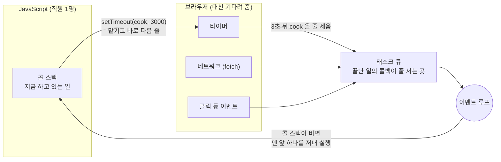
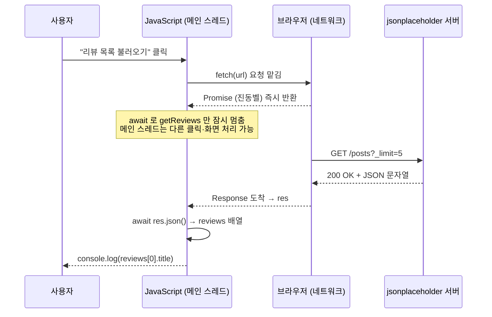
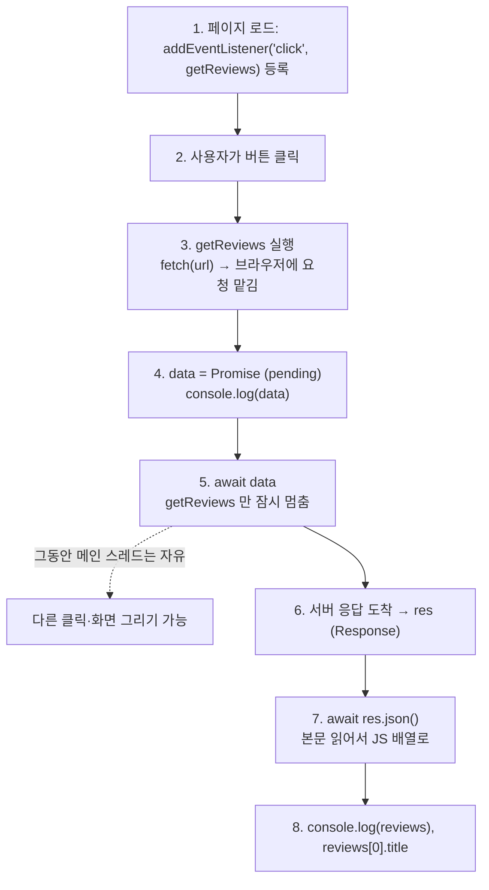

## 들어가며 (Situation)

11/18에는 DOM과 이벤트로 **화면을 움직이는 법**을 배웠다. 오늘(11/20)은 JavaScript에서 가장 중요하면서 가장 헷갈리는 주제인 **비동기(Asynchronous)** 를 배웠다. `03_Async` 폴더의 파일 4개로 진행했다.

| 파일 | 주제 |
|------|------|
| `01_timer.html` | `setTimeout`, `setInterval`, `clearInterval` |
| `02_asynchronous.html` | 동기 vs 비동기, 태스크 큐와 이벤트 루프 |
| `03_promise-async-await.html` | 콜백 지옥 → Promise → async/await |
| `04_fetch.html` | `fetch`로 외부 API(리뷰 목록) 불러오기 |

11/04 JPA 미니 프로젝트의 메뉴 등록 화면에서 `fetch('/menu/category').then(res => res.json())`을 이미 썼다. 그때는 "그냥 이렇게 쓰는 것"이었는데, 오늘 그 코드가 **왜 그렇게 생겼는지** 알게 됐다.

## 문제 상황 (Task)

이 글의 핵심 질문은 하나다.

> **"코드는 위에서 아래로 차례대로 실행하면 되는데, 왜 굳이 비동기가 필요할까?"**

Java(Spring)로 백엔드를 만들 때는 `menuRepository.findAll()`이 DB에서 결과를 가져올 때까지 **그냥 기다렸다.** 그래도 아무 문제가 없었다. 그런데 브라우저의 JavaScript에서 똑같이 "그냥 기다리면" 큰 문제가 생긴다. 그 이유를 먼저 정리하고, 비동기 코드를 **순서대로 읽기 쉽게** 쓰는 방법(콜백 → Promise → async/await)을 따라간다.

### 쉽게 비유하면

분식집에 **직원이 딱 한 명**뿐이다.

- **동기 분식집**: 직원이 떡볶이를 주문받으면 **떡볶이가 다 끓을 때까지 냄비 앞에 서서** 기다린다. 그동안 손님이 줄을 서도 주문을 못 받는다. 손님 입장에선 "가게가 멈췄다".
- **비동기 분식집**: 직원이 떡볶이를 불에 올리고 **타이머를 맞춘 뒤** 바로 다음 손님 주문을 받는다. 타이머가 "띵!" 울리면 그때 떡볶이를 담아 준다.

JavaScript가 바로 **직원이 한 명뿐인 분식집**이다. 그래서 비동기가 필요하다.

## 해결 과정 (Action)

### 0. 비동기는 왜 필요한가? (자세히)

#### ① JavaScript는 일하는 손이 하나다 (싱글 스레드)

브라우저에서 JavaScript 코드를 실행하는 **메인 스레드는 하나**다. 그리고 이 메인 스레드는 JavaScript만 하는 게 아니라 **화면 그리기, 클릭·스크롤 처리**도 같이 맡는다. ([MDN - Main thread](https://developer.mozilla.org/en-US/docs/Glossary/Main_thread))

| | Java (Spring 서버) | JavaScript (브라우저) |
|---|---|---|
| 일하는 손 | 요청마다 스레드가 따로 있음 (Tomcat 스레드 풀) | **메인 스레드 하나** |
| 한 곳에서 오래 기다리면 | 그 요청 하나만 늦어짐 | **화면 전체가 멈춤** (클릭, 스크롤, 입력 모두) |
| 기다리는 방식 | 기다려도 됨 (동기 코드가 기본) | 기다리면 안 됨 → **비동기가 기본** |

Spring에서 DB 조회를 기다리는 건 **여러 직원 중 한 명**이 잠깐 서 있는 것이다. 다른 손님은 다른 직원이 받는다. 하지만 브라우저 JavaScript는 직원이 한 명이라, 그 한 명이 서 있으면 **가게 전체가 멈춘다.**

#### ② 수업 코드로 확인: 동기로 3초 기다리면 무슨 일이?

`02_asynchronous.html`에는 일부러 3초 동안 **손을 놓지 않는** `sleep` 함수가 있다.

```javascript
function sleep(func , delay) {
    const delayUntill = Date.now() + delay;
    while(Date.now() < delayUntill);   // 3초 동안 계속 "아직이야?" 확인만 함
    func();
}

function cook() { console.log("떡볶이 조리 완료!!(3초)"); }
function takeOrder() { console.log("다음 손님 주문 하세요~"); }

// 동기 처리의 한계
// sleep(cook , 3000);
// takeOrder();
```

`while`문이 3초 동안 메인 스레드를 붙잡고 있다. 그동안 브라우저는 이런 상태가 된다.

- `takeOrder()`는 3초 뒤에야 실행된다.
- 그 3초 동안 **버튼을 눌러도 반응이 없고, 화면도 다시 그려지지 않는다.** (메인 스레드가 `while`에 묶여 있으니까)
- 이게 길어지면 브라우저가 "페이지가 응답하지 않습니다"라고 띄우기도 한다.

같은 일을 비동기로 바꾸면 이렇게 된다.

```javascript
// 비동기 처리
setTimeout(cook , 3000);   // "3초 뒤에 cook 불러 줘" 하고 바로 다음 줄로
takeOrder();
takeOrder();
// ... (수업 코드는 7번 호출)
```

예상 출력:

```text
다음 손님 주문 하세요~   ← 바로 7번
다음 손님 주문 하세요~
...
떡볶이 조리 완료!!(3초)   ← 3초 뒤
```

| | 동기 `sleep(cook, 3000)` | 비동기 `setTimeout(cook, 3000)` |
|---|---|---|
| 3초 동안 메인 스레드 | `while`로 **붙잡힘** | **비어 있음** (다른 일 가능) |
| 다음 주문 | 3초 뒤에야 받음 | 바로 받음 |
| 그동안 클릭·스크롤 | 안 됨 (화면 멈춤) | 됨 |

#### ③ 현실에서 "오래 걸리는 일"은 대부분 기다림이다

수업 코드에서는 `setTimeout`으로 3초를 흉내 냈지만, 실제로 오래 걸리는 일은 대부분 **내가 계산하는 시간이 아니라 남을 기다리는 시간**이다.

| 오래 걸리는 일 | 누구를 기다리나 |
|----------------|-----------------|
| 서버 API 호출 (`fetch`) | 백엔드 서버(Spring)의 응답 |
| 이미지·파일 불러오기 | 네트워크 |
| 타이머 (`setTimeout`) | 시간 |
| 사용자 클릭 (이벤트) | 사람 |

수업 자료에도 이렇게 정리되어 있다.

> 프론트 서버는 사용자의 화면을 구성하는 용도, 백엔드 서버는 사용자 화면에 표출될 데이터를 리턴하는 용도이다. 프론트에서 백엔드에 데이터를 요청했는데 응답이 느리면, 사용자는 영문도 모른 채 화면이 멈추는 경험을 하게 된다. 따라서 JS 기반의 프론트는 **API 호출을 모두 비동기 방식으로** 진행한다.

기다리는 동안 직원(메인 스레드)이 할 일은 없다. 그러니 **"끝나면 알려 줘" 하고 맡겨 두고** 그 사이에 다른 일(화면 그리기, 클릭 받기)을 하는 게 맞다. 이것이 비동기가 필요한 이유다.

#### ④ 그럼 누가 대신 기다려 주나? (태스크 큐와 이벤트 루프)

직원이 한 명인데 "맡겨 둔다"는 건, 누군가 대신 기다려 준다는 뜻이다. 그건 **브라우저**다. 타이머, 네트워크 요청은 브라우저가 따로 처리하고, 끝나면 할 일(콜백 함수)을 **대기 줄(태스크 큐)** 에 세워 둔다.

수업 자료의 정리:

> **태스크 큐(task queue)**: 비동기 함수의 콜백 함수나 이벤트 핸들러가 일시적으로 보관되는 영역
>
> **이벤트 루프(event loop)**: 콜 스택에 실행 중인 코드가 있는지, 태스크 큐에 대기 중인 함수가 있는지를 반복 확인한다. 콜 스택이 비어 있고 태스크 큐에 대기 중인 함수가 있으면 FIFO(선입선출)로 콜 스택으로 옮긴다.



비유하면 이벤트 루프는 **분식집 진동벨 담당**이다. 직원 손이 비었는지 계속 보고 있다가, 손이 비면 "띵! 떡볶이 다 됐어요" 하고 대기 줄 맨 앞의 일을 건네준다.

> 중요한 점: `setTimeout(cook, 3000)`은 "**정확히** 3초 뒤 실행"이 아니라 "**최소** 3초 뒤, 직원 손이 비면 실행"이다. 직원이 다른 긴 일을 하고 있으면 더 늦어질 수 있다.

### 1. 타이머 — `01_timer.html`

**역할:** `setTimeout`(한 번 나중에), `setInterval`(일정 간격으로 반복)으로 일부러 **시간 간격**을 만들어 비동기를 체험한다.

```javascript
// 피자를 조리하는 데 걸리는 시간 (5초)
setTimeout( () => console.log('5초 경과! 피자 조리 완료~~🍕') , 5000 );
// 위 -> 아래 개념이라면 5초 메시지 후에 주문 메시지가 나와야 하지만...
console.log("주문 하실 사람~~~!");

// 세 번째 인자부터는 콜백 함수에 전달할 값
setTimeout( (menuName) => console.log(`3초 경과! ${menuName} 조리 완료~~🍕`) , 3000 , "치킨" )

// 간격을 두고 반복
let count = 1;
const interval = setInterval(() => {
    console.log(`배달 도착까지 ${5 - count} 초`);
    count++;

    // 반복 실행이므로 종료 조건이 중요하다
    if(count == 5) {
        clearInterval(interval);   // 반복 멈춤
        console.log('배달 완료~~~🛒');
    }
} , 1000);
```

예상 출력 (시간 순):

| 시점 | 출력 |
|------|------|
| 0초 | `주문 하실 사람~~~!` |
| 1초 | `배달 도착까지 4 초` |
| 2초 | `배달 도착까지 3 초` |
| 3초 | `3초 경과! 치킨 조리 완료~~🍕`, `배달 도착까지 2 초` |
| 4초 | `배달 도착까지 1 초`, `배달 완료~~~🛒` |
| 5초 | `5초 경과! 피자 조리 완료~~🍕` |

> 위 표는 직접 실행해 확인한 것이 아니라 **예상 출력**이다. 3초 시점의 두 줄은 같은 시각에 줄을 서기 때문에 순서가 환경에 따라 달라질 수 있다.

코드에서는 피자가 **맨 위**에 있지만 출력은 **맨 마지막**이다. "위에서 아래로"는 **등록하는 순서**일 뿐이고, 실행 순서는 **타이머가 끝나는 순서**다.

| 함수 | 하는 일 | 멈추는 법 |
|------|---------|-----------|
| `setTimeout(fn, ms, ...args)` | `ms` 뒤에 `fn`을 **한 번** 실행 | `clearTimeout(id)` |
| `setInterval(fn, ms)` | `ms`마다 `fn`을 **계속** 실행 | `clearInterval(id)` |

`setInterval`은 멈추라고 하기 전까지 영원히 반복한다. 그래서 **반환값(id)을 변수에 담아 두고** 조건이 되면 `clearInterval`로 멈춰야 한다. 11/18에 `removeEventListener`로 핸들러를 지우려면 **같은 함수를 기억해 둬야** 했던 것과 같은 원리다.

### 2. 콜백 지옥 — `03_promise-async-await.html` (1)

**역할:** "1초 뒤에 10P 적립"을 **순서대로 5번** 하고 싶을 때, 콜백만으로 쓰면 코드가 어떻게 되는지 본다.

```javascript
// 현재 포인트와 "끝나면 부를 함수"를 받아서 1초 뒤 10P 를 더해 준다
function pointCallback(point , func) {
    setTimeout( () => {
        const result = point + 10;
        if(func) {
            func(result);
        }
    } , 1000 );
}

function runCallback() {
    pointCallback(0 , point => {
        console.log(`${point}P`); // 10P
        pointCallback(point, point => {
            console.log(`${point}P`); // 20P
            pointCallback(point , point => {
                console.log(`${point}P`); // 30P
                pointCallback(point , point => {
                    console.log(`${point}P`); // 40P
                    pointCallback(point , point => {
                        console.log(`${point}P`); // 50P
                    })
                })
            })
        })
    });
}
```

비동기 함수는 언제 끝날지 모른다. 그래서 "10P 적립이 **끝난 다음에** 20P 적립"을 보장하려면 **다음 일을 이전 일의 콜백 안에** 넣어야 한다. 이게 다섯 번 반복되니 코드가 오른쪽으로 계속 밀려나는 **피라미드**가 된다. 이것을 **콜백 지옥(Callback Hell)** 이라고 한다.

비유하면 **러시아 인형(마트료시카)** 이다. 다음 단계를 보려면 인형을 하나씩 계속 열어야 한다. 중간에 에러 처리까지 넣으면 인형마다 `if (에러)`가 붙어서 더 복잡해진다.

### 3. Promise — `03_promise-async-await.html` (2)

**역할:** 비동기 작업의 결과를 담는 **약속 상자(Promise)** 를 돌려주고, `.then()`으로 다음 일을 **옆으로(체이닝)** 이어 붙인다.

```javascript
function earnPoint(point) {
    const promise = new Promise((resolve , reject) => {
        setTimeout( () => {
            const result = point + 10;

            if(result > 50) {
                // 실패: 거부되어야 할 때
                return reject(new Error("적립 한도 초과"));
            }
            // 성공
            return resolve(result)
        } , 1000 );
    });
    return promise;
}

function runPromise() {
    earnPoint(0)    // 프로미스 객체가 리턴
        .then(point => { console.log(`${point}P`); return earnPoint(point); })  // 10P
        .then(point => { console.log(`${point}P`); return earnPoint(point); })  // 20P
        .then(point => { console.log(`${point}P`); return earnPoint(point); })  // 30P
        .then(point => { console.log(`${point}P`); return earnPoint(point); })  // 40P
        .then(point => { console.log(`${point}P`); return earnPoint(point); })  // 50P → 60 시도
        .catch(e => console.log(e, '발생~!!!!!!'))                               // 적립 한도 초과
        .finally(() => console.log("포인트 적립 종료"));
}
```

Promise는 **진동벨**이다. 주문하면 음식 대신 진동벨(Promise)을 먼저 받는다. 진동벨은 세 가지 상태 중 하나다.

| 상태 | 뜻 | 진동벨 비유 | 다음 처리 |
|------|----|-------------|-----------|
| `pending` (대기) | 아직 작업 중 | 아직 안 울림 | - |
| `fulfilled` (이행) | `resolve(값)` 호출됨 | "띵! 떡볶이 나왔어요" | `.then(값 => ...)` |
| `rejected` (거부) | `reject(에러)` 호출됨 | "죄송해요, 재료가 떨어졌어요" | `.catch(에러 => ...)` |

예상 출력:

```text
10P
20P
30P
40P
50P
Error: 적립 한도 초과 ... 발생~!!!!!!
포인트 적립 종료
```

다섯 번째 `.then`이 `earnPoint(50)`을 부르면 `60 > 50`이라 `reject`된다. 그러면 남은 `.then`을 건너뛰고 **`.catch`로 바로 간다.** `.finally`는 성공이든 실패든 **마지막에 꼭** 실행된다. Java의 `try-catch-finally`와 같은 역할이다.

콜백 지옥과 비교하면 들여쓰기가 **한 단계로 평평해졌고**, 에러 처리를 `.catch` **한 곳**에 모을 수 있다.

### 4. async/await — `03_promise-async-await.html` (3)

**역할:** `.then()` 대신 `await`로 Promise의 결과를 꺼내서, 비동기 코드를 **위에서 아래로 읽히게** 쓴다.

```javascript
// async 키워드는 await 를 사용하기 위해 함수 앞에 붙인다
async function runAsync() {
    // async/await 는 메서드 체이닝이 아니므로
    // 예외처리는 try-catch 로 감싼다
    try {
        let point = await earnPoint(0);
        console.log(`${point}P`);        // 10P
        point = await earnPoint(point);
        console.log(`${point}P`);        // 20P
        point = await earnPoint(point);
        console.log(`${point}P`);        // 30P
        point = await earnPoint(point);
        console.log(`${point}P`);        // 40P
        point = await earnPoint(point);
        console.log(`${point}P`);        // 50P
        point = await earnPoint(point);  // 60 → reject → catch 로 이동
        console.log(`${point}P`);        // 실행 안 됨
        point = await earnPoint(point);
    } catch(e) {
        console.log(e , '발생!!!')
    }
}
```

`await`는 "**이 진동벨이 울릴 때까지 이 함수 안에서만 잠깐 멈춰**"라는 뜻이다. 울리면 `resolve`된 값을 꺼내 주고, `reject`되면 에러를 던져서 `catch`로 간다.

| 비교 | 콜백 | Promise `.then()` | async/await |
|------|------|-------------------|-------------|
| 모양 | 안으로 계속 중첩 (피라미드) | 옆으로 체이닝 | **위에서 아래로** (동기 코드처럼) |
| 결과 받기 | 콜백의 인자 | `.then(값 => ...)` | `const 값 = await ...` |
| 에러 처리 | 콜백마다 따로 | `.catch()` | `try-catch` |
| Java와 닮은 정도 | 낮음 | 중간 (Stream 체이닝 느낌) | **높음** (평소 Java 코드처럼 읽힘) |

세 방식 모두 **1초 간격으로 10P씩** 적립된다. 동작은 같고 **읽기 쉬운 정도**가 다르다.

### 5. fetch — `04_fetch.html`

**역할:** 가장 대표적인 비동기 작업인 **외부 서버 API 호출**을 `fetch`로 해 본다. 버튼을 누르면 리뷰(게시글) 5개를 가져온다.

```javascript
document.getElementById("btn-get")
        .addEventListener('click' , getReviews);

async function getReviews() {
    // 외부 API 호출
    const data = fetch('https://jsonplaceholder.typicode.com/posts?_limit=5');
    console.log(data);   // Promise { <pending> } ← 아직 진동벨일 뿐

    // 1. promise - then()
    // data
    //     .then(res => res.json())
    //     .then(json => console.log(json));

    // 2. async - await
    const res = await data;            // 응답(Response) 도착
    const reviews = await res.json();  // 본문 JSON → JS 객체(배열)로 변환

    console.log(reviews);
    console.log(reviews[0].title);
}
```

`fetch`도 **진동벨(Promise)** 을 돌려준다. 그래서 `console.log(data)`를 찍으면 리뷰 목록이 아니라 `Promise`가 나온다. 결과를 쓰려면 `.then()`이나 `await`로 **울릴 때까지** 기다려야 한다.

`await`가 **두 번** 필요한 이유가 처음엔 헷갈린다.

| 단계 | 코드 | 받는 것 | 비유 |
|------|------|---------|------|
| 1 | `await fetch(url)` | `Response` 객체 (상태 코드, 헤더 + 아직 안 읽은 본문) | 택배 **상자가 도착** |
| 2 | `await res.json()` | 본문을 다 읽어 JSON → JS 객체로 변환한 값 | 상자를 **뜯어서** 내용물 꺼내기 |

본문 데이터는 크기가 클 수 있어서 **읽는 것 자체도 비동기**다. 그래서 `res.json()`도 Promise를 돌려준다. ([MDN - Response.json()](https://developer.mozilla.org/ko/docs/Web/API/Response/json))



11/04 JPA 프로젝트의 `fetch('/menu/category').then(res => res.json())`이 바로 이 1번 방식(`then`)이었다. 그때 Spring 컨트롤러가 돌려준 JSON을 브라우저가 이렇게 받아 갔던 것이다.

### 시행착오: 다시 볼 부분

#### ① "비동기를 동기 방식으로 동작하게 만든다"?

수업 주석에 "promise, async, await는 비동기 처리를 동기 방식으로 동작하게 만드는 문법"이라고 되어 있다. 정확히는 **동기처럼 "읽히게"** 만드는 것이다. `await`는 **그 `async` 함수 안에서만** 멈춘다. 메인 스레드 전체가 멈추는 게 아니라서, `runAsync`가 기다리는 동안에도 다른 버튼 클릭이나 화면 그리기는 계속된다. 0번의 `sleep`(진짜 동기 대기)과는 완전히 다르다.

```javascript
// 예시 코드
async function order() {
    console.log('A');
    await earnPoint(0);     // order 함수만 1초 멈춤
    console.log('C');
}
order();
console.log('B');
// 예상 출력: A → B → (1초 뒤) C
```

#### ② `fetch`는 404여도 `catch`로 가지 않는다

`fetch`의 Promise는 **네트워크 자체가 실패했을 때만** reject된다. 서버가 `404`나 `500`을 돌려줘도 "응답은 받았다"로 보고 **성공(fulfilled)** 처리한다. 그래서 실무에서는 `res.ok`를 직접 확인한다. ([MDN - fetch 사용하기](https://developer.mozilla.org/ko/docs/Web/API/Fetch_API/Using_Fetch))

```javascript
// 예시 코드
async function getReviews() {
    try {
        const res = await fetch('https://jsonplaceholder.typicode.com/posts?_limit=5');
        if (!res.ok) {
            throw new Error(`HTTP 오류: ${res.status}`);
        }
        const reviews = await res.json();
        console.log(reviews);
    } catch (e) {
        console.log('리뷰를 불러오지 못했습니다', e);
    }
}
```

#### ③ `res`는 "문자열 JSON"이 아니라 `Response` 객체

수업 주석에 `res`가 "문자열 json"이라고 되어 있는데, 실제로는 상태 코드(`status`), 헤더(`headers`), 아직 읽지 않은 본문(`body`)을 가진 **`Response` 객체**다. 본문을 **문자열로** 읽으려면 `res.text()`, **JS 객체로** 읽으려면 `res.json()`을 쓴다.

#### ④ Promise 콜백은 태스크 큐보다 먼저 실행된다

수업에서는 "태스크 큐" 하나로 설명했다. 실제로는 Promise의 `.then` 콜백이 들어가는 **마이크로태스크 큐**가 따로 있고, `setTimeout`보다 **먼저** 처리된다. 지금 단계에서 꼭 알아야 하는 내용은 아니지만, 출력 순서가 예상과 다를 때 원인이 된다. ([MDN - 마이크로태스크 가이드](https://developer.mozilla.org/ko/docs/Web/API/HTML_DOM_API/Microtask_guide))

```javascript
// 예시 코드
setTimeout(() => console.log('timeout'), 0);
Promise.resolve().then(() => console.log('promise'));
console.log('sync');
// 예상 출력: sync → promise → timeout
```

### 오늘의 JavaScript 흐름 한눈에 보기

`04_fetch.html`에서 "리뷰 목록 불러오기" 버튼을 눌렀을 때 일어나는 일이다.



초등학생에게 설명하듯 정리하면 이렇다.

1. **초인종 달기**: 페이지가 열리면 "버튼 누르면 `getReviews` 해 줘"라고 브라우저에 맡겨 둔다.
2. **버튼 누름**: 사용자가 버튼을 누르면 `getReviews`가 시작된다.
3. **택배 주문**: `fetch`로 "리뷰 5개 보내 주세요" 하고 주문한다. 주문은 브라우저 택배 기사에게 맡긴다.
4. **진동벨 받기**: 택배 대신 **진동벨(Promise)** 을 먼저 받는다. 찍어 보면 아직 `pending`(배달 중)이다.
5. **기다리기**: `await`로 "벨 울릴 때까지 이 함수만 잠깐 쉴게" 한다. 직원(메인 스레드)은 그동안 다른 손님(클릭, 화면)을 받는다.
6. **상자 도착**: 서버가 답을 보내면 **상자(Response)** 가 도착한다.
7. **상자 뜯기**: `res.json()`으로 상자를 뜯어 **리뷰 배열**을 꺼낸다. 뜯는 것도 시간이 걸려서 한 번 더 `await`한다.
8. **보여 주기**: 꺼낸 리뷰를 콘솔에 찍는다. 첫 번째 리뷰의 제목도 찍는다.

## 결과 (Result)

같은 "1초마다 10P씩 5번 적립"을 세 방식으로 쓴 결과를 비교하면 다음과 같다. (수업 코드 기준)

| 방식 | 최대 들여쓰기 깊이 | 에러 처리 위치 | 읽는 방향 |
|------|-------------------|----------------|-----------|
| 콜백 | **5단계** (피라미드) | 없음 (콜백마다 따로 넣어야 함) | 안쪽으로 |
| Promise | 1단계 (`.then` 5개 나란히) | `.catch` 1곳 | 옆으로(아래로 체이닝) |
| async/await | 1단계 (`try` 블록 안) | `catch` 1곳 | **위에서 아래로** |

동기 `sleep`과 비동기 `setTimeout`을 비교하면 이렇다.

| | 동기 `sleep(cook, 3000)` | 비동기 `setTimeout(cook, 3000)` |
|---|---|---|
| 첫 주문을 받기까지 | 3초 | **즉시** (0초) |
| 대기 중 화면 반응 | 멈춤 | 정상 |

**배운 점**

- 비동기가 필요한 이유는 **JavaScript의 일하는 손(메인 스레드)이 하나**이고, 그 손이 **화면까지** 맡고 있기 때문이다. 기다리는 일을 직접 붙잡고 있으면 화면 전체가 멈춘다.
- 오래 걸리는 일은 대부분 **서버 응답, 네트워크, 타이머**처럼 "남을 기다리는 일"이다. 이런 일은 브라우저에 맡기고, 끝나면 **태스크 큐 → 이벤트 루프**를 통해 다시 받는다.
- 비동기의 단점은 "**언제 끝날지 모른다**"는 것이다. 순서를 지키려고 콜백을 중첩하면 콜백 지옥이 된다.
- **Promise**는 결과를 담는 진동벨이고, **async/await**는 그 진동벨을 위에서 아래로 읽히게 기다리는 문법이다. `await`는 메인 스레드가 아니라 **그 함수만** 멈춘다.
- `fetch`는 Promise를 돌려주고, 본문을 읽는 `res.json()`도 Promise라서 `await`가 두 번 필요하다.

## 더 학습하면 좋은 개념

- **마이크로태스크 큐와 이벤트 루프 실행 순서** — `Promise.then`이 `setTimeout(…, 0)`보다 먼저 실행되는 이유다. 비동기 코드의 출력 순서를 정확히 예측하려면 필요하다.
- **`Promise.all` / `Promise.allSettled`** — 오늘은 적립을 **순서대로** 기다렸다. 서로 상관없는 요청 여러 개(메뉴 목록 + 리뷰 목록)는 **동시에** 보내고 한꺼번에 기다리면 훨씬 빠르다.
- **HTTP 상태 코드와 `res.ok`** — `fetch`는 404·500에서 reject되지 않는다. Spring 컨트롤러가 돌려주는 상태 코드와 프론트의 에러 처리를 연결해서 이해할 수 있다.
- **CORS** — 프론트(예: `localhost:5173`)에서 Spring 서버(`localhost:8080`)로 `fetch`하면 만나는 에러다. 브라우저가 왜 막는지, 서버에서 무엇을 허용해야 하는지 알아야 한다.
- **JSON과 `@RestController`/`@ResponseBody`** — Spring이 Java 객체를 JSON 문자열로 바꿔 보내고, 브라우저가 `res.json()`으로 다시 JS 객체로 바꾸는 왕복 과정을 이해할 수 있다.

## 참고 자료

- [MDN - setTimeout()](https://developer.mozilla.org/ko/docs/Web/API/Window/setTimeout)
- [MDN - setInterval()](https://developer.mozilla.org/ko/docs/Web/API/Window/setInterval)
- [MDN - Main thread (용어 사전)](https://developer.mozilla.org/en-US/docs/Glossary/Main_thread)
- [MDN - 비동기 JavaScript 소개](https://developer.mozilla.org/ko/docs/Learn/JavaScript/Asynchronous/Introducing)
- [MDN - Promise](https://developer.mozilla.org/ko/docs/Web/JavaScript/Reference/Global_Objects/Promise)
- [MDN - Promise 사용하기](https://developer.mozilla.org/ko/docs/Web/JavaScript/Guide/Using_promises)
- [MDN - async function](https://developer.mozilla.org/ko/docs/Web/JavaScript/Reference/Statements/async_function)
- [MDN - await](https://developer.mozilla.org/ko/docs/Web/JavaScript/Reference/Operators/await)
- [MDN - Fetch API 사용하기](https://developer.mozilla.org/ko/docs/Web/API/Fetch_API/Using_Fetch)
- [MDN - Response.json()](https://developer.mozilla.org/ko/docs/Web/API/Response/json)
- [MDN - 마이크로태스크 가이드](https://developer.mozilla.org/ko/docs/Web/API/HTML_DOM_API/Microtask_guide)
- [JSONPlaceholder](https://jsonplaceholder.typicode.com/)
