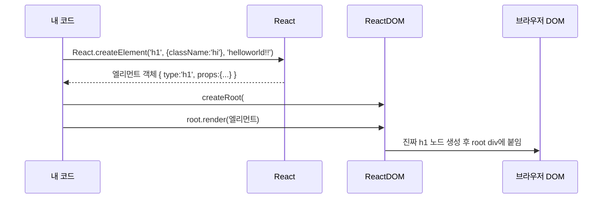
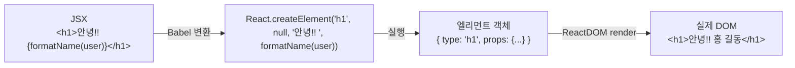
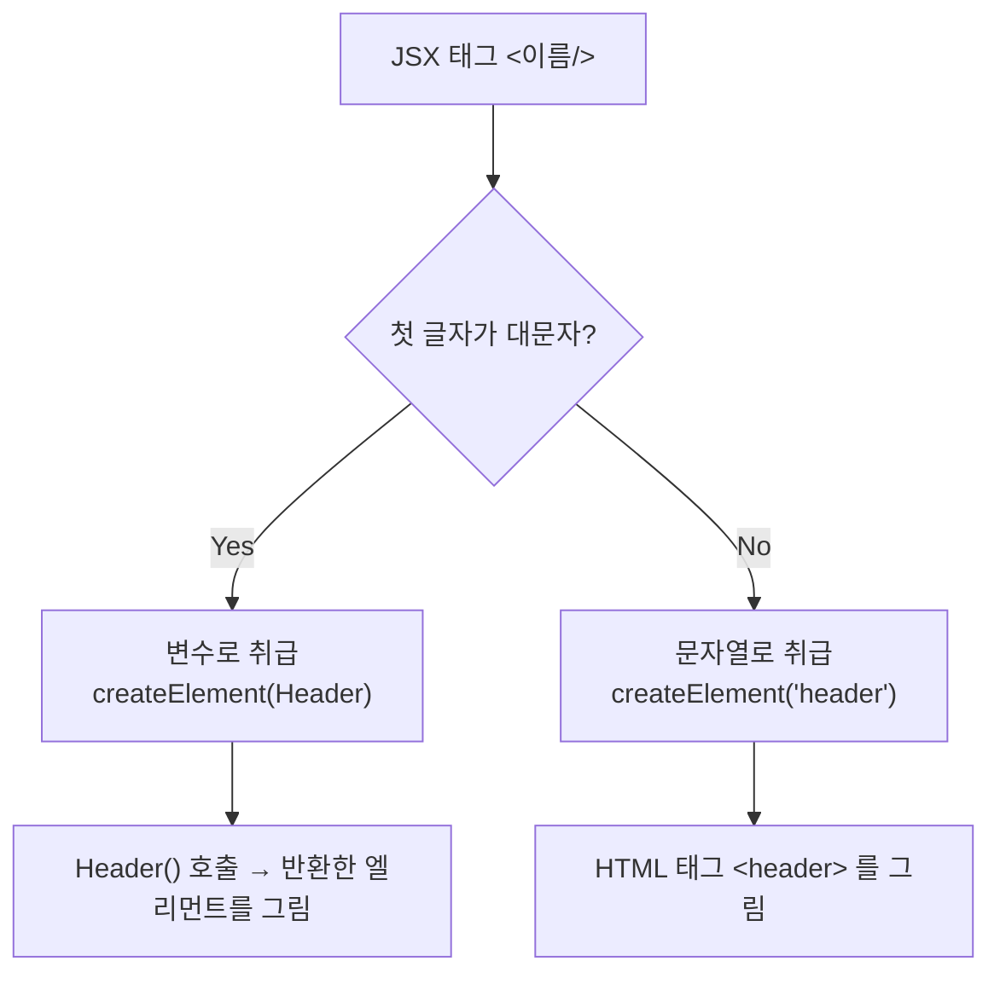
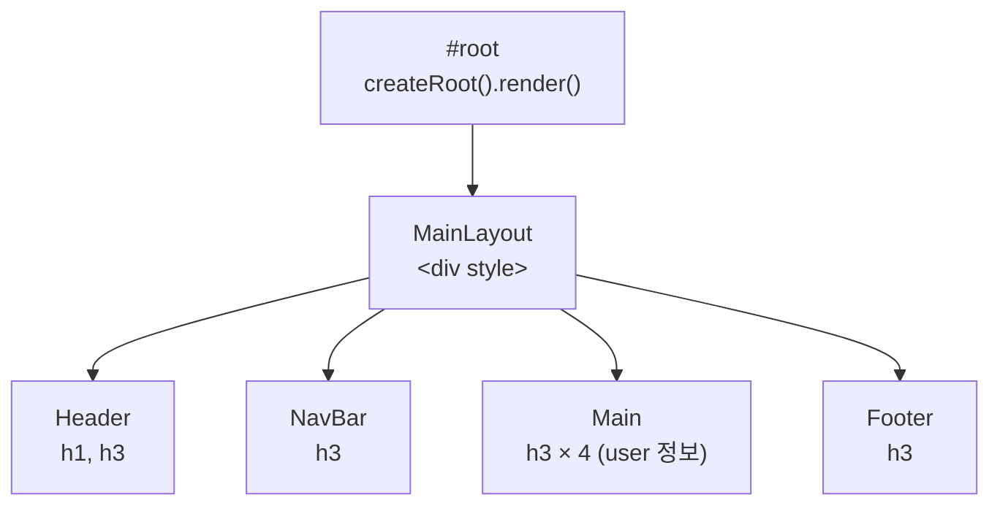
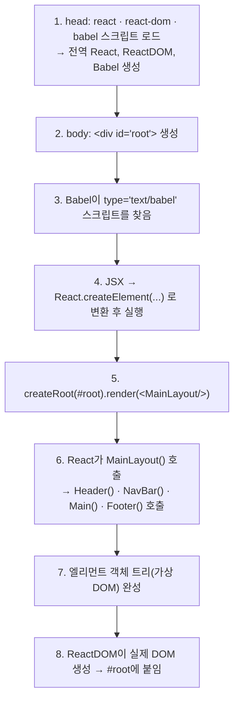

## 들어가며 (Situation)

11/18에는 DOM과 이벤트로 화면을 바꿨고, 11/20에는 비동기와 `fetch`로 서버 데이터를 받아 오는 법을 배웠다. 오늘(11/23)부터는 **React**를 시작했다. 별도 프로젝트를 만들지 않고, HTML 파일에 React를 `<script>`로 불러와서 기본 개념부터 하나씩 확인했다.

| 폴더 | 파일 | 주제 |
|------|------|------|
| `01_intro` | `01_createElement.html` | `React.createElement`, 가상 DOM, `createRoot().render()` |
| `01_intro` | `02_component.html` | 엘리먼트 vs 컴포넌트, 함수형 컴포넌트 |
| `02_component/01_JSX` | `01_jsx-intro.html` | JSX와 Babel, 중괄호 `{}` 표현식 |
| `02_component/01_JSX` | `02_fragment.html` | 최상위 요소는 하나, Fragment `<></>` |
| `02_component/02_component` | `01_function-component.html` | `<Header/>` 문법, 대문자 규칙 |
| `02_component/02_component` | `02_composition.html` | 컴포넌트 합성, `style={{ }}` |

## 문제 상황 (Task)

이 글의 핵심 질문은 하나다.

> **"DOM은 `document.createElement`로도 만들 수 있는데, 왜 React를 쓸까?"**

11/18 수업처럼 DOM을 직접 다루면 **"어떻게 바꿀지"** 를 한 줄씩 명령해야 한다. 요소를 만들고, 속성을 넣고, 부모에 붙이고, 값이 바뀌면 다시 찾아서 고친다. 화면이 작을 때는 괜찮지만, 같은 헤더·네비게이션·푸터가 여러 페이지에 반복되고 데이터가 자주 바뀌면 **어디서 무엇을 바꿨는지** 추적하기 어려워진다.

```javascript
// 예시 코드: DOM 직접 조작 (명령형)
const h1 = document.createElement('h1');
h1.className = 'hi';
h1.textContent = 'helloworld!!';
document.getElementById('root').appendChild(h1);
```

React는 **"화면이 어떤 모양이어야 하는지"** 만 적으면, 실제 DOM을 바꾸는 일은 React가 맡는 방식(선언형)이다.

| 항목 | DOM 직접 조작 | React |
|------|---------------|-------|
| 쓰는 방식 | 명령형: 만들고 → 넣고 → 붙이고 → 고치고 | 선언형: 화면의 모양을 적는다 |
| 재사용 단위 | 함수로 직접 묶어야 함 | **컴포넌트** (화면 조각) |
| 실제 DOM 수정 | 개발자가 직접 | React DOM이 필요한 부분만 |
| 마크업 작성 | 문자열 또는 `createElement` 반복 | **JSX** (HTML처럼 보이는 JS) |

### 쉽게 비유하면

- **DOM 직접 조작**은 레고를 조립할 때 "빨간 블록을 집어서, 왼쪽 위에 끼우고, 그 위에 파란 블록을…" 하고 **손동작을 하나씩** 지시하는 것이다.
- **React**는 **완성 사진(설계도)** 을 건네는 것이다. 조립은 React DOM이 하고, 설계도가 바뀌면 **달라진 블록만** 갈아 끼운다.

설계도에 해당하는 것이 **엘리먼트**이고, 설계도를 찍어 내는 틀이 **컴포넌트**다.

## 해결 과정 (Action)

### 0. React를 쓰는 두 가지 방법

수업 주석에 정리된 방법은 두 가지다.

| 방법 | 오늘 수업 | 특징 |
|------|-----------|------|
| `<script>`로 라이브러리 불러오기 (CDN) | ✅ | 설치 없이 HTML 하나로 바로 실행. 학습용 |
| React 앱 생성 (빌드 도구 사용) | | `import`/`export`, 파일 분리, 빌드 최적화. 실무용 |

오늘은 1번 방식으로, `<head>`에 스크립트를 최대 3개 불러왔다.

```html
<script crossorigin src="https://unpkg.com/react@18.3.1/umd/react.development.js"></script>
<script crossorigin src="https://unpkg.com/react-dom@18.3.1/umd/react-dom.development.js"></script>
<!-- JSX를 쓰는 파일에만 추가 -->
<script crossorigin src="https://unpkg.com/@babel/standalone@8.1.3/babel.min.js"></script>
```

| 스크립트 | 만드는 전역 변수 | 하는 일 |
|----------|------------------|---------|
| `react` | `React` | 엘리먼트·컴포넌트를 **만드는** 도구 (`createElement` 등) |
| `react-dom` | `ReactDOM` | 만든 엘리먼트를 **브라우저 DOM에 그리는** 도구 (`createRoot`) |
| `@babel/standalone` | `Babel` | 브라우저에서 JSX를 일반 JS로 **번역** |

React를 `react`와 `react-dom` 두 개로 나눈 이유는, "무엇을 그릴지"(React)와 "어디에 그릴지"(브라우저 DOM, 모바일 앱 등)를 분리하기 위해서다.

> 참고: 이 방식은 React 18까지만 가능하다. React 19부터는 UMD 빌드가 제거되어 `umd/react.development.js` 같은 파일이 더 이상 배포되지 않는다. ([React 19 업그레이드 가이드 - UMD builds removed](https://react.dev/blog/2024/04/25/react-19-upgrade-guide#umd-builds-removed))

### 1. `React.createElement` — `01_createElement.html`

가장 기본이 되는 함수다. JSX 없이 순수 JavaScript로 엘리먼트를 만든다.

```javascript
/*
    1번째 인자 : 만들려는 요소의 타입(ex) h1 , div , pre)
    2번째 인자 : 요소의 프로퍼티를 표현
    3번째 인자 : 자식 요소 표현
*/
const hiElement = React.createElement('h1' , {className: 'hi'} , 'helloworld!!');

ReactDOM.createRoot(document.getElementById('root')).render(hiElement);
```

| 인자 | 값 | 의미 |
|------|-----|------|
| `type` | `'h1'` | 만들 요소의 종류. 문자열이면 HTML 태그, 함수면 컴포넌트 |
| `props` | `{className: 'hi'}` | 속성. 없으면 `null` |
| `...children` | `'helloworld!!'` | 자식. 텍스트, 다른 엘리먼트 등 여러 개 가능 |

#### 엘리먼트는 "DOM"이 아니라 "평범한 객체"다

`hiElement`를 Node.js에서 찍어 보면 이렇게 나온다. (React 18.3.1, 필요한 필드만 표시)

```text
{ type: 'h1', props: { className: 'hi', children: 'helloworld!!' }, $$typeof: Symbol(react.element) }
```

`document.createElement`는 **진짜 DOM 노드**를 만들지만, `React.createElement`는 "h1을, 이 속성으로, 이 내용으로 그려 줘"라고 적은 **설명서 객체**만 만든다. 수업에서 말한 **가상 DOM(Virtual DOM)** 이 바로 이런 객체들로 이루어진 메모리 속 트리다.

실제 화면에 그리는 일은 `ReactDOM`이 한다.



- `createRoot(domNode)`: `#root` div를 React가 관리하는 영역(루트)으로 만든다.
- `root.render(element)`: 그 영역 안에 엘리먼트를 그린다. 다시 `render`를 부르면 React가 **이전 객체와 새 객체를 비교**해서 **바뀐 부분만** 실제 DOM에 반영한다.

DOM을 직접 고치는 것보다 객체끼리 비교하는 편이 훨씬 가볍기 때문에, React는 "설명서 비교 → 필요한 곳만 수정" 방식을 쓴다. ([React 공식 문서(구) - Virtual DOM and Internals](https://legacy.reactjs.org/docs/faq-internals.html))

### 2. 엘리먼트와 컴포넌트 — `02_component.html`

수업에서 정리한 React의 핵심 키워드 두 가지다.

| 구분 | 엘리먼트 (Element) | 컴포넌트 (Component) |
|------|--------------------|-----------------------|
| 정체 | 화면에 그릴 내용을 적은 **객체** | 엘리먼트를 **반환하는 함수** |
| 비유 | 설계도 한 장 | 설계도를 찍어 내는 틀 |
| 예 | `React.createElement('h1', …)` | `function Helloworld() { return … }` |
| 이름 규칙 | 없음 | **앞글자 대문자** |

```javascript
// 함수형 컴포넌트
// -> 함수 이름 앞글자 대문자!! (암묵적 규칙)
function Helloworld() {
    // 엘리먼트 리턴
    return React.createElement('h1' , {className: 'hi'} , 'helloworld!!');
}

// render(엘리먼트);
ReactDOM.createRoot(document.getElementById('root'))
    // 컴포넌트를 엘리먼트 화
    .render(React.createElement(Helloworld));
```

여기서 중요한 점은 `render`에 **함수 자체가 아니라 엘리먼트**를 넘긴다는 것이다. `React.createElement(Helloworld)`는 `{ type: Helloworld, ... }` 객체를 만든다. `type`이 문자열이 아니라 **함수**이므로, React는 그리는 시점에 `Helloworld()`를 호출해서 그 안의 `h1` 엘리먼트를 얻는다.

수업 주석처럼 컴포넌트는 Java의 메서드처럼 "특정 기능을 하는 코드 묶음"이다. 다만 **엘리먼트를 반환하는 함수**라는 점이 특별해서, 일반 함수와 구분하려고 이름을 대문자로 시작한다. 이 규칙은 단순한 관례가 아니라 JSX에서는 **동작이 달라지는 규칙**이다. (5번에서 확인)

주석 마지막 줄의 고민이 다음 단계로 이어진다.

> 요소를 만들때마다 createElement 로 만들게 되면 굉장히 복잡하고 힘들다. → JSX 문법

### 3. JSX — `01_jsx-intro.html`

**JSX(JavaScript XML)** 는 JavaScript 안에서 HTML처럼 생긴 문법으로 엘리먼트를 쓰게 해 주는 확장 문법이다. 브라우저는 JSX를 모르기 때문에 **Babel**이 일반 JS로 번역(트랜스파일)해 준다.

사용하는 방법은 두 단계다.

1. Babel 스크립트를 `<head>`에 추가한다.
2. JSX를 쓰는 `<script>` 태그에 `type="text/babel"`을 붙인다.

```javascript
function formatName(user) {
    return `${user.lastName} ${user.firstName}`;
}

const user = {
    firstName : '길동',
    lastName : '홍'
};

// jsx 내에서 중괄호를 활용하여 모든 js 표현식을 사용할 수 있다.
const element = <h1 class="test">안녕!! {formatName(user)}</h1>
// const element = React.createElement('h1' , {class : "test"} , "안녕!!")

ReactDOM.createRoot(document.getElementById('root'))
        .render(element);
```

#### Babel은 JSX를 무엇으로 바꿀까?

`type="text/babel"` 스크립트를 만나면 Babel standalone은 기본으로 React preset을 **classic 런타임**으로 적용한다. (`@babel/standalone@8.1.3` 소스의 `buildBabelOptions`에서 확인) 그래서 위 JSX는 1번에서 손으로 쓴 것과 같은 코드가 된다.

```javascript
// 위 JSX를 Babel(classic 런타임)로 변환한 결과
const element = React.createElement("h1", {
  class: "test"
}, "안녕!! ", formatName(user));
```

즉 **JSX는 `React.createElement` 호출을 편하게 쓰는 문법**일 뿐이고, 결과물은 똑같은 엘리먼트 객체다.



#### 중괄호 `{}` 안에는 "표현식"만

JSX의 `{}` 안에는 **값이 되는 코드(표현식)** 는 무엇이든 넣을 수 있다. 변수, 함수 호출, 계산식, 삼항 연산자, 템플릿 리터럴 모두 된다. 하지만 `if`, `for` 같은 **문(statement)** 은 넣을 수 없다. 변환 결과가 `createElement`의 **인자**로 들어가기 때문이다. 함수 인자 자리에 `if`를 쓸 수 없는 것과 같다.

```javascript
// 예시 코드
const isLogin = true;

const ok = <h1>{isLogin ? '환영합니다' : '로그인하세요'}</h1>;   // 삼항 연산자: 표현식 → OK
// const no = <h1>{if (isLogin) { '환영합니다' }}</h1>;          // if 문 → 문법 에러
```

### 4. Fragment — `02_fragment.html`

JSX를 쓸 때 가장 먼저 만나는 규칙은 **최상위 엘리먼트는 하나**라는 것이다. 수업 파일에서는 세 가지 버전을 비교했다.

```javascript
// 1. 최상위 엘리먼트가 두 개 이상 (== 같은 레벨) 이면 문법 에러
// const element = (
//     <h1>{user.name}</h1>
//     <h3>{user.phone}</h3>
// );

// 2. 최상위 엘리먼트 내부에 넣어서 하나의 돔트리를 생성
// const element = (
//     <div>
//         <h1>{user.name}</h1>
//         <h3>{user.phone}</h3>
//     </div>
// );

// 3. <></> (React.Fragment)
const element = (
    <>
        <h1>{user.name}</h1>
        <h3>{user.phone}</h3>
    </>
);
```

1번을 Babel로 변환하면 실제로 이런 에러가 난다.

```text
Adjacent JSX elements must be wrapped in an enclosing tag. Did you want a JSX fragment <>...</>?
```

#### 왜 하나로 감싸야 할까?

3번에서 JSX가 `React.createElement(...)` **함수 호출 하나**로 바뀐다는 것을 확인했다. 1번은 `const element = createElement('h1') createElement('h3')`처럼 값 두 개를 나란히 쓴 꼴이라, 변수 하나에 담을 수도 `return` 할 수도 없다. ([React 공식 문서 - Writing Markup with JSX](https://react.dev/learn/writing-markup-with-jsx))

그래서 하나로 감싸야 하는데, 감싸는 방법에 따라 결과가 다르다.

| 방법 | 실제 DOM 결과 | 단점 |
|------|---------------|------|
| `<div>`로 감싸기 | `<div><h1>…</h1><h3>…</h3></div>` | 의미 없는 `div`가 생김. CSS(flex, grid 자식 관계)나 `<ul>`·`<table>` 구조가 깨질 수 있음 |
| `<>`로 감싸기 (Fragment) | `<h1>…</h1><h3>…</h3>` | 없음. 감싸는 태그가 DOM에 남지 않음 |

Fragment를 Babel(classic 런타임)로 변환하면 `React.createElement(React.Fragment, null, h1, h3)`가 된다. JSX 문법 검사를 통과할 수 있게 **묶어 두기만** 하고, 그릴 때는 사라진다.

> 참고: 반복문으로 Fragment를 여러 개 만들 때 `key`가 필요하면 `<></>` 대신 `<Fragment key={...}>`로 써야 한다. 짧은 문법에는 속성을 넣을 수 없다. ([React 공식 문서 - Fragment](https://react.dev/reference/react/Fragment))

### 5. 함수형 컴포넌트를 JSX로 — `01_function-component.html`

2번에서는 컴포넌트를 `React.createElement(Helloworld)`로 엘리먼트로 바꿨다. JSX에서는 컴포넌트를 **태그처럼** 쓰면 된다.

```javascript
// 함수형 컴포넌트의 특징
// 1. 앞글자 대문자!
// 2. return 엘리먼트!
function Header() {
    return (
        <>
            <h1>헤더입니다!!</h1>
            <h3>사이트 이름~~~</h3>
        </>
    );
}

ReactDOM.createRoot(document.getElementById('root'))
        // .render(React.createElement(Header));
        // 함수형 컴포넌트를 쉽게 엘리먼트로 변환하는 문법
        .render(<Header/>);
```

`<Header/>`와 `React.createElement(Header)`는 같은 코드다.

#### 대문자 규칙은 Babel이 판단한다

수업 주석에 "컴포넌트 앞글자가 소문자면 단순 HTML 요소로 인식한다"고 되어 있다. Babel 변환 결과로 직접 확인하면 차이가 분명하다.

| JSX | Babel 변환 결과 | React가 하는 일 |
|-----|-----------------|-----------------|
| `<Header/>` | `React.createElement(Header)` | **변수** `Header` 함수를 호출해서 그 결과를 그림 |
| `<header/>` | `React.createElement("header")` | **문자열** `"header"` → HTML `<header>` 태그를 그림 |



함정은 **에러가 나지 않는 경우**다. `header`는 실제로 존재하는 HTML 태그라서, 컴포넌트 이름을 소문자로 쓰면 에러 없이 **빈 `<header></header>`** 만 그려진다. (React 18.3.1에서 `renderToString`으로 확인) 화면에 아무것도 안 나오는데 콘솔도 조용하면 이름의 첫 글자부터 확인해야 한다.

### 6. 컴포넌트 합성 — `02_composition.html`

화면을 **헤더 / 네비게이션 / 본문 / 푸터** 조각으로 나누고, `MainLayout`이 그 조각들을 조립한다. 이렇게 작은 컴포넌트를 모아 큰 컴포넌트를 만드는 것을 **합성(Composition)** 이라고 한다.


```javascript
function Header() {
    return (
        <>
            <h1>헤더입니다!!</h1>
            <h3>사이트 이름~~~</h3>
        </>
    );
}

function NavBar() {
    return (
        <>
            <h3>네비게이션 바 입니다!!</h3>
        </>
    );
}

function Footer() {
    return (
        <>
            <h3>푸터 입니다!!!</h3>
        </>
    );
}

const user = {
    name : "홍길동",
    phone : "010-0000-0000",
    age : 20,
    gender : '남'
};

function Main() {
    return (
        <>
            <h3>이름 : {user.name}</h3>
            <h3>전화번호 : {user.phone}</h3>
            <h3>나이 : {user.age}</h3>
            <h3>성별 : {user.gender}</h3>
        </>
    );
}

function MainLayout() {
    return(
        <div style={{border : '1px solid black', backgroundColor : 'red'}}>
            <Header/>
            <NavBar/>
            <Main/>
            <Footer/>
        </div>
    );
}

ReactDOM.createRoot(document.getElementById('root'))
        .render(<MainLayout/>);
```


> 이름과 전화번호는 수업 코드의 실제 값 대신 예시 값으로 바꿔 적었다.

컴포넌트 트리로 그리면 이렇다.



각 조각이 Fragment(`<></>`)를 반환하기 때문에, 실제 DOM에는 `MainLayout`의 `div` 하나 안에 `h1`, `h3`들이 **평평하게** 들어간다. 컴포넌트 경계는 코드에만 있고 DOM에는 흔적이 남지 않는다.

#### `style={{ }}` 중괄호가 두 겹인 이유

| 위치 | 의미 |
|------|------|
| 바깥 `{ }` | "여기부터 JS 표현식" (3번의 JSX 중괄호) |
| 안쪽 `{ }` | JS **객체** 리터럴 `{ border: ..., backgroundColor: ... }` |

HTML에서는 `style="background-color: red"`처럼 **문자열**을 쓰지만, React에서는 **객체**를 넘기고 속성 이름은 **camelCase**(`background-color` → `backgroundColor`)로 쓴다. 변환 결과를 보면 그냥 객체가 `props.style`로 들어간다. ([React 공식 문서 - JavaScript in JSX with Curly Braces](https://react.dev/learn/javascript-in-jsx-with-curly-braces))

```javascript
// Babel(classic 런타임) 변환 결과
React.createElement("div", {
  style: {
    border: '1px solid black',
    backgroundColor: 'red'
  }
}, React.createElement(Header, null), React.createElement(NavBar, null), React.createElement(Main, null), React.createElement(Footer, null));
```

### 시행착오: 다시 볼 부분

#### ① JSX에서 `class`는 경고가 난다

`01_jsx-intro.html`은 `<h1 class="test">`로 썼다. 화면에는 `class="test"`가 정상으로 붙는다. 그런데 React 18.3.1 개발 모드에서는 콘솔에 이런 경고가 뜬다.

```text
Warning: Invalid DOM property `class`. Did you mean `className`?
```

JSX는 JavaScript라서, JS 예약어인 `class` 대신 DOM 프로퍼티 이름인 **`className`** 을 쓰는 것이 React의 규칙이다. 1번의 `createElement` 예제가 `{className: 'hi'}`를 쓴 것도 같은 이유다. `<label>`의 `for`도 같은 이유로 `htmlFor`로 쓴다. ([React 공식 문서 - Common components (className)](https://react.dev/reference/react-dom/components/common))

```javascript
// 예시 코드
const good = <h1 className="test">안녕!!</h1>;
```

#### ② 이름이 소문자면 에러 없이 안 그려진다

5번에서 본 것처럼 `function header()`를 만들고 `<header/>`로 쓰면, React는 내 함수가 아니라 HTML `<header>` 태그를 그린다. 에러가 없어서 더 찾기 어렵다. 컴포넌트는 **정의할 때도, 쓸 때도** 대문자로 시작한다.

#### ③ 브라우저에서 Babel을 돌리는 방식은 학습용이다

`type="text/babel"`은 페이지를 열 때마다 **브라우저가 직접** JSX를 번역한다. 그래서 Babel 파일 자체를 내려받아야 하고, 번역 시간만큼 첫 화면이 늦어진다. React 공식 문서도 이 방식은 학습·간단한 데모용이고 실서비스에는 맞지 않는다고 안내한다. ([React 공식 문서(구) - Quickly Try JSX](https://legacy.reactjs.org/docs/add-react-to-a-website.html#quickly-try-jsx)) 실무에서는 **빌드할 때 미리** JSX를 JS로 바꿔 두고, 브라우저는 번역이 끝난 파일만 받는다.

#### ④ `Main`이 바깥의 `user`를 직접 읽는다

`02_composition.html`의 `Main`은 컴포넌트 밖에 선언된 `user` 객체를 그대로 읽는다. 지금은 잘 동작하지만, 다른 사람 정보를 보여 주는 `Main`을 하나 더 만들려면 함수를 복사해야 한다. 컴포넌트에 데이터를 **인자처럼 넘기는** 방법이 **props**이고, 컴포넌트를 진짜로 재사용하려면 이 개념이 필요하다.

### 오늘의 React 흐름 한눈에 보기

`02_composition.html`을 브라우저에서 열었을 때 일어나는 일이다.



초등학생에게 설명하듯 정리하면 이렇다.

1. **도구 챙기기**: 설계도 도구(React), 조립 도구(ReactDOM), 번역기(Babel)를 챙긴다.
2. **빈 판 준비**: 조립할 빈 판(`#root`)을 놓는다.
3. **번역하기**: 번역기가 "HTML처럼 쓴 설계도(JSX)"를 "React가 읽는 말(`createElement`)"로 바꾼다.
4. **조립 시작**: "이 판에 `MainLayout`을 조립해 줘" 하고 부탁한다.
5. **틀로 찍기**: `MainLayout` 틀이 헤더·네비·본문·푸터 틀을 차례로 불러 설계도 조각을 찍어 낸다.
6. **설계도 완성**: 조각들이 모여 큰 설계도(가상 DOM)가 된다.
7. **진짜 블록 끼우기**: 조립 도구가 설계도대로 진짜 블록(DOM)을 판에 끼운다.

## 결과 (Result)

같은 화면(`02_composition.html`의 컴포넌트 6개)을 JSX로 쓴 원본과, Babel(classic 런타임)로 변환한 `createElement` 버전을 비교했다. (`user` 객체와 `render` 호출은 제외, 공백 제외 글자 수)

| 항목 | JSX (수업 코드) | `React.createElement` 버전 |
|------|-----------------|----------------------------|
| 글자 수 | **422자** | 860자 (약 2배) |
| `createElement` 직접 호출 | 0번 | 17번 |
| 화면 구조가 보이는가 | 태그 들여쓰기로 바로 보임 | 괄호와 인자를 따라가야 보임 |

DOM을 직접 다루는 방식과 비교하면 이렇다.

| | DOM 직접 조작 (11/18) | React (11/23) |
|---|---|---|
| 요소 만들기 | `document.createElement` → 진짜 DOM 노드 | `React.createElement` / JSX → 설명서 객체 |
| 화면에 붙이기 | `appendChild` 직접 호출 | `root.render(엘리먼트)` 한 번 |
| 반복되는 화면 조각 | 함수로 직접 묶기 | 컴포넌트 (`<Header/>`) |
| 여러 요소 묶기 | 감싸는 태그 필요 | Fragment `<></>` (DOM에 안 남음) |

**배운 점**

- React의 **엘리먼트**는 진짜 DOM이 아니라 "무엇을 그릴지" 적은 **평범한 객체**다. 이런 객체들의 트리가 가상 DOM이고, 실제 DOM은 ReactDOM이 바뀐 부분만 고친다.
- **컴포넌트**는 엘리먼트를 반환하는 함수다. 이름을 대문자로 시작해야 Babel이 HTML 태그가 아닌 **변수(함수)** 로 읽는다.
- **JSX는 `React.createElement` 호출을 편하게 쓰는 문법**이다. 그래서 `{}` 안에는 표현식만 들어가고, 최상위 엘리먼트는 하나여야 한다. 이 두 규칙 모두 "함수 인자/반환값"이라는 정체를 알면 외울 필요가 없다.
- 형제 요소를 묶을 때는 `div` 대신 **Fragment** `<></>`를 쓰면 불필요한 DOM이 생기지 않는다.
- JSX에서는 `class` 대신 `className`, `style`은 **객체 + camelCase**로 쓴다.
- 브라우저에서 Babel을 돌리는 방식은 개념 학습용이고, 실무는 빌드 도구로 미리 변환한다.

## 더 학습하면 좋은 개념

- **Props** — 오늘 `Main`은 바깥 `user`를 직접 읽었다. 부모가 `<Main user={user}/>`처럼 데이터를 넘기면 같은 컴포넌트로 여러 사람을 보여 줄 수 있다. 컴포넌트 재사용의 시작점이다.
- **State와 `useState`** — 오늘 화면은 한 번 그리고 끝이었다. 클릭 등으로 값이 바뀔 때 React가 **다시 그리게** 하려면 state가 필요하다. 11/18의 이벤트 처리와 연결해서 보면 좋다.
- **재조정(Reconciliation)과 `key`** — "이전 객체와 새 객체를 비교해서 바뀐 부분만 고친다"의 실제 규칙이다. 목록을 그릴 때 `key`가 왜 필요한지도 여기서 나온다.
- **ES 모듈(`import`/`export`)과 빌드 도구(Vite)** — 실무 React는 컴포넌트를 파일로 나누고 빌드할 때 JSX를 미리 변환한다. 오늘의 CDN 방식과 무엇이 달라지는지 비교하면 구조가 이해된다.
- **순수 컴포넌트(Keeping Components Pure)** — 컴포넌트는 같은 입력이면 같은 엘리먼트를 반환해야 한다. 컴포넌트 밖의 값을 읽고 바꾸는 코드가 왜 문제가 되는지 알 수 있다.

## 참고 자료

- [React 공식 문서 - createElement](https://react.dev/reference/react/createElement)
- [React 공식 문서 - createRoot](https://react.dev/reference/react-dom/client/createRoot)
- [React 공식 문서 - Your First Component](https://react.dev/learn/your-first-component)
- [React 공식 문서 - Writing Markup with JSX](https://react.dev/learn/writing-markup-with-jsx)
- [React 공식 문서 - JavaScript in JSX with Curly Braces](https://react.dev/learn/javascript-in-jsx-with-curly-braces)
- [React 공식 문서 - Fragment](https://react.dev/reference/react/Fragment)
- [React 공식 문서 - Common components (className, style)](https://react.dev/reference/react-dom/components/common)
- [React 공식 문서 - Keeping Components Pure](https://react.dev/learn/keeping-components-pure)
- [React 19 업그레이드 가이드 - UMD builds removed](https://react.dev/blog/2024/04/25/react-19-upgrade-guide#umd-builds-removed)
- [React 공식 문서(구) - Virtual DOM and Internals](https://legacy.reactjs.org/docs/faq-internals.html)
- [React 공식 문서(구) - Add React to a Website](https://legacy.reactjs.org/docs/add-react-to-a-website.html)
- [Babel 공식 문서 - @babel/standalone](https://babeljs.io/docs/babel-standalone)
- [MDN - Document.createElement()](https://developer.mozilla.org/ko/docs/Web/API/Document/createElement)
