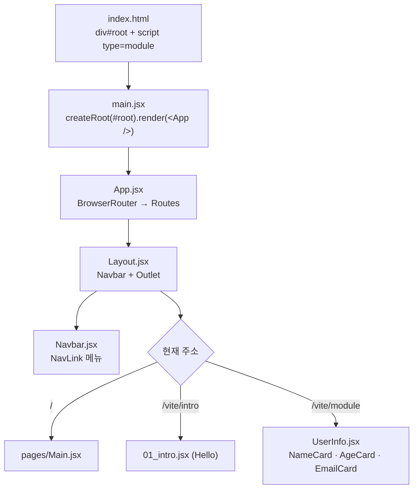
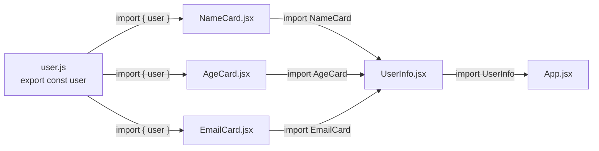
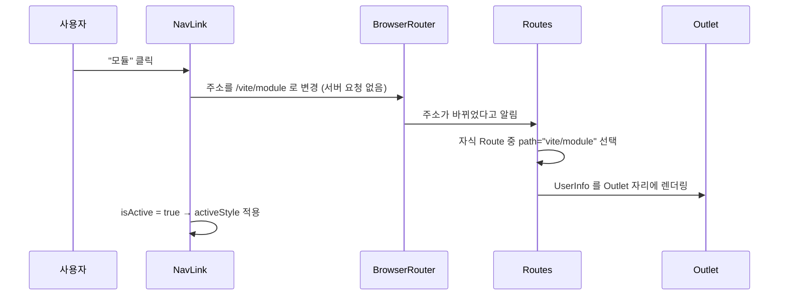
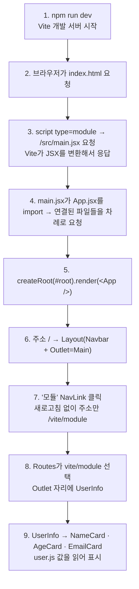

## 들어가며 (Situation)

11/23에는 HTML 파일 하나에 React를 `<script>`로 불러와서 `createElement`, JSX, Fragment, 컴포넌트 합성을 배웠다. 오늘(11/24)은 그 방식을 벗어나 **Vite로 만든 React 프로젝트**(`02_component/component-app`)에서 컴포넌트를 파일로 나누고, 주소에 따라 다른 화면을 보여 주는 **라우팅**까지 만들었다.

| 경로 (`src/` 기준) | 주제 |
|--------------------|------|
| `main.jsx` | 앱의 시작점. `createRoot(...).render(<App />)` |
| `module/01_intro/01_intro.jsx` | `.jsx` 확장자, 첫 컴포넌트 `Hello` |
| `module/02_module/user.js` | `export const user` (named export) |
| `module/02_module/NameCard.jsx` 외 2개 | `export default function` |
| `module/02_module/UserInfo.jsx` | 카드 3개를 묶는 상위 컴포넌트 |
| `App.jsx` | `BrowserRouter`, `Routes`, `Route`로 주소 ↔ 컴포넌트 연결 |
| `layouts/Layout.jsx` | 공통 틀 + `Outlet` |
| `components/Navbar.jsx` | `NavLink`로 메뉴 만들기 + CSS Module |
| `pages/Main.jsx` | 첫 화면 |

프로젝트 버전은 `package-lock.json` 기준 React 19.3.1, react-router-dom 7.18.6, Vite 8.3.8이다.

## 문제 상황 (Task)

어제 방식에는 한계가 세 가지 있었다.

1. **모든 컴포넌트가 HTML 파일 하나에** 있다. `Header`, `NavBar`, `Main`, `Footer`를 다른 페이지에서 다시 쓰려면 코드를 복사해야 한다.
2. **페이지가 하나뿐**이다. 실제 서비스는 주소(`/`, `/vite/intro`, `/vite/module`)마다 다른 화면을 보여 줘야 한다.
3. **브라우저가 JSX를 직접 번역**한다. 열 때마다 Babel(약 2.4MB)을 내려받고 번역해야 한다.

그래서 오늘의 질문은 이것이다.

> **"컴포넌트를 파일로 나눠 재사용하고, 주소마다 다른 화면을 보여 주려면 어떻게 해야 할까?"**

수업 `App.jsx` 주석도 같은 고민에서 출발한다.

> 현실세계의 프로젝트는 여러 페이지가 존재하며 페이지 별로 보여야 하는 컴포넌트, 보이면 안되는 컴포넌트가 존재한다.

### 쉽게 비유하면

- **어제**는 공책 한 권에 모든 내용을 다 적은 것이다. 같은 내용을 다른 공책에 쓰려면 베껴야 한다.
- **오늘**은 내용을 **카드(파일)** 로 나눠 두고, 필요한 카드를 **꺼내 쓰는(import)** 방식이다.
- **라우팅**은 건물 안내 데스크다. "3층(주소)으로 가세요" 하면 건물(사이트)은 그대로 있고, 그 층의 방(컴포넌트)만 보여 준다.

## 해결 과정 (Action)

### 0. CDN 방식 vs Vite 프로젝트

| 항목 | 11/23 CDN 방식 | 11/24 Vite 프로젝트 |
|------|----------------|---------------------|
| React 불러오기 | `<script src="unpkg.com/...">` → 전역 `React` | `npm`으로 설치 후 `import` |
| JSX 번역 | 브라우저에서 Babel이 매번 | 개발 서버·빌드 도구가 미리 |
| 파일 구성 | HTML 하나에 전부 | 컴포넌트마다 `.jsx` 파일 |
| 재사용 | 복사 | `import` / `export` |
| 여러 페이지 | 없음 | `react-router-dom` |
| React 버전 | 18.3.1 (UMD는 19부터 없음) | 19.3.1 |

`package.json`의 `scripts`가 앞으로 쓸 명령이다.

| 명령 | 하는 일 |
|------|---------|
| `npm run dev` | 개발 서버 실행. 파일을 저장하면 화면에 바로 반영(HMR) |
| `npm run build` | 배포용 파일을 `dist/`에 생성 |
| `npm run preview` | `dist/` 결과물을 로컬에서 미리 보기 |
| `npm run lint` | oxlint로 코드 검사 |

Vite는 크게 두 가지 일을 한다.

- **개발할 때**: 브라우저의 ES 모듈(`<script type="module">`)을 그대로 활용한다. 브라우저가 파일을 요청할 때마다 그 파일의 JSX만 바로 변환해서 준다. 그래서 프로젝트가 커져도 개발 서버가 빨리 뜬다.
- **배포할 때**: 흩어진 파일을 하나로 묶고(번들링) 압축한다. Vite 8은 번들러로 **Rolldown**을 쓴다. (`node_modules/vite/package.json`의 의존성에서 확인)

([Vite 공식 문서 - 왜 Vite인가](https://ko.vite.dev/guide/why))

### 1. 앱의 시작점 — `index.html` → `main.jsx` → `App.jsx`

Vite 프로젝트의 `index.html`은 거의 비어 있다. 어제와 똑같이 `<div id="root">`가 있고, 스크립트는 하나만 불러온다.

```html
<div id="root"></div>
<script type="module" src="/src/main.jsx"></script>
```

```javascript
// main.jsx
import { createRoot } from 'react-dom/client'
import App from './App.jsx'

createRoot(document.getElementById('root')).render(
    <App />
)
```

어제의 `ReactDOM.createRoot(...)`가 오늘은 `import { createRoot } from 'react-dom/client'`로 바뀌었다. **전역 변수**에서 꺼내던 것을 **모듈에서 import** 하는 것만 다르고, 하는 일은 같다.



수업 주석처럼 `.jsx` 확장자는 "JSX 문법으로 컴포넌트를 작성한 파일"임을 드러낸다. Vite의 React 플러그인(`@vitejs/plugin-react`)이 이 파일들의 JSX를 변환한다.

### 2. 모듈 나누기 — `import` / `export`

`02_module` 폴더에서는 사용자 정보를 **데이터 파일 1개 + 카드 컴포넌트 3개 + 묶는 컴포넌트 1개**로 나눴다.


```javascript
// user.js — named export
export const user = {
    name : '홍길동',
    age : 20,
    email : "user@example.com"
};
```

```javascript
/*
    export default 는 {} 없이 이름으로
    import 를 받을 수 있지만, 파일 당 1개로
    제한이 된다.
    export 는 {} 를 통해서 import 받을
    수 있으며, 여러 개를 하나의 파일에서
    내보낼 수 있다.
*/

import { user } from "./user";

export default function AgeCard() {
    return  <h2 style={{color : 'orange'}}>{user.age}</h2>
}
```

```javascript
// UserInfo.jsx
import NameCard from "./NameCard";
import AgeCard from "./AgeCard";
import EmailCard from "./EmailCard";

function UserInfo() {
    return (
        <div style={ { width : 300 , border : '1px solid black'} }>
            <NameCard/>
            <AgeCard/>
            <EmailCard/>
        </div>
    );
}

export default UserInfo;
```


> 이름과 이메일은 수업 코드의 값 대신 예시 값으로 바꿔 적었다.

파일끼리 어떻게 연결되는지 그리면 이렇다.



#### `export default` vs `export` 정리

| 구분 | `export default` | `export` (named) |
|------|------------------|------------------|
| 파일당 개수 | **1개** | 여러 개 |
| 내보내기 | `export default function AgeCard() {}` | `export const user = {...}` |
| 가져오기 | `import AgeCard from './AgeCard'` (중괄호 없음) | `import { user } from './user'` (중괄호) |
| 가져올 때 이름 | 마음대로 지어도 됨 | **내보낸 이름 그대로** (바꾸려면 `as`) |
| 오늘 쓴 곳 | 컴포넌트 파일 | 데이터 파일 `user.js` |

`/vite/module`로 들어가면 실제로 이렇게 그려진다. (`vite preview` + headless Chrome으로 확인한 DOM, 값은 예시로 바꿈)

```html
<div style="width: 300px; border: 1px solid black;">
  <h1 style="color: red;">홍길동</h1>
  <h2 style="color: orange;">20</h2>
  <h3 style="color: blue;">user@example.com</h3>
</div>
```

`width : 300`처럼 **숫자**만 쓰면 React가 `300px`로 붙여 준다. 그래서 단위가 `px`일 때는 숫자로 써도 된다. ([React 공식 문서 - Common components (style)](https://react.dev/reference/react-dom/components/common#applying-css-styles))

### 3. 라우팅 — `App.jsx`

컴포넌트를 나눴으니 이제 **주소에 따라** 다른 컴포넌트를 보여 줄 차례다. 수업 주석은 라우팅을 이렇게 정의한다.

> 라우팅 : 요청한 URL 주소에 따라 보여줄 컴포넌트를 정의하는 것이다.

```javascript
import { BrowserRouter, Routes , Route} from 'react-router-dom';
import Layout from "./layouts/Layout";
import Main from "./pages/Main";

function App() {
  return (
    <BrowserRouter>
        <Routes>
          <Route path="/" element={<Layout/>}>
             <Route index element = {<Main/>}/>
             <Route path="vite/intro" element = {<Hello/>}/>
             <Route path="vite/module" element = {<UserInfo/>}/>
          </Route>
        </Routes>
    </BrowserRouter>
  )
}
```

| 컴포넌트 | 역할 | 비유 |
|----------|------|------|
| `BrowserRouter` | 라우팅을 쓸 영역 전체를 감쌈. 브라우저 주소창과 연결 | 건물 |
| `Routes` | `Route`들을 묶고, 현재 주소와 **가장 잘 맞는** 하나를 고름 | 안내 데스크 |
| `Route` | `path`(주소)와 `element`(보여 줄 컴포넌트)를 연결 | 층별 안내판 |

#### 중첩 라우트와 `index`

`Route` 안에 `Route`를 넣은 것이 핵심이다. 부모 `path="/"`의 `Layout`이 **항상** 그려지고, 자식 `Route` 중 주소에 맞는 하나가 그 안에 끼워진다.

| 주소 | 그려지는 것 |
|------|-------------|
| `/` | `Layout` + `Main` (`index` 라우트) |
| `/vite/intro` | `Layout` + `Hello` |
| `/vite/module` | `Layout` + `UserInfo` |

- 자식 `path`는 `/`로 시작하지 않는다. 부모 경로 뒤에 이어 붙는 **상대 경로**라서 `vite/intro`는 `/vite/intro`가 된다.
- `index`는 "부모 주소 **그대로**일 때" 보여 줄 기본 자식이다. `path` 대신 쓴다.

([React Router 공식 문서 - Routing](https://reactrouter.com/start/declarative/routing))

### 4. 공통 틀과 `Outlet` — `Layout.jsx`

자식 라우트가 **어디에** 끼워질지는 부모가 정한다. 그 자리를 표시하는 것이 `Outlet`이다.

```javascript
import { Outlet } from 'react-router-dom';
import Navbar from '../components/Navbar';
import styles from './Layout.module.css';

function Layout() {
    return (
        <div className={styles.layout}>
            <Navbar/>
            <main className={styles.content}>
                {/*
                JSX 내부의 주석
                Outlet 엘리먼트는 경로(Path) 에 따라서
                다른 컴포넌트로 대체되는 엘리먼트이다.
                */}
                <Outlet/>
            </main>
        </div>
    );
}
```

메뉴를 눌러 주소가 바뀌면 `Navbar`는 그대로 있고 **`<main>` 안의 `Outlet` 자리만** 바뀐다. 실제로 세 주소에서 DOM을 비교해 보니 `<nav>` 부분은 같고 `<main>` 안만 `Main` → `Hello` → `UserInfo`로 바뀌었다.

JSX 안에서는 `//`나 `<!-- -->`를 주석으로 쓸 수 없다. 위처럼 **`{/* */}`** 로 감싸야 한다. 중괄호로 JS 영역을 열고, 그 안에 JS 주석을 쓰는 것이다.

### 5. 새로고침 없는 이동 — `NavLink` (`Navbar.jsx`)

```javascript
import { NavLink } from 'react-router-dom';
import styles from './Navbar.module.css';

const activeStyle = ({isActive}) => isActive ? {backgroundColor: 'orangered', color: 'white'} : undefined;

function Navbar() {
    return (
        <nav className={styles.nav}>
            <h2><NavLink to="/">React 챕터</NavLink></h2>

            <h4>01. Vite</h4>
            <NavLink to="/vite/intro" style={activeStyle}>프로젝트 생성</NavLink>
            <NavLink to="/vite/module" style={activeStyle}>모듈</NavLink>
        </nav>
    );
}
```

#### `<a href>` vs `Link` vs `NavLink`

| 태그 | 클릭하면 | 현재 메뉴 표시 |
|------|----------|----------------|
| `<a href>` | 서버에 페이지를 **새로 요청** → 전체 새로고침 (React 상태 초기화) | 직접 구현 |
| `Link` | 주소만 바꾸고 **컴포넌트만 교체** (새로고침 없음) | 직접 구현 |
| `NavLink` | `Link`와 같음 | 현재 주소와 맞으면 `isActive = true` |



`style`에 객체 대신 **함수**를 넘긴 점이 특이하다. `NavLink`는 이 함수를 `{ isActive }`와 함께 호출하고, 반환된 객체를 스타일로 쓴다. `isActive`가 `false`면 `undefined`를 돌려줘서 스타일을 안 붙인다. ([React Router 공식 문서 - NavLink](https://reactrouter.com/api/components/NavLink))

`/vite/intro`에서 렌더링된 실제 DOM을 보면 `NavLink`가 해 주는 일이 하나 더 보인다.

```html
<a aria-current="page" class="active" href="/vite/intro" style="background-color: orangered; color: white;">프로젝트 생성</a>
<a class="" href="/vite/module">모듈</a>
```

- `style` 함수를 쓰지 않아도 현재 메뉴에는 **`class="active"`와 `aria-current="page"`가 자동으로** 붙는다. CSS에서 `.nav a.active { ... }`로 꾸며도 된다.
- 맨 위 `<NavLink to="/">`는 `/`에서만 `active`였다. `/vite/intro`에서는 `class=""`였다. 모든 주소가 `/`로 시작하지만, React Router는 루트 `/` 링크를 특별히 정확히 일치할 때만 활성으로 본다.

### 6. CSS Module — `Navbar.module.css`, `Layout.module.css`

일반 CSS(`import './style.css'`)는 **페이지 전체**에 적용된다. 컴포넌트가 많아지면 `.nav`, `.content` 같은 클래스 이름이 서로 겹쳐 엉뚱한 곳에 스타일이 먹는다. **CSS Module**은 파일 이름을 `이름.module.css`로 지으면 클래스 이름을 **파일마다 고유하게** 바꿔 준다.

```css
/* Navbar.module.css */
.nav {
    width: 180px;
    padding: 10px;
    background-color: #f2f2f2;
    display: flex;
    flex-direction: column;
}
```

```javascript
import styles from './Navbar.module.css';

<nav className={styles.nav}>
```

`styles`는 `{ nav: '바뀐 클래스 이름' }` 형태의 **객체**다. 빌드 결과를 확인해 보니 실제로 이렇게 바뀌었다.

| 파일 | 원래 클래스 | 실제 클래스 (Vite 8.3.8) |
|------|-------------|--------------------------|
| `Navbar.module.css` | `.nav` | `._nav_masue_1` |
| `Layout.module.css` | `.layout` | `._layout_1dcy8_1` |
| `Layout.module.css` | `.content` | `._content_1dcy8_11` |

`masue`, `1dcy8` 부분이 **파일마다 다른 해시**라서, 다른 파일에 `.nav`가 또 있어도 충돌하지 않는다. ([Vite 공식 문서 - CSS Modules](https://ko.vite.dev/guide/features#css-modules))

### 시행착오: 다시 볼 부분

#### ① "import 하고 안 쓰면 오류"는 경고였다

`App.jsx` 주석에 "import 를 했는데 실제로 사용하지 않으면 오류가 발생할 수 있다"고 되어 있다. 직접 실험해 보니, 쓰지 않는 import는 **빌드가 정상으로 성공**했다. 대신 `npm run lint`(oxlint)에서 경고가 났다.

```text
warning eslint(no-unused-vars): Identifier 'EmailCard' is imported but never used.
```

**빌드가 실제로 깨진 경우**는 import와 export 방식이 서로 맞지 않을 때였다.

| 실험 (`AgeCard.jsx`, `UserInfo.jsx`를 잠시 수정) | 결과 |
|------|------|
| 쓰지 않는 `import EmailCard` 추가 | 빌드 ✅, lint 경고 |
| named export인 `user`를 `import user from "./user"`로 | 빌드 ❌ `"default" is not exported by "src/module/02_module/user.js"` |
| default export인 `NameCard`를 `import { NameCard } from "./NameCard"`로 | 빌드 ❌ `"NameCard" is not exported by "src/module/02_module/NameCard.jsx"` |

그래서 "에러가 나면 import부터 보라"는 수업 조언은 맞다. 다만 먼저 확인할 것은 **중괄호가 export 방식과 맞는지**다.

#### ② CSS Module 클래스 이름 형식은 도구마다 다르다

`Navbar.jsx` 주석에는 클래스가 `Navbar-module__nav__xxxxx`처럼 바뀐다고 되어 있다. 이 프로젝트(Vite 8.3.8)에서는 개발 서버와 빌드 결과 모두 `_nav_masue_1` 형식이었다. 이름 형식은 빌드 도구와 설정(`css.modules.generateScopedName`)에 따라 달라진다. 중요한 것은 형식이 아니라 **"파일마다 고유해진다"** 는 점이다.

#### ③ 쓰지 않는 import가 남아 있다

라우팅으로 바꾸면서 `App.jsx`의 `<Hello/>`, `<UserInfo/>`는 `Route`의 `element`로 옮겨 갔다. 그래서 import는 여전히 쓰인다. 다만 주석 처리된 예전 코드(`// <Hello/>`)가 남아 있어서, 나중에 Route를 지우면 import만 덩그러니 남기 쉽다. 이럴 때 lint가 ①의 경고로 알려 준다.

#### ④ 카드 컴포넌트가 아직 `user`를 직접 import 한다

`NameCard`, `AgeCard`, `EmailCard`는 모두 `user.js`를 **직접** import 한다. 파일은 나눴지만 다른 사람 정보를 보여 주려면 여전히 `user.js`를 고쳐야 한다. 부모(`UserInfo`)가 `<NameCard name={...}/>`처럼 넘겨 주는 **props**가 다음 단계다.

### 오늘의 React 흐름 한눈에 보기

`npm run dev`로 띄운 뒤 메뉴에서 "모듈"을 누를 때까지의 흐름이다.



초등학생에게 설명하듯 정리하면 이렇다.

1. **가게 문 열기**: `npm run dev`로 Vite 가게를 연다.
2. **간판 보기**: 브라우저가 `index.html`을 받는다. 거기엔 "`main.jsx`부터 읽어" 한 줄만 있다.
3. **번역해서 건네기**: 브라우저가 `main.jsx`를 달라고 하면, Vite가 JSX를 번역해서 준다.
4. **줄줄이 꺼내기**: `main.jsx`가 `App`을, `App`이 `Layout`을… 필요한 카드를 줄줄이 꺼내 온다(import).
5. **건물 세우기**: `#root`에 `App`을 그린다.
6. **1층 로비**: 주소가 `/`라서 메뉴판(`Navbar`)과 안내문(`Main`)이 보인다.
7. **엘리베이터 버튼**: "모듈" 버튼을 누르면 건물을 새로 짓지 않고 층(주소)만 바뀐다.
8. **방 바꾸기**: 안내 데스크(`Routes`)가 그 층의 방(`UserInfo`)을 `Outlet` 자리에 넣는다.
9. **방 안 구경**: 방 안의 이름표·나이표·이메일표 카드가 `user.js` 정보를 보여 준다.

## 결과 (Result)

어제 CDN 방식에서 브라우저가 받아야 했던 JS와, 오늘 프로젝트를 `npm run build` 한 결과를 비교했다.

| 항목 | 11/23 CDN 방식 (JSX 파일 기준) | 11/24 Vite 빌드 (`dist/`) |
|------|-------------------------------|---------------------------|
| 받는 JS 파일 | 3개 (react, react-dom, babel) | **1개** |
| 크기 | 3,576.9kB | **259.42kB** |
| gzip 크기 | 약 820kB | **82.55kB** (약 1/10) |
| JSX 번역 | 페이지를 열 때마다 브라우저에서 | 빌드할 때 한 번 (약 0.1~0.3초) |
| 포함된 것 | React 18 개발 빌드 + Babel | React 19 + React DOM + React Router + 내 코드 (배포용으로 압축) |

> 측정 조건: CDN 쪽은 unpkg에서 쓰는 파일과 같은 npm 패키지(`react@18.3.1`, `react-dom@18.3.1`의 `umd/*.development.js`, `@babel/standalone@8.1.3`의 `babel.min.js`)의 파일 크기다. gzip은 Node.js `zlib`(level 9)로 계산했다. Vite 쪽은 `vite build`가 출력한 값이다. 개발 빌드와 배포 빌드를 비교한 것이라 차이가 크게 나오는 점을 감안해야 한다. 그래도 **"브라우저에 번역기까지 보내지 않는다"** 는 차이가 가장 크다.

구조 면에서 달라진 점은 이렇다.

| | 11/23 | 11/24 |
|---|---|---|
| 컴포넌트 위치 | HTML 1개 안에 6개 | `.jsx` 파일 9개로 분리 (`App` 포함, `components/`·`layouts/`·`pages/`·`module/`) |
| 화면 수 | 1개 | 주소 3개 (`/`, `/vite/intro`, `/vite/module`) |
| 공통 메뉴 | 없음 | `Layout` + `Navbar` 1번만 작성, 모든 주소에서 재사용 |
| 스타일 | 인라인 `style` | 인라인 `style` + CSS Module (클래스 충돌 없음) |

**배운 점**

- Vite 프로젝트에서도 시작은 어제와 같다. `#root`를 찾아 `createRoot().render()` 한다. 다만 `React`, `ReactDOM`을 전역 변수 대신 **import** 해서 쓴다.
- `export default`는 파일당 하나이고 **중괄호 없이**, named `export`는 여러 개이고 **중괄호로** 가져온다. 이 짝이 안 맞으면 빌드가 실패한다.
- 라우팅은 `BrowserRouter` > `Routes` > `Route`로 **주소와 컴포넌트를 연결**하는 것이다. 중첩 라우트와 `Outlet`을 쓰면 공통 틀은 한 번만 쓰고 가운데만 바꿀 수 있다.
- `NavLink`는 새로고침 없이 이동하고, 현재 메뉴에 `active` 클래스와 `isActive`를 제공한다.
- CSS Module은 클래스 이름을 파일마다 고유하게 바꿔서 **스타일 충돌을 막는다**.
- 주석이나 설명과 실제 동작이 다를 수 있다. lint 경고, 빌드 에러, 렌더링된 DOM을 **직접 확인**하는 습관이 필요하다.

## 더 학습하면 좋은 개념

- **Props** — 카드 컴포넌트들이 `user.js`를 직접 import 하는 구조를, 부모가 데이터를 넘겨 주는 구조로 바꾸는 방법이다. 같은 카드로 여러 사람을 보여 줄 수 있게 된다.
- **SPA와 서버 설정 (History API fallback)** — `BrowserRouter`는 주소만 바꾸고 서버에 요청하지 않는다. 그런데 `/vite/module`에서 **새로고침**하면 브라우저는 서버에 그 경로를 요청한다. 정적 호스팅(예: GitHub Pages)에서는 404가 날 수 있어서, 모든 경로를 `index.html`로 돌려주는 설정이 필요하다.
- **`useParams` / 동적 라우트** — `/users/:id`처럼 주소의 일부를 값으로 받아 화면을 바꾸는 방법이다. 11/20의 `fetch`와 합치면 "글 상세 페이지"를 만들 수 있다.
- **코드 분할(`React.lazy`, 동적 `import()`)** — 지금은 모든 페이지가 JS 파일 하나(259kB)에 들어 있다. 페이지별로 나눠서 필요할 때 받으면 첫 화면이 더 빨라진다.
- **ES 모듈 동작 원리** — `import`가 왜 파일 맨 위에서만 되는지, 같은 모듈을 여러 번 import 해도 왜 한 번만 실행되는지 이해하면 모듈 구조 설계가 쉬워진다.

## 참고 자료

- [Vite 공식 문서 - 시작하기](https://ko.vite.dev/guide/)
- [Vite 공식 문서 - 왜 Vite인가](https://ko.vite.dev/guide/why)
- [Vite 공식 문서 - CSS Modules](https://ko.vite.dev/guide/features#css-modules)
- [Vite 공식 문서 - 프로덕션 빌드](https://ko.vite.dev/guide/build)
- [React 공식 문서 - Importing and Exporting Components](https://react.dev/learn/importing-and-exporting-components)
- [React 공식 문서 - createRoot](https://react.dev/reference/react-dom/client/createRoot)
- [React 공식 문서 - Common components (style)](https://react.dev/reference/react-dom/components/common#applying-css-styles)
- [React Router 공식 문서 - Routing](https://reactrouter.com/start/declarative/routing)
- [React Router 공식 문서 - NavLink](https://reactrouter.com/api/components/NavLink)
- [React Router 공식 문서 - Outlet](https://reactrouter.com/api/components/Outlet)
- [MDN - JavaScript 모듈](https://developer.mozilla.org/ko/docs/Web/JavaScript/Guide/Modules)
- [MDN - export](https://developer.mozilla.org/ko/docs/Web/JavaScript/Reference/Statements/export)
- [MDN - import](https://developer.mozilla.org/ko/docs/Web/JavaScript/Reference/Statements/import)
