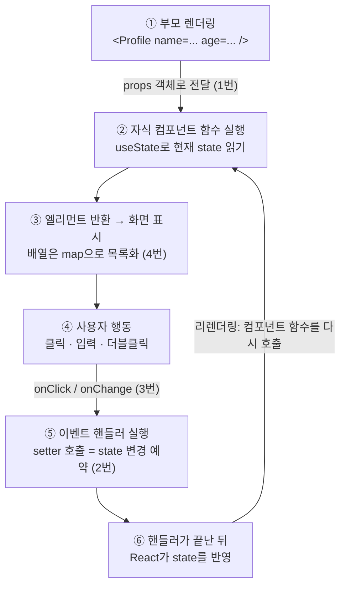
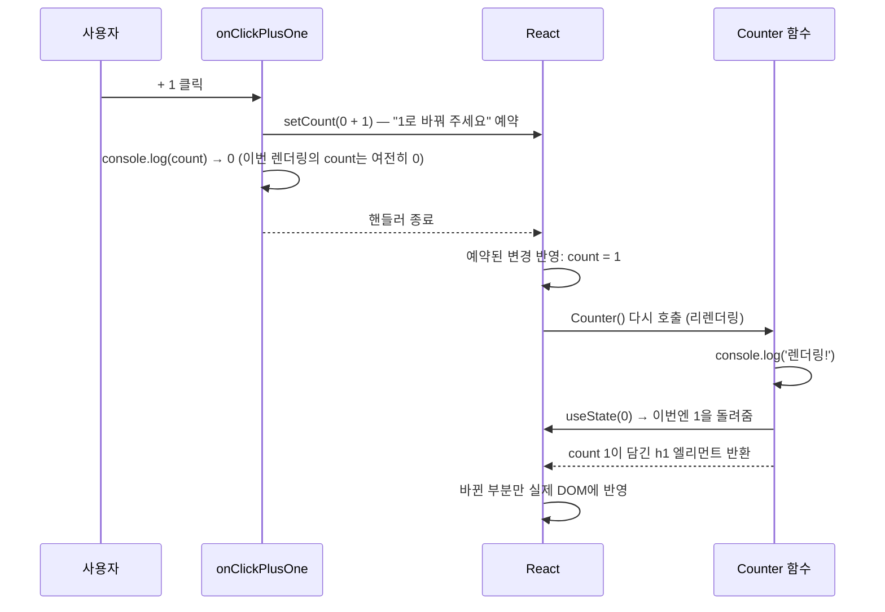
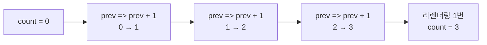
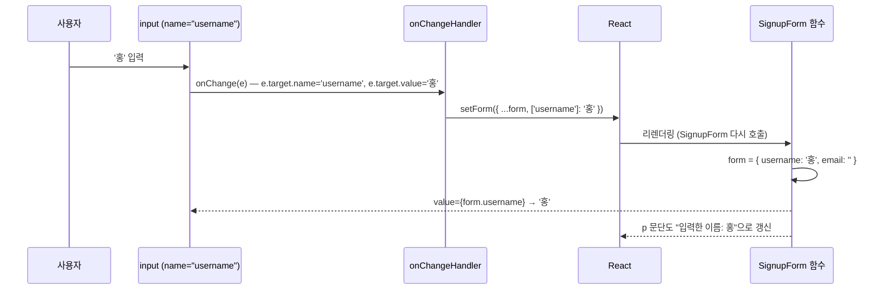
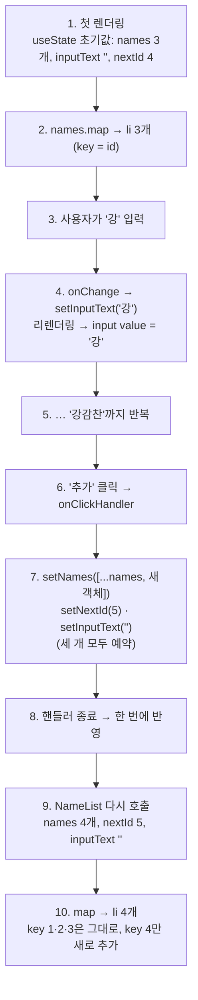

## 들어가며 (Situation)

11/24에는 Vite 프로젝트에서 컴포넌트를 파일로 나누고 라우팅을 붙였다. 그런데 화면은 **한 번 그리고 끝**이었다. 카드 컴포넌트는 `user.js`를 직접 읽었고, 버튼을 눌러도 아무것도 바뀌지 않았다.

오늘(11/25)은 화면에 **데이터를 넣고, 바꾸는** 방법을 파일 4개로 배웠다. 네 파일은 앞 단계를 다음 단계가 이어받는 순서로 되어 있다.

| 순서 | 파일 | 주제 | 한 줄 요약 |
|------|------|------|------------|
| 1 | `01_props.jsx` | props, 구조 분해, `children` | 부모가 자식에게 값을 **내려 준다** |
| 2 | `02_state.jsx` | `useState`, 리렌더링, `prev` | 컴포넌트가 **스스로 바꾸는** 값 |
| 3 | `03_event.jsx` | `onChange`, 제어 컴포넌트, 객체 state | **사용자 입력**으로 state를 바꾼다 |
| 4 | `04_iteration.jsx` | `map`, `key`, 배열 state 추가·삭제 | **배열 state**를 목록으로 그리고 바꾼다 |

## 문제 상황 (Task)

이 글의 핵심 질문은 하나다.

> **"React에서 값이 바뀌면, 어떤 순서를 거쳐 화면이 바뀔까?"**

11/18에는 DOM을 직접 다뤘다. 버튼을 누르면 `textContent`를 **내가 직접** 바꿨다. React에서는 DOM을 직접 고치지 않는다. 그럼 누가, 언제, 어떤 순서로 화면을 고칠까? 이 순서를 모르면 다음과 같은 일이 생긴다.

- 변수를 바꿨는데 화면이 그대로다.
- `setCount`를 세 번 불렀는데 1만 오른다.
- `console.log`를 찍었더니 **방금 바꾼 값이 아니라 이전 값**이 나온다.

오늘 배운 네 가지를 **"무엇이 먼저 일어나고, 그다음에 무엇이 일어나는가"** 순서로 정리한다.

### 쉽게 비유하면

React 컴포넌트는 **사진관**이다.

- **props**: 손님(부모)이 가져온 **소품**. 사진관은 소품을 쓰기만 하고 고치지 않는다.
- **state**: 사진관이 직접 관리하는 **조명 세팅**. 바꿀 수 있다.
- **렌더링**: 지금 소품과 조명으로 **사진을 한 장 찍는 것**.
- **setter(`setCount`)**: "조명 바꿔 주세요" **주문서**. 주문서를 내면 바로 바뀌는 게 아니라, 지금 하던 일이 끝난 뒤 조명을 바꾸고 **사진을 새로 찍는다**.

## 해결 과정 (Action)

### 0. 전체 순서 먼저 보기

오늘 배운 내용을 한 그림으로 그리면 이렇다. 1~4번이 이 고리의 각 부분을 하나씩 다룬다.



> 이름이 들어간 수업 코드는 강사님 실명 대신 예시 이름(`홍길동` 등)으로 바꿔 적었다.

### 1. props — 부모가 자식에게 값을 내려 주는 순서 (`01_props.jsx`)

**props**는 부모 컴포넌트가 자식 컴포넌트에게 전달하는 값이다. 11/24의 카드 컴포넌트는 `user.js`를 직접 import 했지만, props를 쓰면 **부모가 무엇을 보여 줄지 정한다**.


```javascript
/* 1. props 기본 */
function Title(props) {
    console.log(props);
    return <h1>안녕하세요 {props.name}님 반갑습니다.</h1>;
}

/* 2. 매개변수에서 구조 분해 할당 (가장 많이 쓰는 형태) */
function Profile({name, age}) {
    return <h3>{name}님은 {age}살입니다.</h3>;
}

/* 3. children */
function Box({children}) {
    return <div style={{border: '1px solid orangered', padding: 10, margin: 5}}>{children}</div>;
}

export default function Props() {
    return (
        <>
            <Title name="홍길동"/>
            <Title name="Raccoon"/>

            <Profile name="홍길동" age={20}/>

            <Box>텍스트 노드</Box>
            <Box><Profile name="강감찬" age={30}/></Box>
        </>
    );
}
```


#### props가 전달되는 순서

`<Title name="홍길동"/>` 한 줄이 화면이 되기까지의 순서다.

1. **부모가 태그에 속성을 적는다**: `<Title name="홍길동"/>`
2. **React가 속성들을 객체 하나로 묶는다**: `{ name: '홍길동' }`
3. **자식 함수를 호출하면서 그 객체를 첫 번째 매개변수로 넘긴다**: `Title({ name: '홍길동' })`
4. **자식이 props를 읽어 엘리먼트를 반환한다**: `<h1>안녕하세요 홍길동님 반갑습니다.</h1>`

실제로 실행해서 `console.log(props)` 결과를 확인했다. (React 19.3.1, 아래 결과 모두 같은 환경에서 확인)

```text
{name: '홍길동'}
{name: 'Raccoon'}
```

`<Title/>`이 두 번 쓰였으니 `Title` 함수도 **두 번, 위에서부터 순서대로** 호출됐다. 같은 컴포넌트라도 props가 다르면 다른 화면이 나온다. 이것이 11/24 "더 학습하면 좋은 개념"에 적었던 **컴포넌트 재사용**이다.

#### props 작성 규칙

| 규칙 | 예 | 이유 |
|------|----|------|
| 문자열은 따옴표 | `name="홍길동"` | HTML 속성과 같다 |
| 문자열이 아닌 값은 `{}` | `age={20}` | `age="20"`이면 숫자가 아니라 문자열 `"20"`이 된다 |
| 매개변수에서 바로 구조 분해 | `function Profile({name, age})` | `props.name`을 반복하지 않아도 된다 (11/18의 구조 분해 할당) |
| 자식은 props를 **수정하지 않는다** | `props.name = '...'` ❌ | props는 부모의 값이다. 바꾸고 싶으면 부모가 바꿔서 다시 내려 준다 |

#### `children` — 태그 **사이**에 쓴 내용

`<Box>텍스트 노드</Box>`처럼 컴포넌트 태그 사이에 쓴 내용은 `props.children`으로 들어온다. 텍스트뿐 아니라 `<Box><Profile .../></Box>`처럼 **다른 컴포넌트**도 넣을 수 있다. `Box`는 안에 무엇이 들어올지 몰라도 **테두리만 그려 주는 틀** 역할을 한다.

렌더링된 실제 DOM을 보면 `padding: 10`이 `10px`로 바뀌어 들어갔다.

```html
<div style="border: 1px solid orangered; padding: 10px; margin: 5px;">
  <h3>강감찬님은 30살입니다.</h3>
</div>
```

([React 공식 문서 - Passing Props to a Component](https://react.dev/learn/passing-props-to-a-component))

### 2. state — 값이 바뀌고 화면이 다시 그려지는 순서 (`02_state.jsx`)

props는 부모가 주는 **읽기 전용** 값이다. 컴포넌트가 **스스로 바꿔야 하는** 값(클릭 횟수, 입력값, 목록)은 **state**로 관리한다.

```javascript
const [값, setter함수] = useState(초기값);
```

#### 먼저 실패해 보기: `let` 변수

수업의 TODO 1은 `let count = 0`으로 먼저 만들어 보고 화면이 왜 안 바뀌는지 확인하는 것이었다. 버튼을 두 번 눌렀을 때의 실제 결과다.

| 확인 항목 | 결과 |
|-----------|------|
| 콘솔 | `count: 1` → `count: 2` (변수는 바뀜) |
| `렌더링!` 로그 | **안 찍힘** (컴포넌트 함수가 다시 실행되지 않음) |
| 화면 `<h1>` | **0 그대로** |

React는 일반 변수가 바뀐 것을 **모른다**. 그래서 함수를 다시 실행하지 않고, 화면도 그대로다. 혹시 다시 실행되더라도 `let count = 0` 줄부터 다시 시작하니 0으로 돌아간다.

#### `useState`로 바꾸면

```javascript
function Counter() {
    console.log('렌더링!');      // state가 바뀔 때마다 출력된다.

    const [count, setCount] = useState(0);

    const onClickPlusOne = () => {
        // set 함수는 바꾸고자 하는 값을 변경하는 함수이며
        // 변경 시 리랜더링이 일어나게 해준다.
        setCount(count + 1);
        console.log(`count: ${count}`);
    };
    // ...
}
```

`+ 1` 버튼을 한 번 눌렀을 때 **실제로 찍힌 순서**다.

```text
count: 0      ← 핸들러 안의 console.log (아직 이전 값)
렌더링!       ← 핸들러가 끝난 뒤 Counter가 다시 실행됨
```

화면은 `count : 1`이 됐다. 그런데 `setCount(count + 1)` **바로 다음 줄**의 `console.log`는 `0`을 찍었다. 순서를 풀어 보면 이유가 보인다.



1. **클릭** → 이벤트 핸들러가 실행된다.
2. **`setCount(1)`은 "예약"** 이다. 지금 이 순간의 `count` 변수는 바뀌지 않는다.
3. 그래서 다음 줄 `console.log`는 **이전 값 0**을 찍는다.
4. **핸들러가 끝나면** React가 예약된 변경을 반영한다.
5. React가 **`Counter` 함수를 처음부터 다시 호출**한다(리렌더링). `렌더링!`이 찍힌다.
6. 이번 호출에서 `useState(0)`은 초기값 0이 아니라 **저장해 둔 1**을 돌려준다.
7. 새 엘리먼트를 이전과 비교해 **바뀐 `<h1>` 글자만** DOM에 반영한다.

React 문서는 이것을 **"state는 스냅샷이다"** 라고 설명한다. 한 번의 렌더링 안에서 `count`는 **고정된 값**이고, 다음 렌더링이 되어야 새 값이 보인다. ([React 공식 문서 - State as a Snapshot](https://react.dev/learn/state-as-a-snapshot))

#### `setCount`를 세 번 부르면? — `prev`가 필요한 이유

TODO 2는 `setCount(count + 1)`을 세 번 호출해 보는 것이었다. 두 방식을 실제로 실행해 비교했다.

```javascript
// 예시 코드 (비교용): 이전 값을 쓰지 않는 방식
setCount(count + 1);
setCount(count + 1);
setCount(count + 1);
```

```javascript
// 수업 코드: 이전 state(prev)를 받는 방식
const onClickPlusThree = () => {
    setCount(prev => prev + 1);
    setCount(prev => prev + 1);
    setCount(prev => prev + 1);
    console.log(`count: ${count}`);
};
```

| 방식 (count가 0일 때 1번 클릭) | 대기열에 쌓이는 것 | 결과 | `렌더링!` 횟수 |
|------|------|------|------|
| `setCount(count + 1)` × 3 | "1로" , "1로" , "1로" | **1** | 1번 |
| `setCount(prev => prev + 1)` × 3 | "+1" , "+1" , "+1" | **3** | 1번 |

`count + 1`은 세 번 모두 **같은 스냅샷의 `count`(0)** 를 읽어서 "1로 바꿔 주세요"를 세 번 예약한다. `prev => prev + 1`은 **함수**를 예약한다. React는 핸들러가 끝난 뒤 대기열의 함수를 **순서대로** 실행하면서, 앞 결과를 다음 함수의 `prev`로 넘긴다.



두 방식 모두 **`렌더링!`은 한 번만** 찍혔다. setter를 세 번 불러도 React는 핸들러가 끝날 때까지 모았다가 **한 번에** 다시 그린다(배칭). ([React 공식 문서 - Queueing a Series of State Updates](https://react.dev/learn/queueing-a-series-of-state-updates))

> **이전 값을 바탕으로 새 값을 계산할 때는 `prev =>` 형태를 쓴다.** `초기화`처럼 이전 값과 상관없이 정해진 값으로 바꿀 때는 `setCount(0)`이면 충분하다.

### 3. 이벤트와 입력값 — 키 하나가 화면에 찍히는 순서 (`03_event.jsx`)

#### React 이벤트 규칙

| 규칙 | HTML / 11/18 방식 | React |
|------|-------------------|-------|
| 이름 | `onclick`, `onchange` | **카멜 표기** `onClick`, `onChange` |
| 넘기는 것 | 코드 문자열 `onclick="add()"` | **함수** `onClick={add}` 또는 `onClick={() => add()}` |
| 연결 대상 | DOM 요소 | **DOM 요소만** (`button`, `input` 등) |

세 번째 규칙은 실제로 확인했다. 아래처럼 **컴포넌트**에 `onClick`을 주고 버튼을 눌렀더니 아무것도 실행되지 않았다(로그 0개).

```javascript
// 예시 코드 (비교용)
function MyButton() { return <button>내 버튼</button>; }

<MyButton onClick={() => console.log('실행?')}/>   // 클릭해도 실행 안 됨
```

`<MyButton onClick={...}/>`의 `onClick`은 이벤트가 아니라 1번에서 본 **그냥 props**다. `MyButton` 안의 `<button>`에 `onClick={props.onClick}`처럼 **다시 연결**해야 동작한다.

#### 제어 컴포넌트 — input의 값을 state가 쥐고 있다

```javascript
const [form, setForm] = useState({
    username: '',
    email: ''
});

const onChangeHandler = e => {
    // 프로퍼티 키에 [] 를 씌우게 되면 값이 곧 Key 가 된다.
    setForm({
        ...form,  // 기존 값을 스프레드 문법으로 복사하지 않으면
                  // form 에 묶여있는 다른 값을 수정하면 기존 값이
                  // 초기화 된다.
        [e.target.name] : e.target.value
    });
};

const onResetHandler = () => {
    setForm({username : '', email : ''});
};

return (
    <>
        <input name="username" placeholder="이름" value ={form.username} onChange={onChangeHandler}/>
        <input name="email" placeholder="이메일" value ={form.email} onChange={onChangeHandler}/>
        <button onClick={onResetHandler}>초기화</button>
        <p>입력한 이름: {form.username} / 이메일: {form.email}</p>
    </>
);
```

이름 칸에 `홍`을 입력했을 때의 순서다.



1. **키 입력** → `onChange`가 실행되고, 이벤트 객체 `e`가 들어온다.
2. **`e.target`** 은 이벤트가 일어난 input이다. `name`으로 **어느 칸인지**, `value`로 **입력된 값**을 안다.
3. **`[e.target.name]`** (계산된 속성 이름): 대괄호 안의 **값**(`'username'`)이 키가 된다. 그래서 핸들러 하나로 두 칸을 모두 처리한다.
4. **`...form`** 으로 기존 값을 복사한 **새 객체**를 만들어 `setForm`에 넘긴다.
5. 리렌더링되면서 `value={form.username}`으로 **state 값이 다시 input에 들어간다**.

input에 보이는 값의 주인이 브라우저가 아니라 **state**라서 "제어 컴포넌트"라고 부른다. ([React 공식 문서 - input (Controlling an input with a state variable)](https://react.dev/reference/react-dom/components/input#controlling-an-input-with-a-state-variable))

#### 수업 주석 두 개를 직접 확인했다

**① `...form`을 빼면?** 이름 칸에 글자를 입력한 뒤, 이메일 칸에 `a@b.c`를 입력했다.

| | `...form` 있음 (수업 코드) | `...form` 없음 (비교용) |
|---|---|---|
| state | `{username: '홍길', email: 'a@b.c'}` | `{email: 'a@b.c'}` |
| 이름 칸 | 입력한 값 그대로 | **비워짐** |

`setForm`은 기존 객체에 **합치는 것이 아니라 통째로 바꾼다**. `{ [name]: value }`만 넘기면 나머지 키가 사라진다. 그래서 복사(`...form`)가 먼저, 바꿀 키가 나중이다. 순서를 뒤집으면 복사한 옛 값이 새 값을 덮어쓴다.

**② `value`를 연결하지 않으면?** 수업 TODO 3의 "초기화 버튼이 input까지 비우려면 필요"를 확인했다. 이름 칸에 `홍길동`을 입력하고 초기화를 눌렀다.

| | `value` 연결 (수업 코드) | `value` 없음 (비교용) |
|---|---|---|
| state | `{username: '', email: ''}` | `{username: '', email: ''}` |
| 입력 칸에 보이는 값 | **빈칸** | **`홍길동` 그대로** |

state는 비워졌는데 화면의 입력 칸은 그대로였다. `value`가 없으면 input은 **state와 연결이 끊긴** 상태라서, state를 바꿔도 칸에 반영할 방법이 없다.

([React 공식 문서 - Updating Objects in State](https://react.dev/learn/updating-objects-in-state))

### 4. 반복 렌더링 — 배열이 목록이 되고, 추가·삭제되는 순서 (`04_iteration.jsx`)

```javascript
const [names, setNames] = useState([
    {id: 1, name: '홍길동'},
    {id: 2, name: '유관순'},
    {id: 3, name: '이순신'}
]);
const [inputText, setInputText] = useState('');
const [nextId, setNextId] = useState(4);

const onClickHandler = () => {
    setNames([...names, {id: nextId, name : inputText} ]);
    setNextId(nextId+1);
    setInputText('');
};

const onRemove = id => {
    setNames(names.filter(name => name.id !== id ));
};

return (
    <>
        <input value={inputText} onChange={e => setInputText(e.target.value)}/>
        <button onClick={onClickHandler}>추가</button>
        <ul>
            {names.map( name =>
                <li key={name.id} onDoubleClick={() => onRemove(name.id)}>{name.id} 번 {name.name}</li>
            )}
        </ul>
        <p>더블 클릭하면 삭제된다.</p>
    </>
);
```

#### 배열이 목록이 되는 순서

1. `names`는 **데이터 배열**이다: `[{id:1, name:'홍길동'}, ...]`
2. `names.map(name => <li>...</li>)`이 **엘리먼트 배열**을 만든다: `[<li>1 번 홍길동</li>, ...]`
3. JSX의 `{}` 안에 배열을 넣으면 React가 **순서대로** 펼쳐서 그린다.

#### `key`가 없으면

`key` 없이 먼저 써 보라는 TODO 1을 실제로 해 보니 콘솔에 이런 경고가 떴다.

```text
Each child in a list should have a unique "key" prop.
Check the render method of `ListNoKey`. See https://react.dev/link/warning-keys for more information.
```

`key`는 리렌더링 때 React가 **"이전 목록의 어느 항목이 이번 목록의 어느 항목인지"** 짝을 맞추는 이름표다. 이름표가 있어야 2번 항목이 지워졌을 때 "2번이 빠졌다"고 알고 그 `<li>`만 지운다.

| key 후보 | 사용 | 이유 |
|----------|------|------|
| DB의 pk, 오늘의 `id` | ✅ | 항목마다 고유하고, 추가·삭제해도 안 바뀐다 |
| 배열 index | ⚠️ 지양 | 중간 항목을 지우면 뒤 항목들의 index가 **하나씩 당겨진다**. React가 엉뚱한 항목끼리 짝을 맞출 수 있다 |
| `Math.random()` | ❌ | 렌더링마다 바뀌어서 매번 **전부 새 항목**으로 취급된다 |

([React 공식 문서 - Rendering Lists](https://react.dev/learn/rendering-lists))

#### 추가 → 삭제 순서 (실제 실행 결과)

| 순서 | 동작 | 목록 | `nextId` | 입력 칸 |
|------|------|------|----------|---------|
| 0 | 처음 | 1 홍길동, 2 유관순, 3 이순신 | 4 | 빈칸 |
| 1 | `강감찬` 입력 → 추가 | …, **4 강감찬** | 5 | **빈칸** |
| 2 | `세종` 입력 → 추가 | …, 4 강감찬, **5 세종** | 6 | 빈칸 |
| 3 | 2번 유관순 더블클릭 | 1 홍길동, 3 이순신, 4 강감찬, 5 세종 | 6 | 빈칸 |

**추가**를 누르면 이 순서로 진행된다.

1. `[...names, {id: nextId, name: inputText}]`: 기존 배열을 **복사**하고 끝에 새 객체를 붙인 **새 배열**을 만든다.
2. `setNextId(nextId + 1)`: 다음 id를 하나 올린다. 안 올리면 다음 항목도 id가 4가 되어 `key`가 겹친다.
3. `setInputText('')`: 입력 칸을 비운다. 입력 칸이 `value={inputText}`로 연결되어 있어서(3번의 제어 컴포넌트) 실제로 비워진다.
4. 핸들러가 끝나면 세 setter가 **한 번에** 반영되고 리렌더링된다(2번의 배칭).

**삭제**는 `filter`로 "지울 id가 **아닌** 것만 남긴" 새 배열을 만든다. 삭제 후 id가 1, 3, 4, 5로 **빈 번호가 생기는 것**이 정상이다. id는 순번이 아니라 **이름표**이기 때문이다.

#### 왜 `push`, `splice`가 아니라 새 배열인가

```javascript
// 예시 코드 (비교용): 원본을 직접 수정
names.push({id: nextId, name: inputText});
setNames(names);   // 같은 배열을 다시 넘김
```

React는 setter로 받은 값이 **이전 값과 같은 객체인지**(`Object.is`)로 바뀌었는지 판단한다. `push`는 **같은 배열**의 내용만 바꾸므로, React 입장에서는 "같은 값을 또 줬다"가 되어 리렌더링을 건너뛸 수 있다. 그래서 스프레드(`[...names, 새값]`), `filter`, `map`처럼 **새 배열을 돌려주는** 방법을 쓴다. ([React 공식 문서 - Updating Arrays in State](https://react.dev/learn/updating-arrays-in-state), [useState - Caveats](https://react.dev/reference/react/useState#setstate-caveats))

| 하고 싶은 것 | 피할 것 (원본 수정) | 쓸 것 (새 배열) |
|--------------|---------------------|-----------------|
| 추가 | `push`, `unshift` | `[...arr, 새값]` |
| 삭제 | `splice`, `pop` | `filter` |
| 수정 | `arr[i] = ...` | `map` |

### 시행착오: 다시 볼 부분

#### ① setter 바로 뒤의 `console.log`는 이전 값을 찍는다

수업 코드의 `onClickPlusOne`, `onClickPlusThree` 모두 setter 다음 줄에서 `console.log(count)`를 찍는다. 실행해 보니 각각 `0`, `1`이 찍혔다. 화면은 이미 `1`, `4`가 되어 있었다. 2번의 순서대로, **핸들러 안의 `count`는 이번 렌더링의 스냅샷**이기 때문이다. 바뀐 값을 확인하려면 컴포넌트 본문(`렌더링!` 옆)에서 찍어야 한다.

#### ② 컴포넌트에 준 `onClick`은 이벤트가 아니다

3번에서 확인한 것처럼 `<MyButton onClick={...}/>`은 props 전달일 뿐이다. 이벤트는 결국 **DOM 요소**에 연결되어야 한다. 부모가 넘긴 함수를 자식이 받아서 `<button onClick={onClick}>`에 다시 연결하는 패턴은, 자식이 부모의 state를 바꾸는 기본 방법이기도 하다.

#### ③ 빈 이름도 추가된다

`04_iteration.jsx`는 입력 칸이 비어 있어도 `추가`를 누르면 `6 번 `처럼 이름 없는 항목이 생긴다. 핸들러 맨 앞에서 막으면 된다.

```javascript
// 예시 코드
const onClickHandler = () => {
    if (inputText.trim() === '') return;   // 빈 값이면 아무것도 하지 않음
    setNames([...names, {id: nextId, name: inputText}]);
    setNextId(nextId + 1);
    setInputText('');
};
```

#### ④ "set 함수가 값을 변경한다"의 정확한 의미

수업 주석의 "set 함수는 바꾸고자 하는 값을 변경하는 함수"는 결과만 보면 맞다. 다만 **호출하는 순간 변수가 바뀌는 것이 아니라**, 다음 렌더링에 쓸 값을 **예약**하고 리렌더링을 요청하는 함수라고 이해해야 ①과 TODO 2의 결과가 설명된다.

### 오늘의 React 흐름 한눈에 보기

`04_iteration.jsx`에서 `강감찬`을 입력하고 `추가`를 누를 때까지의 흐름이다. 오늘 배운 네 가지가 모두 들어 있다.



초등학생에게 설명하듯 정리하면 이렇다.

1. **사진 첫 장**: 사진관이 이름표 3장(1·2·3번)이 붙은 명단으로 첫 사진을 찍는다.
2. **글자 쓰기**: 손님이 입력 칸에 "강"을 쓰면, 사진관은 메모지(state)에 "강"을 적고 사진을 새로 찍는다. 그래서 칸에 "강"이 보인다.
3. **계속 쓰기**: "강감찬"이 될 때까지 글자마다 반복한다.
4. **추가 버튼**: 손님이 "추가"를 누른다.
5. **주문서 세 장**: "명단 끝에 4번 강감찬 붙이기", "다음 번호는 5번", "입력 칸 비우기" 주문서를 낸다. 아직 아무것도 안 바뀌었다.
6. **한 번에 처리**: 버튼 일이 끝나면 사진관이 주문서 세 장을 **한꺼번에** 처리한다.
7. **새 사진**: 바뀐 메모지로 사진을 **딱 한 번** 새로 찍는다.
8. **이름표 맞추기**: 이름표 1·2·3번은 그대로 두고, 새로 생긴 4번만 사진에 붙인다.

## 결과 (Result)

수업 코드와 비교용 코드를 Vite 개발 서버(React 19.3.1)에서 실행하고, headless Chrome으로 클릭·입력을 자동 실행해 결과를 확인했다.

| 실험 | 결과 | 배운 규칙 |
|------|------|-----------|
| `let count`를 2번 증가 | 콘솔 2, 화면 **0**, 리렌더링 0번 | 화면을 바꾸려면 **state** |
| `+ 1` 클릭 직후 `console.log(count)` | **0** (화면은 1) | state는 **스냅샷** |
| `setCount(count + 1)` × 3 | **+1** | 같은 스냅샷 값을 3번 예약 |
| `setCount(prev => prev + 1)` × 3 | **+3** | 함수를 예약하면 누적 |
| 위 두 경우의 리렌더링 횟수 | 클릭당 **1번** | setter 여러 번 → 한 번에 반영 (배칭) |
| `...form` 없이 이메일 입력 | 이름 값 **사라짐** | 객체 state는 **복사 후 변경** |
| `value` 없이 초기화 | state는 비었는데 칸은 **그대로** | 제어 컴포넌트는 `value` 필수 |
| 컴포넌트에 `onClick` | 실행 **0번** | 이벤트는 **DOM 요소**에만 |
| `key` 없이 `map` | 콘솔 **경고** | 목록에는 고유한 `key` |

**배운 점**

- React에서 화면이 바뀌는 순서는 항상 같다. **이벤트 → setter로 변경 예약 → 핸들러 종료 → 컴포넌트 함수 다시 호출 → 바뀐 부분만 DOM 반영.**
- **props**는 부모 → 자식 방향으로만 흐르고, 자식은 읽기만 한다. 같은 컴포넌트도 props가 다르면 다른 화면이 된다.
- **state**는 렌더링마다 찍힌 스냅샷이다. setter를 불러도 지금 실행 중인 코드의 값은 안 바뀐다. 이전 값으로 계산할 때는 `prev =>`를 쓴다.
- 입력값은 `value` + `onChange`로 **state가 쥐고 있게** 하고, 여러 칸은 객체 state + `[e.target.name]` + `...form`으로 핸들러 하나에서 처리한다.
- 배열 state는 원본을 고치지 않고 **새 배열**(스프레드, `filter`, `map`)로 바꾸고, 목록에는 **바뀌지 않는 고유 `key`**(id)를 준다.
- 11/18에 배운 **스프레드, 구조 분해 할당**이 오늘 React 코드의 거의 모든 곳에 쓰였다.

## 더 학습하면 좋은 개념

- **상태 끌어올리기 (Lifting State Up)** — 오늘은 state가 한 컴포넌트 안에만 있었다. 형제 컴포넌트가 같은 값을 써야 하면 state를 **공통 부모**로 올리고, props로 값과 setter를 내려 준다. 시행착오 ②의 패턴이 여기서 쓰인다.
- **`useEffect`** — 오늘은 클릭·입력 때만 state를 바꿨다. 화면이 처음 뜰 때 11/20의 `fetch`로 데이터를 받아 state에 넣으려면 `useEffect`가 필요하다.
- **렌더링과 커밋 (Render and Commit)** — "컴포넌트 함수 호출(렌더)"과 "실제 DOM 반영(커밋)"을 나눠 이해하면, 리렌더링이 일어나도 DOM이 전부 다시 그려지지 않는 이유가 명확해진다.
- **불변성과 중첩 객체 업데이트** — `...form`은 한 단계만 복사한다. `{ user: { address: { city } } }`처럼 깊은 객체를 바꿀 때는 단계마다 복사해야 한다. 이게 번거로워서 Immer 같은 라이브러리를 쓴다.
- **비제어 컴포넌트와 `useRef`** — 입력마다 리렌더링하지 않고, 제출할 때만 값을 읽는 방식이다. 제어 컴포넌트와 언제 무엇을 쓰는지 비교해 볼 만하다.

## 참고 자료

- [React 공식 문서 - Passing Props to a Component](https://react.dev/learn/passing-props-to-a-component)
- [React 공식 문서 - State: A Component's Memory](https://react.dev/learn/state-a-components-memory)
- [React 공식 문서 - Render and Commit](https://react.dev/learn/render-and-commit)
- [React 공식 문서 - State as a Snapshot](https://react.dev/learn/state-as-a-snapshot)
- [React 공식 문서 - Queueing a Series of State Updates](https://react.dev/learn/queueing-a-series-of-state-updates)
- [React 공식 문서 - Responding to Events](https://react.dev/learn/responding-to-events)
- [React 공식 문서 - Updating Objects in State](https://react.dev/learn/updating-objects-in-state)
- [React 공식 문서 - Updating Arrays in State](https://react.dev/learn/updating-arrays-in-state)
- [React 공식 문서 - Rendering Lists](https://react.dev/learn/rendering-lists)
- [React 공식 문서 - useState](https://react.dev/reference/react/useState)
- [React 공식 문서 - input](https://react.dev/reference/react-dom/components/input)
- [MDN - 구조 분해 할당](https://developer.mozilla.org/ko/docs/Web/JavaScript/Reference/Operators/Destructuring_assignment)
- [MDN - 전개 구문](https://developer.mozilla.org/ko/docs/Web/JavaScript/Reference/Operators/Spread_syntax)
- [MDN - 계산된 속성 이름](https://developer.mozilla.org/ko/docs/Web/JavaScript/Reference/Operators/Object_initializer#%EA%B3%84%EC%82%B0%EB%90%9C_%EC%86%8D%EC%84%B1_%EC%9D%B4%EB%A6%84)
- [MDN - Array.prototype.filter()](https://developer.mozilla.org/ko/docs/Web/JavaScript/Reference/Global_Objects/Array/filter)
