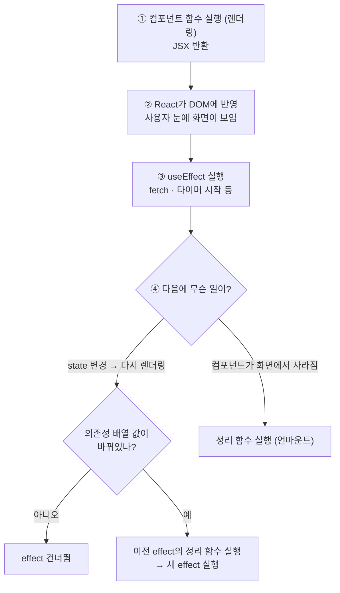
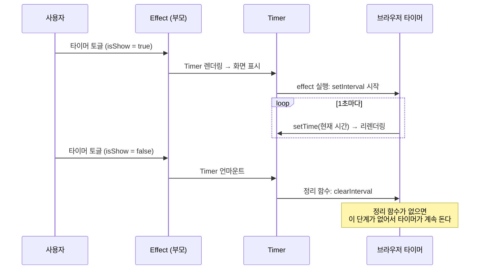
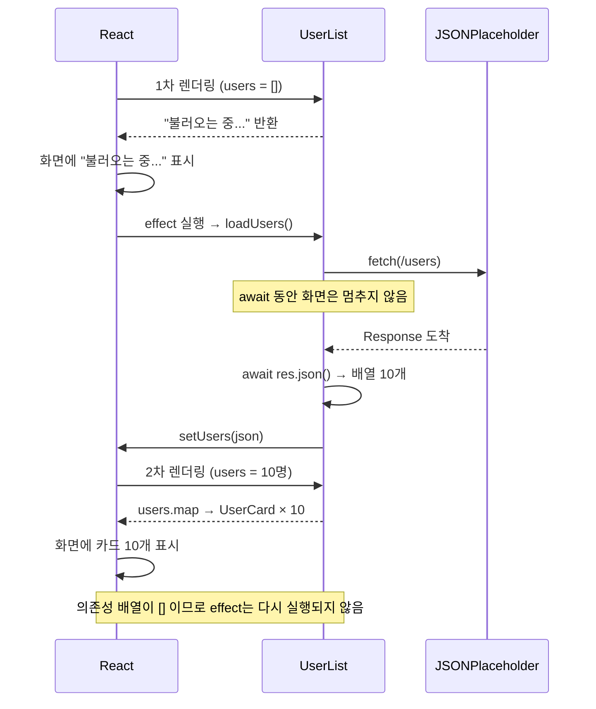
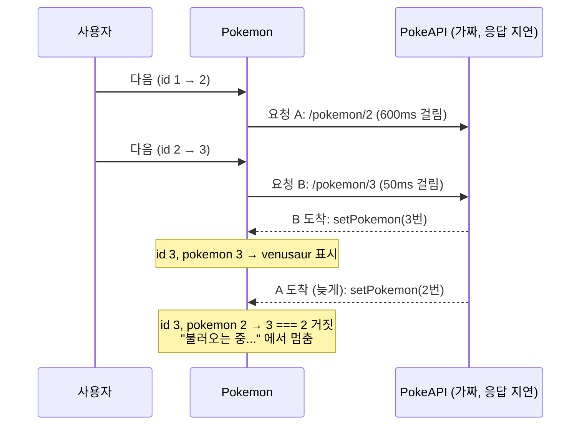
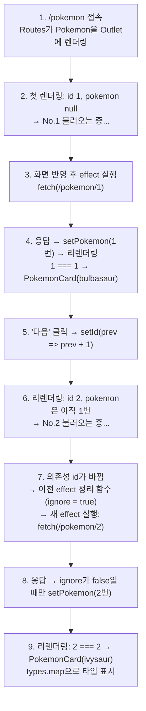

## 들어가며 (Situation)

11/25에는 props, state, 이벤트, 반복 렌더링으로 **사용자가 무언가를 했을 때** 화면이 바뀌는 순서를 배웠다. 오늘(11/26)은 React 파트의 마지막으로, **사용자가 아무것도 안 해도** 화면이 뜨자마자 서버에서 데이터를 받아 오는 방법을 배웠다.

수업 프로젝트는 `data-fetch-app-skeleton`이다. 라우터와 메뉴는 미리 만들어져 있고, `src/chap`의 TODO를 채우는 방식으로 진행했다. 01~04는 11/25에 정리한 내용이고, 오늘은 05~07을 다뤘다.

| 순서 | 파일 | 주소 | 주제 |
|------|------|------|------|
| 5 | `05_useEffect.jsx` | `/effect` | 의존성 배열 3가지, 정리(clean-up) 함수 |
| 6 | `06_fetch.jsx` | `/fetch` | 화면이 뜰 때 회원 목록 불러오기 (JSONPlaceholder) |
| 7 | `07_pokemon.jsx` | `/pokemon` | 종합: 이전/다음 버튼으로 포켓몬 불러오기 (PokeAPI) |

라우터에는 11/24에 없던 것이 하나 추가됐다. 맨 아래의 `<Route path="*" element={<Error404/>}/>`는 **위의 어떤 주소와도 맞지 않을 때** 보여 줄 404 화면이다.

## 문제 상황 (Task)

이 글의 핵심 질문은 하나다.

> **"서버에 데이터를 요청하는 코드는 컴포넌트의 어디에, 언제 실행되게 써야 할까?"**

11/25에 배운 대로라면 컴포넌트 함수는 **렌더링할 때마다 처음부터 다시 실행**된다. 그런데 컴포넌트 본문에 `fetch`를 그냥 쓰면 이런 순서가 된다.

1. 렌더링 → `fetch` 요청
2. 응답 도착 → `setUsers(json)`
3. state가 바뀌었으니 다시 렌더링 → **또 `fetch` 요청**
4. 응답 도착 → `setUsers` → 다시 렌더링 → … (끝나지 않음)

그리고 `fetch`는 11/20에 배운 대로 **언제 끝날지 모르는** 비동기 작업이다. 응답을 기다리는 동안 화면이 비어 있으면 안 된다. 수업 주석은 이렇게 정리한다.

> 사용자 화면에 드러나게 되는 컴포넌트를 먼저 띄워주고, API 응답이 도달하는 대로 컴포넌트에 데이터를 끼워 넣게 된다.

그래서 필요한 것은 **"화면을 먼저 그린 다음에, 필요할 때만 실행되는 자리"** 다. 그 자리가 `useEffect`다.

### 쉽게 비유하면

식당에 손님이 들어왔다.

- **렌더링**: 손님을 자리에 앉히고 **메뉴판과 물부터** 내준다(화면 먼저).
- **useEffect**: 손님이 앉은 **다음에** 주방에 주문을 넣는다(데이터 요청).
- **의존성 배열**: "언제 다시 주문할지" 규칙이다. `[]`는 "처음 한 번만", `[id]`는 "손님이 다른 메뉴 번호를 고를 때마다".
- **정리 함수**: 손님이 나가면 **켜 둔 불판을 끈다**. 안 끄면 손님이 없어도 계속 탄다.

## 해결 과정 (Action)

### 0. 전체 순서 먼저 보기

`useEffect`는 **렌더링이 끝나고 화면에 반영된 뒤**에 실행된다. 정리 함수는 **다음 effect가 실행되기 직전**, 또는 **컴포넌트가 사라질 때** 실행된다.



아래 1~4번의 실행 결과는 수업 파일을 Vite 개발 서버(React 19.3.1)에 올리고, headless Chrome으로 클릭·입력을 자동 실행해서 기록한 것이다. 이 프로젝트의 `main.jsx`는 `StrictMode`를 쓰지 않는다. 그래서 개발 모드에서도 effect가 한 번씩만 실행된다. (`StrictMode`가 있으면 개발 모드에서 effect가 한 번 더 실행된다. 시행착오 ⑤ 참고)

### 1. 의존성 배열 3가지 — 언제 실행되는가 (`05_useEffect.jsx`)

```javascript
useEffect(() => { 실행할 코드 }, [의존성 배열]);
```

수업 코드는 한 컴포넌트에 `useEffect` 세 개를 나란히 썼다.

```javascript
function EffectTest() {
    const [count, setCount] = useState(0);
    const [text, setText] = useState('');

    // 1. 의존성 배열 없음 → 렌더링 될 때마다 실행
    useEffect(() => {
        console.log("백엔드에서 메뉴 전체조회 API 호출함!!")
        console.log("[의존성 배열 없음.] 렌더링 이후에 시작");
    })

    // 2. 빈 배열 → 마운트 시 1번만
    useEffect(() => {
        console.log("[빈 배열.] 마운트 시 1번만 실행된다.");
    }, [])

    // 3. [count] → count가 바뀔 때만
    useEffect(() => {
        console.log("[count] 관리하는 count 가 바뀔 때만 실행된다.");
    }, [count])

    console.log("EffectTest 컴포넌트렌더링!");

    return (
        <>
            <h2>count: {count}</h2>
            <button onClick={() => setCount(count + 1)}>+ 1</button>
            <input value={text} onChange={e => setText(e.target.value)} placeholder="입력해서 콘솔 확인"/>
        </>
    );
}
```

#### 실제로 찍힌 순서

**처음 화면이 뜰 때 (마운트)**

```text
EffectTest 컴포넌트렌더링!
백엔드에서 메뉴 전체조회 API 호출함!!
[의존성 배열 없음.] 렌더링 이후에 시작
[빈 배열.] 마운트 시 1번만 실행된다.
[count] 관리하는 count 가 바뀔 때만 실행된다.
```

여기서 순서 두 가지를 확인할 수 있다.

1. 코드에서는 `useEffect` 세 개가 `console.log("...렌더링!")`보다 **위에** 있다. 그런데 `렌더링!`이 **가장 먼저** 찍혔다. `useEffect`는 그 자리에서 실행되는 게 아니라 **"렌더링 끝나면 실행해 줘"라고 등록**만 하기 때문이다.
2. 렌더링이 끝난 뒤 effect들은 **코드에 쓴 순서대로** 실행됐다.

**`+ 1` 버튼 클릭 / 입력 칸에 `a` 입력**

| 실행된 것 | 마운트 | `+ 1` 클릭 (count 변경) | `a` 입력 (text 변경) |
|-----------|:------:|:-----------------------:|:--------------------:|
| 컴포넌트 렌더링 | ✅ | ✅ | ✅ |
| 의존성 배열 없음 | ✅ | ✅ | ✅ |
| 빈 배열 `[]` | ✅ | — | — |
| `[count]` | ✅ | ✅ | — |

| 의존성 배열 | 실행 시점 | 수업에서 말한 쓰임 |
|-------------|-----------|---------------------|
| 생략 | **렌더링될 때마다** | 거의 안 씀. 입력 한 글자마다 API를 부르게 된다 |
| `[]` | **마운트 때 1번** | 대부분의 백엔드 API 호출. 실시간성이 중요하지 않을 때 |
| `[count]` | 마운트 + **count가 바뀔 때** | 실시간성이 중요한 호출. 예) 검색어가 바뀔 때마다 검색 |

React는 렌더링이 끝날 때마다 의존성 배열의 값을 **이전 렌더링 때의 값과 하나씩 비교**한다(`Object.is`). 하나라도 다르면 effect를 다시 실행한다. `text`만 바뀐 렌더링에서는 `[count]`의 값이 같으므로 건너뛴다. ([React 공식 문서 - useEffect](https://react.dev/reference/react/useEffect))

### 2. 정리 함수 — 켜 둔 것을 끄는 순서 (`05_useEffect.jsx`의 `Timer`)

`Effect` 컴포넌트에는 `타이머 토글` 버튼이 있고, 누를 때마다 `{isShow && <Timer/>}`로 `Timer`가 나타났다 사라진다. TODO 4는 이 `Timer`에 1초마다 시간이 바뀌는 타이머를 넣는 것이다.

> 수업 저장소(`[11/26] 마무리` 커밋) 기준으로 `Timer`의 TODO 4는 아직 비어 있다. 실제로 토글해 보니 처음 시간만 표시되고 바뀌지 않았다. 아래는 TODO 설명대로 완성한 예시 코드다.

```javascript
// 예시 코드: TODO 4 완성본
function Timer() {
    // 함수를 넘기면 처음 한 번만 계산한다 (지연 초기화)
    const [time, setTime] = useState(() => new Date().toLocaleTimeString());

    useEffect(() => {
        const intervalId = setInterval(() => {
            console.log('tick');
            setTime(new Date().toLocaleTimeString());
        }, 1000);

        // 정리 함수: Timer가 사라질 때 실행된다
        return () => {
            clearInterval(intervalId);
        };
    }, []);

    return <h2>현재 시간: {time}</h2>;
}
```

#### 정리 함수가 없으면?

TODO 설명처럼 정리 함수 **없이** 먼저 토글해 봤다. `Timer`를 2.5초 보여 준 뒤 숨기고, 3초를 더 기다렸다.

| | 보이는 동안 (2.5초) | **숨긴 뒤** (3초) |
|---|---|---|
| 정리 함수 없음 | `tick` 2번 | **`tick` 3번** (화면에 없는데 계속 동작) |
| 정리 함수 있음 | `tick` 2번 | **0번** (숨기는 순간 정리 함수 실행) |

`setInterval`은 React가 아니라 **브라우저**가 돌리는 타이머다(11/20의 Web API). React가 `Timer`를 화면에서 지워도 브라우저는 그 사실을 모른다. 그래서 **시작한 쪽(effect)이 끄는 것(정리 함수)까지 책임져야** 한다. 실제로 정리 함수 없이 시작한 타이머는 다음 실험을 하는 동안에도 계속 `tick`을 찍었다.



정리 함수가 실행되는 때는 두 가지다.

1. **컴포넌트가 사라질 때** (위 실험)
2. **의존성이 바뀌어 effect가 다시 실행되기 직전**: 이전 effect의 정리 함수 → 새 effect 순서로 실행된다. 이 순서가 4번 포켓몬 도감의 문제를 해결한다.

([React 공식 문서 - Synchronizing with Effects](https://react.dev/learn/synchronizing-with-effects))

### 3. 화면이 뜰 때 데이터 불러오기 (`06_fetch.jsx`)

수업 주석이 "가장 많이 쓰는 패턴"이라고 한 3단계다.

1. 데이터를 담을 state를 **빈 값**으로 만든다. `useState([])`
2. **마운트 시 한 번만** API를 호출한다. `useEffect(() => {...}, [])`
3. 응답이 오면 state에 저장한다. → 리렌더링되며 목록이 그려진다.


```javascript
function UserCard({user}) {
    return (
        <div style={{display: 'inline-block', width: 300, margin: 10, padding: 10, background: 'powderblue'}}>
            <h4>{user.name}</h4>
            <p>
                email: {user.email}<br/>
                phone: {user.phone}<br/>
                city: {user.address.city}
            </p>
        </div>
    );
}

function UserList() {

    const [users, setUsers] = useState([]);

    // [] 빈배열 why? 최초 1회 컴포넌트 마운트 시점에만 동작하게 하기 위해
    useEffect(() => {
        async function loadUsers() {
            // fetch("api url") : api 를 비동기 방식으로 요청
            // 해당 리턴값은 promise 객체가 된다.
            const res = await fetch("https://jsonplaceholder.typicode.com/users");
            const json = await res.json();

            console.log('json' , json);
            // 관리하는 상태값인 users 에 json 집어넣기(setter)
            setUsers(json);
        }
        loadUsers();
    }, []);

    if (users.length === 0) return <h3>불러오는 중...</h3>;

    return (
        <div>
            {users.map( user => <UserCard key={user.id} user={user}/> )}
        </div>
    );
}
```


#### 실행 순서



실행해서 확인한 결과다.

| 시점 | 화면 | `fetch` 호출 수 |
|------|------|-----------------|
| 마운트 직후 | `불러오는 중...` | 1 |
| 응답 후 | 카드 **10개** (첫 카드: Leanne Graham, Gwenborough) | 1 (그대로) |

`UserList`가 데이터를 받고, **한 명씩 그리는 일은 `UserCard`에 props로 넘긴다**. 11/25의 props, `map`, `key`가 그대로 쓰였다.

#### 왜 effect 안에 `async` 함수를 따로 만들까?

`useEffect(async () => { ... })`로 쓰면 더 짧을 것 같다. 직접 해 보니 콘솔에 이런 경고가 떴다.

```text
useEffect must not return anything besides a function, which is used for clean-up.

It looks like you wrote useEffect(async () => ...) or returned a Promise. Instead, write the async function inside your effect and call it immediately:
```

`async` 함수는 **항상 Promise를 반환**한다(11/20). 그런데 effect가 반환하는 값은 React가 **정리 함수**로 쓴다. Promise는 함수가 아니라서 정리 함수 자리에 들어갈 수 없다. 그래서 수업 코드처럼 **effect는 일반 함수로 두고, 안에서 `async` 함수를 만들어 바로 호출**한다.

#### 의존성 배열을 빼면?

수업 주석의 "무한 반복"을 확인했다. 실제 API를 계속 호출하지 않도록 **20ms 뒤에 응답하는 가짜 `fetch`** 로 바꾸고, 의존성 배열만 뺀 컴포넌트를 1초 동안 띄웠다.

| 의존성 배열 | 1초 동안 `fetch` 호출 |
|-------------|----------------------|
| `[]` (수업 코드) | **1번** |
| 생략 (비교용) | **50번** |

렌더링 → effect → `fetch` → `setUsers` → 렌더링 → effect → … 가 응답 시간(20ms)마다 반복됐다. 실제 서버였다면 1초에 수십 번씩 요청을 보내게 된다. ([React 공식 문서 - useEffect: Fetching data with Effects](https://react.dev/reference/react/useEffect#fetching-data-with-effects))

### 4. 종합: 포켓몬 도감 (`07_pokemon.jsx`)

지금까지 배운 것이 모두 들어 있다.

| 개념 | 쓰인 곳 |
|------|---------|
| state | 현재 번호 `id`, 받아온 데이터 `pokemon` |
| 이벤트 | 이전/다음 버튼 (`prev` 사용) |
| useEffect | `id`가 바뀔 때마다 다시 요청 `[id]` |
| props | 받아온 데이터를 `PokemonCard`에 전달 |
| 반복 렌더링 | 타입 목록 `pokemon.types.map` |

```javascript
function PokemonCard({pokemon}) {
    return (
        <div>
            <h2>{pokemon.name}</h2>
            
            <p>키: {pokemon.height / 10}m / 몸무게: {pokemon.weight / 10}kg</p>
            <p>
                타입: {pokemon.types.map(t => <span key={t.type.name}>{t.type.name}</span>)}
            </p>
        </div>
    );
}

export default function Pokemon() {
    const [id, setId] = useState(1);
    const [pokemon, setPokemon] = useState(null);

    // 이전, 다음 버튼을 누를 때마다 해당 ID 를 가진 포켓몬 API 를 호출한다.
    // => id 가 변경될 때마다 API 를 새롭게 호출해야 한다. => 의존성 배열에 id
    useEffect(() => {
        async function loadPokemon() {
            const res = await fetch(`https://pokeapi.co/api/v2/pokemon/${id}`);
            const json = await res.json();
            setPokemon(json);
        }
        loadPokemon();
    }, [id])

    return (
        <>
            <h1>포켓몬 도감</h1>
            <button onClick={() => setId(prev => prev - 1)} disabled={id === 1}>이전</button>
            <span> No.{id} </span>
            <button onClick={() => setId(prev => prev + 1)}>다음</button>

            {/* 아직 응답이 오지 않았거나, 이전 번호의 데이터라면 로딩 문구를 보여준다. */}
            {pokemon?.id === id ? <PokemonCard pokemon={pokemon}/> : <h3>불러오는 중...</h3>}
        </>
    );
}
```

#### `다음` 버튼을 한 번 눌렀을 때의 순서

1. `setId(prev => prev + 1)` → `id`가 2로 **예약**된다(11/25).
2. 리렌더링: `No.2` 표시. 아직 `pokemon`은 1번 데이터라서 `pokemon?.id === id`가 `1 === 2`로 **거짓** → `불러오는 중...`
3. 화면 반영 후, 의존성 `[id]`가 1 → 2로 바뀌었으니 **effect 다시 실행** → `fetch(.../pokemon/2)`
4. 응답 도착 → `setPokemon(2번 데이터)` → 리렌더링
5. 이제 `2 === 2` → `PokemonCard`에 props로 전달 → 카드 표시

실제로 `다음`을 누른 직후 화면은 `No.2 불러오는 중...`이었고, 잠시 뒤 `ivysaur` 카드로 바뀌었다. 조건부 렌더링 `pokemon?.id === id` 덕분에 **2번을 보고 있는데 1번 카드가 남아 있는** 일이 없다.

| No. | 이름 | API 값 (`height`, `weight`) | 화면 표시 | 타입 |
|-----|------|------------------------------|-----------|------|
| 1 | bulbasaur | 7, 69 | 키: 0.7m / 몸무게: 6.9kg | grass, poison |
| 2 | ivysaur | 10, 130 | 키: 1m / 몸무게: 13kg | grass, poison |

`/ 10`을 하는 이유는 PokeAPI가 키를 **데시미터**, 몸무게를 **헥토그램** 단위로 주기 때문이다. ([PokeAPI 문서 - Pokemon 조회](https://pokeapi.co/v2/openapi/operations/pokemon_retrieve/))

#### 버튼을 빠르게 누르면? — 경쟁 상태 (Race Condition)

수업 주석은 이렇게 경고한다.

> 버튼을 빠르게 누르면 이전 요청의 응답이 나중에 도착해 화면을 덮어쓸 수 있다.

수업 코드(TODO 4 미작성 상태)로 직접 재현했다. 실제 서버로는 응답 순서를 맞추기 어려워서, **2번 응답은 600ms, 3번 응답은 50ms 뒤에 오는 가짜 `fetch`** 를 쓰고 `다음`을 10ms 간격으로 두 번 눌렀다.

| 시점 | 화면 |
|------|------|
| 150ms 뒤 (3번 응답 도착) | `No.3` / **venusaur** ✅ |
| 1초 뒤 (**먼저 출발했지만 늦게 도착한** 2번 응답 도착) | `No.3` / **불러오는 중...** ❌ (계속 이 상태) |

순서를 풀면 이렇다.



`pokemon?.id === id` 조건 덕분에 **엉뚱한 포켓몬이 표시되지는 않았다**. 대신 늦게 온 2번 데이터가 3번 데이터를 덮어써서, `id`가 바뀌지 않는 한 다시 요청하지 않는 `불러오는 중...`에 **갇혔다**.

#### TODO 4: `ignore`로 이전 요청 무시하기

```javascript
// 예시 코드: TODO 4 완성본
useEffect(() => {
    let ignore = false;

    async function loadPokemon() {
        const res = await fetch(`https://pokeapi.co/api/v2/pokemon/${id}`);
        const json = await res.json();
        if (!ignore) {          // 아직 "최신 요청"일 때만 저장
            setPokemon(json);
        }
    }
    loadPokemon();

    return () => {
        ignore = true;          // id가 바뀌어 effect가 다시 실행되기 직전에 실행됨
    };
}, [id]);
```

2번에서 본 순서가 여기서 쓰인다. **`id`가 바뀌면, 새 effect가 실행되기 전에 이전 effect의 정리 함수가 먼저 실행**된다.

1. `id` 1 → 2: effect A 실행 (A의 `ignore = false`), 요청 A 출발
2. `id` 2 → 3: **A의 정리 함수 실행 → A의 `ignore = true`**, 그다음 effect B 실행 (B의 `ignore = false`), 요청 B 출발
3. B 도착: B의 `ignore`는 `false` → `setPokemon(3번)` ✅
4. A 도착: A의 `ignore`는 `true` → **무시** ✅

effect마다 자기만의 `ignore` 변수를 갖는다(클로저). 같은 조건으로 다시 실행해 보니 1초 뒤에도 `No.3 / venusaur`가 유지됐고, 콘솔에 `무시: 2번 응답`이 찍혔다.

| 같은 실험 (2번 600ms, 3번 50ms) | 150ms 뒤 | 1초 뒤 |
|------|------|------|
| 수업 코드 (ignore 없음) | venusaur | **불러오는 중... (멈춤)** |
| ignore 추가 | venusaur | **venusaur** |

([React 공식 문서 - You Might Not Need an Effect: Fetching data](https://react.dev/learn/you-might-not-need-an-effect#fetching-data))

### 시행착오: 다시 볼 부분

#### ① 수업 코드에 TODO 두 개가 남아 있다

저장소 기준으로 `05_useEffect.jsx`의 `Timer`(TODO 4)와 `07_pokemon.jsx`의 `ignore`(TODO 4)가 아직 작성되지 않았다. 둘 다 **정리 함수**에 관한 TODO다. 이 글의 2번과 4번에 예시 코드로 완성해 두었다. 실험해 보니 둘 다 빠뜨렸을 때 증상이 분명했다. 타이머는 화면에서 사라져도 계속 돌았고, 포켓몬 도감은 `불러오는 중...`에서 멈췄다.

#### ② "useEffect는 위에서 아래로 바로 실행된다"고 착각하기 쉽다

`useEffect`가 `console.log("렌더링!")`보다 코드상 위에 있어도, 실행은 **렌더링이 끝난 뒤**다. `useEffect`를 부르는 것은 "나중에 실행할 함수를 **맡겨 두는 것**"이다. 11/20의 `setTimeout`에 콜백을 맡기는 것과 비슷하게 이해하면 된다.

#### ③ `fetch`는 404여도 성공으로 처리된다

`06_fetch.jsx`와 `07_pokemon.jsx` 모두 `res.ok`를 확인하지 않는다. 11/20에 정리했듯이 `fetch`는 서버가 404를 돌려줘도 reject되지 않는다. 예를 들어 없는 번호의 포켓몬을 요청하면 `res.json()`에서 실패하거나, 에러 응답을 데이터처럼 다루게 된다. 화면에 오류를 보여 주려면 state를 하나 더 둔다.

```javascript
// 예시 코드
const [error, setError] = useState(null);

useEffect(() => {
    async function loadUsers() {
        try {
            const res = await fetch('https://jsonplaceholder.typicode.com/users');
            if (!res.ok) throw new Error(`HTTP 오류: ${res.status}`);
            setUsers(await res.json());
        } catch (e) {
            setError(e.message);
        }
    }
    loadUsers();
}, []);
```

#### ④ "불러오는 중"과 "결과가 0개"를 구분하지 못한다

`if (users.length === 0) return <h3>불러오는 중...</h3>;`는 **응답이 빈 배열일 때도** 영원히 `불러오는 중...`을 보여 준다. 로딩 여부를 따로 `const [loading, setLoading] = useState(true)`로 두면 "불러오는 중", "결과 없음", "오류"를 각각 보여 줄 수 있다.

#### ⑤ `StrictMode`에서는 effect가 두 번 실행된다

Vite 템플릿의 기본 `main.jsx`는 `<StrictMode>`로 `<App/>`을 감싼다. 하지만 이 수업 프로젝트는 감싸지 않았다. `StrictMode`에서는 **개발 모드에서만** React가 마운트 직후 **정리 함수 → effect를 한 번 더** 실행한다. 정리 함수를 빠뜨린 코드를 일부러 드러내기 위한 동작이다. 그래서 `StrictMode` 프로젝트에서 `[]` effect의 로그가 두 번 찍혀도 버그가 아니다. ([React 공식 문서 - StrictMode](https://react.dev/reference/react/StrictMode#fixing-bugs-found-by-re-running-effects-in-development))

### 오늘의 React 흐름 한눈에 보기

`/pokemon`에 들어가서 `다음`을 한 번 누를 때까지의 흐름이다.



초등학생에게 설명하듯 정리하면 이렇다.

1. **도감 펼치기**: 도감 페이지(`/pokemon`)를 연다.
2. **빈 칸 먼저**: 1번 칸에 "불러오는 중..." 쪽지를 붙여 둔다. 화면이 먼저 보인다.
3. **편지 보내기**: 화면이 뜬 **다음에** 포켓몬 연구소(PokeAPI)에 "1번 알려 주세요" 편지를 보낸다.
4. **답장 붙이기**: 답장이 오면 쪽지를 떼고 이상해씨 카드를 붙인다.
5. **다음 장**: "다음"을 누르면 페이지 번호가 2로 바뀐다.
6. **또 빈 칸**: 2번 카드는 아직 없으니 "불러오는 중..." 쪽지를 붙인다.
7. **이전 편지 취소 표시**: 새 편지를 보내기 전에, 아직 답장이 안 온 이전 편지에 "이 답장은 버리기" 표시(`ignore = true`)를 한다. 그리고 "2번 알려 주세요" 편지를 보낸다.
8. **답장 확인**: 답장이 오면 "버리기" 표시가 없는 것만 붙인다.
9. **카드 완성**: 이상해풀 카드를 붙이고, 타입 스티커(grass, poison)를 하나씩 붙인다.

## 결과 (Result)

수업 코드와 비교용 코드를 실행해 확인한 결과다. (React 19.3.1, Vite 개발 서버, headless Chrome. 무한 요청·경쟁 상태 실험은 실제 API 대신 가짜 `fetch` 사용)

| 실험 | 결과 | 배운 규칙 |
|------|------|-----------|
| 마운트 시 로그 순서 | `렌더링!` → effect 3개 (코드 순서대로) | effect는 **렌더링 뒤**에 실행 |
| `+ 1` 클릭 | 의존성 없음 ✅, `[]` —, `[count]` ✅ | 의존성 값이 바뀐 effect만 실행 |
| 입력 `a` | 의존성 없음 ✅, `[]` —, `[count]` — | 관계없는 state 변경엔 실행 안 됨 |
| 타이머 숨긴 뒤 3초 | 정리 함수 없음 **3번** tick / 있음 **0번** | 시작한 작업은 정리 함수에서 종료 |
| `fetch` 의존성 배열 없음 (1초) | **50번** 요청 (`[]`이면 1번) | 데이터 요청은 `[]` 또는 필요한 값만 |
| `useEffect(async ...)` | 콘솔 경고 | async 함수는 effect **안에서** 만들어 호출 |
| 포켓몬 빠른 클릭 (응답 순서 역전) | ignore 없음 **멈춤** / 있음 **정상** | 정리 함수로 이전 요청 결과 무시 |

**배운 점**

- React 컴포넌트의 순서는 **렌더링 → 화면 반영 → effect → (다음 effect 전 또는 사라질 때) 정리 함수**다. 데이터 요청처럼 화면과 직접 관계없는 일은 렌더링이 아니라 effect에서 한다.
- 의존성 배열은 **"언제 다시 실행할지"** 를 정하는 목록이다. 생략하면 매번, `[]`이면 처음 한 번, `[id]`면 `id`가 바뀔 때마다.
- effect에서 **시작한 것은 effect가 끝낸다**. 타이머는 `clearInterval`, 비동기 요청은 `ignore`로 정리한다.
- 데이터 요청의 기본 순서는 **빈 state → 마운트 후 fetch → setState → 리렌더링**이고, 응답이 오기 전 화면(`불러오는 중...`)도 함께 설계해야 한다.
- 오늘 코드에는 11/20(비동기, `fetch`, `await`), 11/24(라우팅), 11/25(props, state, `map`, `key`)가 모두 들어 있다. React 파트에서 배운 것이 하나의 화면으로 이어졌다.

## 더 학습하면 좋은 개념

- **`AbortController`** — `ignore`는 늦게 온 응답을 **무시**만 한다. 요청 자체는 끝까지 간다. 정리 함수에서 `controller.abort()`를 부르면 **요청을 취소**해서 네트워크도 아낄 수 있다.
- **커스텀 Hook (`useFetch`)** — 06과 07의 "state + useEffect + fetch + 로딩/오류" 코드는 거의 같다. 이 묶음을 `useFetch(url)` 같은 함수로 빼면 컴포넌트마다 반복하지 않아도 된다.
- **TanStack Query 같은 데이터 요청 라이브러리** — 캐싱, 중복 요청 제거, 경쟁 상태 처리, 재시도를 대신 해 준다. React 공식 문서도 effect로 직접 요청하는 것의 단점(경쟁 상태, 캐싱 없음 등)을 설명하며 이런 도구를 권한다.
- **You Might Not Need an Effect** — effect는 "React 밖과 동기화"할 때 쓰는 도구다. props나 state로 계산할 수 있는 값을 effect로 state에 넣는 것은 흔한 실수다. 언제 effect가 필요 없는지 알면 코드가 단순해진다.
- **`useRef`** — 타이머 id처럼 **바뀌어도 리렌더링할 필요가 없는 값**을 렌더링 사이에 보관하는 방법이다. 버튼으로 타이머를 직접 시작/정지할 때 필요하다.

## 참고 자료

- [React 공식 문서 - useEffect](https://react.dev/reference/react/useEffect)
- [React 공식 문서 - Synchronizing with Effects](https://react.dev/learn/synchronizing-with-effects)
- [React 공식 문서 - Lifecycle of Reactive Effects](https://react.dev/learn/lifecycle-of-reactive-effects)
- [React 공식 문서 - You Might Not Need an Effect](https://react.dev/learn/you-might-not-need-an-effect)
- [React 공식 문서 - StrictMode](https://react.dev/reference/react/StrictMode)
- [React 공식 문서 - useState (지연 초기화)](https://react.dev/reference/react/useState#avoiding-recreating-the-initial-state)
- [MDN - Fetch API 사용하기](https://developer.mozilla.org/ko/docs/Web/API/Fetch_API/Using_Fetch)
- [MDN - setInterval()](https://developer.mozilla.org/ko/docs/Web/API/Window/setInterval)
- [MDN - AbortController](https://developer.mozilla.org/ko/docs/Web/API/AbortController)
- [MDN - 클로저](https://developer.mozilla.org/ko/docs/Web/JavaScript/Closures)
- [PokeAPI 문서 - Pokemon 조회](https://pokeapi.co/v2/openapi/operations/pokemon_retrieve/)
- [JSONPlaceholder](https://jsonplaceholder.typicode.com/)
